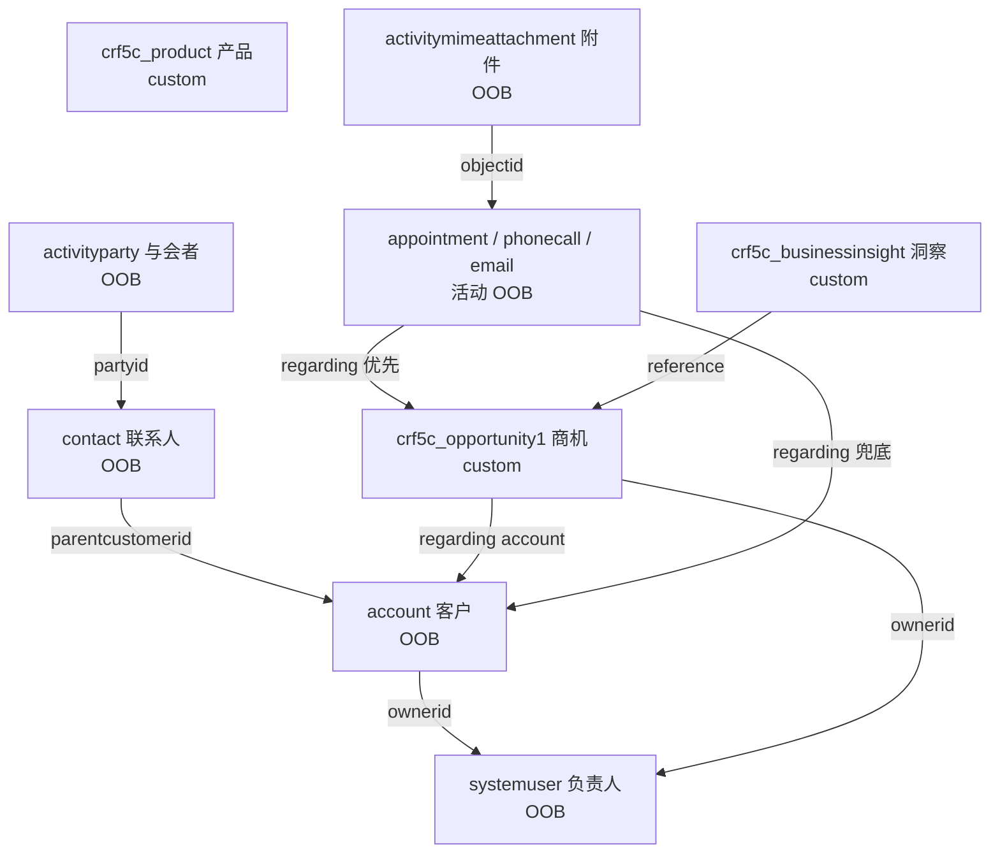

## #principle 01 / Table Strategy :: 先问标准表够不够，再决定要不要自建 || Ask Whether a Standard Table Suffices Before Building One

Dataverse 自带四百多张标准表。盲目自建会丢掉平台天然能力——Timeline 时间线、Outlook 日历同步、安全角色裁剪都是绑在标准表上的。因此每张表先做一次取舍判断。 || Dataverse ships 400+ standard tables. Building custom blindly throws away native platform capabilities — Timeline, Outlook calendar sync and security-role trimming are all tied to standard tables. So each table goes through one reuse-or-build decision.

:::comparison
::versus 复用标准表 || Reuse Standard
### 复用标准表 || Reuse Standard
当标准表的 schema 已覆盖业务字段，且需要平台天然能力时复用。客户用 account、联系人用 contact、活动用 appointment / phonecall / email——它们让活动自动出现在客户与商机的 Timeline 上，并可同步日历。 || Reuse when a standard table's schema already covers the fields and native platform capability is needed. Account uses account, contact uses contact, activities use appointment / phonecall / email — they make activities appear on account and opportunity Timelines automatically and can sync to calendars.

::versus 落自定义表 || Build Custom { highlight: true }
### 落自定义表 || Build Custom
当业务实体在标准表里无对应物、或需要专属字段集时自建,用 crf5c 发布者前缀。商机用 crf5c_opportunity1、产品 crf5c_product、洞察 crf5c_businessinsight、会话日志 crf5c_copilotconversation、设置 crf5c_setting 等都属此类。 || Build custom (crf5c publisher prefix) when a business entity has no standard counterpart or needs a bespoke field set. Opportunity uses crf5c_opportunity1, plus crf5c_product, crf5c_businessinsight, crf5c_copilotconversation, crf5c_setting and others.
:::

一个关键事实：商机是自定义表 crf5c_opportunity1，不是标准 opportunity 表。因此活动要挂到商机上，需要该自定义表开启「启用活动」，并把活动的 regarding 关联指向该自定义表。 || One key fact: opportunity is the custom table crf5c_opportunity1, not the standard opportunity. So for activities to attach to an opportunity, that custom table must have 'Enable activities' turned on and an activity's regarding link must target it.

## #tables 02 / Table Inventory :: 当前注册的全部数据源 || All Currently Registered Data Sources

下表是应用真实注册在 Dataverse 上的数据源,按用途分组。标准表标 OOB,自定义表标 crf5c。这份清单以 power.config.json 为准。 || The table below lists the data sources the app actually registers on Dataverse, grouped by purpose. Standard tables are marked OOB, custom tables crf5c. This inventory follows power.config.json.

| 业务对象 || Object | 逻辑名 || Logical Name | 类型 || Type | 职责 || Role |
| --- | --- | --- | --- |
| 客户 || Account | account | OOB | 客户主数据，分层、行业、负责人 || Account master: tier, industry, owner |
| 联系人 || Contact | contact | OOB | 联系人，归属客户 || Contacts, belonging to an account |
| 商机 || Opportunity | crf5c_opportunity1 | crf5c | 销售商机，阶段、金额、置信度 || Sales opportunity: stage, amount, confidence |
| 产品 || Product | crf5c_product | crf5c | 产品目录 || Product catalog |

**account 字段详情 || account Field Details**

| App 字段 | Dataverse 列 | 类型 || Type | 说明 || Description |
| --- | --- | --- | --- |
| id | accountid | GUID | 主键 || Primary key |
| name1 | name | string | 客户名称 || Account name |
| address | address1_composite | string? | 地址 || Address |
| email | emailaddress1 | string? | 邮箱 || Email |
| industry | industrycode | string? | 行业 || Industry |
| latitude | address1_latitude | number? | 纬度 || Latitude |
| longitude | address1_longitude | number? | 经度 || Longitude |
| notes | description | string? | 备注 || Notes |
| ownerid | _ownerid_value | GUID | 负责人 ID || Owner ID |
| phone | telephone1 | string? | 电话 || Phone |

**contact 字段详情 || contact Field Details**

| App 字段 | Dataverse 列 | 类型 || Type | 说明 || Description |
| --- | --- | --- | --- |
| id | contactid | GUID | 主键 || Primary key |
| fullname | fullname | string | 姓名 || Full name |
| account | _parentcustomerid_value | Lookup | 归属客户 || Parent account |
| email | emailaddress1 | string? | 邮箱 || Email |
| phone | telephone1 | string? | 电话 || Phone |
| title | jobtitle | string? | 职位 || Job title |

**crf5c_opportunity1 字段详情 || crf5c_opportunity1 Field Details**

| App 字段 | Dataverse 列 | 类型 || Type | 说明 || Description |
| --- | --- | --- | --- |
| id | crf5c_opportunity1id | GUID | 主键 || Primary key |
| name1 | crf5c_name | string | 商机名称 || Opportunity name |
| account | _biz_account_value | Lookup | 关联客户 || Related account |
| stage | crf5c_stage | Choice | 阶段: prospecting/qualification/proposal/negotiation/won/lost || Stage: prospecting/qualification/proposal/negotiation/won/lost |
| totalamount | crf5c_totalamount | number | 金额 || Amount |
| confidence | crf5c_confidence | number? | 置信度 (0-100) || Confidence (0-100) |
| confidenceTrend | crf5c_confidencetrend | Choice? | 趋势: up/down/flat || Trend: up/down/flat |
| expectedclosedate | crf5c_expectedclosedate | date? | 预计成交日 || Expected close date |
| closedon | crf5c_closedon | date? | 实际成交日 || Closed on |
| blocker | crf5c_blocker | string? | 阻碍项 || Blocker |
| lastaction | crf5c_lastaction | string? | 上次动作 || Last action |
| ownerid | crf5c_ownerid | GUID | 负责人 ID || Owner ID |
| createdon | crf5c_createdon | date? | 创建时间 || Created on |

**crf5c_product 字段详情 || crf5c_product Field Details**

| App 字段 | Dataverse 列 | 类型 || Type | 说明 || Description |
| --- | --- | --- | --- |
| id | crf5c_productid | GUID | 主键 || Primary key |
| productName | crf5c_productname | string | 产品名称 || Product name |
| category | crf5c_category | string | 分类 || Category |
| summary | crf5c_summary | string | 简介 || Summary |
| featureHighlight | crf5c_featurehighlight | string | 亮点 || Feature highlight |
| specification | crf5c_specification | string | 规格参数 || Specification |
| imageURL | crf5c_imageurl | string | 图片 URL || Image URL |
| productURL | crf5c_producturl | string | 产品链接 || Product URL |
| sortOrder | crf5c_sortorder | number | 排序 || Sort order |

| 活动类型 || Activity Type | 逻辑名 || Logical Name | 类型 || Type | 用途 || Use |
| --- | --- | --- | --- |
| 会议 / 拜访 || Meeting / Visit | appointment | OOB | 多与会者，可同步日历 || Multi-attendee, calendar-syncable |
| 电话 || Call | phonecall | OOB | 通话记录 || Call logs |
| 邮件 || Email | email | OOB | 邮件往来 || Email correspondence |
| 与会者 || Parties | activityparty | OOB | 活动的多联系人关联 || Multi-contact links on an activity |
| 附件 || Attachments | activitymimeattachment | OOB | 活动附件，进 ATTACHMENTS 子网格 || Activity attachments in the ATTACHMENTS subgrid |
| 备注 || Notes | annotation | OOB | 时间线备注 || Timeline notes |

**Activity 统一模型字段详情 || Activity Unified Model Field Details**

应用层将 appointment/phonecall/email 抽象为统一的 Activity 模型，通过 type 字段区分，service 层自动路由到对应表。 || The app layer abstracts appointment/phonecall/email into a unified Activity model, distinguished by the type field, with the service layer routing to the correct table.

| App 字段 | Dataverse 列 | 类型 || Type | 说明 || Description |
| --- | --- | --- | --- |
| id | activityid | GUID | 主键 || Primary key |
| title | subject | string | 主题 || Subject |
| type | — | enum | 类型: visit/call/meeting/email → 路由到对应表 || Type: visit/call/meeting/email → routes to corresponding table |
| account | _regardingobjectid_value | Lookup? | 关联客户（从 regarding 或商机推导） || Related account (from regarding or via opportunity) |
| opportunity | _regardingobjectid_value | Lookup? | 关联商机（regarding 优先指向商机） || Related opportunity (regarding points here first) |
| contact | — | Derived | 主联系人（从 contacts[0] 推导） || Primary contact (derived from contacts[0]) |
| contacts | activityparty | Array | 与会者列表（懒加载） || Attendee list (lazy-loaded) |
| notes | description | string? | 备注 / 描述 || Notes / description |
| scheduleddate | scheduledstart | date | 计划日期 || Scheduled date |
| status | statecode | enum | 状态: open(0)/completed(1)/canceled(2) || Status: open(0)/completed(1)/canceled(2) |
| ownerid | _ownerid_value | GUID | 负责人 ID || Owner ID |
| createdon | createdon | date? | 创建时间 || Created on |

| 对象 || Object | 逻辑名 || Logical Name | 类型 || Type | 职责 || Role |
| --- | --- | --- | --- |
| 业务洞察 || Business Insight | crf5c_businessinsight | crf5c | AI 生成的洞察卡片数据 || AI-generated insight card data |
| 每日简报 || Briefing | crf5c_briefing | crf5c | 每日播报内容 || Daily briefing content |
| 会话日志 || Conversation Log | crf5c_copilotconversation | crf5c | Copilot 对话历史 || Copilot conversation history |
| AI 摘要 || AI Summary | crf5c_aisummary | crf5c | AI 生成的摘要缓存 || Cached AI-generated summaries |
| 智能体日志 || Agent Log | crf5c_agentlog | crf5c | 智能体动作日志 || Agent action log |
| 设置 || Settings | crf5c_setting | crf5c | 用户个性化设置 || User personalization settings |
| 系统用户 || System User | systemuser | OOB | 负责人解析，owner 名称来源 || Owner resolution and name source |

**crf5c_businessinsight 字段详情 || crf5c_businessinsight Field Details**

| App 字段 | Dataverse 列 | 类型 || Type | 说明 || Description |
| --- | --- | --- | --- |
| id | crf5c_businessinsightid | GUID | 主键 || Primary key |
| title | crf5c_title | string | 洞察标题 || Insight title |
| summary | crf5c_summary | string | 摘要 || Summary |
| rationale | crf5c_rationale | string | AI 推理依据 || AI rationale |
| type | crf5c_type | Choice | 类型: warning/info/success || Type: warning/info/success |
| referenceType | crf5c_referencetype | Choice | 引用类型: client/opportunity || Reference type: client/opportunity |
| referenceidsjson | crf5c_referenceidsjson | string | 引用 ID 列表 (JSON) || Reference IDs (JSON) |
| detailsjson | crf5c_detailsjson | string | 详情数据 (JSON) || Details data (JSON) |
| displayorder | crf5c_displayorder | number | 显示顺序 || Display order |
| isactive | crf5c_isactive | boolean | 是否有效 || Is active |
| generatedon | crf5c_generatedon | date | 生成时间 || Generated on |
| validuntil | crf5c_validuntil | date | 有效期至 || Valid until |
| ownerid | _ownerid_value | GUID | 负责人 ID || Owner ID |

**crf5c_briefing 字段详情 || crf5c_briefing Field Details**

| App 字段 | Dataverse 列 | 类型 || Type | 说明 || Description |
| --- | --- | --- | --- |
| id | crf5c_briefingid | GUID | 主键 || Primary key |
| ownerid | _ownerid_value | GUID | 负责人 ID || Owner ID |
| payloadjson | crf5c_payloadjson | string | 简报内容 (JSON) || Briefing content (JSON) |
| generatedon | crf5c_generatedon | date | 生成时间 || Generated on |
| audiourl | crf5c_audiourl | string? | 音频 URL || Audio URL |
| lastposition | crf5c_lastposition | number? | 上次播放位置 || Last playback position |

**crf5c_copilotconversation 字段详情 || crf5c_copilotconversation Field Details**

| App 字段 | Dataverse 列 | 类型 || Type | 说明 || Description |
| --- | --- | --- | --- |
| id | crf5c_copilotconversationid | GUID | 主键 || Primary key |
| ownerid | _ownerid_value | GUID | 负责人 ID || Owner ID |
| messagesjson | crf5c_messagesjson | string | 消息列表 (JSON) || Messages (JSON) |
| startedon | crf5c_startedon | date | 开始时间 || Started on |
| lastactiveon | crf5c_lastactiveon | date | 最后活跃时间 || Last active on |

**crf5c_aisummary 字段详情 || crf5c_aisummary Field Details**

| App 字段 | Dataverse 列 | 类型 || Type | 说明 || Description |
| --- | --- | --- | --- |
| id | crf5c_aisummaryid | GUID | 主键 || Primary key |
| entityID | crf5c_entityid | string | 被摘要的实体 ID || Summarized entity ID |
| entityType | crf5c_entitytype | Choice | 实体类型: account/opportunity/contact/activity || Entity type |
| summary | crf5c_summary | string | 摘要内容 || Summary content |
| actionItems | crf5c_actionitems | string? | 行动项 || Action items |
| status | crf5c_status | Choice | 状态: pending/generating/completed/failed || Status |
| generatedOn | crf5c_generatedon | date? | 生成时间 || Generated on |
| expiresOn | crf5c_expireson | date? | 过期时间 || Expires on |

**crf5c_agentlog 字段详情 || crf5c_agentlog Field Details**

| App 字段 | Dataverse 列 | 类型 || Type | 说明 || Description |
| --- | --- | --- | --- |
| id | crf5c_agentlogid | GUID | 主键 || Primary key |
| logName | crf5c_logname | string | 日志名称 || Log name |
| agentName | crf5c_agentname | string | 智能体名称 || Agent name |
| queryText | crf5c_querytext | string | 用户输入 || User query |
| responseText | crf5c_responsetext | string? | 智能体响应 || Agent response |
| sessionID | crf5c_sessionid | string? | 会话 ID || Session ID |
| sourceDescription | crf5c_sourcedescription | string? | 来源描述 || Source description |
| timestamp | crf5c_timestamp | date | 时间戳 || Timestamp |

**crf5c_setting 字段详情 || crf5c_setting Field Details**

| App 字段 | Dataverse 列 | 类型 || Type | 说明 || Description |
| --- | --- | --- | --- |
| id | crf5c_settingid | GUID | 主键 || Primary key |
| settingKey | crf5c_settingkey | string | 设置键 || Setting key |
| settingValue | crf5c_settingvalue | string | 设置值 || Setting value |
| description | crf5c_description | string? | 描述 || Description |
| updatedOn | crf5c_updatedon | date? | 更新时间 || Updated on |

## #relations 03 / Entity Relations :: 客户为中心的关系拓扑 || An Account-Centric Relationship Topology

所有业务对象最终都挂到客户上。联系人归属客户;商机指向客户;活动通过 regarding 指向商机(优先)或客户。下图是当前数据模型的实体关系。 || Every business object ultimately hangs off the account. Contacts belong to accounts; opportunities point to accounts; activities point via regarding to an opportunity (preferred) or an account. The diagram shows the current entity relationships.

regarding 的优先级规则:活动优先关联商机,无商机时兜底关联客户。联系人不放在 regarding,而是放进 activityparty(会议与会者)或电话/邮件的收发方。这样活动能正确出现在商机与客户的 Timeline 上。 || The regarding priority rule: an activity links to an opportunity first, falling back to an account when no opportunity is present. Contacts go not into regarding but into activityparty (meeting attendees) or the to/from party of a call/email. This makes activities surface correctly on opportunity and account Timelines.
