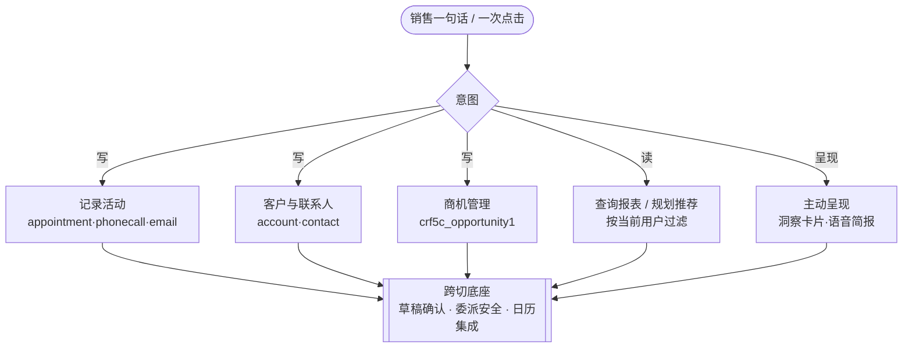
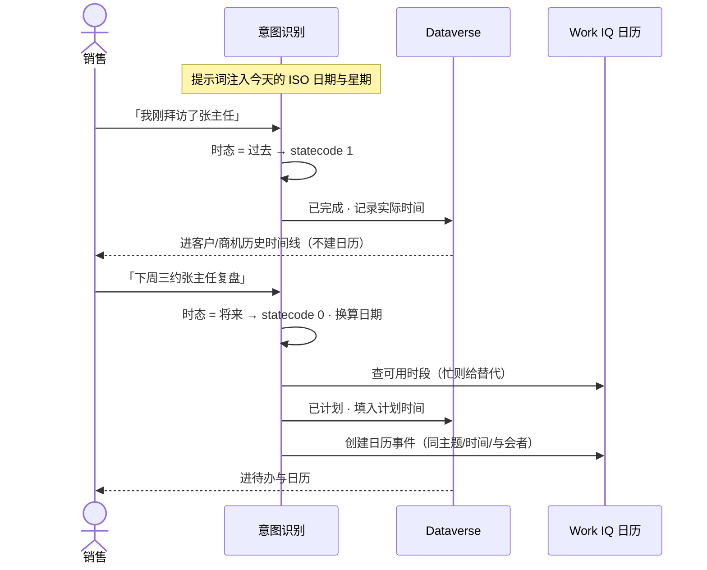

## #philosophy 01 / Design Philosophy :: Beyond Data-Driven，迈向 Purpose-Driven CRM：数据为基，目标为向 || Beyond Data-Driven, Toward Purpose-Driven CRM

本应用采用 Purpose-Driven CRM 设计：保留 CRM 的数据基础能力，并在录入、查询、规划和呈现环节增加面向销售目标的判断层。设计原则分为输入侧与输出侧两组：输入侧降低结构化沉淀成本，输出侧将 CRM 事实转为下一步行动判断。所有后续功能域均按这两组原则约束。 || This app uses a Purpose-Driven CRM design: it preserves CRM's data foundation and adds a sales-goal-oriented judgment layer across capture, query, planning, and surfacing. The design principles are divided into input-side and output-side groups: the input side reduces the cost of structured capture, and the output side turns CRM facts into next-action judgment. All following functional domains are constrained by these two principle groups.

:::comparison
::versus 过去 · Data-Driven || Before · Data-Driven
### 过去 · Data-Driven || Before · Data-Driven
CRM 以数据为中心：销售把客户关系拆成字段填进系统，是主要的数据贡献者；而数据变成判断需要额外查询与汇总，价值兑现偏晚、多服务于管理复盘。 || CRM is data-centric: reps break customer relationships into fields and feed the system, as the main data contributors; turning that data into judgment takes extra querying and aggregation, so value lands late and largely serves management review.

::versus 进化 · Purpose-Driven || Evolved · Purpose-Driven { highlight: true }
### 进化 · Purpose-Driven || Evolved · Purpose-Driven
CRM 以目标为向：数据退回手段的位置，AI 在数据之上即时产出对目标的判断与下一步建议。销售录入的每一条，都在当下回流成对自己有用的行动——他从数据的贡献者，同时成为数据的即时受益人。 || CRM is goal-steered: data returns to being a means, and AI produces, on top of the data and in the moment, judgments and next-step advice toward the goal. Every entry a rep makes flows back, right away, into useful action — so the rep, beyond being a data contributor, is also an immediate beneficiary of the data.
:::

Purpose 定义为五层目标体系：当下行动、商机推进、客户关系、管线健康、可信合规。每条 CRM 数据均需映射到可解释、可行动、可核对的目标层级。 || Purpose is defined as a five-layer goal system: immediate action, deal progress, customer relationship, pipeline health, and trust/compliance. Every CRM data point must map to an explainable, actionable, and checkable goal layer.

| 层级 || Layer | Purpose | 系统应该给出的判断 || Judgment the System Should Produce |
| --- | --- | --- |
| 当下行动 || Immediate action | 下一步做什么 || What to do next | 刚录入一次拜访后，是否需要安排复盘、补联系人、记录阻塞点或推进商机阶段。 || After a visit is logged, whether to schedule a follow-up, add a contact, record a blocker, or advance the deal stage. |
| 商机推进 || Deal progress | 如何提高成交概率、降低风险 || How to improve win probability and reduce risk | 哪些商机临近关单、金额高但信心低、久无动作，应该优先被关注。 || Which deals are closing soon, high-value but low-confidence, or inactive, and therefore deserve priority. |
| 客户关系 || Customer relationship | 如何长期经营关键客户 || How to develop key accounts over time | 关键联系人是否缺失、关系是否变冷、决策链是否覆盖采购 / 使用科室 / 高层 sponsor。 || Whether key contacts are missing, relationships are going cold, or the decision chain covers procurement / users / executive sponsor. |
| 管线健康 || Pipeline health | 如何保持 forecast 与覆盖率健康 || How to keep forecast and coverage healthy | 本月要关的金额、风险金额、阶段分布和下一步覆盖是否足以支撑目标。 || Whether closing amount, at-risk amount, stage distribution, and next-step coverage are sufficient for the target. |
| 可信合规 || Trust and compliance | 如何避免错误动作和权限风险 || How to avoid wrong actions and permission risk | 哪些写入必须确认、哪些判断缺少证据、哪些数据只能由平台安全角色决定可见范围。 || Which writes require confirmation, which judgments lack evidence, and which visibility decisions must be left to platform security roles. |

### 认知驱动的业务闭环：行为 → 数据 → 洞察 → 行动 || Cognition-Driven Business Loop: Behavior → Data → Insight → Action

Purpose-Driven CRM 的核心模型定义为一个持续闭环：销售行为产生 CRM 数据，CRM 数据形成业务洞察，业务洞察驱动下一步销售行动，新的行动再产生新的数据。认知是驱动闭环的判断层，负责理解目标、上下文、优先级和边界，使每一次数据沉淀都指向下一步业务推进。 || The core model of a Purpose-Driven CRM is a continuous loop: sales behavior creates CRM data, CRM data forms business insight, business insight drives the next sales action, and the new action creates new data. Cognition is the judgment layer that drives the loop. It understands goals, context, priority, and boundaries so every data capture points toward the next business move.

:::callout { title: "📊 认知驱动的业务闭环" }
认知层居于闭环中心：行为产生数据，数据形成洞察，洞察驱动新的行为；认知持续判断目标、优先级与边界，使三者相互推动、不断迭代。 || Cognition sits at the center of the loop: behavior produces data, data forms insight, and insight drives new behavior; cognition continuously judges goals, priority, and boundaries, so the three keep pushing one another and iterating.
:::

| 闭环阶段 || Loop Stage | 系统定义 || System Definition | 产品落点 || Product Landing |
| --- | --- | --- |
| 行为产生数据 || Behavior creates data | 拜访、电话、会议、邮件、查询和确认动作进入 CRM，形成可追踪的客户、活动、商机与关系事实。 || Visits, calls, meetings, emails, queries, and confirmations enter CRM as traceable account, activity, opportunity, and relationship facts. | 记录活动、客户联系人、商机管理、写前确认。 || Activity logging, accounts and contacts, opportunity management, confirmation before write. |
| 数据产生洞察 || Data creates insight | 系统将字段事实组合成业务判断，包括风险、关系缺口、久未互动、关单压力和管线覆盖。 || The system combines field facts into business judgment, including risk, relationship gaps, inactivity, close pressure, and pipeline coverage. | 查询报表、主动呈现、洞察卡片、语音简报。 || Query/report, proactive surfacing, insight cards, voice briefing. |
| 洞察驱动行动 || Insight drives action | 洞察必须延展为可确认的下一步入口，包括待办、会议草稿、未来活动、跟进建议或资料准备清单。 || Insights must extend into confirmable next-step entry points, including tasks, meeting drafts, future activities, follow-up suggestions, or preparation checklists. | 规划推荐、日历集成、录入即回报、AI 行为边界。 || Planning recommendation, calendar integration, logging earns a return, AI action boundaries. |
| 认知驱动闭环 || Cognition drives the loop | 认知层理解当前目标、客户上下文、商机阶段、角色覆盖、权限范围和用户意图，决定哪些数据有意义、哪些洞察应优先、哪些行动可建议。 || The cognition layer understands the current goal, account context, deal stage, role coverage, permission scope, and user intent. It determines which data matters, which insights should be prioritized, and which actions may be recommended. | Purpose 五层目标、Actionable Insight、权限与确认机制。 || Five layers of Purpose, actionable insight, permission and confirmation mechanisms. |

### CRM 的价值地图：客户在中心，系统把角色、任务和结果接成一条回路 || The CRM Value Map: The Customer at the Center, with Roles, Tasks, and Outcomes Connected into One Loop

CRM 的价值不应只按模块说明，而应按“谁在闭环里完成什么任务、系统给他什么回报”来衡量。可以把它看作一张客户作战地图：客户位于中心，数据是坐标，认知是导航，行动是路线，不同角色在同一张地图上协同完成各自任务。 || The value of CRM should be explained by who completes which task in the loop and what return the system gives them, rather than by software modules alone. Think of it as a customer operating map: the customer is at the center, data is the coordinate system, cognition is the navigation layer, and action is the route across roles.

:::insight-grid { cols: 3 }
::card ①
### 前线角色：把现场变成事实 || Front-Line Roles: Turn the Field into Facts
销售、售前、交付和客服把拜访、需求、承诺、问题与反馈沉淀进 CRM。系统的回报不是“谢谢录入”，而是立刻给出下一步提醒、风险信号、关系缺口和可确认行动。 || Sales reps, presales, delivery, and service teams capture visits, needs, commitments, issues, and feedback into CRM. The system's return is not 'thanks for logging,' but immediate next-step reminders, risk signals, relationship gaps, and confirmable actions.

::card ②
### 经营角色：把事实变成判断 || Operating Roles: Turn Facts into Judgment
销售管理、市场、客户成功和运营把 CRM 事实组织成漏斗、分层、评分、健康度和流程规则。系统帮助他们判断谁值得优先投入、哪里正在停滞、哪些动作真正推动转化。 || Sales management, marketing, customer success, and operations organize CRM facts into funnels, segments, scores, health, and process rules. The system helps them decide who deserves priority, where work is stuck, and which actions truly drive conversion.

::card ③
### 决策角色：把判断变成资源配置 || Decision Roles: Turn Judgment into Resource Allocation
管理层、产品、财务风控和渠道团队从 CRM 中看到客户资产、需求趋势、收入预测、回款风险和伙伴贡献。系统帮助他们把资源投向更高价值客户、更健康管线和更可复制打法。 || Leadership, product, finance/risk, and channel teams see customer assets, demand trends, revenue forecasts, collection risk, and partner contribution through CRM. The system helps them allocate resources toward higher-value customers, healthier pipeline, and more repeatable plays.
:::

因此，CRM 的价值层次不是“谁拥有系统权限”，而是“谁能从客户认知闭环中拿到可行动的回报”：前线拿到下一步，管理拿到可控过程，经营拿到增长信号，客户拿到更连续的体验。 || Therefore, CRM's value hierarchy is not 'who has system access,' but 'who gets an actionable return from the customer cognition loop': the front line gets next steps, management gets controllable process, the business gets growth signals, and customers get a more continuous experience.

### 角色价值账本：不同对象从同一闭环获得不同回报 || Role Value Ledger: Different Audiences Receive Different Returns from the Same Loop

同一套 CRM 闭环，对不同角色的价值兑现方式不同。系统设计需要明确每类角色期望得到的帮助，避免把所有人都压成“填字段的人”或“看报表的人”。 || The same CRM loop pays back different roles in different ways. The product design must state what help each role expects, instead of reducing everyone to 'field fillers' or 'dashboard viewers.'

| 目标群体 || Audience | 在闭环中的价值点 || Value in the Loop | 期望 CRM 提供的帮助 || Expected Help from CRM |
| --- | --- | --- |
| 一线销售 || Front-line sales | 把现场口述、拜访和客户信号快速变成客户、活动、联系人与商机事实。 || Turn field speech, visits, and customer signals quickly into account, activity, contact, and opportunity facts. | 少填表、不遗漏、懂客户历史、知道下一步该跟谁、说什么、何时推进。 || Less form-filling, no missed follow-ups, customer history in context, and clear next step: whom to contact, what to say, and when to advance. |
| 销售管理者 || Sales managers | 把零散商机变成可管理漏斗，识别停滞、虚假机会、团队动作缺口与 forecast 风险。 || Turn scattered deals into a manageable funnel, identifying stalled deals, false opportunities, action gaps, and forecast risk. | 管理过程、预测业绩、发现风险商机、复盘赢输原因，并把资源投入最需要介入的客户。 || Manage process, forecast performance, detect risky deals, review win/loss reasons, and invest resources where intervention matters most. |
| 市场团队 || Marketing teams | 把来源、活动、内容互动和线索行为接到后续商机与收入结果。 || Connect source, campaign, content interaction, and lead behavior to downstream opportunities and revenue outcomes. | 识别高质量线索、做分群与评分、验证活动 ROI，并和销售完成清晰移交。 || Identify quality leads, segment and score audiences, validate campaign ROI, and hand off clearly to sales. |
| 客服 / 客户成功 || Service / Customer success | 把服务记录、投诉、使用情况和满意度变成客户健康度、续约风险与增购信号。 || Turn service records, complaints, usage, and satisfaction into customer health, renewal risk, and expansion signals. | 了解客户上下文、减少重复询问、优先处理高价值或高风险客户，并主动提醒续约与回访。 || Understand customer context, avoid repeated questions, prioritize high-value or high-risk accounts, and trigger renewal or follow-up reminders. |
| 售前 / 交付 || Presales / Delivery | 把销售阶段的需求、方案、承诺和合同边界延续到方案设计与项目执行。 || Carry needs, solution context, commitments, and contract boundaries from sales into solution design and project execution. | 提前理解客户背景、准备匹配方案、承接销售承诺、识别交付风险并沉淀验收反馈。 || Understand context early, prepare matched solutions, inherit sales commitments, detect delivery risk, and capture acceptance feedback. |
| 产品 / 运营 || Product / Operations | 把客户反馈、功能请求、流程瓶颈和转化规律变成产品优先级与运营规则。 || Turn customer feedback, feature requests, process bottlenecks, and conversion patterns into product priorities and operating rules. | 区分个别需求与共性趋势，设计客户分层、自动化提醒、流程标准和产品路线图依据。 || Separate one-off requests from common trends, and design segmentation, automated reminders, process standards, and roadmap evidence. |
| 管理层 / 财务 / 渠道 || Leadership / Finance / Channel | 把客户资产、收入预测、合同回款、信用风险和伙伴贡献纳入同一经营视图。 || Bring customer assets, revenue forecast, contracts and collections, credit risk, and partner contribution into one operating view. | 看清增长来源、资源投入、回款风险、渠道冲突和经营预测，支持提前决策而非事后复盘。 || See growth sources, resource allocation, collection risk, channel conflict, and business forecast to support early decisions instead of after-the-fact review. |
| 客户 || Customers | 企业内部对客户的统一认知，最终转化为连续、一致、主动的客户体验。 || The organization's shared customer understanding ultimately becomes a continuous, consistent, and proactive customer experience. | 不用重复解释需求，获得更准确推荐、更顺畅交付、更及时响应和更持续的问题跟进。 || Avoid repeating needs, receive more accurate recommendations, smoother delivery, faster response, and more continuous issue follow-up. |

:::insight-grid { cols: 2 }
::card 01
### Mobile-First，不是桌面缩小版 || Mobile-First, Not a Shrunk Desktop
设计起点是单手、户外光线、30 秒内完成。长表单不能成为主路径，超过三屏的录入必须由对话、草稿或分步确认承接。 || Design starts from one hand, outdoor light, and completion within 30 seconds. Long forms must not be the main path; any entry longer than three screens must move into conversation, draft, or stepwise confirmation.

::card 02
### Voice-First，键盘是 fallback || Voice-First, Keyboard as Fallback
拜访间隙最自然的输入是语音。功能必须允许用户用一句话表达意图；键盘用于修正、补充与语音失败后的兜底，而不是第一入口。 || Between visits, the natural input is voice. Features must let the user express intent in one sentence; the keyboard is for correction, completion, and fallback after voice fails — not the first entry.

::card 03
### Confirm，Don't Configure || Confirm, Don't Configure
AI 负责把自然语言塑成草稿，用户负责确认、微调或拒绝。所有写入型功能必须先展示可核对草稿，不能把配置项和字段选择推回给销售。 || AI turns natural language into a draft; the user confirms, tweaks, or rejects. Every write feature must show a checkable draft first, instead of pushing field selection and configuration back to the rep.

::card 04
### 意图编排，不是菜单导航 || Intent Orchestration, Not Menu Navigation
用户说业务意图，系统决定落到哪个功能域；新增能力应通过注册新的意图/技能扩展，而不是不断增加菜单层级。 || The user states the business intent; the system decides which functional domain handles it. New capability should be added by registering a new intent/skill, not by growing menu depth.
:::

:::insight-grid { cols: 3 }
::card 05
### 即时闭环：录入即回报 || Instant Loop: Logging Earns a Return
数据写入后立即触发回报机制。系统在当前会话内返回确认结果、增量发现与下一步建议，不依赖隔日报表或离线复盘。 || After data is written, the return mechanism is triggered immediately. Within the current session, the system returns confirmed capture, incremental findings, and next-step recommendations, without depending on next-day reports or offline review.

::card 06
### 增量价值：说他不知道的 || Incremental Value: Tell What They Don't Know
输出内容必须提供输入之外的增量判断，例如久未联系、信心下滑、关系覆盖缺口或被忽略机会；系统不返回对用户口述的简单复述。 || Outputs must provide incremental judgment beyond the user's input, such as inactive accounts, declining confidence, relationship-coverage gaps, or overlooked opportunities; the system does not return simple paraphrases of the user's utterance.

::card 07
### 可信赖：有据可查，宁缺毋编 || Trustworthy: Grounded, Never Fabricated
每条 AI 输出均基于真实字段事实、可追溯来源，并支持销售核对与推翻；低置信时显式降级，不输出无依据的确定性结论。 || Every AI output is grounded in real field facts, traceable sources, and supports rep verification and correction; under low confidence, the system degrades explicitly and does not output unsupported certainty.
:::

### AI 时代的 Actionable Insight：洞察到行动的转换机制 || Actionable Insight in the AI Era: Conversion from Insight to Action

在认知驱动闭环中，actionable insight 承担“洞察 → 行动”的转换责任。系统不把洞察停留在风险标签或报表提示，而是把洞察组织成可解释、可确认、可执行的行动入口。认知层负责判断洞察出现的时机、事实依据、业务优先级和可建议动作。 || Within the cognition-driven loop, actionable insight owns the conversion from insight to action. The system does not leave insight as a risk label or dashboard prompt; it organizes the insight into an explainable, confirmable, and executable action entry point. The cognition layer determines the timing, factual basis, business priority, and recommendable action.

| 产品责任 || Product Responsibility | BI 时代常见形态 || Common BI-Era Form | AI 时代设计形态 || AI-Era Design Form |
| --- | --- | --- |
| 解释业务处境 || Explain the business situation | 用户自己解释图表、筛选维度、判断异常是否重要。 || The user interprets charts, filters dimensions, and decides whether an anomaly matters. | 系统结合当前目标、客户上下文、商机阶段和最近互动，说明该洞察的业务时点。 || The system combines the current goal, account context, deal stage, and recent interactions to explain the business timing of the insight. |
| 形成洞察判断 || Form insight judgment | 报表指出某个指标上升、下降、异常或风险。 || A report points out that a metric rose, fell, became abnormal, or indicates risk. | AI 将 CRM 字段事实组合成业务判断：客户变冷、商机缺角色、风险影响目标或下一步覆盖不足。 || AI combines CRM field facts into business judgment: the account is going cold, the deal lacks a role, risk affects the target, or next-step coverage is insufficient. |
| 转换为后续行动 || Convert into follow-up action | 用户离开报表，自己决定发邮件、约会议、建任务或更新 CRM。 || The user leaves the dashboard and decides on their own whether to send email, book a meeting, create a task, or update CRM. | 系统生成会议草稿、待办、跟进建议或资料准备清单，并在用户确认后进入执行。 || The system generates a meeting draft, task, follow-up suggestion, or preparation checklist, and moves into execution after user confirmation. |

洞察卡片采用固定输出结构：业务时点、事实依据、行动入口。业务时点说明为什么此刻呈现；事实依据列出对应 CRM 字段或活动记录；行动入口提供可确认的下一步。 || Insight cards use a fixed output structure: business timing, factual basis, and action entry. Business timing explains why the insight appears now; factual basis lists the supporting CRM fields or activity records; action entry provides a confirmable next step.

### 录入即回报的产品机制 || The Product Mechanism of Logging Earns a Return

“录入即回报”定义为每次写入后的固定交互契约：系统先确认已沉淀的记录或草稿，再返回基于 CRM 事实的增量发现，最后提供可接受、忽略或转成待办的下一步入口。 || 'Logging earns a return' is defined as a fixed interaction contract after every write: the system first confirms the captured record or draft, then returns incremental findings grounded in CRM facts, and finally provides a next-step entry point that can be accepted, ignored, or turned into a task.

| 回报层 || Return Layer | 系统输出 || System Output | 示例 || Example |
| --- | --- | --- |
| 1. 确认结果 || 1. Confirmed capture | 说明已生成哪些草稿或已写入哪些记录，让销售知道口述没有丢失，也不需要再去列表里找。 || State which drafts were created or which records were written, so the rep knows the utterance was not lost and does not need to hunt through lists. | 已记录一次 Royal London / 张主任 / N22 演示活动，并生成 ICU 监护仪升级商机草稿。 || Logged one Royal London / Dr. Zhang / N22 demo activity and created a draft opportunity for the ICU monitor upgrade. |
| 2. 增量发现 || 2. Incremental finding | 只说销售刚才没有明说、但系统可由字段事实推导出的信号；必须附带事实来源或可核对依据。 || Surface only signals the rep did not explicitly state but the system can derive from field facts; attach sources or checkable evidence. | 该账户已有 38 天没有高层互动；新商机预计 7 月底关闭，金额较高但缺少采购联系人。 || This account has had no executive interaction for 38 days; the new deal closes at the end of July, is high-value, and lacks a procurement contact. |
| 3. 下一步建议 || 3. Next-step recommendation | 把增量发现转成低摩擦行动入口：接受、改期、创建待办、安排会议或忽略；系统不自动修改阶段，也不替用户承诺客户。 || Turn the finding into a low-friction action entry: accept, reschedule, create a task, arrange a meeting, or ignore; the system does not automatically change stages or make customer commitments for the user. | 建议下周安排一次采购主任复盘会，确认预算与 ICU 升级时间线；是否创建 30 分钟会议草稿？ || Recommend scheduling a procurement review next week to confirm budget and the ICU upgrade timeline; create a 30-minute meeting draft? |

### Purpose-Driven CRM 的成功度量 || Success Metrics for a Purpose-Driven CRM

Purpose-Driven CRM 的效果按三类结果验证：输入成本降低、输出判断有效、信任质量稳定。指标同时用于产品约束：进入主路径的功能必须对应至少一类可观测指标。 || The effectiveness of a Purpose-Driven CRM is validated through three result categories: lower input cost, effective output judgment, and stable trust quality. Metrics also constrain product design: features on the main path must map to at least one observable metric category.

| 指标组 || Metric Group | 要证明的问题 || Question to Prove | 示例指标 || Example Metrics |
| --- | --- | --- |
| 输入侧效率 || Input Efficiency | 销售是否真的更少填表、更快沉淀事实？ || Is the rep truly doing less form-filling and capturing facts faster? | 平均记录一次活动耗时；语音录入成功率；草稿一次确认率；用户修改草稿字段数；拜访后 30 分钟内记录比例。 || Average time to log an activity; voice capture success rate; first-pass draft confirmation rate; number of fields edited by the user; share of visits logged within 30 minutes. |
| 输出侧价值 || Output Value | 系统是否真的把数据回流成有用判断？ || Does the system truly turn data back into useful judgment? | 建议被采纳率；建议转活动 / 会议率；风险商机提前识别率；久未联系客户重新触达率；销售主动查询次数变化。 || Recommendation adoption rate; recommendation-to-activity / meeting conversion rate; early detection rate for risky opportunities; reactivation rate for cold accounts; change in rep-initiated query frequency. |
| 信任与质量 || Trust and Quality | AI 输出是否可核对、低错误、可被长期依赖？ || Are AI outputs checkable, low-error, and dependable over time? | AI 输出被用户推翻率；低置信降级触发率；来源字段覆盖率；错误写入撤销次数；无数据时正确拒答比例。 || Rate of AI outputs overturned by users; low-confidence degradation rate; source-field coverage; erroneous-write reversal count; correct refusal rate when data is missing. |
| 采用与习惯 || Adoption and Habit | 销售是否把它作为日常工作入口持续使用？ || Do reps use it consistently as a daily work entry point? | 日活 / 周活；每日简报打开率与播放完成率；移动端录入占比；连续使用天数；同一用户重复使用语音入口次数。 || DAU / WAU; daily briefing open and playback-completion rate; mobile capture share; consecutive days used; repeated voice-entry usage per user. |

| 原则 || Principle | 对后续功能的硬约束 || Hard Constraint on Later Features | 落点 || Where It Lands |
| --- | --- | --- |
| 输入 · Mobile-First || Input · Mobile-First | 每个功能域都必须能在移动现场快速完成，避免长表单和多层菜单。 || Every domain must complete quickly in the field, avoiding long forms and deep menus. | 活动、客户、商机、查询 || Activities, accounts, opportunities, queries |
| 输入 · Voice-First || Input · Voice-First | 功能入口优先支持一句话触发，键盘只做补充。 || Feature entry should support one-sentence triggers first; keyboard only supplements. | 所有写入与查询域 || All write and query domains |
| 输入 · Confirm || Input · Confirm | 任何写入 Dataverse 或日历的动作，必须先展示草稿并等待确认。 || Any write to Dataverse or calendar must show a draft and wait for confirmation first. | 记录活动、客户联系人、商机、排程 || Activities, accounts/contacts, opportunities, scheduling |
| 输入 · 意图编排 || Input · Intent orchestration | 一句话可拆成多个意图，但每个意图必须落到清晰的功能域和可核对卡片。 || One sentence may split into multiple intents, but each intent must land in a clear functional domain and a checkable card. | 功能全景、活动+商机组合场景 || Functional overview, activity+opportunity combined scenarios |
| 输出 · 即时闭环 || Output · Instant loop | 读写域产出的判断要当下回流，不依赖隔日批处理。 || Judgments from read/write domains must flow back in the moment, not wait for next-day batch. | 查询报表、规划推荐、主动呈现 || Query/report, plan, proactive surfacing |
| 输出 · 增量价值 || Output · Incremental value | 洞察与建议必须给出销售未注意到的信号，而非复述输入。 || Insights and advice must surface signals the rep missed, not echo the input. | 主动呈现、规划推荐 || Proactive surfacing, plan |
| 输出 · 可信赖 || Output · Trustworthy | 每条 AI 输出都基于真实字段事实、可溯源、可核对，低置信时显式降级。 || Every AI output rests on real field facts, is traceable and checkable, and degrades explicitly on low confidence. | 主动呈现、查询报表 || Proactive surfacing, query/report |

## #overview 02 / Business Journey and Functional Architecture :: 从 Maria 的一天，引申出六个功能域 + 一个跨切底座 || From Maria's Day to Six Functional Domains + One Cross-Cutting Foundation

业务主线从医疗器械销售 Maria 的一天展开，将每个高频业务场景映射到对应功能域，汇总为整体功能架构图。各功能域沿着这张架构图逐一展开，统一按「场景 → 输入 → 产物 → 业务规则」定义。 || The business journey starts from a day in the life of medical-device sales rep Maria, maps each high-frequency scenario to a functional domain, and forms the overall functional architecture map. Each functional domain then unfolds along this map under a consistent frame: scenario → input → output → business rules.

以下通过医疗器械销售 Maria 的 6 个高频场景界定应用的功能边界。每张卡片列出用户话术或业务事实、系统响应、支撑功能域与边界说明。 || Six high-frequency scenarios from Maria, a medical-device sales rep, define the functional boundary. Each card lists the user utterance or business fact, system response, supporting functional domain, and boundary notes.

07:55

通勤

### 路上先听，不先看屏幕

Maria 开车去第一家医院，无法低头翻列表。她需要在 90 秒内知道今天最该盯的客户、商机和待办。

用户动作：打开每日简报，播放今日要点。

系统逐卡朗读业务洞察，读到哪张，界面跟到哪张。

支撑功能：主动呈现 · 语音简报。

§07 主动呈现

语音简报

08:35

到院前

### 新遇到联系人，先挂到正确客户

拜访前，Maria 得知张主任刚成为心内科负责人，需要把联系人补进 Royal London 账户下，而不是散落成一个孤立姓名。

用户话术：张主任是 Royal London 新来的心内科主任，电话 020-7188-7188。

系统先解析父客户，若歧义则追问；确认后写 contact 并绑定 parentcustomerid。

支撑功能：客户与联系人。

§04 客户与联系人

父客户解析

10:30

拜访后

### 一句话同时沉淀活动与商机

拜访刚结束，信息还新鲜。Maria 不想回车里再填表，也不想自己判断哪些句子该变成活动、哪些该变成商机。

用户话术：刚拜访了张主任，演示过 N22；ICU 升级监护仪算一个新机会，估 25 万，7 月底关。

系统拆成两张确认卡：已完成活动 + 新商机；活动按过去时落历史时间线，商机写金额、阶段、预计关单日期并关联客户。

支撑功能：记录活动 · 商机管理。

§03 记录活动

§05 商机管理

写前确认

12:10

午间

### 空隙里问管线，不打开报表

Maria 只有十分钟午餐时间，想知道哪些单有风险，以及本月还有多少金额要关，不想逐个点开商机列表。

用户话术：哪些单有风险？这个月要关的总额是多少？

系统按当前用户范围查询，先报数量和总额，再给紧凑列表与一行建议；不臆造工具未返回的数据。

支撑功能：查询报表。

§06 查询报表

数字优先

15:40

回程

### 把建议变成排好期的行动

系统提示某大单信心下降且久未联系。Maria 同意跟进，但需要避开自己和客户的忙碌时间。

用户话术：帮我下周安排一次和采购主任的复盘会。

系统读取 Work IQ 日历，推荐 2–3 个可用时段；用户选择后，同时写 Dataverse 未来活动和日历事件。

支撑功能：规划推荐 · 记录活动。

§06 规划推荐

§03 记录活动

日历集成

18:20

收尾

### 团队里上线，靠底座避免串号

同一个应用同时服务销售代表与经理。代表视图展示本人客户与活动，经理视图展示团队范围数据；可见性由 Dataverse 安全角色裁剪。

业务事实：读取列表由 Dataverse 安全角色裁剪；写入前均展示草稿；个人 UI 偏好留本地，跨设备配置进 Dataverse。

系统不在客户端加 owner 过滤当安全；创建记录默认当前用户；删除/重生成只删本人范围。

支撑功能：跨切底座。

§08 跨切底座

委派身份

个性化

边界说明：应用覆盖「销售一天里围绕客户 / 联系人 / 商机 / 活动的记录、查询、规划与呈现」。它不做报价单 / 合同 / 订单履约（属 SAP Commerce 等后端），也不做团队级 KPI 考核管理——这些超出本应用的功能边界。本应用优先服务一线销售的日常行动，经理视角通过 Dataverse 安全角色自然扩展到团队风险、管线健康和 forecast 视图，但不把产品主路径变成监督销售填报的管理驾驶舱。 || Boundary note: the app covers 'logging, querying, planning and surfacing around accounts / contacts / opportunities / activities in a rep's day'. It does not do quotes / contracts / order fulfillment (that belongs to SAP Commerce and other back ends), nor team-level KPI management — these are outside this app's functional boundary. The app prioritizes the front-line rep's daily action; manager views can naturally extend through Dataverse security roles into team risk, pipeline health, and forecast views, but the main path must not become a management cockpit for supervising data entry.

### 从业务场景引出功能域 || Deriving Functional Domains from Business Scenarios

Maria 的一天直接构成功能划分的主线：每个高频场景对应一个或多个功能域，并逐一落实为各功能域的输入、产物和业务规则。 || Maria's day serves directly as the organizing spine for feature decomposition: each high-frequency scenario maps to one or more functional domains, which then specify inputs, outputs, and business rules.

| 业务场景 || Business Scenario | 引出的功能域 || Derived Functional Domain | 对应模块 || Target Module |
| --- | --- | --- |
| 通勤时听今日重点 || Hear today's priorities during commute | 主动呈现、语音简报、洞察卡片 || Proactive surfacing, voice briefing, insight cards | §07 主动呈现 || §07 Proactive surfacing |
| 到院前补新联系人 || Add a new contact before the visit | 客户与联系人、父客户解析、关系覆盖 || Accounts and contacts, parent account resolution, relationship coverage | §04 客户与联系人 || §04 Accounts and contacts |
| 拜访后一句话记录活动与商机 || Log activity and opportunity after visit in one sentence | 记录活动、商机管理、写前确认 || Activity logging, opportunity management, confirmation before write | §03 记录活动 · §05 商机管理 || §03 Activity · §05 Opportunity |
| 午间查询风险与本月金额 || Query risks and this month's amount at lunch | 查询报表、数字优先、当前用户范围 || Query/report, number-first response, current-user scope | §06 查询规划 || §06 Query and planning |
| 回程把建议变成排期行动 || Turn recommendation into a scheduled action on the way back | 规划推荐、日历集成、未来活动 || Planning recommendation, calendar integration, future activity | §06 查询规划 · §03 记录活动 || §06 Query and planning · §03 Activity |
| 团队上线与权限边界 || Team rollout and permission boundary | 委派身份、安全角色、个性化存储 || Delegated identity, security roles, personalization storage | §08 跨切底座 || §08 Foundation |

:::insight-grid { cols: 2 }
::card ①
### 场景 / 触发 || Scenario / Trigger
销售在什么情形下、说什么话或点什么，会进入这个功能域。 || In what situation, and with what utterance or tap, the rep enters this domain.

::card ②
### 输入 || Input
从口述里抽取哪些字段，需要解析或换算什么（金额、日期、关联记录）。 || Which fields are extracted from the utterance, and what must be parsed or converted (amount, date, linked record).

::card ③
### 产物 / 去向 || Output / Destination
写入哪张 Dataverse 表的哪些字段，或返回什么样的读结果，进哪个视图。 || Which Dataverse table and fields are written, or what read result is returned, and which view it lands in.

::card ④
### 业务规则 || Business Rules
该域必须遵守的判定与边界（状态判定、解析歧义处理、所有权、范围）。 || The decisions and boundaries the domain must obey (status rules, ambiguity handling, ownership, scope).
:::

## #activity 03 / Write · Log Sales Activity :: 说一句话，代替填一张活动表 || One Sentence Replaces an Activity Form

拜访、电话、会议、邮件是销售一天中最高频记录的客户触点。记录销售活动域把一句口述转化为正确归类、正确归档且（对未来活动）正确排程的活动记录，用户不必手动选择类型与状态。 || Visits, calls, meetings, and emails are the customer touchpoints a rep logs most frequently throughout the day. Activity logging turns one utterance into an activity record that is correctly typed, filed, and (for future activities) scheduled without manual type or status selection.

| 要素 || Element | 说明 || Detail |
| --- | --- |
| ① 场景 || ① Scenario | 销售描述一次客户触点：「我拜访了……」「给张主任打了电话」「下周三约……」。 || The rep describes a touchpoint: 'I visited…', 'called Director Zhang', 'meet next Wednesday…'. |
| ② 输入 || ② Input | 类型（拜访/会议→appointment，电话→phonecall，邮件→email）、具体标题（客户+主题+产品）、日期（解析「昨天/下周三」）、备注、关联的客户或商机。 || Type (visit/meeting→appointment, call→phonecall, email→email), a specific subject (customer+topic+product), date (resolve 'yesterday/next Wed'), notes, and the regarding account or opportunity. |
| ③ 产物 || ③ Output | 写入对应活动表，通过 regarding 绑定客户或商机；未来活动额外创建一条 Work IQ 日历事件。 || Writes to the matching activity table, binds the account or opportunity via regarding; a future activity also creates a Work IQ calendar event. |
| ④ 规则 || ④ Rules | 标题必须具体、绝不用通用名；客户名解析歧义则追问、无则问是否新建；所有权默认当前用户。 || The subject must be specific, never generic; ambiguous customer name → ask, none → offer to create; ownership defaults to the current user. |

日期锚点是命门。模型必须知道「今天」才能把「下周三」换成具体日期。早期缺锚点时，标为「今天」的活动被臆造成错误年份、在当周视图里消失。当前在意图识别的提示词里显式注入今天的 ISO 日期与星期，并给出换算规则。 || The date anchor is the crux. The model must know 'today' to turn 'next Wednesday' into a date. Without the anchor, a 'today' activity was once fabricated into the wrong year and vanished from the week view. The prompt now injects today's ISO date and weekday with explicit resolution rules.

:::comparison
::versus 过去活动（statecode 1） || Past activity (statecode 1)
### 过去活动（statecode 1） || Past activity (statecode 1)
仅写入 Dataverse 活动记录，不创建日历事件；已发生活动不进入未来日程。 || Writes only the Dataverse activity record and does not create a calendar event; completed activities do not enter future schedules.

::versus 未来活动（statecode 0） || Future activity (statecode 0) { highlight: true }
### 未来活动（statecode 0） || Future activity (statecode 0)
先用 Work IQ 日历查用户（及与会者）可用性：有时间则确认，冲突则提示并给最近空档；没给具体时间则推荐 2–3 个最佳时段让用户选。确认后同时写 Dataverse 记录与日历事件。 || First checks the user's (and attendees') availability via Work IQ Calendar: confirm if free, flag conflicts with nearest openings, or recommend 2–3 best slots when no time is given. On confirm, writes both the Dataverse record and the calendar event.
:::

## #account 04 / Write · Accounts and Contacts :: 建客户、加联系人、挂到正确的客户名下 || Create Accounts, Add Contacts, Link Them Correctly

CRM 的根是客户主数据与人脉。本域处理客户组织与联系人的新建与更新，并保证每个联系人都挂到正确的父客户下——这是后续商机、活动能正确归集的前提。 || The root of any CRM is account master data and relationships. This domain creates and updates customer organizations and contact people, ensuring every contact is linked to the right parent account — the precondition for opportunities and activities to aggregate correctly.

| 要素 || Element | 说明 || Detail |
| --- | --- |
| ① 场景 || ① Scenario | 「新增一个客户：上海瑞金医院」「张主任是新来的心内科主任，挂到 Royal London 下」「更新某客户电话」。 || 'Add a hospital account: Shanghai Ruijin', 'Dr. Lisa is the new cardiology head under Royal London', 'update the phone for…'. |
| ② 输入 || ② Input | 先判断是「客户（组织）」还是「联系人（个人）」、是新建还是更新；客户取名称/电话/邮箱/行业/地址/备注，联系人取姓名/职务/电话/邮箱+父客户。 || First decide account (org) vs contact (person), and create vs update; account takes name/phone/email/industry/address/notes, contact takes name/title/phone/email + parent account. |
| ③ 产物 || ③ Output | 客户写标准表 account；联系人写 contact 并用 parentcustomerid 绑定到父客户。 || Accounts write to the standard account table; contacts write to contact and bind to the parent via parentcustomerid. |
| ④ 规则 || ④ Rules | 联系人必先解析父客户：歧义则追问、不存在则先建客户；更新只发改动字段、先按名匹配现有记录；所有权默认当前用户。 || A contact must resolve its parent account first: ambiguous → ask, missing → create the account first; updates send only changed fields after matching by name; ownership defaults to the current user. |

### 关系覆盖：从联系人列表到客户关系图谱 || Relationship Coverage: From Contact List to Account Graph

客户与联系人域同时承担关系覆盖识别。系统维护客户组织、联系人与角色信息，并识别关键角色覆盖缺口，包括使用者、影响者、采购、设备科、科室主任与院级 sponsor。关系覆盖结果进入洞察、规划推荐与下一步建议。 || The accounts and contacts domain also owns relationship-coverage detection. The system maintains account, contact, and role information, and identifies coverage gaps across key roles, including users, influencers, procurement, equipment department, department heads, and executive sponsors. Relationship coverage feeds insights, planning recommendations, and next-step suggestions.

| 关系维度 || Relationship Dimension | 系统应识别的缺口 || Gap the System Should Detect | 可生成的下一步 || Possible Next Step |
| --- | --- | --- |
| 角色覆盖 || Role coverage | 只有使用科室联系人，没有采购 / 设备科 / 高层 sponsor。 || Only user-department contacts exist; procurement / equipment department / executive sponsor is missing. | 建议补齐采购主任或设备科联系人，并在下一次拜访中确认决策链。 || Recommend adding a procurement or equipment-department contact and confirming the decision chain in the next visit. |
| 互动新鲜度 || Interaction freshness | 关键联系人超过 60 / 90 天未发生活动记录。 || Key contacts have had no activity for 60 / 90+ days. | 建议安排一次关系维护触点，或在每日简报中标为关系变冷风险。 || Recommend scheduling a relationship-maintenance touchpoint or flagging it in the daily briefing as a cooling-relationship risk. |
| 商机关联 || Opportunity linkage | 高金额商机没有绑定关键联系人，或活动只挂客户、不挂具体商机。 || A high-value opportunity has no key contact, or activities are linked only to the account rather than to the specific opportunity. | 建议把最近活动关联到对应商机，并确认谁影响预算、技术和采购。 || Recommend linking recent activities to the relevant opportunity and confirming who influences budget, technical fit, and procurement. |
| 关系风险 || Relationship risk | 只有单点联系人，或核心支持者离职 / 换岗后没有替代关系。 || There is only one contact, or a core supporter left / changed roles without a replacement relationship. | 建议拓展第二联系人，避免商机推进依赖单一关系。 || Recommend expanding to a second contact to avoid depending on a single relationship for deal progress. |

## #opportunity 05 / Write · Opportunity Management :: 开单、推进阶段、调整金额与信心 || Open Deals, Advance Stages, Adjust Amount and Confidence

商机是销售管线的核心对象。本域负责开新单、推进阶段、改金额/信心、记阻塞点，并把口语里的金额与日期换算成结构化字段，关联到正确客户。 || The opportunity is the core object of the sales pipeline. This domain opens deals, advances stages, edits amount/confidence, notes blockers, and converts spoken amounts and dates into structured fields linked to the right account.

| 要素 || Element | 说明 || Detail |
| --- | --- |
| ① 场景 || ① Scenario | 「开一个 25 万的单，7 月底关」「把协和的单子推进到谈判阶段，信心降到 60」。 || 'Open a 250k deal closing end of July', 'move the Xiehe deal to negotiation, drop confidence to 60'. |
| ② 输入 || ② Input | deal 名称（客户+产品）、金额（25万→250000、50万→500000、250k→250000）、阶段（prospecting/qualification/proposal/negotiation/won/lost 六选一）、信心 0–100、预计关单日期（ISO）、最近动作、阻塞点。 || Deal name (customer+product), amount (250k→250000, 50万→500000), stage (one of prospecting/qualification/proposal/negotiation/won/lost), confidence 0–100, expected close date (ISO), last action, blocker. |
| ③ 产物 || ③ Output | 写自定义表 crf5c_opportunity1，用 biz_Account 绑定到关联客户。 || Writes the custom crf5c_opportunity1 table, binding the linked account via biz_Account. |
| ④ 规则 || ④ Rules | 命名已有单则更新、否则新建；更新只发改动字段；紧接活动而来的单复用该活动的客户、不再追问；「at risk」=信心 0–49，「active/pipeline」=阶段非 won/lost。 || Name an existing deal → update, else create; updates send only changed fields; a deal following a just-logged activity reuses that account; 'at risk' = confidence 0–49, 'active/pipeline' = stage not won/lost. |

一句话两意图：当用户「新增客户 + 同一句里开单」时，按两个独立意图处理——先建客户，再把商机交给本域；这正是架构文档里 Frame 阶段拆意图的业务来源。 || One sentence, two intents: when the user 'adds a customer and opens a deal' in the same breath, it is handled as two separate intents — create the account first, then hand the deal here; this is the business origin of the Frame stage's intent-splitting in the architecture doc.

## #query 06 / Read · Query, Report and Plan :: 把数据变成判断：先报数字，再给清单或计划 || Turn Data into Judgment: Numbers First, Then List or Plan

光能写还不够，销售要随时问数、要被告知该做什么。本域覆盖两类「读」：查询报表回答「现在怎么样」，规划推荐回答「接下来做什么」——后者还能把建议直接转成排好期的活动。 || Writing alone is not enough; the rep needs to ask the numbers and be told what to do. This domain covers two kinds of read: query & report answers 'how are things now', plan-and-recommend answers 'what next' — and the latter can turn advice into scheduled activities.

| 要素 || Element | 说明 || Detail |
| --- | --- |
| ① 场景 || ① Scenario | 「这个月要关的单」「哪些单有风险」「今天的拜访」「我的管线怎么样」。 || 'Deals closing this month', 'which deals are at risk', 'today's visits', 'how is my pipeline'. |
| ② 输入 || ② Input | 从问题里识别目标实体与过滤条件（关单日期区间、信心<50、阶段、本周日期、completed=statecode 1）。 || Identify target entity and filters from the question (close-date range, confidence<50, stage, this-week date, completed=statecode 1). |
| ③ 产物 || ③ Output | 先给标题数字（条数/总额），再给紧凑列表或简短分析；活动查询合并 appointment+phonecall+email 按时间倒序。 || A headline number (count/total) first, then a compact list or brief analysis; activity queries merge appointment+phonecall+email sorted by time desc. |
| ④ 规则 || ④ Rules | 一律按当前用户过滤；多段报表是一个意图、合并作答；同会话可复用上次查询结果；绝不臆造记录或总额，只报工具返回的真实数据。 || Always filter to the current user; a multi-section report is one intent, answered together; reuse prior query results in the same conversation; never fabricate records or totals — report only what the tool returns. |

:::flow
1. **按信号排优先级 || Prioritize by Signal** — 读当前用户的开放商机与近期活动，按「将到期、金额高、信心低/下滑、久无联系、有阻塞点」排序，产出当天/本周的少数高影响事项，每项=做谁、为何现在、建议动作。 || Reads the user's open opportunities and recent activities, ranks by 'closing soon, high amount, low/declining confidence, no recent contact, named blocker', and produces a few high-impact items for today/this week — each item = who, why now, suggested action.
2. **建议可一键转排程 || Turn Advice into a Scheduled Item** — 用户接受某条建议时，用 Work IQ 日历读取空闲、推荐 2–3 个最佳时段，再交给「记录活动」域写入 Dataverse 记录与日历事件。 || When the user accepts an item, it reads free/busy via Work IQ Calendar, recommends 2–3 best slots, then hands it to the log-activity domain to write the Dataverse record and calendar event.
3. **规划只建议，不改单 || Planning Only Advises, Never Edits Deals** — 规划推荐自身从不修改或关闭商机字段——那属于商机管理域；规划过程不写任何记录，只有用户确认某事项时才落库。 || Plan-and-recommend never modifies or closes deal fields itself — that belongs to opportunity management; planning writes nothing until the user confirms an item.
:::

## #present 07 / Surface · Insights and Voice Briefing :: 不等用户问，应用主动把要点送上门 || Without Being Asked, the App Pushes the Highlights

查询与规划需要用户主动提问，而主动呈现层把每日要点直接推到台前，并在不便看屏幕时用语音播报，让判断与提醒无需等待用户发起。 || While query and planning wait for the user to ask, the proactive surfacing layer pushes the day's highlights to the front and reads them aloud when viewing a screen is inconvenient, delivering judgment and reminders without user initiation.

:::flow
1. **按现象→原因→行动结构生成 || Generated as Observation → Reason → Action** — 洞察由 LLM 生成，输入汇集高风险客户（附「上次联系天数」等事实）与管线数据，用资深销售教练的系统提示词，要求输出遵循「现象 → 原因 → 行动建议」三段结构，让每条洞察都可执行。 || Insights are LLM-generated; input aggregates at-risk accounts (with facts like days-since-last-contact) and pipeline data, using a senior sales-coach system prompt that requires an Observation → Reason → Action structure so every insight is actionable.
2. **重新生成 = 先删本人旧、再批量建新 || Regenerate = Delete Own Old, Then Batch-Create** — 点「重新生成」时，系统先删除当前用户拥有的旧洞察，再批量创建新洞察。删除范围限定用于数据保护；数据可见性由平台安全角色统一裁剪。 || On 'regenerate', the system first deletes insights owned by the current user, then batch-creates new insights. The delete scope acts as a data-protection guard, while data visibility is trimmed by platform security roles.
3. **未读铃铛：浏览即标记 || Unread Bell: Mark on View** — 已读集合持久化在本地存储，未读数驱动铃铛角标。洞察被实际查看时触发回调写入已读，角标随之递减——已读状态是纯客户端 UI 偏好，不占数据库。 || The read set is persisted in local storage and the unread count drives the bell badge. When an insight is actually viewed, a callback writes it as read and the badge decrements — read state is a pure client-side UI preference, taking no database space.
:::

:::insight-grid { cols: 3 }
::card 01
### 逐卡重建播报文本 || Rebuild Narration per Card
播报文本按卡片从当前业务洞察逐条重建，确保朗读内容与屏幕卡片一一对应，而非读一段与界面无关的长文。 || Narration text is rebuilt card by card from the current business insights, ensuring the spoken content maps one-to-one to the on-screen cards rather than a long passage unrelated to the view.

::card 02
### 朗读进度双向对齐 || Two-Way Progress Alignment
朗读到的卡片下标与详情面板的当前页通过同步逻辑双向对齐：语音前进会翻页，手动翻页也会跳读对应卡片。 || The narrated card index and the detail panel's current page are kept two-way aligned: voice progress turns the page, and manual paging also jumps narration to that card.

::card 03
### 富播放控制集中在详情面板 || Rich Controls in the Detail Panel
播放控制统一集中在洞察详情面板，减少漂浮元素、统一交互入口。 || Playback controls are unified in the insight detail panel, cutting floating elements and consolidating the interaction entry.
:::

## #foundation 08 / Foundation · Confirm · Personalize · Secure · Resilient :: 贯穿全部六域的四条共同规则 || Four Shared Rules Running Through All Six Domains

六个业务功能域职责各异，但共享同一套跨切底座：任何写入前先出草稿等用户确认、每个人只动自己的数据与偏好、安全交给平台而非客户端、断网时如实降级为只读并保留唯一被许可的离线写入。这四条共同规则是所有功能域成立的前提。 || The six functional domains each own a distinct job, but share one cross-cutting foundation: every write produces a draft for confirmation first, each user modifies only their own data and preferences, security is enforced by the platform rather than the client, and when the network drops the app degrades to read-only while preserving the one sanctioned offline write. These four shared rules are the precondition for all features.

建客户、开单、记录活动等写入动作均先生成草稿卡片，展示写入内容与关联对象；用户确认后再写入 Dataverse 或日历。 || Write actions such as creating accounts, opening opportunities, and logging activities first generate a draft card showing the content to be written and the linked records; the system writes to Dataverse or calendar only after user confirmation.

### AI 行为边界：可做、必须确认、禁止做 || AI Action Boundaries: Allowed, Must Confirm, Forbidden

Agentic CRM 按动作类型定义执行边界：AI 可自动读取、解析和生成建议；改变业务事实、客户承诺或日历安排的动作必须先由用户确认；缺少事实来源、绕过平台权限或直接修改关键业务状态的动作禁止自动执行。 || Agentic CRM defines execution boundaries by action type: AI may read, parse, and generate recommendations automatically; actions that change business facts, customer commitments, or calendar arrangements require user confirmation first; actions without factual grounding, actions that bypass platform permissions, or actions that directly modify key business states are forbidden from automatic execution.

| 动作类型 || Action Type | AI 可以自动做 || AI May Do Automatically | 必须用户确认 || Must Be Confirmed by User | 禁止自动做 || Forbidden to Automate |
| --- | --- | --- | --- |
| 读取查询 || Read / Query | 按当前登录用户权限查询客户、活动、商机、联系人和管线摘要。 || Query accounts, activities, opportunities, contacts, and pipeline summaries under the current signed-in user's permissions. | 无；但低置信或无数据时必须说明范围和缺口。 || None; but on low confidence or no data, state the scope and gap explicitly. | 编造工具未返回的数据，或用客户端过滤伪造权限范围。 || Fabricating data not returned by tools, or faking permission scope with client-side filters. |
| 草稿生成 || Draft Generation | 把一句话解析成活动、客户、联系人、商机或会议草稿，并标出关联对象。 || Parse an utterance into activity, account, contact, opportunity, or meeting drafts, with linked records identified. | 任何写入 Dataverse、日历或外部系统之前，都必须展示草稿并等待确认。 || Before any write to Dataverse, calendar, or external systems, show the draft and wait for confirmation. | 直接落库、静默合并客户、自动覆盖关键字段。 || Direct persistence, silent account merging, or automatic overwrite of key fields. |
| 推荐规划 || Recommendation / Planning | 基于风险、久未联系、关单日期和关系缺口生成下一步建议。 || Generate next-step recommendations from risk, inactivity, close dates, and relationship gaps. | 把建议转成待办、会议、未来活动或客户沟通前，需要用户确认时间、对象和内容。 || Before turning advice into tasks, meetings, future activities, or customer communication, confirm time, recipients, and content with the user. | 自动修改商机阶段、承诺客户、发送邮件或替用户做 forecast 判断。 || Automatically changing deal stage, making customer commitments, sending emails, or making forecast calls for the user. |
| 洞察生成 || Insight Generation | 基于字段事实生成“现象 → 原因 → 行动建议”的洞察卡片。 || Generate insight cards in an Observation → Reason → Action structure from field facts. | 用户可采纳、忽略、反馈错误；被采纳后进入排程或待办仍需确认。 || The user may accept, ignore, or flag errors; accepted insights still require confirmation before scheduling or task creation. | 无来源判断、把推测写成事实、低置信时假装确定。 || Ungrounded judgments, writing speculation as fact, or pretending certainty under low confidence. |
| 安全可见性 || Security Visibility | 使用平台返回的权限内结果，并在界面上解释当前视图范围。 || Use the permission-scoped results returned by the platform and explain the current view scope in the UI. | 无；权限不是用户在客户端临时确认出来的。 || None; permissions are not temporarily confirmed by the user on the client. | 用 adminMode、owner filter 或隐藏 UI 元素来冒充真实安全边界。 || Using adminMode, owner filters, or hidden UI elements to impersonate a real security boundary. |

应用设置按作用范围分为两层：纯界面偏好保存在本地，需要持久化或跨设备同步的应用级配置写入 Dataverse。 || App settings are split into two tiers by scope: pure UI preferences are stored locally, while app-level configuration that requires persistence or cross-device sync is written to Dataverse.

| 层 || Tier | 存储 || Storage | 用途 || Use |
| --- | --- | --- |
| 本地偏好 || Local Preference | localStorage | 纯客户端 UI 偏好，无需跨设备（如列表默认视图、Top-N 截断）。写入即派发事件，订阅组件即时刷新。 || Pure client UI preferences, no cross-device need (list default view, Top-N truncation). Writing dispatches an event so subscribers refresh instantly. |
| 共享配置 || Shared Config | crf5c_settings | 需持久化/跨设备的应用级配置（如 Power Automate Flow URL、Copilot Studio Agent 名称），以键值 upsert 写入 Dataverse 设置表。 || App-level config needing persistence/cross-device sync (Power Automate Flow URL, Copilot Studio agent name), written as key-value upserts into the Dataverse settings table. |

已移除的设置：失效的「卡片化组织数据」开关，以及与平台安全模型冲突的 adminMode 开关——后者是可被绕过的客户端标志，不构成真实安全，已整体删除。 || Removed settings: the defunct 'organize data in cards' toggle, and the adminMode toggle that conflicted with the platform security model — the latter was a bypassable client-side flag, not real security, and was removed entirely.

销售代表与经理使用同一应用入口，数据范围由 Dataverse 安全角色决定。应用采用直连绑定与委派用户身份运行，每个用户使用本人凭据访问数据。 || Sales reps and managers use the same app entry point, with data scope determined by Dataverse security roles. The app runs with direct binding and delegated user identity, and each user accesses data with their own credentials.

| 操作 || Operation | 谁负责隔离 || Who Isolates | 客户端动作 || Client Action |
| --- | --- | --- |
| 读取列表 || Read list | 平台（安全角色裁剪） || Platform (security-role trimming) | 不加任何 owner 过滤 || No owner filter at all |
| 创建 || Create | 客户端 || Client | 落章写入所有者，保证归属正确 || Stamp the owner so ownership is correct |
| 删除 / 重生成 || Delete / Regenerate | 客户端 || Client | 仅删本人行（范围保护，非安全边界） || Delete own rows only (scope guard, not a security boundary) |

安全规则：客户端不得使用「ownerid 等于当前用户」等过滤条件作为安全边界。数据可见性统一由 Dataverse 安全角色访问级别实现，包括用户级、业务部门级与组织级。 || Security rule: the client must not use filters such as 'ownerid equals current user' as a security boundary. Data visibility is implemented by Dataverse security-role access levels, including user-level, business-unit-level, and organization-level access.

第四条底座关注可用性：当网络或 Dataverse 不可达时，应用不静默失败，而是本地优先启动、如实标注在线或离线、放行唯一被许可的离线写入，并停用依赖网络的操作。 || The fourth foundation concerns availability: when the network or Dataverse is unreachable, the app does not fail silently — it opens local-first, states online or offline honestly, permits the one sanctioned offline write, and disables network-dependent actions.

| 能力 || Capability | 在线 || Online | 离线 / 后端不可达 || Offline / Backend Unreachable |
| --- | --- | --- |
| 打开与浏览 || Open and browse | 实时读取，后台增量刷新。 || Live reads with background refresh. | 从本地缓存即时出屏（首屏最长等 800 毫秒），展示最近一次同步的客户、商机与活动。 || Paints instantly from the local cache (first paint capped at 800ms), showing the last-synced accounts, deals, and activities. |
| 记录活动 || Log activity | 确认后直接写入 Dataverse。 || Writes to Dataverse after confirmation. | 写入仅追加的离线队列，联网后自动回放，无合并冲突。 || Queued in an append-only outbox and replayed automatically on reconnect, with no merge conflicts. |
| Copilot 与其它写入 || Copilot and other writes | 正常可用。 || Available. | 停用并提示，因为 AI 调用与写入依赖同一条 Dataverse 连接。 || Disabled with a notice, because the AI call and writes ride on the same Dataverse connection. |
| 连接状态 || Connection status | 徽标显示已连接。 || Badge shows connected. | 单一「有效离线」信号（浏览器离线或核心读取报错）统一驱动徽标与停用逻辑。 || A single effective-offline signal (browser offline, or core reads erroring) drives both the badge and the disabling logic. |

离线时应用是只读查看器，唯一放行的写入是手工新建活动（经离线队列回放）；其余写入快速失败并给出友好提示，而不是排队后在重连时重放过期编辑——以此避免冲突。读取设 20 秒超时，网络挂起会落为空态而非无限转圈。 || Offline, the app is a read-only viewer; the only permitted write is manually creating an activity, replayed via the outbox. Every other write fails fast with a friendly notice instead of queuing and replaying stale edits on reconnect — which is how conflicts are avoided. Reads carry a 20-second timeout, so a hung network settles to an empty state rather than an infinite spinner.

## #summary 09 / Summary :: 从目标、场景到功能边界的闭环 || A Closed Loop from Purpose and Scenario to Functional Boundaries

本设计以 Purpose-Driven CRM 为原则起点，以 Maria 的一天串联业务主线，并将六个功能域与一个跨切底座落实到活动记录、客户与联系人、商机管理、查询与规划、主动呈现及平台安全边界，构成可逐项核验的功能闭环。 || This design starts from Purpose-Driven CRM principles and follows Maria's day across six functional domains and one cross-cutting foundation. It specifies activity logging, accounts and contacts, opportunities, query and planning, proactive surfacing, and platform boundaries as verifiable design rules.

| 文章层次 || Article Layer | 承担的作用 || Role | 对应章节 || Section |
| --- | --- | --- |
| 设计哲学 || Design philosophy | 定义数据、目标、AI 输出、确认机制和成功度量。 || Defines data, purpose, AI output, confirmation mechanism, and success metrics. | §01 |
| 业务场景主线 || Business journey | 用 Maria 的一天说明应用覆盖的真实销售工作流。 || Uses Maria's day to show the real sales workflow covered by the app. | §02 |
| 功能架构图 || Functional architecture map | 把业务场景映射为六个功能域和一个跨切底座。 || Maps business scenarios into six functional domains and one cross-cutting foundation. | §02 |
| 逐一功能设计 || Domain-by-domain design | 按场景、输入、产物和业务规则说明每个功能域。 || Explains each domain through scenario, input, output, and business rules. | §03–§08 |
| 边界与验证 || Boundary and validation | 通过 AI 行为边界、安全角色、存储分层和成功度量约束功能落地。 || Constrains implementation through AI action boundaries, security roles, storage tiers, and success metrics. | §01 · §08 |

Agentic Sales Mobile 的功能边界最终落在一线销售的日常行动闭环：行为产生数据，数据产生洞察，洞察驱动下一步行为。认知是闭环的核心动力，负责理解目标、上下文、优先级和边界；AI 不替用户承担高风险业务动作，而是把 CRM 事实组织成可确认的行动入口。 || The functional boundary of Agentic Sales Mobile ultimately centers on the front-line rep's daily action loop: behavior creates data, data creates insight, and insight drives the next behavior. Cognition is the core force of the loop: it understands goals, context, priority, and boundaries. AI does not take over high-risk business actions for the user; it organizes CRM facts into confirmable action entry points.
