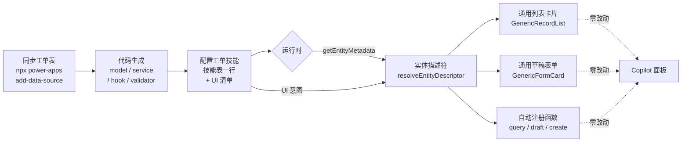

## #ask 01 / The Ask and the Bar :: 把「加功能要改前端」变成「加元数据就够了」 || Turning 'New Feature Means Front-End Edits' into 'New Metadata Is Enough'

当前应用覆盖客户、联系人、商机、活动四类业务对象。本评估要回答的是：若把覆盖面扩展到一个全新对象，前端要付出多少代价，以及这份代价能否压到趋近于零。评估范围涵盖完整方案——前端渲染、后端流程一致，以及技能与元数据的业务侧治理，并以一条可验证的成功判据逐项核对。 || The app today covers four business objects: accounts, contacts, opportunities, and activities. This assessment answers one question: what does the front end pay to extend coverage to a brand-new object, and whether that cost can be driven close to zero. The scope spans a complete solution — front-end rendering, backend process consistency, and business-side governance of skills and metadata — anchored on a verifiable success bar.

:::callout { title: "关键洞察 || Key Insight" }
「同步一张服务工单（work order）的 Dataverse 表，补上工单相关技能；此后在会话里查询、创建、修改工单时所需的列表与草稿表单，应当自动出现，而不必再改 Copilot 面板的代码。」 || Sync a Dataverse table for service work orders, add the matching skills; thereafter the lists and draft forms needed to query, create and edit work orders in chat should appear automatically, with no edits to the Copilot panel code.
:::

:::insight-grid { cols: 3 }
::card 01
### 术语：生成式数据界面 || Term: Generative Data UI
本文定义「生成式数据界面」为：会话内的数据控件（列表卡片、草稿表单）由实体的结构化元数据在运行时推导生成，而非为每个实体手写一套组件分支。它对应的已有概念是元数据驱动 UI（metadata-driven UI）。 || This report defines 'generative data UI' as: in-chat data controls (list cards, draft forms) derived at runtime from an entity's structured metadata, rather than hand-written component branches per entity. The established concept it maps to is metadata-driven UI.

::card 02
### 范围：会话内的两类控件 || Scope: Two In-Chat Controls
主线聚焦两类控件：查询返回的列表卡片，与新建/修改触发的草稿确认表单。实体详情页与导航作为次要项讨论，后端 Copilot Studio 技能的自动注册单列一节。 || The main line focuses on two controls: the list card a query returns, and the draft-confirm form a create or edit triggers. Entity detail pages and navigation are treated as secondary; the backend Copilot Studio skill's auto-registration gets its own section.

::card 03
### 判据：零新增文件、纯元数据驱动 || The Bar: Zero New Files, Metadata-Driven
本评估采用业务方设定的最高判据——新增一个实体时，不新增、不修改任何 Copilot 面板/渲染/表单组件代码，控件完全由 Dataverse 元数据加技能描述驱动，并精确界定这一判据在工程上的可达边界。 || This assessment adopts the highest bar set by the business stakeholder: adding an entity adds and modifies no Copilot panel, renderer, or form component code; controls are driven entirely by Dataverse metadata plus a skill description, with the engineering boundary of that bar defined explicitly.
:::

## #verdict 02 / Verdict First :: 条件可行，且支点已经在代码里 || Conditionally Feasible, and the Linchpin Is Already in the Code

结论可以一句话给出，再用三条判断展开。面向决策者的结论口径是：该方向值得投入，工程量中等，风险可控；无需从零搭建新系统，只需把当前「叶子层数据驱动、装配层按实体硬编码分支」的现状，改造为「装配层也由描述符驱动」。 || The verdict can be stated in one line, then expanded into three judgments. For decision-makers: this direction is worth investing in, effort is moderate, and risk is bounded; rather than building a new system from scratch, it refactors the current state — data-driven at the leaves, hard-coded entity branches at assembly — so assembly is descriptor-driven as well.

:::insight-grid { cols: 2 }
::card ✓
### 结论：可行（条件式） || Verdict: Feasible (Conditional)
对标准增删改查实体的列表与草稿表单，「零前端控件改动」可达成。代价转移到：运行一次数据源代码生成、撰写一份技能描述。两者都不触碰面板、渲染器、表单组件。 || For a standard CRUD entity's list and draft form, 'zero front-end control edits' is reachable. The cost shifts to: running data-source codegen once, and authoring one skill description. Neither touches the panel, renderer or form components.

::card !
### 判据精确化：零代码 ≠ 零产物 || Bar Refined: Zero Code ≠ Zero Artifacts
纯靠 Dataverse 元数据、不写任何技能，只能得到统一的「通用样式」界面，足够做新实体的最小可用版。要得到与现有四类对象一致的精修体验，界面意图须由技能承载——而技能本就是新增实体时要编写的产物，故不构成额外文件。 || Pure Dataverse metadata with no skill yields only a uniform generic UI, enough for a new entity's minimum-viable version. To match the curated experience of today's four objects, UI intent must ride in the skill — an artifact authored for a new entity anyway, so it adds no extra file.

::card ◆
### 关键支点：运行时元数据可用 || Linchpin: Runtime Metadata Is Available
代码生成出的每个服务都带 getMetadata()，底层调用 Power Apps SDK 的 getEntityMetadata，返回字段类型、选项集、本地化显示名、必填级别、主名称字段、图标与配色。这正是生成式界面所需的全部输入。 || Each generated service exposes getMetadata(), which calls the Power Apps SDK's getEntityMetadata and returns field types, option sets, localized display names, required levels, the primary-name attribute, icon and color. That is exactly the input a generative UI needs.

::card ⛁
### 延伸：技能即数据 || Extension: Skills as Data
把技能定义（描述、参数、提示词、启用开关）从代码搬进一张 Dataverse 表，业务管理员经模型驱动应用维护；可执行逻辑仍留代码、由 handlerKey 寻址。标准增删改查指向通用执行器，故新增标准实体可做到零前端代码。 || Move skill definitions (description, parameters, prompt, enabled flag) out of code into a Dataverse table maintained by business admins through a model-driven app; executable logic stays in code, addressed by a handlerKey. Standard CRUD points at a generic executor, so adding a standard entity reaches zero front-end code.
:::

一句话给决策者：投入一次「实体描述符 + 技能表」抽象改造（分阶段、行为保持），换来此后每加一个标准业务对象只需「同步 Dataverse + 配一行技能表」，且技能维护权可下放到业务管理员，前端不再是扩展瓶颈。 || For the decision-maker, in one line: invest once in an 'entity descriptor plus skill table' abstraction (phased, behavior-preserving), and thereafter each standard business object costs only 'sync Dataverse plus add a skill-table row', with skill maintenance delegable to business admins and the front end no longer the bottleneck.

## #asbuilt 03 / The As-Built :: 今天加一个实体，要改动散落在约 7 处的实体知识 || Adding an Entity Today Touches Entity Knowledge Scattered Across ~7 Sites

对照「零前端控件改动」的判据，先定位当前无法做到零改动的原因。渲染主路径其实已经是数据驱动的——智能体返回 JSON，渲染器通用解析。但每类实体的展示规则、字段标签、表单字段、导航目标，仍以 switch/if 分支硬编码在代码里。下表逐处列出这些耦合点，作为后续改造的拆除清单。 || Measured against the zero-edit bar, the first question is why zero-edit is impossible today. The render main path is already data-driven — the agent returns JSON and the renderer parses generically. Yet each entity's display rules, field labels, form fields, and navigation target remain hard-coded as switch/if branches. The table below lists each coupling point as the demolition checklist for the refactor.

| 位置 || Location | 硬编码内容 || What Is Hard-Coded | 加工单要改 || Edit to Add Work Orders |
| --- | --- | --- |
| copilot-agent.ts | buildRecordList 按函数名 switch（queryAccounts / Opportunities / Contacts / Activities），逐类映射 title / subtitle / meta || buildRecordList switches on function name (queryAccounts / Opportunities / Contacts / Activities), mapping title / subtitle / meta per class | 新增一个 else-if 分支 || Add one else-if branch |
| dynamic-data-renderer.tsx | 固定的 EntityType 联合类型 + entityIcons / fieldDisplayNames（双语）/ priorityColumns / detectEntityType 字段嗅探 / getNavigationPath / formatCellValue / 徽章配色 || A fixed EntityType union + entityIcons / fieldDisplayNames (bilingual) / priorityColumns / detectEntityType field sniffing / getNavigationPath / formatCellValue / badge colors | 改 7 处常量与分支 || Edit ~7 constants and branches |
| form-card.tsx | 固定的 type 联合类型；约 8 段按实体的字段布局与保存逻辑；静态导入的 useCreateActivity 等建档 Hook || A fixed type union; ~8 per-entity field-layout and save branches; statically imported create hooks like useCreateActivity | 加一组字段布局 + 建档 Hook + 图标分支 || Add a field layout + create hook + icon branch |
| function-registry.ts | 手写的 availableFunctions 数组：每实体的 query / draft / create / fuzzyMatch 函数定义（参数 + Zod 输出契约） || A hand-authored availableFunctions array: per-entity query / draft / create / fuzzyMatch definitions (parameters + Zod output contract) | 新增 3-4 条函数定义 || Add 3-4 function definitions |
| function-executor.ts | 函数名到处理器的分派表 + functions/*-handlers 实现 || The function-name-to-handler dispatch table + functions/*-handlers implementations | 新增分派项与 handler || Add dispatch entries and a handler |
| generated/* | 每实体的 model / service / hook / validator（已是代码生成产物） || Per-entity model / service / hook / validator (already codegen output) | 跑一次数据源代码生成 || Run data-source codegen once |
| pages/ + copilot-studio/ | 实体详情页与路由；后端 Copilot Studio 技能 Markdown（design-as-code） || Entity detail page and route; backend Copilot Studio skill Markdown (design-as-code) | 新建详情页 + 写技能文件 || Add a detail page + author a skill file |

读法：上表前五行是「应当被拆除」的硬编码耦合——它们把界面知识锁在组件里。第六行（代码生成）与第七行的技能文件是「应当保留」的产物，因为它们是声明式的、本就随新实体一起产出。改造目标，是把前五行的知识全部上移到这两类产物所能表达的描述符里。 || How to read it: the first five rows are hard-coded coupling that should be demolished — they lock UI knowledge inside components. The sixth row (codegen) and the seventh row's skill file are artifacts that should stay, because they are declarative and produced alongside a new entity anyway. The refactor's goal is to lift all knowledge from the first five rows into a descriptor expressible by these two artifact kinds.

## #target 04 / Target Architecture :: 实体描述符注册表：元数据与技能的合并产物 || An Entity-Descriptor Registry: Metadata Merged With the Skill

拆除散落的分支开关之后，需要一个统一的事实来源补位。目标架构引入一个运行时解析器，把 Dataverse 元数据（机器可读、但只懂类型不懂意图）与技能里的界面清单（人写的、表达展示意图）合并成一个实体描述符，供所有通用控件消费，覆盖从元数据到通用控件的四个责任层与描述符字段结构。 || After demolishing the scattered switches, a single source of truth must take their place. The target architecture introduces a runtime resolver that merges Dataverse metadata (machine-readable but type-aware only, not intent-aware) with a UI manifest in the skill (human-authored, expressing display intent) into one entity descriptor consumed by all generic controls across four responsibility layers.

数据/元数据层 || Data / Metadata

### Dataverse 元数据（机器可读事实） || Dataverse Metadata (Machine-Readable Facts)

经 service.getMetadata() 取回字段类型码（String / Memo / Money / DateTime / Picklist / Lookup / Boolean / Status）、选项集、本地化标签、必填级别、主名称字段、表配色与图标。提供「类型与合法值」，但不含「该不该在列表里露出」这类意图。 || Via service.getMetadata() it returns attribute type codes (String / Memo / Money / DateTime / Picklist / Lookup / Boolean / Status), option sets, localized labels, required levels, the primary-name attribute, table color and icon. It supplies 'types and legal values' but not intent such as 'should this show in the list'.

generated/services/*Service.ts · @microsoft/power-apps/data/metadata/dataverse

技能/意图层 || Skill / Intent

### 技能里的界面清单（人写的意图） || The Skill's UI Manifest (Human Intent)

技能描述补足元数据表达不了的部分：列表显示哪几列与顺序、表单收哪些字段与分组、主/次显示字段、导航目标、模糊匹配键、写库前是否需要草稿确认。技能本就是新实体要新增的产物，意图寄存于此不构成额外文件。 || The skill description supplies what metadata cannot express: list columns and their order, form fields and grouping, primary and secondary display fields, the navigation target, the fuzzy-match key, and whether writes require draft confirmation. Because a new entity adds a skill anyway, hosting UI intent there creates no extra file.

copilot-studio/skills/*.SKILL.md · function-registry FunctionDefinition

描述符层 || Descriptor

### resolveEntityDescriptor 合并解析 || resolveEntityDescriptor Merges Both

一个解析器把上述两源合并为单一实体描述符：字段集合（类型、标签、必填、选项、格式化器）+ 展示规则（列表列、表单分组、主次字段、图标、导航）。结果带缓存，作为所有通用控件唯一消费的事实来源。 || A resolver merges the two sources into a single entity descriptor: a field set (type, label, required, options, formatter) plus display rules (list columns, form groups, primary/secondary fields, icon, navigation). The result is cached and serves as the single source of truth consumed by every generic control.

lib/entity-descriptor.ts（新增的唯一基础设施）

渲染层 || Render

### 通用列表卡片 + 通用草稿表单 || Generic Record List + Generic Form Card

GenericRecordList 取代渲染器里的实体分支，GenericFormCard 取代表单里的 8 段布局；二者只读描述符，不认识具体实体。已有的 EditableField 已是按类型渲染的通用字段组件，可直接复用。 || GenericRecordList replaces the renderer's entity branches and GenericFormCard replaces the form's eight layout branches; both read only the descriptor and know no concrete entity. The existing EditableField is already a type-driven generic field component and is reused as-is.

components/dynamic-data-renderer.tsx · components/form-card.tsx（改为描述符驱动）

为何要两源合并、而非纯元数据：Dataverse 元数据知道「金额是 Money 类型、阶段有 6 个选项」，但不知道「列表里先露金额还是先露阶段、详情该跳哪页」。这类展示意图属于产品决策，交给人写的技能最自然，也最稳定——它不会因为某张表多了一个内部字段就漂移。 || Why merge two sources rather than use pure metadata: Dataverse metadata knows 'amount is Money, stage has six options' but not 'show amount or stage first in the list, or which page detail should open'. Such display intent is a product decision, best and most stably owned by the human-authored skill — it will not drift just because a table gains an internal field.

:::comparison
::versus 方案 1 || Option 1
### 详情页：通用回退 + 按需精修 || Detail Page: Generic Fallback, Opt-In Bespoke
▤

同一描述符可驱动一个只读的通用详情页（字段分组 + 关联记录），让新实体开箱即有详情视图；现有四类对象的精修页作为按需覆盖保留。完全泛化的富详情页是可达的，但收益递减，建议先通用回退、后按业务价值逐个升级。 || The same descriptor can drive a read-only generic detail page (grouped fields plus related records), so a new entity has a detail view out of the box; the four objects' bespoke pages remain as opt-in overrides. A fully generic rich detail page is reachable but with diminishing returns — prefer a generic fallback first, upgrading per business value.

::versus 方案 2 || Option 2
### 后端技能：模板化自动注册 || Backend Skill: Templated Auto-Registration
⚙

前端 availableFunctions 可由描述符在构建期自动生成（query / draft / create / fuzzyMatch 四件套）。后端 Copilot Studio 侧是 design-as-code：一个参数化的通用增删改查技能模板加表名即可派生。两个「大脑」需各自知道新实体，故自动注册要同时覆盖前端注册表与后端技能。 || The front-end availableFunctions can be auto-generated from the descriptor at build time (the query / draft / create / fuzzyMatch quartet). The backend Copilot Studio side is design-as-code: a parameterized generic CRUD skill template derives from the table name. The two 'brains' must each learn the new entity, so auto-registration must cover both the front-end registry and the backend skill.
:::

## #skilldata 05 / Skills as Data :: 把技能定义从代码搬进一张 Dataverse 表 || Moving Skill Definitions Out of Code Into a Dataverse Table

既然界面意图已经寄存在技能里，再往前一步就是把技能本身也变成 Dataverse 数据——建一张自建技能表，由业务管理员在模型驱动应用里维护、前端运行时读取。如此新增或调整一个技能不再需要改前端代码或发版。前提是先分清「契约」与「逻辑」：能进表的是声明式契约，不能进表的是可执行逻辑。 || Once UI intent lives inside the skill, the next step is making the skill itself Dataverse data — a custom skill table that business admins maintain in a model-driven app and the front end reads at runtime. Adding or adjusting a skill then needs no front-end code change or release. The precondition is to separate contract from logic: declarative contract can live in the table; executable logic cannot.

:::comparison
::versus 方案 1 || Option 1
### 声明式契约 → 进表 || Declarative Contract → Table
▤

LLM 看到的、以及路由要用的部分：名称、双语显示名、description（路由信号）、参数 schema、必填、promptTemplate、responseFormat、示例触发语、技能边界、启用开关。这些全部可数据化，是业务侧能安全维护的部分。 || What the LLM sees and what routing needs: name, bilingual display names, description (the routing signal), parameter schema, required flags, promptTemplate, responseFormat, example triggers, skill boundaries, the enabled flag. All of this is data, and the part the business can safely maintain.

::versus 方案 2 || Option 2
### 可执行逻辑 → 留代码 || Executable Logic → Code
⚙

调哪个服务、字段映射、业务规则、多步编排——不可能把可执行代码塞进表里安全运行。表里只放一个 handlerKey 指向代码侧 handler：标准增删改查指向通用执行器（零新增代码），特殊业务逻辑指向具名 handler。这与现有「按函数名分派」的执行器顺势对接。 || Which service to call, field mapping, business rules, multi-step orchestration — executable code cannot be safely stored and run from a table. The table holds only a handlerKey pointing to a code-side handler: standard CRUD points at a generic executor (zero new code), bespoke logic points at a named handler. This aligns with the existing dispatch-by-function-name executor.
:::

| 字段 || Column | 含义 || Meaning | 归属 || Belongs To |
| --- | --- | --- |
| name · displayName_zh/en | 技能唯一名与双语显示名 || Unique skill name and bilingual display names | 契约（表） || Contract (table) |
| description | 给 Frame/Orchestrator 的路由信号，决定意图命中的核心字段 || The routing signal for Frame/Orchestrator — the primary field deciding intent matching | 契约（表） || Contract (table) |
| operation · targetTable | 操作类型（query/create/update/llm）与目标 Dataverse 表 || Operation type (query/create/update/llm) and the target Dataverse table | 契约（表） || Contract (table) |
| handlerKey | 寻址代码侧 handler；标准 CRUD 指向通用执行器 || Addresses a code-side handler; standard CRUD points at the generic executor | 契约引用代码 || Contract references code |
| paramsJson · outputSchemaJson | 参数 schema 与输出契约（文本，加载时 Zod 校验） || Parameter schema and output contract (text, Zod-validated at load) | 契约（表） || Contract (table) |
| promptTemplate · examples · boundaries | LLM 提示词模板、示例触发语、技能边界 || LLM prompt template, example triggers, skill boundaries | 契约（表） || Contract (table) |
| enabled · sort · version | 启用开关、排序、版本，便于灰度与回滚 || Enabled flag, sort order, version — for staged rollout and rollback | 契约（表） || Contract (table) |

可选子表 crf5c_skillparameter：若想让管理员逐字段配参数而非直接编辑 JSON，体验更好、更防错。表名沿用 crf5c 发布者前缀，与现有自定义业务表一致。 || Optional child table crf5c_skillparameter: if admins should configure parameters field-by-field rather than editing raw JSON, the experience is better and less error-prone. The table uses the crf5c publisher prefix, consistent with existing custom business tables.

:::flow
1. **运行时加载器取代硬编码的 availableFunctions 数组 || A Runtime Loader Replaces the Hard-Coded availableFunctions Array** — 前端启动时读技能表 → 每行用 Zod 校验 → 通过的进注册表喂给 Frame/Orchestrator → 坏行跳过并告警，绝不因一行错配置拖垮整个智能体 → 带缓存，管理员改了即失效重拉。由此把「手写 function-registry」那处硬编码耦合也一并拆除。 || At startup the front end reads the skill table, validates each row with Zod, feeds the passing rows into the registry for Frame/Orchestrator, skips bad rows with a warning (never letting one misconfigured row break the whole agent), and caches with invalidation when admins edit. This also removes the hand-authored function-registry coupling.
:::

三层安全护栏（缺一不可）：① 表级 RBAC，只有管理员能编辑技能行并开启审计；② 执行器只认白名单，handlerKey 与 targetTable 必须在代码侧白名单内，绝不允许一行配置就调任意 handler 或碰不该碰的表；③ 平台数据裁剪兜底，Dataverse 安全角色 + owner 过滤照旧生效，哪怕配错技能也越不过用户本身的数据权限。 || Three security guardrails (all required): (1) table-level RBAC — only admins edit skill rows, with auditing on; (2) the executor honors an allowlist — handlerKey and targetTable must be in a code-side allowlist, never letting one row call an arbitrary handler or touch a table it should not; (3) platform data trimming as a backstop — Dataverse security roles plus owner filtering still apply, so even a misconfigured skill cannot exceed the user's own data permissions.

## #govern 06 / Maintenance, Testing and the Two Brains :: 让业务侧维护技能，并把后端对齐 || Letting the Business Maintain Skills, and Keeping the Backend Aligned

技能进表之后，维护权可以下放到业务管理员：通过模型驱动应用承接日常维护与分级测试，同时保持「前端流水线」与「后端 Copilot Studio」两套技能源一致，并厘清与官方 Business skill 的边界。 || Once skills live in the table, maintenance can be delegated to business admins: a model-driven app handles routine maintenance and tiered testing, while keeping the two skill sources — the front-end pipeline and the backend Copilot Studio agent — aligned and clarifying the boundary with official Business skills.

:::comparison
::versus 方案 1 || Option 1
### 模型驱动应用维护 || Model-Driven App Maintenance
✎

对技能表建一个模型驱动应用（MDA），管理员增删改行即可；RBAC 控制谁能编辑；表是 solution-aware 的，可随解决方案跨 dev/test/prod 搬运并版本化。这正是把「写技能」从开发者工作流移到业务工作流的落点。 || Build a model-driven app (MDA) over the skill table; admins add, edit and remove rows; RBAC controls who can edit; the table is solution-aware and moves across dev/test/prod with versioning. This is exactly how 'authoring a skill' moves from the developer workflow to the business workflow.

::versus 方案 2 || Option 2
### 两档测试：轻量先行，端到端后补 || Two Tiers: Lightweight First, End-to-End Later
▷

轻量档（先做）：MDA 内嵌测试页输入一句话，调用已有 Power Automate Flow / AI Builder prompt 做一次 Frame 分类，回显「命中哪个技能、抽出什么参数」，不写库。端到端档（后做）：嵌入式 canvas/PCF 真正跑 draft→确认→落库，价值高但成本高，建议二期。 || Lightweight tier (first): an embedded test page in the MDA takes one sentence, calls the existing Power Automate Flow / AI Builder prompt for a single Frame classification, and shows which skill matched and what parameters were extracted, without writing. End-to-end tier (later): an embedded canvas/PCF runs draft to confirm to persist — high value, high cost, recommended as a second wave.
:::

:::comparison
::versus 方案 1 || Option 1
### 两个大脑要对齐 || The Two Brains Must Align
⇄

前端 Frame/Orchestrator 与后端 Copilot Studio agent 是两套技能来源。把技能表作为单一事实源，由它派生后端 Copilot Studio 技能（design-as-code），避免两侧各配一套、长期分叉。派生可放在构建期。 || The front-end Frame/Orchestrator and the backend Copilot Studio agent are two skill sources. Treat the skill table as the single source of truth and derive the backend Copilot Studio skills (design-as-code) from it, avoiding two hand-maintained copies that drift apart. The derivation can run at build time.

::versus 方案 2 || Option 2
### 与官方 Business skill 的关系 || Relation to Official Business Skills
◈

官方 Dataverse Business skills（Preview）是给运行时 agent 的自然语言流程定义，治理好但纯散文、不携带类型化契约、且尚未正式发布。本方案的自建表当下可生产、可控；将来其正式发布时，可把 description/promptTemplate 这类散文映射过去，二者并不冲突。 || The official Dataverse Business skills (Preview) are natural-language process definitions for runtime agents — well governed but prose-only, carrying no typed contract, and not yet generally available. This custom table is production-ready and controllable now; when Business skills reach general availability, the prose fields such as description and promptTemplate can map onto them, with no conflict.
:::

一句话定位：自建技能表是「技能意图」这一源的 Dataverse 实体化，让标准实体做到「同步 DV + 配表 = 零前端改动」；可执行逻辑仍由具名 handler 承载；安全靠 RBAC + 执行器白名单 + 平台数据裁剪三层兜底。 || Positioning in one line: the custom skill table is the Dataverse materialization of the 'skill intent' source, letting standard entities reach 'sync DV plus configure a row equals zero front-end edits'; executable logic still lives in named handlers; security rests on three backstops — RBAC, executor allowlist, and platform data trimming.

## #walkthrough 07 / Work-Order Walkthrough :: 加一张工单表，改造前后各发生什么 || Adding a Work-Order Table: Before and After the Refactor

把「耦合拆除清单」与「描述符目标架构」落到服务工单这一具体场景，对照同一动作在改造前后的代价：改造前是「七处分支开关逐个补」，改造后是「两步声明式产物 + 零组件改动」。 || Grounding the coupling demolition checklist and target descriptor architecture in the concrete service work-order scenario makes the cost contrast explicit: before the refactor it is 'patch seven switches one by one'; after, it is 'two declarative artifacts and zero component edits'.

实线是产物链（两步：代码生成 + 配技能表行），虚线标注「零改动」的组件。运行时由元数据与技能意图汇入描述符，再扇出到列表、表单、函数注册——Copilot 面板自始至终不被触碰。 || Solid lines are the artifact chain (two steps: codegen plus configuring a skill-table row); dotted lines mark the 'zero-edit' components. At runtime, metadata and skill intent flow into the descriptor and fan out to list, form and function registration — the Copilot panel is never touched.

| 工单字段 || Work-Order Field | Dataverse 类型码 || Dataverse Type Code | 自动推导的控件 || Auto-Derived Control |
| --- | --- | --- |
| 工单标题 || Title | String / PrimaryName | 文本框；同时作为列表主显示与卡片标题 || Text input; also the list primary display and card title |
| 优先级 || Priority | Picklist + OptionSet | 下拉选择，选项与本地化标签由选项集填充 || Dropdown select; options and localized labels from the option set |
| 预计完成 || Due Date | DateTime | 日期选择器；列表中按本地化日期格式渲染 || Date picker; rendered with localized date format in the list |
| 报修客户 || Customer | Lookup → account | 复用现有客户模糊匹配卡片，技能声明匹配键即可 || Reuses the existing account fuzzy-match card; the skill declares the match key |
| 问题描述 || Description | Memo | 多行文本域；列表中隐藏，仅详情/表单展开 || Multi-line textarea; hidden in the list, shown only in detail/form |
| 工单状态 || Status | Status / State | 状态徽章；配色由通用状态调色板按序分配 || Status badge; colors assigned in order from a generic status palette |

这张表是「零组件改动」最硬的证据：每一行的控件选择都来自字段类型码这一既有事实，无需为工单写任何 if 分支。唯一仍由人决定的是「哪些列进列表、哪个字段是主显示」——这正是技能界面清单承载的少量意图。 || This table is the hardest evidence for 'zero component edits': every row's control choice derives from the existing fact of the field type code, with no work-order-specific if branch. The only human decision left is 'which columns enter the list, which field is primary' — exactly the small intent the skill's UI manifest carries.

## #rollout 08 / Phased Rollout :: 分阶段、行为保持，工单作为验收试点 || Phased and Behavior-Preserving, Work Orders as the Acceptance Pilot

可行不等于一次性重写。完整方案拆成若干「行为保持」的演进阶段——上线体验不变，只把实体知识从代码逐步搬进描述符与技能表。前几阶段用现有四类对象自证抽象够用，再接通运行时元数据与技能即数据，最后补齐 MDA 维护并以工单作为「零改动新增」的验收试点。 || Feasible does not mean a one-shot rewrite. The complete solution breaks into several behavior-preserving phases — the shipped experience stays unchanged while entity knowledge moves step by step from code into descriptors and the skill table. Early phases prove the abstraction on the existing four objects, then wire in runtime metadata and skills-as-data, and finally add MDA maintenance with work orders as the zero-edit acceptance pilot.

:::flow
1. **阶段 0 — 抽取描述符（行为保持） || Phase 0 — Extract Descriptors (Behavior-Preserving)** — 把现有四类对象隐含的展示规则显式化为 EntityDescriptor 数据对象，组件暂时照旧但改为读描述符。零界面变化，目的是验证描述符 schema 足以覆盖现状——这是整条路线的去风险起点。 || Make the four objects' implicit display rules explicit as EntityDescriptor data objects; components stay as-is but read from descriptors. No UI change; the goal is to verify the descriptor schema covers today's behavior — the de-risking start of the whole path.
2. **阶段 1 — 列表走描述符 || Phase 1 — Route the List Through Descriptors** — buildRecordList 与列表渲染改由描述符驱动，删除按函数名 switch 与 detectEntityType 字段嗅探，载荷里显式带实体标签。列表行为不变，但实体分支清零。 || buildRecordList and list rendering become descriptor-driven; remove the function-name switch and the detectEntityType field sniffing, carrying an explicit entity tag in the payload. List behavior is unchanged, but entity branches go to zero.
3. **阶段 2 — 表单走描述符 || Phase 2 — Route the Form Through Descriptors** — form-card 的 8 段字段布局改为按描述符装配字段；静态导入的建档 Hook 改为经服务注册表通用建档。复用 EditableField，草稿确认与保存语义保持。 || form-card's eight field-layout branches become field assembly from the descriptor; statically imported create hooks become a generic create via a service registry. Reuse EditableField; draft-confirm and save semantics are preserved.
4. **阶段 3 — 技能即数据 + 运行时加载器 || Phase 3 — Skills as Data + Runtime Loader** — 建 crf5c_skill 表；前端用运行时加载器读表、逐行 Zod 校验、带缓存，取代硬编码的 availableFunctions；handlerKey 接通用 CRUD 执行器。此后新增标准技能 = 配一行表，无需改前端。 || Create the crf5c_skill table; the front end uses a runtime loader to read it, validate each row with Zod, and cache, replacing the hard-coded availableFunctions; handlerKey wires into the generic CRUD executor. Thereafter adding a standard skill is one table row, with no front-end edit.
5. **阶段 4 — 元数据注水 + 后端对齐 + 通用详情页 || Phase 4 — Hydrate Metadata + Align the Backend + Generic Detail Page** — 描述符的字段类型、选项、标签、必填改由 getEntityMetadata 运行时注水；由技能表派生后端 Copilot Studio 技能，消除两脑分叉；补一个描述符驱动的只读通用详情页作为回退。 || Field types, options, labels and required levels are hydrated at runtime by getEntityMetadata; the backend Copilot Studio skills are derived from the skill table to eliminate two-brain drift; a descriptor-driven read-only generic detail page is added as a fallback.
6. **阶段 5 — MDA 维护与测试 + 工单验收 || Phase 5 — MDA Maintenance and Testing + Work-Order Acceptance** — 建技能表的模型驱动应用与轻量测试页（Frame dry-run）；以工单为试点，全程不改面板/渲染/表单，验证「同步 DV + 配表」即可上线，且维护权可下放给业务管理员。 || Build a model-driven app over the skill table plus a lightweight test page (Frame dry-run); pilot with work orders, touching no panel/renderer/form, verifying that 'sync DV plus configure a row' is enough to ship and that maintenance can be delegated to business admins.
:::

## #risks 09 / Risks and Residual Manual Work :: 工程附录：哪些地方仍需人，哪些地方需设防 || Engineering Appendix: Where Humans Are Still Needed, and Where Guardrails Matter

在条件可行的决策结论之上，工程评估还须把「零改动」的适用边界说清，并把可预见的技术风险逐条标注，避免把条件可行误读为无条件可行。 || Beyond the conditional-feasibility verdict, engineering review must spell out the exact boundary of 'zero edits' and annotate foreseeable technical risks one by one, so conditional feasibility is not misread as unconditional.

:::insight-grid { cols: 2 }
::card 01
### 代码生成是构建动作 || Codegen Is a Build Action
新表需跑一次数据源代码生成（本项目用 npx power-apps，因 pac code add-data-source 对 Dataverse 失效）。它不是手写文件，但是一步人工触发的构建。 || A new table needs one data-source codegen run (this project uses npx power-apps, since pac code add-data-source is broken for Dataverse). It is not a hand-written file, but it is a human-triggered build step.

::card 02
### 界面意图需写进技能 || UI Intent Goes in the Skill
列表列序、主次字段、导航目标、模糊匹配键属于产品决策，元数据给不出。它寄存在本就要写的技能里，是声明式数据而非组件代码——这是「零新增文件」成立的精确含义。 || List column order, primary/secondary fields, navigation target and fuzzy-match key are product decisions metadata cannot yield. They live in the skill that is authored anyway — declarative data, not component code — which is the precise meaning of 'zero new files'.

::card 03
### 富详情页与特殊校验 || Rich Detail Pages and Special Validation
通用详情页能开箱即用，但现有四类对象那种精修页与跨实体工作流仍需按需写代码；超出 Dataverse 必填级别的业务校验也需手写。这些是按业务价值的可选投入，不在「零改动」承诺内。 || A generic detail page works out of the box, but the bespoke pages and cross-entity workflows like today's four objects still need hand-written code; business validation beyond Dataverse required levels is also hand-written. These are optional, value-driven investments outside the 'zero-edit' promise.

::card 04
### 两个大脑要同步 || Two Brains Must Stay in Sync
前端函数注册表与后端 Copilot Studio 智能体是两套技能来源，新实体须让两者都知道。自动注册要覆盖两侧，否则会出现「前端能渲染、后端不会路由」或反之的错位。 || The front-end function registry and the backend Copilot Studio agent are two skill sources; a new entity must reach both. Auto-registration must cover both sides, or you get a mismatch where the front end can render but the backend will not route, or the reverse.
:::

| 风险 || Risk | 影响 || Impact | 缓解 || Mitigation |
| --- | --- | --- |
| 类型安全弱化 || Type-safety erosion | 从编译期联合类型转向运行期描述符，丢失部分静态检查 || Moving from compile-time unions to runtime descriptors loses some static checks | 代码生成产出带类型的描述符 + Zod 运行时校验补回保障 || Codegen emits typed descriptors + Zod runtime validation restores the guarantee |
| 元数据获取延迟 || Metadata fetch latency | 运行时拉元数据可能拖慢首屏渲染 || Fetching metadata at runtime may slow first render | 按表缓存 + 构建期预取，元数据变更少、可长缓存 || Per-table caching + build-time prefetch; metadata rarely changes and tolerates long caching |
| 多态/查找字段 || Polymorphic / lookup fields | 活动族本就是多态结构，工单的查找字段也需解析目标实体 || The activity family is polymorphic; a work order's lookups also need target-entity resolution | 复用现有模糊匹配级联，描述符显式声明查找目标表 || Reuse the existing fuzzy-match cascade; the descriptor declares the lookup target table |
| 选项集本地化缺口 || Option-set localization gaps | 若某选项未配中文标签，下拉会露出英文或键名 || If an option lacks a Chinese label, the dropdown shows English or the key | 回退到 UserLocalizedLabel，并在校验里标注缺口 || Fall back to UserLocalizedLabel and flag the gap in validation |
| 函数调用准确率 || Function-calling accuracy | 自动生成的函数描述若过于泛化，LLM 选错技能 || Auto-generated function descriptions that are too generic make the LLM pick the wrong skill | 技能描述里保留人写的一句话用途，喂给 Frame/Orchestrator || Keep a human-authored one-line purpose in the skill, fed to Frame/Orchestrator |
| 技能表配置错误 || Skill-table misconfiguration | 一行配错 description / 参数导致路由错乱 || A row with a wrong description or parameters misroutes intents | 加载即 Zod 校验、坏行跳过并告警；MDA 测试页先验证再启用 || Zod-validate on load, skip and warn on bad rows; verify in the MDA test page before enabling |
| 技能表权限滥用 || Skill-table permission abuse | 管理员误改技能行改变智能体行为 || An admin editing a skill row changes agent behavior | 表级 RBAC 限管理员 + 审计；执行器白名单兜底；平台数据裁剪保证越不过用户权限 || Table-level RBAC limits editors plus auditing; executor allowlist as a backstop; platform data trimming keeps it within the user's permissions |

阶段 0 的存在正是为这些风险兜底：在不改变上线体验的前提下，先用现有四类对象把描述符 schema 与缓存、校验、类型生成全部跑通，确认无回归，再接新实体。任一风险在阶段 0 暴露，都还来得及调整 schema 而不影响用户。 || Phase 0 exists precisely to backstop these risks: without changing the shipped experience, first run the descriptor schema, caching, validation and type generation through the existing four objects, confirm no regression, then onboard a new entity. Any risk surfaced in Phase 0 can still reshape the schema without affecting users.

## #references 10 / References :: 证据与来源 || Evidence and Sources

本评估的事实分两类：代码库内的现状证据（文件路径），与 Dataverse/Power Apps 平台能力的官方文档。每条标注它支撑文中的哪个论断。 || The facts in this assessment are of two kinds: in-repo as-built evidence (file paths) and official documentation of Dataverse/Power Apps platform capability. Each notes which claim it supports.

- apps/sales-copilot/src/lib/copilot-agent.ts — buildRecordList 按函数名 switch || apps/sales-copilot/src/lib/copilot-agent.ts — buildRecordList switches on function name
- apps/sales-copilot/src/components/dynamic-data-renderer.tsx — 固定 EntityType 与展示常量 || apps/sales-copilot/src/components/dynamic-data-renderer.tsx — fixed EntityType and display constants
- apps/sales-copilot/src/components/form-card.tsx — 按实体的字段布局与建档 Hook || apps/sales-copilot/src/components/form-card.tsx — per-entity field layout and create hooks
- apps/sales-copilot/src/lib/function-registry.ts — FunctionDefinition 声明式技能契约 || apps/sales-copilot/src/lib/function-registry.ts — the FunctionDefinition declarative skill contract
- apps/sales-copilot/src/generated/services/*Service.ts — getMetadata() → getEntityMetadata
