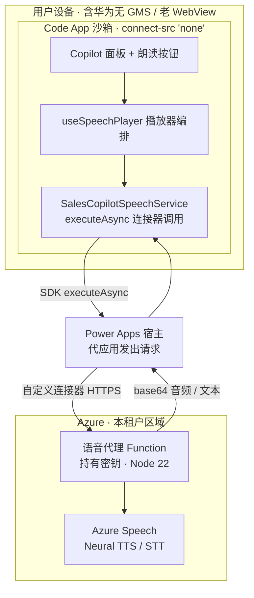
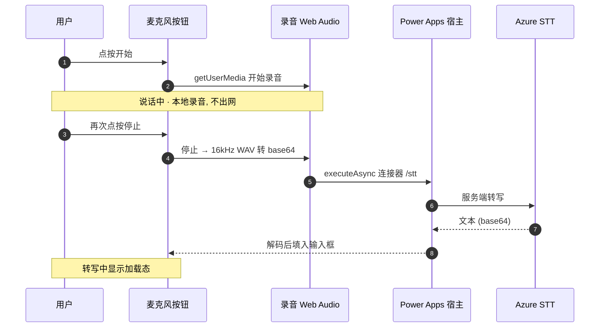

## #requirements 01 / Business Need and Architectural Requirements :: 移动优先语音优先对语音方案提出四条属性要求 || Mobile-First, Voice-First Imposes Four Properties on Any Speech Solution

销售在拜访之间用口语与系统交互：口述一段活动纪要、听系统朗读客户简报、点按说话快速提问。要让这套语音在一线的真实设备上都成立，方案必须同时满足四条属性；这四条属性构成整套语音架构的验收标准。 || Reps interact by voice between visits: dictate an activity note, listen to a briefing read aloud, tap to talk for a quick question. For this to hold on real field devices, a solution must satisfy four properties at once; together they form the acceptance criteria for the entire voice architecture.

:::insight-grid { cols: 2 }
::card 01
### 跨设备一致 || Cross-Device Consistency
同一套语音体验必须在 iOS、Android、桌面浏览器与 Power Apps 移动播放器里表现一致。当前 Web Speech 的听写接口在浏览器兼容数据中直到 Chromium 139 才进入 Android WebView，而一线在用的华为 WebView 12.1.2.326 内核远早于此，接口根本不存在；朗读又依赖设备自带的语音引擎，无谷歌服务的设备常常没有可用音色。能力随设备而变，就是招牌功能在部分设备上直接消失。 || One voice experience must behave identically across iOS, Android, desktop browsers and the Power Apps mobile player. In browser-compatibility data the Web Speech dictation interface only reached Android WebView at Chromium 139, whereas the Huawei WebView 12.1.2.326 in field use runs a much older core where the interface does not exist; read-aloud in turn depends on the device's own speech engine, and devices without Google services often have no usable voice. Capability that varies by device means the flagship feature simply disappears on some of them.

::card 02
### 实时响应 || Real-Time Response
响应时效是语音体验的关键：朗读要按下即出声，听写要尽快出字。朗读可做到近实时——按下到首字一到两秒、段与段之间无明显停顿。听写受平台沙箱约束（应用不能直接开启实时音频流），退为「点按录音、再点转写」，停止后约一到两秒出字。目标是把这两处延迟压到最低，而非追求边说边出字。 || Response latency is decisive for a voice experience: read-aloud must sound on press, dictation must produce text quickly. Read-aloud reaches near real time — one to two seconds from press to the first syllable, with no audible gap between segments. Dictation is bounded by the platform sandbox (the app cannot open a real-time audio stream directly) and becomes 'tap to record, tap again to transcribe', with text about one to two seconds after stop. The goal is to minimize these two latencies, not to chase text-as-you-speak.

::card 03
### 密钥零暴露 || Zero Key Exposure
语音服务的订阅密钥绝不能进入前端包或浏览器可见的任何位置。代码库已有一次教训：一段直接在浏览器里换 Azure AD 令牌的实现被证明会被 CORS 拦截，注释里写明「浏览器无法直连、需后端代理」。因此所有对外调用都走服务端——密钥只在 Function 的应用设置里，前端从不持有密钥或令牌，语音请求经连接器由宿主代发。 || The speech subscription key must never enter the front-end bundle or anything visible to the browser. The codebase already carries one lesson: an implementation that exchanged an Azure AD token directly in the browser was shown to be blocked by CORS, its comment stating that the browser cannot connect directly and needs a backend proxy. All external calls therefore run server-side — the key lives only in the Function's app settings, the front end holds neither key nor token, and speech requests are relayed by the host through the connector.

::card 04
### 成本可控可降级 || Controllable, Degradable Cost
云语音按量计费，不能让每一次朗读、每一次听写都无条件产生费用。方案要允许具备本地语音能力的设备按用户选择走免费的本地引擎，也要在离线时明确禁用而非静默失败。默认云端保证可用，本地作为省流量的选项。 || Cloud speech is billed by usage, so not every read-aloud and every dictation should incur cost unconditionally. The solution must let devices with a capable local engine use the free local path by user choice, and must clearly disable rather than silently fail when offline. Cloud is the default for availability; local is the data-saving option.
:::

现状证据：当前听写调用 webkitSpeechRecognition 并将 continuous 固定为 true，而浏览器兼容数据显示 Android 的 Chrome 与 WebView 均不支持该连续模式；朗读经 speechSynthesis，在无本地音色时 getVoices() 返回空数组、静默无声。四条属性正是从这些真实缺口反推出来的验收线。 || Evidence from the current state: dictation calls webkitSpeechRecognition with continuous fixed to true, yet browser-compatibility data shows neither Chrome nor WebView on Android supports that continuous mode; read-aloud goes through speechSynthesis, where a device with no local voice returns an empty getVoices() array and stays silent. The four properties are the acceptance line derived from these real gaps.

## #overview 02 / Solution Overview and Engine Policy :: 应用经连接器调服务端，Azure 语音在服务端完成 || The App Calls a Server-Side Proxy via a Connector; Azure Speech Runs Server-Side

Code App 跑在 connect-src 'none' 的 iframe 沙箱里，应用代码不能直接对外发任何网络请求。因此语音不走前端直连 Azure，而是由应用经 Power Apps SDK 调一个自定义连接器，交由 Power Apps 宿主代为请求服务端的语音代理 Function，再由 Function 持密钥调 Azure Speech 并返回结果。密钥始终留在服务端，前端从不持有。 || The Code App runs in a connect-src 'none' iframe sandbox, so the app's code cannot make any direct external network call. Speech therefore does not connect to Azure from the front end; instead the app calls a custom connector via the Power Apps SDK, the Power Apps host proxies the request to a server-side speech-proxy Function, and the Function calls Azure Speech with the key and returns the result. The key stays server-side; the front end never holds it.

设置项「语音引擎」三选一，缺省自动。自动档检测本设备是否具备可用的本地语音能力，有则用本地、无则回落 Azure——无谷歌服务的设备无需用户干预即走 Azure。 || A 'voice engine' setting offers three choices, defaulting to auto. The auto mode detects whether the device has a usable local speech capability, using local when present and falling back to Azure when not — a device without Google services goes to Azure with no user intervention.

| 设置档位 || Setting | 行为 || Behavior | 适用 || Fits |
| --- | --- | --- |
| 自动（默认） || Auto (default) | 有可用本地能力则用本地，否则用 Azure || Local if a usable local engine exists, else Azure | 绝大多数用户，无需理解差异 || Most users, no need to understand the difference |
| 本地优先 || Local first | 尽量用本地，省流量与费用；能力不足时仍回落 Azure || Prefer local to save data and cost; still falls back to Azure when insufficient | 桌面或具备高质量本地音色的设备 || Desktop or devices with high-quality local voices |
| 始终云端 || Always cloud | 无论设备一律走 Azure，音色与识别质量最一致 || Always Azure regardless of device, most consistent voice and recognition | 要求统一体验、不在意流量的场景 || Scenarios needing uniform experience, indifferent to data |

改动面收敛的前提：朗读早已收口到单一的 useSpeechPlayer；听写只存在于 copilot 面板一处。因此换引擎只触及这两个接缝，上层 UI、手势、分段与队列逻辑保持不变。 || Why the change stays contained: read-aloud is already funneled into a single useSpeechPlayer, and dictation lives in only one place, the copilot panel. Swapping engines therefore touches only these two seams; the upper UI, gestures, segmentation and queue logic remain unchanged.

## #token 03 / The Sandbox Constraint and the Connector :: 沙箱禁止直连，所以语音经连接器走服务端 || The Sandbox Forbids Direct Egress, so Speech Goes Server-Side via a Connector

一项平台约束直接决定了整套语音架构：Code App 的 iframe 受 connect-src 'none' 内容安全策略限制，应用代码发起的任何 fetch 或 WebSocket 都会被浏览器拒绝。因此不存在「前端直连 Azure」的路径——语音必须经 Power Apps SDK 的连接器通道，由宿主代为出网。这一设计可从需求、机制、取舍、代价四个层面审视。 || One platform constraint directly shapes the entire speech architecture: the Code App iframe runs under a connect-src 'none' content security policy, so any fetch or WebSocket the app initiates is refused by the browser. There is therefore no 'front end connects to Azure directly' path — speech must go through the Power Apps SDK connector channel, with the host making the egress on the app's behalf. This design breaks down across need, mechanism, trade-off, and cost.

需求 || Need

### 应用要到达 Azure，但不能直接出网 || The App Must Reach Azure but Cannot Egress Directly

实测证据：在已部署的应用帧内执行 fetch 触发控制台报错「Refused to connect … violates the following Content Security Policy directive: connect-src 'none'」；同一请求从顶层 apps.powerapps.com 页面则返回 200。结论是应用帧被网络隔离，密钥又必须留在服务端——两条约束共同排除了客户端直连与客户端持密钥。 || Measured evidence: a fetch executed inside the deployed app frame triggers the console error 'Refused to connect … violates the following Content Security Policy directive: connect-src 'none'', while the same request from the top apps.powerapps.com page returns 200. The app frame is network-isolated, and the key must stay server-side — together these rule out both client-side direct connection and client-held keys.

机制 || Mechanism

### 自定义连接器 + Function，经 executeAsync 调用 || A Custom Connector plus a Function, Called via executeAsync

一个 Node 22 的 Azure Function（语音代理）把订阅密钥存在应用设置里，对外暴露 /tts 等操作。围绕它建一个自定义连接器，用 add-data-source 接进 Code App，生成 SalesCopilotSpeechService。应用调 executeAsync 的 connectorOperation，由 Power Apps 宿主在沙箱外向连接器发请求——绕过 connect-src。这条通道与应用现有调 Dataverse、调大模型是同一条。 || A Node 22 Azure Function (the speech proxy) keeps the subscription key in app settings and exposes operations such as /tts. A custom connector wraps it and is wired into the Code App with add-data-source, generating SalesCopilotSpeechService. The app calls executeAsync's connectorOperation, and the Power Apps host issues the request to the connector outside the sandbox — bypassing connect-src. This is the same channel the app already uses for Dataverse and the LLM.

取舍 || Trade-off

### 连接器而非 Flow 或 Dataverse 插件 || A Connector over a Flow or a Dataverse Plugin

备选一是 Power Automate Flow，但仓库已记录 shared_logicflows 连接引用会导致应用启动 500，所以大模型才改走 Dataverse 自定义 API；备选二是 Dataverse 自定义 API 加 C# 插件，通道最稳但要写、编译、装插件。选自定义连接器的判据：它复用应用已在用的连接器机制（Copilot Studio 连接器已证明能正常启动、不触发 500），无需插件开发，且直接包住已有 Function。已实测应用带该连接器数据源仍正常启动。 || Alternative one is a Power Automate Flow, but the repo records that the shared_logicflows connection reference causes an app-launch 500 — the reason the LLM moved to a Dataverse Custom API; alternative two is a Dataverse Custom API with a C# plugin, the most proven channel but requiring plugin authoring, compilation and registration. The criterion for the custom connector: it reuses the connector mechanism the app already relies on (the Copilot Studio connector is proven to launch cleanly, no 500), needs no plugin work, and wraps the existing Function directly. The app was verified to still launch with this connector data source.

代价与边界 || Cost and Boundary

### 连接器是请求/响应，不能实时流式 || A Connector Is Request/Response and Cannot Stream in Real Time

连接器只支持请求/响应，没有应用可消费的实时双向流。这直接决定了听写只能做整段录音、停止后转写的批处理，而非边说边出字的流式听写。朗读是请求/响应天然契合，不受影响。另有两处工程代价：NoAuth 连接实例需在 maker 门户手工创建一次（无法脚本化）；端点当前匿名 + CORS 全开，仅供 dev，上线前须收紧。 || A connector supports only request/response, with no real-time bidirectional stream the app can consume. This directly dictates that dictation can only be batch — record the whole clip, then transcribe — rather than live text-as-you-speak. Read-aloud is a natural request/response fit and is unaffected. Two engineering costs remain: a NoAuth connection instance must be created once by hand in the maker portal (not scriptable); and the endpoint is currently anonymous with open CORS, dev-only, to be tightened before go-live.

## #tts 04 / The Read-Aloud Engine Seam :: 在合成这一步换引擎，编排全不动 || Swap the Engine at the Synthesis Step, Leaving Orchestration Untouched

在朗读侧实现跨设备一致，无需改动上层播放编排。现有 useSpeechPlayer 已经处理好分段、分轨、暂停恢复、移动端手势解锁与朗读进度；只需把它内部「念一段」的动作抽象成统一的引擎接口，使本地与 Azure 两种实现可无缝替换。 || Achieving cross-device consistency on the read-aloud side leaves upper-level playback orchestration untouched. The existing useSpeechPlayer already handles segmentation, multi-track queueing, pause and resume, mobile gesture unlock, and progress; abstracting its internal 'speak one segment' action into a unified engine interface makes the local and Azure implementations interchangeable.

引擎只承担「产生并播放这一段音频」的机械动作；runId 守卫、分段推进、分轨切换、状态机全部留在 hook 内不变。接口方法如下： || The engine takes on only the mechanical action of producing and playing one segment of audio; the runId guard, segment advance, track switching and state machine all remain inside the hook, unchanged. The interface methods are:

| 方法 || Method | 职责 || Responsibility | 本地实现 || Local Impl | Azure 实现 || Azure Impl |
| --- | --- | --- | --- |
| speakSegment | 念一段文本，完成后回调 || Speak one text segment, call back on end | SpeechSynthesisUtterance | 连接器合成 → 播放元素 || Connector synth → audio element |
| pause / resume | 暂停与恢复当前朗读 || Pause and resume the current read | speechSynthesis 暂停/恢复 || speechSynthesis pause/resume | 播放元素原生暂停/恢复 || Native audio pause/resume |
| cancel | 立即停止并清队列 || Stop immediately and clear the queue | speechSynthesis.cancel | 停止播放并释放 || Stop playback and release |
| primeGesture | 在用户手势内解锁音频自动播放 || Unlock audio autoplay inside a user gesture | 静音占位 utterance || Silent placeholder utterance | 静音播放元素触发一次 || Trigger a silent audio element once |

机制 || Mechanism

### 经连接器请求服务端合成，播放元素输出 || Synthesize Server-Side via the Connector, Output via an Audio Element

AzureTtsEngine 调 SalesCopilotSpeechService.Synthesize（经连接器 → 宿主 → Function），Function 用选定的 Neural 音色合成并返回 base64 MP3；引擎将其解码进一个复用的播放元素播放，完全绕开设备自带的语音引擎。音色映射复用 LOCALE_META 的五个区域：中文 zh-CN-XiaoxiaoNeural、英文 en-US-AvaNeural、德文 de-DE-KatjaNeural、法文 fr-FR-DeniseNeural、西文 es-ES-ElviraNeural，可在设置中更换。 || AzureTtsEngine calls SalesCopilotSpeechService.Synthesize (connector -> host -> Function); the Function synthesizes with the selected Neural voice and returns base64 MP3; the engine decodes it into one reused audio element to play, entirely bypassing the device's own speech engine. Voice mapping reuses the five locales in LOCALE_META: Chinese zh-CN-XiaoxiaoNeural, English en-US-AvaNeural, German de-DE-KatjaNeural, French fr-FR-DeniseNeural, Spanish es-ES-ElviraNeural, changeable in settings.

取舍 || Trade-off

### 先按段合成加预取，暂缓段内逐块流式 || Per-Segment Synthesis with Prefetch First, Intra-Segment Streaming Deferred

更彻底的做法是段内逐块流式播放，首字延迟最低，但实现更复杂。判据：应用早已把长文本按句子切成短段，单段合成本就很快，配合「本段在念、下段已在合成」的预取，首字延迟已经足够低。因此第一版取按段合成加预取，段内逐块流式列为后续优化。附带收益：经播放元素的暂停恢复是原生可靠的，避免了 Web Speech 在部分移动端暂停后卡住的老问题。 || The more thorough approach is intra-segment chunked streaming for the lowest first-syllable latency, but it is more complex to implement. The criterion: the app already splits long text into short sentence segments, so a single segment synthesizes quickly, and with 'this segment plays while the next is synthesized' prefetch the first-syllable latency is already low enough. The first version therefore takes per-segment synthesis with prefetch, listing intra-segment streaming as a later optimization. A side benefit: pause and resume via the audio element is natively reliable, avoiding the known issue of Web Speech stalling after a pause on some mobile devices.

代价与边界 || Cost and Boundary

### 迁移两处裸调用，统一到 hook || Migrate Two Raw Call Sites into the Hook

要让换引擎覆盖全部朗读，必须先把绕过 hook 的两处裸 speechSynthesis 调用迁进来：简报页与首页各有一处独立实现。一个具体边界：若某段 Azure 合成失败（网络抖动），引擎应回调错误让 hook 按既有 onError 逻辑停止本轮，而非静默跳过——保持朗读进度对用户可见。 || For the engine swap to cover all read-aloud, the two raw speechSynthesis call sites that bypass the hook must first be migrated in: the briefing page and the home page each have a separate implementation. A concrete boundary: if a segment's Azure synthesis fails on a network hiccup, the engine should call back an error so the hook stops this round via its existing onError path, rather than silently skipping — keeping read-aloud progress visible to the user.

## #stt 05 / Tap to Record and Transcribe :: 点按录音，再点转写，填入输入框 || Tap to Record, Tap Again to Transcribe, Fill the Composer

由于连接器仅支持请求/响应、应用无法向 Azure 开启实时音频流，听写采用「点按录音、再点转写」的批处理形态，不做边说边出字。麦克风采集在本地进行（getUserMedia 可用），前端把整段录音编码成 16kHz 单声道 WAV、经连接器送服务端转写，再把文字填入输入框。交互从「按住说话」改为「点按切换」——因为 Android 的 Power Apps WebView 在长按松手时不派发任何抬起事件，只有一次独立点击才可靠。 || Because a connector is request/response only and the app cannot open a real-time audio stream to Azure, dictation adopts a batch shape — tap to record, tap again to transcribe — rather than live text-as-you-speak. Microphone capture is local (getUserMedia works); the front end encodes the whole clip as 16 kHz mono WAV, sends it through the connector to transcribe server-side, and fills the composer. The interaction moved from press-and-hold to tap-to-toggle, because Android's Power Apps WebView delivers no release event when a long-press finger lifts — only a separate tap is reliable.

机制 || Mechanism

### Web Audio 录 WAV，经连接器送服务端转写 || Web Audio Captures WAV, the Connector Sends It Server-Side to Transcribe

点按用 getUserMedia 开录，Web Audio（ScriptProcessorNode）把采样降到 16kHz 单声道并编码成 WAV，再点按停止后转 base64，经 SalesCopilotSpeechService（连接器）调 Function 的 /stt，服务端用密钥调 Azure STT 返回文本。copilot 面板只把「送识别」这一步从 Web Speech 换成连接器调用，其余编排不动。 || A tap starts getUserMedia; Web Audio (a ScriptProcessorNode) downsamples to 16 kHz mono and encodes WAV; a second tap stops it, the clip is base64-encoded and sent through SalesCopilotSpeechService (the connector) to the Function's /stt, where the server calls Azure STT with the key and returns text. In the copilot panel only the 'send to recognize' step is swapped from Web Speech to a connector call; the rest of the orchestration is unchanged.

取舍 || Trade-off

### 批处理是沙箱下的客观上限 || Batch Is the Sandbox Ceiling

实时流式听写（边说边出字）需要应用直接持有一条到 Azure 的实时通道，而 connect-src 'none' 与请求/响应式的连接器均不允许直连，因此批处理属于平台沙箱限制下的客观上限。可做的半实时改进：录音时每约 1.5 秒切一段增量送转写、拼接呈现，逼近边说边出——但切词边界会掉准确率、且每段都付一次连接器往返，故列为后续可选，基线仍是整段录完再转。 || Real-time streaming dictation (text as you speak) requires the app to hold a live channel to Azure directly, which both connect-src 'none' and a request/response connector forbid — making batch processing the hard ceiling under the platform sandbox. A semi-real-time improvement is possible: while recording, cut an incremental slice roughly every 1.5 seconds, transcribe and append it to approximate live text — but cutting on word boundaries hurts accuracy and each slice pays a connector round-trip, so it is listed as a later option; the baseline records the whole clip then transcribes.

代价与边界 || Cost and Boundary

### 格式已定，中文转写走 base64，停止后 1 到 2 秒出字 || Format Settled, Chinese Transcript via Base64, Text 1 to 2 Seconds After Stop

不走浏览器 MediaRecorder（其 WebM/Opus 不被 Azure 短音频 REST 接受），而用 Web Audio 直接编码 16kHz 单声道 PCM WAV——正是 Azure 短音频 REST 接受的格式，无需服务端转码。连接器响应层会破坏多字节 UTF-8，故转写文本在 Function 侧 base64 编码、前端解码，规避中文与带重音字符的乱码。延迟来自录音时长 + 上传 + 转写，停止后约 1 到 2 秒出字。麦克风权限被拒时回落到明确的「麦克风未授权」提示并给开启指引。 || Rather than the browser MediaRecorder (whose WebM/Opus is not accepted by Azure's short-audio REST), the front end encodes 16 kHz mono PCM WAV directly with Web Audio — exactly the format that REST accepts — so no server-side transcode is needed. The connector response layer corrupts multi-byte UTF-8, so the transcript is base64-encoded in the Function and decoded in the front end, avoiding garbled Chinese and accented characters. Latency is record duration plus upload plus transcription, about 1 to 2 seconds after stop. When microphone permission is denied it falls back to a clear 'microphone not authorized' message with enablement guidance.

## #realtime 06 / The Real-Time Optimization Pipeline :: 用预热与预取把首字延迟压到最低 || Cutting First-Byte Latency with Pre-Warm and Prefetch

围绕实时响应要求，管线把延迟优化拆解为可核对的具体动作与目标值。响应时效取决于两段路径：按下到出字（识别）与按下到出声（朗读），两者都靠「把能提前做的事提前做」来压缩等待时间。 || To meet the real-time response requirement, the pipeline translates latency optimization into verifiable actions and target values. Latency is decided across two paths: press-to-text (recognition) and press-to-sound (read-aloud), and both are cut by doing ahead of time whatever can be done ahead of time.

:::flow
1. **Function 预热 — 打开面板发一次轻量请求 || Function warm-up — a light request on panel open** — 消费计划 Function 会缩容到零、首次调用有冷启动。打开 copilot 面板时发一次轻量连接器请求把它唤醒，避免首次朗读被冷启动拖慢。 || A consumption Function scales to zero and cold-starts on first call. A light connector request on panel open wakes it so the first read-aloud is not slowed by a cold start.
2. **短段与短录音 — 压低单次往返负载 || Short segments and clips — cut per-round-trip load** — 朗读按句子切短段，听写录音尽量短，使每次连接器往返携带的音频与文本都小，转写与合成都快、首响更早。 || Read-aloud is split into short sentence segments and dictation clips are kept short, so each connector round-trip carries little audio or text — transcription and synthesis stay fast and the first response comes sooner.
3. **手势解锁 — 按下同步解锁音频 || Gesture unlock — unlock audio synchronously on press** — 在按下的同步阶段触发一次静音播放解锁自动播放策略，保证随后朗读能立即出声，沿用现有的手势解锁经验。 || A silent playback is triggered in the synchronous phase of the press to unlock the autoplay policy, ensuring the following read-aloud can sound immediately, reusing the existing gesture-unlock practice.
4. **分段预取 — 本段在念下段在合成 || Segment prefetch — synthesize the next while this one plays** — 朗读时当前段落播放的同时预先合成下一段，使段与段之间无明显停顿，朗读首字发声目标控制在一秒内。 || During read-aloud the next segment is synthesized while the current one plays, removing audible gaps between segments and targeting the first spoken syllable within one second.
:::

目标值汇总（验收口径）：朗读首字发声（含一次连接器往返与服务端合成）目标一到两秒内、段与段之间无明显停顿；听写停止后约一到两秒出字。这些数字是真机自测时的核对项。 || Target summary (acceptance basis): the first read-aloud syllable (including one connector round-trip and server-side synthesis) within one to two seconds, with no audible gap between segments; dictation text about one to two seconds after stop. These numbers are the checkpoints during on-device testing.

## #degradation 07 / Progressive Degradation and Offline :: 每一级失效都有下一级，最差也说得清 || Every Failure Level Has a Next One, and the Worst Is Explained

围绕可降级要求，语音能力沿一条明确的降级链逐级退让：云端优先，本地兜底，采麦受阻则回退录音上传，离线则明确禁用。关键是任何一级都不静默失败——旧版「按钮凭空消失」正是要被替换的反例。 || To meet the degradability requirement, voice capability steps down along an explicit chain: cloud first, local as backup, record-and-upload if microphone capture is blocked, and clearly disabled when offline. No level fails silently — the earlier 'button just disappears' behavior is the anti-pattern being replaced.

:::comparison
::versus 听写降级链 || Dictation Chain
### Azure 转写（点按录音）→ 本地 → 明确禁用 || Azure Transcribe (tap-to-record) → Local → Clearly Disabled
在线且采麦放行：点按录音、再点经连接器送 Azure 转写；设置为本地优先且设备本地识别可用则走本地；离线则禁用麦克风按钮并给出「离线不可用」而非隐藏它。 || Online with capture allowed: tap to record, tap again to send it through the connector to Azure to transcribe; set to local-first with device local recognition available goes local; offline disables the mic button with an 'unavailable offline' message rather than hiding it.

::versus 朗读降级链 || Read-Aloud Chain
### Azure Neural → 本地音色 → 明确禁用 || Azure Neural → Local Voice → Clearly Disabled
在线优先 Azure Neural 音色；设置为本地优先且设备有对应语言的本地音色走本地；两者皆不可得（离线且无本地音色）则禁用朗读入口并说明原因，不留一个点了没反应的按钮。 || Online prefers an Azure Neural voice; set to local-first with a matching local voice present goes local; when neither is available (offline and no local voice), the read-aloud entry is disabled with a stated reason, leaving no button that does nothing when tapped.
:::

离线一致性：应用已有统一的离线判定与门禁，Copilot 在离线时本就禁用。语音挂在同一判定上——离线即禁用语音输入与朗读，联网恢复后自动可用，无需单独的离线逻辑。 || Offline consistency: the app already has a unified offline determination and gating, and Copilot is disabled offline by default. Voice hangs on the same determination — offline disables voice input and read-aloud, both auto-restored on reconnection, with no separate offline logic.

## #plan 08 / Delivery Plan :: 先探明麦克风闸门，再复活朗读与听写 || Probe the Microphone Gate First, Then Revive Read-Aloud and Dictation

按依赖与风险排序分六个阶段，每个阶段独立可测、独立可发，完成判据都以真机自测为准（含华为设备）。第一阶段是权限探针，用最小成本回答最大未知数。 || Six phases ordered by dependency and risk, each independently testable and shippable, with completion criteria anchored on on-device testing (including the Huawei device). The first phase is a permission probe that answers the largest unknown at minimal cost.

:::flow
1. **P0 · 权限探针（已完成） || P0 · Permission Probe (done)** — 设置里加隐藏探针，报告采麦是否放行、识别接口是否存在、本地音色数量。华为实测：采麦成功、本地朗读引擎缺失。结论：麦克风闸门可用，缺的是服务端语音。 || A hidden settings probe reported whether capture is allowed, whether the recognition interface exists, and the local voice count. On the Huawei: capture succeeded, local read-aloud engine absent. Conclusion: the microphone gate is open; what is missing is server-side speech.
2. **P1 · 语音代理 + 连接器（已完成，读已通） || P1 · Speech Proxy + Connector (done, read-aloud verified)** — 建 Speech 资源与语音代理 Function（/tts），建自定义连接器 + 连接，用 add-data-source 接进应用生成 SalesCopilotSpeechService。华为实测：经连接器合成的中文语音成功播放——绕过沙箱的通道打通。 || Provisioned the Speech resource and the speech-proxy Function (/tts), created the custom connector plus a connection, and wired it in with add-data-source to generate SalesCopilotSpeechService. On the Huawei: Chinese speech synthesized via the connector played successfully — the sandbox-bypassing channel works.
3. **P2 · 朗读全面接入（已完成） || P2 · Read-Aloud Rolled Out Everywhere (done)** — 已把连接器合成接到 useSpeechPlayer 引擎层，覆盖 Copilot 回复、洞察简报、Brief 页等所有朗读入口；两处裸 speechSynthesis 已迁移；分段预取压首字延迟；并加了完成看门狗，规避 Android WebView 丢失段落结束事件导致朗读卡在首段。华为实测各处朗读复活，暂停恢复停止全过。 || Connector synthesis is wired into the useSpeechPlayer engine layer, covering every read-aloud entry point — Copilot replies, insight briefings, the Brief page; the two raw speechSynthesis call sites are migrated; segments prefetch to cut first-syllable latency; and a completion watchdog was added so a dropped segment-end event on the Android WebView cannot freeze read-aloud after the first segment. On the Huawei, read-aloud revives everywhere and pause/resume/stop all pass.
4. **P3 · 听写（点按录音转写，已完成） || P3 · Dictation (tap-to-record, transcribe) (done)** — 已给 Function 加 /stt；前端用 Web Audio 编码 16kHz 单声道 WAV，点按开始、再点停止录音，经连接器送转写、base64 解码后填入输入框；中文转写走 base64 规避连接器对多字节 UTF-8 的截断；麦克风权限被拒有明确提示。华为实测中文听写可用，停止后一到两秒出字。 || The Function's /stt is live; the front end encodes 16 kHz mono WAV with Web Audio, taps to start and taps again to stop, sends the clip through the connector to transcribe and fills the composer after base64-decoding; the Chinese transcript rides base64 to survive the connector's multi-byte UTF-8 truncation; microphone-permission denial has a clear message. On the Huawei, Chinese dictation works, text one to two seconds after stop.
5. **P4 · 降级与离线一致 || P4 · Degradation and Offline Consistency** — 落地降级链（Azure 连接器 → 本地引擎 → 明确禁用），把现在的静默禁用箭头换成可解释状态，语音挂到应用既有离线门禁。判据：最差设备也有可用路径或清晰说明。 || Land the degradation chain (Azure connector -> local engine -> clearly disabled), replace today's silently disabled arrow with an explainable state, and hang voice on the app's existing offline gating. Exit: even the worst device has a usable path or a clear explanation.
6. **P5 · 收尾发布 || P5 · Finalize and Release** — 服务端安全收紧（CORS 收窄、加鉴权、限流），补五语言文案与埋点（所用引擎、失败率、延迟），加用量护栏，写变更日志，同步本文档，构建推送并真机自测。判据：全绿、真机通过、文档同步。 || Tighten server-side security (narrow CORS, add auth, rate limit), complete the five-language strings and telemetry (engine used, failure rate, latency), add a usage guardrail, write the changelog, sync this document, build, push and self-verify on device. Exit: all green, on-device pass, docs in sync.
:::

构建纪律：本方案不在应用里引入客户端语音 SDK——语音在服务端 Function 完成，前端只多一个生成的连接器服务，增量构建即可、不触发冷编译。Function 侧部署与 run-from-package 命令留在《Azure 语音平台搭建指南》中维护。 || Build discipline: this design adds no client-side speech SDK to the app — speech runs in the server-side Function, and the front end only gains one generated connector service, so an incremental build suffices with no cold compile. Function deployment and run-from-package commands are maintained in the Azure Voice Platform Setup Guide.

## #economics 09 / Cost, Risk and Privacy :: 按量计费的语音，量级在个位数美元每人每月 || Usage-Billed Voice, on the Order of Single-Digit Dollars per Rep per Month

云语音按使用量计费，规模可估、量级可控；下方列出估算口径与主要风险的缓解措施。所有金额均为按公开单价与假定用量推算的量级参考，非承诺值。 || Cloud speech is billed by usage, keeping scale estimable and controllable; the tables below set out the estimation basis and mitigations for the main risks. All figures are order-of-magnitude references derived from public unit prices and assumed usage, not commitments.

| 用途 || Use | 单价量级 || Unit Price | 假定用量 || Assumed Usage | 估算 || Estimate |
| --- | --- | --- | --- |
| 语音识别（批处理） || Speech-to-text (batch) | 约 1 美元 / 音频小时 || ~$1 / audio hour | 每人每天约 5 分钟听写 || ~5 min dictation per rep per day | 约 2 美元 / 人 / 月 || ~$2 / rep / month |
| Neural 朗读 || Neural TTS | 约 15 美元 / 百万字符 || ~$15 / 1M characters | 每人每天约 1.5 万字符朗读 || ~15k characters read per rep per day | 约 5 美元 / 人 / 月 || ~$5 / rep / month |
| Function 计算（消费计划） || Function compute (Consumption) | 前 100 万次执行 / 月免费，超出约 0.2 美元 / 百万次 || First 1M executions/month free, then ~$0.20 / 1M | 每次语音调用一次执行，全队远低于免费额度 || One execution per voice call; the whole team stays well under the free grant | 约 0 美元 / 团队 / 月（免费额度内） || ~$0 / team / month (within free grant) |
| Storage（Standard_LRS） || Storage (Standard_LRS) | 约 0.02 美元 / GB / 月，另加少量事务费 || ~$0.02 / GB / month plus minor transactions | Function 依赖包与运行元数据，不足 1 GB || Function package and runtime metadata, under 1 GB | 低于 1 美元 / 团队 / 月 || under $1 / team / month |

量级结论：每人每月成本由语音主导（约个位数美元）；Function 与 Storage 属全队共享的固定基础设施，在消费计划与免费额度下几乎可忽略。若为消除冷启动改用常驻计划（见下方风险表），则新增一笔与人数无关的固定月度计算费，需单列预算。省钱开关（本地优先档）与用量埋点护栏进一步压低默认云端支出。 || Scale conclusion: per-rep monthly cost is dominated by Speech (single-digit dollars); Function and Storage are shared, fixed infrastructure that is near-negligible under the Consumption plan and free grants. If an always-on plan is adopted to remove cold starts (see the risk table below), that adds a fixed monthly compute cost independent of head count, to be budgeted separately. The data-saving setting (local-first) and a usage-telemetry guardrail further reduce the default cloud spend.

| 风险 || Risk | 影响 || Impact | 缓解 || Mitigation |
| --- | --- | --- |
| 个别设备封采麦 || A device blocks capture | 该设备听写不可用 || Dictation unavailable on that device | P0 已验证华为采麦可用；封则系统录音文件上传兜底 || P0 verified capture works on the Huawei; a system audio-file upload fallback if blocked |
| Function 冷启动 || Function cold start | 首次语音偏慢 || First voice call is slow | 打开面板时预热；必要时改常驻计划 || Warm up on panel open; move to an always-on plan if needed |
| Flow 启动 500 包袱 || Flow launch-500 baggage | 应用调用路径不稳 || Unstable app call path | 改用自定义连接器（复用现有连接器机制） || Use a custom connector (reusing the existing connector mechanism) |
| 默认每次语音都计费 || Every voice call billed by default | 费用随用量上升 || Cost rises with usage | 本地优先档加用量护栏 || Local-first setting plus a usage guardrail |

隐私：Azure 路径把音频送往本租户区域内的语音服务，可控且便于合规声明。相比之下，当前 Web Speech 的听写本就把音频发往浏览器厂商的云端服务——改用 Azure 反而缩小了数据出境面。 || Privacy: the Azure path sends audio to a speech service within the tenant's own region, controllable and amenable to a compliance statement. By contrast, today's Web Speech dictation already sends audio to the browser vendor's cloud service — moving to Azure actually narrows the data-egress surface.

## #references 10 / References :: 参考来源 || References

- MDN Web Docs — SpeechRecognition 浏览器兼容数据（支撑「continuous 在 Android Chrome 与 WebView 不支持」「接口于 Chromium 139 进入 WebView」「Chrome 使用服务端识别引擎、音频上云」三条论断）。 || MDN Web Docs — SpeechRecognition browser-compatibility data (supports the three claims: continuous is unsupported on Android Chrome and WebView; the interface reached WebView at Chromium 139; Chrome uses a server-based recognition engine that sends audio to the cloud).
- Microsoft Learn — Azure AI Speech 服务文档：授权令牌经 STS issueToken 获取、有效期十分钟；语音 SDK 用令牌加区域建立连接；Neural 文本转语音音色列表。 || Microsoft Learn — Azure AI Speech service docs: authorization tokens via the STS issueToken with a ten-minute validity; the Speech SDK connects with token plus region; the Neural text-to-speech voice list.
- 本项目代码与仓库笔记：现有 speechSynthesis 封装与 useSpeechPlayer、copilot 面板的 webkitSpeechRecognition 听写、i18n.ts 中被 CORS 拦截的 Azure AD 取令牌实现、LOCALE_META 的五区域配置、离线门禁与华为 WebView 12.1.2.326 兼容记录。 || This project's code and repo notes: the existing speechSynthesis wrapper and useSpeechPlayer, the copilot panel's webkitSpeechRecognition dictation, the CORS-blocked Azure AD token acquisition in i18n.ts, the five-locale LOCALE_META, the offline gating, and the Huawei WebView 12.1.2.326 compatibility record.
