## #paradigm-shift 01 / Paradigm Shift & Sessions :: 战略定调：从手工作坊到智能体软件工厂与官方议题剧场 || Strategic Vision: From Handcrafting to Software Factory and Session Theater

一年前构建企业智能体仍像皮革手工作坊，创作者必须在 GPT-3.5 与 GPT-4o 时代手写大量分支逻辑、一步步纠偏掌舵 [1]。随着前沿大语言模型从平均每 17 天发布一代提速至每 6 天一代（甚至单周内涌现 5 款重量级新模型），具备长程目标追求与故障自愈能力的推理模型彻底改写了软件工程底座 [1][3]。微软在 2026 年 8 月交付的新版 Copilot Studio 未留一行手工旧代码，而是由“造智能体的智能体”在软件工厂中全自动重构而成 [1]。 || A year ago, building enterprise agents resembled leather handcrafting, forcing makers in the GPT-3.5 and GPT-4o era to hand-wire branches and steer models step by step [1]. As frontier LLM releases compressed from every 17 days to every 6 days—with five major models shipping in a single week—goal-pursuing reasoning models reshaped the software foundation [1][3]. The rebuilt Copilot Studio shipped in August 2026 contains zero hand-touched legacy code, generated instead by a software factory of agents building agents [1].

:::diagram { src: "./media/ignite-2026-three-pillars", drawio: "./media/ignite-2026-three-pillars.drawio", title: "Microsoft Ignite 2026：Copilot Studio 三大支柱与三位一体架构全景 || Microsoft Ignite 2026: Copilot Studio Three-Pillar & Trinity Architecture" }
图 1：Copilot Studio 在 Ignite 2026 确立的三层架构——顶层打通自然语言与命令行创作入口，中层融合三轨智能体编排、确定性工作流与托管微应用，底层挂载独立员工身份、跨智能体协议与规模化财务治理 [1][2][5]。 || Figure 1: Three-tier architecture unveiled at Ignite 2026—unifying natural-language and CLI authoring on top, blending three-track agent harnesses, deterministic workflows, and managed apps in the middle, and anchoring agent accounts, open protocols, and fleet FinOps underneath [1][2][5].
:::

在微软整体产品版图中，个人日常写邮件与做演示文稿归属 Microsoft 365 Copilot，从零编写跨组织商业软件归属 GitHub Copilot，而横跨多部门与多业务系统的**端到端业务流程创新**则由 Copilot Studio 独占承接 [1][2]。下方交互剧场汇总了 Ignite 2026 五场核心专场的官方点播视频流、原版幻灯片下载直链与关键时间戳，点击顶部标签即可切换查阅 [1][2]： || Across Microsoft's portfolio, individual productivity belongs to Microsoft 365 Copilot and ground-up software engineering belongs to GitHub Copilot, while **end-to-end business process innovation** across teams and systems anchors in Copilot Studio [1][2]. The interactive theater below curates official on-demand video streams, slide deck downloads, and timestamped highlights across the five core Ignite 2026 breakout sessions [1][2]:

:::sandbox { id: "ignite-session-theater", canvas: false, script: "./ignite-showcase.js", style: "./ignite-showcase.css", title: "Ignite 2026 Copilot Studio 五大官方专场点播与课件导览台 || Ignite 2026 Copilot Studio Official Breakout Video & Slide Deck Theater", desc: "切换 BRK267、BRK259、BRK261、BRK379 与 BRK262 五场核心议题，一键打开微软官方点播播放器或下载原版 PPTX 讲义。 || Switch across BRK267, BRK259, BRK261, BRK379, and BRK262 to launch official Medius on-demand streams or download original PPTX decks." }
纯静态议题导览沙盒：内含五场 Ignite 2026 官方封面图、核心时间戳摘要及视频与课件直达链接。 || Pure static session theater featuring five official Ignite 2026 thumbnails, timestamped chapter digests, and direct video/slide links.
:::

真实生产案例印证了这一流程重构路线的商业回报 [2]：保险服务商 Asurion 在财务自动化管线中引入 Copilot Studio 智能体处理异常单据后，无接触发票直通处理率从不足 20% 跃升至 70% 以上；微软自身客户支持团队构建的动态排障智能体（Customer Zero）也在 2026 年 8 月实现了超过 35% 的零人工介入全自主结案率 [2]。下方卡片保留了微软官方博客发布的 Customer Zero 实战纪录短片与多资产协同总览动图 [2]： || Production deployments confirm the business payoff of rethinking whole processes [2]: Asurion lifted touchless invoice processing from under 20% to over 70% by handling exception-heavy scenarios with a Copilot Studio agent, while Microsoft Support's own dynamic resolution agent (Customer Zero) exceeded a 35% fully autonomous resolution rate in August 2026 [2]. The cards below preserve the official Customer Zero documentary walkthrough and unified process animation from the Microsoft Copilot Blog [2]:

  <article class="ignite-media-card">
    

      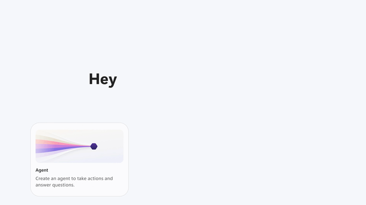
    

    

      官方架构动图 · Copilot Blog
      <h4 data-zh="智能体、工作流与微应用同台协同" data-en="One System for Agents, Workflows, and Apps">智能体、工作流与微应用同台协同</h4>
      
告别按单一技术拆割流程：用智能体负责推理决策，用工作流锁死确定性审批，用托管应用承接人机交互界面 [2]。

    

  </article>
  <article class="ignite-media-card">
    

      <video controls preload="none" poster="./media/customer-zero-poster.jpg">
        <source src="https://cdn-dynmedia-1.microsoft.com/is/content/microsoftcorp/1308869-customerzero-0x720-3266k" type="video/mp4" />
      </video>
    

    

      官方实拍案例短片 · Customer Zero
      <h4 data-zh="微软支持团队动态排障智能体：超 35% 全自主结案" data-en="Microsoft Support Dynamic Resolution Agent: 35%+ Autonomous Resolution">微软支持团队动态排障智能体：超 35% 全自主结案</h4>
      
微软内部支持团队结合推理模型、知识库与诊断工具处理复杂工单的完整构建复盘（官方公开 CDN 720p 直连流）[2]。

    

  </article>

## #maker-experience 02 / Pillar 01: Maker Experience :: 支柱一：创作体验重塑——极简设计器、智能节点工作流与托管应用合一 || Pillar 01: Maker Experience—Simpler Designers, AI-Infused Workflows, and Managed Apps

过去创作者常陷入“万物皆塞给智能体”的误区，结果在合规审批等环节既昂贵又不可控；另一端则是僵硬的传统自动化流一遇非结构化邮件或票据就报错中断 [1]。新版创作体验从底层打通了智能体（推理与异常处理）、工作流（确定性高效执行）与微应用（结构化交互视图），并把自然语言描述直接变成跨三类资产的最优组合架构 [1][2]。 || Makers previously fell into the trap of forcing every task into an LLM agent—driving up cost and unpredictability on compliance steps—while rigid classic flows broke whenever unstructured emails or invoices appeared [1]. The rebuilt maker experience unifies reasoning agents, deterministic workflows, and interactive micro-apps, letting natural-language prompts assemble the optimal mix automatically [1][2].

:::insight-grid { cols: 3, title: "第一支柱四大核心更新与商用状态 || Four Core Innovations in Maker Experience" }
::card 01
### 全新极简智能体设计器（正式商用） || Simpler Inline Agent Designer (GA)
砍掉繁琐的多层跳转菜单，在单屏右侧整合指令、主模型、工具、技能、知识库与持久记忆的行内配置，顶栏原生内置评测与运行监控标签页 [1]。 || Strips away nested menus into a single-view designer where instructions, model, tools, skills, knowledge, and memory configure inline alongside built-in Evaluate and Monitor tabs [1].

::card 02
### 确定性工作流嵌智能节点（正式商用） || Deterministic Workflows + AI Nodes (GA)
保留拖拽式确定性主干并大幅提速，支持一键切换“从上到下”或“从左到右”视图；在需要判断处精准嵌入智能体节点、0.06 秒决策评分分类节点、文档字段抽取节点与办公助手节点 [1][2][5]。 || Preserves fast deterministic steps with one-click top-to-bottom or left-to-right layout toggling, embedding Agent, decision-scoring Classify, document Extract, and Copilot nodes right where judgment is needed [1][2][5].

::card 03
### 托管应用商用与全入口构建（公测/商用） || Apps GA & Natural-Language Building
Copilot Studio 与协同画布中的微应用构建于 2026 年 11 月正式商用，底层由托管运行时自动沙盒承载并开放源码编辑；同时支持在协同画布或任意兼容模型上下文协议的命令行中一句话生成完整方案 [1][2]。 || Apps in Copilot Studio and Cowork reached GA in November 2026 on Copilot Managed Runtime with full code access, while natural-language solution building works across Cowork, Copilot Code, and MCP CLIs [1][2].
:::

在 BRK267 现场演示中，首席产品经理 Alice Appleton 在协同画布中输入一句自然语言诉求，便自动创建出“金融洞察智能体（Financial Insights Agent）” [1]。该智能体仅从晨星（Morningstar）权威行情服务拉取持仓相关性，自动复用组织现成的品牌邮件模板技能与公司《投资原则》文档 [1]。涉及外发客户邮件时，系统通过确定性工作流强制拦截并等待人工审批 [1]。整套深度持仓穿透在两分钟内跑完（甚至主动揪出单只科技股敞口超 10% 警戒线），单次运行成本仅约 1 美元 [1]。 || During the BRK267 live demo, Principal PM Alice Appleton entered a single prompt in Cowork to generate a complete **Financial Insights Agent** [1]. It pulled verified market data exclusively from the Morningstar server while reusing an existing branded email template skill and firm investment guardrails [1]. Before sending any client email, a deterministic workflow enforced mandatory human approval [1]. The multi-step portfolio analysis—proactively flagging an unprompted >10% single-stock concentration risk—finished in minutes for roughly $1 per run [1].

  <article class="ignite-media-card">
    

      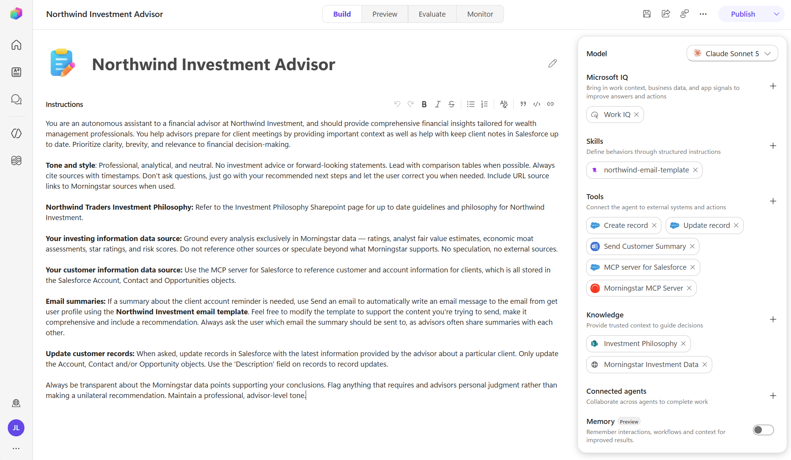
    

    

      BRK267 官方课件原图 · GA
      <h4 data-zh="全新单屏行内智能体设计器" data-en="Rebuilt Single-Pane Inline Agent Designer">全新单屏行内智能体设计器</h4>
      
一屏总览智能体指令、模型、工具、技能、知识与记忆，右侧支持零跳转行内调参 [1]。

    

  </article>
  <article class="ignite-media-card">
    

      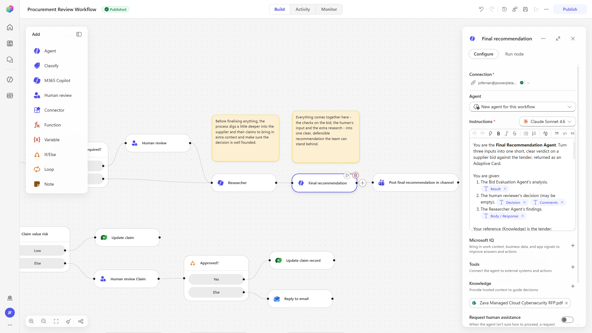
    

    

      BRK267 官方课件原图 · GA
      <h4 data-zh="确定性工作流融合智能推理节点" data-en="Deterministic Workflows Married with Agent Nodes">确定性工作流融合智能推理节点</h4>
      
人工审批与合规写入走确定性低成本分支，共享邮箱分派与合同抽取交给智能节点 [1][5]。

    

  </article>
  <article class="ignite-media-card">
    

      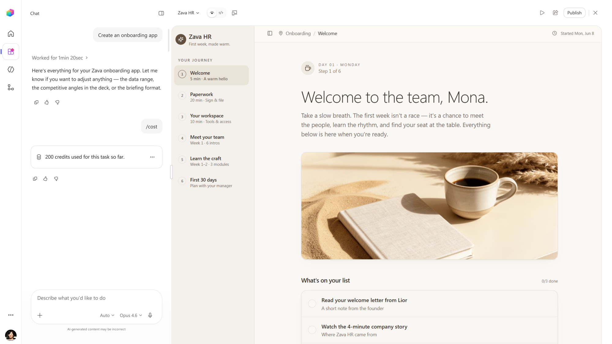
    

    

      BRK267 官方课件原图 · 11月 GA
      <h4 data-zh="Copilot Studio 托管微应用（Apps）" data-en="Apps Alongside Agents and Workflows">Copilot Studio 托管微应用（Apps）</h4>
      
自然语言描述业务诉求即可生成可编辑前端草稿并保留源码访问，由托管运行时统一治理 [1][2]。

    

  </article>
  <article class="ignite-media-card">
    

      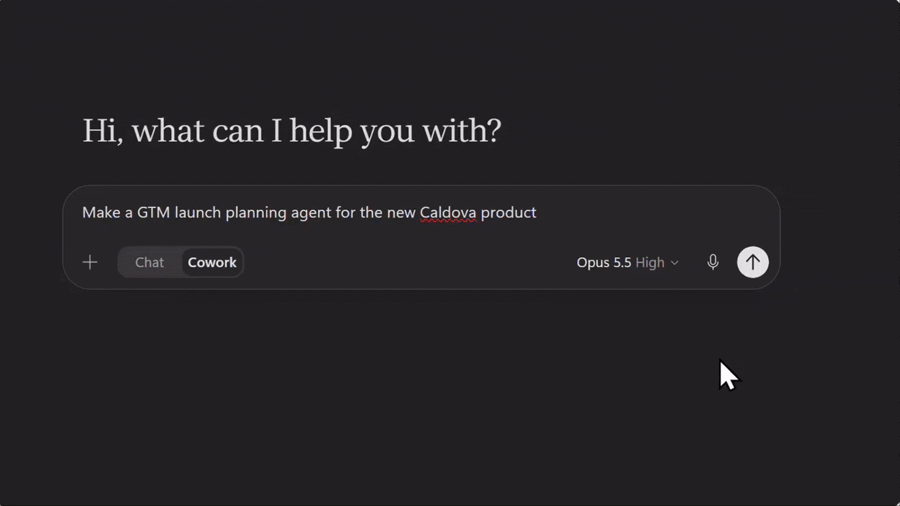
    

    

      官方实机演示动图 · Cowork
      <h4 data-zh="在协同画布中用自然语言拉起完整方案" data-en="Natural-Language Solution Authoring in Cowork">在协同画布中用自然语言拉起完整方案</h4>
      
业务人员直接描述上市规划或理财场景，系统自动编排智能体、技能与配套工作流 [2][4]。

    

  </article>

## #agent-capabilities 03 / Pillar 02: Agent Capabilities :: 支柱二：智能体内核与连接跃迁——三轨编排、独立员工账号与跨生态协议 || Pillar 02: Agent Capabilities—Three-Track Harnesses, Dedicated Accounts, and Open Protocols

智能体能否跑完几十步的真实业务马拉松，不仅取决于底层大模型，更取决于决定智能体如何规划、调工具与容错恢复的执行内核（Harness）[3]。微软已将原先演进自编码底座的新内核正式定名为 **Microsoft Copilot Harness**（与 Foundry 及协同画布同源共享），并与面向外部联络中心的 **Customer Conversation Harness** 及兼容存量的 **Standard Harness** 共同构成三轨矩阵 [1][2][3]。 || Completing multi-dozen-step business marathons depends as much on the execution harness—how the runtime plans, invokes tools, and recovers from errors—as on the underlying LLM [3]. Microsoft unified its flagship runtime as the **Microsoft Copilot Harness** (shared across Foundry and Cowork) alongside the **Customer Conversation Harness** and the **Standard Harness** [1][2][3].

:::figure { src: "./media/harness-quality-efficiency.figure.json", title: "Microsoft Copilot Harness 与经典底座同模型评测通过率对比 || Microsoft Copilot Harness vs. Classic Standard Harness Evaluation Pass Rates" }
图 2：固定同一模型（Claude Sonnet 4.6）与 50,000+ 验收题集时，新内核在四大场景全面跃升（代码分析暴涨 47.5 个百分点），且单次会话输入词元从 47.8K 砍至 26.5K；跨模型综合评测中 OpenAI 与 Anthropic 亦分别提升至 78.0% 与 89.1% [1][2][3]。 || Figure 2: Holding Claude Sonnet 4.6 and 50,000+ acceptance tasks constant, the new harness surges across all four categories (+47.5 pts in code analysis) while cutting average input tokens by 45% (47.8K to 26.5K); OpenAI and Anthropic overall pass rates reached 78.0% and 89.1% [1][2][3].
:::

为什么新内核能在发起近两倍模型调用的同时反而大幅省钱 [3]？官方技术拆解揭示了三大底层工程机制：其一，循环运行在具备命令行、代码执行与本地文件系统的**安全隔离容器**中，遇到 50,000 行电子表格导出时直接存为本地文件写脚本检索，不再硬塞进提示词窗口（同时绝不向容器暴露原始密码凭据）[3]；其二，每步都在已有上下文上增量推进，**83%–88% 的输入词元直接命中低价缓存**，使成本加权输入词元净降 15%–21% [3]；其三，当工具调用报错时，新内核在 **84%–91% 的回合中会像导航软件重新规划路线一样自主重试或换路**（其中约五分之二的失败工具在同一会话内最终调用成功），彻底打破“单步 5% 失败率叠加 10 步即导致约 40% 任务半途而废”的复合脆弱性定律 [3]： || How does the new harness make nearly twice as many model calls while cutting token spend [3]? Three runtime mechanisms drive the gain: first, the continuous loop executes inside a **secure container** equipped with a CLI, code execution, and local filesystem—querying 50,000-row exports as files via code rather than stuffing prompts while keeping raw credentials outside the container [3]; second, **83%–88% of input tokens serve from cache**, cutting cost-weighted input tokens by 15%–21% [3]; third, when a tool call fails, agents keep working in **84%–91% of turns** (recovering the failed tool roughly 40% of the time), overcoming the compound fragility where a 5% per-step error rate leaves ~40% of 10-step tasks unfinished [3]:

$$
P_{\text{fail-at-least-once}}(n=10,\,p=0.05) = 1 - (1 - 0.05)^{10} \approx 40.13\%, \qquad \Delta T_{\text{input}} = \frac{26.5\text{K} - 47.8\text{K}}{47.8\text{K}} \approx -44.56\%
$$

除了内核换代，第二支柱还围绕“让智能体从个人工具升级为团队数字同事”补齐了全套连接与认知拼图 [1][2][4][5]： || Beyond the runtime leap, Pillar 02 equips agents to evolve from personal tools into persistent digital teammates across six capability tracks [1][2][4][5]:

| 能力模块 || Capability | 发布状态 || Status | 核心工程机制与实测细节 || Engineering Mechanism & Verified Details |
|------|------|------|
| 专属智能体账号 || Dedicated Agent Accounts | 2026年12月公测（前沿预览已开） || Public Preview Dec 2026 | 赋予智能体独立目录身份、专属邮箱与聊天在线状态；同事可直接 `@提及` 交办周度预算核对，配合事件/定时触发器全天候推进共享流程 [2][4][5] || Grants a dedicated Entra ID, mailbox, and Teams presence; teammates `@mention` the agent while event/schedule triggers drive recurring processes [2][4][5] |
| 组织实时上下文 || Work IQ Default Grounding | 正式商用 || GA (Oct 2026) | 新建智能体默认挂载组织级实时邮件、会议纪要、文件与聊天上下文，并在遵循企业权限护栏前提下默认开启写操作支持 [5] || Added by default to every new Microsoft Copilot harness agent for real-time grounding across files, mail, meetings, and chats with governed write access [5] |
| 跨会话持久记忆 || Per-User & Process Memory | 正式商用 || GA | 同时记住个人习惯与最优工具调用路径，运行满一个月后因少走弯路而越用越快、越跑越省；终端用户可随时在门户查看或清空个人记忆 [1][5] || Remembers user preferences and optimal tool paths—making agents faster and cheaper over a month—while users can inspect or delete memories anytime [1][5] |
| 组织级技能注册表 || Reusable Skills Catalog | 公开预览 || Public Preview | 将指令集与连接器打包为可复用的 `.md` 技能文件，发布至微软插件注册表供全员共享，并由管理员在管理中心统一管控更新通知 [1][5] || Package modular `.md` instructions into the Microsoft plugin registry for org-wide reuse with update notifications and central Agent 365 governance [1][5] |
| 动态自动选模 || Auto Model Selection | 公开预览 || Public Preview | 由微软数据科学团队按任务所需的最低充分智力门槛与企业合规要求，动态路由最具性价比的前沿模型（手动换模另享 30 天旧模缓冲期）[1][5] || Dynamically routes each task to the most cost-efficient compliant model meeting the required intelligence bar, plus a 30-day grace window on model upgrades [1][5] |
| 聊天原生界面与互联通道 || MCP Apps & A2A Channels | 聊天界面商用 / 通道公测 || MCP Apps GA / A2A Preview | 聊天流内直接渲染交互式日历与图表微件并展示思维链及权限确认；同时支持将智能体暴露为远程服务或跨平台连接外部智能体 [1][4][5] || Renders interactive calendar/chart UI widgets, chain-of-thought traces, and auth prompts in chat while connecting Foundry, Agents SDK, and A2A agents [1][4][5] |

下方四宫格集中保留了来自 BRK267 原版幻灯片与微软官方十月/十一月发布博客的两段原生 `.mp4` 产品演示短片及两幅核心动图与截图——涵盖聊天内嵌交互微件（MCP Apps）、全渠道客服语音网页双栖助手、独立员工账号开通以及多智能体委托确认 [1][2][4]： || The four-card gallery below preserves two native `.mp4` product demo videos and two official animations/captures from the BRK267 slide deck and Microsoft Copilot Blog—covering interactive in-chat MCP Apps, Customer Conversation Harness banking support, dedicated agent account provisioning, and Agent2Agent delegation [1][2][4]:

  <article class="ignite-media-card">
    

      <video controls preload="metadata" poster="./media/brk267-mcp-apps-poster.png">
        <source src="./media/brk267-mcp-apps-demo.mp4" type="video/mp4" />
      </video>
    

    

      BRK267 内嵌实机演示视频 · GA
      <h4 data-zh="MCP Apps：在对话流内直接交互操作真实界面" data-en="MCP Apps: Interactive UI Widgets Directly Inside Chat">MCP Apps：在对话流内直接交互操作真实界面</h4>
      
提取自 BRK267 第 19 页原版课件视频：告别纯文本刷屏，直接在对话内点选日历、钻取数据图表并完成动作提交 [1]。

    

  </article>
  <article class="ignite-media-card">
    

      <video controls preload="metadata" poster="./media/contoso-assistant-poster.png">
        <source src="./media/contoso-customer-harness-demo.mp4" type="video/mp4" />
      </video>
    

    

      官方产品演示短片 · Customer Harness GA
      <h4 data-zh="Customer Conversation Harness：全渠道客服与平滑转人工" data-en="Customer Conversation Harness: Voice, Web & Live Escalation">Customer Conversation Harness：全渠道客服与平滑转人工</h4>
      
展示银行服务助手跨语音与网页处理客户诉求，并在复杂场景下携带完整对话摘要无缝交接人工代表 [2][4]。

    

  </article>
  <article class="ignite-media-card">
    

      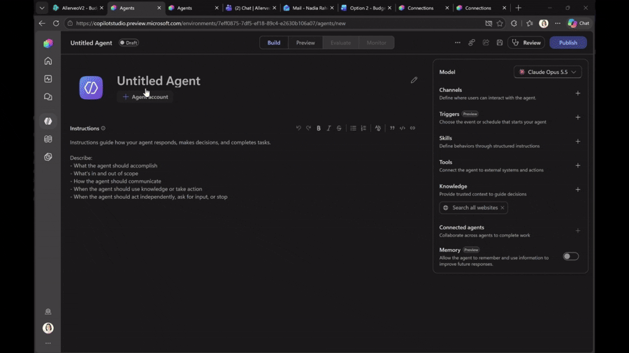
    

    

      官方配置动图 · Agent Account
      <h4 data-zh="一键为智能体开通专属身份与邮箱账号" data-en="Provisioning a Dedicated Agent Account in Studio">一键为智能体开通专属身份与邮箱账号</h4>
      
智能体不再借用创作者个人凭据，而是以受管数字员工身份独立收发邮件、响应群聊并接受安全审计 [2][4]。

    

  </article>
  <article class="ignite-media-card">
    

      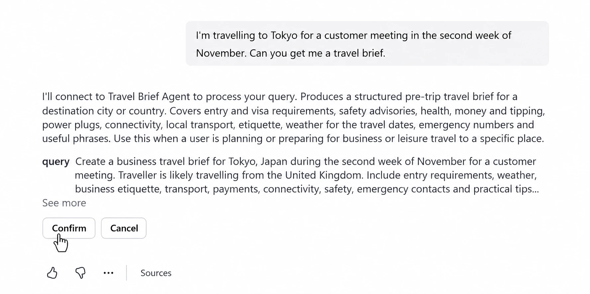
    

    

      官方界面实拍 · A2A 协议协同
      <h4 data-zh="跨平台智能体委托与透明确认护栏" data-en="Agent2Agent Delegation with Explicit User Confirmation">跨平台智能体委托与透明确认护栏</h4>
      
主控智能体将东京差旅简报任务路由给外部专职智能体前，向用户清晰展示委托详情并提供确认与取消按钮 [4][5]。

    

  </article>

## #governance-finops 04 / Pillar 03: Governance & FinOps :: 支柱三：百万级规模治理与 FinOps——评测比价、上线监控与额度账本 || Pillar 03: Governance & FinOps—Multi-Model Evals, Live Monitor, and Credit Ledger

几年前微软曾以为企业智能体数量会像内部应用一样停留在数万量级，后来又以为会与二十余万员工账号持平；但真实演进彻底击穿了旧假设——如今微软内部每天活跃运行的智能体已远超 **100 万个** [1]。当组织同时支持业务人员在协同画布里用自然语言生成智能体、又允许开发者在本地代码编辑器中通过模型上下文协议与源码仓库协作开发时（多创作者共享共建现已正式商用），治理与财务管控必须从第一天就内生于开发闭环之中 [1][2]。 || Years ago Microsoft expected enterprise agent counts to mirror internal apps (tens of thousands) or employee headcount (~250,000), yet Microsoft itself now runs **well over one million agents every single day** [1]. When business users generate solutions in Cowork while developers co-author agents from VS Code backed by GitHub repositories (with multi-maker agent sharing now GA), governance and cost discipline must start directly inside Copilot Studio [1][2].

:::flow { title: "企业级智能体从创作者准入到上线运营的四道治理闭环 || Four-Stage Governance Loop from Maker Sign-In to Production FinOps" }
1. **事前门禁：登录合规必读与受限能力前置置灰 || Pre-Build Guardrails: Audited Terms & Up-Front Policy Limits** — 创作者首次进入环境时必须点开审阅组织安全守则（确认回执写入合规中心供审计查验，且每次规则更新强制重新触达）；组织策略禁用的第三方连接器在画布中直接置灰显示，并附带一键申请审批联系人入口 [1]。 || Makers must open and acknowledge organizational security terms upon sign-in (logged in Microsoft Purview, overriding ‘don't show again’ on policy updates), while disallowed connectors appear greyed out up front with one-click approval contacts [1].
2. **发版前验证：内置评测集与多模型成本质量并排对决 || Pre-Publish Verification: Out-of-Box Evals & Multi-Model Cost Comparison** — 开箱内置通用质量、任务完成度、工具准确率与内容安全评分器，支持自定义分类器；发布前预检面板集中高亮配置阻断项 [1][6]。在 BRK267 演示中，同一套测试集跑在重型模型 Astra 上约需 `$2.00/次`，切换至中型模型 Sol 降至 `$0.50/次`，切换至轻量模型 Terra 仅需 `$0.40/次`，帮助团队结合思维链定性回放挑出最优性价比模型 [1]。 || Built-in graders score general quality, task completion, tool accuracy, and content safety while the Review panel flags setup blockers [1][6]. In BRK267, running the exact same eval suite cost `~$2.00` on Astra, `~$0.50` on Sol, and `~$0.40` on Terra—letting teams inspect qualitative reasoning traces before overpaying [1].
3. **上线后巡检：自然语言运行告警与全链路健康看板 || Post-Deployment Observability: Monitor Tab & Plain-Language Alerts** — 针对“99% 的真实难题都发生在上线之后”的痛点，监控面板汇总超时报错、工具失败率、成本异动与员工点赞点踩反馈，甚至支持在协同画布中直接用自然语言追问智能体健康度并获取调优建议（公开预览）[1]。 || Addressing the reality that 99% of operational challenges surface post-launch, the Monitor tab unifies error spikes, latency, cost drift, and user thumbs-up/down feedback with plain-language alerts and conversational diagnostics (Preview) [1].
4. **全局账本：智能体财务运营与闲置额度重分配 || Fleet Cost Control: FinOps for Agents & Credit Redistribution** — 正式商用的智能体财务看板打通双管理中心，按单个智能体、部门与用户组透视预付费包及按量计费消耗，支持设置级联预算上限、临近超额自动告警，并主动提示将低活跃组的闲置点数调拨给高价值业务线 [1][2][7]。 || Now GA across MAC and PPAC, FinOps for agents tracks prepaid and pay-as-you-go Copilot Credit spend per agent and user group, enforces cascading budgets and threshold alerts, and highlights unused credits for redistribution [1][2][7].
:::

  <article class="ignite-media-card">
    

      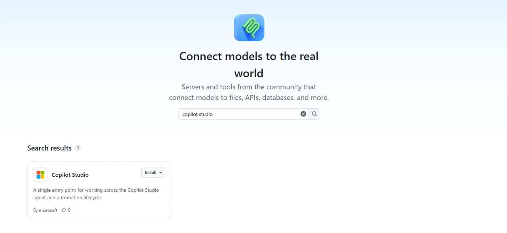
    

    

      官方目录截图 · Copilot Studio MCP
      <h4 data-zh="Copilot Studio MCP：在开发工具内闭环全生命周期" data-en="Copilot Studio MCP: Full Lifecycle Inside Your IDE">Copilot Studio MCP：在开发工具内闭环全生命周期</h4>
      
开发者在代码编辑器或命令行一键安装官方服务，即可直接创建、评测、迁移与监控智能体 [2][5]。

    

  </article>
  <article class="ignite-media-card">
    

      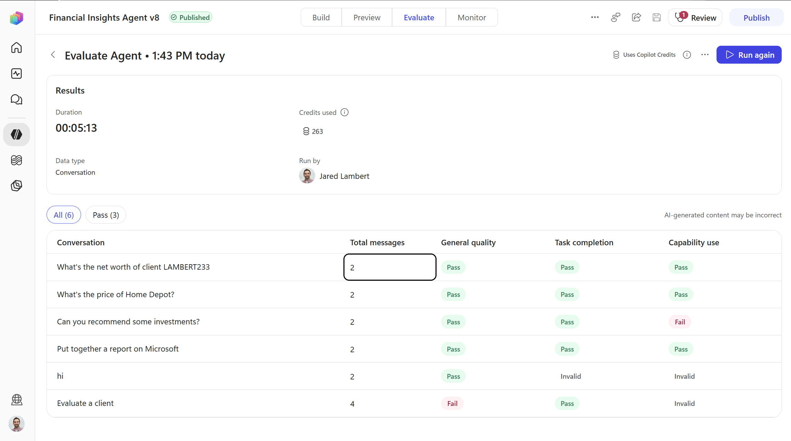
    

    

      BRK267 官方课件原图 · Evals GA
      <h4 data-zh="上线前多维度自动评测与模型横向比价" data-en="Pre-Publish Multi-Grader Evaluations & Model Benchmarking">上线前多维度自动评测与模型横向比价</h4>
      
用客观通过率、安全测试与单次运行成本（如 2 美元 vs 0.50 美元 vs 0.40 美元）替代凭感觉选模型 [1][6]。

    

  </article>
  <article class="ignite-media-card">
    

      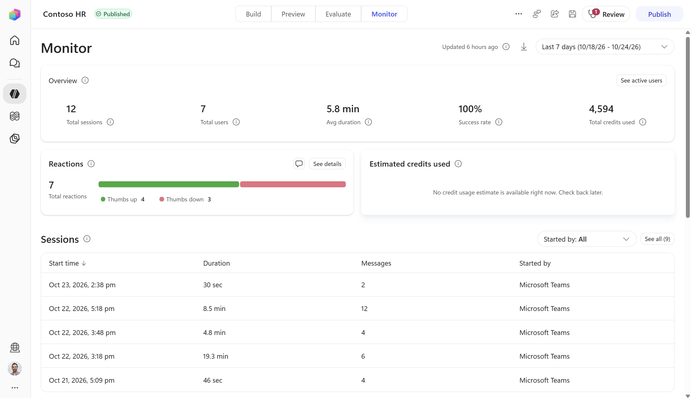
    

    

      BRK267 官方课件原图 · Monitor Preview
      <h4 data-zh="Monitor 面板：比终端用户更早发现质量漂移" data-en="Monitor Tab: Catch Quality Drift and Cost Spikes Early">Monitor 面板：比终端用户更早发现质量漂移</h4>
      
将运行成功率、工具超时、用户反馈与花费波动汇聚成直观的自然语言预警卡片 [1]。

    

  </article>
  <article class="ignite-media-card">
    

      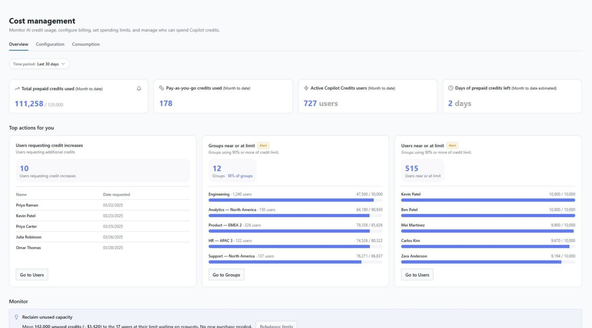
    

    

      官方控制台实拍 · FinOps GA
      <h4 data-zh="成本管理总览：预付/按量双轨监控与额度调拨" data-en="Cost Management Dashboard: Budgets, Alerts & Credit Reallocation">成本管理总览：预付/按量双轨监控与额度调拨</h4>
      
实时追踪活跃用户、剩余预估点数与逼近限额的部门预警，精准优化全组织算力账单 [2][7]。

    

  </article>

## #enterprise-blueprint 05 / Enterprise Architecture Blueprint :: 企业落地总纲：三轨执行内核选型与规模化推进矩阵 || Enterprise Blueprint: Harness Selection Matrix and Adoption Roadmap

面对 Ignite 2026 集中释放的数十项商用与公测特性，企业架构团队在落地方案时最忌回到“全流程硬塞单一大模型”的老路 [1][2]。结合 BRK267 与配套专场的实测边界，建议直接按业务确定性要求、交互渠道与组织规模执行分层对号入座 [1][3][5]： || With dozens of GA and preview capabilities shipping at Ignite 2026, enterprise architects should avoid forcing every step through a single prompt loop [1][2]. Based on BRK267 benchmarks and runtime boundaries, match workloads directly to the right execution track and governance tier [1][3][5]:

| 业务场景画像 || Workload Profile | 推荐主干组合 || Recommended Architecture Mix | 选型依据与成本护栏 || Rationale & Cost Guardrails |
|------|------|------|
| 跨系统长链路研究、表格穿透与周报核对 || Multi-step research, 50K-row data crunching & recurring ops | **Microsoft Copilot Harness** + 专属智能体账号 + 确定性审批工作流 [1][3][4] || **Microsoft Copilot Harness** + Agent Account + Approval Workflow [1][3][4] | 隔离容器写脚本查大表免撑爆上下文，83%–88% 缓存命中叠加 84%–91% 报错自愈；外发客户动作强制走确定性审批节点 [1][3] || Secure container handles large files via code with 83%–88% cache hits and 84%–91% tool recovery; deterministic nodes gate external writes [1][3] |
| 高并发外部客服、银行语音热线与人工坐席协同 || High-volume external voice/web support & live escalation | **Customer Conversation Harness** + 全渠道上下文交接 [2][4] || **Customer Conversation Harness** + Omnichannel Live Handoff [2][4] | 专为低延迟语音打断、多轮身份核验与携带完整摘要平滑转人工设计，避免通用长推理循环拉高首字等待 [2][4] || Tuned for low-latency voice turn-taking, structured verification, and context-preserving live agent escalation [2][4] |
| 高合规票据分拣、固定接口同步与轻量内部问答 || Strict compliance routing, fixed API sync & legacy FAQ | **确定性工作流嵌 Classify/Extract 节点** 或 **Standard Harness** [1][5] || **Deterministic Workflows + Classify/Extract Nodes** or **Standard Harness** [1][5] | 毫秒级分类评分（如 0.06 秒路由）与结构化抽取成本远低于完整智能体循环，存量稳定机器人无需强行迁移 [1][5] || Sub-second classification and extraction keep high-volume predictable pipelines fast and inexpensive [1][5] |

:::callout { title: "企业落地的三条黄金工程准则 || Three Golden Rules for Enterprise Rollout" }
其一，**按工序拆解而非按工具站队**：让智能体承接非结构化推理与异常兜底，让确定性工作流守住合规写入与人工确认，让托管微应用提供高密度表单与图表交互 [1][2]。其二，**上线前必过评测比价门禁**：先用内置评测集并排跑通重型、中型与轻量模型（如 `$2.00` vs `$0.50` vs `$0.40` 单次成本对照），确认最低充分智力门槛后再放开动态自动选模 [1][6]。其三，**用受管身份与额度账本替代创作者个人凭据**：为跨团队常驻智能体分配独立目录身份与级联预算告警，从源头杜绝权限越界与月底算力账单失控 [1][4][7]。 || First, **compose by task physics**—pair reasoning agents with deterministic approval workflows and interactive managed apps [1][2]. Second, **benchmark before publishing**—run multi-model evals ($2.00 vs. $0.50 vs. $0.40 per run) to lock the minimum viable intelligence tier [1][6]. Third, **govern identities and credits up front**—assign dedicated Entra agent accounts and cascading FinOps budgets instead of sharing maker credentials [1][4][7].
:::

## 参考资料：官方一手信源与工程规范 || References: Official Primary Sources & Engineering Guides

1. **Jason Moore & Alice Appleton (Microsoft Ignite 2026 BRK267)** — https://ignite.microsoft.com/en-US/sessions/1787856613640001EPcc-1791587921531001Fi0n?source=sessions | 《What's new in Copilot Studio》旗舰专场点播视频、官方原版幻灯片与完整演讲实录（2026-11-18） || Flagship breakout session on-demand recording, official PPTX deck, and full transcript (Nov 18, 2026)
2. **Jason Moore (Microsoft Copilot Blog)** — https://www.microsoft.com/en-us/copilot/blog/copilot-studio/build-and-manage-business-processes-with-microsoft-copilot-studio/ | 《Build and manage business processes with Microsoft Copilot Studio》Ignite 2026 官方发布综述（2026-11-18） || Official Ignite 2026 Copilot Studio announcement post, Asurion & Customer Zero metrics (Nov 18, 2026)
3. **Ben Appleby (Microsoft Copilot Blog)** — https://www.microsoft.com/en-us/copilot/blog/copilot-studio/how-the-microsoft-copilot-harness-in-copilot-studio-helps-agents-finish-the-job/ | 《How the Microsoft Copilot harness in Copilot Studio helps agents finish the job》安全容器、缓存与自愈实测数据（2026-11-09） || Engineering deep dive into containerized loop, 83%–88% cache hits, and 84%–91% tool failure recovery (Nov 9, 2026)
4. **Jason Moore (Microsoft Copilot Blog)** — https://www.microsoft.com/en-us/copilot/blog/copilot-studio/new-and-improved-agents-that-are-persistent-agents-for-customer-conversations-and-improved-maker-experience-in-microsoft-copilot-studio/ | 持久智能体账号、全渠道客服底座与十月特性总览（2026-11-04） || Persistent agent accounts, Customer Conversation harness demo, and October 2026 updates (Nov 4, 2026)
5. **Microsoft Learn Official Documentation** — https://learn.microsoft.com/en-us/microsoft-copilot-studio/whats-new | 《What's new in Copilot Studio》2026 年 6–10 月官方特性状态与技术规范文档 || Official monthly feature status matrix covering Work IQ GA, MCP/A2A channels, Extract node, and Auto models
6. **Jason Moore (Microsoft Copilot Blog)** — https://www.microsoft.com/en-us/copilot/blog/copilot-studio/new-and-improved-build-apps-extend-agents-and-transform-business-processes-in-microsoft-copilot-studio/ | 托管微应用、生命周期钩子与自定义评测器详解（2026-10-07） || Apps in Copilot Studio, lifecycle hooks, and custom evaluation graders overview (Oct 7, 2026)
7. **Microsoft Ignite 2026 Governance & Runtime Track (BRK259 / BRK261 / BRK262 / BRK379)** — https://ignite.microsoft.com/en-US/sessions/1787856612903001EK5O-1791588157241001CqrV?source=sessions | 《Scale agents, not risk: Governance and FinOps for the enterprise》及关联架构专场 || Enterprise governance, Purview maker policy audit, and Copilot Credit FinOps sessions
