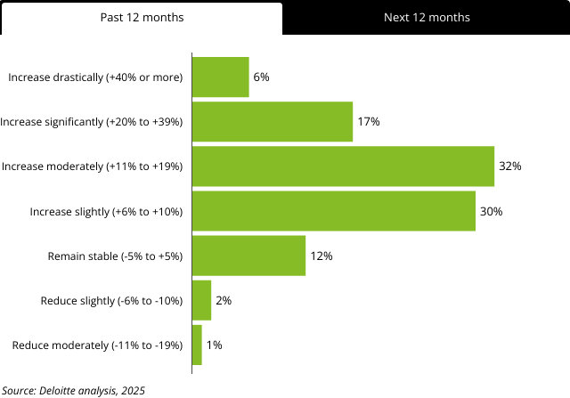
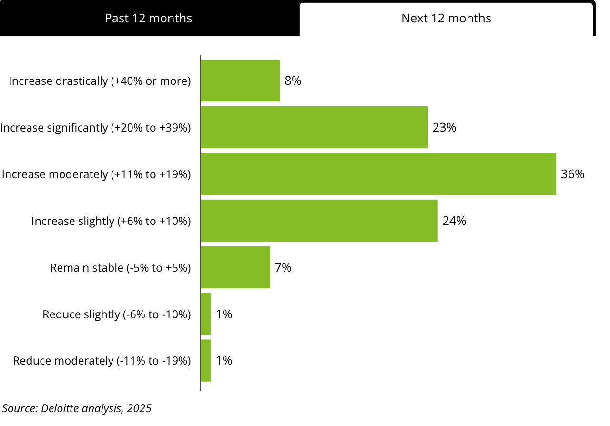
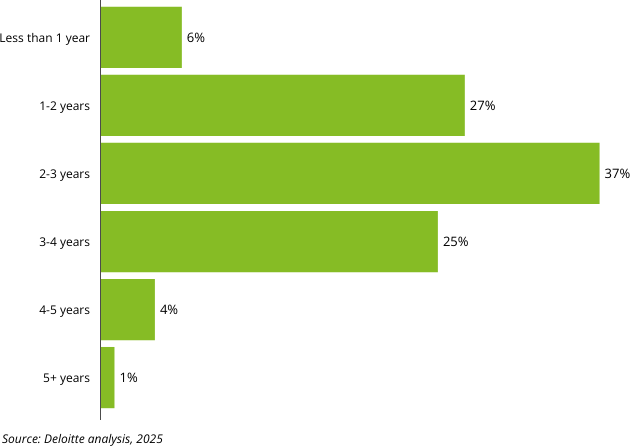

## #challenge 01 / The AI Value Challenge :: AI 投资炼金术悖论：活动激增，但业务价值兑现稀缺 || The Alchemist's Paradox of AI: Surging Activity, Scarce Business Value

Deloitte 2025 年调查显示，AI 投资仍在快速增长，但典型 AI 用例通常需要两到四年才能实现令人满意的 ROI，显著长于技术投资通常预期的 7–12 个月回收期。[1] || Deloitte's 2025 survey shows that AI investment continues to rise, while a typical AI use case usually takes two to four years to achieve satisfactory ROI, significantly longer than the seven-to-twelve-month payback commonly expected for technology investments.[1]

:::insight-grid { cols: 3 }
::card 01
### 85%
已增加 AI 投资 || Increased AI Investment

过去 12 个月增加了 AI 投资的组织比例。 || Organizations that increased AI investment in the past 12 months.

Figure 1 · Past 12 months：6% 大幅增加、17% 显著增加、32% 中度增加、30% 小幅增加。 || Figure 1 · Past 12 months: 6% increased drastically, 17% significantly, 32% moderately, and 30% slightly.

::card 02
### 91%
计划进一步增加 || Plan to Increase Further

未来 12 个月计划继续增加 AI 投资的组织比例。 || Organizations planning to increase AI investment over the next 12 months.

Figure 1 · Next 12 months：8% 计划大幅增加、23% 显著增加、36% 中度增加、24% 小幅增加。 || Figure 1 · Next 12 months: 8% plan to increase drastically, 23% significantly, 36% moderately, and 24% slightly.

::card 03
### 6%
一年内实现回收 || Payback Within One Year

典型 AI 用例在一年内实现投资回收的组织比例。 || Organizations whose typical AI use case achieves payback within one year.

Figure 2：2–3 年最常见（37%），其次为 1–2 年（27%）和 3–4 年（25%）。 || Figure 2: two to three years is most common (37%), followed by one to two years (27%) and three to four years (25%).
:::

:::callout { title: "「组织正在向 AI 投入资金，但回报兑现缓慢，也很难衡量。」 || \"Organizations are pouring in investment, yet returns are slow to materialize and hard to measure.\"" }
Deloitte 指出，AI 的价值通常不会独立出现，而是伴随数据质量改善、团队重组和运营流程优化，因此很难把收益单独归因于 AI。[1] || Deloitte notes that AI rarely delivers value in isolation; it is typically introduced alongside data-quality improvements, team reconfiguration, and operational streamlining, making AI's contribution difficult to isolate.[1]
:::

方法：Deloitte 于 2025-08-15 至 2025-09-05 调查欧洲与中东 14 个国家的 1,854 名高级管理者，并在法国、德国、荷兰和英国开展 24 次深度访谈；受访组织均已有日常 AI 实施。[1] || Method: Deloitte surveyed 1,854 senior executives across 14 countries in Europe and the Middle East from 15 August to 5 September 2025 and conducted 24 in-depth interviews in France, Germany, the Netherlands, and the United Kingdom; all surveyed organizations had AI implementations in daily use.[1]

## #root-causes 02 / Root-Cause Analysis :: ROI 延迟来自衡量、基础能力与组织转型三类系统缺口 || Delayed ROI Reflects Three Systemic Gaps in Measurement, Foundations, and Organizational Transformation

Deloitte 将 ROI 难以实现归纳为五项高管访谈主题。本指南进一步按可行动的系统边界将其归并为三类根因，但不把访谈主题解释为经统计识别的因果效应：这些结论说明障碍如何发生，不提供每项障碍对 ROI 延迟的独立贡献率。[1] || Deloitte identifies five executive-interview themes behind difficult AI ROI. This guide groups them into three actionable system boundaries without treating interview themes as statistically identified causal effects: they explain how barriers arise but do not quantify each barrier's independent contribution to delayed ROI.[1]

:::insight-grid { cols: 3, title: "AI ROI 延迟的三类系统根因 || Three Systemic Root Causes of Delayed AI ROI" }
::card 01
### 价值衡量体系与 AI 收益形态不匹配 || Value Measurement Does Not Match How AI Benefits Materialize
供应商关系、员工满意度和客户互动等收益重要但难以货币化；与此同时，工具和用例快速演进，项目中途的目标与指标会发生变化。结果是团队有活动数据，却缺少稳定的基线、归因口径和决策指标。[1] || Benefits such as vendor relationships, employee satisfaction, and customer engagement matter but are hard to monetize. Tools and use cases also evolve quickly, shifting expectations and metrics mid-project. Teams therefore collect activity data without stable baselines, attribution rules, or decision measures.[1]

::card 02
### 数据、平台与现实运行条件没有同步就绪 || Data, Platforms, and Real Operating Conditions Are Not Ready Together
孤立平台和碎片化系统阻碍前后对比，组织也容易高估数据成熟度。使用理想化虚拟数据的 PoC 可以顺利演示，但接入真实数据后才暴露质量、访问、连接和基础设施问题；Deloitte 还指出约四分之一组织将数据与基础设施不足视为 ROI 障碍。[1] || Siloed platforms and fragmented systems obstruct before-and-after measurement, while organizations often overestimate data maturity. PoCs can appear successful on unrealistic dummy data, only to expose quality, access, integration, and infrastructure problems with real data. Deloitte also reports that about one in four organizations cite inadequate infrastructure and data as an ROI barrier.[1]

::card 03
### AI 被当作工具部署，而不是业务与组织转型 || AI Is Deployed as a Tool Instead of a Business and Organizational Transformation
采用效果取决于文化阻力、员工使用和工作流调整；同时，AI 往往与数据质量提升、团队重组和运营优化一起发生，使其独立贡献难以分离。Agentic AI 的跨系统、多步骤自治进一步放大了流程设计、人工监督和变革管理要求。[1] || Adoption depends on cultural resistance, employee use, and workflow adaptation. AI is also introduced alongside data-quality improvement, team reconfiguration, and operational streamlining, making its standalone contribution hard to isolate. Agentic AI's cross-system, multi-step autonomy further increases demands for process design, human oversight, and change management.[1]
:::

:::accordion
::panel
### Deloitte 访谈识别的五项原始障碍 || Five Original Barriers Identified in Deloitte Interviews
五项障碍分别作用于价值定义、技术基础和组织采用，并共同拉长从 PoC 到可衡量成效的周期。 || The five barriers affect value definition, technical foundations, and organizational adoption, collectively extending the path from PoC to measurable outcomes.

1. 许多收益是无形的：员工满意度、客户互动和供应商关系难以直接货币化。 || Many benefits are intangible: employee satisfaction, customer engagement, and vendor relationships are difficult to monetize directly.
2. 平台孤立与数据质量不足：碎片化系统削弱前后对比，虚拟数据 PoC 隐藏真实运行问题。 || Siloed platforms and data-quality issues: fragmented systems weaken before-and-after comparison, while dummy-data PoCs conceal real operating problems.
3. 技术演进快于指标：工具和用例变化使能力边界与项目预期在执行中移动。 || Technology evolves faster than metrics: changing tools and use cases move capability boundaries and project expectations during execution.
4. 人的因素：文化阻力、员工采用和工作流适配决定技术能否进入日常工作。 || The human factor: cultural resistance, employee adoption, and workflow adaptation determine whether technology enters daily work.
5. AI 与更广泛转型纠缠：AI 常与数据、组织和运营变化同步发生，独立归因困难。 || AI is entangled with broader transformation: AI often coincides with data, organizational, and operational changes, complicating standalone attribution.
:::

## #positioning 03 / Program Introduction :: 把零散 AI 实验转成客户可验证、可治理、可持续的创新机制 || Turn Scattered AI Experiments into a Customer-Owned, Governed, and Evidence-Driven Innovation Motion

Agentic AI Innovation Accelerator 是一套由业务目标牵引、微软提供方法与教练、客户 IT 和业务团队共同执行的客户能力共建计划。它以 Copilot Studio 的 Agent、Workflow 和配套 App 为构建平台，通过统一的场景征集、优先级选择、动手构建、试点衡量与运营接管，将企业的 AI 规划转化为规模化业务采用；客户始终拥有场景、业务决策和运行责任。 || Agentic AI Innovation Accelerator is a business-led customer enablement program in which Microsoft provides the method and coaching while Customer IT and business teams execute together. Using Copilot Studio agents, workflows, and companion apps, it connects structured scenario intake, prioritization, hands-on building, pilot measurement, and operating handoff to move AI ambition toward enterprise adoption. The customer retains ownership of scenarios, business decisions, and operations.

:::insight-grid { cols: 3, title: "Agentic AI Innovation Accelerator 的三项目标 || Three Objectives of Agentic AI Innovation Accelerator" }
::card 01
### 把分散想法收敛为三个有 owner 的优先实验 || Converge Scattered Ideas into Three Owned Priority Experiments
通过业务启发、统一征集和价值 × 可行性评估，形成 Top 3 场景组合；每个场景明确业务 owner、当前基线、实验边界、数据依赖和验收标准。 || Use business inspiration, common intake, and value-versus-feasibility assessment to form a top-three portfolio. Every scenario has a business owner, current baseline, experiment boundary, data dependencies, and acceptance criteria.

::card 02
### 让客户团队亲自构建并取得可测试证据 || Enable Customer Teams to Build and Produce Testable Evidence
客户 maker、业务 SME 和 IT 共同完成关键路径，使用代表性样例验证功能、限制和人工接管；微软负责教练、架构建议和疑难排解，不替代客户构建。 || Customer makers, business SMEs, and IT complete the critical path and use representative examples to test function, limits, and human escalation. Microsoft provides coaching, architecture guidance, and unblock support rather than replacing the customer build.

::card 03
### 建立可继续运行的治理、采用与下一批创新机制 || Establish a Repeatable Governance, Adoption, and Next-Wave Innovation Motion
客户 IT / CoE 接收环境、发布、监控、支持和资产管理；业务 owner 按自身基线评估试点，Sponsor 决定迭代、有限上线、扩展或停止，并从 backlog 选择下一批机会。 || Customer IT / CoE receives environments, release, monitoring, support, and asset management. Business owners evaluate pilots against their own baselines, while the sponsor decides whether to iterate, release in a limited scope, expand, or stop and selects the next opportunities from the backlog.
:::

:::insight-grid { cols: 3, title: "计划定位与交付边界 || Program Positioning and Delivery Boundary" }
::card 01
### 而不是单纯的功能演示 || Not Just a Product Demo
Inspire · 启发 || Inspire

不枯燥罗列 Copilot Studio 的配置菜单。主要引入能引发客户共鸣的 AI 业务模式，让具体的痛点先于技术方案进入深入讨论。 || Avoid merely listing Copilot Studio configuration menus. Introduce AI application patterns that spark customer resonance, ensuring specific business pains drive the conversation before technical solutions.

::card 02
### 而不是纯听讲的理论培训 || Not Just Classroom Training
Empower · 培养 || Empower

跳出脱离实际的理论讲解。要求客户带入真实工作场景，由业务方提出领域要求与基线，IT 与业务协同，亲自构建出可验证核心想法的解决方案原型。 || Step away from abstract theory. Customers bring real work scenarios where the business names domain requirements and baselines, enabling business and IT to collaboratively build functional prototypes that validate the core idea.

::card 03
### 而不是接管环境的代建实施 || Not an Outsourced Delivery
Accelerate · 加速 || Accelerate

微软及生态伙伴作为教练提供技术与方法论支持，而非包揽所有代码和实施工作。由客户掌握业务产出成果，主导内部发布与规模化应用。 || Microsoft and its ecosystem provide methodological and technical coaching rather than writing all the code and doing all implementation. The customer owns business outcomes, manages internal releases, and leads scaled adoption.
:::

## #control 04 / Control Model and Process :: 五个阶段由五道决策闸串联，每次推进都要留下证据和责任人 || Five Phases Connect Through Five Decision Gates, Each with Evidence and an Accountable Owner

客户 Overview 定义了 Discover & Align、Inspire & Collect、Prioritize Top 3、Build & Learn、Adopt & Scale 五阶段。本指南把它落实为八周节奏和五道决策闸：发起人章程、用例锁定、MVP 演示、加固评审、CoE 交接。IT Readiness Check 与场景征集并行，是进入条件，不是第六道闸；没有规定证据，就不进入下一阶段。 || The customer overview defines five phases: Discover & Align, Inspire & Collect, Prioritize Top 3, Build & Learn, and Adopt & Scale. This guide operationalizes them as an eight-week rhythm with five decision gates: Sponsor Charter, Use Case Lock, MVP Demo, Hardening Gate, and CoE Handoff. The IT Readiness Check runs in parallel with intake as an entry condition, not a sixth gate. Progress stops when required evidence is absent.

:::diagram { src: "./media/program-matrix", title: "三角色 × 五阶段执行矩阵 || Three-Role × Five-Phase Execution Matrix" }
横向读取五个阶段，纵向比较三方责任；每个单元格按 Action → 进入条件 → 产出读取。 || Read the five phases from left to right and compare the three roles vertically; every cell follows Action → Entry Criteria → Output.
:::

:::comparison { title: "从客户 Overview 到执行指南 || From Customer Overview to Operating Guide" }
::versus 客户 Overview || Customer Overview
### 解释为什么参与、Program 是什么、客户会经历什么 || Explain Why to Participate, What the Program Is, and What the Customer Will Experience
用于 sponsor 对齐和客户沟通，覆盖 Program 定位、五阶段旅程、风险控制、运营节奏与场景分层。它建立共同语言，不承担逐项执行说明。 || Use it for sponsor alignment and customer communication. It covers program positioning, the five-phase journey, risk controls, operating cadence, and scenario tiers. It establishes shared language rather than step-by-step execution.

::versus 执行指南 || Operating Guide { highlight: true }
### 说明每阶段谁在何时填写什么、如何过门、失败后怎么办 || Define Who Completes What, When Each Gate Passes, and What Happens After Failure
用于 Program 团队、客户 IT、业务 owner 和 sponsor 共同推进。每个阶段都给出交付物、最低证据、批准人、复盘节奏和降级路径。 || Use it jointly across the program team, Customer IT, business owners, and the sponsor. Every phase specifies deliverables, minimum evidence, approvers, review cadence, and fallback routes.
:::

:::callout { title: "Program 承诺产出验证证据并完成阶段决策，不承诺固定 ROI 或生产级交付。 || The Program Commits to Validation Evidence and Gate Decisions, Not Fixed ROI or Production-Grade Delivery." }
章程中的 12 周 ROI 窗口是首次成效复盘时点，不是回报保证；Workshop 产出可测试 MVP，不等于已获生产批准。客户成效必须根据自身基线、运行成本、采用和风险共同判断。 || The 12-week ROI window in the charter is the first outcome-review point, not a return guarantee. A workshop produces a testable MVP, not production approval. Customer outcomes must be judged against the customer's own baseline, operating cost, adoption, and risk.
:::

## #solution-mapping 05 / Program Response :: 五阶段 Program 用三组控制机制逐项回应系统根因 || The Five-Phase Program Responds to the Systemic Root Causes Through Three Control Mechanisms

Program 已明确为一套从对齐、征集、筛选、构建到接管的客户自驱机制。它不保证消除所有外部约束，而是把三类根因转化为可核查的阶段任务、决策闸和证据：问题未解决时缩小范围、延后或停止，而非继续追加功能。 || The program is a customer-led mechanism spanning alignment, intake, selection, build, and handoff. Rather than promising to remove every external constraint, it converts the three root causes into inspectable phase work, decision gates, and evidence. When a problem remains unresolved, the program reduces scope, defers, or stops instead of adding features.

:::insight-grid { cols: 3, title: "三类根因与 Program 控制机制的对应关系 || How the Three Root Causes Map to Program Controls" }
::card 01
### 衡量失配 → 先定义价值，再锁定验收 || Measurement Mismatch → Define Value Before Locking Acceptance
同时使用财务和非财务指标，先记录当前基线和衡量窗口，再以同一口径筛选、验收和复盘。 || Use financial and nonfinancial measures together, recording the current baseline and measurement window before applying the same criteria to selection, acceptance, and review.

- 机制：基线定义 + 成功指标 + Outcome Scorecard || Mechanism: baseline definition + success measures + outcome scorecard
- 路径：发起人章程 → 用例锁定 → 季度评审 || Path: Sponsor Charter → Use Case Lock → Quarterly Review
- 证据：签署的 Charter、场景基线、验收口径与试点评分卡 || Evidence: signed charter, scenario baseline, acceptance criteria, and pilot scorecard
- 边界：没有基线或 owner，不进入 Top 3；证据不足则延长试点 || Boundary: no baseline or owner means no top-three admission; insufficient evidence extends the pilot

::card 02
### 基础未就绪 → 并行检查，并用真实条件加固 || Unready Foundations → Assess in Parallel and Harden Under Real Conditions
在场景征集期间同步核对环境、身份、数据、连接和治理条件；构建必须使用代表性样例，并在有限上线前关闭运行缺口。 || Assess environment, identity, data, integration, and governance conditions during intake; build with representative examples and close operating gaps before limited release.

- 机制：Readiness 检查 + 代表性测试 + 运行加固 || Mechanism: readiness assessment + representative testing + operational hardening
- 路径：并行 IT Readiness Check → MVP 演示 → 加固评审 || Path: Parallel IT Readiness Check → MVP Demo → Hardening Gate
- 证据：访问矩阵、数据与连接清单、测试集、Hardening Backlog || Evidence: access matrix, data and connection inventory, test set, and hardening backlog
- 边界：关键数据或平台路径不可用则缩小范围或延后；Demo 不替代上线批准 || Boundary: unavailable critical data or platform paths reduce scope or defer; a demo never substitutes for release approval

::card 03
### 工具式部署 → 业务认领、亲自构建并接管运营 || Tool-Led Deployment → Business Ownership, Customer Build, and Operating Handoff
业务 owner 对场景和验收负责，客户团队亲自构建；试点持续检查使用与人工接管，最终由 CoE 接收运行资产和下一批创新机制。 || Business owners own scenarios and acceptance while customer teams build; pilots review usage and human escalation, and the CoE ultimately receives operating assets and the next-wave innovation mechanism.

- 机制：业务认领 + 客户动手 + 使用评审 + CoE 接管 || Mechanism: business ownership + customer build + usage review + CoE handoff
- 路径：Qualified Backlog → MVP Demo → CoE Handoff || Path: Qualified Backlog → MVP Demo → CoE Handoff
- 证据：具名 owner 与 RACI、真实用户测试、采用记录、Runbook || Evidence: named owner and RACI, real-user tests, adoption records, and runbook
- 边界：没有 sponsor、业务 owner 或运营责任就停止规模化；Program 不替代客户变革管理 || Boundary: stop scale-up without a sponsor, business owner, or operating ownership; the program does not replace customer change management
:::

## #align 06 / Discover & Align :: 发起人章程是第 0 周闸门；IT Readiness Check 与征集并行完成 || The Sponsor Charter Is the Week 0 Gate; the IT Readiness Check Runs in Parallel with Intake

启动阶段确定谁有权做决定、客户愿意投入什么、哪些数据和平台条件可用，以及何种证据足以继续。发起人缺席时，Program 不进入阶段 01。IT 阻塞没有 owner 时，不进入 Top 3 选择。 || Initiation establishes decision authority, customer commitment, available data and platform conditions, and the evidence required to proceed. If the sponsor is absent, the program does not enter Stage 01. If an IT blocker has no owner, the program does not advance to top-three selection.

:::insight-grid { cols: 3, title: "启动阶段的三项交付物 || Three Initiation Deliverables" }
::card 01
### 发起人章程 || Sponsor Charter
记录业务目标、范围、决策机制、参与部门、人员投入、风险接受、停止条件和 12 周 ROI 窗口，由具名发起人在阶段 01 开始前签署。 || Record business goals, scope, decision rights, participating functions, staffing, risk acceptance, stop conditions, and the 12-week ROI window; obtain named sponsor signature before Stage 01 begins.

::card 02
### Stakeholder Map
明确 sponsor、客户协调人、客户 IT owner、业务 owner、SME、maker、最终用户和批准人，并为每项交付物只指定一个 owner。 || Identify the sponsor, customer coordinator, Customer IT owner, business owners, SMEs, makers, end users, and approvers, assigning one owner to every deliverable.

::card 03
### IT Readiness Check
与场景征集并行核对环境、身份、许可、数据、连接器、DLP、ALM 和支持路径。它是进入条件，不是独立决策闸；每个缺口都要有 owner、日期和降级方案。 || Check environments, identity, licensing, data, connectors, DLP, ALM, and support in parallel with intake. This is an entry condition, not a standalone gate. Every gap needs an owner, due date, and fallback.
:::

:::accordion
::panel
### 五道决策闸的最低证据 || Minimum Evidence for the Five Decision Gates
决策闸只回答是否可以继续；阶段负责完成工作。每道闸都要有证据、批准人和未通过时的处理路径。IT Readiness Check 与征集并行，不单独占一道闸。 || A gate answers whether the program may continue; a phase performs the work. Every gate requires evidence, an approver, and a route when it fails. The IT Readiness Check runs in parallel with intake and does not occupy its own gate.

| 决策闸 || Gate | 参考时间 || Illustrative Timing | 最低证据 || Minimum Evidence | 批准人 || Approver |
| --- | --- | --- | --- |
| 发起人章程 || Sponsor Charter | 第 0 周 || Week 0 | 业务目标、决策委员会、退出条件与 12 周 ROI 窗口 || Goals, decision board, exit criteria, and 12-week ROI window | 客户发起人 || Customer Sponsor |
| 用例锁定 || Use Case Lock | 第 2 周 || Week 2 | Top 3、用例画布、RACI 与成功度量 || Top three, use-case canvases, RACI, and success measures | 发起人 + 业务 Owner + 客户 IT || Sponsor + Business Owner + Customer IT |
| MVP 演示 || MVP Demo | 第 4 周 || Week 4 | 第一个可用 agent 对照成功标准完成验证 || First working agent validated against success criteria | 业务 Owner || Business Owner |
| 加固评审 || Hardening Gate | 第 6 周 || Week 6 | 可观测性、评测集、回滚与安全评审通过 || Observability, evaluation suite, rollback, and security review passed | 客户 IT + 业务 Owner || Customer IT + Business Owner |
| CoE 交接 || CoE Handoff | 第 8 周 || Week 8 | 客户 IT 接手运营，运行手册与支持路径到位 || Customer IT takes operations, with runbook and support path in place | 客户 IT / CoE || Customer IT / CoE |

::panel
### 入口诊断：成熟度、资源与目标 || Entry Diagnosis: Maturity, Resources, and Goal
十二道题只回答从哪一层起步，不替代发起人章程。成熟度与资源共同决定「可承载的层级」，目标单独界定「期望的层级」；建议起步层级不超过当前可承载范围。两者之间的落差正是仅 6% 用例一年内回收的症结：能建出原型，不等于能上线并持续运行。 || Twelve questions decide the starting tier; they do not replace the Sponsor Charter. Maturity and resources combine into the supported tier, while goal names the ambition tier. The recommended start never exceeds what can be supported. That gap explains the 6% one-year payback rate: the ability to build a prototype is not the ability to ship and sustain.

1. 起步：熟悉度和工具均未就绪时，前几周先夯实环境与治理基础，不直接构建 agent。 || Nascent: when familiarity and tooling are both missing, the first weeks focus on environment and governance groundwork rather than building agents.
2. 匹配：目标与现有基础一致时，从对应层级进入阶段 01，由决策闸而非日历决定推进节奏。 || Aligned: when goal and readiness match, enter Stage 01 at that tier and let decision gates, not the calendar, set the pace.
3. 差距：目标超出当前基础时，先补齐许可、环境与共同语言，再锁定 Top 3 场景。 || Gap: when ambition outruns readiness, close licensing, environment, and shared-vocabulary gaps before locking the top three scenarios.
4. 余量：现有基础高于目标层级时，在评审会上确认范围是否过于保守，但不自动升入第 3 层。 || Headroom: when readiness exceeds the stated goal, confirm in the review whether scope was set too conservatively rather than auto-promoting to Tier 3.
:::

## #collect 07 / Inspire & Collect :: 先用分层案例打开想象，再用统一表单把想法变成可评估场景 || Use Tiered Examples to Expand Possibilities, Then a Common Intake to Create Assessable Scenarios

场景征集不是功能愿望清单。每个提交必须说明用户、当前流程、问题频次、涉及数据与系统、预期变化和业务 owner。三个层级同时决定启发范围和交付动作：第 1 层自助、第 2 层按已验证范本改造、第 3 层由交付伙伴在同一套闸门内实施。它们不是产品 SKU。 || Scenario intake is not a feature wish list. Every submission must state users, the current process, problem frequency, data and systems involved, expected change, and business owner. The three tiers set both inspiration scope and delivery motion: self-serve at Tier 1, adaptation of a proven pattern at Tier 2, and partner-led delivery inside the same gates at Tier 3. They are not product SKUs.

:::comparison { title: "三层场景启发与征集边界 || Three Scenario Inspiration and Intake Tiers" }
::versus Tier 1 · Everyday Productivity
### 高频、低复杂度、业务用户可自助 || Frequent, Low-Complexity, and Business-User-Led
适合邮件分流、发票或订单识别、外部数据收集等重复工作。以节省处理时间和减少手工步骤为目标，通常以天为单位形成原型。 || Suitable for email routing, invoice or order recognition, and external data collection. Target handling-time reduction and fewer manual steps; prototypes are commonly measured in days.

- 难度：低 || Complexity: Low
- 业务影响：个人或团队效率 || Impact: Individual or team productivity
- 目标受众：广泛业务用户 || Audience: Broad business users

> **交付动作 || Delivery Motion**
> 自助：业务人员自主构建；IT 设定安全护栏并下放日常操作。计划交付的是构建能力，不是替客户交付 agent。 || Self-serve: business users build on their own once IT sets security guardrails and delegates day-to-day execution. The program delivers building capability, not the agent itself.

::versus Tier 2 · Process Innovation { highlight: true }
### 面向专业人员的多步任务与可复用流程 || Multi-Step Specialist Tasks and Reusable Processes
适合文档审查、复杂文档生成和 AI 翻译等需要集成、领域判断与人工检查点的工作。通常需要客户 IT 参与，以周为单位构建和验证。 || Suitable for document review, complex document generation, and AI translation requiring integration, domain judgment, and human checkpoints. Customer IT typically participates, with build and validation measured in weeks.

- 难度：中 || Complexity: Medium
- 业务影响：任务周期与质量 || Impact: Task cycle time and quality
- 目标受众：Power Users 与流程 owner || Audience: Power users and process owners

> **交付动作 || Delivery Motion**
> 案例牵引：专才与业务并肩，按最接近的参考资产走完「之前 → 方案 → 之后」，再复用到相似流程。 || Case-led: specialists build alongside the business, walking the closest reference asset from before to after, then reuse the pattern.

::versus Tier 3 · Agentic Processes
### 跨系统、持续运行、企业级影响 || Cross-System, Continuous, Enterprise-Scale Impact
适合运营 Agent、业务系统 Agent 和销售或现场服务运营 Agent。需要安全、治理、可观测性、人工接管和跨团队运营设计，不适合作为单日 Workshop 的完整上线目标。 || Suitable for operations agents, business-system agents, and sales or field-service operations agents. These require security, governance, observability, human escalation, and cross-functional operating design; they are not a full production target for a one-day workshop.

- 难度：高 || Complexity: High
- 业务影响：跨团队流程结果 || Impact: Cross-team process outcomes
- 目标受众：业务 owner、IT 与运营团队 || Audience: Business owners, IT, and operations

> **交付动作 || Delivery Motion**
> 伙伴主导：交付伙伴跑构建，客户 IT 把守治理、安全和交接；伙伴离开后，能力留在 CoE。 || Partner-led: a delivery partner runs the build while Customer IT holds governance, security, and handover; the partner leaves, the capability stays.
:::

:::accordion
::panel
### 场景征集表与 Lab 路径 || Scenario Intake Fields and Lab Path
提交必须补齐用户、owner、当前流程、频次、输入输出、数据、系统、人工检查点和基线。场景点名需要的能力，Lab 只教那一项；部门路径按前置条件展开，而不是按固定课表上课。产品构建入口的选择属于动手阶段的能力，不在征集阶段预先指定。 || Submissions must identify users, owner, current process, frequency, inputs and outputs, data, systems, human checkpoints, and baseline. A scenario names the work; a lab teaches the one capability that work needs. Department paths expand over prerequisites rather than following a fixed syllabus. Choosing a product build surface belongs to the hands-on stage, not to intake.

1. 先写清任务、用户、数据、动作、渠道和负责人，再选构建入口。 || Write the job, users, data, actions, channel, and owner before choosing a build surface.
2. 动手路径由场景所需能力加上前置条件组成，不另写一份私有课表。 || The hands-on path is composed from required capabilities plus prerequisites; it is not a private syllabus.
3. 每个 Lab 都要留下验收产物；没有证据，不能把模块标成已完成。 || Every lab leaves an acceptance artifact; a module is not complete without that evidence.
:::

## #prioritize 08 / Prioritize Top 3 :: 用例锁定把三个候选想法变成有 owner、基线和固定边界的实验 || Use Case Lock Turns Three Candidate Ideas into Owned, Baseline-Driven, Bounded Experiments

选择会议不按热度或部门声量排序，也不要求每个层级各选一个。评分用四轴 1–5：价值、数据就绪度（越高越好），复杂度、工作量（越低越好）。微软主持评分，客户 IT 判断数据与运营条件，业务 owner 对基线和验收负责，发起人在依赖和资源透明后批准 Top 3。 || The selection meeting does not rank by enthusiasm or departmental influence, nor does it require one scenario from each tier. Scoring uses four 1–5 axes: value and data readiness (higher is better), complexity and effort (lower is better). Microsoft facilitates scoring, Customer IT evaluates data and operating conditions, business owners own baselines and acceptance, and the sponsor approves the top three after dependencies and resources are visible.

| 评分轴 || Axis | 方向 || Direction | 必须回答的问题 || Required Answer | 未通过时处理 || If the Gate Fails |
| --- | --- | --- | --- |
| 价值 || Value | 越高越好 || Higher is better | 改善哪个周期、质量、产能或风险指标？ || Which cycle-time, quality, capacity, or risk measure changes? | 回到场景澄清 || Return to scenario clarification |
| 数据就绪度 || Data Readiness | 越高越好 || Higher is better | Workshop 能否获得代表性样例和合法访问路径？ || Can the workshop obtain representative examples and an approved access path? | 缩小范围或延后 || Reduce scope or defer |
| 复杂度 || Complexity | 越低越好 || Lower is better | 关键路径能否在第 4 周形成可测试 MVP？ || Can the critical path become a testable MVP by Week 4? | 拆分成更小实验 || Split into a smaller experiment |
| 工作量 || Effort | 越低越好 || Lower is better | 谁处理权限、日志、异常、变更与发布？ || Who handles access, logs, exceptions, change, and release? | 保留为学习样例，不进入试点 || Keep as a learning example, not a pilot |

## #build 09 / Build & Learn :: MVP 演示证明关键路径，加固评审决定是否具备有限上线条件 || The MVP Demo Proves the Critical Path; the Hardening Gate Decides Whether Limited Release Is Viable

Workshop 或构建冲刺结束时得到的是可测试 MVP，不是生产承诺。业务团队先用代表性样例验收关键路径，客户 IT 再检查安全、评估、可观测性、ALM、容量、回退和支持。两道闸都通过后，才可进入受控试点。 || A workshop or build sprint produces a testable MVP, not a production promise. Business teams first validate the critical path with representative examples; Customer IT then reviews security, evaluation, observability, ALM, capacity, rollback, and support. A controlled pilot begins only after both gates pass.

:::comparison { title: "MVP Demo 与 Hardening Gate 的差异 || How the MVP Demo Differs from the Hardening Gate" }
::versus MVP 演示 · 第 4 周 || MVP Demo · Week 4
### 业务可用性证据 || Business-Usefulness Evidence
展示输入、动作、输出和人工检查点；用正常、边界、错误和敏感样例记录期望、实际结果与人工判断；同时公开限制、失败和下一轮待办。未通过时回到实验设计或停止。 || Demonstrate inputs, actions, outputs, and human checkpoints. Record expectations, actual results, and human judgment across normal, boundary, error, and sensitive examples. Expose limitations, failures, and the next backlog. If the gate fails, return to experiment design or stop.

::versus 加固评审 · 第 6 周 || Hardening Gate · Week 6 { highlight: true }
### 有限上线准备证据 || Limited-Release Readiness Evidence
确认权限和数据合规、评估与监控、人工接管、回退、版本发布、容量监控和支持路径。未通过时继续加固，不得以演示成功替代上线批准。 || Confirm compliant access and data, evaluation and monitoring, human escalation, rollback, versioned release, capacity monitoring, and support. If the gate fails, continue hardening; a successful demo does not substitute for release approval.
:::

:::accordion
::panel
### 构建周节奏与四方责任 || Build-Week Cadence and Four-Party Accountability
每周 Build Clinic 关闭技术阻塞，每周 Test Review 更新测试证据，decision log 持续记录决定、依据、owner 和待验证假设；每项结果只有一个明确 owner。 || A weekly build clinic closes technical blockers, a weekly test review updates evidence, and the decision log records decisions, rationale, owners, and hypotheses to validate. Every outcome has one explicit owner.

| 角色 || Role | 负责 || Owns | 不负责 || Does Not Own | 核心决策 || Core Decision |
| --- | --- | --- | --- |
| 微软 || Microsoft | 方法、场景启发、评分引导、产品架构、Workshop 教练与疑难排解 || Method, scenario inspiration, scoring facilitation, product architecture, workshop coaching, and unblock support | 客户内部优先级、业务验收和上线运营 || Customer priorities, business acceptance, or production operations | 建议构建模式与风险边界 || Recommend the build pattern and risk boundary |
| 客户 IT || Customer IT | Program 协调、环境、权限、连接器、平台标准、发布和支持路径 || Program coordination, environments, access, connectors, platform standards, release, and support path | 代替业务定义价值或验收 || Defining value or accepting outcomes for the business | 平台 readiness 与运营可接续性 || Platform readiness and operability |
| 业务团队 || Business Teams | 当前流程、领域知识、真实样例、基线、验收、使用反馈与采用 || Current process, domain knowledge, real examples, baseline, acceptance, feedback, and adoption | 环境管理和平台级发布 || Environment management or platform-level release | 场景是否达到业务验收标准 || Whether the scenario meets business acceptance criteria |
| 客户 Sponsor || Customer Sponsor | 跨部门优先级、资源、冲突处理和规模化决策 || Cross-functional priority, resources, conflict resolution, and scale decisions | 日常构建和测试 || Day-to-day building or testing | 选择三个场景；批准试点；决定规模化或停止 || Select the three scenarios, approve pilots, and decide whether to scale or stop |
:::

## #adopt 10 / Adopt & Scale :: CoE 交接把技术资产、运营责任和成效复盘一起交给客户 || CoE Handoff Transfers Technical Assets, Operating Ownership, and Outcome Review Together

Handoff 确认哪些场景获准有限上线、谁负责运行和支持、哪些风险被接受、指标在哪里查看，以及何时由 sponsor 决定迭代、扩展或停止。它不表示所有 MVP 已达到生产要求。 || Handoff confirms which scenarios are approved for limited release, who operates and supports them, which risks are accepted, where measures are reviewed, and when the sponsor will decide whether to iterate, expand, or stop. It does not imply that every MVP is production-ready.

:::insight-grid { cols: 2, title: "客户接管后的四项运营机制 || Four Operating Mechanisms After Customer Handoff" }
::card 01
### 每周 Office Hours || Weekly Office Hours
按原型待办处理产品使用、数据连接和设计问题；会议结论写回同一个场景 backlog。 || Resolve product, data-connection, and design issues from the prototype backlog and write every decision back to the same scenario record.

::card 02
### 业务使用与异常评审 || Business Usage and Exception Review
业务 owner 检查使用样例、完成率、错误、人工接管和基线变化，决定下一轮只解决一个最高优先问题。 || The business owner reviews usage examples, completion, errors, human escalation, and baseline movement, then selects one highest-priority issue for the next iteration.

::card 03
### Champion Community
客户 IT 维护 maker、模板、连接模式、提示、测试样例和复盘记录。内部 badge 只表示完成 Program 实践，不等同于微软官方认证。 || Customer IT maintains makers, templates, connection patterns, prompts, test examples, and review records. Any internal badge only recognizes program completion and is not a Microsoft certification.

::card 04
### 季度 Sponsor Review || Quarterly Sponsor Review
比较业务效果、采用、全负担运行成本、风险和复用情况，决定迭代、扩展、补平台能力或停止，并选择下一批机会。 || Compare business effect, adoption, fully burdened operating cost, risk, and reuse; decide whether to iterate, expand, strengthen platform capability, or stop; then select the next opportunities.
:::

:::comparison { title: "试点评分卡与扩展决策 || Pilot Scorecard and Scale Decision" }
::versus 最低评分卡 || Minimum Scorecard
### 比较试点与启动前基线 || Compare the Pilot with the Pre-Program Baseline
- 任务周期或每次处理耗时 || Task cycle time or handling time per case
- 一次通过率、错误率或返工率 || First-pass rate, error rate, or rework rate
- 使用人数、使用频次与完成率 || Active users, frequency, and completion rate
- 许可、容量、支持、评估与维护的全负担成本 || Fully burdened licensing, capacity, support, evaluation, and maintenance cost

::versus 决策规则 || Decision Rule { highlight: true }
### 只有业务改善与运营可承受同时成立才进入下一步 || Advance Only When Business Improvement and Operability Both Hold
指标改善但运营负担不可接受时，缩小范围或补平台能力；运营稳定但指标未改善时，回到流程和用户需求；证据不足时延长有限试点。只有证据支持且风险被明确接受，才扩大范围。 || If measures improve but operating burden is unacceptable, reduce scope or strengthen platform capability. If operations are stable but measures do not improve, revisit the process and user need. If evidence is insufficient, extend the limited pilot. Expand only when evidence supports the decision and risks are explicitly accepted.
:::

## #assets 11 / Reusable Asset Library :: 每道决策闸都对应一份权威资产，并由客户指定 owner 和存储位置 || Every Decision Gate Maps to an Authoritative Asset with a Customer Owner and Storage Location

模板统一输入，客户实例记录事实，decision log 保存选择依据，scorecard 追踪试点证据。每项资产必须有版本、owner、更新时间和唯一存储位置；邮件附件和个人副本不能作为权威版本。 || Templates standardize inputs, customer instances record facts, the decision log preserves rationale, and scorecards track pilot evidence. Every asset needs a version, owner, update date, and single storage location; email attachments and personal copies are not authoritative.

:::insight-grid { cols: 2, title: "Program 权威资产登记 || Authoritative Program Asset Register" }
::card 01
### 启动与征集资产 || Initiation and Intake Assets
发起人章程、干系人图、入口诊断、IT Readiness Check、启发材料与场景清单。由发起人、客户 IT 与客户协调人分别维护。 || Sponsor charter, stakeholder map, entry diagnosis, IT Readiness Check, inspiration deck, and scenario backlog, maintained by the sponsor, Customer IT, and customer coordinator.

::card 02
### 场景锁定资产 || Use-Case-Lock Assets
四轴评分、三份用例画布、RACI、基线、成功度量、实验边界和决策记录。范围变化时必须重新批准。 || Four-axis scores, three use-case canvases, RACI, baselines, success measures, experiment boundaries, and decision log. Scope changes require reapproval.

::card 03
### 构建与验证资产 || Build and Validation Assets
按场景组成的 Lab 路径、测试包、演示脚本、评测记分卡、限制清单和加固待办。每次构建和测试后更新。 || A scenario-composed lab path, test pack, demo script, evaluation scorecard, limitation register, and hardening backlog, updated after every build and test cycle.

::card 04
### 运营与采用资产 || Operations and Adoption Assets
运行手册、支持模型、风险登记、指标面板、发布记录、Champion 社区名单和季度评审记录。内部徽章只表示完成计划实践，不是微软官方认证。 || Runbook, support model, risk register, measures dashboard, release record, champion-community roster, and quarterly review record. Any internal badge recognizes program practice, not a Microsoft certification.
:::

## #references 12 / References :: Program 定义、外部证据与产品术语来源 || Sources for Program Definitions, External Evidence, and Product Terminology

五阶段、五道决策闸和八周运营节奏来自计划站点的现行方法定义；AI 投资与 ROI 判断来自 Deloitte 2025 年研究。外部数据不构成本 Program 的回报承诺，客户成效必须按自身基线验证。 || The five phases, five decision gates, and eight-week operating cadence follow the program site's current method definition; the AI investment and ROI findings follow Deloitte's 2025 research. External evidence does not promise program returns, and customer outcomes must be validated against the customer's own baseline.

- [1] Deloitte Global. — https://www.deloitte.com/global/en/issues/ai/ai-roi-the-paradox-of-rising-investment-and-elusive-returns.html | 2025-10-22。支撑 85%/91% 投资数据、6% 一年内回收、典型 AI 用例 2–4 年回收期，以及 1,854 名高管与 24 次访谈的方法条件。 || Published 2025-10-22. Supports the 85%/91% investment findings, 6% payback within one year, the typical two-to-four-year AI payback period, and the methodology covering 1,854 executives and 24 interviews.
