## #mechanism 01 / Dataverse MCP Mechanism :: Dataverse MCP 的工作机制：理解三个边界 || How Dataverse MCP Works: Three Boundaries to Understand

跨租户能否成立，取决于三个层面是否对齐：MCP 端点的物理位置、调用方使用哪个 Entra 身份获取 token，以及目标 Dataverse 环境是否把调用方的 client ID 加入了允许清单。这里先统一三层关键术语，作为各类场景可行性判定的基准。 || Whether a cross-tenant call is feasible depends on three layers lining up: the physical location of the MCP endpoint, which Entra identity the caller uses to obtain the token, and whether the target Dataverse environment has added the caller's client ID to its allow-list. Fixing these three terms upfront establishes the baseline for evaluating each scenario.

:::accordion
::panel { open: true }
### 1.1 端点形态：每个 Dataverse 环境一个 MCP URL || 1.1 Endpoint Shape: One MCP URL per Dataverse Environment
Dataverse MCP server 属于绑定在单个环境上的 endpoint，而非租户级全局服务。URL 由环境主域名 + `/api/mcp` 组成，sovereign 云走对应的根域名。 || Dataverse MCP server is an environment-bound endpoint rather than a tenant-wide service. The URL combines the environment's host with `/api/mcp`, and sovereign clouds use their corresponding root domains.

- **Commercial（Global） || Commercial (Global)** — 格式：`https://{org}.crm.dynamics.com/api/mcp`。地域后缀（`.crm4`、`.crm5` 等）随环境实际所在 region 变化。 || Format: `https://{org}.crm.dynamics.com/api/mcp`. Region suffixes (`.crm4`, `.crm5`, etc.) vary with the environment's actual region.
- **21Vianet（China） || 21Vianet (China)** — 格式：`https://{org}.crm.dynamics.cn/api/mcp`。China 3 区数据中心 2023 年完成切换，环境 ID/URL/URI 未变。 || Format: `https://{org}.crm.dynamics.cn/api/mcp`. The China-3 datacenter transition completed in 2023; environment IDs, URLs, and URIs were preserved.
- **GCC / GCC High / DoD** — 分别走 `.crm9`、`.crm.appsplatform.us`、`.crm.microsoftdynamics.us` 等政府云后缀，规则同上：环境绑定，不跨域。 || They use government-cloud suffixes such as `.crm9`, `.crm.appsplatform.us`, and `.crm.microsoftdynamics.us`. Same rule: environment bound, never cross-domain.

::panel
### 1.2 客户端两条路径：内置连接器 vs 自带 Entra 应用 || 1.2 Two Client Paths: Built-In Connector vs Bring-Your-Own Entra App
Copilot Studio 接入 Dataverse MCP 有两种身份模型，二者的跨租户能力截然不同。理解它们的差别，是判断跨租户可行性的关键。 || Copilot Studio reaches Dataverse MCP via two identity models with very different cross-tenant behavior. Knowing the difference is what makes the cross-tenant verdict tractable.

Path A · 内置连接器 || Path A · Built-In Connector

**Dataverse MCP Server（开箱即用） || Dataverse MCP Server (Out of the Box)**

- **身份模型** — 复用 Power Platform connector 框架，使用 maker 当前登录身份对应的 Dataverse connection。 || **Identity model** - Reuses the Power Platform connector framework with the Dataverse connection tied to the maker's current sign-in.
- **目标环境** — 默认指向 maker 当前选择的 Power Platform environment，UI 中无独立的「目标 org URL」字段。 || **Target environment** - Defaults to the Power Platform environment the maker currently has selected; the UI exposes no separate target-org URL field.
- **租户边界** — 在同一租户的不同环境间可切换；不支持指向另一个租户或另一个云的 Dataverse 实例。 || **Tenant boundary** - Can switch between environments inside the same tenant; cannot point to a Dataverse instance in another tenant or another cloud.
- **许可清单** — Copilot Studio client 默认已被 PPAC 自动允许，无需手工配置。 || **Allow-list** - The Copilot Studio client is auto-allowed in PPAC by default; no manual configuration required.

Path B · OAuth Manual

**自带 Entra 应用 + MCP 向导 || Bring Your Own Entra App via the MCP Wizard**

- **身份模型** — 在目标租户注册自定义 Entra 应用，授予 `Dynamics CRM/mcp.tools` 权限，Copilot Studio 在运行时用 OAuth 2.0 拿用户委托 token。 || **Identity model** - Register a custom Entra app in the target tenant, grant the `Dynamics CRM/mcp.tools` permission, and Copilot Studio acquires a delegated-user token via OAuth 2.0 at runtime.
- **目标环境** — 在 MCP 向导里直接填 `https://{org}.crm.dynamics.com/api/mcp`，可以是任意租户的环境 URL。 || **Target environment** - Type `https://{org}.crm.dynamics.com/api/mcp` directly into the MCP wizard; the host can belong to any tenant.
- **租户边界** — 跨同云租户可行；跨云受到 §04 的数据面限制。 || **Tenant boundary** - Works across tenants in the same cloud; cross-cloud is subject to the data-plane limits in &sect;04.
- **许可清单** — 必须把这个自定义应用的 Application (client) ID 加到目标环境的「Dataverse Model Context Protocol → Advanced Settings」白名单。 || **Allow-list** - The custom app's Application (client) ID must be added to the target environment's Dataverse Model Context Protocol -> Advanced Settings allow-list.

::panel
### 1.3 环境级 Allow-List 是最后一道闸 || 1.3 The Environment Allow-List Is the Final Gate
无论走 Path A 还是 Path B，调用方的 Entra app ID 必须在目标 Dataverse 环境的 MCP allow-list 中显式启用，否则 Dataverse 直接拒绝 `/api/mcp` 调用。 || Regardless of Path A or Path B, the caller's Entra app ID must be explicitly enabled in the target Dataverse environment's MCP allow-list; otherwise Dataverse rejects `/api/mcp` calls outright.

- **位置** — Power Platform admin center → Environments → 选择环境 → Settings → Product → Features → Dataverse Model Context Protocol → Advanced Settings。 || **Location** - Power Platform admin center -> Environments -> pick the environment -> Settings -> Product -> Features -> Dataverse Model Context Protocol -> Advanced Settings.
- **默认条目** — `allowedmcpclient` 表初始有 3 条 Microsoft first-party 客户端记录（Microsoft Copilot Studio App、Microsoft GitHub Copilot App、Dataverse CLI client，CLI app ID `0c412cc3-0dd6-449b-987f-05b053db9457`）；仅 Microsoft Copilot Studio App 默认 Is Enabled = Yes，其余两条默认关闭，自定义 multitenant app 需另行新增条目。 || **Default entries** - The `allowedmcpclient` table ships with three Microsoft first-party rows (Microsoft Copilot Studio App, Microsoft GitHub Copilot App, and Dataverse CLI client; CLI app ID `0c412cc3-0dd6-449b-987f-05b053db9457`); only Microsoft Copilot Studio App is Is Enabled = Yes by default, the other two are off, and custom multitenant apps must be added as new rows.
- **前置条件** — 环境必须是 Managed Environment；操作者必须有 Power Platform administrator 角色。 || **Prerequisites** - The environment must be a Managed Environment, and the operator must hold the Power Platform administrator role.
- **作用范围** — 只对 `/api/mcp` 入口生效，不影响以 MCP 命名的 Dataverse Custom API（后者按普通 Dataverse API 走原有权限模型）。 || **Scope** - The allow-list applies only to the `/api/mcp` entry point; it does not affect Dataverse Custom APIs that are simply named after MCP (those use the normal Dataverse API permission model).
:::

## #scenarios 02 / Scenario Matrix :: 三类跨租户场景的能力边界 || Capability Boundaries Across Three Cross-Tenant Scenarios

把「Copilot Studio 在租户 A，要调 Dataverse MCP 在租户 B」按云分布拆为三类。下表给出各层是否成立的判定，后续章节展开同云跨租户（§03）和跨云（§04）。 || Split the question 'Copilot Studio is in tenant A, calling Dataverse MCP in tenant B' into three cases by cloud distribution. The table below records the verdict for each layer; subsequent sections expand the in-cloud cross-tenant case (&sect;03) and the cross-cloud case (&sect;04).

:::accordion
::panel { open: true }
### 2.1 三类场景判定表 || 2.1 Verdict Table for the Three Scenarios
判定按四层展开：Entra 身份联邦是否可建立、Dataverse 端点是否可被 Commercial Copilot Studio 直接拨号、PPAC allow-list 是否提供管控位、整链是否走得通。 || The verdict spans four layers: whether Entra identity federation can be established, whether the Dataverse endpoint is reachable for a Commercial Copilot Studio caller, whether PPAC allow-list exposes a control point, and whether the end-to-end chain works.

| 场景 || Scenario | Entra B2B 启用动作 || Entra B2B Enablement | MCP 端点可达性 || MCP Endpoint Reachability | PPAC Allow-List | 整链结论 || End-to-End Verdict |
| --- | --- | --- | --- | --- |
| Global 租户 A → Global 租户 B || Global Tenant A -> Global Tenant B | 默认许可，仅需检查 cross-tenant access || Allowed by default; only cross-tenant access needs review | 同云内可达 || Reachable Within the Cloud | 在 B 环境配置 || Configured in Tenant B's Environment | 可配置（§03） || Configurable (&sect;03) |
| Global → GCC / GCC High || Global -> GCC / GCC High | 需启用 Microsoft cloud settings || Requires Microsoft Cloud Settings | sovereign URL（结构上同 §4.4，未实测） || Sovereign URL (Structurally Same as &sect;4.4, Not Verified) | 在 GCC/GCC High 环境配置 || Configured in the GCC / GCC High Environment | 未实测（§4.3） || Not Verified (&sect;4.3) |
| Global → 21Vianet（China） || Global -> 21Vianet (China) | 需启用 Microsoft cloud settings || Requires Microsoft Cloud Settings | sovereign URL 可达 || Sovereign URL Reachable | 在 21V 环境配置 || Configured in the 21V Environment | 实测可通（§4.4） || Verified Working (&sect;4.4) |

「支持 B2B 身份层」不等于「Copilot Studio 能调通 MCP」。下两章分别给可行场景的步骤和不可行场景的根因。 || 'Supports B2B identity' is not the same as 'Copilot Studio can reach MCP'. The next two sections cover the steps for the workable case and the root cause for the unworkable case.

::panel
### 2.2 为什么这样划分 || 2.2 Why the Boundaries Fall This Way
Microsoft Entra 的「Microsoft cloud settings」明文允许 Commercial × 21Vianet、Commercial × Government 两对跨云 B2B；但 Power Platform 服务部署是按云独立的，Copilot Studio Commercial 的连接器栈不会主动尝试解析 `.crm.dynamics.cn` 这类 sovereign 主机。 || Microsoft Entra's Microsoft cloud settings explicitly allow Commercial x 21Vianet and Commercial x Government cross-cloud B2B; however, Power Platform services are deployed per-cloud, and the Copilot Studio Commercial connector stack does not natively resolve sovereign hosts such as `.crm.dynamics.cn`.

- **身份联邦支持 || Identity Federation Supported** — Commercial 与 21Vianet 通过 Microsoft cloud settings 互加 tenant ID 后，用户可被作为 guest 邀请到对方租户；但 B2B Direct Connect 在跨云场景明确不支持。 || Once Commercial and 21Vianet enable each other's tenant ID via Microsoft cloud settings, users can be invited as guests across tenants; however, B2B Direct Connect is explicitly unsupported in cross-cloud scenarios.
- **数据面物理分离 || Data Plane Is Physically Separated** — Power Platform 和 Dynamics 365 apps 在 China 由 21Vianet（Shanghai Blue Cloud Technology）作为本地运营方独立运营，与 Commercial 是「physically separated environment」。 || Power Platform and Dynamics 365 apps in China are operated independently by 21Vianet (Shanghai Blue Cloud Technology) and form a 'physically separated environment' relative to Commercial.
- **连接器栈分云部署，跨云路径未承诺 SLA || Connector Stack Is Cloud-Local; Cross-Cloud Path Carries No SLA** — Copilot Studio 通过 Power Platform connectors 接 Dataverse MCP；连接器运行在云本地实例中，Microsoft 未在公开文档中承诺跨云路由 SLA。Global → 21V 已实测可通（§4.4），但 OAuth 回跳要穿越 sovereign 边界，CA / 出口网关与 PIPL 出境合规需要自评（§05）。 || Copilot Studio reaches Dataverse MCP via Power Platform connectors; those connectors run cloud-locally, and Microsoft does not publicly commit an SLA for the cross-cloud route. Global -> 21V is verified working (&sect;4.4), but the OAuth redirect must cross the sovereign boundary, so CA / egress gateways and PIPL data-export compliance must be evaluated independently (&sect;05).
:::

## #runbook 03 / In-Cloud Cross-Tenant Runbook :: 操作 Runbook：同云跨租户配通步骤 || Operational Runbook: Wiring Up a Cross-Tenant Connection Inside One Cloud

当两个租户位于同一 Microsoft 云（两个 Commercial、两个 21V、或两个 GCC 租户），按以下 5 个阶段顺序执行。Phase 0 是不可跳过的前置；Phase 1–2 双方各做一半；Phase 3 做验收；Phase 4 做回滚排错。§3.6 给出 OAuth Manual 6 项字段速查表。 || When both tenants sit in the same Microsoft cloud (two Commercial, two 21V, or two GCC tenants), run the following five phases in order. Phase 0 is a non-skippable prerequisite; Phase 1-2 split the work between the two sides; Phase 3 validates; Phase 4 covers rollback and triage. &sect;3.6 gives a six-field OAuth Manual cheat sheet.

:::accordion
::panel { open: true }
### 3.1 Phase 0 · 前置条件清单（不满足直接终止） || 3.1 Phase 0 · Prerequisite Checklist (Stop if Any Item Fails)
先对完这 6 项，再进入配置动作。缺一项，后面都会卡在注册、授权、allow-list 或连接阶段。 || Clear all six items before any configuration. Miss one and you will get stuck downstream at registration, consent, allow-list, or the connection wizard.

- **同一云域 || Same Cloud** — 双方租户必须同处 Commercial、21V 或 GCC 的同一云。跨云场景直接跳到 §04，不要进 §03。 || Both tenants must reside in the same Microsoft cloud - Commercial, 21V, or GCC. Cross-cloud cases jump straight to &sect;04; do not pursue &sect;03.
- **Managed Environment** — 目标 Dataverse 环境必须是 Managed Environment，否则 PPAC 中不会出现 Dataverse Model Context Protocol 开关。 || The target Dataverse environment must be a Managed Environment; otherwise the Dataverse Model Context Protocol toggle will not surface in PPAC.
- **管理员权限 || Administrator Rights** — 目标方至少具备 Entra Application Admin 与目标环境 System Administrator；来源方至少是 Copilot Studio Maker。 || The target side needs at least Entra Application Administrator plus System Administrator on the target environment; the source side needs at least Copilot Studio Maker.
- **跨租户身份 || Cross-Tenant Identity** — 来源方实际操作者必须已在目标租户中作为 B2B guest 或原生用户存在，并且可登录目标租户。 || The actual source-side operator must already exist in the target tenant as a B2B guest or native user, and must be able to sign in there.
- **许可与容量 || Licensing and Capacity** — 来源方有 Copilot Studio 可用容量；目标方用户在 Dataverse 环境中有对应安全角色，不是“能登录就够了”。 || The source side has Copilot Studio capacity available; the target-side user holds the right security role in the Dataverse environment - 'able to sign in' alone is insufficient.
- **基础信息互换 || Shared Baseline Information** — 目标方知道来源方使用者 UPN；来源方知道目标 Org URL 与目标租户 tenant ID，后续 callback 回填有对接人。 || The target side knows the source-side UPN; the source side knows the target Org URL and target tenant ID so that callback wiring has a named owner on each side.

::panel
### 3.2 Phase 1 · 目标租户（Dataverse 所属方）做的事 || 3.2 Phase 1 · Tasks for the Target Tenant (Dataverse Owner)
Step 1A / Registration

**注册页先把 Multitenant App 建出来 || Create the Multitenant App First**

目标方先在自己的租户里创建一个 multitenant Entra app。这个 app 后面既是 OAuth Manual 的 client ID，也是 Dataverse MCP allow-list 要放行的主体。 || The target side creates a multitenant Entra app inside its own tenant. The app will serve both as the OAuth Manual client ID and as the principal that the Dataverse MCP allow-list must admit.

- **入口** — Entra 管理中心 → Identity → Applications → App registrations → *New registration*。 || **Entry point** - Entra admin center -> Identity -> Applications -> App registrations -> *New registration*.
- **关键参数** — Name = `Dataverse MCP Bridge for {SourceTenantName}`；Supported account types = *Multiple Entra ID tenants*。 || **Key fields** - Name = `Dataverse MCP Bridge for {SourceTenantName}`; Supported account types = *Multiple Entra ID tenants*.
- **注意事项** — 首次 PoC 可暂用 *Allow all tenants* 加速配通；**生产或对外分享前**应切换到 *Allow only certain tenants (Preview)* 并显式登记来源租户 ID，最终边界仍由环境 allow-list 与安全角色共同收紧。 || **Caveat** - For the first PoC, *Allow all tenants* can be used temporarily to speed wiring up; **before production or external sharing** switch to *Allow only certain tenants (Preview)* and explicitly register the source tenant ID. The ultimate boundary is still enforced jointly by the environment allow-list and security roles.
- **完成判据** — 点击 Register 后成功进入应用详情页，没有被 Preview 的 allowed tenants 面板卡住。 || **Done when** - Register lands on the app details page without getting blocked by the Preview allowed-tenants panel.

Portal Screen 01

**Register an application || Register an Application**

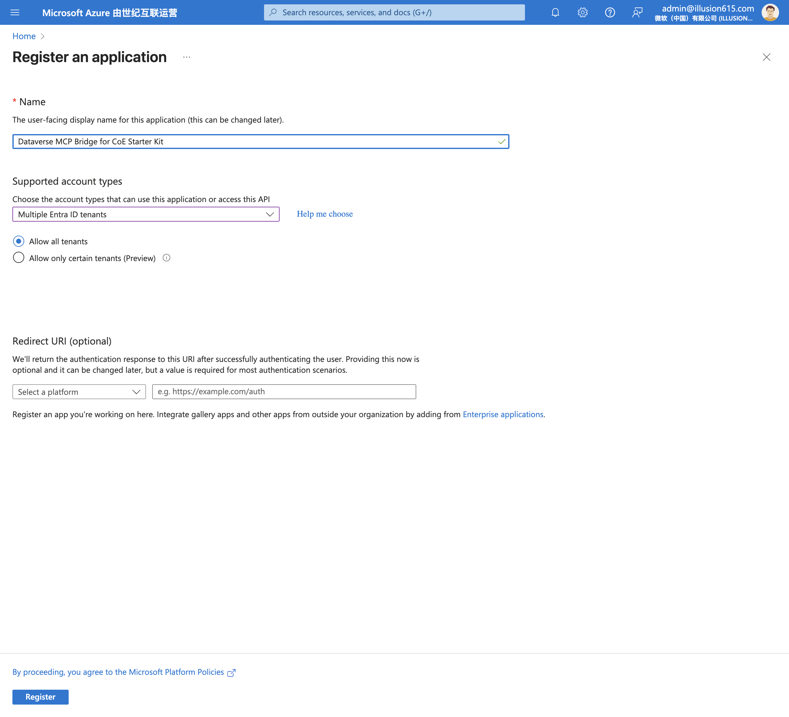

这一步最容易误入 *Allow only certain tenants (Preview)*，导致 Register 按钮一直灰掉。 || The easy mistake here is wandering into *Allow only certain tenants (Preview)*, which leaves the Register button greyed out.

Step 1B / Overview

**注册完成后马上回看 Overview || Return to Overview Immediately After Registration**

应用一旦建好，第一时间在 Overview 里记录两项最关键的 ID。后面 Phase 1 的 allow-list 和 Phase 2 的 OAuth Manual 都要用到。 || As soon as the app is created, record the two critical IDs from the Overview blade. Phase 1's allow-list and Phase 2's OAuth Manual both depend on them.

- **入口** — 应用注册完成后落在 *Overview*；如不在该页，手动点左侧 *Overview*。 || **Entry point** - The app lands on *Overview* automatically; otherwise click *Overview* on the left rail.
- **必须记录** — *Application (client) ID* 与 *Directory (tenant) ID*。 || **Must capture** - *Application (client) ID* and *Directory (tenant) ID*.
- **交付对象** — 这两个值后面都要发给来源租户的 Copilot Studio 配置人。 || **Handoff to** - Both values must be sent to whoever configures Copilot Studio in the source tenant.
- **注意事项** — 对外发布截图时要遮挡具体 ID，公开版不应暴露真实值。 || **Caveat** - Redact the actual IDs in any public screenshot; the published version must not leak real values.

Portal Screen 02

**Overview → Essentials || Overview -> Essentials**

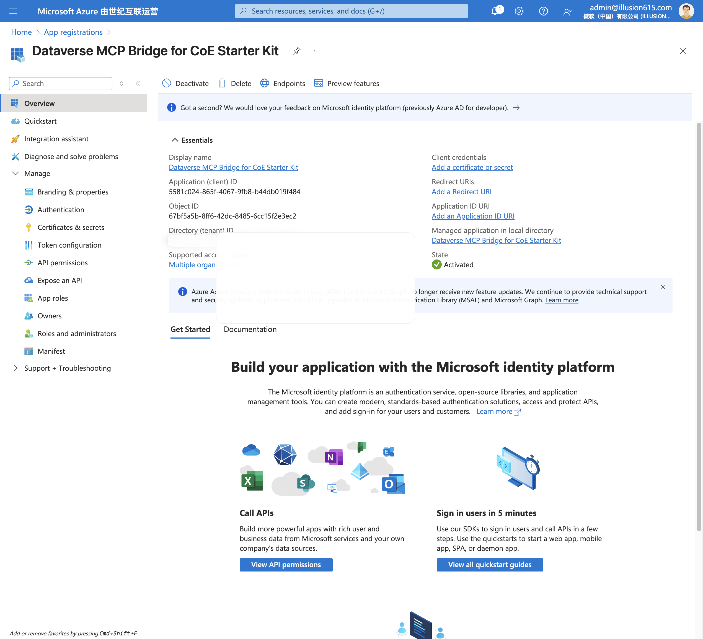

图里遮住了真实值，但定位没变。读者应该在 Essentials 里复制 client ID 与 tenant ID。 || The screenshot masks the actual values, but the location is unchanged. Copy the client ID and tenant ID from the Essentials block.

Step 2A / API Permissions

**从默认权限页进入 Dataverse 授权流程 || Open the Dataverse Authorization Flow from the Default Permissions Page**

应用刚创建出来通常只有 `Microsoft Graph / User.Read`。这不是问题，真正需要补的是 Dataverse MCP 所需的 delegated permission。 || A freshly created app usually has only `Microsoft Graph / User.Read`. That is not the issue; what actually needs to be added is the delegated permission required by Dataverse MCP.

- **入口** — 左侧 *API permissions* → 左上角 *Add a permission*。 || **Entry point** - Left rail *API permissions* -> top-left *Add a permission*.
- **当前状态** — 页面只显示 `User.Read` 很正常，说明还没加 Dataverse 权限。 || **Current state** - It is normal that the page only shows `User.Read`; it just means the Dataverse permission has not been added yet.
- **下一步目标** — 进入 *Microsoft APIs*，继续寻找 *Dynamics CRM*。 || **Next goal** - Move into *Microsoft APIs* and look for *Dynamics CRM*.
- **完成判据** — 成功打开右侧的 *Request API permissions* 侧栏。 || **Done when** - The *Request API permissions* side panel opens on the right.

Portal Screen 03

**API permissions 起点页 || API Permissions Starting Page**

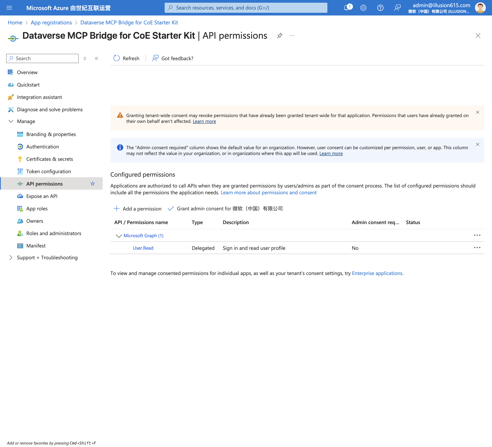

看到只有 `User.Read` 不用慌，这只是默认起点，不代表配置错了。 || Do not be alarmed at seeing only `User.Read`; this is just the default starting point and does not indicate misconfiguration.

Step 2B / Dynamics CRM

**在侧栏里继续向下找 Dynamics CRM || Scroll Further Down the Side Panel to Find Dynamics CRM**

21V 门户这里最容易误判：第一屏并不会把 *Dynamics CRM* 直接露出来，所以很多人以为该 API 不存在。 || This is the easiest spot to misjudge on the 21V portal: the first screen does not surface *Dynamics CRM* directly, so many operators assume the API is missing.

- **关键动作** — 保持在 *Microsoft APIs* tab 内，向下滚动找到 *Dynamics CRM*。 || **Key action** - Stay on the *Microsoft APIs* tab and scroll down to *Dynamics CRM*.
- **权限选择** — 进入后选 *Delegated permissions* → 勾选 `mcp.tools` → Add permissions。 || **Permission choice** - Choose *Delegated permissions*, tick `mcp.tools`, and click Add permissions.
- **管理员动作** — 回到权限主页后点 *Grant admin consent for {tenant}*。 || **Admin action** - Back on the permissions page, click *Grant admin consent for {tenant}*.
- **注意事项** — 不要先切到 *APIs my organization uses*，这次实操里那一页是空的。 || **Caveat** - Do not jump to *APIs my organization uses*; in this walkthrough that tab is empty.
- **21V / GCC sovereign 云** — 走 sovereign 路径时，*Dynamics CRM* 名称与可选 scope 与同云 Commercial 不同（§4.4 F3 / F4），需按 §4.2 与 §4.4 的表 B 填写。 || **21V / GCC sovereign clouds** - On a sovereign path, the *Dynamics CRM* name and the available scopes differ from the same-cloud Commercial case (&sect;4.4 F3 / F4); follow &sect;4.2 and the sovereign cheat-table in &sect;4.4.

Portal Screen 04

**Request API permissions 侧栏 || Request API Permissions Side Panel**

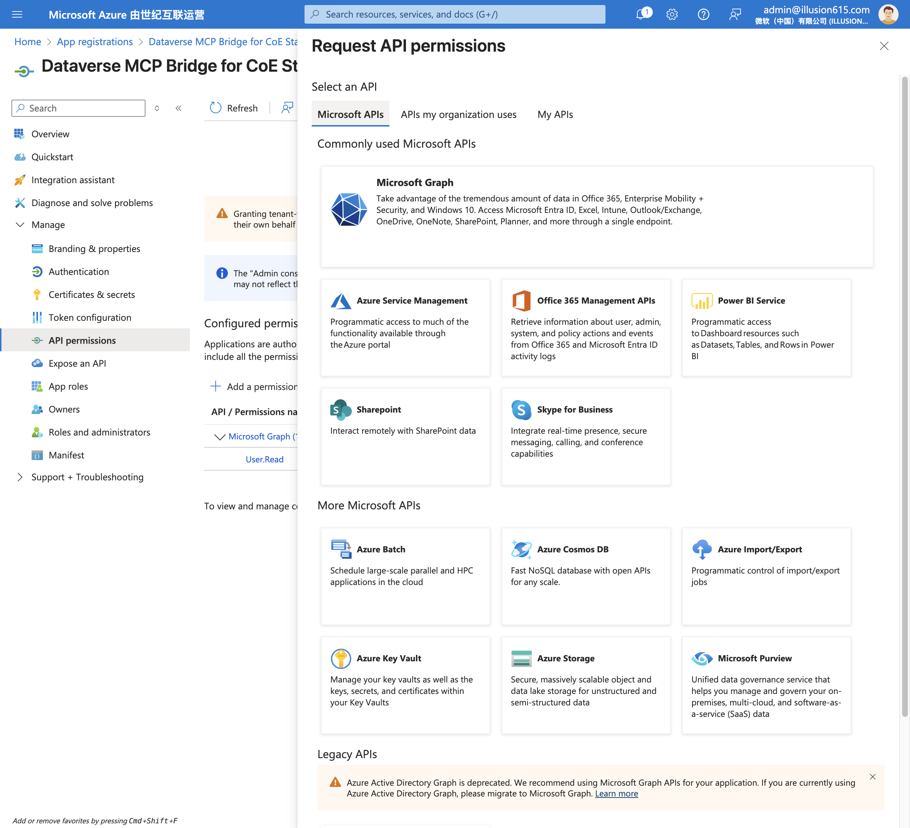

在此界面切勿停留于首屏，需继续向下滚动列表直至找到 *Dynamics CRM*。 || Do not stop at the top of this list; continue scrolling down until *Dynamics CRM* appears.

Step 3 / Client Secret

**创建 Client Secret，并且当场保存 Value || Create the Client Secret and Capture Its Value Immediately**

OAuth Manual 最终要吃的是 secret value，不是 secret ID。这个值在 Azure 门户只显示一次，所以这一页不是“回头再看”的步骤。 || OAuth Manual consumes the secret value, not the secret ID. The value is shown once in the Azure portal, so this page is not a 'come back later' step.

- **入口** — 左侧 *Certificates & secrets* → *Client secrets* → *New client secret*。 || **Entry point** - Left rail *Certificates & secrets* -> *Client secrets* -> *New client secret*.
- **建议写法** — Description 写清来源租户或用途，避免后面多个 secret 混在一起。 || **Recommended wording** - Use a Description that records the source tenant or purpose so multiple secrets stay distinguishable later.
- **注意事项** — 页面生成后必须立即复制 *Value*，不要只记 Secret ID。 || **Caveat** - As soon as the secret is generated, copy *Value* immediately; do not rely on Secret ID alone.
- **完成判据** — 已把 secret value 安全保存，并能与 client ID 一起交付给来源方。 || **Done when** - The secret value is stored securely and can be handed over together with the client ID.

Portal Screen 05–06 || Portal Screens 05-06

**New client secret → secret 列表 || New Client Secret -> Secret List**

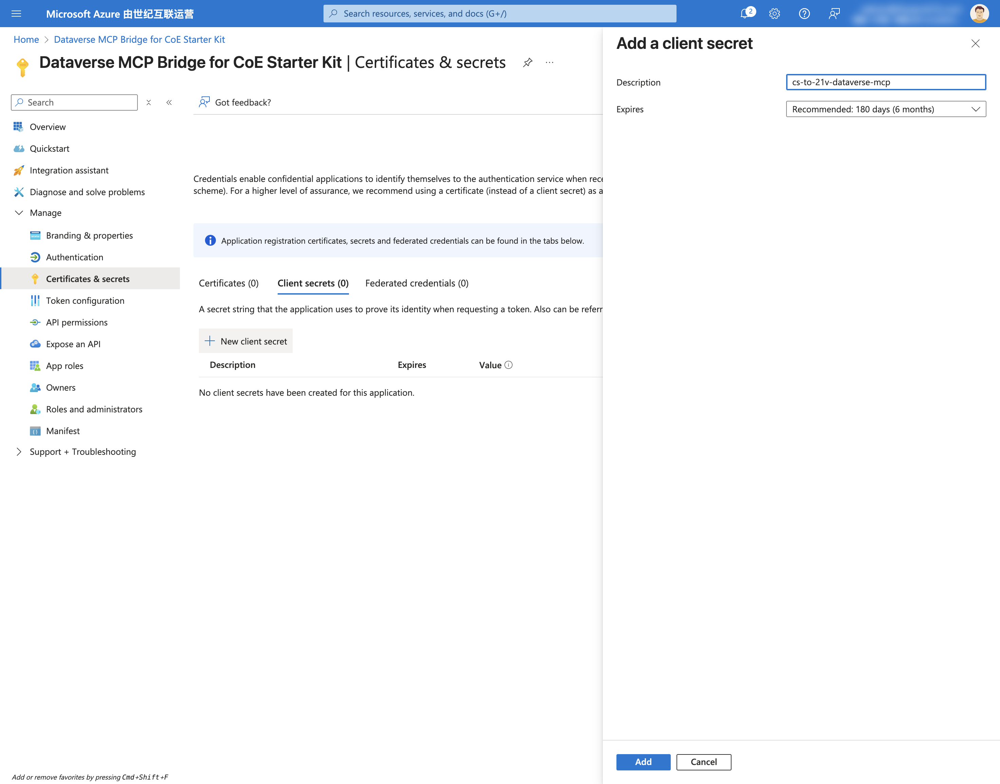

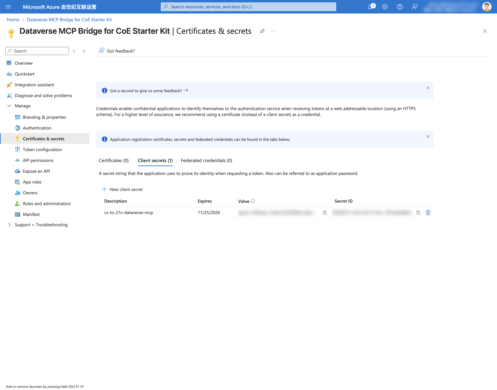

第二张图里 Value 仅在生成瞬间可见；离开此页后只剩末尾 4 位。Secret ID 与 Value 均已掩码。 || In the second screenshot, Value is visible only at creation; once you leave the page, only the last four characters remain. Both Secret ID and Value are masked.

Step 4 / Allow-List

**在目标环境 allow-list 里显式放行这个 App ID || Explicitly Add This App ID to the Target Environment's Allow-List**

应用注册成功并不等于 Dataverse MCP 能放行。真正控制 `/api/mcp` 是否接受调用的，是环境级 allow-list。 || Successful app registration is not the same as Dataverse MCP admission. The environment-level allow-list is what actually controls whether `/api/mcp` accepts the caller.

- **入口** — PPAC → Environments → 目标 Environment → Settings → *Product → Features* → Dataverse Model Context Protocol → *Advanced Settings*，跳转到模型驱动表 `allowedmcpclient`（URL `{org}/main.aspx?...&etn=allowedmcpclient`）。 || **Entry point** - PPAC -> Environments -> target Environment -> Settings -> *Product -> Features* -> Dataverse Model Context Protocol -> *Advanced Settings*, which opens the model-driven `allowedmcpclient` table (URL `{org}/main.aspx?...&etn=allowedmcpclient`).
- **填写字段** — *Name*（自由文本，便于识别，如 `Wells Dev 21V Dataverse MCP Test`）；*Unique Name*（必须带 publisher prefix，如 `crf5c_21vdataversemcptest`，否则保存报 *must start with a valid customization prefix*）；*Application Id* = Step 1B 的 client ID；*Is Enabled* = Yes。 || **Fields** - *Name* (free text for recognizability, e.g. `Wells Dev 21V Dataverse MCP Test`); *Unique Name* (must include a publisher prefix, e.g. `crf5c_21vdataversemcptest`; otherwise save fails with *must start with a valid customization prefix*); *Application Id* = the client ID from Step 1B; *Is Enabled* = Yes.
- **注意事项** — 目标环境必须已是 Managed Environment；Unique Name 的 prefix 取自该环境默认 publisher 或 maker 自定义 publisher。 || **Caveat** - The target environment must already be a Managed Environment; the Unique Name prefix is taken from the environment's default publisher or a maker-defined publisher.
- **完成判据** — 新条目保存成功并出现在 Active Allowed MCP Clients 视图，Application ID 与 Entra 应用完全一致。 || **Done when** - The new row saves successfully and appears in the Active Allowed MCP Clients view, with Application ID matching the Entra app exactly.

Portal Screen 10–11 || Portal Screens 10-11

**PPAC Features → Allowed MCP Clients 列表 || PPAC Features -> Allowed MCP Clients List**

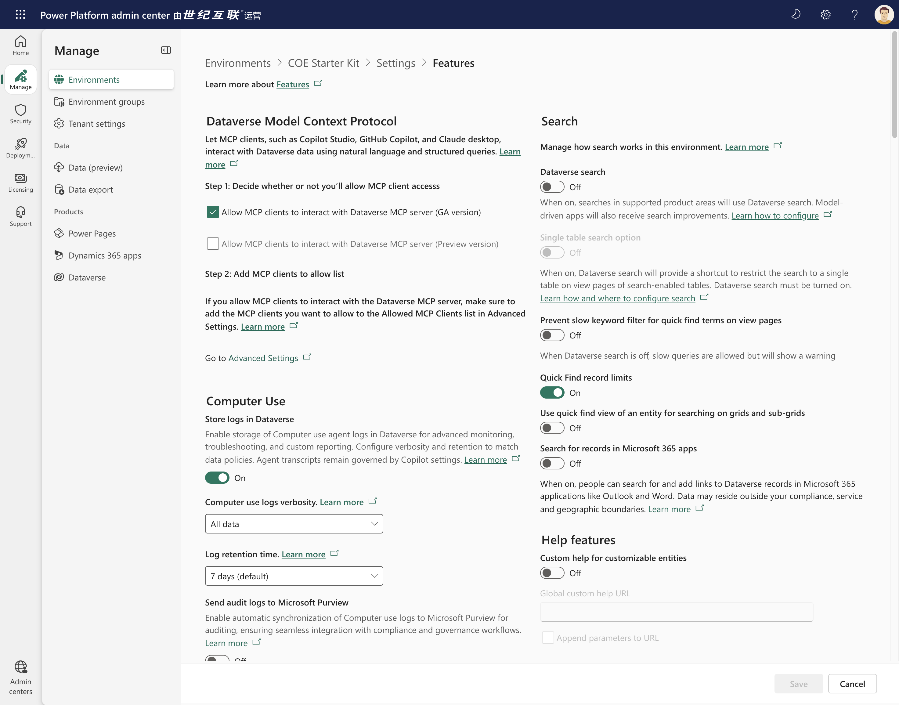

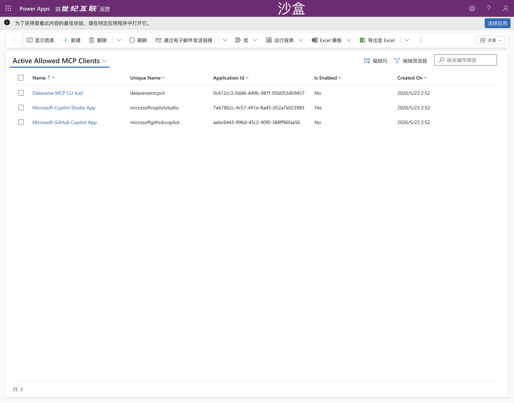

第一张图说明 MCP 总开关已开；第二张是默认视图，3 条 first-party 客户端中只有 Copilot Studio App 默认 Enabled。要让自定义 multitenant app 调用 `/api/mcp`，须用 *+ New* 在 `allowedmcpclient` 表里追加一条记录（Unique Name 必须带 publisher prefix），把调用方 client ID 与 Is Enabled = Yes 写入。 || The first screen confirms the MCP master switch is on; the second is the default view, where only Copilot Studio App is Enabled out of the three first-party clients. To let a custom multitenant app call `/api/mcp`, use *+ New* to append a row in the `allowedmcpclient` table (Unique Name must carry a publisher prefix), recording the caller's client ID and Is Enabled = Yes.

Step 5 / Guest Authorization

**把来源方使用者绑到最小权限安全角色 || Bind the Source-Side User to a Least-Privilege Security Role**

OAuth 拿到的是用户委托 token，但最终这个用户能读什么、写什么，还是由目标 Dataverse 环境里的安全角色决定。 || OAuth returns a delegated-user token, but what that user can ultimately read or write is still decided by the security roles inside the target Dataverse environment.

- **入口** — 目标环境 → Settings → Users + permissions → Users。 || **Entry point** - Target environment -> Settings -> Users + permissions -> Users.
- **关键动作** — 找到来源方 UPN 对应的 guest 用户 → *Manage security roles* → 绑定最小权限 role。 || **Key action** - Locate the guest user matching the source UPN, open *Manage security roles*, and bind a least-privilege role.
- **注意事项** — 不要图省事直接给 System Customizer 之类高权限角色。 || **Caveat** - Do not take a shortcut by assigning high-privilege roles such as System Customizer.
- **完成判据** — guest 用户能看到目标环境需要暴露的表，但没有多余写权限。 || **Done when** - The guest user can see the tables the target environment is meant to expose, with no extra write permission.

Portal Screen 12

**PPAC Users 列表 → Manage security roles 入口 || PPAC Users List -> Manage Security Roles Entry**

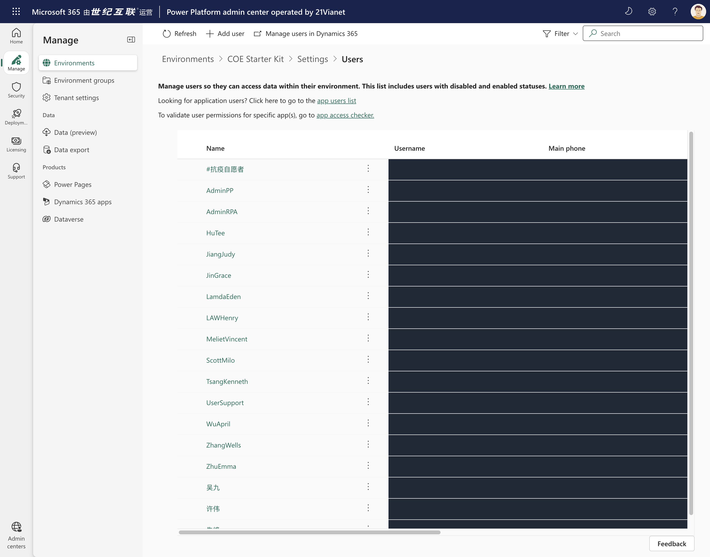

截图来自 21V 实测：Username（UPN）与电话列已掩码。选中目标 guest 用户后，从工具栏点 *Manage security roles* 绑定最小权限 role；若调用回 403，先回查这里。 || Screenshot from the 21V deployment: Username (UPN) and phone columns are masked. Select the target guest user and click *Manage security roles* in the toolbar to bind a least-privilege role; if calls fail with 403, this is the first place to revisit.

Step 6 / Handoff

**把来源方真正需要的 4 项交付物一次发全 || Hand Off All Four Values to the Source Side in One Round**

如果目标方交付不完整，来源方在 Copilot Studio 里会不断来回补字段。最省事的做法是这里一次性交齐。 || An incomplete handoff sends the source side bouncing back to fill missing fields in Copilot Studio. The most efficient path is to ship everything in one round.

- **必须交付** — Application (client) ID、Client secret Value、Directory (tenant) ID、目标 Dataverse Org URL。 || **Required deliverables** - Application (client) ID, Client secret Value, Directory (tenant) ID, and target Dataverse Org URL.
- **URL 格式** — 必须是 `https://{org}.crm.dynamics.com` 这一层 org host，不是 PPAC 地址。 || **URL format** - Use the `https://{org}.crm.dynamics.com` org host, not the PPAC address.
- **交付对象** — 直接交给来源租户中负责 Copilot Studio MCP 向导的人。 || **Handoff target** - Deliver directly to the person owning the Copilot Studio MCP wizard in the source tenant.
- **完成判据** — 来源方不需要再回头追问“还缺哪一个字段”。 || **Done when** - The source side does not need to come back asking which field is still missing.

Deliverables

**一次发全，避免来回追数 || Ship All Four at Once to Avoid Round Trips**

Client ID

来自 Step 1B 的 Application (client) ID。 || From the Step 1B Application (client) ID.

Tenant ID

来自 Step 1B 的 Directory (tenant) ID。 || From the Step 1B Directory (tenant) ID.

Secret + Org URL

来自 Step 3 的 secret value 与目标 org 根 URL。 || The secret value from Step 3 plus the target org root URL.

::panel
### 3.3 Phase 2 · 来源租户（Copilot Studio 所属方）做的事 || 3.3 Phase 2 · Tasks for the Source Tenant (Copilot Studio Owner)
Step 1 / Open MCP Wizard

**从 Agent 的 Tools 面板进入 MCP 向导 || Open the MCP Wizard From the Agent's Tools Panel**

来源方所有动作都从 Agent 的 Tools 面板开始。这里决定你走的是“自带 Entra 应用的通用 MCP”路径，而不是内置 Dataverse MCP Server。 || All source-side actions start from the agent's Tools panel. The choice here commits to the bring-your-own Entra app path, not the built-in Dataverse MCP Server.

- **入口** — Copilot Studio → 选 Agent → Tools → *Add a tool* → *New tool* → *Model Context Protocol*。 || **Entry point** - Copilot Studio -> pick agent -> Tools -> *Add a tool* -> *New tool* -> *Model Context Protocol*.
- **关键判断** — 当前目标是“连到外部租户的 Dataverse MCP endpoint”，不是“连到自己租户的 Dataverse”。 || **Decision check** - The goal is to connect to a Dataverse MCP endpoint in another tenant, not to the local tenant's Dataverse.
- **注意事项** — 不要点 catalog 里的「Dataverse MCP Server」；那条路径只能指向本租户环境。 || **Caveat** - Do not click the catalog tile labelled *Dataverse MCP Server*; that path only targets the local tenant's environment.
- **完成判据** — 进入新建 MCP server 的向导页，而不是 Dataverse 内置连接器详情页。 || **Done when** - You land on the new MCP server wizard, not the built-in Dataverse connector details page.

Portal Screen 13

**Copilot Studio Add tool → Add new MCP || Copilot Studio Add Tool -> Add New MCP**

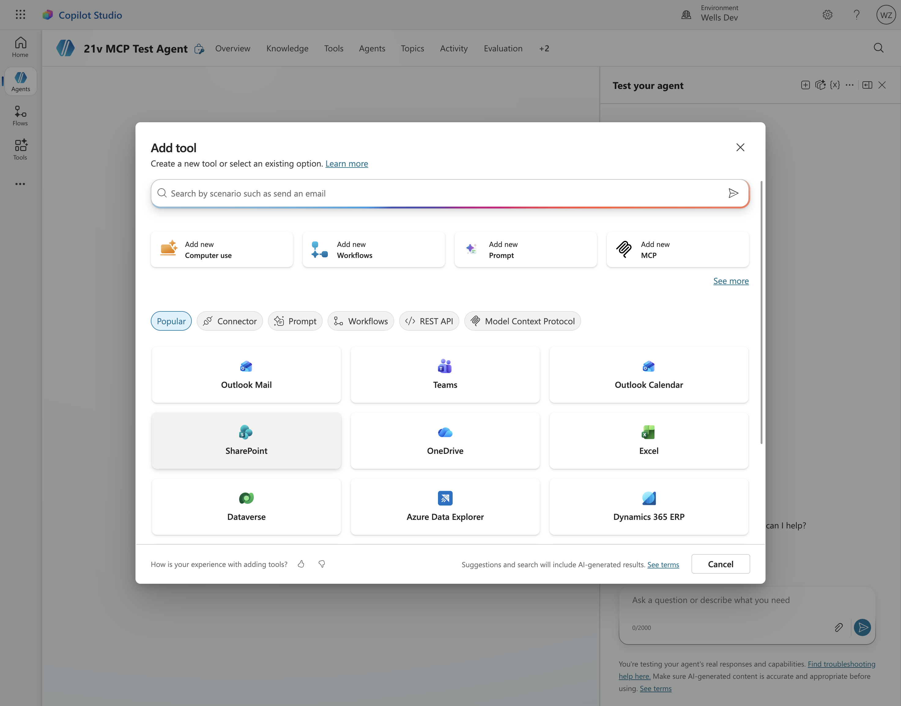

正确入口是顶部 *Add new MCP* 或下方 chip *Model Context Protocol*；不要点 catalog 中的「Dataverse」整合卡，那条路径只能指向本租户环境。 || The correct entry point is the top-bar *Add new MCP* or the *Model Context Protocol* chip below; do not click the integrated Dataverse tile in the catalog, which only targets the local tenant.

Step 2 / Server Basics

**先把 MCP Server URL 填对 || Get the MCP Server URL Right First**

这一页的重点只有一个：连接必须打到目标 org 的 `/api/mcp`。最多人犯的错，是把 PPAC 地址、租户首页，甚至环境列表页 URL 填进去。 || This page has one priority: the connection must hit the target org's `/api/mcp`. The most common mistake is pasting a PPAC, tenant home, or environment list URL.

- **Server name** — 自定义即可（CS 后台会以正则校验生成 connector 唯一名，仅接受字母数字 / `-` / `_` 且首字符为字母数字，空格/括号/中文会触发 HTTP 400），例如 `21V Dataverse MCP`。 || **Server name** - Free text, but Copilot Studio derives a connector unique name with a regex that accepts only alphanumerics, `-`, and `_`, with an alphanumeric leading character; spaces, parentheses, or CJK characters trigger HTTP 400. Example: `21V Dataverse MCP`.
- **Server URL** — Commercial 目标填 `https://{target-org}.crm.dynamics.com/api/mcp`；21V 目标填 `https://{target-org}.crm.dynamics.cn/api/mcp`（本次实测：`https://coe.crm.dynamics.cn/api/mcp`）。 || **Server URL** - For a Commercial target: `https://{target-org}.crm.dynamics.com/api/mcp`; for a 21V target: `https://{target-org}.crm.dynamics.cn/api/mcp` (this verification used `https://coe.crm.dynamics.cn/api/mcp`).
- **注意事项** — URL 必须落在目标 org host，末尾必须显式带 `/api/mcp`；不要填 PPAC / make.powerapps 入口。 || **Caveat** - The URL must use the target org host and explicitly end with `/api/mcp`; do not use the PPAC or make.powerapps entry point.
- **完成判据** — 基础信息页能顺利继续，不是因为 URL 基础格式错误而被拦住。 || **Done when** - The basics page advances without being blocked by a basic URL format error.

Portal Screen 07

**CS MCP 向导基础信息页 || CS MCP Wizard Basics Page**

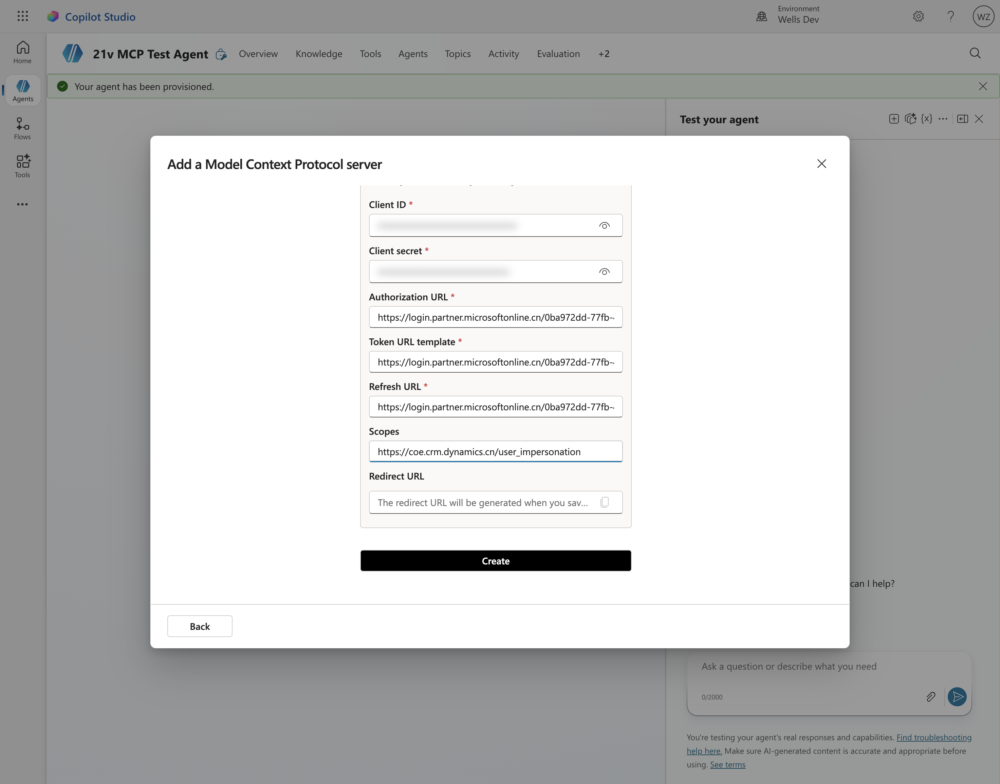

Server URL 与租户名已掩码；右侧 Authentication 必须显式选 *OAuth 2.0*（Manual），否则后续 6 字段面板不会出现。 || Server URL and tenant name are masked; on the right, Authentication must be set explicitly to *OAuth 2.0* (Manual), otherwise the six-field panel will not appear.

Step 3 / OAuth Manual

**按 3.6 速查表填写 6 个 OAuth 字段 || Fill the Six OAuth Fields Using the &sect;3.6 Cheat Sheet**

这一步不需要猜，也不应该猜。所有输入都来自目标方交付物，尤其是 tenant ID、secret、scope 格式，只要有一个写错就会出现 token 或 refresh 异常。 || Nothing in this step should be guessed. Every input comes from the target side's handoff; a single typo in tenant ID, secret, or scope format will surface as token or refresh errors.

- **必填来源** — Client ID、Client secret、Directory (tenant) ID、Org URL 全都来自目标方。 || **Required sources** - Client ID, Client secret, Directory (tenant) ID, and Org URL all come from the target side.
- **最容易漏** — Scopes 必须包含 `offline_access`，否则 60–90 分钟后会强制重新登录。 || **Easy to miss** - Scopes must include `offline_access`; otherwise sign-in is forced again after 60-90 minutes.
- **不要自己拼** — Authorization / Token URL 直接按 §3.6 模板替换 tenant ID，不要写成通用 login URL。 || **Do not improvise** - Use the &sect;3.6 templates for Authorization / Token URL with tenant ID substituted; do not use a generic login URL.
- **子类型选择** — OAuth 2.0 下拉新增 *Dynamic discovery* / *Dynamic* / *Manual*。跨租户 / 跨云时只有 *Manual* 能填全 sovereign endpoint，前两者要求 server 公开 metadata，详见 §4.4 F2。 || **Subtype choice** - The OAuth 2.0 dropdown now offers *Dynamic discovery*, *Dynamic*, and *Manual*. For cross-tenant / cross-cloud cases only *Manual* can fill in the full sovereign endpoints; the other two require the server to expose metadata. See &sect;4.4 F2.
- **完成判据** — 6 个字段填完后能进入 Create 阶段，不出现明显的字段级格式报错。 || **Done when** - All six fields validate and the wizard advances to Create without obvious field-level format errors.

Portal Screen 14

**MCP 向导 → OAuth 2.0 · Manual 6 字段 || MCP Wizard -> OAuth 2.0 Manual Six-Field Panel**

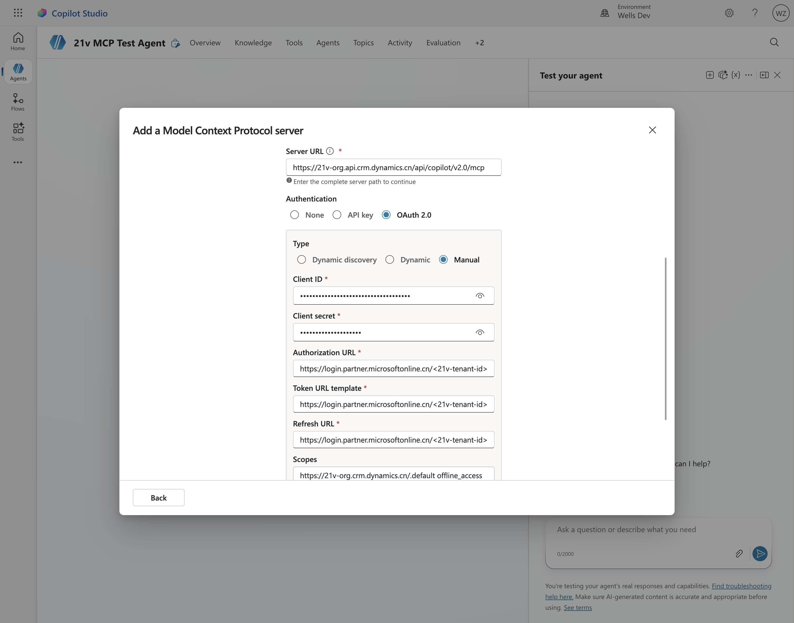

必须选 *OAuth 2.0 → Manual*，才会暴露完整 6 字段。Client ID/Secret 在截图中以掩码形式呈现；Scopes 必须包含 `offline_access`，否则 60–90 分钟后强制重新登录。 || You must pick *OAuth 2.0 -> Manual* to expose the full six-field panel. Client ID/Secret are masked in the screenshot; Scopes must include `offline_access`, otherwise sign-in is forced again after 60-90 minutes.

Step 4 / Callback URL

**Create 后立刻把 callback URL 回填给目标方 || Send the Callback URL Back to the Target Side Immediately After Create**

Copilot Studio 只有在创建连接动作发生后，才会吐出 callback URL。目标方必须把这条 URL 加进应用 Redirect URI，否则授权完成后一定会 404 或 `redirect_uri_mismatch`。 || Copilot Studio only emits the callback URL after the create-connection action. The target side must add it to the app's Redirect URI list, otherwise the consent flow fails with 404 or `redirect_uri_mismatch`.

- **动作顺序** — 点 *Create* → 复制 callback URL（形如 `https://global.consent.azure-apim.net/redirect/{connector-hash}`，跨云时同样在 Commercial APIM 域）→ 发给目标方。 || **Action order** - Click *Create*, copy the callback URL (e.g. `https://global.consent.azure-apim.net/redirect/{connector-hash}`; even in cross-cloud cases the redirect host is the Commercial APIM domain), and send it to the target side.
- **目标方动作** — 目标方在 Entra 应用的 Authentication → Web → Redirect URIs 中保存这条 URL。**必须先回填再点 Create connection**，否则 OAuth 弹窗会以 `redirect_uri_mismatch` 拒绝。 || **Target-side action** - The target side saves this URL under the Entra app's Authentication -> Web -> Redirect URIs. **You must complete the redirect registration before clicking Create connection**, otherwise the OAuth popup rejects with `redirect_uri_mismatch`.
- **浏览器** — Create connection 会以 `window.open` 弹子窗，浏览器需放行 `copilotstudio.preview.microsoft.com` 的弹窗；自动化场景无法完成同意握手。 || **Browser** - Create connection opens a child window via `window.open`; the browser must allow pop-ups from `copilotstudio.preview.microsoft.com`. Automation cannot complete the consent handshake.
- **完成判据** — 两侧都完成保存后，再继续下一步建连接。 || **Done when** - Both sides confirm the save, then continue with the next step to create the connection.

Portal Screen 08–09 || Portal Screens 08-09

**CS 生成 Redirect → 21V Authentication 回填 || CS Generates Redirect -> 21V Authentication Pastes It Back**

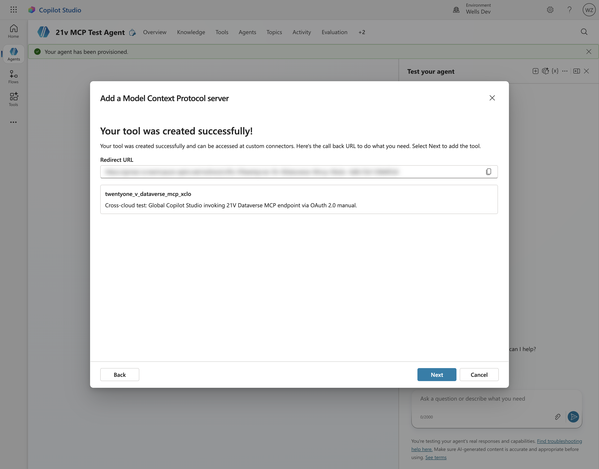

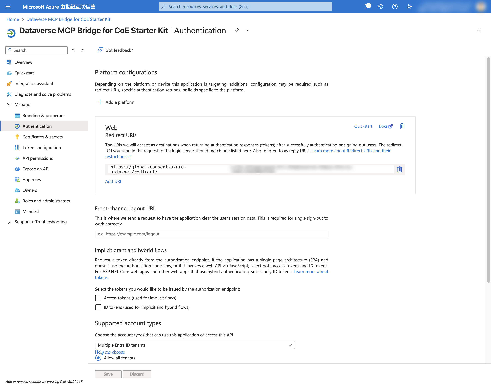

第一张图来自来源方 Copilot Studio；第二张图是目标方在 Entra 应用 Authentication 页粘贴整条 URL 后的状态。Connector hash 与 tenant 名已掩码。 || The first image comes from the source side's Copilot Studio; the second shows the target side after pasting the URL into the Entra app's Authentication blade. Connector hash and tenant name are masked.

Step 5 / Connection + Agent

**建立连接，并把 MCP 工具真正挂进 Agent || Create the Connection and Mount the MCP Tool on the Agent**

到这一步，来源方才会以 guest 身份跳到目标租户完成 consent。授权成功后，还要把连接挂进 Agent，最后确认 Agent 的编排模式。 || At this step the source-side user finally lands on the target tenant as a guest to complete consent. After the authorization succeeds, the connection must be mounted on the agent, and the agent's orchestration mode must be confirmed.

- **连接动作** — Next → *Create new connection* → 浏览器跳目标租户登录页 → 用准备好的 B2B 身份登录并同意。 || **Connection action** - Next -> *Create new connection* -> the browser routes to the target tenant sign-in page -> sign in with the prepared B2B identity and consent.
- **加入 Agent** — 授权成功后点 *Add to agent*。 || **Add to agent** - Once the consent succeeds, click *Add to agent*.
- **最后检查** — Agent → Overview 确认 *Generative orchestration* 已开启。 || **Final check** - Agent -> Overview, confirm *Generative orchestration* is on.
- **完成判据** — Agent 测试面板里能看到 MCP 工具被正常调度，而不是一直留在连接状态未挂载。 || **Done when** - The agent test panel actually invokes the MCP tool rather than leaving it stuck in a connected-but-unmounted state.

Portal Screen 15

**Agent Settings → Generative AI · Orchestration || Agent Settings -> Generative AI Orchestration**

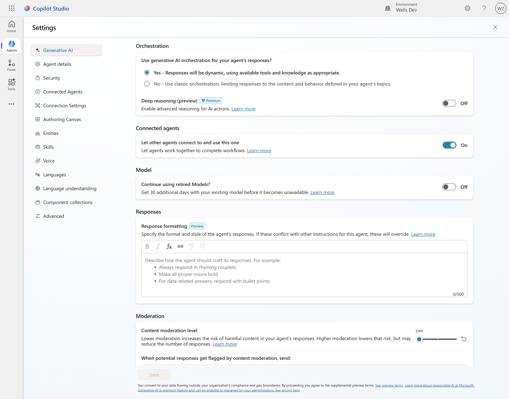

建好连接、点 *Add to agent* 后，必须回到 *Settings → Generative AI → Orchestration* 确认选中 *Yes – Responses will be dynamic*；保留 *No (classic)* 时 MCP 工具不会被调度。Identity 必须是目标租户中已存在的 B2B guest 身份。 || After creating the connection and clicking *Add to agent*, return to *Settings -> Generative AI -> Orchestration* and pick *Yes - Responses will be dynamic*; leaving it on *No (classic)* prevents MCP tool invocation. The identity must be a B2B guest already present in the target tenant.

::panel
### 3.4 Phase 3 · 验收（连通性 + 续期自测） || 3.4 Phase 3 · Acceptance (Connectivity + Refresh Self-Test)
Validation 1 / Connectivity

**先验证 MCP 调用是否真的打到目标环境 || Confirm the MCP Call Actually Reaches the Target Environment**

第一项不要做复杂动作，先确认最基本的连通性。只要这里不通，后面所有权限和写入验证都没有意义。 || Start with the simplest action: confirm basic connectivity. If this step fails, every subsequent permission and write check is moot.

- **测试动作** — 在 Copilot Studio 的 Test your agent 面板输入「list tables in Dataverse」。 || **Test action** - In the Copilot Studio Test your agent pane, type *list tables in Dataverse*.
- **期望结果** — 返回的是 *目标环境* 的表列表，而不是来源租户本地环境的表。 || **Expected** - The list of tables comes from the *target environment*, not the source tenant's local environment.
- **注意事项** — 如果返回空或返回错环境，先回查 Server URL 与 allow-list。 || **Caveat** - If the result is empty or comes from the wrong environment, revisit the Server URL and allow-list first.

Pass Signal

**看到“对的环境”才算通过 || You Only Pass When You See the Right Environment**

Pass

表名明显来自目标环境。 || Table names clearly belong to the target environment.

Fail

无返回、报 401、或列出的是来源租户自己的表。 || No response, 401 error, or tables listed from the source tenant itself.

Validation 2 / Identity

**确认写操作确实归到目标租户里的 guest 身份 || Confirm Write Operations Are Attributed to the Target Tenant's Guest Identity**

连通不等于身份归属正确。第二项要确认 Dataverse 里记录到的操作者，是你准备好的 B2B guest，而不是别的应用主体。 || Connectivity does not guarantee correct attribution. This step confirms that the operator recorded in Dataverse is the prepared B2B guest, not some other application principal.

- **测试动作** — 用 MCP 工具创建一条测试记录。 || **Test action** - Use an MCP tool to create a test record.
- **核对位置** — 到目标环境 Auditing 查看 *Modified By*。 || **Where to verify** - In the target environment's Auditing pane, check *Modified By*.
- **期望结果** — *Modified By* 等于准备好的 B2B guest UPN。 || **Expected** - *Modified By* matches the prepared B2B guest UPN.

Pass Signal

**看到 guest UPN 才说明用户委托链路正确 || Seeing the Guest UPN Confirms the User-Delegation Path Works**

Pass

审计里显示目标租户中的 guest 用户。 || Audit log shows the guest user from the target tenant.

Fail

显示成别的主体，或根本没有审计记录。 || Shows a different principal, or no audit entry at all.

Validation 3 / Boundary

**故意降权限，确认边界真的生效 || Deliberately Reduce Privileges to Confirm the Boundary Actually Holds**

相比单纯测试“能否写入”，更可靠的安全验证是确认“收回写权限后写入立即被拒”。这一步用于检验角色边界是否真实生效。 || Rather than merely testing whether writes succeed, verify that writes fail immediately once write permission is revoked. This step confirms that the role boundary genuinely takes effect.

- **测试动作** — 临时解除该 guest 用户已绑定的写权限角色，仅保留只读 role，再调 `create_record`。 || **Test action** - Temporarily unbind the write-capable security role from the guest user, leave only a read-only role, then call `create_record`.
- **期望结果** — 应返回 403 / *Insufficient privileges*。 || **Expected** - The call returns 403 / *Insufficient privileges*.
- **注意事项** — 验证完要重新绑回原写权限角色，避免影响正式使用。 || **Caveat** - After validation, rebind the original write-capable role to avoid disrupting normal use.

Pass Signal

**“能失败”才说明边界有效 || Only a Confirmed Failure Proves the Boundary Works**

Pass

降权后立刻收到权限不足错误。 || Permission-denied error returns immediately after the downgrade.

Fail

降权后依旧能写，说明角色配置过宽。 || Writes still succeed after the downgrade, indicating an overly broad role.

Validation 4 / Refresh

**等待一轮 token 周期，确认 refresh 正常 || Wait Out One Token Cycle and Confirm Refresh Works**

很多连接第一次能通，但 1 小时后就掉。第四项验证的是 refresh token 路径，核心看点是你有没有把 `offline_access` 配对。 || Many connections succeed on the first call but drop after an hour. This step verifies the refresh token path; the key signal is whether `offline_access` is included in the scope.

- **测试动作** — 等待 60–90 分钟后再次发起 MCP 请求。 || **Test action** - Wait 60-90 minutes, then send another MCP request.
- **期望结果** — 能自动续期，不弹登录页。 || **Expected** - The token refreshes automatically without prompting for sign-in.
- **注意事项** — 如果重新要求登录，优先回查 scope 是否缺少 `offline_access`。 || **Caveat** - If sign-in is forced again, check first whether the scope is missing `offline_access`.

Pass Signal

**自动续期才算真的可用 || Only Automatic Refresh Counts as Truly Usable**

Pass

二次调用直接成功，不要求再次登录。 || The second call succeeds without prompting for sign-in.

Fail

强制回到登录流程，通常是 scope 配置不完整。 || User is forced back into the sign-in flow, usually due to an incomplete scope configuration.

::panel
### 3.5 Phase 4 · 常见错误速查 || 3.5 Phase 4 · Common Error Cheat Sheet
Error 1 / 401

**401 或 Insufficient privileges || 401 or Insufficient Privileges**

此类报错通常源于目标环境尚未在 allow-list 中放行该应用，或 guest 用户缺少目标表权限，而非 OAuth 字段拼写有误。 || This error usually indicates that the target environment has not approved the app in its allow-list or the guest user lacks table privileges, rather than a typo in the OAuth fields.

- **先查 allow-list** — 回到 §3.2 Step 4，确认启用的是正确的 Application ID。 || **Check the allow-list first** - Revisit &sect;3.2 Step 4 and confirm the correct Application ID is enabled.
- **再查安全角色** — 回到 §3.2 Step 5，确认 guest 用户确实被绑定了需要的 role。 || **Then check the security role** - Revisit &sect;3.2 Step 5 and confirm the guest user is actually bound to the required role.
- **判断顺序** — 401 更偏 allow-list / token；403 更偏 role / privilege。 || **Triage order** - 401 leans toward allow-list / token; 403 leans toward role / privilege.

Rollback Path

**优先回查目标租户两道门 || Start by Checking the Two Gates on the Target Tenant**

Door 1

Environment allow-list。 || Environment allow-list.

Door 2

Guest user's Dataverse security role。 || Guest user's Dataverse security role.

Error 2 / Register Disabled

**Register 按钮灰掉，提示缺少 allowed tenant || Register Button Greyed Out With *Allowed Tenant Required***

该现象并非账号权限不足，原因在于开启了 *Allow only certain tenants (Preview)* 却未将来源租户列入 allowed list。 || This symptom stems from enabling *Allow only certain tenants (Preview)* without adding the source tenant to the allowed list, rather than missing account permissions.

- **症状** — 提示 *At least one allowed tenant is required*。 || **Symptom** - The error reads *At least one allowed tenant is required*.
- **两种处理** — 要么点 *Manage allowed tenants* 输入来源 Tenant ID 后 Apply；要么改选 *Allow all tenants* 先注册。 || **Two fixes** - Either click *Manage allowed tenants*, enter the source Tenant ID, and Apply; or switch to *Allow all tenants* to finish registration first.
- **推荐处理** — 首次配通优先用 *Allow all tenants*，边界靠 allow-list + role 兜底。 || **Recommended** - For the first successful run, prefer *Allow all tenants*; rely on the allow-list and role as the actual boundary.

Fast Fix

**别在注册页提前做过度收紧 || Do Not Over-Restrict at Registration Time**

Fastest Path

改回

Allow all tenants

，先把 app 建出来。

Strict Path

只有在你已经掌握来源 tenant ID 时，再用 Preview 选项。 || Only use the Preview option once the source Tenant ID is in hand.

Error 3 / No Consent

**外租户用户看不到同意页 || External Tenant Users Never See the Consent Page**

最常见原因是应用仍然是 single-tenant。这样外租户用户即使拿到了 URL，也不会被允许进入授权流程。 || The most common cause is that the app is still single-tenant. External users will not be allowed into the authorization flow even if they have the URL.

- **回查位置** — §3.2 Step 1A 的 Supported account types。 || **Where to check** - &sect;3.2 Step 1A, Supported account types.
- **正确值** — 必须是 *Multiple Entra ID tenants*。 || **Correct value** - Must be *Multiple Entra ID tenants*.
- **错误值** — *Single tenant only* 会直接拒绝外租户用户。 || **Wrong value** - *Single tenant only* immediately rejects external users.

Root Cause

**这是 app registration 级别的路由问题 || This Is a Routing Issue at the App Registration Level**

Fix

回到注册配置，把应用改成 multitenant。 || Return to the registration settings and change the app to multitenant.

Why

single-tenant app 根本不会接受外租户用户授权。 || A single-tenant app simply will not accept external tenant user authorization.

Error 4 / Callback

**Callback 404 或 redirect_uri_mismatch || Callback 404 or redirect_uri_mismatch**

这种错误不要怀疑 token endpoint，先看 Redirect URI 是否原样回填。这里最怕人为修改大小写、删尾部路径、或者加错 slash。 || Do not blame the token endpoint here; check whether the Redirect URI was pasted back verbatim. The most common mistakes are altered casing, a removed trailing path, or an added slash.

- **回查位置** — §3.3 Step 4 拿到的 callback URL 原文。 || **Where to check** - The original callback URL captured in &sect;3.3 Step 4.
- **正确做法** — 整条复制到目标方应用的 Redirect URI，不做手改。 || **Correct approach** - Copy the entire URL into the target side's Redirect URI without manual edits.
- **注意事项** — 含末尾路径、斜杠、大小写都必须完全一致。 || **Caveat** - Trailing path, slashes, and casing must all match exactly.

Root Cause

**这是字符串精确匹配，不是“差不多就行” || This Is Exact String Matching, Not Approximate**

Fix

重新复制 callback URL，整条覆盖 Redirect URI。 || Re-copy the callback URL and replace the Redirect URI verbatim.

Typical Mistake

省略尾部路径、手动改 slash、复制错环境 URL。 || Dropping the trailing path, hand-editing slashes, or copying the URL from the wrong environment.

Error 5 / No Tool Call

**工具明明连好了，但 Agent 从来不触发它 || The Tool Is Connected but the Agent Never Triggers It**

这类问题通常不在连接本身，而在 Agent 的编排模式。连接存在不等于 Agent 一定会自动调用 MCP 工具。 || The cause typically lies in the agent's orchestration mode, not the connection. A connection's existence does not guarantee the agent will invoke the MCP tool automatically.

- **回查位置** — Agent → Overview。 || **Where to check** - Agent -> Overview.
- **正确状态** — *Generative orchestration* 已开启。 || **Correct state** - *Generative orchestration* is on.
- **常见误区** — Classic 模式下连接和工具都在，但编排器不会自动调度。 || **Common pitfall** - In Classic mode the connection and tool both exist, but the orchestrator never dispatches them automatically.

Root Cause

**这不是权限错，是编排模式错 || This Is Not a Permission Bug, It's an Orchestration-Mode Bug**

Fix

切回 Generative orchestration。 || Switch back to Generative orchestration.

Signal

切换后再次测试，Agent 才会真正发起 MCP 调用。 || After the switch, retest; the agent will then issue real MCP calls.

Error 6 / Schema

**Schema 异常，不是门户配置项问题 || Schema Errors Are Not a Portal Configuration Problem**

若报错集中在 schema 层，说明租户连通、权限与 allow-list 均已通过，问题出在 MCP server 对特定 schema 结构的已知限制。 || Schema-layer errors indicate that tenant connectivity, permissions, and allow-lists have already passed, and the call has hit a known MCP server schema limitation.

- **已知限制** — `exclusiveMinimum` 必须是 boolean；type 必须单一类型。 || **Known limits** - `exclusiveMinimum` must be boolean; type must be a single type.
- **不支持项** — reference type / enum type。 || **Unsupported** - reference type / enum type.
- **处理方式** — 回到 MCP schema 本身做裁剪，不要继续在 Azure / Copilot Studio 门户里找开关。 || **How to fix** - Trim the MCP schema itself; do not keep hunting for switches in the Azure or Copilot Studio portals.

Root Cause

**这是 MCP 实现边界，不是配置漏项 || This Is the MCP Implementation Boundary, Not a Missing Setting**

Fix

按官方已知约束收窄 schema 定义。 || Narrow the schema definition to match the documented known constraints.

Do Not Do

不要反复重建 app registration 或重新授权，这里不会解决。 || Do not repeatedly rebuild app registration or reissue consent; that does not address the problem.

::panel
### 3.6 字段速查表（MCP 向导：Server URL + OAuth Manual 6 项） || 3.6 Field Cheat Sheet (MCP Wizard: Server URL + OAuth Manual, 6 Fields)
来源方在 §3.3 Step 3 复制以下值。占位符替换为 §3.2 Step 1 拿到的实际值。同云路径用表 A；目标位于 21V / GCC sovereign 云时改用表 B。 || The source side copies the following values in &sect;3.3 Step 3. Replace placeholders with the actual values captured in &sect;3.2 Step 1. Use Table A for same-cloud paths; use Table B when the target sits in a 21V / GCC sovereign cloud.

**表 A · 同云 Commercial / GCC**（GCC 把 `.com` 换成 `.us`，Authority 改为 `login.microsoftonline.us`） || **Table A - Same-Cloud Commercial / GCC** (for GCC swap `.com` for `.us` and switch Authority to `login.microsoftonline.us`)

| 字段 || Field | 值 || Value | 来源 || Source |
| --- | --- | --- |
| Server URL | `https://{target-org}.crm.dynamics.com/api/mcp` | 目标 Org URL + `/api/mcp` || Target Org URL + `/api/mcp` |
| Client ID | `{Application (client) ID}` | §3.2 Step 1 || &sect;3.2 Step 1 |
| Client secret || Client Secret | `{Secret Value}` | §3.2 Step 3 || &sect;3.2 Step 3 |
| Authorization URL | `https://login.microsoftonline.com/{tenant-id}/oauth2/v2.0/authorize` | {tenant-id} = 目标 Tenant ID || {tenant-id} = target Tenant ID |
| Token URL | `https://login.microsoftonline.com/{tenant-id}/oauth2/v2.0/token` | 同上 || Same as above |
| Refresh URL | 同 Token URL || Same as Token URL | — |
| Scopes | `https://{target-org}.crm.dynamics.com/.default offline_access` | `offline_access` 不可省 || `offline_access` is required |

**表 B · Sovereign（21V 实测；GCC High 类推，未实测）** || **Table B - Sovereign (21V verified; GCC High extrapolated, not verified)**

| 字段 || Field | 21V | GCC High（未实测） || GCC High (Not Verified) |
| --- | --- | --- |
| Server URL | `https://{target-org}.crm.dynamics.cn/api/mcp` | `https://{target-org}.crm.microsoftdynamics.us/api/mcp` |
| Authorization URL | `https://login.partner.microsoftonline.cn/{tenant-id}/oauth2/v2.0/authorize` | `https://login.microsoftonline.us/{tenant-id}/oauth2/v2.0/authorize` |
| Token URL | `https://login.partner.microsoftonline.cn/{tenant-id}/oauth2/v2.0/token` | `https://login.microsoftonline.us/{tenant-id}/oauth2/v2.0/token` |
| Scopes | `https://{target-org}.crm.dynamics.cn/.default offline_access` | `https://{target-org}.crm.microsoftdynamics.us/.default offline_access` |
| Client ID / Secret | 目标 sovereign 租户上注册的 app（如 21V 应用注册） || App registered in the target sovereign tenant (e.g. the 21V app registration) |   |

**关于 `.default` 与 `user_impersonation`**：21V Common Data Service 在 admin-consent 之后仅暴露 `user_impersonation` 一个 delegated scope，因此用 `.default` 颁发的 token 实际上就是 `user_impersonation` 的访问权；`/api/mcp` 不强制要求 `mcp.tools` claim，实际可访问数据由 Dataverse 安全角色决定。Global → 21V 路径已实测可通，详见 §4.4。 || **About `.default` vs `user_impersonation`**: After admin consent, 21V Common Data Service exposes only the `user_impersonation` delegated scope, so the token issued via `.default` is effectively a `user_impersonation` grant. `/api/mcp` does not require the `mcp.tools` claim; the reachable data is determined by Dataverse security roles. The Global -> 21V path is verified; see &sect;4.4.
:::

## #cross-cloud 04 / Cross-Cloud Boundary :: 跨云跨租户：Global → 21V 实测可通与三项差异 || Cross-Cloud Cross-Tenant: Global -> 21V Verified Working and the Three Differences

Global Commercial × 21Vianet 在 §3 同云路径之外有三项差异：Authority 在 partner 云、Common Data Service 只暴露 `user_impersonation`、allow-list 在 Dataverse `allowedmcpclient` 表里手建。这里梳理可复现的完整跨云路径与 2026-05 实测证据。 || Beyond &sect;3's same-cloud path, Global Commercial x 21Vianet has three structural differences: the Authority sits in the partner cloud, Common Data Service exposes only `user_impersonation`, and the allow-list must be built by hand in the Dataverse `allowedmcpclient` table. Below is the reproducible end-to-end cross-cloud path alongside the May 2026 empirical evidence.

:::accordion
::panel { open: true }
### 4.1 三个差异层、三个应对动作 || 4.1 Three Difference Layers, Three Mitigations
跨云不只是「换个域名」，三个层面均与同云不同，但每一层都有对应的可执行动作。 || Cross-cloud is more than swapping a domain: three layers behave differently from same-cloud, but each has a concrete mitigation.

- **Authority 不同 || Authority Differs** — 21Vianet 的 Entra 授权端点是 `login.partner.microsoftonline.cn`，与 Commercial 的 `login.microsoftonline.com` 是两套独立目录。实测动作：在 21V 租户独立注册 Entra 应用，OAuth Manual 填 sovereign authority。 || 21Vianet's Entra authorization endpoint is `login.partner.microsoftonline.cn`, a directory separate from Commercial's `login.microsoftonline.com`. Action: register a dedicated Entra app in the 21V tenant and put the sovereign authority into the OAuth Manual fields.
- **资源端点不同 || Resource Endpoint Differs** — 21Vianet Dataverse 走 `*.crm.dynamics.cn`，只接受由 partner authority 颁发、audience 为该 China org 的 token。实测动作：Scopes 填 `https://{org}.crm.dynamics.cn/.default offline_access`。 || 21Vianet Dataverse uses `*.crm.dynamics.cn` and only accepts tokens issued by the partner authority for that China org. Action: set Scopes to `https://{org}.crm.dynamics.cn/.default offline_access`.
- **Allow-list 入口不同 || Allow-List Entry Point Differs** — PPAC Features 上的「Advanced Settings」跳转到模型驱动表 `allowedmcpclient`，需手建记录并填调用方 client ID，Unique Name 必须带 publisher prefix（如 `crf5c_`）。 || PPAC Features *Advanced Settings* routes to the model-driven table `allowedmcpclient`; you must hand-create a record with the caller's client ID, and the Unique Name must carry a publisher prefix (for example `crf5c_`).

::panel
### 4.2 跨云独有的风险 || 4.2 Risks Unique to the Cross-Cloud Path
跨云落地同样套用 §3 Runbook（字段参考 §3.6 表 B，独有发现见 §4.4）。此处仅列出 §3 未覆盖、专门在跨云场景下暴露的风险点。 || Cross-cloud deployment follows the &sect;3 runbook (use the &sect;3.6 Table B field set; cross-cloud-only findings are in &sect;4.4). The points below list only the risks that &sect;3 does not cover and that surface specifically in cross-cloud scenarios.

- **OAuth 回跳穿越 sovereign 边界** — 回跳目标是 Commercial APIM 域 `global.consent.azure-apim.net`，企业 CA 或出口网关如拦截该域，同意握手在 sovereign 侧就会失败。 || **OAuth redirect crosses the sovereign boundary** - the redirect target is the Commercial APIM domain `global.consent.azure-apim.net`; if the enterprise CA or egress gateway blocks that domain, the consent handshake fails on the sovereign side.
- **跨境数据交互** — 调用以委托身份发生，但必然产生跨境 metadata + payload 传输，PIPL、数据出境、跨境传输合规需在发布前完成评估（§5 治理层）。 || **Cross-border data exchange** - calls happen under a user-delegated identity, but cross-border metadata and payload transfer are unavoidable; PIPL, data-export, and cross-border transfer compliance must be evaluated before release (&sect;5 Governance).
- **无 SLA 承诺** — Microsoft 未在公开文档中对跨云 OAuth 回跳与连接器调用给出 SLA；生产场景要在架构上对间歇性失败预留重试 / 降级路径。 || **No SLA commitment** - Microsoft does not publicly commit an SLA for cross-cloud OAuth redirects or connector calls; production architectures should pre-design retry / fallback paths for intermittent failures.

::panel
### 4.3 GCC / GCC High / DoD 未实测 || 4.3 GCC / GCC High / DoD Not Verified
当前实测仅覆盖 Commercial → 21Vianet 路径。类推到 GCC / GCC High / DoD 需同时满足三个条件：目标云提供对应的 sovereign authority（如 `login.microsoftonline.us`）、目标 Dataverse 环境启用 Dataverse MCP 且 `allowedmcpclient` 表可写入、企业 CA 及出口网关放行 Commercial APIM 回跳。未经实测验证前不作成败断言。 || Empirical verification covers only the Commercial -> 21Vianet path. Extending the same approach to GCC / GCC High / DoD requires three conditions to hold: the target cloud must offer a corresponding sovereign authority (for example `login.microsoftonline.us`); the target Dataverse environment must have Dataverse MCP enabled with a writable `allowedmcpclient` table; and the enterprise CA and egress gateway must allow the Commercial APIM redirect. No success/failure claim is made until that is empirically verified.

::panel
### 4.4 实测：Global → 21V 在 Copilot Studio 中走通的完整路径（2026-05） || 4.4 Empirical: The Full Global -> 21V Path Verified in Copilot Studio (May 2026)
2026-05 实测：Commercial Copilot Studio Preview（环境 `Wells Dev`）调用 21Vianet 租户 `illusion615.com` 下 `https://coe.crm.dynamics.cn/api/mcp`，全链路走通、Agent Tools 列表出现 *Model Context Protocol (1)*。同云路径以外需额外完成三件事：**(a)** 在 21V 侧采用 Common Data Service / `user_impersonation` + `.default` scope；**(b)** 在 21V Dataverse `allowedmcpclient` 表里手建一条带 publisher prefix 的允许记录；**(c)** 把 CS 生成的 Commercial APIM 回跳 URL 回填到 21V 应用注册。 || May 2026 verification: Commercial Copilot Studio Preview (environment `Wells Dev`) invoking `https://coe.crm.dynamics.cn/api/mcp` on 21Vianet tenant `illusion615.com` succeeded end to end, with *Model Context Protocol (1)* appearing in the agent's Tools list. Beyond the same-cloud path, three additional actions are required: **(a)** on the 21V side, use Common Data Service / `user_impersonation` + the `.default` scope; **(b)** in 21V Dataverse `allowedmcpclient`, hand-create an allowed record with a publisher prefix; **(c)** register the Commercial APIM redirect URL generated by CS into the 21V app registration.

**7 项与同云路径不同的实测发现**： || **Seven differences from the same-cloud path, as observed in this empirical run**:

1. **F1 · CS 向导不校验 sovereign host || F1 - CS Wizard Does Not Validate the Sovereign Host** — Commercial Copilot Studio「Add MCP」向导对 Server URL 主机不做云校验，`https://*.crm.dynamics.cn` 直接通过，Create 按钮可点。 || The Commercial Copilot Studio Add MCP wizard does not perform cloud validation on the Server URL host; `https://*.crm.dynamics.cn` passes through and Create is clickable.
2. **F2 · OAuth 现暴露 3 个子类型 || F2 - OAuth Now Exposes Three Subtypes** — OAuth 2.0 下拉新增 *Dynamic discovery* / *Dynamic* / *Manual*。前两者要求 server 公开 metadata 端点；跨租户/跨云只有 *Manual* 能填全 sovereign 端点。 || The OAuth 2.0 dropdown now includes *Dynamic discovery*, *Dynamic*, and *Manual*. The first two require the server to expose a metadata endpoint; for cross-tenant or cross-cloud cases, only *Manual* lets you fill in the full sovereign endpoints.
3. **F3 · 21V SP 名称不同 || F3 - 21V SP Name Differs** — Azure China 门户里对应服务名是 *Common Data Service*（well-known appId `00000007-0000-0000-c000-000000000000`），不是 Commercial 的 *Dynamics CRM*。在 21V 找不到 Dynamics CRM 时去搜 Common Data Service。 || In the Azure China portal the corresponding service principal is *Common Data Service* (well-known appId `00000007-0000-0000-c000-000000000000`), not Commercial's *Dynamics CRM*. If you cannot find Dynamics CRM in 21V, search for Common Data Service.
4. **F4 · 21V 不发布 mcp.tools，但端点不要求 || F4 - 21V Does Not Publish mcp.tools, but the Endpoint Does Not Require It** — 21V Common Data Service 的 Delegated permissions 列表里**只有 `user_impersonation`**，没有 `mcp.tools`（见 step-05）。实测表明 21V `/api/mcp` 不要求 token 携带 `mcp.tools` claim：Scopes 填 `https://{org}.crm.dynamics.cn/.default offline_access` 后即可放行（`.default` 涵盖 `user_impersonation`）。这是 21V Dataverse 侧的实现差异，与同云 Commercial 路径需要 `mcp.tools` 不同。 || 21V Common Data Service's Delegated permissions list **contains only `user_impersonation`**; `mcp.tools` is absent (see step-05). The empirical run shows that the 21V `/api/mcp` endpoint does not require the token to carry the `mcp.tools` claim: Scopes set to `https://{org}.crm.dynamics.cn/.default offline_access` are accepted (`.default` covers `user_impersonation`). This is an implementation difference on the 21V Dataverse side relative to the same-cloud Commercial path, which still requires `mcp.tools`.
5. **F5 · CS 连接器命名正则 || F5 - CS Connector Name Regex** — CS Manual OAuth Create 后台对 connector 名做正则校验：*alphanumeric / `-` / `_`，必须以字母数字开头*。空格、括号、中文都会触发 HTTP 400。本次名称填 `21V Dataverse MCP`，后台生成的 connector 唯一名为 `crf5c-5f21v-20dataverse-20mcp-5f...`（空格被转义）。 || After CS Manual OAuth Create, the back end validates the connector name with a regex: *alphanumeric, `-`, `_`, leading character must be alphanumeric*. Spaces, parentheses, or CJK characters trigger HTTP 400. This run used the name `21V Dataverse MCP`; the back end generated the unique name `crf5c-5f21v-20dataverse-20mcp-5f...` (spaces are escaped).
6. **F6 · Redirect URL 在 Commercial APIM 域 || F6 - Redirect URL Lives in the Commercial APIM Domain** — CS Create 后自动生成的 Redirect URL 形如 `https://global.consent.azure-apim.net/redirect/{connector-hash}`，是 Commercial APIM 同意域。需在点 Create connection **之前**回填到 21V 应用注册的「Authentication → Web → Redirect URIs」（step-12），否则 OAuth 弹窗以 `redirect_uri_mismatch` 拒绝。 || The Redirect URL generated automatically after CS Create has the form `https://global.consent.azure-apim.net/redirect/{connector-hash}` and sits in the Commercial APIM consent domain. It must be registered to the 21V app's *Authentication -> Web -> Redirect URIs* (step-12) **before** clicking Create connection; otherwise the OAuth popup rejects with `redirect_uri_mismatch`.
7. **F7 · 浏览器同意弹窗易被拦 || F7 - Browser Consent Pop-Ups Are Easily Blocked** — CS Create connection 触发的是 `window.open` 子窗口；浏览器需放行 `copilotstudio.preview.microsoft.com` 的弹窗才能完成握手，自动化/身份托管场景无法代走这一步。 || CS Create connection opens a `window.open` child window; the browser must allow pop-ups from `copilotstudio.preview.microsoft.com` to complete the handshake. Automation or managed-identity scenarios cannot complete this step on the user's behalf.

**F8 · 环境级 Allow-List 需手建带 publisher prefix 的记录**：21V Dataverse `allowedmcpclient` 表默认仅含 Microsoft first-party 三条记录。若要放行自定义 multitenant app 调用 `/api/mcp`，需在该表点 + New 新增记录，填入 Name、Unique Name、Application Id 并将 Is Enabled 设为 Yes（Unique Name 必须包含 `crf5c_` 等 publisher prefix，否则保存会报 *must start with a valid customization prefix*）。本次实测写入 `crf5c_21vdataversemcptest` / app `{your-21v-app-client-id}` / Yes 后，`/api/mcp` 立即接受调用。 || **F8 - The Environment-Level Allow-List Needs a Hand-Built Record With a Publisher Prefix**: 21V Dataverse `allowedmcpclient` ships with only three Microsoft first-party entries. To let a custom multitenant app call `/api/mcp`, add a record via + New with Name, Unique Name, Application Id, and Is Enabled = Yes. Unique Name must include a publisher prefix such as `crf5c_`; otherwise save fails with *must start with a valid customization prefix*. This run saved `crf5c_21vdataversemcptest` / app `{your-21v-app-client-id}` / Yes, and `/api/mcp` accepted calls immediately.

**实测证据截图**（来源租户 / 用户身份均已打码）： || **Empirical evidence screenshots** (source tenant and user identity masked):

Evidence 05 · Scope Inventory

**21V Common Data Service 的 Delegated 权限列表只暴露 user_impersonation || 21V Common Data Service Delegated Permissions Expose Only user_impersonation**

这是 21V 与 Commercial 同云路径的关键差异。Commercial 同云租户里 Dynamics CRM 的 Delegated 权限有 `user_impersonation` 与 `mcp.tools` 两项；21V 这边筛选框输入 *mcp* 后无任何匹配，目录里彻底没有 `mcp.tools`。 || This is the key difference between 21V and the Commercial same-cloud path. In a Commercial same-cloud tenant, Dynamics CRM's Delegated permissions include both `user_impersonation` and `mcp.tools`; in 21V, filtering by *mcp* returns no matches, and the directory contains no `mcp.tools` at all.

- **资源服务** — Common Data Service（appId `00000007-0000-0000-c000-000000000000`）。 || **Resource service** - Common Data Service (appId `00000007-0000-0000-c000-000000000000`).
- **暴露范围** — 仅 `user_impersonation`（Access Dynamics 365 as organization users）。 || **Exposed scope** - only `user_impersonation` (Access Dynamics 365 as organization users).
- **应对** — Copilot Studio Scopes 填 `https://{org}.crm.dynamics.cn/.default offline_access`；`.default` 已涵盖 `user_impersonation`，不需也无法补 `mcp.tools`。实测表明 21V `/api/mcp` 不要求 `mcp.tools` claim。 || **Mitigation** - set Copilot Studio Scopes to `https://{org}.crm.dynamics.cn/.default offline_access`; `.default` already covers `user_impersonation`, and `mcp.tools` can neither be required nor added. The empirical run shows 21V `/api/mcp` does not require the `mcp.tools` claim.

Portal Screen 05

**21V Request API permissions · Common Data Service || 21V Request API Permissions - Common Data Service**

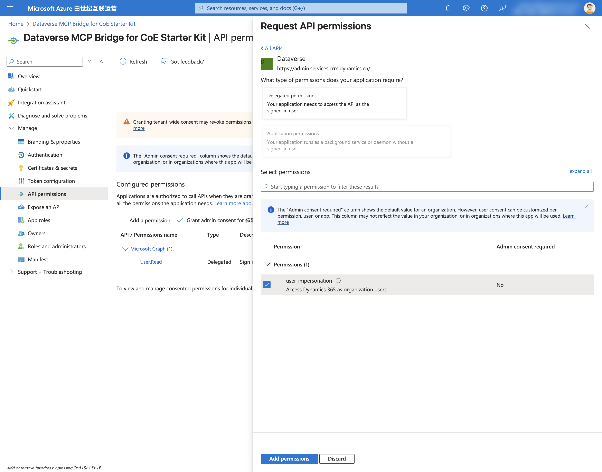

对照 §3.2 Step 2B：Commercial 同云会有 mcp.tools，21V 只有 user_impersonation。实测中 `.default` scope 已足以让 `/api/mcp` 放行。 || Compare with &sect;3.2 Step 2B: Commercial same-cloud has mcp.tools; 21V has only user_impersonation. The empirical run shows the `.default` scope alone is enough for `/api/mcp` to accept the call.

Evidence 06–07 · Configured + Consent

**把唯一可选的 user_impersonation 加上、并完成 admin consent || Add the Only Available user_impersonation Permission and Grant Admin Consent**

21V 侧在创建应用后把 *Common Data Service / user_impersonation* 加进配置权限，并由租户管理员 *Grant admin consent for {tenant}*，状态列全绿勾。这是 OAuth 能颁发 token 的前提。 || After creating the app on the 21V side, add *Common Data Service / user_impersonation* to Configured permissions, then have a tenant admin *Grant admin consent for {tenant}*; the Status column turns to all green checkmarks. This is the precondition for OAuth to issue tokens.

Portal Screen 06 · 07

**Configured permissions / Successfully granted || Configured Permissions / Successfully Granted**

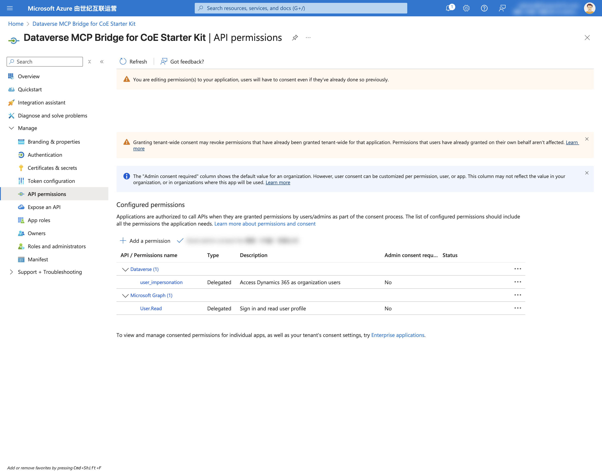

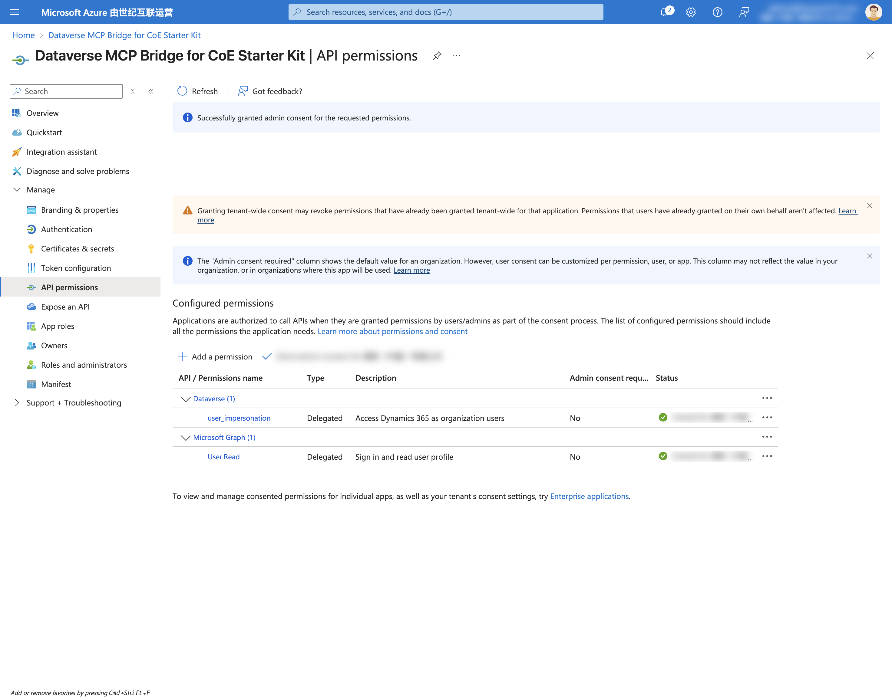

Evidence 08–09 · Client Secret

**给 21V 应用建一个 Client Secret，并当场记录 Value || Create a Client Secret on the 21V App and Capture the Value Immediately**

OAuth Manual 在 Commercial CS 端要填 client_secret value。21V 端的 Certificates & secrets → New client secret 流程与 Commercial 一致；生成后 Value 列只显示一次。本次实测以 Description `cs-to-21v-dataverse-mcp` 创建，过期日按企业最短可接受周期设置。 || OAuth Manual on the Commercial CS side requires a client_secret value. The 21V side's Certificates & secrets -> New client secret flow is identical to Commercial; after generation, the Value column is displayed only once. This run created the secret with Description `cs-to-21v-dataverse-mcp` and set the expiry to the shortest acceptable enterprise cadence.

Portal Screen 08 · 09

**New client secret / Secret value masked || New Client Secret / Secret Value Masked**

Evidence 10–11 · CS Wizard

**CS 向导接受 sovereign URL，向导后台对名称做正则校验 || CS Wizard Accepts the Sovereign URL; the Back End Validates the Name With a Regex**

Server URL 填 `https://coe.crm.dynamics.cn/api/mcp`、Authority 填 `https://login.partner.microsoftonline.cn/{21V-tenant-id}`、Scope 填 `https://coe.crm.dynamics.cn/.default offline_access`，向导 Create 直通。名称填中文或含空格会被 HTTP 400 拒绝（F5）；本次填 `21V Dataverse MCP` 后后台生成的 connector 唯一名为 `crf5c-5f21v-20dataverse-20mcp-5f...`，对应的 Redirect URL 在 `global.consent.azure-apim.net` 域。 || With Server URL `https://coe.crm.dynamics.cn/api/mcp`, Authority `https://login.partner.microsoftonline.cn/{21V-tenant-id}`, and Scope `https://coe.crm.dynamics.cn/.default offline_access`, the wizard Create passes without intervention. A CJK name or one containing spaces is rejected with HTTP 400 (F5); this run used `21V Dataverse MCP`, and the back end generated the connector unique name `crf5c-5f21v-20dataverse-20mcp-5f...`, with the corresponding Redirect URL on the `global.consent.azure-apim.net` domain.

CS Screen 10 · 11

**Manual OAuth form filled / Connector created with Redirect URL || Manual OAuth Form Filled / Connector Created With Redirect URL**

Evidence 12 · Redirect URI

**跨云 callback 域要在 sovereign 租户里登记 || The Cross-Cloud Callback Domain Must Be Registered in the Sovereign Tenant**

把 CS 自动生成的 `https://global.consent.azure-apim.net/redirect/{hash}` 回填到 21V 应用 *Authentication → Add a platform → Web → Redirect URIs*。这一步是为了让 21V 授权服务在用户同意后允许把 code 跳回 Commercial APIM。**必须在 CS Create connection 之前完成保存**，否则同意弹窗会以 `redirect_uri_mismatch` 拒绝。 || Add the CS-generated `https://global.consent.azure-apim.net/redirect/{hash}` to the 21V app under *Authentication -> Add a platform -> Web -> Redirect URIs*. This lets the 21V authorization service redirect the code back to Commercial APIM after user consent. **It must be saved before clicking CS Create connection**; otherwise the consent popup rejects with `redirect_uri_mismatch`.

- **记录顺序** — CS 侧 Create connector → 复制 Redirect URL → 21V 侧应用保存 Web Redirect URI → CS 侧点 Create connection 跳 OAuth 同意。 || **Order of operations** - CS side Create connector -> copy Redirect URL -> 21V side save Web Redirect URI on the app -> CS side click Create connection to trigger OAuth consent.
- **风险** — 跨云 DNS / TLS 回跳不在文档 SLA 范围内，严格 CA 或企业出口网关可能拦截 Commercial APIM 域的回跳。 || **Risk** - cross-cloud DNS / TLS redirects are outside the documentation SLA; strict CA or enterprise egress gateways may block the redirect to the Commercial APIM domain.

Portal Screen 12

**21V Authentication → Web → Redirect URIs || 21V Authentication -> Web -> Redirect URIs**

**综合判定**：Global → 21V 在 Copilot Studio Preview 中可复现走通。前置条件与 Runbook（§3）一致，跨云附加 F1–F8 与上述 5 组截图记录的独有事项。Scope 使用 `.default offline_access` 即可被 21V `/api/mcp` 接受。跨境数据交互的 PIPL / 数据出境合规需自行评估，详见 §5 治理层。 || **Overall judgment**: Global -> 21V is reproducibly working in Copilot Studio Preview. Preconditions follow the &sect;3 runbook; the cross-cloud-only items are F1-F8 and the five screenshot records above. A Scope of `.default offline_access` is accepted by 21V `/api/mcp`. Cross-border data interaction must be assessed independently for PIPL and data-export compliance; see &sect;5 Governance.
:::

## #governance 05 / Governance Layer :: 治理层：管理员发布前对齐清单 || Governance Layer: Admin Pre-Release Alignment Checklist

以下治理清单面向 Power Platform 管理员、安全与合规角色。Maker 配通（§03）后，**发布到生产前**必须由管理员把这三个治理位逐条对齐，避免 PoC 通过后被合规审核拦截。若仅处于开发测试阶段，可暂缓生产治理核对并回到 §03 优先完成连通验证。 || This governance checklist addresses Power Platform admins, security, and compliance roles. After the Maker has wired things up (&sect;03), **before promoting to production** the admin must align the three governance points below so the work is not blocked by compliance review after PoC. During dev/test, you can defer production governance checks and return to &sect;03.

:::accordion
::panel { open: true }
### 5.1 DLP 与连接器策略 || 5.1 DLP and Connector Policy
MCP server 通过 Power Platform connectors 接入，意味着 DLP（数据丢失防护）策略对 MCP 工具同样生效。规划时必须把 MCP 的 connector 单独放入策略组评估。 || MCP servers plug in through Power Platform connectors, which means DLP (Data Loss Prevention) policies apply equally to MCP tools. During planning, the MCP connector must be placed into a policy group for explicit evaluation.

- **分组** — 自定义连接器（包含 §03 注册的 OAuth Manual MCP 连接器）默认为 non-business；明确归入 business 或 blocked 之前不要发布。 || **Grouping** - custom connectors (including the OAuth Manual MCP connector registered in &sect;03) default to non-business; do not publish before they are explicitly placed into business or blocked.
- **跨组流** — DLP 默认禁止 business 与 non-business 数据在同一 Agent 中流转；MCP 工具与其他 connector（如 Mail Send、SharePoint）混用时会被拦截。 || **Cross-group flow** - DLP by default forbids business and non-business data from flowing through the same agent; mixing MCP tools with other connectors (such as Mail Send or SharePoint) is blocked.
- **环境作用域** — DLP 策略可按环境授予，跨租户场景下两侧管理员都要确认自家策略不会拒绝该 connector。 || **Environment scope** - DLP policies can be scoped per environment; in cross-tenant scenarios, both sides' admins must confirm their own policy does not reject the connector.

::panel
### 5.2 身份与权限最小化 || 5.2 Identity and Least Privilege
跨租户场景下，「外部应用 + 委托权限」叠加「目标环境安全角色」共同决定可见数据范围，任何一层失控都会放大风险。 || In cross-tenant scenarios, *external app + delegated permissions* stacked with *target-environment security role* jointly determine the visible data scope; loss of control at any layer amplifies risk.

- **应用权限范围** — 同云 Commercial 优先使用 `Dynamics CRM/mcp.tools`（scope 范围最窄且语义专为 MCP）；21V / GCC sovereign 云上 Common Data Service 目前只暴露 `user_impersonation`，需以该 scope + 环境 allow-list + Dataverse 安全角色三层共同收紧。两者都是委托模型，实际可访问范围由用户的安全角色决定。 || **App permission scope** - On same-cloud Commercial, prefer `Dynamics CRM/mcp.tools` (narrowest scope and MCP-specific semantics); on 21V / GCC sovereign clouds, Common Data Service currently exposes only `user_impersonation`, and the boundary must be enforced jointly by that scope, the environment allow-list, and the Dataverse security role. Both are delegated-user scopes; the actual reachable data is determined by the user's security role.
- **Admin consent** — 由目标租户管理员显式 Grant admin consent，避免每个用户都跳出同意页。 || **Admin consent** - have the target tenant admin explicitly Grant admin consent, to avoid every user being prompted with a consent page.
- **安全角色** — 在目标 Dataverse 环境内单独建一个最小权限的 Security Role 绑给跨租户用户，不要复用 System Customizer 之类的高权限角色。 || **Security role** - create a dedicated minimum-privilege Security Role in the target Dataverse environment and bind it to cross-tenant users; do not reuse high-privilege roles such as System Customizer.
- **Secret 轮换** — Client secret 必须按企业策略轮换；建议改用 Certificate credential，统一通过 Entra 应用 manifest 管理。 || **Secret rotation** - client secrets must be rotated per enterprise policy; prefer Certificate credentials managed centrally through the Entra app manifest.

::panel
### 5.3 审计与可观测 || 5.3 Audit and Observability
跨租户调用要能在事后被追溯到某次具体的用户会话、某个 MCP 工具调用、某条 Dataverse 修改记录。 || Cross-tenant calls must be traceable after the fact to a specific user session, a specific MCP tool invocation, and a specific Dataverse change.

- **Copilot Studio 侧** — Agent 的 Analytics + Conversation transcripts 能看到 MCP 工具调用次数与参数，留存期取决于环境配置。 || **Copilot Studio side** - the agent's Analytics + Conversation transcripts surface MCP tool invocation counts and parameters; retention depends on environment configuration.
- **Dataverse 侧** — 启用 Auditing on entities；对 `create_record`/`update_record`/`delete_record` 工具，目标环境的 audit log 会记录 Modified By（guest 用户）和具体字段变更。 || **Dataverse side** - enable Auditing on entities; for `create_record` / `update_record` / `delete_record` tools, the target environment's audit log records Modified By (the guest user) and the specific field-level changes.
- **Entra 侧** — Sign-in logs 显示自定义应用的 OAuth 授权与 token 颁发，可用于异常 token 使用追溯。 || **Entra side** - Sign-in logs show the custom app's OAuth authorizations and token issuance; useful for tracing anomalous token usage.
- **跨云路径 B 额外** — 自托管代理要自带 request/response 日志、调用方身份映射，并按法律保存期归档。 || **Cross-cloud Path B extras** - a self-hosted proxy must carry its own request/response logging plus caller identity mapping, and must archive logs for the legally required retention period.
:::

## #references 06 / References :: 参考来源 || References

- [1] Microsoft. — https://learn.microsoft.com/en-us/microsoft-copilot-studio/agent-extend-action-mcp | Copilot Studio MCP 集成总览、generative orchestration 强制启用要求；§01 / §03 引用基础。 || Copilot Studio MCP integration overview and the generative-orchestration requirement; the base reference for &sect;01 and &sect;03.
- [2] Microsoft. — https://learn.microsoft.com/en-us/microsoft-copilot-studio/mcp-add-existing-server-to-agent | MCP onboarding wizard 中 OAuth 2.0 Dynamic discovery / Dynamic / Manual 三类配置；§03.2 步骤的官方源。 || The three OAuth 2.0 configurations in the MCP onboarding wizard - Dynamic discovery, Dynamic, Manual; the official source for the steps in &sect;3.2.
- [3] Microsoft. — https://learn.microsoft.com/en-us/power-apps/maker/data-platform/data-platform-mcp | Dataverse MCP 端点格式 `/api/mcp`、内置工具清单（list_tables / read_query 等）、计费起算日；§01.1、§03.3 验收的来源。 || Dataverse MCP endpoint format `/api/mcp`, built-in tool catalog (list_tables, read_query, etc.), and billing start date; the source for &sect;1.1 and &sect;3.3 acceptance.
- [4] Microsoft. — https://learn.microsoft.com/en-us/power-apps/maker/data-platform/data-platform-mcp-other-clients | 自定义 Entra 应用注册流程、`Dynamics CRM/mcp.tools` 委托权限、Dataverse CLI client ID `0c412cc3-0dd6-449b-987f-05b053db9457`；§01.3、§03.1 直接引用。 || Custom Entra app registration flow, the `Dynamics CRM/mcp.tools` delegated permission, and the Dataverse CLI client ID `0c412cc3-0dd6-449b-987f-05b053db9457`; directly referenced by &sect;1.3 and &sect;3.1.
- [5] Microsoft. — https://learn.microsoft.com/en-us/power-apps/maker/data-platform/data-platform-mcp-copilot-studio | Copilot Studio 内置 Dataverse MCP Server 工具的添加流程；§01.2 Path A 描述来源。 || The add flow for Copilot Studio's built-in Dataverse MCP Server tools; the source for the Path A description in &sect;1.2.
- [6] Microsoft. — https://learn.microsoft.com/en-us/power-apps/maker/data-platform/data-platform-mcp-disable | PPAC 中 Dataverse Model Context Protocol → Advanced Settings 的 allow-list 配置；Managed Environment 前置条件；§01.3 来源。 || PPAC's Dataverse Model Context Protocol -> Advanced Settings allow-list configuration; Managed Environment prerequisite; source for &sect;1.3.
- [7] Microsoft. — https://learn.microsoft.com/en-us/microsoft-copilot-studio/mcp-troubleshooting | MCP 集成已知问题（exclusiveMinimum / 多类型数组 / reference type / enum type）；§3.5 Error 6 列表的官方源。 || Known MCP integration issues (exclusiveMinimum, multi-type array, reference type, enum type); the official source for the &sect;3.5 Error 6 list.
- [8] Microsoft. — https://learn.microsoft.com/en-us/entra/external-id/cross-tenant-access-overview | Microsoft cloud settings 跨云 B2B 支持范围；B2B Direct Connect 在跨云不支持；§02.2、§04.1 引用。 || Microsoft cloud settings scope for cross-cloud B2B; B2B Direct Connect not supported across clouds; cited by &sect;2.2 and &sect;4.1.
- [9] Microsoft. — https://learn.microsoft.com/en-us/entra/external-id/cross-cloud-settings | 明确列出 Commercial × Government、Commercial × 21Vianet 两对跨云 B2B；UPN 登录强制；§02.1、§04 引用。 || Explicitly lists the two cross-cloud B2B pairs Commercial x Government and Commercial x 21Vianet; UPN sign-in is enforced; cited by &sect;2.1 and &sect;4.
- [10] Microsoft. — https://learn.microsoft.com/en-us/power-platform/admin/about-microsoft-cloud-china | 21Vianet 为「physically separated environment」、Shanghai Blue Cloud 本地运营、China 3 数据中心切换；§04.1 的合规与隔离表述来源。 || 21Vianet as a 'physically separated environment'; locally operated by Shanghai Blue Cloud; China 3 data-center transition; source for the compliance and isolation statements in &sect;4.1.
