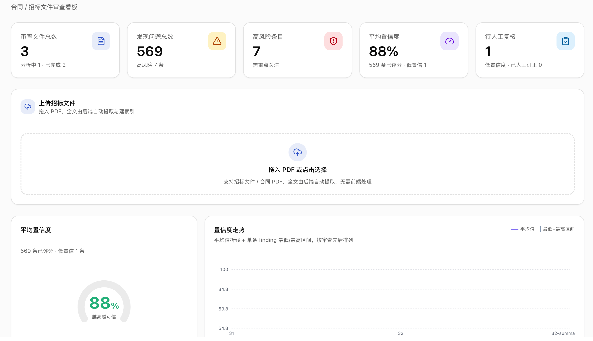
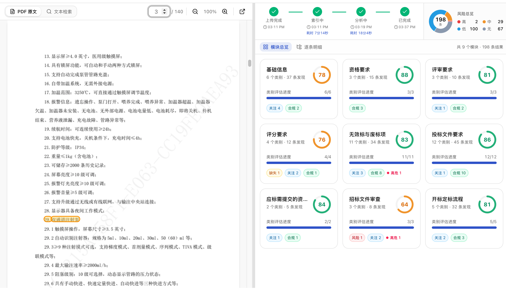
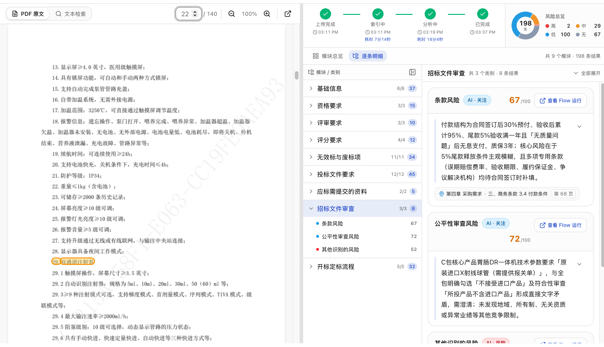
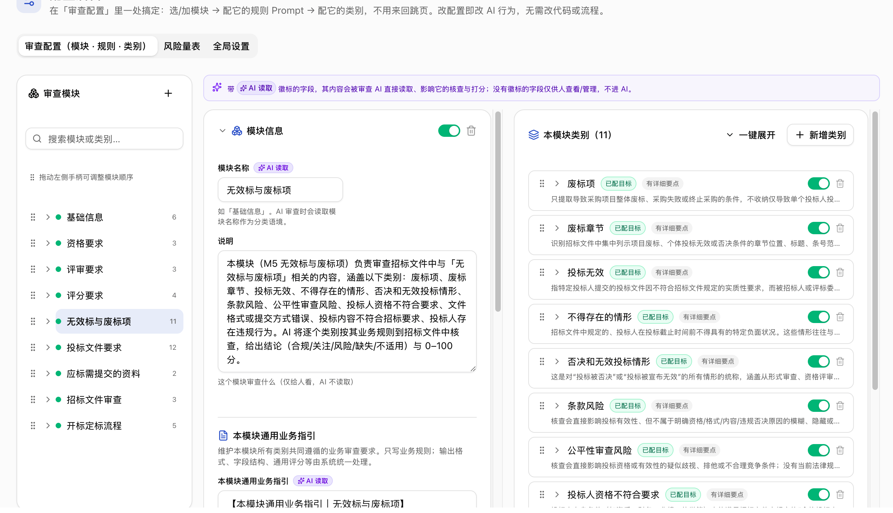

## #decision 01 / Business Challenges :: 长文档、分散规则和人工复核压力让招标风险难以及时收敛 || Long Documents, Fragmented Policy, and Manual Review Pressure Delay Risk Resolution

招标与合同文件往往包含上百页正文、附件和交叉引用，审查人员需要在资格要求、评分规则、废标条件、技术参数、商务条款和合同风险之间反复核对。不同专家依赖各自经验和检查表，结果难统一、进度难追踪、原文难回溯。业务需要扩大首轮筛查覆盖，同时保留专业人员对风险判断和最终发布的责任。 || RFPs and contracts often span hundreds of pages, attachments, and cross-references. Reviewers repeatedly reconcile qualification, scoring, disqualification, technical, commercial, and contract requirements. Different specialists rely on separate experience and checklists, making results difficult to standardize, progress difficult to track, and evidence difficult to revisit. The business needs broader first-pass coverage without transferring risk judgment or release accountability away from specialists.

:::comparison { title: "四类业务挑战 || Four Business Challenges" }
::versus 挑战 1 || Challenge 1
### 审查范围广且容易遗漏 || Review Breadth Creates Miss Risk
一份文件同时包含资格、评分、废标、格式、技术、商务和合同要求；人工线性阅读难以稳定覆盖全部类别和交叉矛盾。 || One document combines qualification, scoring, disqualification, formatting, technical, commercial, and contract requirements. Linear manual review struggles to cover every category and contradiction consistently.

::versus 挑战 2 || Challenge 2
### 经验和规则分散 || Policy and Expertise Are Fragmented
检查表、风险口径和专业经验散落在个人文档与历史项目中；规则更新后难以保证所有审查人员使用同一版本。 || Checklists, risk standards, and specialist knowledge live in personal files and prior projects. Policy changes do not reliably reach every reviewer in the same version.

::versus 挑战 3 || Challenge 3
### 结论与原文脱节 || Conclusions Lose Their Evidence Trail
摘要和问题清单常缺少章节、页码和原文摘录；复核人需要重新搜索整份文件，解释和交接成本较高。 || Summaries and issue lists often omit section, page, and source excerpt. Reviewers must search the entire document again, increasing explanation and handoff effort.

::versus 挑战 4 || Challenge 4 { highlight: true }
### 进度和异常不可见 || Progress and Exceptions Are Opaque
文件是否完成索引、哪些类别尚未审查、哪次 AI 调用失败以及谁修改了结论，通常缺少统一状态和审计入口。 || Teams often lack one view of index readiness, unfinished categories, failed AI calls, and who changed a conclusion.
:::

## #journey 02 / Target Outcomes and Value :: 把人工精力从全文搜索转向证据核验、风险判断和业务决策 || Shift Human Effort from Full-Text Search to Evidence Validation and Risk Decisions

方案不让 AI 独立决定是否投标；系统先承担可重复的文档处理和分类筛查，为专业人员准备结构化审查包。目标结果包括统一审查覆盖、缩短定位原文的时间、让风险优先级可见、把规则从个人经验沉淀为可维护配置，并让每次运行、重试和人工订正都有记录。实际收益需通过客户基线和试点数据验证，不预设未经测量的 ROI。 || The goal is not to let AI decide whether to bid. The system performs repeatable document processing and category screening first, then prepares a structured review package for specialists. Target outcomes include consistent coverage, faster source localization, visible risk priority, maintainable policy instead of personal knowledge, and records of every run, retry, and correction. Customer baselines and pilot data must validate realized value; this solution does not prestate unmeasured ROI.

:::insight-grid { cols: 4, title: "四项目标业务结果 || Four Target Business Outcomes" }
::card 01
### 覆盖一致 || Consistent Coverage
每份文件按同一模块、类别和检查标准执行首轮审查，减少因人员经验差异造成的覆盖波动。 || Every document receives the same first-pass modules, categories, and review criteria, reducing coverage variation across reviewers.

::card 02
### 证据直达 || Evidence at Hand
每条结论同时给出原文摘录、章节、页码和定位锚，复核人从风险清单直接回到文件上下文。 || Every conclusion includes source excerpt, section, page, and anchor so reviewers can move directly from issue to context.

::card 03
### 风险优先 || Risk Prioritization
风险等级与置信度分开呈现，高风险、低置信和跨章节冲突优先进入专业复核。 || Risk and confidence remain separate, prioritizing high-risk, low-confidence, and cross-section conflicts for specialist review.

::card 04
### 过程可管 || Managed Operations
看板展示文件状态、类别进度、人工订正和异常恢复，管理者可以按统一口径跟踪处理质量与运行健康。 || Dashboards expose document status, category progress, human corrections, and recovery so managers can track quality and health consistently.
:::

## #evidence 03 / End-to-End Business Experience :: 从上传一份文件到形成可复核审查包，全程在一个工作台完成 || Move from One Uploaded File to a Reviewable Package in a Single Workbench

用户只需提交 PDF 和项目基本信息。系统在后台推进全文提取、知识索引和分类审查，业务人员在结果工作台查看模块总览、风险分布和类别结论，专业复核人对照原文确认或订正。配置管理员维护审查目录与评分标准，运营人员通过 Trace 和 Watchdog 处理异常。 || Users submit a PDF and basic project information. The system extracts text, builds the knowledge index, and performs category review in the background. Business users inspect module summaries, risk distribution, and category conclusions; specialists validate or correct them against the source. Configuration administrators maintain the review taxonomy and scoring policy, while operators use traces and the watchdog to handle exceptions.

:::flow { title: "六步业务流程 || Six-Step Business Experience" }
1. **1 · 上传与登记 || 1 · Upload and Register** — 上传招标或合同 PDF，填写项目名称和编号；系统生成唯一审查记录并进入处理队列。 || Upload an RFP or contract PDF and enter project details; the system creates one review record and queues processing.
2. **2 · 提取与索引 || 2 · Extract and Index** — 后台提取全文与页数，把 PDF 和纯文本保存到受控文档库，并确认审查 Agent 已能检索内容。 || The backend extracts full text and pages, stores PDF and text in the controlled library, and confirms that the review agent can retrieve the content.
3. **3 · 分类并行审查 || 3 · Parallel Category Review** — 系统按启用的模块和类别执行检查，分别形成类别结论、合规健康分和具体 findings。 || Enabled modules and categories run in parallel to produce category conclusions, health scores, and specific findings.
4. **4 · 结果与原文对照 || 4 · Compare Results with Source** — 工作台左侧呈现 PDF 与全文搜索，右侧呈现模块、类别、风险和原文定位，支持从 finding 直接跳转证据。 || The workbench places PDF and full-text search beside modules, categories, risk, and source locations, enabling direct navigation from finding to evidence.
5. **5 · 人工复核与订正 || 5 · Human Review and Correction** — 高风险和低置信结果优先进入复核；人员修改标题、描述或风险理由时，系统保留改前、改后、人员和时间。 || High-risk and low-confidence results receive priority. When people change titles, descriptions, or risk rationale, the system retains before, after, actor, and time.
6. **6 · 运营监控与持续优化 || 6 · Operate and Improve** — 看板跟踪风险、置信度和人工订正；Trace 记录每次调用，Watchdog 恢复卡住类别，真实 prompt 可回放测试。 || Dashboards track risk, confidence, and corrections. Traces retain calls, the watchdog recovers stuck categories, and resolved prompts can be replayed in testing.
:::

*真实业务总览与文件入口 聚合展示文件、findings、高风险、置信度与待复核数量，并在同一页面提交新 PDF。 || Live Business Overview and Document Entry Point Aggregates documents, findings, high-risk items, confidence, and pending review while accepting new PDFs on the same page.*

*原文旁的全局审查态势 同屏呈现 140 页原文、四阶段处理轨迹、198 条结果、风险分布，以及九个模块的得分、进度和结论构成。 || Portfolio-Level Review Status Beside the Source Shows the 140-page source, four processing stages, 198 results, risk distribution, and the score, progress, and conclusion mix of nine modules in one view.*

*从风险结论直接回到原文证据 逐条展示类别评分、AI 风险结论、Flow 运行入口、章节锚点和页码；复核人可在同一工作台核验原文，免去重新搜索整份文件的负担。 || Move Directly from Risk Conclusions to Source Evidence Presents category scores, AI risk conclusions, workflow-run links, section anchors, and page numbers so reviewers validate the source without searching the full document again.*

*真实可配置审查目录与规则 管理员在应用内维护模块、类别、风险量表和 AI 读取规则，改变业务行为无需修改前端代码。 || Live Configurable Review Taxonomy and Policy Administrators maintain modules, categories, risk rubrics, and AI-read policy in the application without changing front-end code.*

| 信息 || Information | 回答的问题 || Business Question | 给复核人的价值 || Reviewer Value |
| --- | --- | --- |
| 类别结论 || Category Conclusion | 这个审查类别是合规、关注、风险、缺失还是不适用？ || Is this category compliant, attention, risk, missing, or not applicable? | 先看结论和事实摘要，再按需展开细节 || Start with conclusion and factual summary, then expand details as needed |
| 风险与置信度 || Risk and Confidence | 潜在后果有多严重？当前判断有多确定？ || How severe is the consequence, and how certain is the judgment? | 把高风险和低置信项优先交给专家 || Prioritize high-risk and low-confidence items for specialists |
| 原文证据 || Source Evidence | 结论对应哪段原文、章节和页码？ || Which excerpt, section, and page support the conclusion? | 减少重复搜索，保持结论可解释 || Reduce repeated search and keep conclusions explainable |
| 评分依据 || Scoring Basis | 为什么给出这个类别得分、风险和置信度？ || Why did this category receive this score, risk, and confidence? | 支持复核、校准和规则迭代 || Support review, calibration, and policy improvement |
| 人工订正记录 || Human Correction Record | 谁在何时修改了哪个字段，修改前后是什么？ || Who changed which field, when, and from what to what? | 保留专业判断，形成可审计的学习数据 || Preserve specialist judgment and create auditable learning data |

## #architecture 04 / Solution Architecture :: 三层架构把业务体验、Agentic 编排与企业数据分开 || A Three-Layer Architecture Separates Business Experience, Agentic Orchestration, and Enterprise Data

体验层使用 Dynamics 365 或 Power Apps 承载上传、审查、人工复核、配置和运营；Agentic 编排层由 Copilot Studio RFP Reviewer 与 Copilot Studio Workflow 组成，Workflow 负责文档处理、知识就绪检查、49 类并行审查、Human-in-the-Loop 和异常恢复；数据与知识层使用 Dataverse 保存业务记录，并以 SharePoint 保存原始文件和企业知识。Microsoft Entra ID、DLP、Solution 与可观测性横向治理三层。[1][2][3][4][8][9] || The experience layer uses Dynamics 365 or Power Apps for upload, review, human correction, configuration, and operations. The agentic orchestration layer combines the Copilot Studio RFP Reviewer with Copilot Studio Workflows; workflows own document processing, knowledge readiness, 49-category review, human-in-the-loop actions, and exception recovery. The data and knowledge layer uses Dataverse for business records and SharePoint for source files and enterprise knowledge. Microsoft Entra ID, DLP, solutions, and observability govern all three layers.[1][2][3][4][8][9]

Evidence-Grounded RFP Review · 三层解决方案架构 || Evidence-Grounded RFP Review · Three-Layer Solution Architecture

Dynamics 365 / Power Apps + Copilot Studio Credits

Layer 1

业务体验层 || Business Experience Layer

Business Application

Dynamics 365 / Power Apps

承载上传、总览、审查列表、原文对照、配置和运营入口 || Hosts upload, overview, review list, source comparison, configuration, and operations

Human Control

专业复核与发布 || Specialist Review and Release

业务人员确认、订正或退回高风险和低置信结果，保留最终责任 || People confirm, correct, or return high-risk and low-confidence results and retain final accountability

↓

Layer 2

Agentic 编排层 || Agentic Orchestration Layer

Reasoning

Copilot Studio RFP Reviewer

按类别检索企业知识，生成结论、事实摘要、findings、风险与置信度 || Retrieves enterprise knowledge by category and generates conclusions, factual summaries, findings, risk, and confidence

Deterministic Execution

Copilot Studio Workflow

执行文档处理、知识就绪、类别派发、结构化落表、Human-in-the-Loop、Trace 与恢复 || Runs content processing, knowledge readiness, category dispatch, structured persistence, human-in-the-loop, traces, and recovery

↓

Layer 3

数据与知识层 || Data and Knowledge Layer

Business Data

Microsoft Dataverse

保存 RFP、审查目录、类别结果、findings、配置、订正与运行记录 || Stores RFPs, taxonomy, category results, findings, configuration, corrections, and runtime records

Enterprise Knowledge

SharePoint Online

保存原始 PDF 与企业文档，支撑 Agent 的受控知识检索 || Stores source PDFs and enterprise documents for controlled agent retrieval

Microsoft Entra ID

用户、服务身份与条件访问 || Users, workload identities, and Conditional Access

Power Platform 治理 || Power Platform Governance

DLP · 环境 · Solution · ALM || DLP · Environments · Solutions · ALM

可观测性 || Observability

Workflow run · 任务状态 · 恢复记录 || Workflow runs · Task state · Recovery records

人员责任 || Human Accountability

规则负责人 · 复核人 · 发布人 || Policy owner · Reviewer · Release owner

## #runtime 05 / Key Components :: 四个逻辑组件连接业务体验、Agent 推理、确定性执行与企业数据 || Four Logical Components Connect Business Experience, Agent Reasoning, Deterministic Execution, and Enterprise Data

方案避免把所有逻辑放进一个 Agent。Dynamics 365 / Power Apps 负责业务体验；RFP Reviewer 负责基于证据的生成式审查；Copilot Studio Workflow 负责文档处理、规则执行、Human-in-the-Loop 和恢复；Dataverse 与 SharePoint 保存权威业务记录和企业知识。客户只需管理应用用户许可与 Copilot Credits 两类商业配置。 || The design avoids placing all logic in one agent. Dynamics 365 or Power Apps owns the business experience. RFP Reviewer performs evidence-grounded generative review. Copilot Studio Workflows own content processing, rule execution, human-in-the-loop actions, and recovery. Dataverse and SharePoint retain authoritative business records and enterprise knowledge. Customers manage only application user licensing and Copilot Credits as commercial configurations.

| 组件 || Component | 主要职责 || Primary Responsibility | 客户可见能力 || Customer-Facing Capability | 控制边界 || Control Boundary |
| --- | --- | --- | --- |
| Dynamics 365 / Power Apps 体验 || Dynamics 365 / Power Apps Experience | 统一业务交互、数据展示与人工复核 || Unified business interaction, data presentation, and human review | 上传、看板、结果页、原文对照、配置与运营 || Upload, dashboards, results, source comparison, configuration, and operations | 不承担 Agent 推理或后台编排 || Does not own agent reasoning or backend orchestration |
| Copilot Studio RFP Reviewer | 按类别检索证据并生成结构化建议 || Retrieve evidence by category and generate structured recommendations | 类别结论、事实摘要、findings、风险与置信度 || Category conclusions, factual summaries, findings, risk, and confidence | 不能代替专业人员发布结论 || Cannot replace specialist release authority |
| Copilot Studio Workflow | 管理文档处理、状态、并行任务、Human-in-the-Loop、Trace 与恢复 || Manage content processing, state, parallel work, human-in-the-loop, traces, and recovery | 进度可见、Workflow run 可追踪、卡住类别可重跑 || Visible progress, traceable workflow runs, and rerunnable stuck categories | 确定性执行，不拥有业务风险定义 || Executes deterministically without owning business risk definitions |
| Dataverse + SharePoint | 保存业务记录、配置、订正、审计与企业知识 || Retain business records, configuration, corrections, audit, and enterprise knowledge | 统一规则、原文证据、低置信队列和改前改后留痕 || Unified policy, source evidence, low-confidence queue, and before/after history | 按角色、项目和文档库配置最小权限 || Apply least privilege by role, project, and library |

:::accordion
::panel
### 5.1 长时间审查如何保持可恢复 || 5.1 How Long-Running Review Remains Recoverable
每个类别拥有独立结果记录和 Workflow run，单一类别卡住时不需要重跑整份文件；恢复 Workflow 取消旧运行并有限重试，同时把扫描、重跑和放弃数量写入运营记录。 || Each category has its own result record and workflow run. A stuck category does not require rerunning the full document; a recovery workflow cancels the old run, retries within limits, and records scans, retriggers, and give-ups.

幂等 || Idempotency

**同一任务只产生一个有效结果 || One Task Produces One Effective Result**

幂等键至少包含文档版本、类别和规则版本；后到的重复运行不得覆盖已人工订正的结果。 || The idempotency key includes document version, category, and policy version. Late duplicate runs cannot overwrite human-corrected results.

有界 || Bounded

**重试次数和总时长有上限 || Attempts and Total Duration Have Limits**

达到上限后进入人工异常队列，并停止自动调用，避免持续成本和重复告警。 || After the limit, the task enters a human exception queue and automated calls stop to prevent ongoing cost and duplicate alerts.

可解释 || Explainable

**每次重跑都有原因和差异 || Every Rerun Has a Reason and a Difference Record**

记录触发原因、输入版本、运行 ID、输出哈希和最终采用结果，便于排查模型、连接器或配置问题。 || Record trigger reason, input version, run ID, output hash, and accepted result to diagnose model, connector, or policy faults.
:::

## #governance 06 / Required Product Configuration :: 客户只需配置应用许可与 Copilot Studio Credits 两类产品 || Customers Configure Only Application Licensing and Copilot Studio Credits

第一类是 Dynamics 365 或 Power Apps，用于业务应用、Dataverse 数据、用户访问和平台治理；第二类是 Copilot Studio Credits，用于 RFP Reviewer、Copilot Studio Workflow、文档处理、AI tools、Workflow actions 和知识检索。Copilot Studio 中的内容处理按页消耗 8 Copilot Credits，Workflow actions 每 100 个动作消耗 13 Copilot Credits；正式配置按月文档数、平均页数、49 类审查动作和重试率测算。[1][8][9] SharePoint Online 作为客户现有 Microsoft 365 企业知识来源，不单列为本方案新增许可。 || The first product is Dynamics 365 or Power Apps for the business application, Dataverse data, user access, and platform governance. The second is Copilot Studio Credits for RFP Reviewer, Copilot Studio Workflows, content processing, AI tools, workflow actions, and knowledge retrieval. Copilot Studio content processing consumes 8 Copilot Credits per page, while workflow actions consume 13 Copilot Credits per 100 actions. Size production capacity from monthly documents, average pages, 49-category review actions, and retry rate.[1][8][9] SharePoint Online is treated as the customer's existing Microsoft 365 enterprise knowledge source and is not counted as a new solution license.

:::insight-grid { cols: 2, title: "两类产品配置 || Two Product Configurations" }
::card 01
### Dynamics 365 / Power Apps
涵盖业务应用、Dataverse、Entra 登录、角色权限、DLP、Solution、环境与 ALM。已有适用 Dynamics 365 用户可沿用其应用上下文；其他用户配置 Power Apps Premium。[1][8] || Covers the business application, Dataverse, Entra authentication, role security, DLP, solutions, environments, and ALM. Users with qualifying Dynamics 365 rights can stay in that application context; other users receive Power Apps Premium.[1][8]

::card 02
### Copilot Studio Credits
统一覆盖 Agent、Copilot Studio Workflow、文档处理、AI tools、知识检索和 Workflow actions。试点可使用 PAYG，稳定后根据实测月用量选择预付 Credits 或继续 PAYG。[2][9] || Covers the agent, Copilot Studio Workflows, content processing, AI tools, knowledge retrieval, and workflow actions. Use PAYG for the pilot, then choose prepaid Credits or continued PAYG from measured monthly consumption.[2][9]
:::

| 配置项 || Configuration | 生产基线 || Production Baseline | 容量驱动因素 || Sizing Driver |
| --- | --- | --- |
| Dynamics 365 / Power Apps | 使用客户已有适用 Dynamics 365 权益，或为 Code App 用户配置 Power Apps Premium；Dataverse、治理和环境能力随应用平台配置 || Use qualifying existing Dynamics 365 rights or assign Power Apps Premium to code-app users; configure Dataverse, governance, and environments within the application platform | 月活用户数、角色数量、现有 Dynamics 365 / Power Apps 权益、数据与文件保留量 || Monthly active users, role count, existing Dynamics 365 / Power Apps rights, and data/file retention |
| Copilot Studio Credits | 试点优先 PAYG；生产按 Agent actions、Workflow actions、文档处理页数、AI tool tokens 与重试量选择预付或 PAYG || Prefer PAYG for pilot; in production choose prepaid or PAYG from agent actions, workflow actions, content-processing pages, AI-tool tokens, and retries | 月文档数 × 平均页数 × 8 Credits/页；49 类 Workflow 动作量；Agent/AI tool 用量与异常重试率 || Monthly documents × average pages × 8 Credits/page; 49-category workflow actions; agent/AI-tool usage and retry rate |

## #security 07 / Expected Solution Benefits :: 方案预期改善覆盖、审查效率、风险响应和治理透明度 || The Solution Targets Better Coverage, Review Efficiency, Risk Response, and Governance Transparency

预期获益源于端到端流程重构，远非单一模型能力所能涵盖：统一目录提高首轮覆盖一致性，证据直达减少原文定位工作，风险与置信度分流让专家先处理更需要判断的事项，配置和运行记录让规则、质量与异常可持续管理。所有收益应在同类型文档、同一审查目录和相同风险范围下建立人工基线，并通过受控试点验证。 || Expected value stems from end-to-end process redesign, beyond any single model feature. A shared taxonomy improves first-pass consistency. Direct evidence reduces source-search effort. Risk and confidence routing lets specialists address judgment-intensive items first. Configuration and runtime records make policy, quality, and exceptions manageable over time. Establish manual baselines on comparable document types, review taxonomies, and risk scope, then validate every benefit through a controlled pilot.

:::comparison { title: "四类预期获益 || Four Expected Benefit Areas" }
::versus 覆盖 || Coverage { highlight: true }
### 统一首轮审查标准 || Standardize First-Pass Review
每份文件按同一模块、类别和风险规则执行，预期减少因审查人不同造成的检查项遗漏和口径波动。 || Apply the same modules, categories, and risk policy to every document, reducing reviewer-dependent gaps and variation.

::versus 效率 || Efficiency
### 缩短原文查找与整理时间 || Reduce Source Search and Compilation Time
系统预先组织结论、事实摘要和原文位置，让专业人员把精力集中在风险判断与跨方沟通上，免去重复翻页和手工整理问题清单。 || The system prepares conclusions, factual summaries, and source locations so specialists focus on risk judgment and communication without repeated search and manual list compilation.

::versus 风险 || Risk
### 更早暴露高风险与矛盾 || Surface High Risk and Contradictions Earlier
风险等级、置信度和跨章节证据让团队优先澄清废标条件、关键缺失、异常责任和互相冲突的要求。 || Risk, confidence, and cross-section evidence help teams prioritize disqualification terms, critical gaps, unusual obligations, and conflicting requirements.

::versus 治理 || Governance
### 形成可配置、可追踪的审查资产 || Create Configurable and Traceable Review Assets
规则、prompt、运行、订正和恢复记录进入统一平台，支持规则版本管理、质量复盘、责任追踪和持续优化。 || Policy, prompts, runs, corrections, and recovery enter one platform, supporting versioning, quality review, accountability, and continuous improvement.
:::

| 收益维度 || Benefit Dimension | 建议指标 || Recommended Measure | 对照方法 || Comparison Method |
| --- | --- | --- |
| 审查覆盖 || Review Coverage | 人工 gold 中被系统发现的适用问题占比；按风险等级拆分 || Share of applicable gold issues found by the system, split by risk | 同一文档、同一目录，对比人工基准与 AI+人工结果 || Same document and taxonomy; compare manual baseline with AI-plus-human result |
| 主动处理时间 || Active Handling Time | 从开始审查到形成可提交问题清单的有效分钟数中位数 || Median active minutes from review start to a submission-ready issue list | 按页数区间和风险复杂度匹配前后样本 || Match before/after samples by page range and risk complexity |
| 证据定位效率 || Evidence Localization Efficiency | 复核人从 finding 打开正确原文所需时间与成功率 || Time and success rate for opening the correct source from a finding | 抽样记录点击到确认原文的用时 || Sample elapsed time from click to source confirmation |
| 风险响应 || Risk Response | 高风险事项从发现到责任人处置的中位时长 || Median time from high-risk discovery to accountable disposition | 统一风险定义后比较试点前后 || Compare before and after using one risk definition |
| 治理透明度 || Governance Transparency | 具备原文、运行、规则版本和人工订正记录的 findings 占比 || Findings with source, run, policy version, and correction history | 按月审计完整记录率和异常关闭率 || Audit record completeness and exception closure monthly |

## #rollout 08 / Delivery and Validation :: 从一个文档类型和一组责任人开始，按质量门逐步扩大使用范围 || Start with One Document Type and One Accountable Team, Then Scale Through Quality Gates

现有平台已经具备完整链路，客户项目可以直接进入业务适配与受控试点，无需从头搭建概念验证。实施重点是把客户审查目录、风险规则、用户角色、文档库和许可容量配置到目标环境，并用客户历史样本建立质量和效率基线。每个阶段都有退出条件；质量、权限或运行可靠性未达标时不扩大范围。 || The existing platform already provides the complete runtime path, so a customer engagement can move directly into business adaptation and a controlled pilot without rebuilding a proof of concept. Configure the customer's taxonomy, risk policy, user roles, document library, licensing, and capacity in the target environment, then establish quality and efficiency baselines with customer history. Every phase has an exit gate; scope does not expand when quality, authorization, or reliability fails.

:::flow { title: "四阶段客户交付路线 || Four-Phase Customer Delivery Roadmap" }
1. **阶段 1 · 业务发现与基线 || Phase 1 · Business Discovery and Baseline** — 选择一个文档类型、一个责任团队和 20–30 份已完成人工审查的样本；确认审查目录、风险口径、用户角色、保留要求和人工处理时间基线。 || Select one document type, one accountable team, and 20–30 historically reviewed samples. Confirm taxonomy, risk policy, user roles, retention, and manual handling baselines.
2. **阶段 2 · 环境配置与离线评估 || Phase 2 · Environment Configuration and Offline Evaluation** — 部署 Solution，配置 SharePoint、连接引用、服务身份、许可与容量；导入客户规则并对历史样本运行，逐条比较证据、结论、风险和遗漏。 || Deploy the solution; configure SharePoint, connection references, workload identities, licenses, and capacity. Import customer policy and compare evidence, conclusions, risk, and misses against historical samples.
3. **阶段 3 · 受控生产试点 || Phase 3 · Controlled Production Pilot** — 限定到一个团队和明确文档范围，所有 AI 结果先经人工复核；每日处理异常，每周复盘质量、采用、处理时间和 credits 消耗，保留原流程回退。 || Limit the pilot to one team and a defined document scope. Route every AI result through human review, handle exceptions daily, and review quality, adoption, handling time, and credit consumption weekly while retaining fallback.
4. **阶段 4 · 生产加固与规模化 || Phase 4 · Production Hardening and Scale** — 质量、权限、恢复和容量门通过后，再按文档类型或组织范围逐步扩大；持续抽样高置信结果，版本化规则并按月审查单位成本与收益。 || After quality, authorization, recovery, and capacity gates pass, expand one document type or organizational scope at a time. Continue sampling high-confidence results, version policy, and review unit cost and value monthly.
:::

:::accordion
::panel
### 8.1 现有验证说明平台可用，也说明人工复核仍不可取消 || 8.1 Existing Evidence Shows the Platform Works and Human Review Remains Necessary
真实回归已经验证 140 页、49 类别和 198 findings 的完整链路；独立质量裁决也显示当前结果仍需专业人员把关。六项实测指标取自不同样本，只用于定义上线边界，不合并成营销总分。 || A real regression completed a 140-page document across 49 categories and 198 findings. Independent adjudication also shows that specialists must still govern results. The six measured indicators come from different samples and define go-live boundaries without being merged into a single marketing score.

| 指标 || Measure | 当前代码证据 || Current Evidence | 下一门槛 || Next Gate |
| --- | --- | --- |
| 完成状态完整性 || Completion-State Integrity | 一例 42002 仅完成 48/49；另一例 49/49 E2E PASS || One 42002 run stopped at 48/49; another achieved a 49/49 E2E pass | 任何 42002 都必须同时满足 49/49 和零 pending || Every 42002 must also prove 49/49 and zero pending |
| finding 准确率 || Finding Accuracy | 181 条逐条裁决样本为 74.9% || 74.9% across 181 adjudicated findings | 按业务风险偏好设门，并对高风险项要求更高下限 || Set a risk-based gate with a higher floor for high-risk findings |
| 内容 / 严格类别召回 || Content / Strict-Category Recall | 内容召回 91.0%；严格类别召回 63.3% || Content recall 91.0%; strict-category recall 63.3% | 保持内容召回，同时显著提高类别主归属 || Preserve content recall while materially improving primary-category assignment |
| 证据可定位性 || Evidence Locatability | 三文档不计页码口径为 97.2% / 99.8% / 96.3%；单文档页码正确率曾为 82.1% || Three-document no-page rates were 97.2% / 99.8% / 96.3%; one-document page accuracy was 82.1% | 锚文本命中与页码准确分别统计，不能互相替代 || Measure anchor hits and page accuracy separately; neither substitutes for the other |
| 跨类别重复率 || Cross-Category Duplicate Rate | 31 号逐条裁决样本为 15.5% || 15.5% in the adjudicated document-31 sample | 引入主归属与引用关系后按同口径下降 || Reduce under the same definition after primary ownership and cross-references |
| 人工复核与权限控制 || Human Review and Authorization Control | 修改留痕已上线；正式处置枚举、发布状态和角色验收待收尾 || Edit history is live; formal dispositions, release state, and role validation remain pending | 四角色权限测试通过，所有高风险和低置信项有处置记录 || Pass four-role authorization tests and retain disposition for every high-risk and low-confidence item |
:::

## #references 09 / References :: 事实来源与适用边界 || Sources and Applicability Boundaries

当前实现事实来自 ContractReview-CodeApp main 分支源码、现有工作流定义、生成模型、测试资产与 PROJECT_STATUS；运行体验来自 2026-07-29 对已共享 Power Apps 的逐页操作。[6][7] 产品能力边界引用 Microsoft 官方资料。仓库中的项目名称、业务条款和环境标识未在正文展开。质量数字均保留原测量样本和口径，不跨样本合并。 || Implementation facts come from the ContractReview-CodeApp main-branch source, existing workflow definitions, generated models, test assets, and PROJECT_STATUS. Runtime experience comes from a page-by-page inspection of the shared Power Apps application on 2026-07-29.[6][7] Product boundaries rely on official Microsoft sources. Project names, business clauses, and environment identifiers from the repository are not expanded in the article. Quality figures retain their original samples and definitions and are not combined across tests.

- [1] Microsoft Learn · Power Apps Code Apps Overview — https://learn.microsoft.com/en-us/power-apps/developer/code-apps/overview | 支撑 React 等框架在 Power Platform 托管运行、Entra 登录、连接器、发布、DLP、条件访问和 code apps 当前限制。 || Supports React and other frameworks on managed Power Platform hosting, Microsoft Entra authentication, connectors, publishing, DLP, Conditional Access, and current code-app limitations.
- [2] Microsoft Learn · Knowledge Sources Summary in Copilot Studio — https://learn.microsoft.com/en-us/microsoft-copilot-studio/knowledge-copilot-studio | 支撑 SharePoint、Dataverse 和上传文档知识源、用户身份访问、知识源限制、引用行为，以及关闭无依据回答的实际边界。 || Supports SharePoint, Dataverse, and uploaded-document knowledge, user-identity access, source limits, citation behavior, and the practical boundary of disabling ungrounded responses.
- [3] Microsoft Learn · Security Concepts in Microsoft Dataverse — https://learn.microsoft.com/en-us/power-platform/admin/wp-security-cds | 支撑安全角色、业务单元、团队、记录所有权、记录共享、列级安全和权限累加模型。 || Supports security roles, business units, teams, record ownership, sharing, column security, and the cumulative access model.
- [4] Microsoft Learn · Data Loss Prevention Policies — https://learn.microsoft.com/en-us/power-platform/admin/wp-data-loss-prevention | 支撑按业务、非业务和阻止分组管理连接器组合，并把策略应用到 Power Platform 应用、Workflow 与 Copilot Studio Agent。 || Supports business, nonbusiness, and blocked connector classifications across Power Platform applications, workflows, and Copilot Studio agents.
- [5] NIST · Artificial Intelligence Risk Management Framework 1.0 — https://doi.org/10.6028/NIST.AI.100-1 | 用 Govern、Map、Measure、Manage 组织 AI 风险管理，支撑人员责任、持续测量与异常处置。 || Organizes AI risk management through Govern, Map, Measure, and Manage, supporting human accountability, continuous measurement, and exception treatment.
