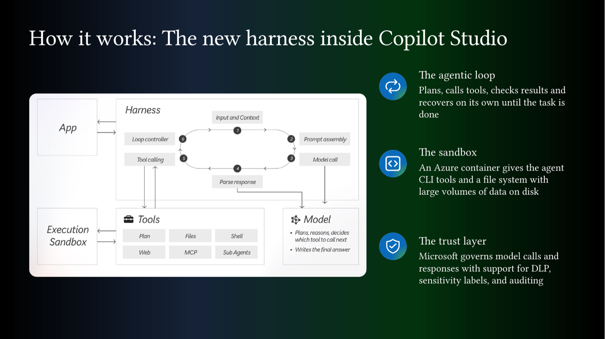
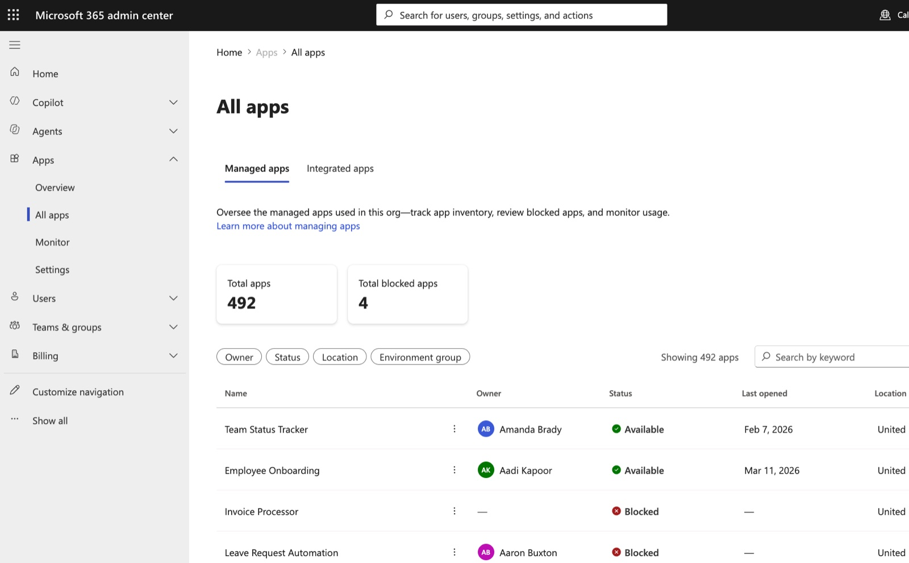
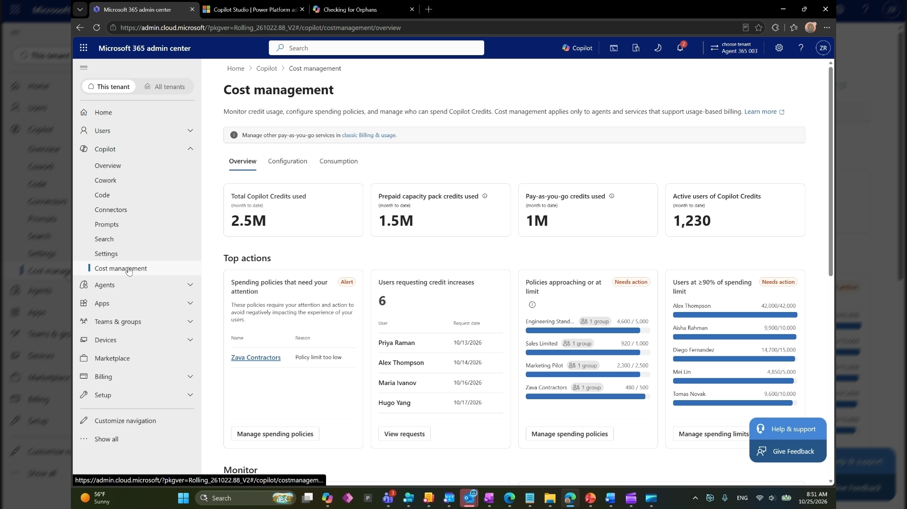
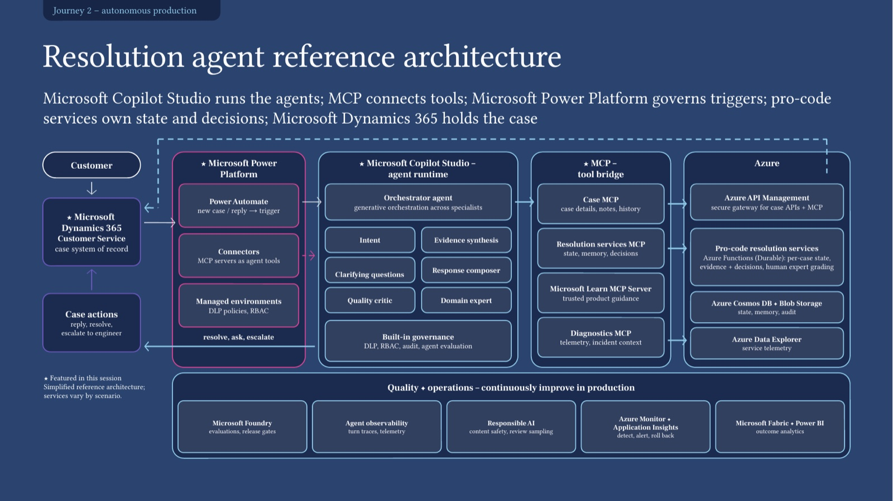

## #production-chasms 01 / Four Production Chasms :: 为什么“能跑通的原型”进不了生产：横亘在构建与投产之间的四道工程断层 || Why Working Prototypes Stall: Four Engineering Chasms Between Build and Production

在企业落地生成式应用与智能体的过程中，“构建（Build）”与“投产（Production）”遵循着截然不同的评判法则 [7]。BRK285 开场的两次现场举手投票直观揭示了这一反差：会场里绝大多数团队都已经搭出过能给出实用回答的智能体，但当追问“谁敢免去人工逐单审批、直接放它进生产系统执行动作”时，举手者寥寥无几 [7]。正如 Azure 云运营需求工程团队（CODE）首席客户工程经理 Omprakash Reddy Adudodla 所言，演示原型只验证“点子能不能跑通”，而生产系统追问的是“当外部接口超时、跨天状态中断或模型推理漂移时，组织能否看清它、管住它并安全回滚” [7][8]。 || Across enterprise AI initiatives, *Build* and *Production* obey fundamentally different engineering laws [7]. Two live audience polls at the opening of BRK285 exposed the gap: most attendees had built an agent that produced a genuinely useful answer, yet almost none dared let it execute production actions without step-by-step human approval [7]. As Azure CODE Principal Customer Engineering Manager Omprakash Reddy Adudodla observed, a prototype asks whether an idea works, whereas production asks whether teams can trust, observe, and safely recover the system when tools time out or reasoning drifts [7][8].

更糟糕的是，许多团队误以为投产只是在一天搭出的单容器原型上继续堆叠界面功能 [7]。合作伙伴解决方案架构师 Tim Schaeps 在复盘“订单到回款（Order-to-Cash）”原型演进史时展示了典型的翻车现场：连续多次代码提交顺手往单容器里塞新特性，直到接入 Azure Cosmos DB 时因触碰租户“严禁公网端点”的平台安全策略而当场瘫痪 [7]。把企业投产受阻的根因拆解开来，本质上是传统开发栈在四个层面上同时出现了结构性断层 [1][3][5][7]： || Worse, teams routinely assume productionization means stacking UI features onto a one-day single-container prototype [7]. Replaying the commit history of an *Order-to-Cash* prototype, Partner Solution Architect Tim Schaeps showed commits piling up until adding Azure Cosmos DB abruptly broke against a tenant policy forbidding public endpoints [7]. Unpacking why enterprise initiatives stall reveals four structural chasms across the stack [1][3][5][7]:

| 生产断层维度 || Production Chasm | 原型期的常见假象与反模式 || Prototype Illusion & Anti-Pattern | 推向企业生产时的真实工程崩塌 || What Breaks at Enterprise Production | 对应的平台级破局支点 || Platform Architectural Answer |
| --- | --- | --- | --- |
| **1. 推理与控制断层** || **1. Reasoning & Control Gap** | 靠 2023 年串行拆分提示词底座拼凑流程，或靠自然语言提示词“祈祷模型别违规” [3] || Patching 2023 sequential prompt scaffolding or trusting prompt wishes for compliance [3] | 模型看不见全局业务目标，遇数万行表格塞爆上下文；缺少百分百触发的调用前拦截机制 [3][4] || Blind to holistic goals, chokes on large tabular files, and lacks deterministic pre-tool blocking [3][4] | **Microsoft Copilot Harness**：Copilot SDK 单循环 + 会话级 Azure 容器沙盒 + 六类确定性钩子（BRK259）[3][4] || **Microsoft Copilot Harness**: Copilot SDK loop + per-session Azure containers + 6 deterministic hooks (BRK259) [3][4] |
| **2. 宿主与接力断层** || **2. Hosting & Handoff Cliff** | 自然语言生成微应用跑在个人电脑 `localhost` 端口；业务原型交棒研发时无干净源码 [1] || AI-generated apps trapped on laptop `localhost`; domain prototypes hit a pro-code rewrite cliff [1] | 无 Entra 单点登录与合规连接器；事后才发现用了禁用数据源，全栈工程师被迫推倒重写 [1][2] || No Entra SSO or governed connectors; prohibited connectors discovered late force full rewrites [1][2] | **Copilot Managed Runtime（CMR）**：零 `localhost` 托管、构建期策略前置与共享 Git 远程源码仓（BRK378）[1][2] || **Copilot Managed Runtime**: Zero-localhost host, build-time policy context & shared Git remote (BRK378) [1][2] |
| **3. 规模与账本断层** || **3. Sprawl & FinOps Blindness** | 要么像审《蒙娜丽莎》一样卡死每份草稿，要么放任数千人混居默认环境野蛮生长 [5] || Either gating every draft like the *Mona Lisa* or letting thousands crowd an unguarded default environment [5] | 无主僵尸资产泛滥、私调外部未授权接口，且创作者与 IT 均看不清实时算力点数账单 [5][6] || Orphaned zombie sprawl, unauthorized outbound API calls, and opaque Copilot Credit bills [5][6] | **双轨绿区与开放管理面**：PPAC 路由 + MAC 首日默认绿区 CSP + 单一 OpenAPI 账本与 `\$10` CoE（BRK382）[5][6] || **Dual Green Zones & FinOps**: PPAC routing + MAC default CSP + OpenAPI ledger & `\$10` CoE app (BRK382) [5][6] |
| **4. 状态与信任断层** || **4. State & Autonomy Gap** | 以为配好工具就能一键开启“全自主”，上线出现幻觉后只会在提示词里写“请更努力思考” [7] || Treating autonomy as an on/off switch and fighting live hallucinations with "think harder" prompts [7] | 跨数天复杂工单在长会话中丢状态；针对错误资源写出流畅诊断反而掩盖幻觉并引发跨团队推诿 [7][8] || Multi-day cases drop state; fluent prose about the wrong resource hides hallucinations and sparks finger-pointing [7][8] | **混合持久状态与爬山闭环**：Studio 专员推理 + Durable Functions 状态机 + 逐轮追踪与六步爬山（BRK285）[7][8] || **Hybrid State & Hill Climbing**: Studio specialists + Durable Functions state + Trace Studio & 6-step evals (BRK285) [7][8] |

这四道断层解释了为什么“Harness（执行内核）”与“Managed Runtime（托管运行时）”必须成对出现：没有强大的容器化推理内核与确定性钩子，托管在云端的应用也只是脆弱的聊天外壳；反过来，没有统一接管身份、Git 源码、网络沙盒与额度账本的托管运行时，再聪明的内核也走不出开发者的本地机器 [1][3][5]。下图完整呈现了这两大核心支柱如何与规模化治理及爬山评测闭环咬合为一套三层企业生产架构 [1][3][5][7]： || These four chasms explain why **Harness** and **Managed Runtime** form an inseparable pair: without a containerized reasoning kernel and deterministic hooks, a cloud-hosted app remains a brittle chat wrapper; without a managed runtime governing identity, Git source, network sandboxing, and credit ledgers, even the strongest harness stays trapped on a developer's laptop [1][3][5]. Figure 1 maps how both pillars interlock with tenant governance and hill-climbing evaluations across three architectural planes [1][3][5][7]:

:::figure { src: "./media/build-to-prod-four-session-topology.figure.json", title: "From Build to Production：Harness 执行内核、Copilot 托管运行时与规模治理全栈拓扑 || From Build to Production: Harness Kernel, Copilot Managed Runtime & Scale Topology" }
图 1：顶层由 Microsoft Copilot Harness 单循环容器内核、六类确定性钩子与构建期前置策略统一承接五大创作入口（BRK259/BRK378）；中层收口至共享 Git 远程仓库、1,500+ 受管连接器与低高代码混合持久底座（BRK378/BRK285）；底层通过 M365 管理中心默认绿区、单一 OpenAPI 算力账本与六步爬山闭环护航规模化投产（BRK382/BRK285）[1][3][5][7]。 || Figure 1: Top plane unites five policy-aware entry surfaces on the Microsoft Copilot Harness and lifecycle hooks (BRK259/BRK378); middle plane converges on one Git remote, 1,500+ connectors, and hybrid durable state (BRK378/BRK285); bottom plane enforces MAC default green zones, OpenAPI FinOps, and 6-step hill climbing (BRK382/BRK285) [1][3][5][7].
:::

## #copilot-harness-kernel 02 / Kernel: Microsoft Copilot Harness :: 执行内核重铸：用容器化单循环与确定性钩子替代对话脚手架 || Rebuilding the Execution Kernel: Containerized Agent Loops and Deterministic Hooks

跨越第一道断层的起点，是从根源上淘汰 2023 年初为弥补早期模型短板而设计的“串行对话脚手架（Standard Harness）” [3]。Copilot Studio 首席产品经理 Alice Appleton 在 BRK259 中指出，旧底座强行将复杂请求切碎为固定串行子提示词。这虽压低了单步开销，却让模型看不见完整业务目标，遇到数万行财务表格便束手无策 [3][4]。微软工程团队因此放弃给旧底座贴补丁，基于与 GitHub、Microsoft Foundry、Copilot Cowork 及 Copilot Code 同源的 **Microsoft Copilot SDK** 从零重铸内核（剥离纯研发提示词并补齐跨部门流程语义），在每次会话启动时动态拉起专属 **Azure 隔离容器（Execution Sandbox）** [3][4]。 || Crossing the first chasm starts by retiring the 2023 chat-era *Standard harness* [3]. As Copilot Studio Principal PM Alice Appleton detailed in BRK259, splitting user requests into rigid sequential sub-prompts blinded the model to holistic business goals and choked on multi-thousand-row spreadsheets [3][4]. Rather than patching legacy scaffolding, Microsoft rebuilt from scratch on the shared five-product **Microsoft Copilot SDK** [3][4]. Engineers stripped pure software-engineering prompt fragments, added business-process semantics, and provisioned an isolated **Azure container sandbox** with shell, code execution, and local disk on every session [3][4].

容器化内核不仅赋予了智能体把大文件落盘并用脚本逐行解析的算力，更推翻了“多步自主循环调模翻倍必然烧穿预算”的直觉顾虑 [3][9]。在约 **500 道源于真实客户流程的离线评测集**（统一固定 Claude Sonnet 4.6）上，得益于容器命令行接管确定性重算与单循环增量上下文拼接，新内核在四类业务能力全线跃升的同时，反而将最昂贵的 **输入词元**（Input Tokens）消耗直接砍掉 **45%** [3][4][9]： || Container sandboxes let agents parse massive exports on local disk via scripts while overturning the fear that multi-turn agent loops multiply token bills [3][9]. Across **~500 customer-derived offline evaluations** held constant on Claude Sonnet 4.6, offloading deterministic slicing to container CLI and incremental context assembly lifted pass rates across all four categories while slashing **input token consumption by 45%** [3][4][9]:

$$
\begin{aligned}
\Delta Q_{\text{code}} &= +47.5\text{ pts}, & \Delta Q_{\text{file}} &= +28.2\text{ pts}, & \Delta T_{\text{input}} &= -45.0\% \\
R_{\text{cache}} &\in [83\%,\, 88\%], & R_{\text{recover}} &\in [84\%,\, 91\%]
\end{aligned}
$$

其中 **83%–88%** 的输入词元直接命中低价提示词缓存（使成本加权输入词元净降 15%–21%），且外部工具调用报错时有 **84%–91%** 的回合能在同一循环内自主重算恢复 [3][9]。与此同时，外层 **信任层**（Trust Layer）将原始连接凭据严格隔离在容器之外，对每次模型进出流量强制实施 Microsoft Purview 数据防泄漏（DLP）与敏感度标签继承 [3][4]。面对前沿实验室平均每周至少发布一款新模型的速度（平台往往在数十分钟内完成评测上架），默认开启的 **Auto 帕累托选模**在管理员策略边界内横跨 Anthropic、OpenAI、Mistral 与 SpaceXAI 动态寻优；微软研发团队更用 **32 个 Copilot Studio 智能体、47 条协作连接与 6 个共享专家**建成全天候内部软件工厂，自动分流故障、生成修复 PR 并巡检每日点数账单来构建 Copilot Studio 本体 [3][4]。 || Prompt cache hits reached **83%–88%** (cutting cost-weighted input tokens by 15%–21%), while **84%–91%** of failed tool turns self-recovered mid-loop [3][9]. Outside the sandbox, the **Trust Layer** isolates raw credentials and enforces Microsoft Purview DLP and sensitivity labels on every turn [3][4]. With frontier labs shipping new models weekly, default **Auto Pareto routing** optimizes quality versus cost across Anthropic, OpenAI, Mistral, and SpaceXAI; internally, Microsoft dogfoods **32 Copilot Studio agents, 47 connections, and 6 shared helpers** 24/7 to triage incidents, author PRs, and audit credit spend while building Copilot Studio itself [3][4].

:::insight-grid { cols: 3, title: "让自主内核满足生产严苛要求的三大控制机制（BRK259） || Three Runtime Mechanisms Making Autonomous Loops Production-Safe (BRK259)" }
::card 01 · BRK259
### 动态任务子智能体（Dynamic Task Agents） || Ephemeral Parallel Sub-Agents
无需单独创建或发布子机器人，主控智能体在单会话边界内按指令并发拉起 3 个轻量 `Claude Haiku 5.5` 在隔离上下文中盲审 Apex、Meridian 与 Nimbus 标书（防交叉污染），再一句话跨厂商派生 `Sol` 模型挑刺复核（预计 2026 年 12 月 GA）[3][4]。 || Spins up ephemeral workers at runtime with zero child bots to publish—fanning out three isolated `Claude Haiku 5.5` bid reviewers in parallel to prevent context contamination before spawning `Sol` for cross-provider critique (targeting Dec 2026 GA) [3][4].

::card 02 · BRK259
### 六类生命周期钩子（Lifecycle Hooks） || Six Deterministic Lifecycle Hooks
如果工作流嵌智能体是在确定性骨架里引入大模型判断，Hooks 恰恰相反——它在自主循环的固定切点强制挂载百分百触发的确定性逻辑 [3]。采购实测中 `Session start` 预载英国成本中心，唯一拥有拦截改参权的 `Before tool` 当场拒绝超 **£2,000** 的 8 套入职包订单（`continue: false`），`After tool` 则在工具返回值进模型前完成隐私脱敏 [3][4]。 || Whereas agent nodes add LLM judgment to deterministic flows, Hooks embed 100% deterministic logic into fixed agent lifecycle points [3]. `Session start` loads UK cost-center rules, `Before tool`—the sole blocking/rewriting event—halts an 8-kit order exceeding **£2,000** (`continue: false`), and `After tool` redacts sensitive outputs before they enter the LLM context [3][4].

::card 03 · BRK259
### 会话变量裁剪与双向 MCP / A2A || Scoped Variables & Bidirectional MCP/A2A
创作者可将固定入参锁死为会话变量，并按 `Department = HR` 等条件动态控制向模型暴露哪些工具与知识库（兼顾防幻觉与省词元）；同时支持经 Entra OAuth 2.0 委托身份入向连接 Foundry / M365 Agents SDK / 私有 VNet 代理（已 GA），或出向发布为远程 MCP 与 A2A 服务（2027 Q1 GA）[3][4]。 || Scoped **Variables** lock static tool inputs and gate sensitive HR knowledge strictly when `Department = HR`; meanwhile, Entra OAuth-secured channels connect inbound to Foundry, M365 Agents SDK, and VNet peers (GA) or publish agents outbound as MCP/A2A servers (targeting Q1 CY27 GA) [3][4].
:::

  <article class="b2p-media-card" data-present-surface="unframed">
    

      
    

    

      BRK259 官方架构图 · Slide 08
      <h4 data-zh="Microsoft Copilot Harness 六步自愈循环与容器信任边界" data-en="Six-Step Agentic Loop, Azure Sandbox & Outer Trust Layer">Microsoft Copilot Harness 六步自愈循环与容器信任边界</h4>
      
输入组装、模型调用、容器沙盒工具执行与外层凭据隔离/Purview DLP 审计形成完整闭环 [3][4]。

    

  </article>
  <article class="b2p-media-card" data-present-surface="unframed">
    

      
    

    

      BRK378 官方实拍 · Slide 18 GA
      <h4 data-zh="Microsoft 365 管理中心：全域托管应用盘点与一键阻断" data-en="M365 Admin Center: 492 Managed Apps & Instant Quarantine">Microsoft 365 管理中心：全域托管应用盘点与一键阻断</h4>
      
五大构建入口产出的应用自动入账盘点（实机纳管 492 款、拦截 4 款高危应用），彻底消除隐形本地端口 [1][2]。

    

  </article>

## #copilot-managed-runtime 03 / Host: Copilot Managed Runtime :: 随处构建与受管托管：单一 Git 远程仓库如何消除本地孤岛与重写断崖 || Universal Hosting Without Silos: How Copilot Managed Runtime Ends Localhost and Rewrite Cliffs

解决了智能体“如何可靠思考与受控调工具”之后，紧接着必须解决业务人员与工程师在多种工具里生成的全栈应用“往哪里托管、怎么协同演进”的第二道断层 [1]。2026 年 11 月 17 日正式全面商用（GA）的 **Copilot 托管运行时（Copilot Managed Runtime，简称 CMR）** 给出了直接答案 [1][2]。产品总经理 Clay Wesener 在 BRK378 中指出，团队混合使用 Cowork、Copilot Studio、CLI 与多款模型构建了所有演示应用，但**没有任何一款成品停留在 `localhost` 本地端口上** [1][2]。应用一经发布至 CMR，即自动获得独立受管域名下的 Microsoft Entra 单点登录、后台专属 **Git 远程源码仓库**、**1,500 余个受管连接器**代理及管理中心实时台账 [1][2]。 || Once the reasoning harness is trustworthy, enterprises must solve where full-stack apps authored across half a dozen tools actually run and co-evolve [1]. **Copilot Managed Runtime (CMR)**—generally available since November 17, 2026—closes that gap directly [1][2]. In BRK378, GM Clay Wesener noted that although the team built demos across Cowork, Copilot Studio, the CLI, and mixed models, **zero resulting apps ran on `localhost`** [1][2]. Publishing to CMR automatically provisions Microsoft Entra SSO, a backing **Git remote repository**, **1,500+ governed connectors**, and live Microsoft 365 Admin Center visibility [1][2].

尤为关键的设计在于**构建期策略前置感知**与**工作流内双模智能架构** [1][2]。传统影子开发往往在烧掉大量词元写完应用后，才在上线审查时因触碰禁用连接器而报废；CMR 则把管理中心设定的环境组路由、连接器动作级白名单与共享规则直接注入构建智能体上下文，确保动笔前即遵循组织红线（正如 BRK285 在 VS Code 中接入 **Microsoft Learn MCP** 先查 CAF/WAF 规范落盘架构契约那样）[1][7]。在应用内部，首席产品经理 Emma Cooper 展示了两条递进形态：一是在 **Copilot Cowork（已 GA）** 中调取 **Work IQ** 组织脉络与 **Figma 设计插件**快速生成《Q4 2026 Atlas 项目路线图》，并通过代号 **Rayfin** 的前沿能力一键将数据持久化至 **Microsoft Fabric 数据库**或 SharePoint 列表；二是在 **Copilot Studio**（Apps 现已 GA）中构建通过 36 项自动构建质检的 *Voyage Desk* 核保台与 **Gauge 现场巡检应用**——看板顶部嵌入低时延 **行内提示词函数**（Inline LLM）提炼即时风险摘要，右侧嵌入完整 **Gauge 风险顾问智能体** 跨 Dataverse 表与规程库追查北场（North Yard）逾期整改项 [1][2]。 || Equally critical are **build-time policy grounding** and **dual in-app intelligence** [1][2]. Instead of discovering prohibited connectors at deployment review, CMR injects admin routing, per-action connector rules, and sharing limits directly into the authoring agent upfront—echoing BRK285's practice of wiring **Microsoft Learn MCP** into VS Code to lock CAF/WAF contracts before coding [1][7]. Inside the apps themselves, Principal PM Emma Cooper demonstrated two escalating patterns: prompting **Copilot Cowork** (GA) with **Work IQ** and the **Figma plugin** to ship the *Q4 2026 Atlas Roadmap* backed by **Microsoft Fabric via Rayfin**, and building Dataverse-backed **Apps in Copilot Studio** (GA) such as *Voyage Desk* (passing 36 automated build checks) and **Gauge Field Inspections**—pairing a low-latency **inline LLM summary** on top with an embedded **Gauge Risk Advisor Agent** side pane querying overdue North Yard actions [1][2].

:::comparison { title: "以单一 Git 远程仓库打通开放三方生态与全栈工程接力（BRK378） || Uniting Open 3P Builders and Pro-Dev Engineering on One Shared Git Remote (BRK378)" }
::versus 开放三方生态直发：Lovable + Managed Platform SDK || Open 3P Ecosystem: Lovable Direct Publish
### 20 分钟租户绑定，仅推送纯 React 前端且零权限触碰企业数据 || 20-Minute Admin Bind, Pure React UI & Zero 3P Data Access
服务超 **40,000 家企业**（含德国电信与英伟达）、累计创建逾 **7,000 万个项目**的 Lovable 原生接入托管平台 SDK：IT 管理员约 **20 分钟**完成租户绑定后，创作者生成的新员工入职应用可一键直发 CMR；**Lovable 仅向微软运行时推送编译后的纯 React 前端代码，全程零权限接触底层 Excel 或企业业务数据**，一切身份鉴权与连接器读写严格闭环在客户 M365 租户内 [1][2]。 || Powering **40,000+ businesses** and **70M+ projects**, Lovable binds to CMR in roughly **20 minutes**: makers prompt an Entra-personalized onboarding app and publish with one click—**shipping only the compiled React frontend while Lovable never touches underlying enterprise data** [1][2].

::versus 专业研发无缝接力：CLI + VS Code + Code Agents || Pro-Dev Relay: CLI, VS Code & Code Agents { highlight: true }
### 免密克隆标准 TypeScript/React 源码树，彻底终结推倒重写 || Keyless GCM Clone of Clean React/TS Source—Zero Rewrite Cliff
由于所有入口背后共写同一套标准 React/TypeScript Git 仓库，全栈工程师无需配置个人令牌，直接用命令行与 **Git Credential Manager（GCM）** 将业务专家在 Studio 中创建的 Gauge 巡检应用克隆至本地 VS Code，在 `Home.tsx` 新增巡检地理位置地图并在带安全横幅的本地开发服验证后原路推回生产域名 [1]。开发者还可部署自带模型与编排器的 **Code Agents**（早鸟预览），零 Azure 额外配置默认连通 Agent 365，或本地 Git 化开发 Studio 智能体与工作流 [1][2]。 || Because every surface commits clean React/TypeScript to a shared Git remote, software engineers clone the Studio-built Gauge app keyless via CLI and **Git Credential Manager** into VS Code, add a geolocation map onto `Home.tsx` on a flagged local dev server, and push updates straight back to production [1]. Teams can also deploy custom **Code Agents** wired to Agent 365 with zero Azure setup [1][2].
:::

## #dual-green-zones-finops 04 / Scale: Dual Green Zones & FinOps :: 规模化治理与算力账本：双轨绿区、CSP 实时拦截与单一 OpenAPI 管理生态 || Governing at Tenant Scale: Dual Green Zones, Runtime CSP, and OpenAPI FinOps

当五六种构建入口同时向全公司数千名员工敞开后，企业立刻直面第三道断层：怎样既不像委托达·芬奇耗费三年画《蒙娜丽莎》那样用繁琐审批扼杀个人创新，又不让默认环境沦为影子 IT 泥潭 [5]？拥有约 **77,000 名员工**、惠及全球 **3.04 亿患者**的跨国药企 **诺华（Novartis）** 在 BRK382 中给出了生产验证答卷 [5][6]。依托“护栏内放行”与 10 周公民开发者训练营（约 500 名活跃毕业生实现近 50% 生产转化），诺华主租户自 2025 年 10 月起在用 Copilot Studio 智能体从 182 个跃升至 **1,366 个（7.5×）**，月活创作者增至 **3,312 人（2.6×）** [5][6]。同期 Power Apps 扩至 **27,862 款**（含 50 款新代码应用），并靠 **周期性所有者确权（Periodic Owner Attestation）** 自动清退无主僵尸资产 [5][6]。 || Opening half a dozen authoring tools to thousands of employees immediately raises the third chasm: how to avoid gating every personal draft like Leonardo da Vinci's three-year *Mona Lisa* without letting the default environment degenerate into shadow IT [5]? In BRK382, **Novartis** (**77,000 associates**, **304M patients**) shared primary tenant telemetry proving the "path of least resistance" model [5][6]. Pairing guardrailed enablement with 10-week Citizen Developer cohorts (~500 graduates converting ~50% to production), active Copilot Studio agents surged **7.5× from 182 to 1,366** while monthly makers grew **2.6× to 3,312** [5][6]. Power Apps simultaneously reached **27,862** (including 50 Code apps) and stayed clean through **periodic owner attestation** [5][6].

支撑这一规模秩序的核心架构，是 **Power Platform 管理中心（PPAC）专家绿区**与 **M365 管理中心（MAC）首日默认绿区**的双轨协同，外加托管宿主（Managed Host）的运行时硬隔离 [1][5][6]： || Sustaining this velocity relies on pairing **PPAC expert green zones** with **MAC's on-by-default green zone** above a sandboxed **Managed Host** [1][5][6]:

1. **双轨绿区与 OAuth 连接器纵深防线**：在 PPAC 侧，管理员配置最多 25 条优先级环境路由将创作者分流至个人开发沙盒，勾选启用 **高级连接器策略**（ACP）不仅能封禁 SQL `Delete/Update` 高危动作，更强制要求 **仅允许 OAuth 身份认证** 连接数据库，配合 Microsoft Purview 审计必读欢迎守则与微软内部 **Ask Mica** 申诉引导助手前置化解阻力 [5][6]；而在跨工具的 CMR 侧，**绿区在租户第一天即默认开启**（On by Default），开箱仅放行核心 M365 办公连接器，并在 MAC `All apps` 视图统一纳管全域资产（BRK382 课件实拍盘点 **953 款受管应用** 与 4 款封禁应用）[1][5][6]。 || **Dual Green Zones & OAuth-Only Connector Depth**: PPAC layers up to 25 routing rules with **Advanced Connector Policies** (ACP)—blocking SQL `Delete/Update` actions and enforcing **OAuth-only authentication** alongside Purview-audited welcome terms and Microsoft's internal **Ask Mica** assistant [5][6]; meanwhile, CMR ships its **green zone on by default from day one** in MAC (tracking **953 managed apps** and 4 blocked apps in BRK382 Slide 30), scoping apps to core M365 connectors out of the box [1][5][6].
2. **Managed Host 实时 CSP 掐断、双层 ALM 与小时级告警**：每款负载运行在自动强制 Entra 登录与 Purview 审计的专属 **Managed Host** 中——Austin Laugesen 在实机测试三栏代码应用时证明，白名单连接器顺畅通行，而一旦代码试图私自外呼未授权外部端点（演示中指向 `Bing`），宿主便依据默认 **严格内容安全策略**（CSP）当场拦截报错 [5]。应用生命周期则从小型团队免配置的“单环境内建 `Dev -> Test -> Prod` 部署目标”平滑晋升至反洗钱（AML）/KYC 级的跨环境严管流水线，并由高灵敏度 **Monitor** 在 **1 小时内** 捕获健康劣化直推 Teams 或 ServiceNow 工单 [5][6]。 || **Managed Host Live CSP Blocking, Tiered ALM & Sub-Hour Alerts**: Workloads execute inside a **Managed Host** enforcing Entra SSO and Purview logging—blocking unauthorized outbound calls (such as `Bing` in Demo 3) live via **strict Content Security Policy** (CSP) [5]. Workloads graduate from zero-setup in-environment `Dev -> Test -> Prod` targets to shrink-wrapped KYC/AML cross-environment pipelines watched by **within-1-hour** Monitor alerts routed to Teams or ServiceNow [5][6].
3. **双轨算力账本与单一 OpenAPI 驱动的 `$10` 超级 CoE**：回应“让创作者与 IT 同步看清成本”的诉求，创作者在 Studio 左上角直看实时点数计数器（如 `88 credits`）或在 Cowork 敲 `/cost` 查账；管理员则在 MAC `Cost management` 中设定如现场巡检 **5,000 点数**的试点上限，一屏统管全租户 `2.5M` 月度点数（`1.5M` 预付 + `1M` 按量）与 `≥90%` 阈值预警 [1][5][6]。更关键的是，微软将全平台管理能力抽象为**单一权威 OpenAPI 规范**，按月自动同步生成版本化 REST API、`.NET/Python` SDK、`Admin V2` 连接器、**15 组 PAC CLI 命令**与 **Cowork 管理插件**——Zohar 现场导入顾问团队 3 小时打磨的包，仅耗资 **10 美元**、用时 **30 分钟**便编译出一款托管在 CMR 上的全栈超级 CoE 治理应用（`aka.ms/powerplatform360`）[5][6]。 || **Transparent FinOps & the `$10` OpenAPI CoE App**: Makers track live burn via Studio's top-left counter (`88 credits`) or `/cost` in Cowork while admins set **5,000-credit** pilot caps and oversee `2.5M` monthly credits (`1.5M` prepaid + `1M` PAYG) with `≥90%` alerts in MAC [1][5][6]. Underneath, **one authoritative OpenAPI specification** auto-generates monthly REST docs, `.NET/Python` SDKs, `Admin V2` connectors, **15 PAC CLI groups**, and the **Cowork Admin Plugin**—letting Zohar compile a full CoE Toolkit superset app on CMR in **30 minutes for `$10`** (`aka.ms/powerplatform360`) [5][6].

  <article class="b2p-media-card" data-present-surface="unframed">
    

      
    

    

      BRK382 官方实拍 · Slide 46
      <h4 data-zh="MAC 全局双轨账本：2.5M 点数透视与限额预警" data-en="MAC FinOps Ledger: 2.5M Credits & Threshold Alerts">MAC 全局双轨账本：2.5M 点数透视与限额预警</h4>
      
衔接创作者端顶栏点数器（88 credits）与 Cowork /cost 命令，统一纳管 1.5M 预付 + 1M 按量及 5,000 点业务上限 [1][5][6]。

    

  </article>
  <article class="b2p-media-card" data-present-surface="unframed">
    

      
    

    

      BRK285 官方架构图 · Slide 29
      <h4 data-zh="Azure 支持 FACS 生产参考拓扑：低代码推理 + 全代码状态" data-en="Azure Support FACS Topology: Studio Reasoning + Azure State">Azure 支持 FACS 生产参考拓扑：低代码推理 + 全代码状态</h4>
      
Copilot Studio 调度 6 大专职推理角色，经 APIM 安全网关与 4 路 MCP 桥连接 Durable Functions / Cosmos DB 跨天状态与 Foundry 门禁 [7][8]。

    

  </article>

## #bounded-autonomy-evolution 05 / Autonomy: Durable State & Hill Climbing :: 跨越最后一公里信任鸿沟：混合持久状态分工与有界自主爬山闭环 || Crossing the Final Trust Chasm: Hybrid Durable State and Six-Step Hill Climbing

即便内核、托管与租户治理全部就绪，面对跨数天乃至数周的关键业务工单，企业仍需跨越最后一道“敢不敢免审放权”的信任鸿沟 [7]。BRK285 完整拆解了微软 Azure 客户支持团队历时 **18 个月**将全自主客户服务（Fully Autonomous Customer Service，简称 FACS）推上生产的 Customer Zero 工程心法 [7][8]。在 Contoso `503 Service Unavailable` 线上故障实录中，工单进入 Dynamics 365 后，FACS **无需追问客户索要订阅号**便直连诊断接口查明“上午 `09:08` 刚完成新部署，当前 `0 of 3` 实例健康”，经内置审校门禁核验后给出回滚指引，并全程保持跨轮状态直至客户确认健康检查恢复才执行受控关单 [7]。 || Even with governed hosting and FinOps in place, multi-day mission-critical operations still face the final trust chasm of unreviewed execution [7]. BRK285 unpacked Azure Support's **18-month** Customer Zero journey shipping Fully Autonomous Customer Service (FACS) [7][8]. When Contoso reported a live `503` App Service outage in Dynamics 365, FACS queried diagnostics **without asking for a subscription ID**, pinpointed `0 of 3` healthy instances right after a `09:08` deployment, verified evidence through an in-flow critic gate, and held multi-turn state until rollback health checks passed before closing the ticket [7].

Ali Ijaz 与 Arun Masilamani 强调，支撑这套生产系统的核心并非“成熟后迁离低代码”，而是确立 **低代码做敏捷专员推理、全代码管跨天持久状态** 的架构分工 [7][8]。Copilot Studio 在前端编排意图、证据合成、质量审校等 6 类专职角色，而跨周工单状态持久化与工具超时升级兜底则经由 APIM 网关与 4 路 MCP 桥交由 **Azure Durable Functions 与 Cosmos DB** 承载 [7][8]。当线上依然出现幻觉时，团队摒弃“让提示词更努力思考”的许愿式调优，建立起 **六步爬山**（Hill Climbing）闭环：把人工坐席改稿原因、专家量表（Rubric）与 **逐轮追踪工作台**（Trace Studio）日志聚类为失败分桶，经 Microsoft Foundry 重放与金丝雀门禁逐场景放开有界自主，同时终结跨部门故障推诿 [7][8]。 || Ali Ijaz and Arun Masilamani stressed that production reliability came **not from migrating off low-code, but from splitting specialist reasoning from pro-code durable state** [7][8]. Copilot Studio orchestrates six specialist roles (from Intent and Evidence Synthesis to Quality Critic), while **Azure Durable Functions and Cosmos DB** manage multi-week case state and timeout escalations across four APIM-secured MCP bridges [7][8]. When live hallucinations persisted, the team abandoned wishful "think harder" prompt edits for a **six-step hill-climbing loop** [7][8]. Engineers clustered **reviewer edit reasons**, SME rubrics, and **Trace Studio** logs into failure buckets gated by Microsoft Foundry replay, unlocking bounded autonomy scenario by scenario while ending cross-team finger-pointing [7][8].

:::figure { src: "./media/talk-30min-pacing-blueprint.figure.json", title: "从个人验证原型到有界全自主生产系统：三阶段六维工程控制同步硬化雷达 || From Personal Prototype to Bounded Production Autonomy: Six-Axis Control Progression" }
图 2：综合四场专场实证绘制的控制强度外扩轨迹——自主权从来不是一键打开的开关，每从个人试验晋级至受管企业应用乃至有界全自主系统，内核确定性钩子、受管宿主 CSP、跨天持久状态、动作级最小权限、逐轮追踪告警与爬山回滚门禁六个维度必须同步硬化 [1][3][5][7]。 || Figure 2: Synthesized across BRK259, BRK378, BRK382, and BRK285—autonomy is never a switch flipped on; advancing from personal prototypes to governed apps and bounded autonomous systems requires lockstep hardening across all six control axes [1][3][5][7].
:::

不同业务负载所需的内核特性、托管形态与治理深度并非一刀切。点击下方**企业负载架构选型与护栏推演台**的五个场景标签，可按工作流微应用、跨生态全栈接力、敏感审批智能体、数千人租户治理与跨天关键业务自主五类典型场景，对照检视全栈分层选型与生产准入门禁： || Architectural requirements vary sharply by workload criticality. Switch across the five workload patterns in the interactive **Workload Architecture Decision Matrix** below to inspect concrete Harness, Managed Runtime, FinOps, and release-gate configurations for each scenario:

:::sandbox { id: "abs-talk-blueprint", canvas: false, script: "./talk-blueprint.js", style: "./talk-blueprint.css", title: "From Build to Production：五类企业负载架构选型与护栏推演台 || From Build to Production: Five-Workload Architecture & Guardrail Decision Matrix", desc: "按业务复杂度切换五类典型企业负载，查阅对应的 Harness 内核机制、Managed Runtime 托管路径、实证指标与生产准入边界。 || Switch across five enterprise workload tiers to inspect Harness mechanics, Managed Runtime hosting paths, empirical benchmarks, and release gates." }
纯静态交互式架构选型推演台：涵盖工作流微应用、三方与全栈 Git 接力、合规写操作门禁、全租户双轨治理及跨天有界全自主五类生产模式。 || Pure static architecture decision matrix spanning in-flow micro-apps, 3P/pro-dev Git relay, policy-gated loops, tenant FinOps, and bounded production autonomy.
:::

:::callout { title: "企业架构师推进 Build-to-Production 的三条刚性工程准则 || Three Non-Negotiable Engineering Rules for Build-to-Production Architecture" }
① **契约与确定性钩子永远先于界面和提示词**：动笔前用 Microsoft Learn MCP 与构建期前置策略对齐云安全红线；凡涉及金额审批、外部写操作或隐私数据的工具，一律用 `Before tool` / `After tool` 生命周期钩子钉死确定性边界，绝不靠自然语言提示词“祈祷合规” [1][3][7]。  ② **前端构建全面开放，代码仓与数据边界严格收口**：允许业务人员与工程师自由选用 Cowork、Copilot Studio、Lovable 或 VS Code，但强制所有产物脱离 `localhost` 收归共享 Git 远程仓库与 Copilot Managed Runtime，确保外部工具零触碰企业数据、专业研发零重写无缝接力 [1][2]。  ③ **让默认绿区成为最省力路径，凭爬山证据逐场景放权**：开箱启用 M365 管理中心默认绿区连接器、严格 CSP 与业务线点数限额（辅以 OpenAPI 自动生成的管理套件）；对跨天核心流程实施“Studio 推理 + Azure 持久状态”分工，坚守 BRK285 两条授权铁律——**绝不授予无法解释的权限，绝不授予无法撤销的权限** [1][5][7]。 || ① **Contracts & Deterministic Hooks Precede UI and Prompts**: Ground designs via Microsoft Learn MCP and build-time policy context upfront, and gate side-effecting or sensitive tools with `Before tool` / `After tool` hooks rather than trusting prompt wishes [1][3][7].  ② **Open Authoring on Top, Unified Git & Tenant Data Underneath**: Let teams build freely across Cowork, Studio, Lovable, or VS Code while converging every artifact onto Copilot Managed Runtime and one shared Git remote—keeping tenant data strictly inside M365 with zero pro-dev rewrite cliff [1][2].  ③ **Default to Green-Zone FinOps and Earn Autonomy One Scenario at a Time**: Enforce MAC default green-zone CSP, pilot credit caps, and OpenAPI admin automation; split Studio reasoning from Azure durable state for multi-day flows, and uphold BRK285's two iron rules—**never grant authority you cannot explain, and never grant authority you cannot reverse** [1][5][7].
:::

## 参考资料：Microsoft Ignite 2026 四大核心专场与官方信源 || References: Four Microsoft Ignite 2026 Core Engineering Sources

1. **Clay Wesener, Emma Cooper & Malavika Balachandran Tadeusz (Microsoft Ignite 2026 BRK378)** — https://ignite.microsoft.com/en-US/sessions/1787856630704001Ep9J-1791588308254001CRyh | 《Host apps from anywhere with the new Copilot Managed Runtime》45 分钟官方点播实录与逐字稿（2026-11-18） || BRK378 official 45-minute recording and verbatim transcript on Copilot Managed Runtime GA (Nov 18, 2026)
2. **Microsoft Ignite 2026 BRK378 Official Slide Deck & Stream** — https://medius.microsoft.com/video/asset/PPT/c5c8ac76-0384-4a0c-acf5-83488136a4f1 | BRK378 原版 34 页 PPTX 课件（含 11 月 17 日 GA 矩阵、Voyage Desk 36 项检查、Fabric Rayfin 持久化与管理中心 492 款应用实拍） || Official 34-slide BRK378 presentation deck covering Nov 17 GA capabilities, Lovable integration, and MAC inventory captures
3. **Alice Appleton (Microsoft Ignite 2026 BRK259)** — https://ignite.microsoft.com/en-US/sessions/1787856612459001EfZu-1791588174633001COAZ | 《See how the Microsoft Copilot harness powers Copilot Studio》38 分 36 秒官方点播实录与双语逐字稿（2026-11-20） || BRK259 official recording and transcript on the Microsoft Copilot SDK harness and Azure container sandboxes (Nov 20, 2026)
4. **Microsoft Ignite 2026 BRK259 Official Slide Deck** — https://medius.microsoft.com/video/asset/PPT/57bd65b7-dce0-4d9d-9d20-70a3b284e9bd | BRK259 原版 32 页 PPTX 讲义（含 500 道离线评测 +47.5 pts / -45% 数据、32 智能体软件工厂、动态子智能体与六类 Hooks 契约） || Official 32-slide BRK259 deck detailing offline eval gains, 32-agent internal factory, Dynamic Task Agents, and 6 lifecycle hooks
5. **Zohar Raz, Ryan Jansen, Austin Laugesen & Nicholas Balestrino (Microsoft Ignite 2026 BRK382)** — https://ignite.microsoft.com/en-US/sessions/1787856631314001Eynh-1791814918515001Cspr | 《Deploy solutions at scale with Power Platform or Copilot Managed Runtime》47 分钟官方点播实录与诺华访谈逐字稿（2026-11-20） || BRK382 official 47-minute recording featuring Novartis's 77,000-associate telemetry and four governance demos (Nov 20, 2026)
6. **Microsoft Ignite 2026 BRK382 Official Slide Deck** — https://medius.microsoft.com/video/asset/PPT/8698eb3b-5f0b-4284-bf98-188eb338d15e | BRK382 原版 54 页 PPTX 课件（含诺华 7.5× 增长报表、PPAC/MAC 双轨绿区、小时级 Monitor 告警、2.5M 点数账本与单一 OpenAPI 规范） || Official 54-slide BRK382 deck covering Novartis scale metrics, Managed Host CSP blocking, FinOps ledgers, and the $10 CoE app
7. **Ali Ijaz, Arun Masilamani, Tim Schaeps & Omprakash Reddy Adudodla (Microsoft Ignite 2026 BRK285)** — https://ignite.microsoft.com/en-US/sessions/1787856616329001EyM8-1791588352535001C8TA | 《Your agent works. Now make it enterprise-ready.》51 分钟官方点播实录与双旅程逐字稿（2026-11-19） || BRK285 official 51-minute recording dissecting Superagents contracts and Azure Support's 18-month FACS rollout (Nov 19, 2026)
8. **Microsoft Ignite 2026 BRK285 Official Slide Deck** — https://medius.microsoft.com/video/asset/PPT/048e7075-9b0a-458d-b28b-3fa6113f248b | BRK285 原版 38 页 PPTX 讲义（含三阶成熟度、3×6 控制矩阵、FACS 低高代码参考拓扑与六步爬山迭代图） || Official 38-slide BRK285 deck covering the 3×6 autonomy-control matrix, FACS reference topology, and 6-step hill-climbing loop
9. **Ben Appleby (Microsoft Copilot Studio Engineering Blog)** — https://www.microsoft.com/en-us/copilot/blog/copilot-studio/how-the-microsoft-copilot-harness-in-copilot-studio-helps-agents-finish-the-job/ | 《How the Microsoft Copilot harness in Copilot Studio helps agents finish the job》83%–88% 提示词缓存命中率与 84%–91% 工具失败自愈工程解析（2026-11-09） || Companion engineering deep dive on Azure container sandboxes, 83%–88% prompt cache hit rates, and 84%–91% self-recovery (Nov 9, 2026)
