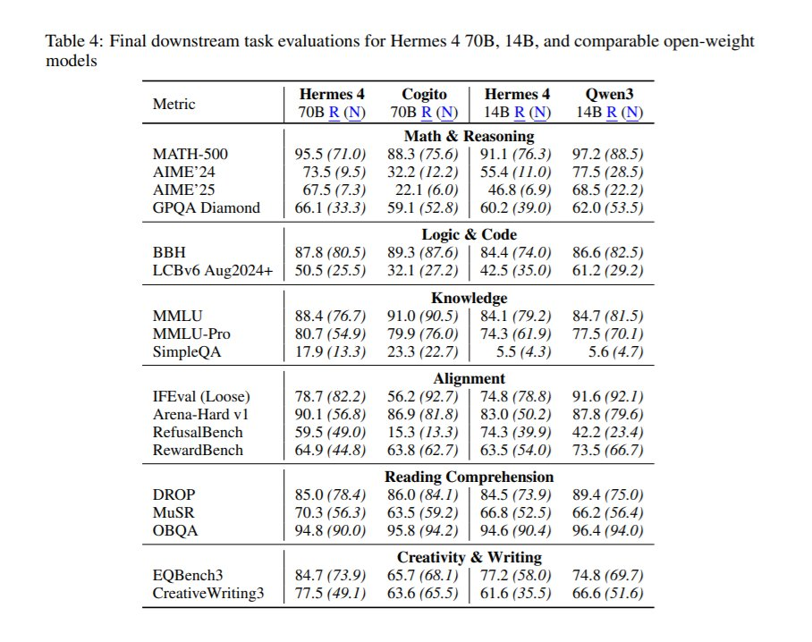
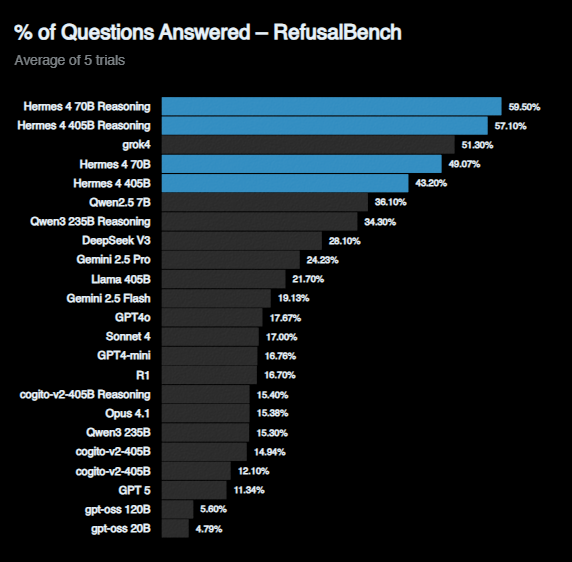
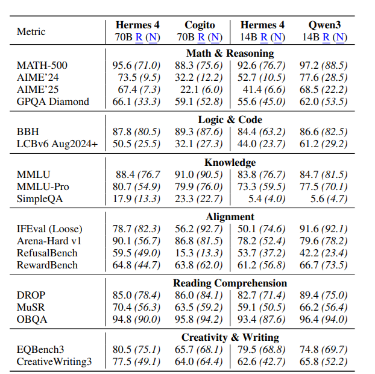
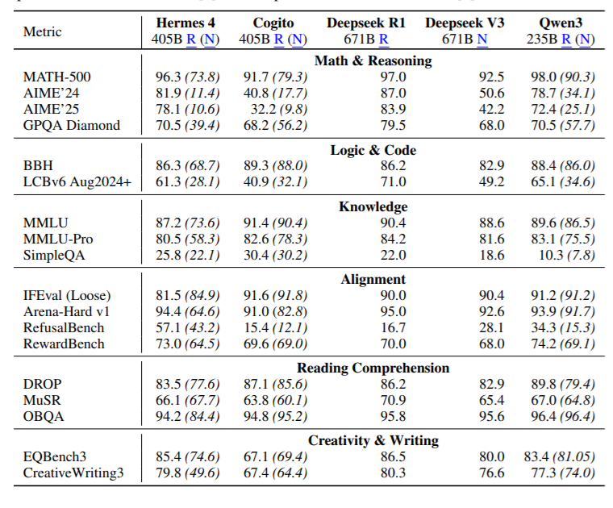

## #overview 01 / What Is Hermes :: Hermes 是什么：一个"用户对齐"而非"厂商对齐"的开源模型系列

在当前 LLM 生态中，大多数指令微调模型的对齐方向由模型提供商决定 — 模型内嵌了哪些拒答策略、遵循哪些伦理准则、表达哪些价值立场，均在训练阶段固化。Hermes 的设计思路反其道而行：通过 neutral alignment 将这些决策权移交给 system prompt 的编写者（即终端开发者和用户），使 LLM 成为一个可塑性更高的推理引擎。

:::insight-grid { cols: 2 }
::card 01
### 谁在做 Hermes
Nous Research 是一个专注于开源 AI 研究的组织，核心贡献者包括 Ryan Teknium、Jeffrey Quesnelle 和 Chen Guang。Hermes 是其旗舰模型系列。

::card 02
### 核心定位
Hermes 定位为"中立对齐的通用指令模型"（neutrally-aligned generalist instruct model），在 function calling、structured output、roleplaying 和 multi-turn conversation 上均有针对性训练。

::card 03
### 与 Llama Instruct 的差异
同为基于 Llama 3.1 的微调（70B/405B 版本），Meta 的 Llama Instruct 版本内嵌了预设的安全对齐；Hermes 将对齐策略外置到 system prompt，用户可自行设定行为边界。Hermes 4 通过 RefusalBench SOTA 量化了这一可操控性优势。

::card 04
### 训练数据构成
Hermes 系列的训练数据以合成数据（synthetic data）为主。Hermes 4 将训练规模从 ~1M 样本 / 1.2B tokens 扩至 ~5M 样本 / ~60B tokens，在推理（verified reasoning traces）和非推理数据之间做混合配比。训练流程包含 SFT + DPO 两个阶段。
:::

:::comparison
::versus Neutral Alignment
### Neutral Alignment 的含义与边界
- **不是"无对齐"** — Hermes 仍经过 SFT + DPO 训练，具有指令遵循能力和质量控制。差异在于它不预设特定价值立场。
- **不是"无限制"** — 但行为边界由 system prompt 定义而非训练时固化，给应用开发者更多控制空间。
- **设计目的** — 允许同一个模型在不同场景下表现出不同的行为策略，而不是把所有场景约束到同一套固化规则中。
- **工程含义** — 在部署 Hermes 时，开发者必须通过 system prompt 显式设定安全边界，这是一项额外的工程责任。

::versus Use Cases { highlight: true }
### Hermes 适合哪些场景
- **Agentic 工作流** — 需要模型执行 function calling、多步推理和工具编排的 AI Agent 场景。
- **Structured output** — 需要模型严格输出 JSON schema 格式的数据提取和转换任务。
- **角色扮演 / 创意写作** — Hermes 的 system prompt 可塑性使其适合高度定制化的对话角色。
- **本地部署** — 8B 版本支持 GGUF 量化，可在消费级硬件上通过 llama.cpp / vLLM / Ollama 等工具运行。
:::

## #evolution 02 / Evolution Timeline :: 演进（Hermes 1 → 2 → 2 Pro → 3 → 4 → 4.3）：每一代解决了什么问题

Hermes 系列经历了四个主要版本。每个版本均基于同期领先的开源基座模型，并持续扩展训练数据规模、训练方法与能力边界。

Hermes 1

### 首批高质量 GPT-4 合成数据微调（2023）

基于 LLaMA 1 / LLaMA 2，使用 GPT-4 生成的合成对话数据进行 SFT。定位为通用对话模型，在当时的开源模型中率先验证了"合成数据 + 开源基座"可以接近闭源模型的对话质量。ChatML 在此版本开始作为 prompt format。

Hermes 2

### 扩展到 Mistral / Mixtral / Llama 2 多基座（2023–2024）

从单一基座扩展到 Mistral 7B、Mixtral 8x7B、Llama 2 等多个基座模型。随着训练数据质量与多样性提升，对话、推理和代码生成能力同步增强。此版本验证了 Hermes 微调方法在不同基座上的可迁移性。

Hermes 2 Pro

### 引入 Function Calling 和 JSON Mode（2024 Q1–Q2）

在 Hermes 2 的基础上引入两项关键能力：**Function calling**（通过 <tool_call> XML 标记生成函数调用）和 **JSON mode**（严格遵循用户提供的 JSON schema 生成结构化输出）。这使 Hermes 从纯对话模型跨入了 agentic 工具生态。训练使用了专门构造的 function calling 和 schema 遵循数据集。

Hermes 3

### Llama 3.1 全参数微调 + GOAP 推理（2024 Q3）

基于 Meta Llama 3.1（8B / 70B / 405B），其中 405B 版本是业界首批完成 Llama 3.1 405B 全参数微调的开源模型。训练方法为 SFT + DPO，合成数据规模和质量进一步扩大。新增 GOAP（Goal-Oriented Action Planning）推理框架的 <scratch_pad> 支持，用于多步工具调用中的规划与反思。arXiv 技术报告：2408.11857。

Hermes 4

### Hybrid Reasoning + 60B Token 训练规模（2025 Q3）

Hermes 4 是一次结构性升级。**基座多元化：**14B 基于 Qwen 3 14B（Apache 2.0），70B/405B 基于 Llama 3.1。**训练规模跃升：**训练数据从 ~1M 样本 / 1.2B tokens 扩至 ~5M 样本 / ~60B tokens，在推理和非推理数据之间做混合配比。**Hybrid reasoning：**引入 <think>...</think> 深度推理模式，模型可自主决定是否启用长链推理（也可通过 thinking=True 强制开启）。**RefusalBench SOTA：**在自建的 RefusalBench 基准上，Hermes 4 在所有主流开源和闭源模型中拒答率最低。**vLLM/SGLang 原生支持：**工具解析器内置于 vLLM（hermes）和 SGLang（qwen25），<tool_call> token 可流式解析。技术报告：arXiv 2508.18255。

Hermes 4.3

### Psyche 分布式训练 + 512K 上下文（2025 Q4）

基于 ByteDance Seed-OSS-36B-Base，36B 参数量在性能上接近（部分超过）Hermes 4 70B。核心创新是训练基础设施：Hermes 4.3 是首个在 Psyche 分布式训练网络上完成生产训练的模型，24 个节点通过 DisTrO 优化器跨数据中心协作，平均吞吐 144k tokens/秒。上下文窗口扩展至 512K。GGUF 量化后可在消费级 GPU 上运行。

## #alignment 03 / Training & Alignment :: 训练方法：SFT + DPO 两阶段，合成数据为主

Hermes 系列（3 和 4）均采用 SFT + DPO 两阶段流程。Hermes 4 在此基础上将训练数据扩充至 ~5M 样本 / ~60B tokens，包含 verified reasoning traces 以支持 hybrid reasoning 模式。第一阶段 SFT 在基座模型上建立指令遵循、对话、code generation、function calling 和 structured output 等核心能力；第二阶段 DPO 通过偏好对比学习优化输出质量和对齐表现。

:::insight-grid { cols: 2 }
::card 01
### SFT 阶段
在基座模型上使用合成数据执行有监督微调。Hermes 4 的 SFT 数据规模达 ~5M 样本，覆盖多轮对话、推理链（含 verified reasoning traces）、代码编写、function calling schemas 和 JSON 模式输出。Hermes 4 14B 使用 ChatML 格式，70B/405B 使用 Llama chat 格式。

::card 02
### DPO 阶段
Direct Preference Optimization 通过对比"优选响应"与"劣选响应"直接完成模型偏好对齐，无需训练单独的奖励模型。相比 RLHF，DPO 的训练流程更简洁且稳定性更好，特别适合社区资源有限的开源项目。

::card 03
### 合成数据策略
Hermes 自初代起即以合成数据为核心训练材料。这一策略的优势在于可以大规模构造覆盖特定能力维度的高质量样本（如 function calling 流程、JSON schema 遵循），劣势在于可能引入基座模型的偏见和质量上限。

::card 04
### 全参数微调与分布式训练
Hermes 3 405B 在 Lambda Labs 的 1-Click Cluster 上完成全参数微调（800GB+ VRAM）。Hermes 4 延续全参数路线，Hermes 4.3 则首次在 Psyche 分布式训练网络上完成生产训练（24 节点，DisTrO 优化器，144k tokens/秒），验证了去中心化训练的可行性。
:::

:::comparison
::versus Hermes vs Llama Instruct
### 训练路径对比
- **训练数据** — Llama Instruct 使用人工标注和 RLHF/DPO 数据；Hermes 以 GPT-4 合成数据为主。
- **对齐目标** — Llama Instruct 内嵌 Meta 预设的安全策略；Hermes 追求中立对齐，安全策略由 system prompt 定义。
- **Prompt 格式** — Llama Instruct 使用 Llama 原生 chat template；Hermes 统一使用 ChatML 格式。
- **能力侧重** — 两者在通用对话和推理上各有胜负；Hermes 在 function calling 和 roleplaying 上有更专门的训练。

::versus ChatML Format { highlight: true }
### 为什么 Hermes 坚持 ChatML
- **结构化分隔** — <|im_start|> / <|im_end|> 提供明确的角色边界和轮次分隔，比自然文本标记更不容易被模型误解。
- **OpenAI 兼容** — ChatML 格式与 OpenAI API 的 messages 结构直接对应，工程集成成本低。
- **工具角色扩展** — ChatML 天然支持 system / user / assistant / tool 四种角色，适合 function calling 场景中工具回复的注入。
- **Hermes 4 分化** — Hermes 4 14B 继续使用 ChatML，但 70B/405B（Llama 3.1 基座）改用 Llama chat 格式。部署时需注意基座对应的 template。
:::

<!-- Hermes 4 14B (ChatML) --> <|im_start|>system You are Hermes 4. Be concise and helpful.<|im_end|> <|im_start|>user Explain the photoelectric effect simply.<|im_end|> <|im_start|>assistant

## #capabilities 04 / Core Capabilities :: 四大核心能力：Function Calling、Structured Output、Agentic Reasoning、Steerability

Hermes 系列在四个维度上做了专门训练和架构级支持。Hermes 4 对这四个维度做了全面升级——特别是引入 hybrid reasoning（<think> 模式）替代了 Hermes 3 的 GOAP scratch_pad。

Tool Use

### Function Calling

模型可以接收 OpenAI 格式的 tools 定义（JSON schema），在推理过程中生成 <tool_call> 标记的函数调用，并解析 <tool_response> 返回值继续对话。支持单次和多次并发调用。

- 工具定义在 system prompt 的 <tools> 标签中提供
- 调用结果通过 tool 角色注入回对话
- 支持递归调用（最大深度可配）

Structured

### JSON Mode / Structured Output

通过专门的 system prompt 指令和 JSON schema 约束，模型可以输出严格符合用户定义 schema 的 JSON 对象。配合 Pydantic 模型可自动生成 schema 定义。

- system prompt 中指定 <schema> 约束
- 支持嵌套对象、可选字段、数组类型
- 提供 JSON schema 验证器脚本

Agentic

### Hybrid Reasoning（Hermes 3 GOAP → Hermes 4 <think>）

Hermes 3 引入 GOAP scratch_pad 实现工具调用前的结构化推理。Hermes 4 进一步演进为 <think>...</think> hybrid reasoning 模式——模型可自主决定是否启用长链推理，也可通过 thinking=True 强制开启，推理与工具调用可交织在同一轮输出中。

- Goal：重述用户意图
- Actions：列出待执行的函数调用序列
- Observation：总结工具返回结果
- Reflection：评估是否需要后续调用

Steerability

### System Prompt 可塑性

由于 neutral alignment 设计，Hermes 对 system prompt 的遵循度高于大多数预对齐模型。用户可以通过 system prompt 设定模型的人格、语言风格、行为边界和拒答策略，且模型不会因内置对齐策略而覆盖这些指令。

- 支持角色扮演、教学助手等高度定制场景
- 可设定领域特定的拒答规则
- Hermes 4 的 steerability 进一步提升，RefusalBench SOTA

## #function-calling 05 / Function Calling Deep Dive :: Function Calling 完整工作流：从 tool 定义到结果回传

Hermes 的 function calling 依托 ChatML 角色系统与专用 XML 标记，构成端到端的六步工具调用工作流。

01

### System Prompt 定义可用工具

在 system 角色消息中，通过 <tools> 标签提供 OpenAI 格式的函数签名列表（JSON schema）。每个工具包含 name、description 和参数定义。

02

### 用户发出请求

用户在 user 角色消息中发出自然语言请求，如"获取特斯拉的股价基本面数据"。

03

### 模型生成 tool_call（可选 <think> 推理）

模型在 assistant 角色中生成 <tool_call> 标记包裹的 JSON 对象，包含函数名和参数。Hermes 4 可在调用前使用 <think> 进行 hybrid reasoning，规划调用策略（Hermes 3 使用 <scratch_pad> GOAP 模式）。

04

### 应用层解析并执行函数

推理代码（inference harness）解析模型输出中的 <tool_call>，提取函数名和参数，调用对应的外部 API 或本地函数。

05

### 工具结果通过 tool 角色回传

函数返回值被包裹在 <tool_response> 标签中，以 tool 角色注入对话历史。模型读取此结果生成自然语言回答。

06

### 递归循环（如需多步调用）

如果首次工具调用的结果不足以回答用户问题，模型可再次生成 tool_call 进入下一轮调用。递归深度由推理代码的 max_depth 参数控制，默认为 5。

### <scratch_pad> 结构示例

Goal

重述用户请求：获取 TSLA 的股票基本面数据。

Actions

result = functions.get_stock_fundamentals(symbol="TSLA")

Observation

首次调用前设为 None；工具返回后填充结果摘要。

Reflection

可用工具中 get_stock_fundamentals 与请求匹配，所需参数 symbol 已由用户提供。执行调用。

:::comparison
::versus GOAP 设计意图
### 为什么在工具调用前增加 scratch_pad
- **减少幻觉调用** — 模型在 Reflection 阶段评估工具相关性和参数完整性，降低无效调用概率。
- **支持多步规划** — Actions 可以列出多个待执行的函数序列，模型可以规划调用顺序。
- **可解释性** — scratch_pad 的内容对开发者可见，方便调试和审计 Agent 的决策过程。
- **与 CoT 的区别** — Chain-of-Thought 是通用推理，GOAP 是面向工具使用任务的结构化规划模板。

::versus Practical Notes { highlight: true }
### 使用 GOAP 时的工程注意事项
- **token 开销** — scratch_pad 会消耗额外的输出 token，在延迟敏感场景下需权衡。
- **非强制** — GOAP 通过 system prompt 启用，不使用时模型退回标准 tool_call 模式。
- **解析要求** — 推理代码需要同时支持解析 <scratch_pad> 和 <tool_call> 标记。
- **效果依赖模型规模** — 405B 模型的 GOAP 推理质量明显优于 8B，8B 在复杂多步场景下的规划能力有限。
:::

## #benchmarks 06 / Benchmarks & Comparison :: 基准测试：Hermes 3 → 4 代际跃升与竞品对比

Hermes 3 8B 的 Open LLM Leaderboard 分数（如 MATH Lvl 5 仅 4.76）反映的是 2024 年 Q3 的基座能力上限。Hermes 4 通过切换基座（Qwen 3 / Llama 3.1）与 50 倍训练数据扩充，全面拉升了 math、code 与 reasoning 表现，并可与 Hermes 3 及同级别竞品直接对照。

:::comparison
::versus 方案 1 || Option 1
### 方案 1 || Option 1
Hermes 4 14B Benchmarks（vs Qwen 3 14B / GPT-4o 等）

来源：[Hermes-4-14B Model Card](https://huggingface.co/NousResearch/Hermes-4-14B)（HuggingFace）。包含 AIME、MATH-500、GPQA、LiveCodeBench、IFEval 等基准与同级别模型的逐项对比。

::versus 方案 2 || Option 2
### 方案 2 || Option 2
RefusalBench（跨模型拒答率对比）

来源：Hermes 4 Model Card。Hermes 4 在 RefusalBench 上超过所有测试的开源和闭源模型（即拒答率最低），量化了 neutral alignment 的可操控性优势。
:::

:::comparison
::versus 方案 1 || Option 1
### 方案 1 || Option 1
Hermes 4 70B Benchmarks

来源：[Hermes-4-70B Model Card](https://huggingface.co/NousResearch/Hermes-4-70B)。70B 规模的跨模型基准对比。

::versus 方案 2 || Option 2
### 方案 2 || Option 2
Hermes 4 405B Benchmarks

来源：[Hermes-4-405B Model Card](https://huggingface.co/NousResearch/Hermes-4-405B)。405B 旗舰版本的跨模型基准对比。
:::

Benchmark Notes

### 数据说明与局限

- **数据来源** — 上方图表直接引用自 NousResearch 在 HuggingFace 上发布的官方 Model Card，包含 AIME 2024/2025、MATH-500、GPQA Diamond、LiveCodeBench、IFEval、MMLU-Pro 等基准与 GPT-4o、Claude、Qwen、Llama Instruct 等模型的逐项对比。
- **Hermes 3 baseline** — Hermes 3 8B 的 Open LLM Leaderboard 分数（IFEval 61.70, BBH 30.72, MATH Lvl 5 4.76, GPQA 6.38, MMLU-PRO 23.77）可作为代际对比的基准线。
- **RefusalBench** — Nous Research 自建的拒答率基准。Hermes 4 在所有测试模型中得分最高（拒答率最低）。该基准的独立第三方验证尚有限，但量化了 neutral alignment 的差异化价值。
- **评测条件** — 完整的评测设置、温度参数和对比细节见 [Hermes 4 Technical Report](https://arxiv.org/abs/2508.18255)（arXiv 2508.18255）。

Function Calling Benchmark Gap

### BFCL：Hermes 缺席的 Function Calling 基准

- **BFCL** — [Berkeley Function Calling Leaderboard](https://gorilla.cs.berkeley.edu/leaderboard.html)（V4, 2025-12）是当前最权威的 function calling 独立基准，由 UC Berkeley 维护，评测 107+ 个模型在 multi-turn 工具调用、agentic 场景和 web search 上的表现。
- **Hermes 未参评** — 截至 2025 年 12 月最后更新，BFCL 中未收录任何 Hermes（3 或 4）模型。排行榜前列为 Claude Opus 4.5（77.47）、Claude Sonnet 4.5（73.24）、Gemini 3 Pro（72.51）、GLM-4.6（72.38）等。同规模开源模型中，Qwen3-14B（FC）得分 41.03，xLAM-2-8B（46.68）。
- **影响** — 尽管 Hermes 在自身技术报告中展示了 function calling 能力，但缺少 BFCL 等独立第三方基准的验证数据，使其 tool-use 能力难以与 Claude、GPT、Qwen 等竞品在统一标准下定量对比。
- **可能原因** — Hermes 使用自研的 <tool_call> XML 格式（而非标准 OpenAI FC 协议），BFCL 的 FC 模式需要模型原生支持 OpenAI 兼容的 function calling API。Hermes 4 内置了 vLLM hermes tool parser，但可能尚未被 BFCL 评测团队纳入测试。

14B

### Hermes 4 14B（Qwen 3 基座）

最新的旗舰轻量版本，基于 Qwen 3 14B，Apache 2.0 许可。支持 hybrid reasoning（<think> 模式）。推荐采样参数：temperature=0.6, top_p=0.95, top_k=20。月下载量约 425k。

36B

### Hermes 4.3 36B（Seed-OSS 基座）

基于 ByteDance Seed-OSS-36B-Base，通过 Psyche 分布式训练。512K 上下文。性能接近/部分超过 Hermes 4 70B，GGUF 可在消费级 GPU 上运行。下载量约 9.6k。

70B / 405B

### Hermes 4 70B / 405B（Llama 3.1 基座）

大规模版本，使用 Llama 3.1 基座。405B FP8 约 430GB。Nous Portal、Chutes、Nebius、Luminal 等提供推理 API。适合企业级 agentic 部署。

## #positioning 07 / Competitive Positioning :: 竞争定位：Hermes 在开源 LLM 生态中的差异化

开源指令模型市场已高度拥挤（Llama Instruct、Qwen-Chat、Mistral Instruct、Gemma 等）。Hermes 的差异化不在于单项基准的绝对领先，而在于三个维度的组合：neutral alignment 的可操控性、原生 agentic tool use 的工程完整度、以及衍生生态（如 OpenClaw）的实际验证。

:::comparison
::versus Differentiation
### Hermes 的三个差异化维度
- **Neutral alignment 可操控性** — 大多数开源模型内嵌了预设的拒答策略（如 Llama Instruct 的 safety prompt），Hermes 将安全策略外置到 system prompt，使同一模型可适配高限制（企业合规）和低限制（创意/研究）场景。RefusalBench SOTA 量化了这一优势。
- **原生 tool use 工程完整度** — Hermes 在训练 function calling 能力的同时，配套提供完整的推理代码仓库（Hermes-Function-Calling, 1.3k stars）、vLLM/SGLang 原生工具解析器、JSON schema 验证器以及 GOAP/<think> 推理模板，缩短了从"模型会调工具"到"工程可部署"的距离。
- **Agent 生态验证** — Hermes 已成为多个 Agent 平台的默认/推荐模型选项。社区围绕 Hermes 的 tool-calling 格式构建了专门的微调模型（如 OpenClaw 系列），验证了其 agentic 能力在真实工作负载中的可用性。

::versus Hermes & OpenClaw { highlight: true }
### Hermes 与 OpenClaw 的关系
- **OpenClaw 是什么** — OpenClaw（前身 Clawdbot）是由 Peter Steinberger 创建的开源个人 AI 助手平台（354k GitHub stars），可通过 WhatsApp/Telegram/Discord 等聊天应用控制用户的本地计算机执行任务。
- **为什么与 Hermes 相关** — OpenClaw 默认依赖 Claude API，但社区已构建了基于 Hermes tool-calling 格式训练的专用模型（如 Medina-Qwen3.5-27B-OpenClaw），使 OpenClaw 可用开源模型替代闭源 API。
- **Hermes 4 的影响** — Hermes 4 的 hybrid reasoning + 更强的 tool calling 能力使其成为替代 Claude 驱动 OpenClaw 的更有力候选。社区讨论认为 Hermes 4 级别的开源模型可能减少对闭源 API 的依赖。
- **更广的 Agent 趋势** — 类似的替代趋势出现在其他 Agent 平台中：强 tool-use 开源模型正在蚕食闭源 API 在 agentic 场景中的垄断地位。
:::

:::insight-grid { cols: 2 }
::card 01
### Agentic / Tool Use 场景
Hermes 的核心阵地。原生 <tool_call> 协议 + <think> 推理 + vLLM 工具解析器 + 完整推理代码仓库，构成了从训练到部署的完整链路。OpenClaw 等平台的实际验证证明了工程可用性。推荐 14B+ 规模。

::card 02
### 本地 / 隐私优先部署
14B Q4 GGUF 约 8GB，可在消费级 GPU 或 Mac 上运行。相比 Llama Instruct 或 Qwen-Chat 的同规模版本，Hermes 的 neutral alignment 使其在没有内置拒答约束的前提下更易适配本地助手场景。

::card 03
### 角色扮演 / 创意写作
Hermes 自初代起就在 roleplaying 社区有强用户基础。Neutral alignment 允许模型遵循高度定制的人格设定而不被内置安全层覆盖。Hermes 4 的推理能力进一步提升了角色一致性。

::card 04
### 不适合的场景
需要开箱即用的安全护栏（如面向终端消费者的聊天产品）时，Llama Instruct 或 GPT 更合适。Hermes 的 neutral alignment 意味着安全责任转移给部署者。此外，8B 以下规模的 tool calling 质量仍有限。
:::

## #usage 08 / Practical Usage :: 使用指南：从本地运行到 Agent 集成

Hermes 的实际表现同时取决于参数规模、system prompt 编写规范与推理引擎选型，不同部署场景需采取对应的配置策略。

:::comparison
::versus Local Deployment
### 本地运行指南
- **最低门槛** — Hermes 4 14B Q4 GGUF 约 8GB，可通过 Ollama 或 LM Studio 运行；推荐采样参数 temperature=0.6, top_p=0.95, top_k=20。
- **开发调试** — HuggingFace Transformers + torch float16 + device_map="auto"，支持 Jupyter 交互式推理。
- **生产推理** — vLLM 支持连续 batching 和 OpenAI 兼容端点；SGLang 同样原生支持 Hermes tool parser。
- **Apple Silicon** — 14B GGUF 可通过 llama.cpp 的 Metal backend 在 Mac 上运行，16GB 统一内存可加载 Q4 量化模型。

::versus Agent Integration { highlight: true }
### Agent 集成建议
- **工具定义格式** — 使用 OpenAI function calling 的 JSON schema 格式定义工具，Hermes 原生支持此格式。
- **启用推理模式** — Hermes 4 通过 thinking=True 或推理 system prompt 启用 <think> hybrid reasoning；Hermes 3 使用 scratch_pad + GOAP。
- **chat_template** — 使用 tokenizer.apply_chat_template() 格式化消息，设置 add_generation_prompt=True。14B 使用 ChatML，70B/405B 使用 Llama chat 格式。
- **安全护栏** — 由于 neutral alignment，必须在 system prompt 中显式设定拒答规则和行为边界。
:::

:::insight-grid { cols: 2 }
::card 01
### System Prompt 编写建议
Hermes 的 system prompt 是行为控制的唯一入口。建议明确指定：(1) 模型角色和身份，(2) 允许和禁止的行为范围，(3) 输出格式要求（如 JSON schema），(4) 可用工具定义。避免模糊指令，利用 ChatML 的结构化格式提供精确约束。

::card 02
### 规模选择策略
简单对话和 FAQ → 14B 即可胜任；单工具调用和 JSON 输出 → 14B 可用；多步 Agent 编排和 hybrid reasoning → 建议 36B（Hermes 4.3）或 70B+，405B 效果最佳。Hermes 4.3 36B 的性价比最高，接近 70B 性能但 GGUF 可在消费级 GPU 上运行。

::card 03
### 社区生态
Hermes 4 14B 月下载量约 425k，已有 7 个微调衍生和 27 个量化版本。Hermes 3 8B 生态更成熟（277 个 adapter、49 个合并模型）。Hermes Function Calling 仓库（1.3k stars）提供完整的推理代码和模板。OpenClaw 社区已基于 Hermes tool-calling 格式构建了专用本地替代模型。

::card 04
### 已知局限
Hermes 4 14B 在 math 和 code 上有代际跃升，但在 BFCL 等独立 function calling 基准上仍缺乏第三方验证数据。Neutral alignment 意味着安全护栏需自行搭建，部署时要对安全投入的工程成本有准确预估。Hermes 4 14B（ChatML）和 70B/405B（Llama chat）使用不同 prompt 格式，迁移时需注意模板切换。
:::

## #references 09 / References :: 参考来源

- [1] R. Teknium, J. Quesnelle, C. Guang. — https://arxiv.org/abs/2408.11857 | Hermes 3 的官方技术报告，覆盖训练方法（SFT + DPO）、数据构成、基准测试结果和 405B 全参数微调细节。
- [2] R. Teknium, R. Jin, J. Suphavadeeprasit et al. — https://arxiv.org/abs/2508.18255 | Hermes 4 技术报告：hybrid reasoning、~5M 样本 / ~60B tokens 训练规模、RefusalBench SOTA 和多基准评测。
- [3] NousResearch. — https://huggingface.co/NousResearch/Hermes-4-14B | Hermes 4 14B（Qwen 3 基座）的完整文档，包含 hybrid reasoning 模式、tool calling 模板和推理参数建议。
- [4] NousResearch. — https://nousresearch.com/introducing-hermes-4-3/ | Hermes 4.3 36B 发布公告，记录 Psyche 分布式训练、512K 上下文和 DisTrO 优化器的生产验证。
- [5] NousResearch. — https://github.com/NousResearch/Hermes-Function-Calling | 官方 function calling 推理代码仓库（1.3k stars），包含 functioncall.py、jsonmode.py、prompt 模板和 GOAP scratch pad 示例。
- [6] Open LLM Leaderboard. — https://huggingface.co/datasets/open-llm-leaderboard/details_NousResearch__Hermes-3-Llama-3.1-8B | Hermes 3 8B 的 Open LLM Leaderboard 评测数据：IFEval 61.70、BBH 30.72、MATH 4.76、GPQA 6.38、MuSR 13.62、MMLU-PRO 23.77。
- [7] OpenClaw. — https://openclaw.ai | 开源个人 AI 助手平台（354k GitHub stars），社区围绕 Hermes tool-calling 格式构建了专用微调模型，验证了 Hermes 在 agentic 场景中的工程可用性。
- [8] R. Rafailov et al. — https://arxiv.org/abs/2305.18290 | DPO 方法论：Hermes 3/4 在 SFT 后采用 DPO 完成偏好对齐，无需单独训练奖励模型。
- [9] S. Patil, H. Mao et al. — https://gorilla.cs.berkeley.edu/leaderboard.html | 当前最权威的 function calling 独立基准（107+ 模型），截至 2025-12 未收录 Hermes 系列。用于指出 Hermes 在第三方 tool-use 评测中的空白。
