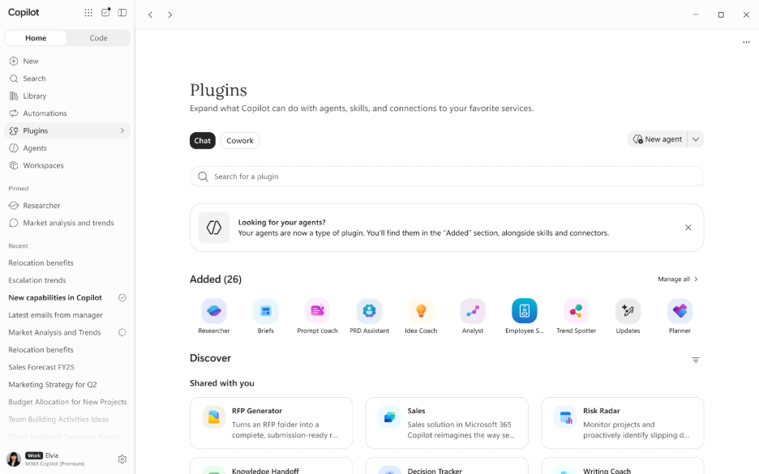
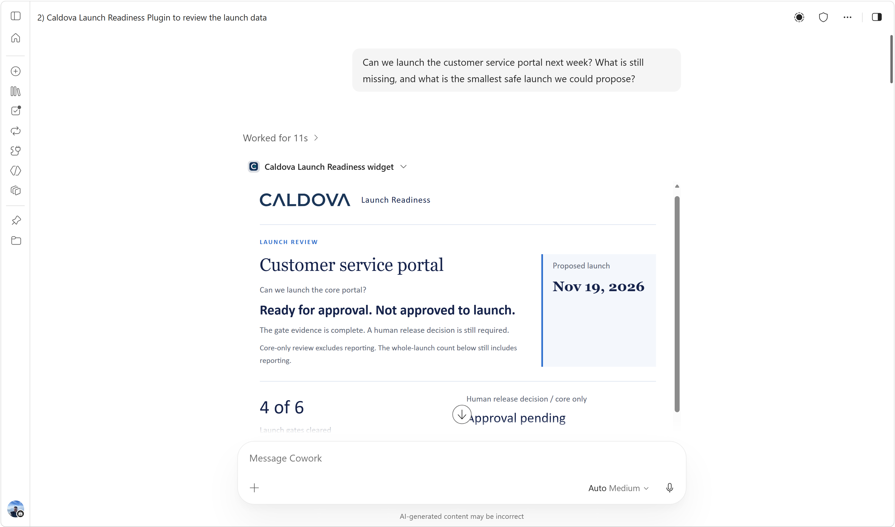
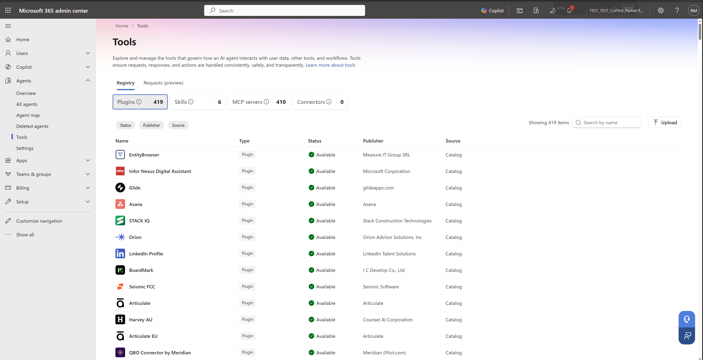
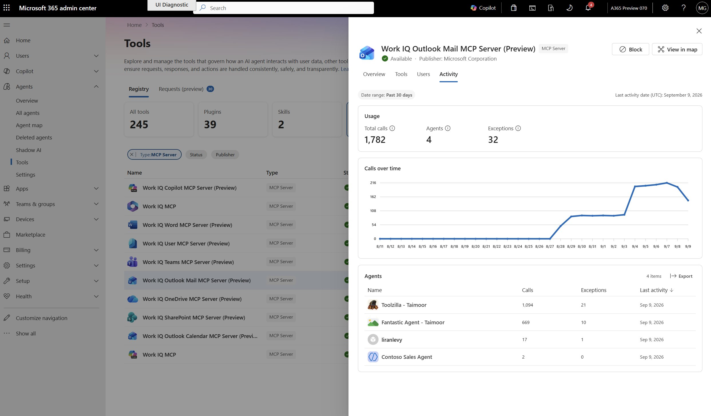

## #unified-extensibility 01 / Unified Registry Architecture :: 统一扩展底座：为什么需要把工具、技能与智能体收拢进单一插件注册表 || Unified Extensibility: Packaging Tools, Skills, and Agents in One Registry

企业扩展 Microsoft Copilot 时常遭遇两难：业务部门急需跨外部记录系统拉取实时门禁、工单与客户账本，而安全管理员却要面对散落在聊天、代码工具、自动化流与办公套件里的多套连接器目录、重复审批单与不可见的“影子技能” [1][5]。在 BRK221 开篇，Mandy Whaley 给出了微软收敛扩展碎片的顶层解法——将所有扩展原语按职责分层，统一封装为可安装的**插件（Plugin）**并归口至 **Microsoft Plugin Registry** [1][2]。 || Extending Microsoft Copilot across an enterprise often creates a tug-of-war: business teams need live gate statuses, tickets, and CRM records from external systems, while IT admins face fragmented catalogs, duplicate reviews, and unmonitored shadow skills across chat, coding tools, and Office apps [1][5]. Opening BRK221, Mandy Whaley presented Microsoft's architectural answer—separating extensibility primitives by responsibility and bundling them into installable **Plugins** governed through the **Microsoft Plugin Registry** [1][2].

在这套四层分工模型中，**工具（Tools）**解决“连什么（What）”，涵盖连接器与模型上下文协议（MCP）服务端点，具备明确定义的输入、输出与权限边界以读写业务记录系统；**技能（Skills）**解决“怎么做（How）”，用自然语言指令、参考资源与标准作业流教会模型按企业既定格式产出高管周报或执行核查；**智能体（Agents）**围绕业务目标自主推理并编排工具与技能；最外层的**插件（Plugins）**则充当标准分发包，实现“一次构建打包，在员工工作的所有界面按同一套 Agent 365 策略受控运行” [1][2]。 || Within this four-part taxonomy, **Tools** define the *what*—callable MCP servers and connectors with explicit inputs, outputs, and permissions reaching systems of record; **Skills** encode the *how*—natural-language instructions, templates, and repeatable workflows guiding task execution; **Agents** reason toward goals by orchestrating skills and tools; and **Plugins** act as the installable distribution unit so teams build once, govern once in Agent 365, and run everywhere [1][2].

:::figure { src: "./media/plugin-registry-architecture.figure.json", title: "Microsoft Plugin Registry 三层扩展、治理与全域分发架构 || Microsoft Plugin Registry Three-Tier Packaging, Governance & Surface Architecture" }
图 1：BRK221 核心架构——顶层由 Work IQ Developer Tools 将远端工具、自然语言技能与智能体打包校验；中层依托统一插件注册表（含 350+ 公共生态包与自研包）及 Agent 365 实施准入审批、部门组预装与 30 天遥测；底层无缝投射至 Copilot Home、Code、Autopilot、Copilot Studio 与 Office 全家桶 [1][2][3]。 || Figure 1: Three-tier BRK221 architecture—packaging MCP tools, skills, and agents via Work IQ Developer Tools on top; enforcing central approval, group pre-install, and 30-day telemetry in the Registry and Agent 365 in the middle; and surfacing governed capabilities across Copilot Home, Code, Autopilot, Studio, and Office apps underneath [1][2][3].
:::

整场 45 分钟议题以虚构企业 **Caldova** 的真实工程困境为主线：团队计划下周上线全新客服门户（Customer-Service Portal），必须在“全量发布（Go）”、“缩减为核心范围发布（Narrow）”与“暂缓发布（Hold）”之间拍板 [1][2]。下方导览台集成了 BRK221 官方点播视频流、原版 31 页 PPTX 课件直链与五段实机演示的逐分钟时间轴，点击上方章节药丸即可切换查阅对应进度与实测要点 [1][2]： || Across the 45-minute session, Mandy Whaley and Rachit Malik anchor every concept in a realistic release-room dilemma at fictional enterprise **Caldova**: deciding whether next week's customer-service portal launch should **Go big**, **Narrow scope**, or **Hold** [1][2]. The interactive theater below pairs the official Medius on-demand video stream and 31-slide PPTX deck with timestamped walkthroughs of all five live demos [1][2]:

:::sandbox { id: "brk221-video-theater", canvas: false, script: "./brk221-session.js", style: "./brk221-session.css", title: "BRK221 官方点播视频与五场实机演示时间轴导览 || BRK221 Official On-Demand Stream & Five-Demo Timestamp Navigator", desc: "切换架构导论与 Demo 1–5 关键时间节点，支持在页面内直接加载微软 Medius 点播流或下载官方原版 PPTX 讲义。 || Switch across the architecture intro and Demos 1–5, load the embedded Microsoft Medius player on demand, or download the official PPTX slide deck." }
纯静态点播与议题导览沙盒：内置官方高清封面图、五段演示分章摘要及官方视频与课件直链。 || Pure static session theater featuring the official BRK221 HD cover, five timestamped chapter digests, and direct video/slide links.
:::

## #discover-and-use 02 / Demo 01: Discover & In-Flow Execution :: 发现与即插即用：结合组织上下文、远端记录系统与高管报表技能 || Demo 01: Discovery & In-Flow Execution—Bridging Work IQ, Live MCP Gates, and Excel Skills

当发布负责人 Rachit 在 Teams 频道追问“下周能否上线客服门户？还缺什么？最小安全发布范围是什么？”时，仅靠默认挂载的组织内部工作上下文（Work IQ）只能检索到同事间的聊天讨论串，而真正的上线门禁审批记录存放在业务部门独立的外部记录系统之后 [1]。进入 Copilot 左侧导航栏全新的 **Plugins** 页面后，用户既能浏览按 Chat 与 Cowork 分类的 **350 余款**公共合作伙伴插件，也能直接看到本组织开发并获批的内部插件——且原先散落的智能体如今也作为插件的一种统一归入“已添加（Added）”视图集中管理 [1][2]。 || When release owner Rachit asks whether the customer-service portal can launch next week and what the smallest safe scope looks like, default Work IQ grounding locates the relevant Teams thread but cannot see authoritative gate records stored in an external engineering system [1]. Opening the unified **Plugins** tab in Copilot reveals **350+ public partner plugins** alongside organization-built packages—consolidating agents, skills, and connectors under one roof [1][2].

启用自研的 **Caldova Launch Readiness** 插件并重新发起同一提问后，返回结果发生了质变 [1]：该插件打包了一个连接内部门禁数据库的远端服务与两项自然语言技能。对话流内不再只有纯文本总结，而是直接渲染出由 **MCP App** 驱动的富交互门禁看板微件，清晰标出拟定发布日（2026 年 11 月 19 日）、当前综合判定状态 **Narrow（核心范围待批，尚未获准全量上线）** 以及 **4 / 6 道门禁已通关**——并精准点名正等待同事 Priya 完成共享数据就绪流（Shared Data Readiness）[1][2]。 || Toggling on the custom **Caldova Launch Readiness** plugin—which bundles an internal MCP server with two formatting skills—transforms the response [1]. Instead of plain text, Copilot renders an interactive **MCP App** readiness widget displaying the proposed November 19, 2026 launch date, a **Narrow** release status, and **4 of 6** cleared launch gates while pinpointing the pending shared-data workstream owned by Priya [1][2].

  <article class="brk221-media-card" data-present-surface="unframed">
    

      
    

    

      BRK221 官方课件原图 · Slide 13
      <h4 data-zh="Copilot 统一 Plugins 发现与管理页" data-en="Unified Plugins Discovery Hub in Microsoft Copilot">Copilot 统一 Plugins 发现与管理页</h4>
      
在同一入口按 Chat 与 Cowork 筛选已添加能力（含智能体、技能与连接器），并浏览组织共享与 350+ 公共目录插件 [1][2]。

    

  </article>
  <article class="brk221-media-card" data-present-surface="unframed">
    

      
    

    

      BRK221 官方课件原图 · MCP App 微件
      <h4 data-zh="Caldova 上线就绪度交互微件（4/6 门禁通过）" data-en="Caldova Launch Readiness Interactive Widget (4 of 6 Gates)">Caldova 上线就绪度交互微件（4/6 门禁通过）</h4>
      
远端工具实时拉取核心门禁事实，内置技能自动按下一步行动清单格式化输出，支持对话内双向刷新状态 [1][2]。

    

  </article>

更关键的是，插件不仅能读取外部系统，还能在对话流内双向刷新并跨宿主延续工作流 [1]：当 Priya 在后台更新进度后，Rachit 直接在 Copilot 内点击刷新，门禁状态当场跃升至 **5 / 6**；紧接着调用插件内封装的第二项“高管汇报技能”，一句话生成包含高管摘要（Executive Summary）、门禁总数、上次变更对比与后续动作的标准 Excel 工作簿，并在打开桌面端 Excel 后通过 `Choose Plugins` 继续挂载同一款插件深加工数据，全程无需切换工具或手工对齐表格格式 [1]。 || Crucially, plugins support live bidirectional refresh and cross-app continuity [1]: once Priya updates her gate, refreshing directly inside Copilot advances readiness to **5 of 6** cleared gates. Invoking the plugin's second packaged skill immediately generates an executive-formatted Excel workbook—complete with summary deltas, gate totals, and next steps—and the exact same governed plugin remains selectable inside Microsoft Excel via `Choose Plugins` [1].

## #build-with-wiqd 03 / Demo 02: Work IQ Developer Tools :: 工程化构建与定量评测：用 WIQD 跑通从意图到提审的五步生命周期 || Demo 02: Agentic Packaging & Quantitative Evals with Work IQ Developer Tools

如果公共目录中的 350 余款合作伙伴插件尚未覆盖企业内部专有系统（例如 Caldova 自建的上线门禁服务），研发团队该如何低摩擦地构建并验证自研插件？BRK221 重点展示了全新发布的命令行与编码智能体技能套件 **Work IQ Developer Tools**（简称 **WIQD**，访问入口 `https://aka.ms/wiqd`），它能够在 GitHub Copilot 或任意主流编码智能体中以对话驱动的方式跑通完整插件工程闭环 [1][2][4]。 || When an internal system of record like Caldova's readiness service has no off-the-shelf connector among the 350+ public offerings, developers turn to **Work IQ Developer Tools** (**WIQD**, available at `https://aka.ms/wiqd`)—a CLI toolset plus coding-agent skills that drives the end-to-end plugin lifecycle directly inside GitHub Copilot or any coding agent [1][2][4].

:::flow { title: "Work IQ Developer Tools（WIQD）从自然语言意图到租户目录提审的五步流水线 || Five-Stage WIQD Plugin Lifecycle from Intent Prompt to Tenant Catalog Submission" }
1. **意图声明与资产拉取（Build） || Intent Prompt & Context Pull (Build)** — 开发者在 GitHub Copilot 中输入起始提示词（如绑定远端端点 `caldova-corp.azurewebsites.net/readiness/mcp`），并通过 Work IQ 直接从个人 OneDrive 拉取公司规定的品牌图标与视觉规范，免去手动下载拷贝即可自动生成包含技能文件与 `manifest.json` 的标准插件包 [1][2]。 || Start from a natural-language prompt referencing `caldova-corp.azurewebsites.net/readiness/mcp` while pulling required brand icons straight from OneDrive via Work IQ to scaffold skills and `manifest.json` [1][2].
2. **服务端同源结构校验（Validate） || Server-Parity Manifest Validation (Validate)** — 在本地开发态直接运行与云端注册表完全一致的结构与字段合规检查，提前拦截 `manifest.json` 权限声明缺失或包目录格式错误，确保上传零返工 [1][2]。 || Execute the exact structural and schema checks enforced server-side during local authoring so `manifest.json` fields and package layouts pass cleanly [1][2].
3. **预览发布与小范围共测（Preview & Share） || Instant Registry Preview & Peer Feedback (Preview & Share)** — 构建产物一键生成预览链接并挂载至个人 Copilot 插件页，开发者可在正式提审前先行定向共享给 Mandy 等核心同事收集定性体验反馈 [1][2]。 || Publish a preview build to test live inside Copilot's Plugins page and share selectively with teammates for early qualitative feedback [1][2].
4. **十用例定量基准评测（Evaluate） || Quantitative 10-Case Benchmarking (Evaluate)** — 调用 Ignite 期间全新上线的内置评测引擎，针对“发现可用发布项”、“对比全量与仅核心范围就绪度”等 **10 个关键业务测试集**自动发送提示词、比对实际响应与期望输出并输出聚合评分报告；演示中团队从首轮尴尬的 **0 / 10（0%）** 基线出发，经智能体辅助多轮更新插件结构与评测集后将综合得分拉升至 **77.8%** [1][4]。 || Run the newly released Ignite evaluation engine across **10 critical test cases** (comparing actual vs. expected outputs across tool and skill metrics), iterating from an initial **0/10 (0%)** baseline up to **77.8%** [1][4].
5. **双轨目录一键提审（Publish） || Org & Public Catalog Submission (Publish)** — 定量评分达标后，直接在工具链内向本租户组织目录发起上架审批请求（实时落入 Agent 365 的 `Requests` 待批队列）；若属于独立软件开发商（ISV）对外分发，还可追加执行商店合规检查（Store Checks）并推送至合作伙伴中心（Partner Center）[1][2]。 || Submit validated packages directly into the tenant's organizational catalog queue in Agent 365, or run Store Checks and publish cross-tenant via Partner Center [1][2].
:::

:::figure { src: "./media/brk221-lifecycle-metrics.figure.json", title: "BRK221 实机演练核心量化轨迹：WIQD 评测提分、技能体检与门禁通关率 || BRK221 Live Walkthrough Metrics: WIQD Eval Progression, Skill Score & Launch Gates" }
图 2：汇总 BRK221 全场五次实机演示披露的关键百分比与门禁比值——涵盖 WIQD 10 用例评测从首轮 0/10（0%）迭代跃升至 77.8%、Cowork 内沉淀可复用技能获评 92.0% 质量分，以及 Caldova 门户上线门禁从 4/6（66.7%）实时刷新至 5/6（83.3%）直至终审前 6/6（100%）全绿通关 [1][2]。 || Figure 2: Quantitative progression captured live in BRK221—spanning WIQD's 10-case plugin eval climb from 0% to 77.8%, the 92.0% quality score on a Cowork-authored skill, and live launch-gate clearance advancing from 4/6 (66.7%) to 5/6 (83.3%) and 6/6 (100%) [1][2].
:::

## #govern-in-agent365 04 / Demo 03: Agent 365 Governance :: 集中治理与遥测洞察：在 Microsoft 365 管理中心管住准入、受众与异常 || Demo 03: Enterprise Governance in Agent 365—Approvals, Group Rollout, and 30-Day Telemetry

“一次治理，全域复用”的核心控制面落在 **Microsoft 365 管理中心（MAC）** 的 `Agents -> Tools` 注册表视图中，底层复用管理员早已熟悉的 **Agent 365** 治理框架并平滑延伸至插件、技能、远端服务与连接器四类资产 [1][2][5]。在 BRK221 官方课件实拍界面中，租户管理员不仅能在同一张清单里过滤审阅 **419 款插件**与 **410 个 MCP 服务**，还能切入 `Requests (preview)` 标签页逐项核查开发者刚刚提交的自研插件申请 [1][2]。 || The operational backbone of “Govern Once, Use Everywhere” lives under `Agents -> Tools` in the **Microsoft 365 admin center**, extending familiar **Agent 365** controls across plugins, skills, MCP servers, and connectors [1][2][5]. As captured in the official BRK221 admin slides, tenant admins filter across **419 plugins** and **410 MCP servers** in a single inventory while reviewing developer submissions in the `Requests (preview)` queue [1][2].

管理员点开待审的 Caldova 插件条目时，并非盲目点“同意”，而是清晰透视发布者身份、版本号、打包技能以及具体暴露的远端工具操作（如列出发布评审 `listing launch reviews`、草拟状态更新 `drafting launch updates`、审批上线演示 `approving launch demos`）[1][2]。点击 **Approve** 后，该插件即刻对租户内受权员工生效；对于业务急需的高价值套件（如内置 Dynamics 365 服务与销售技能集的 **Sales** 插件），管理员更可在右上角点击 **Install**，精准勾选“仅限销售部门组（Specific users and groups -> Sales）”，几秒钟内完成静默预装，让一线销售打开 Copilot 或 Office 组件即可零配置直接使用 [1][2]。 || Before clicking **Approve**, admins inspect the publisher, version, packaged skills, and exact remote MCP operations (such as listing launch reviews, drafting updates, and approving demos) [1][2]. Beyond reactive approvals, admins proactively accelerate adoption by selecting a catalog offering—like the **Sales** plugin bundling a Dynamics 365 MCP server and sales skills—and clicking **Install** to pre-deploy it directly to the **Sales** Entra group, while retaining one-click **Block** authority if policies change [1][2].

  <article class="brk221-media-card" data-present-surface="unframed">
    

      
    

    

      BRK221 官方课件原图 · Slide 19
      <h4 data-zh="M365 管理中心 Tools 统一注册表与待批队列" data-en="Unified Tools Registry & Requests Queue in M365 Admin Center">M365 管理中心 Tools 统一注册表与待批队列</h4>
      
在同一面板分类透视 Plugins（419）、Skills（6）、MCP servers（410）与 Connectors，集中处理组织内上架审批请求 [1][2]。

    

  </article>
  <article class="brk221-media-card" data-present-surface="unframed">
    

      
    

    

      BRK221 官方课件原图 · Slide 21
      <h4 data-zh="MCP 服务端点 30 天调用曲线与异常审计" data-en="30-Day MCP Server Call Telemetry & Exception Breakdown">MCP 服务端点 30 天调用曲线与异常审计</h4>
      
细粒度追踪单个 MCP 服务近 30 天总调用量（如示例中的 1,782 次调用、4 个消费智能体与 32 次异常），支持一键导出或封禁高危端点 [1][2]。

    

  </article>

上线后的持续保护与优化同样依托真实遥测数据闭环 [1][2]：在工具详情抽屉的 `Activity` 标签页下，系统自动绘制过去 **30 天**的每日调用趋势折线，并按消费智能体逐行拆解调用次数、异常报错数（Exceptions）与最后活跃时间（如 Slide 21 实拍中单服务端点累计 `1,782` 次调用、关联 `4` 个智能体、捕获 `32` 次异常），帮助运维团队及时定位连接器故障或异常激增并在必要时一键 **Block** 熔断 [1][2]。 || Post-deployment protection relies on granular observability [1][2]: the `Activity` tab charts **30-day** daily call spikes and breaks down consumption and exception counts per agent (showing `1,782` total calls across `4` agents and `32` exceptions in Slide 21), letting admins diagnose failing endpoints or click **Block** immediately [1][2].

## #skills-and-ecosystem 05 / Demos 04 & 05: Inline Skills & Partner Plugins :: 全员共创与生态合力：对话内沉淀高分技能，调用 Adobe 插件冲刺上线 || Demos 04 & 05: User-Authored Skills in Cowork and Last-Mile Launch with the Adobe Plugin

除了研发团队用命令行构建重型业务插件，一线业务人员同样能在日常工作流中反哺组织资产，且全过程不脱离管理员视野 [1]。在第四场演示中，门禁看板已刷新至 **6 / 6 全绿通关**，Rachit 在向高管 Mandy 与 Simon 发出最终上线审批邮件后，顺手将这套高频重复的“核查门禁 + 起草高层简报”动作在 Cowork 对话流内直接保存为名为 `Launch Readiness` 的可复用技能 [1]。系统当场生成涵盖适用场景、禁用边界、状态刷新方法与标准步骤的结构化说明，并自动出具一份 **92%** 的质量评估报告（检验触发时机与指令清晰度）[1]。 || Extensibility is not limited to pro-code developers—every Copilot Cowork user can capture repeatable workflows as shared skills without creating ungoverned shadow IT [1]. In Demo 4, once all **6 of 6** gates clear and Rachit emails leadership for final sign-off, he saves the status-reporting pattern inline as a `Launch Readiness` skill. Copilot generates structured usage boundaries, refresh steps, and an automatic **92%** quality report verifying trigger accuracy before sharing [1].

当 Rachit 将这项技能一键分享给同事 Mandy 时，底层实际将其封装为“仅含单项技能的轻量插件包”写入统一注册表 [1]：一方面，管理员切回 Agent 365 管理台即刻就能查看到该包的新建与更新时间及受权用户名单（Mandy 实时在列）；另一方面，Mandy 在 Copilot Home、Code、Autopilot 乃至桌面 Office 应用的插件目录中都能立即安装复用 [1]。演示中还出现了一处颇具真实感的现场插曲——当 Rachit 试图让 Copilot 读取 Mandy 刚发来的审批回复并回写外部门禁库时，演示环境连接器偶发断连未响应，恰好从侧面印证了前一节 Agent 365 异常监控看板在真实生产运维中的必要性 [1]。 || Sharing that skill with Mandy packages it under the hood as a single-skill plugin inside the central registry—giving admins immediate user-level visibility in Agent 365 while making the skill installable across Home, Code, Autopilot, and Office [1]. Even a candid live-demo hiccup—when the external connector briefly timed out while writing Mandy's approval reply back to the database—underscored why Agent 365's exception telemetry matters in real enterprise rollouts [1].

| 角色与阶段 || Persona & Stage | 核心工具与入口 || Primary Surface & Tooling | 输入资产与治理控制 || Inputs & Governance Guardrails | 跨端交付产物 || Cross-Surface Outputs |
|------|------|------|------|
| 业务负责人：发现与评估（Demo 1） || Launch Owner: Discover & Assess | Copilot Home / Cowork + Microsoft Excel | 启用已批自研插件，融合 Work IQ 聊天脉络与远端门禁库 [1] || Toggle approved plugin blending Work IQ context with remote MCP data [1] | 交互式 MCP App 门禁卡片（4/6→5/6）与高管格式 Excel 报表 [1] || Interactive MCP App gate widget (4/6→5/6) & formatted Excel report [1] |
| 研发工程师：构建与评测（Demo 2） || Pro Developer: Build & Evaluate | GitHub Copilot + Work IQ Developer Tools (`WIQD`) | 远端 MCP 地址 + OneDrive 品牌图标；本地校验 `manifest.json` 并跑 10 项评测（77.8%）[1][4] || Remote MCP URL + OneDrive icons; local manifest check & 10-case evals (77.8%) [1][4] | 标准插件包预览链接与推送至 Agent 365 的上架审批单 [1] || Validated plugin preview & formal org catalog request in A365 [1] |
| 租户管理员：审批与预装（Demo 3） || Tenant Admin: Approve & Govern | Microsoft 365 管理中心（`Agents -> Tools` / Agent 365） | 审查暴露工具列表与版本；按 Entra 部门组静默预装并盯防 30 天异常曲线 [1][5] || Audit exposed MCP tools; pre-install to Entra groups & track 30-day exceptions [1][5] | 全租户受控可见目录、销售组开箱即用插件及一键封禁熔断能力 [1] || Governed catalog, pre-installed Sales group tools & 1-click Block [1] |
| 业务共创与生态冲刺（Demo 4 & 5） || Co-Author & Partner Launch | Copilot Cowork + Microsoft Word + **Adobe Plugin** | 对话内沉淀单技能包（92% 质量分，A365 留痕）；人工复核机密脱敏红线 [1][3] || Save inline skill (92% quality score, A365 tracked); human redaction review [1][3] | 跨社交平台多尺寸宣传图、15/20/45 秒短视频切条与公开版白皮书 PDF [1][2] || Resized social images, 15/20/45s video cuts & redacted whitepaper PDFs [1][2] |

在最终拍板上线后的第五场演示中，团队直接调用公共注册表内现成的 **Adobe 插件**，在几分钟内清空了原本耗时数日的上市营销物料清单 [1][2]：其一，上传 4 张门户宣传原图并指名发布至 Facebook、Instagram 与 LinkedIn，插件内置技能自动映射各平台画幅规范完成批量裁切（用户无需背诵任何像素尺寸）；其二，对保存在 OneDrive 中的约 3–4 分钟上线长视频下达指令，自动剪辑输出 **15 秒、20 秒与 45 秒**三档短视频供各渠道下载分发；其三，在 Microsoft Word 右侧同时挂载自研门禁插件与 Adobe 插件，将含内部机密数据的营销初稿提炼为对外白皮书与精简宣传册，并在内嵌 **Acrobat 微件**中强制等待人工核验确认“零机密信息残留”后，方才生成最终对外发布的精美 PDF 文档 [1][2]。 || With launch approved, Demo 5 tapped the out-of-the-box **Adobe plugin** from the public registry to clear three last-mile marketing tasks in minutes [1][2]. First, it automatically resized four promo images to the exact Facebook, Instagram, and LinkedIn aspect ratios encoded in the plugin's skills. Second, it sliced a 3–4 minute OneDrive launch video into **15-second, 20-second, and 45-second** short-form cuts. Third, it paired the custom readiness plugin with Adobe right inside Microsoft Word to turn a confidential draft into a public whitepaper and brochure, pausing inside an embedded **Acrobat widget** for human redaction sign-off before exporting final PDFs [1][2].

## 参考资料：官方一手信源与关联议题 || References: Official Primary Sources & Related Sessions

1. **Mandy Whaley & Rachit Malik (Microsoft Ignite 2026 BRK221 Video & Transcript)** — https://ignite.microsoft.com/en-US/sessions/1787856606537001E7eU-1791588336053001C2T6 | 《Govern Once, Use Everywhere: Scale Copilot with Microsoft Plugin Registry》45 分钟官方点播实录与双语时间轴字幕（2026-11-19） || Official 45-minute breakout recording and WebVTT transcripts (Nov 19, 2026)
2. **Mandy Whaley & Rachit Malik (BRK221 Official Slide Deck & Medius Stream)** — https://medius.microsoft.com/Embed/video-nc/f2b7f27d-492d-4bb5-a3e5-8d5ef79dbef5 | BRK221 官方内嵌点播流与原版 31 页 PPTX 讲义（`https://medius.microsoft.com/video/asset/PPT/f2b7f27d-492d-4bb5-a3e5-8d5ef79dbef5`） || Official Medius on-demand player and 31-slide PPTX presentation deck
3. **Microsoft Copilot Plugin Catalog** — https://aka.ms/plugins | 微软官方 Copilot 插件公共目录（汇聚 Adobe、Asana、LinkedIn 等超 350 款生态伙伴插件与角色套件） || Official Microsoft Copilot Plugin Catalog featuring 350+ partner plugins across enterprise SaaS
4. **Work IQ Developer Tools (WIQD Documentation & CLI)** — https://aka.ms/wiqd | Work IQ Developer Tools 官方入门指南：在 GitHub Copilot 与编码智能体中构建、校验、评测与发布自定义插件 || Official developer guide for building, validating, evaluating, and publishing Copilot plugins with WIQD
5. **Microsoft Ignite 2026 Companion Track (BRK237 / LTG1220 / BRK220)** — https://ignite.microsoft.com/en-US/sessions | BRK221 课件第 29 页关联专场（插件架构与连接器治理） || Slide 29 companion sessions on plugin architecture and Agent 365 scale management
