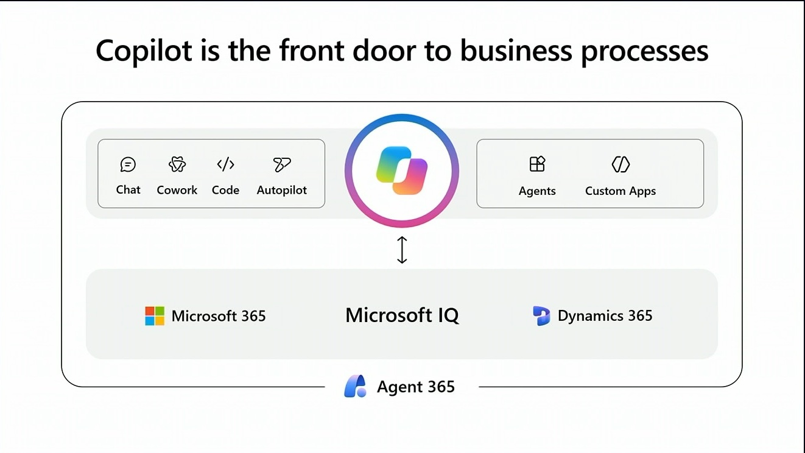
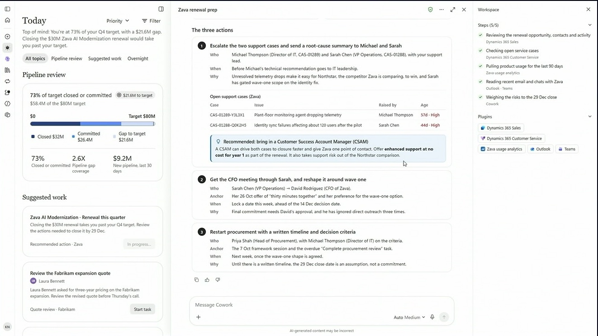
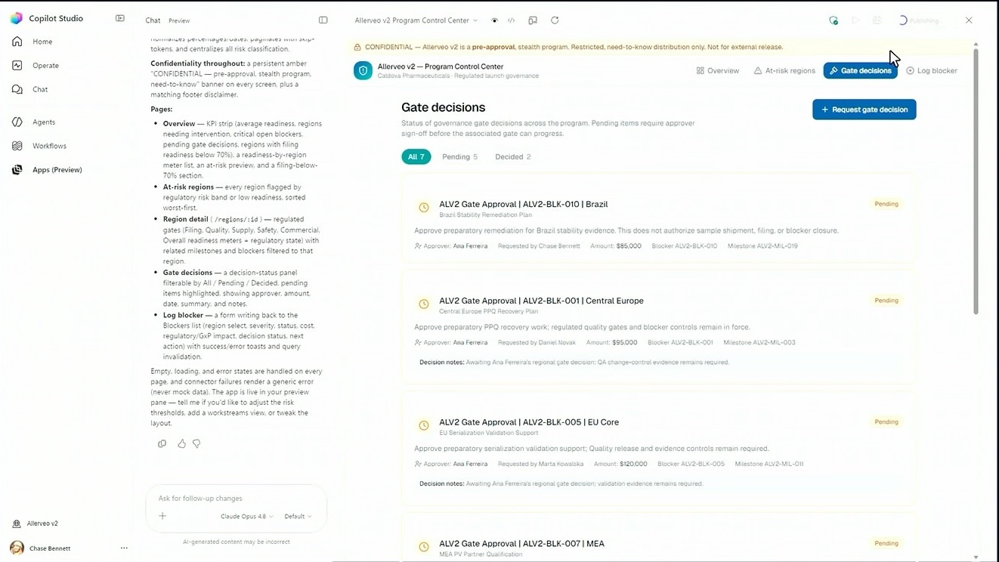
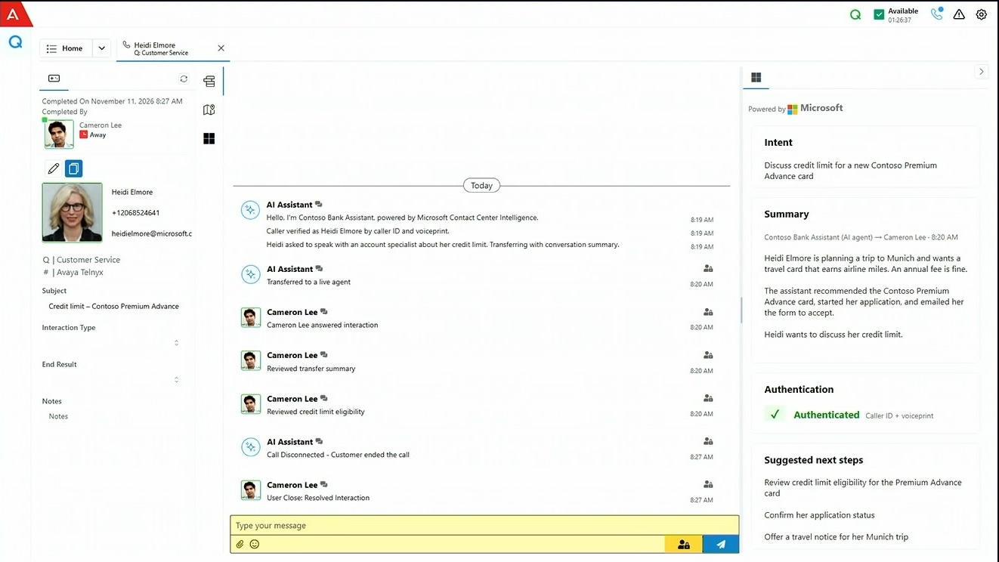

## #three-layer-stack 01 / Architecture & Theater :: 架构定调：无头业务前门与三层持久技术栈 || Architectural Foundation: Headless Front Door and the Three-Layer Stack

商业应用在过去两年经历了从早期概念验证到实质投资回报的跨越 [1]。2026 年上半年，微软内部研发团队借助新一代编码模型与执行内核，将高质量代码产出效率从最初的 20% 增幅一路推高至 2 倍乃至 5 倍 [1]。年中开始，工程团队将同源的执行内核与多模型调度机制引入销售、客服、财务与供应链场景，直接拉动营收增长、工单分流与库存周转 [1][2]。 || Business applications crossed from early AI prototypes into measurable production return during 2026 [1]. In the first half of the year, new coding models and agentic harnesses lifted quality code output across Microsoft engineering teams from 20% gains to 2x and 5x [1]. Starting mid-year, Microsoft brought those same harnesses into sales, service, finance, and supply chain workflows to drive pipeline conversion, incident deflection, and inventory turns [1][2].

面对繁杂的产品更新，Jeff Teper 给出了贯穿微软全公司商业应用战略的三层持久框架 [1][2]。顶层是以 Copilot 为核心、辅以自研智能体与定制微应用的**用户体验层**；中层是融合协作办公、客户关系与企业资源规划以及实时分析引擎的**智能上下文层（Microsoft IQ）**；外围则是统一纳管数字员工身份、权限与审计的**全域治理层（Agent 365）**[1][2]。 || Cutting through product sprawl, Jeff Teper defined a durable three-layer architecture for Microsoft business applications [1][2]. **Copilot alongside custom apps and agents** forms the user experience layer. **Microsoft IQ** unifies collaborative work, business transactions, and analytics as the data substrate, while **Agent 365** surrounds every asset as the enterprise governance control plane [1][2].

:::figure { src: "./media/brk234-agentic-business-stack.figure.json", title: "BRK234 智能体化业务应用三层持久架构栈 || BRK234 Three-Layer Agentic Business Application Stack" }
图 1：BRK234 确立的三层商业应用底座——顶层通过无头交互前门与自研微应用承接人机协同，中层在单一技术栈内拉通邮件会议、核心业务接口与高速分析库，底层由专属身份与托管沙盒兜底合规边界 [1][2]。 || Figure 1: The three-layer business application stack from BRK234—connecting headless Copilot workflows and custom apps on top, unified M365, Dynamics 365, and Fabric context in the middle, and Agent 365 plus Managed Runtime guardrails underneath [1][2].
:::

为什么“无头化（Headless）”会成为商业软件的演进主航道 [1]？传统客服坐席与项目经理仍可留在熟悉的工单列表或排期视图中筛选数据，但一线销售代表从不希望把时间耗在客户关系管理系统的表单录入上 [1]。无头架构让后台智能体自动吸收会议纪要、往来邮件与外部背景调研并回写核心记录系统，而员工只需在手机端聊天窗口或每日工作台中发问与拍板 [1][3]。同时，针对历史遗留系统迁移成本高昂的行业顽疾，微软在继 9 月推出面向 Salesforce 迁移的 **Dynamics 365 Activate** 之后，于本场正式宣布开启面向 **SAP 企业资源规划系统迁移的私有预览**，联合生态伙伴以极低周期盘点存量流程并完成平滑切换 [1][2]。 || Why is headless interaction reshaping enterprise software [1]? Support reps and project managers keep their fast grid and schedule views, yet frontline sellers never ask to spend more hours typing into CRM screens instead of meeting clients [1]. Headless architecture lets background agents synthesize meeting recaps, emails, and web research directly into the system of record while employees act from mobile chat or Copilot Today [1][3]. To remove legacy migration barriers, Microsoft followed its September Salesforce release of **Dynamics 365 Activate** by announcing a **private preview for SAP ERP migrations**, codifying partner domain expertise to inventory processes at a fraction of historical time and cost [1][2].

下方交互导览台按时间轴完整还原了 BRK234 全场 50 分钟的五幕核心议程，支持直接加载微软官方点播流或跳转官方议题主页核验一手细节 [1]： || The interactive theater below maps all five acts across the 50-minute BRK234 recording, letting you load the official Microsoft Medius stream inline or jump straight to the session page [1]:

:::sandbox { id: "brk234-video-theater", canvas: false, script: "./brk234-theater.js", style: "./brk234-theater.css", title: "BRK234 官方点播视频与五幕时间戳导览台 || BRK234 Official On-Demand Stream & Five-Act Timestamp Theater", desc: "点击顶部时间轴标签切换架构定调、Zava 续约实战、Visa 对谈、托管运行时微应用与联络中心智能五大章节，一键唤起官方 Medius 播放器。 || Switch across the five timestamped chapters—Stack Vision, Zava CRM Demo, Visa Fireside, Managed Runtime Apps, and Contact Center Intelligence—or launch the official Medius player." }
纯静态点播导览沙盒：内置官方高清关键帧预览、逐分钟实录摘要与微软官方视频点播入口。 || Pure static session theater featuring official HD keyframe previews, timestamped transcript digests, and direct Medius playback links.
:::

## #headless-crm-visa 02 / Headless Flow & Visa IQ :: 无头协同与企业脉络：从 3,000 万美元续约实战到 Visa 集体智慧 || Headless Execution & Enterprise Context: From a $30M Renewal to Visa IQ

“Copilot 是新一代工作操作系统”的前提，是它不仅能润色文档，更能直接读写企业的订单、商机、工单与财务账本 [1][3]。在第一场实机演示中，产品负责人 Karan Nigam 展示了销售代表如何在不打开任何传统后台界面的情况下，仅凭全新的 **Today（今日）** 工作台与 **Autopilot** 推进一笔决定季度成败的大单 [1]。 || For Copilot to serve as the operating system for work, it must reason over orders, opportunities, support tickets, and financial ledgers rather than documents alone [1][3]. In the opening live demo, Karan Nigam walked through how an account executive advances a quarter-defining deal directly inside the new **Today** view and **Autopilot** without opening a standalone CRM screen [1].

:::flow { title: "实机拆解：在 Copilot 工作流内闭环 Zava 3,000 万美元续约的四步链路 || Four-Step Live Walkthrough: Closing the $30M Zava Renewal Inside Copilot" }
1. **管线缺口即时透视 || Instant Pipeline Gap Triage** — 打开 Today 视图即可看到第四季度 `8,000 万美元` 销售目标已达成或锁定 `73%`（已签 `3,200 万美元`、承诺 `2,640 万美元`，尚有 `2,160 万美元` 缺口），系统自动置顶价值 `3,000 万美元`、定于 12 月 29 日截标的 Zava 现代化续约商机 [1]。 || Opening the Today page reveals `73%` of the `$80M` Q4 target closed or committed (`$32M` closed, `$26.4M` committed, `$21.6M` gap), flagging the `$30M` Zava renewal closing December 29 as the decisive action item [1].
2. **跨栈归因与风险穿透 || Cross-Stack Root-Cause Synthesis** — 点击启动任务后，右侧工作区并行调用销售、客服、近 90 天产品用量以及邮件聊天插件，提炼出三项阻断：两张高龄未结故障单（已挂起 57 天的车间遥测丢包单与挂起 44 天影响约 120 人的身份同步故障单）正给竞品可乘之机；财务总监三次未回直发邮件；采购评审逾期未锁时间表 [1]。 || Clicking Start Task invokes Sales, Customer Service, 90-day usage analytics, Outlook, and Teams plugins simultaneously—surfacing two aging support tickets (57-day telemetry drops and 44-day identity sync failures hitting ~120 users), an unreached CFO, and an overdue procurement timeline [1].
3. **一键外发与无感回写后台 || In-Flow Messaging & Automatic CRM Write-Back** — 采纳系统“引入客户成功经理并提供首年免费增强支持”的建议后，界面直接拟好内部协同消息与借运营副总裁引荐财务总监的客户邮件；点击发送的同时，左下角自动将最新进展同步回写至客户关系管理系统 [1]。 || Accepting the recommendation to assign a Customer Success Account Manager with year-one enhanced support generates ready-to-send Teams and customer messages while logging every update back into Dynamics 365 CRM automatically [1].
4. **例行巡检移交后台助手 || Delegating Weekly Prep to Autopilot** — 针对原本每周耗费 `4–5 小时` 手工搜集重点客户动态与竞品威胁的繁琐工作，销售代表一句话配置每周一早 `8:00` 自动运行的例行任务，并在同一界面按需切换前端商机与后端企业资源规划插件 [1]。 || Replacing `4–5 hours` of manual weekly account and competitive tracking, the seller schedules a transparent Monday `8:00 a.m.` Autopilot routine and taps into the Dynamics 365 ERP plugin from the same surface [1].
:::

  <article class="brk234-media-card">
    

      
    

    

      BRK234 现场课件实拍 · 04:15
      <h4 data-zh="Copilot 作为全部业务流程的统一前门" data-en="Copilot as the Front Door to Business Processes">Copilot 作为全部业务流程的统一前门</h4>
      
上方汇聚聊天、协同画布、编码、自动巡航及定制智能体与应用，下方双向打通 Microsoft IQ 并由 Agent 365 统一护航 [1]。

    

  </article>
  <article class="brk234-media-card">
    

      
    

    

      BRK234 实机演示截帧 · 16:45
      <h4 data-zh="Today 管线透视与 Zava 续约三步处方" data-en="Today Pipeline Health & Zava Renewal Action Plan">Today 管线透视与 Zava 续约三步处方</h4>
      
左侧实时核算 8,000 万美元季度目标缺口，中栏串联工单号与采购节点给出可执行建议，右侧透明展示五步推理与挂载插件 [1]。

    

  </article>

这一架构在全球超大型金融网络中同样得到了印证 [1]。Visa 高级副总裁兼全球技术负责人 Manish Mittal 在炉边对谈中指出，Visa 服务着全球银行、金融科技与商户生态，旗下横跨支付清算、反欺诈、风控与核心银行等数百款产品 [1]。销售团队面临的最大瓶颈并非缺乏数据，而是客户历史交互、已购产品组合与风控表现散落在多套异构系统中 [1]。 || Global enterprise deployment confirms this architectural pattern [1]. During his fireside chat, Visa SVP and Global Head of Technology Manish Mittal explained that Visa serves banks, fintechs, and merchants across hundreds of payment, fraud, risk, and core banking products [1]. Visa sellers never lacked raw data; instead, relationship history, product holdings, and risk signals lived fragmented across disconnected systems [1].

为此，Visa 在原生商机洞察与会前准备能力之上，自主构建了融合采购明细、产品图谱与客户画像的统一脉络层——**Visa IQ**，并将其直接注入销售智能体 [1]。Manish 坦言，落地过程中最硬核的工程挑战在于**打通云端智能体与企业本地（On-Premises）核心系统的安全身份认证链路** [1]。链路贯通后，当银行客户在会谈中临时提起“近期交易授权率下滑、拒付或欺诈抬头”时，销售无需再会后跨多个部门拉通排期，而是在对话流内即时调取定制化诊断响应 [1]。下一步，Visa 正依托协同工作空间推进两条演进路线：一是结合客服与运营数据，在客户仅描述业务痛点而未点名产品时主动在后台匹配方案；二是萃取顶尖销售老手的沟通打法沉淀进智能体，把个人效率升级为全销售团队的集体产能 [1]。 || Building on native Dynamics account intelligence, Visa created its own Customer 360 intelligence layer—**Visa IQ**—and injected it into its Sales Agent [1]. Mittal noted that the toughest engineering hurdle was **wiring cloud-hosted Copilot authentication securely into on-premises data systems** [1]. With that bridge running, a seller hearing a client mention falling authorization rates or rising fraud receives tailored portfolio guidance right inside the live conversation rather than chasing multiple teams afterward [1]. Next, Visa is expanding Copilot-enabled collaborative selling workspaces along two tracks: proactively spotting product propositions from support signals before clients ask, and capturing top-seller engagement patterns to elevate collective productivity across the entire sales force [1].

## #studio-managed-runtime 03 / Studio Trinity & Runtime :: 三位一体构建与托管运行时：药企上市控制中心的端到端生成 || Unified Creation & Managed Runtime: Building a Regulated Launch Control Center

企业业务流程既不能全靠昂贵且非确定性的纯大模型自由发挥，也不能退回一遇非结构化异常就卡死的传统僵硬脚本 [1][4]。2026 年 8 月，微软基于最新多模型与执行内核彻底重写了 Copilot Studio，把**智能体（负责推理判别）、确定性工作流（负责低成本合规流转）与微应用（负责人工检视与拍板界面）**收敛进同一个工作台 [1][4]。 || Enterprise processes cannot rely solely on expensive, non-deterministic LLM loops, nor can they survive on brittle scripts that halt whenever unstructured exceptions arise [1][4]. Rewritten from the ground up in August 2026 around the new Copilot harness, Copilot Studio unifies **reasoning agents, deterministic workflows, and interactive micro-apps** in one environment [1][4].

Jeff Teper 在现场披露了这套算力分工底座的实测收益：通过让大模型代码在图形处理器（GPU）上专注语义理解与动态规划，同时让确定性工作流代码在中央处理器（CPU）上高效跑完固定步骤，新版平台相比上一代不仅在多维度任务评测中实现了 **10 至 40 个百分点的质量跃升**，还将**平均词元消耗直接砍半（降低约 50%）**[1][4]。与此同时，智能体专属身份（Agent Identity）已进入预览，管理员可像管理真实员工一样对智能体施加访问控制、敏感度标签、操作审计与数据防泄漏策略；而承载生成式前端应用的 **Copilot 托管运行时（Copilot Managed Runtime）** 则于大会当日正式商用（GA）[1][6]。 || Jeff Teper shared the concrete economics behind this hybrid execution engine: pairing LLM reasoning on GPUs with deterministic workflow code on CPUs delivered **10-to-40-point quality gains** over the prior release while **cutting token consumption roughly in half** [1][4]. At the same time, preview support for dedicated **Agent Identities** brings employee-grade access control, sensitivity labels, auditing, and data loss prevention to custom agents, while the **Copilot Managed Runtime** reached general availability on stage [1][6].

:::figure { src: "./media/brk234-process-asset-quadrant.figure.json", title: "企业业务流程资产的推理弹性与执行确定性分工象限 || Reasoning Flexibility vs. Execution Determinism Across Business Process Assets" }
图 2：告别手工拼表与缺乏监管的裸虚机即兴编码——通过在受管沙盒内组合智能体、确定性流与微应用，企业可同时锁定高自适应推理与严密合规护栏 [1][4][6]。 || Figure 2: Escaping manual list triage and ungoverned raw-VM prototypes—combining agents, deterministic workflows, and Managed Runtime apps achieves both contextual reasoning and strict compliance guardrails [1][4][6].
:::

为什么企业级微应用必须跑在托管运行时之上，而不是随便起一台云主机 [1][6]？当业务人员或开发者在协同画布、代码工具乃至外部辅助编码平台用自然语言生成看板或表单时，如果直接部署在带有未知开源依赖的裸虚拟机上，安全团队将彻底失去对数据流向的控制 [1]。托管运行时复用了低代码平台验证多年的治理控制面：管理员可精细裁决谁能访问或分享该应用，并严格限定其仅能读写受信任的数据表与文档库，任何跨出白名单的外部连接请求都必须经过显式审批 [1][6]。 || Why host AI-generated apps on Copilot Managed Runtime rather than arbitrary virtual machines [1][6]? Deploying vibe-coded prototypes onto raw VMs with unknown open-source dependencies leaves security teams blind to data exfiltration [1]. Copilot Managed Runtime inherits Power Platform's proven control plane: administrators govern who accesses or shares each app and enforce connector allowlists—permitting SharePoint or Dataverse reads while requiring explicit oversight for external systems [1][6].

在第二场实机演示中，产品经理 Jessica Lo 以一家正遭遇供应链短缺、急需推出改款主线产品的制药企业 **Caldova Pharmaceuticals** 为背景，现场将原本每天早会人工刷新的区域列表改造成一套受监管的端到端上市控制系统（Allerveo v2）[1]： || In the second live demo, Product Manager Jessica Lo stepped into the role of **Caldova Pharmaceuticals**—resolving a supply chain shortage with a modified product version—to replace manual daily SharePoint standups with a governed launch control system (*Allerveo v2*) [1]:

| 协同资产类型 || Asset Layer | 自然语言构建与挂载配置 || Prompted Setup & Grounding | 实机运行表现与治理闭环 || Live Execution & Governance Loop |
|------|------|------|
| 托管微应用（正式商用） || Managed Control App (GA) | 一句话提示词连接区域就绪度列表，自动在托管运行时生成含机密横幅的五页上市控制中心 [1] || Single natural-language prompt over SharePoint lists generates a 5-page gate control app hosted on Copilot Managed Runtime [1] | 顶栏直观呈现各区域关键绩效指标与全量 7 项门禁决策（5 项待批、2 项已决），高亮标红存在稳定度阻断的**巴西赛区（涉及 8.5 万美元审批项）**[1] || Displays regional KPIs and 7 regulated gate decisions (5 pending, 2 decided), flagging **Brazil** at risk (`$85,000` remediation gate) [1] |
| 项目协调智能体 || Program Coordinator Agent | 在主页对话框同时挂载区域追踪列表、上市准入政策文档与组织实时上下文，并按性价比自选推理模型 [1] || Grounded on SharePoint trackers, launch readiness policy docs, and Work IQ with admin-friendly model selection [1] | 当被追问“哪个区域最可能错过上市窗口及证据”时，并行拉取多源数据锁定巴西红灯与供应链卡点，全程默认受全域治理策略约束 [1] || Queries sources in parallel to pinpoint Brazil's supply-chain and stability blockers under default Agent 365 policies [1] |
| 受监管升级工作流 || Regulated Gate Workflow | 在同一条创建指令中自动伴生确定性升级工作流，挂载为智能体的受控调用工具 [1] || Co-generated from the same prompt as a deterministic tool attached directly to the coordinator agent [1] | 仅在确需升级时触发路由，向负责人推送聊天审批卡片；点击批准后自动同步更新底层列表与前端微应用状态 [1] || Fires strictly on valid escalations, sends an interactive Teams approval card, and writes sign-off status back to SharePoint and the app [1] |

## #contact-center-intelligence 04 / Contact Center Intelligence :: 对客服务重塑：零推倒重来的联络中心智能与多模态交接 || Customer Engagement: Zero-Rip Contact Center Intelligence and Warm Handoff

业务转型的终极试金石在于企业如何服务自己的外部客户 [1]。市场负责人 Bryan Goode 引用现场调研指出，**高达十分之九（90%）的企业**希望用人工智能重塑对客互动体验，但几乎所有首席信息官都面临同一道现实铁幕：“我既没时间、也没法推倒重来（Rip and Replace）现网已经跑了十年的呼叫中心。” [1] || Customer engagement remains the highest-priority proving ground for agentic transformation [1]. Marketing VP Bryan Goode noted that **9 out of 10 enterprises** want AI to transform customer interactions, yet technology leaders share one non-negotiable constraint: they have neither the time nor the appetite to rip and replace entrenched telephony infrastructure [1].

为破解AI迭代速度与联络中心漫长改造周期之间的错位，微软正式发布当日全面商用（GA）的 **Microsoft Contact Center Intelligence（CCI）**，并同步官宣与 **Avaya、Cisco 及 Five9** 三大传统联络中心巨头达成深度合作 [1][5]。企业无需改动任何现有电话路由规则或语音基础设施，完整保留全部直拨电话号码（DID），只需通过开箱即用的通用连接器粘贴少量密钥，即可在既有呼叫中心之上直接叠加多智能体语音与数字自助服务层 [1][5]。 || Bridging fast-moving AI and multi-year telephony lifecycles, Microsoft announced general availability of **Microsoft Contact Center Intelligence (CCI)** alongside partnerships with **Avaya, Cisco, and Five9** [1][5]. Using an out-of-the-box universal connector and a few API keys, enterprises layer voice and digital agents directly over existing infrastructure—requiring zero routing changes and preserving every existing phone number (DID) [1][5].

  <article class="brk234-media-card">
    

      
    

    

      BRK234 实机演示截帧 · 35:05
      <h4 data-zh="托管运行时上的药企门禁控制中心微应用" data-en="Caldova Launch Gate App on Copilot Managed Runtime">托管运行时上的药企门禁控制中心微应用</h4>
      
左侧保留自然语言迭代对话窗，右侧实时预览并交互操作巴西、中欧等赛区的受监管上市门禁审批项 [1]。

    

  </article>
  <article class="brk234-media-card">
    

      
    

    

      BRK234 实机演示截帧 · 47:28
      <h4 data-zh="向第三方 Avaya 坐席桌面无感推送核身与摘要" data-en="Warm Handoff Summary Inside Third-Party Avaya Desktop">向第三方 Avaya 坐席桌面无感推送核身与摘要</h4>
      
人工专员接起电话瞬间，右侧面板直接呈现慕尼黑差旅办卡摘要、声纹核身通过标识与三步后续操作建议 [1]。

    

  </article>

Heidi Elmore 在压轴实机拨测中，以银行业务（Contoso Bank）完整展示了这套非侵入式客服底座从构建到质检的五层工程设计 [1][5]： || Closing the session with a live phone call to Contoso Bank, Heidi Elmore demonstrated five engineering capabilities built into Contact Center Intelligence [1][5]:

:::insight-grid { cols: 2, title: "Contact Center Intelligence 五大生产级工程特性 || Five Production Engineering Capabilities in CCI" }
::card 01
### 专职子智能体分治与跨域资产复用 || Domain Sub-Agents & Foundry Reuse
自然语言创建主接待助手后，系统按业务线拆分专职子智能体（如独立配置专属模型、产品手册与后台政策的信用卡服务子智能体），并可直接复用研发团队已在云端模型工厂构建好的交易分析智能体，真正实现“一次构建、多处挂载” [1]。 || Decomposes self-service into fast domain sub-agents—each with dedicated models, brochures, and Microsoft IQ policies—while reusing existing agents such as a Foundry transaction-analysis agent without rebuilding [1].

::card 02
### 生成式对话与声纹确定性流程混编 || Generative Skills + Voiceprint Determinism
面对“下周去慕尼黑旅行选哪张航空里程卡”这类开放咨询，智能体调用生成式技能灵活推荐低年费航空卡，甚至在客户突然改说德语时秒级同语种对答并平滑切回英语；一旦进入信用卡申领或资金划转环节，立即切入预设问题序列的确定性流程并支持声纹（Voiceprint）生物核身 [1]。 || Handles open-ended Munich travel perk inquiries and mid-call German-to-English switching generatively, then locks into predetermined intake steps enhanced with biometric voiceprint authentication for card applications [1].

::card 03
### 第三方坐席桌面零断层热交接 || Third-Party Agent Desktop Warm Handoff
当客户进一步要求调整信用额度以防旅途超支时，智能体无缝转接人工专员，并将来电意图、已发送开卡表单摘要、来电号码加声纹双重核身状态及后续建议直接渲染在第三方 **Avaya** 坐席工作台右侧，大幅降低一线坐席的变革管理阻力 [1]。 || Escalating a credit-limit inquiry pushes caller intent, prior card-application summary, Caller ID + voiceprint verification status, and suggested next steps straight into the human rep's existing Avaya desktop [1].

::card 04
### 人机同标自动质检与统一台账 || Unified Automated QA & Agent 365 Visibility
通话推进的同时，后台质量保证智能体自动对照企业质检方案（涵盖问候礼仪、品牌合规词等可配维度）为本通对话打分，且同一套评分标尺可无差别考核AI助手与人工坐席；IT 管理员则在统一控制台中像查看普通内部助手一样监管该客服智能体 [1][5]。 || A background QA agent scores every call against configurable brand and greeting rubrics shared across AI and human reps, while IT admins govern the customer-assist agent centrally inside Agent 365 [1][5].
:::

## 参考资料：官方一手信源与关联技术规范 || References: Official Primary Sources & Engineering Guides

1. **Jeff Teper, Bryan Goode, Manish Mittal, Karan Nigam, Jessica Lo & Heidi Elmore (Microsoft Ignite 2026 BRK234)** — https://ignite.microsoft.com/en-US/sessions/1787856608608001EBSP-1791588069088001Cwnv | 《Agentify your business processes-the next era of business applications》50 分钟官方点播视频流（`https://medius.microsoft.com/Embed/video-nc/b996ddba-c550-4e0e-9d21-8d9a3d50e5f6`）与双语 WebVTT 演讲实录（2026-11-17） || Official 50-minute breakout on-demand video recording and full WebVTT transcript (Nov 17, 2026)
2. **Jeff Teper & Dynamics 365 Team (Microsoft Official Blog)** — https://www.microsoft.com/en-us/dynamics-365/blog/ | Dynamics 365 融入 Microsoft IQ 底座、无头商业应用交互范式及 Dynamics 365 Activate（Salesforce 正式商用与 SAP 迁移私有预览）官方技术说明 || Official announcements on Dynamics 365 inside Microsoft IQ, headless business processes, and Dynamics 365 Activate for Salesforce and SAP migrations
3. **Jason Moore (Microsoft Copilot Blog)** — https://www.microsoft.com/en-us/copilot/blog/copilot-studio/build-and-manage-business-processes-with-microsoft-copilot-studio/ | 《Build and manage business processes with Microsoft Copilot Studio》三位一体创作台、托管运行时正式商用与端到端业务流程重构综述（2026-11-18） || Ignite 2026 overview of unified agents, deterministic workflows, and generally available Managed Runtime apps (Nov 18, 2026)
4. **Ben Appleby (Microsoft Copilot Blog)** — https://www.microsoft.com/en-us/copilot/blog/copilot-studio/how-the-microsoft-copilot-harness-in-copilot-studio-helps-agents-finish-the-job/ | 《How the Microsoft Copilot harness in Copilot Studio helps agents finish the job》执行内核质量跃升与词元节降工程机制拆解（2026-11-09） || Engineering breakdown of the Microsoft Copilot harness quality gains and token-efficiency architecture (Nov 9, 2026)
5. **Microsoft Contact Center Intelligence & Customer Harness Documentation** — https://learn.microsoft.com/en-us/microsoft-copilot-studio/whats-new | 全渠道对客会话底座、第三方联络中心（Avaya / Cisco / Five9）通用连接器、声纹核身与自动质检特性规范 || Official product documentation covering customer-facing voice/chat agents, universal telephony connectors, and Agent 365 governance
6. **Microsoft Copilot Studio Governance & Managed Runtime Guides** — https://learn.microsoft.com/en-us/power-platform/admin/ | 专属智能体身份（Agent ID）、访问控制与数据防泄漏策略及受管应用连接器白名单治理指南 || Enterprise administration guide for dedicated agent identities, DLP enforcement, and Copilot Managed Runtime security controls
