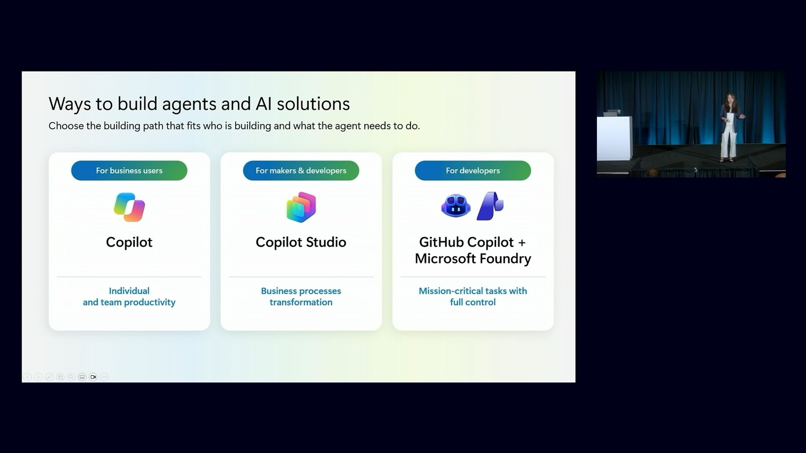
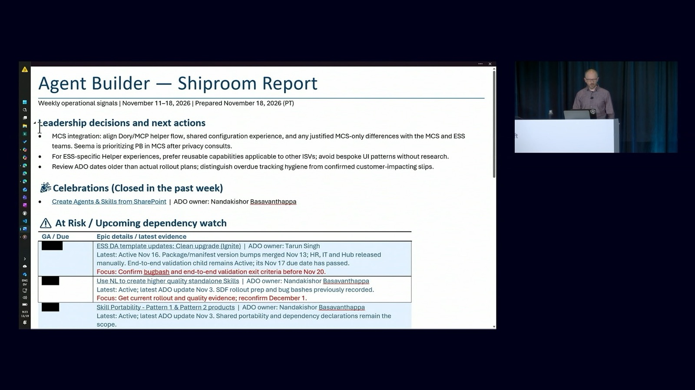
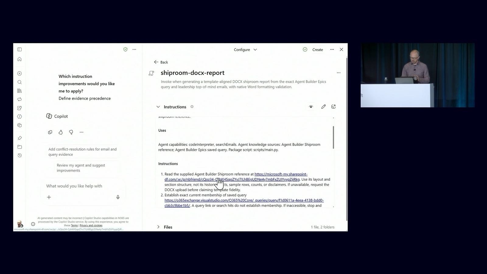
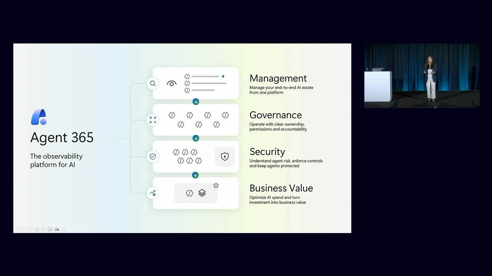

## #three-build-paths 01 / Continuum & Theater :: 构建选型：把组织独有经验编码进三层互补连续体 || Authoring Continuum: Codifying Institutional Know-How Across Three Paths

通用大模型再强大，也无法预先替企业写好内部特有的业务流程与团队协作惯例 [1]。Anna Cao 在开场直指客户最常追问的选型命题：当开箱即用的聊天助手已经足够聪明，企业究竟在什么节点才需要动手自建智能体 [1]？答案藏在组织的差异化壁垒里——哪怕同在微软市场部，入职 Copilot 团队与入职 Azure 团队的新员工需要研读的站点、规范文档与对接人名单都截然不同 [1]。把沉淀多年的岗位经验与流程标准固化成智能体，才能让团队知识顺着日常办公流自动复用，免去频繁切换系统的损耗 [1][2]。 || No matter how capable foundation models become, out-of-the-box AI cannot pre-build your organization's proprietary workflows or team conventions [1]. Anna Cao opened by answering a question customers ask constantly: when should you build a custom agent instead of prompting generic chat [1]? Even inside Microsoft marketing, a new hire joining Copilot Marketing needs completely different SharePoint sites, policy files, and contacts than someone joining Azure Marketing [1]. Codifying institutional expertise into agents scales team knowledge directly in the flow of work without context switching [1][2].

为了让市场、财务、人力等业务人员与一线软件工程师在同一套企业级护栏下各展所长，微软构建了覆盖全角色的**三大互补路径**，并将 9 月焕新发布的 Microsoft Copilot 作为触达全员的统一分发载具 [1][3]： || So business teams in marketing, finance, or HR can innovate alongside software engineers under unified IT guardrails, Microsoft structures agent creation into **three complementary paths**, using the new Microsoft Copilot announced in late September as the organization-wide distribution vehicle [1][3]:

:::figure { src: "./media/brk236-agent-continuum-architecture.figure.json", title: "BRK236 三路径智能体构建与统一分发治理栈 || BRK236 Three-Path Agent Continuum & Unified Governance Stack" }
图 1：BRK236 确立的全栈构建与采用架构——顶层按构建者角色分流三大工具链，底层共用八月发布并正式更名的 Microsoft Copilot Harness，中层经插件包与跨栈协议拉通四维 Microsoft IQ，外围由 Agent 365 统一兜底安全与预算 [1][3][5]。 || Figure 1: The end-to-end authoring and adoption stack from BRK236—matching three role-specific entry points atop the shared Microsoft Copilot Harness, connected via plugins, MCP, and A2A over four-part Microsoft IQ and Agent 365 controls [1][3][5].
:::

这三条路径并非彼此割裂的孤岛，而是通过统一执行内核与开放协议紧密咬合的有机整体 [1][3][4]： || Rather than isolated silos, these three paths interlock through a shared execution engine and open interoperability protocols [1][3][4]:

| 构建路径与目标角色 || Build Path & Persona | 核心产物与模型底座 || Artifacts & Model Substrate | 跨栈连接与生产级运行时特性 || Cross-Stack Protocols & Runtime Capabilities |
|------|------|------|
| **路径一：Agent Builder**（业务人员零代码入门） || **Path 1: Agent Builder** (Business Users, No-Code) | 几分钟内在 Copilot Chat 或 SharePoint 直接生成轻量智能体与技能，已有 Copilot 许可即可免费启用 [1][2] || Create lightweight agents and skills in minutes inside Copilot Chat or SharePoint—included with existing Copilot licenses [1][2] | 产物默认封装为**插件包（Plugin Package）**，将技能、工具与远程服务打包复用，支持团队共享或提报管理员上架全组织商店 [1][2] || Automatically wrapped into a **Plugin package** bundling skills, MCP servers, and tools for Cowork, Teams, or org-wide admin catalog rollout [1][2] |
| **路径二：Copilot Studio**（业务创作者与敏捷研发） || **Path 2: Copilot Studio** (Makers & Rapid Prototyping Devs) | 同一工作台统筹**智能体（推理行动）、工作流（结构化流转）与微应用（人机协同界面）**三大资产；精选 Claude、OpenAI、Grok、Mistral 及微软自研模型，支持 **Auto Mode** 按任务性价比自动派单 [1][3] || Unifies **Agents, Workflows, and Apps** in one studio; curates frontier models (Claude, OpenAI, Grok, Mistral, Microsoft AI) with **Auto Mode** dynamic routing [1][3] | 新增**专属智能体账号（Agent Account）与长期记忆（Memory）**，可在 Teams 与 Outlook 中直接 `@提及` 派活并越用越准；直连 Work IQ、Foundry IQ 及 **1,400+ 连接器**，支持发布为远程 MCP 服务或经 **A2A 协议**联动其他智能体 [1][3] || Adds dedicated **Agent Accounts and persistent Memory** for `@mention` delegation across Teams and Outlook; connects to **1,400+ connectors**, publishes as remote MCP servers, and speaks **Agent2Agent (A2A)** [1][3] |
| **路径三：GitHub + Foundry**（高定制核心系统工程团队） || **Path 3: GitHub + Foundry** (Pro Devs, Mission-Critical) | 支持在 GitHub Copilot 内用自然语言起手提示词智能体，或用 Microsoft Agent Framework 编写自有代码，按需调度 **10,000+ 款前沿与开源模型** [1][4] || Start from natural-language prompt agents in GitHub Copilot or bring custom code via Microsoft Agent Framework across **10,000+ models** [1][4] | 由 **Foundry Agent Service** 提供托管容器与弹性扩缩容：**每个会话运行在独立隔离沙盒内**，每个智能体分配独立 **Microsoft Entra ID**，内置端到端决策追踪与自动化评测（Agent Evals）[1][4] || Hosted on **Foundry Agent Service** with **per-session isolated sandboxes**, dedicated **Microsoft Entra IDs**, Microsoft IQ grounding, end-to-end decision tracing, and automated **Agent Evals** [1][4] |

值得关注的是，Anna 现场确认微软已将今年 8 月随 GitHub 发布的底层编排内核正式更名为 **Microsoft Copilot Harness** [1][3]。之所以升级命名，是因为这套负责多轮上下文维持、工具调度与推理规划的核心底座，如今已全面贯通 Copilot、Copilot Studio、Foundry 与 GitHub 四大版图，并在客户实测中交出了显著的质量提分表现 [1][3]。 || Notably, Anna highlighted that the execution layer originally introduced in August as the GitHub Copilot Harness has been renamed **Microsoft Copilot Harness** [1][3]. That rename reflects its expanded footprint as the foundational multi-turn orchestration engine across all four Microsoft surfaces—Copilot, Copilot Studio, Foundry, and GitHub—driving measurable quality score gains across customer deployments [1][3].

下方交互导览台按时间轴完整还原了 BRK236 全场 45 分钟的四幕核心议程，支持一键唤起微软官方 Medius 点播流核验现场实录 [1]： || The interactive theater below maps all four chapters across the 45-minute BRK236 recording, with one-click inline playback from Microsoft's official Medius stream [1]:

:::sandbox { id: "brk236-video-theater", canvas: false, script: "./brk236-theater.js", style: "./brk236-theater.css", title: "BRK236 官方点播视频与四幕时间戳导览台 || BRK236 Official On-Demand Stream & Four-Chapter Timestamp Theater", desc: "点击顶部时间轴标签切换三路径架构、两大高频范式与 Shiproom 检视、渐进披露技能实机调优以及管理中心与 Agent 365 成本治理四大章节。 || Switch across the four timestamped chapters—Three Build Paths, Core Patterns & Shiproom Walkthrough, Live Skills & Grounding Build, and Admin & Agent 365 FinOps—or load the official Medius player." }
纯静态点播导览沙盒：内置官方 16:9 实机关键帧预览、逐章双语时间轴纪要与微软官方点播流入口。 || Pure static session theater featuring official 16:9 keyframe previews, timestamped transcript digests, and direct Medius playback links.
:::

## #patterns-shiproom-demo 02 / Adoption Patterns :: 高频采用范式：每周数百万次构建背后的两类刚需与内部实战 || Proven Adoption Patterns: What Millions Build Every Week Inside Copilot

作为曾先后创立 Copilot Chat（微软内部使用量第一的智能体，早期名为 Microsoft 365 Copilot Business Chat）与 Researcher（使用量第二的深度研究智能体）的产品负责人，Ned Friend 分享了一组极具说服力的采用观察：**每周都有数以百万计的用户直接在 Copilot 内动手创建智能体**，而这些自发涌现的高活资产高度收敛于两大黄金场景 [1][2]。 || Having previously served as founding Group Product Manager for both Copilot Chat (the #1 most-used agent in Copilot) and Researcher (#2 most-used), Ned Friend shared what telemetry reveals across **millions of people building agents every week**: organic adoption overwhelmingly clusters around two repeatable patterns [1][2].

第一类是**权威指南（Authoritative Guidance）**——通用对话虽然能给出漂亮但宽泛的建议，一旦涉及人力资源政策、法务合规或特定项目指标，管理者必须强制要求回答仅源自经过审批的受信任文档（例如微软全公司内部使用率排名第一的员工自助服务智能体 ESS，专门解答人事与 IT 服务台工单）[1][2]。第二类是**标准化交付物（Standardized Deliverables）**——当团队每周反复撰写战情周报、遵循职级与法务规范的岗位说明书（JD）、新功能规格书（Spec）或严守品牌口径的营销文案时，将其封装成智能体能让全员免写长提示词即可稳定产出同标准成品 [1][2]。 || The first pattern is **Authoritative Guidance**—locking answers strictly to approved policy repositories rather than generic model knowledge, exemplified by Microsoft's #1 internal agent, Employee Self-Service (ESS) for HR and IT Help Desk Q&A [1][2]. The second pattern is **Standardized Deliverables**—codifying recurring team outputs such as weekly operational reports, level-compliant job descriptions, feature specifications, RFPs, and brand-compliant marketing posts so every teammate follows identical standards automatically [1][2].

:::figure { src: "./media/brk236-adoption-scenarios-quadrant.figure.json", title: "企业智能体高频采用场景与构建路径选型象限 || Enterprise Agent Adoption Patterns & Authoring Path Selection Matrix" }
图 2：告别每周手工追进度与无预算护栏的野生脚本——从锁定信源的 Agent Builder 权威问答与标准文档起步，再按跨系统持久化编排需求平滑延展至 Copilot Studio 与 Foundry [1][2][5]。 || Figure 2: Graduating from repetitive ad-hoc prompting and unmanaged scripts—anchoring quick wins in Agent Builder's authoritative Q&A and standardized deliverables while scaling complex autonomous processes into Copilot Studio and Foundry [1][2][5].
:::

为了展示这两类范式如何改变一线工程管理，Ned 直接打开自己的真实办公环境，演示了他的团队每周开交付评审会（Shiproom）必用的 **`/shiproom reporter`** 智能体 [1]： || Rather than showing synthetic toy examples, Ned switched to his live Microsoft machine to demonstrate how he runs his own engineering team using **`/shiproom reporter`** alongside four pinned daily agents [1]:

  <article class="brk236-media-card">
    

      
    

    

      BRK236 现场课件实拍 · 04:55
      <h4 data-zh="按构建者角色与任务复杂度匹配三大路径" data-en="Matching Builder Personas to the Three Authoring Paths">按构建者角色与任务复杂度匹配三大路径</h4>
      
从个人与团队提效（Copilot）、业务流程重塑（Copilot Studio）到全栈受控关键任务（GitHub + Foundry）逐级递进 [1]。

    

  </article>
  <article class="brk236-media-card">
    

      
    

    

      BRK236 实机演示截帧 · 23:40
      <h4 data-zh="串联真实 ADO 史诗单直出可协同 Word 战情周报" data-en="Live Shiproom Word Deliverable Grounded on Real ADO Epics">串联真实 ADO 史诗单直出可协同 Word 战情周报</h4>
      
自动归纳高层决策事项、本周已闭环庆祝项（如 SharePoint 创建智能体）与逾期风险项，甚至主动标注需要重点复核的绿灯任务 [1]。

    

  </article>

过去每逢周会前夕，项目骨干往往要耗费数小时四处催问进度、手工拼贴表格；现在只需在聊天框输入斜杠命令 `/shiproom reporter` 并发送一句“生成本周报告”，智能体便会读取 Azure DevOps 中的史诗（Epics）看板与管理层重点关注邮件，直接生成一份排版严谨的**原生 Word 文档**，供全组在会议现场实时批注与协同拍板 [1]。更有实战价值的是，报告不仅严格按规则揪出了截止日期已过的验证子单，还自主判断出某些表面显示“进度正常（On Track）”的高优项目——例如前一日刚官宣的 **将 Copilot 模型微调（Copilot Tuning）集成进 Agent Builder**——值得管理层在会上重点展开复核 [1]。在左侧边栏，Ned 还置顶了遵循微软职级法务口径的**招聘 JD 生成器**、辅助产品经理查竞品与指标的**规格书撰写器（Spec Writer）**、**新员工入职向导**以及全司最火的**员工自助智能体**；由于所有自建智能体默认封装为插件，点击进入 `Plugins` 面板即可清晰区分个人创建、同事共享以及带有**管理员审批背书（Admin-Approved）**的官方高信誉资产 [1][2]。 || Preparing weekly shiproom reviews previously took hours of chasing status updates across teams; typing `/shiproom reporter` now queries live Azure DevOps Epics and leadership "top of mind" emails to produce a native **Word document** ready for live meeting comments [1]. Beyond flagging slipped validation dates, the agent exercised contextual judgment to highlight nominally "on track" milestones—such as the newly announced **Copilot Tuning integration inside Agent Builder**—that still merited leadership double-click [1]. Alongside Shiproom Reporter, Ned keeps a level-compliant **JD Writer**, **Spec Writer**, **Team Onboarding Agent**, and Microsoft's top **Employee Self-Service** agent pinned in his rail, while the unified `Plugins` hub separates personal builds, peer-shared tools, and **admin-approved** trusted catalog assets [1][2].

## #agent-builder-deep-dive 03 / Skills & Grounding :: 实机深潜：渐进披露 Python 技能、智能体嵌套与精准接地闭环 || Deep-Dive Walkthrough: Progressive Python Skills, Nested Agents, and Scoped Grounding

如何零代码亲手复刻一套同等级别的工程周报智能体 [1]？Ned 在后半场从空白画布出发，现场演示了近期密集上线的多项硬核能力——包括渐进披露技能包、自动编写 Python 校验脚本、智能体互相嵌套以及像协作编辑 Office 文档一样共建智能体 [1][2]： || Walking through how anyone can build that exact Shiproom Reporter from scratch, Ned showcased a wave of newly shipped Agent Builder capabilities—from progressively disclosed code skills and agent-to-agent linking to Office-style co-authoring [1][2]:

:::flow { title: "实机六步闭环：从单条自然语言需求到团队协同运维 || Six-Step Live Build: From Natural-Language Prompt to Co-Authored Team Asset" }
1. **历史样张喂入与 AI 指令自优化 || Reference Sample Ingestion & AI Instruction Refinement** — 在新建界面粘贴需求并直接挂载一份过往人工编写的旧版周报作为结构样张（系统仅提取版式骨架而不混入旧数据）；生成初稿后无需手工抠字眼改提示词，直接点击 **“建议改进（Suggest Improvements）”**，系统即刻弹出多选卡片引导补充证据优先级与邮件/工单冲突裁决规则 [1]。 || Feed an existing manually written shiproom DOCX as structural reference alongside ADO requirements, then click **Suggest Improvements** so Copilot proposes interactive instruction upgrades such as evidence-precedence rules [1].
2. **渐进披露技能与零代码生成 Python 脚本 || Progressively Disclosed Skills & Auto-Generated Python** — 得益于近期上线的技能（Skills）机制，系统自动挂载了名为 `shiproom-docx-report` 的专属技能；由于技能采用**向模型渐进披露（Progressively Disclosed）**架构，内部不仅容纳了远超常规提示词长度的精细排版指令，甚至还零代码自动编写了技能包内的 `main.py` 脚本来精确计算工单日期对比与逾期状态 [1][2]。 || Agent Builder automatically attaches a `shiproom-docx-report` skill; because skills are **progressively disclosed** to the model, they hold deep formatting rules plus an auto-generated `main.py` script inside the skill bundle that computes exact work-item date comparisons without manual coding [1][2].
3. **跨智能体嵌套组合（Agent Linking） || Composable Multi-Agent Linking** — 当读者在周报里看到某项即将上线的新特性时，往往紧接着就要审阅其设计规格书；Ned 直接从插件目录把同事构建的 **`Agent Builder Spec Reviewer`** 链接进当前周报智能体，实现“看周报 → 按团队视角审规格书”的一站式串联 [1]。 || Using the new agent-linking capability, Ned browses the Plugins catalog and embeds a teammate's **`Agent Builder Spec Reviewer`** directly inside Shiproom Reporter so readers can review upcoming feature specs immediately [1].
4. **收窄会议纪要范围与多源业务库接地 || Scoped Work IQ & Enterprise Data Connectors** — 在知识配置区，除了读取本人与主管的重点邮件，Ned 没有放任智能体大海捞针检索全部聊天记录，而是**精准锁定“Shiproom 周期例会系列”的转写纪要**以对齐上周决议；同时启用管理员预置的 **Exchange Azure DevOps 连接器**，关闭无需用到的公网搜索，并现场展示了新上线的 **Power BI（底层直连 Microsoft Fabric）**、**SharePoint 列表（充当轻量数据库）**与 **Dataverse（承载 Dynamics 数据）**原生接地开关 [1][2]。 || Instead of searching random Teams chats, Ned scopes grounding strictly to the **recurring Shiproom meeting series**, enables the admin-configured **Exchange Azure DevOps connector**, disables unneeded Web Search, and highlights direct grounding toggles for **Power BI (Fabric)**, **SharePoint Lists**, and **Dataverse** [1][2].
5. **人机确认式 Outlook 草稿动作 || Human-in-the-Loop Outlook Draft Actions** — 在高级设置中默认集成全新的 **Outlook Actions**：周报生成后，智能体可直接在对话窗内一键起草汇报邮件或会议邀约，但严格遵守**绝不自动点击发送**的安全红线，始终把最终外发确认权留在用户手中 [1]。 || Newly added **Outlook Actions** let the agent draft distribution emails and meeting invites directly in chat while enforcing a strict human-in-the-loop boundary—never sending mail until the user clicks Send [1].
6. **共同编辑授权、ACL 联动与组织商店提报 || Co-Author Sharing, File ACL Sync & Catalog Submission** — 点击创建后智能体默认处于仅自己可见的私有态（但后台已对管理员透明可查）；通过与 Office 文档一致的共享弹窗，Ned 将搭档 Anna 设为**共同编辑者（Co-editor）**，系统自动触发底层参考样张文档的访问授权确认并发送邮件通知；随后可通过内置监测看板追踪总会话数、日活用户（DAU）及各知识源（ADO、邮件、会议纪要）的真实调用命中率，验证高价值后一键提交至全组织应用目录审批 [1][2]。 || Newly created agents start private (yet visible to IT); sharing via the familiar Office dialog adds Anna as a **co-editor**, automatically prompts to grant ACL access on underlying reference files, tracks sessions, DAU, and per-source hit rates, and submits proven agents to the org catalog [1][2].
:::

  <article class="brk236-media-card">
    

      
    

    

      BRK236 实机演示截帧 · 29:45
      <h4 data-zh="渐进披露技能包与自动生成的 scripts/main.py" data-en="Progressively Disclosed Skill & Auto-Generated Python Script">渐进披露技能包与自动生成的 scripts/main.py</h4>
      
左侧通过对话式建议补充证据冲突裁决规则，右侧自动挂载 codeInterpreter 与 Python 脚本精确核算 ADO 工单逾期状态 [1]。

    

  </article>
  <article class="brk236-media-card">
    

      
    

    

      BRK236 现场课件实拍 · 42:10
      <h4 data-zh="Agent 365 四维可观测性与商业价值平台" data-en="Agent 365: End-to-End AI Estate Observability & Spend Value">Agent 365 四维可观测性与商业价值平台</h4>
      
围绕资产盘点、权责治理、风险防护与成本优化四大支柱，统一纳管横跨 Copilot、Studio 与 Foundry 的全部智能体 [1][5]。

    

  </article>

在切回总结页时，Ned 还剧透了即将落地的三项演进路线图：一是直接在界面内**构建完整插件包（Create Full Plugins）**；二是在现有定时触发提示词之外，支持**基于业务事件触发（Event-Based Prompts）**——例如一旦检测到错过了某场会议或收到关键邮件便自动唤醒智能体；三是面向复杂智能体迭代提供**版本历史回滚（Version History）**，随时一键退回上一个稳定可用版本 [1][2]。 || Wrapping up his walkthrough, Ned previewed three upcoming roadmap additions: **authoring full Plugins** directly, **event-based scheduled prompts** triggered automatically when you miss a meeting or receive a specific email, and **version history** to roll sophisticated agents back to their last known good state [1][2].

## #governance-finops-scale 04 / Governance & FinOps :: 规模化信任护栏：M365 管理中心三抓手、四维 IQ 与三步控费 || Scaling with Confidence: Admin Guardrails, Four-Part Microsoft IQ, and Predictable FinOps

当企业内部每周涌现成百上千个自建智能体时，IT 与安全团队怎样做到“既放手让一线创新，又牢牢守住合规与预算底线” [1][5]？Ned 与 Anna 从日常管理后台、底层数据安全栈与财务可预测性三个层面给出了完整闭环 [1][5]： || When thousands of grassroots and pro-code agents emerge across an enterprise, how does IT enable rapid innovation without losing control over security or budgets [1][5]? Ned and Anna closed the session by demonstrating concrete administrative controls, unified context security, and three-step FinOps governance [1][5]:

:::insight-grid { cols: 2, title: "支撑企业级智能体规模化采用的四大治理与赋能支柱 || Four Enterprise Pillars for Governed Agent Adoption at Scale" }
::card 01
### M365 管理中心三把日常治理抓手 || Three Everyday Controls in M365 Admin Center
管理员在 Microsoft 365 管理中心的 Copilot 专区握有三项直接控制权：第一，在丰富的预置库中一键点击 `Add Connection` 开通受控业务连接器，供 Copilot 与智能体共享；第二，在 `All Agents` 全量清单中透视全司智能体——遇到可疑资产可**当场一键封禁（Block）**，发现高口碑热门资产则可**全员免申领预装推送**；第三，关闭“允许向全组织所有人直接共享”开关，确保个人与小团队自由试错的同时，任何面向全公司的推广都必须先过管理员审批门禁 [1][5]。 || Inside Microsoft 365 Admin Center, admins prioritize pre-built LOB **Connectors**, inspect **All Agents** to **block** risky builds or **install** high-value agents org-wide without manual user acquisition, and disable unrestricted org-wide sharing so company-wide distribution requires admin sign-off [1][5].

::card 02
### 四维 Microsoft IQ 与原生安全合规底座 || Four-Part Microsoft IQ & Security Foundation
无论智能体诞生于哪条路径，底层均共享由四部分组成的 **Microsoft IQ** 上下文层：承载办公协作数据的 **Work IQ**、直连商业分析与 Power BI 报表的 **Fabric IQ**、打通云端企业数据的 **Foundry IQ** 以及获取最新公开资讯的 **Web IQ** [1][6]。其下直接复用企业已在 Azure 与办公云验证成熟的 **Microsoft Entra（身份）、Microsoft Purview（合规标签）与 Microsoft Defender（威胁防护）**，无需另建孤立安全体系 [1][5]。 || Every build path grounds over four-part **Microsoft IQ**—**Work IQ** (M365), **Fabric IQ** (Power BI analytics), **Foundry IQ** (Azure data), and **Web IQ** (live web)—protected by the same **Entra, Purview, and Defender** controls securing Azure and Microsoft 365 [1][5][6].

::card 03
### Agent 365 四问模型与三步成本预算治理 || Agent 365 Four Questions & Three-Step Spend Control
针对跨平台智能体资产分散与按量计费导致预算难预测的两大痛点，**Agent 365** 集中回答四大管理追问：**我的 AI 资产有哪些？它们在做什么？带来了什么风险？究竟花了多少钱？**[1][5] 在成本管控上，IT 团队可通过三步闭环锁死账单：先用 **Copilot Credit Estimator（积分估算器）**做事前预算测算，再通过管理中心的**成本管理看板（Cost Management Dashboard）**跨 Cowork、Copilot Studio 与 Work IQ 接口，按**单用户维度或单智能体维度**实时对账实际消耗与初始预算 [1][5]。 || **Agent 365** answers four core questions: *What is my AI estate? What is it doing? What is it putting at risk? How much does it cost?* [1][5] To eliminate unpredictable usage-based bills, IT forecasts budgets with the **Copilot Credit Estimator** and tracks live spend per user or per agent in the **Cost Management Dashboard** across Cowork, Copilot Studio, and Work IQ APIs [1][5].

::card 04
### Frontier Accelerator 端到端落地加速计划 || Frontier Accelerator Program for Enterprise Rollout
面对日新月异的技术栈演进，许多客户在推进跨部门规模化采用时渴望获得架构与变革管理陪跑 [1]。微软同步推出了 **Frontier Accelerator Program（前沿加速器计划）**，企业可通过官方网站、微软一线销售代表或生态合作伙伴申请接入，一站式获取专家架构指导、人才赋能与规模化资源投入，把零散的概念验证稳步转化为全员日常生产力 [1]。 || To help organizations navigate rapid AI evolution from pilot to org-wide value, Microsoft's **Frontier Accelerator Program** packages technical expertise, change-management specialists, and scaling investments accessible via web, Microsoft field teams, or partners [1].
:::

## 参考资料：官方一手信源与关联技术规范 || References: Official Primary Sources & Engineering Guides

1. **Anna Cao & Ned Friend (Microsoft Ignite 2026 BRK236)** — https://ignite.microsoft.com/en-US/sessions/1787856608929001E4Ws-1791588218162001Cshc | 《Agents in Copilot: help every user get more done》45 分钟官方点播视频流（`https://medius.microsoft.com/Embed/video-nc/356d05a7-24fc-4876-98ae-edbe2f51a7fb`）与英中双语 WebVTT 逐字实录（2026-11-19） || Official 45-minute breakout on-demand video stream and bilingual WebVTT transcript (Nov 19, 2026)
2. **Microsoft 365 Copilot Agent Builder Documentation (Microsoft Learn)** — https://learn.microsoft.com/en-us/microsoft-365-copilot/extensibility/agent-builder-build-agents | 在 Copilot Chat 与 SharePoint 中零代码创建智能体、渐进披露技能包、协同编辑共享与连接器接地官方指南 || Official engineering guide to building, grounding, co-authoring, and sharing agents in Agent Builder
3. **Ben Appleby & Copilot Studio Team (Microsoft Copilot Blog)** — https://www.microsoft.com/en-us/copilot/blog/copilot-studio/how-the-microsoft-copilot-harness-in-copilot-studio-helps-agents-finish-the-job/ | Microsoft Copilot Harness 多轮执行内核、三位一体构建台、Auto Mode 动态路由与跨智能体协议技术解析 || Architectural breakdown of the unified Microsoft Copilot Harness, Auto Mode model routing, MCP, and A2A
4. **Microsoft Foundry Agent Service Documentation (Microsoft Learn)** — https://learn.microsoft.com/en-us/azure/ai-foundry/agents/overview | 面向专业开发者的会话级隔离容器沙盒、专属 Microsoft Entra ID、万级模型目录与端到端追踪评测规范 || Official specification for Foundry Agent Service managed sandboxes, Entra agent identities, and automated evaluations
5. **Manage Agents in Microsoft 365 Admin Center & Agent 365 FinOps Guides** — https://learn.microsoft.com/en-us/microsoft-365/admin/manage/manage-copilot-agents-integrated-apps | 全组织智能体目录审批、一键封禁与全员推送、连接器治理以及 Copilot Credit Estimator 与成本管理看板实操手册 || Enterprise admin documentation covering All Agents registry controls, sharing guardrails, and per-user/per-agent cost management
6. **Microsoft IQ Context & Enterprise Grounding Architecture** — https://www.microsoft.com/en-us/microsoft-copilot/blog/ | Work IQ、Fabric IQ、Foundry IQ 与 Web IQ 四维企业上下文接地及 Purview / Defender 合规继承综述 || Official overview of unified Microsoft IQ grounding across Microsoft 365, Power BI/Fabric, Azure, and live web sources
