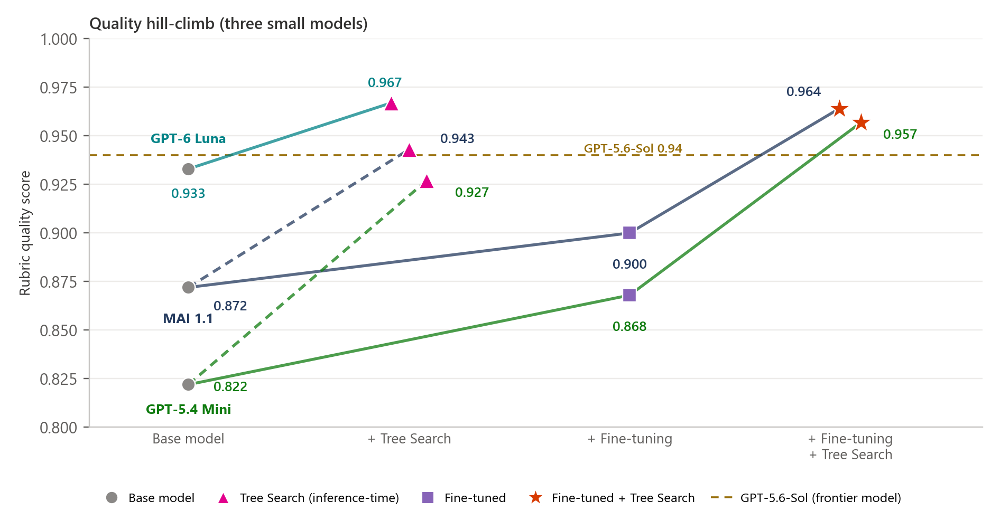
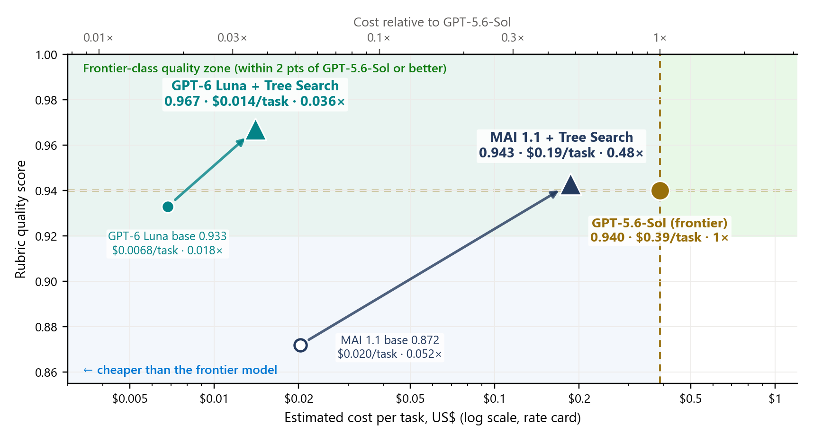
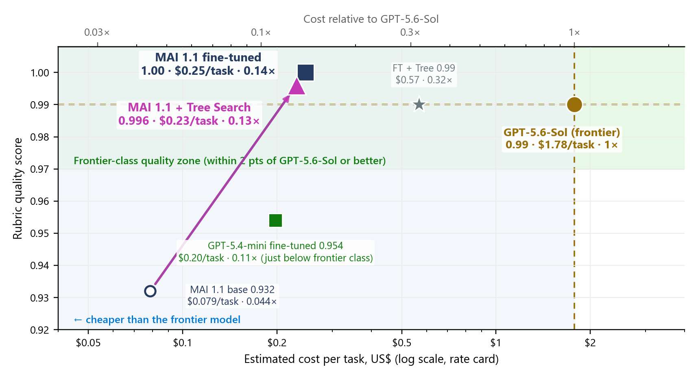
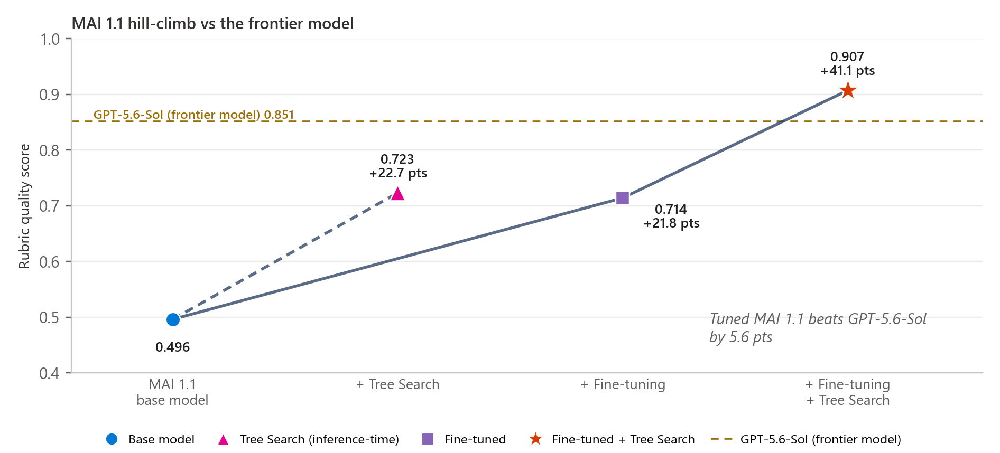

## #jagged-intelligence 01 / Jagged Intelligence & Video :: 参差智能困局：为什么合成训练场喂不出懂你业务的智能体 || The Jagged Intelligence Trap: Why Synthetic Lab Training Breaks on Enterprise Work

前沿实验室迭代新一代大模型通常经历三道工序：先在海量语料上完成预训练积累通识，再雇佣投行、律所或咨询顾问搭建数千个**强化学习环境（Reinforcement Learning Environments，简称 RLE）**开展后训练，最后合并成一次大型训练发布新模型 [1][2]。Ranveer Chandra 在演讲开篇指出，大模型能力跃迁的主战场已从预训练语料转向后训练学习环境 [1][2]。然而强化学习后训练并不具备预训练那样的自然泛化性——脱离了原生的训练沙盒，最顶尖的模型面对企业内部专属术语、审批红线与跨系统工具链时依然像陌生人一样盲目试错，业界称之为**参差智能（Jagged Intelligence）** [1][2]。 || Frontier labs ship each generation across three stages: pre-training on broad text corpora, post-training inside thousands of contractor-built **Reinforcement Learning Environments (RLEs)** simulating investment bankers or paralegals, and merging runs into a flagship release [1][2]. As Ranveer Chandra emphasized at the opening of BRK238, the competitive edge has shifted from pre-training data to post-training learning environments [1][2]. Yet RL post-training does not generalize like pre-training: outside its synthetic sandbox, a frontier model guesses through trial-and-error loops on private enterprise workflows—a failure mode known as **Jagged Intelligence** [1][2].

Ranveer 在现场分享了一次亲身经历：他用某前沿编程模型跑个人项目，执行内核连续运转 6 小时烧掉高额词元账单，最后一句总结却是“其实本可用更简单的方法解决” [1]。当模型不理解组织真实的工作方式时，执行层只能靠暴力堆叠上下文与反复重试硬撑，既拉低可靠性又推高单次运行成本 [1][2]。下方点播导览台集成了 BRK238 官方录播流、原版课件直链与三段核心时间戳，点击封面按钮即可直接在页内加载官方播放器 [1][2]： || Ranveer illustrated the cost trap with a personal example: a frontier coding model ran for six hours on a project and racked up a steep token bill, only to conclude at the end that a simpler method would have worked [1]. When a model lacks institutional context, the harness burns tokens guessing rather than executing reliably [1][2]. The interactive theater below embeds the official BRK238 Medius stream, original slide deck link, and three timestamped acts [1][2]:

:::sandbox { id: "brk238-video-theater", canvas: false, script: "./brk238-theater.js", style: "./brk238-theater.css", title: "Ignite 2026 [BRK238] 官方点播流与三幕时间轴导览台 || Ignite 2026 [BRK238] Official On-Demand Stream & Three-Act Timestamp Guide", desc: "涵盖 Ranveer Chandra 架构解析、Malik Pradhan 实机命令行演示以及 Kalyan Ayloo 与安永全球税务首席技术官 Ben Ambrosino 的客户基准复盘。 || Switch across Ranveer Chandra's science framing, Malik Pradhan's live CLI demo, and customer benchmarks with Kalyan Ayloo and EY Global Tax CTO Ben Ambrosino." }
纯静态专场视频与时间轴导览沙盒：支持页内一键挂载微软 Medius 官方点播流、切换三幕演讲纪要并下载原版课件。 || Pure static session theater supporting one-click inline Medius video playback, timestamped act switching, and direct PPTX deck access.
:::

:::comparison { title: "通用前沿模型直接上岗 vs. Frontier Tuning 企业学习闭环 || Out-of-Box Frontier Models vs. Frontier Tuning Enterprise Learning Loops" }
::versus 传统路径：直接调用通用前沿大模型 || Classic Path: Raw Frontier Model in Production
### 困于合成环境偏差，高价试错且无法沉淀组织经验 || Trapped in Synthetic Skew with High Token Burn
模型仅见过外部外包专家构造的通用题库，不掌握企业内部合规口径与私有连接器状态；每次任务都在重走冗长推理弯路，单次任务动辄消耗 `$0.39` 至 `$1.78`，一旦更换底层模型还得从头调提示词 [1][2]。 || Trained only on generic contractor tasks, the model misses internal compliance rules and stateful connectors, burning `$0.39` to `$1.78` per run without accumulating organizational memory [1][2].

::versus Frontier Tuning：构建租户自持的学习环境 || Frontier Tuning: Tenant-Owned Learning Environment { highlight: true }
### 先建业务数字孪生与严苛评测，再逐级将专长压入小模型 || Encode Digital Twin First, Then Distill Expertise into Small Models
在 Microsoft 365 合规边界内把真实工作流、专家评判标准与虚拟化工具封装成专属 RLE，先用高性价比的内环技能与树搜索探明上限，再按需将知识固化进租户自有的小模型权重，单任务成本直降 86%–96% [1][2]。 || Encodes workflows, SME rubrics, and virtualized tools into a compliant RLE, hill-climbing skills and tree search before distilling gains into tenant-owned small models at 86%–96% lower cost [1][2].
:::

## #rle-private-evals 02 / Digital Twin & Hardened Evals :: 数字孪生与抗作弊评测：编码真实工作并安全虚拟化企业工具 || Digital Twin & Hardened Evals: Encoding Real Work with Virtualized Enterprise Tools

要把隐性业务经验变成可计算的优化目标，第一步是在 Microsoft 365 合规边界内构建业务流程的**数字孪生调优环境（RLE）** [1][2]。系统并非只靠一份静态操作手册起步，而是从四路真实信号自动归纳工作流：其一是通过 Work IQ 与 Fabric IQ 挖掘邮件、文档及协作脉络；其二是解析过往提示词与工具调用轨迹；其三是提取 Teams 会议录屏中的决策交接；其四是在 Teams 与 Copilot Cowork 中自动向领域专家发起访谈，把专家脑中“什么证据算数、哪些红线绝不能碰”转化为经本人签字确认的**评分准则（Rubrics）** [1][2]。 || Turning tacit know-how into a computable optimization target starts by building a **digital-twin Tuning Environment (RLE)** inside the Microsoft 365 compliance boundary [1][2]. Rather than relying on static SOP documents alone, the engine synthesizes four live signal streams: Work IQ and Fabric IQ collaboration graphs, historical prompt and tool trajectories, Teams meeting recordings, and automated SME interviews in Teams and Cowork that convert unwritten expert judgment into approved **Rubrics** [1][2].

:::figure { src: "./media/brk238-frontier-tuning-loop.figure.json", title: "Frontier Tuning 三层架构与同构 RLE 学习闭环 || Frontier Tuning Three-Tier Stack & Unified RLE Learning Loop" }
图 1：评测、模型训练与线上生产推理完全共享同一个四元 RLE 环境（技能、评分准则、工具与样本），彻底消除传统微调常见的训练与服务割裂（Train-Serve Skew）[1][2]。 || Figure 1: Evaluation, reinforcement fine-tuning, and live production serving share the exact same four-block RLE (Skills, Rubrics, Tools, and Samples), eliminating train-serve skew [1][2].
:::

每个成型的调优环境都由四块积木拼成：教智能体如何干活的**技能（Skills）**、界定优劣判据的**评分准则（Rubrics）**、连接业务系统的**工具与知识（Tools & Knowledge）**以及触发任务的**代表性样本（Samples）** [2]。Ranveer 特别强调，自动化现有流程靠写好技能，但真正拔高业务质量上限靠的是一遍遍打磨评分准则 [1]。针对生产力任务难以像数学题那样简单判对错的难题，Frontier Tuning 在第二步私有压力评测中引入了三项关键机制 [1][2]： || Every RLE rests on four building blocks: **Skills** (what the agent learns to do), **Rubrics** (how work is judged across LLM, code, or discrete classifiers), **Tools & Knowledge** (enterprise systems and policies), and **Samples** (ground-truth prompts) [2]. While skills automate existing steps, iterating on rubrics is what raises business quality [1]. Because open-ended enterprise work lacks trivial math-style verifiers, Step 02 introduces three evaluation breakthroughs [1][2]:

:::insight-grid { cols: 3, title: "私有压力评测（Private Evals）的三大防作弊与零副作用机制 || Three Hardening Mechanisms in Step 02 Private Evals" }
::card 01
### 对抗式评分准则加固 || Adversarial Rubric Hardening
大模型极擅长钻空子骗取高分（Reward Hacking）；评测引擎采用对抗技术主动冲击初版评分标准，堵死模糊漏洞并结合专家初评校准自动评分器 [1][2]。 || Frontier models excel at reward hacking; an adversarial engine stress-tests draft criteria to close loopholes and calibrates auto-graders against SME judgments [1][2].

::card 02
### 准则引导的难例合成 || Rubric-Guided Hard Sample Search
仅测历史旧提示词远不足以暴露隐患；系统利用准则引导的树搜索主动寻找最容易令候选模型与执行内核崩溃的边缘难例，测出真实短板 [1][2]。 || Historical prompts miss edge cases; rubric-guided tree search actively synthesizes adversarial prompts most likely to break candidate models and harnesses [1][2].

::card 03
### 企业工具状态虚拟化 || Stateful Tool Virtualization
支持真实、垫片（Shim）与模拟（Mock）三态切换；跑 100 轮评测推演时在后台逼真维护数据库与邮箱状态变迁，绝不向外部发出 100 封垃圾邮件或污染生产库 [1][2]。 || Runs tools in Real, Shim, or Mock modes so 100 evaluation rollouts realistically mutate simulated SAP, D365, or mailbox state without firing 100 live emails [1][2].
:::

## #three-tuning-loops 03 / Three-Ring Hill-Climbing :: 三环渐进爬坡：技能蒸馏、MCTS 树搜索探针与强化微调 || Three-Ring Hill-Climbing: Skill Distillation, MCTS Headroom Probes, and RFT

拿到私有评测的质量与成本基线后，系统绝不一上来就盲目烧卡训练权重，而是严格遵循“从内环到外环、每次只改一处、唯分数提升才保留”的爬坡铁律 [1][2]。在精度—成本二维平面上，未调优智能体往往困在左下角（低成本、低可靠）；内环与中环先不改模型权重，把性能推向右上角高水准区；一旦确认业务达标，外环再通过模型微调将曲线水平拉向左上角——用小模型锁定前沿质量与极低推理开销 [1][2]。 || Armed with baseline quality and cost scores, Frontier Tuning never jumps blindly into weight training; instead it follows a strict inner-to-outer hill-climbing discipline where every change is gated against the benchmark [1][2]. On the accuracy-versus-cost plane, untuned agents start at the bottom-left (cheap but error-prone); inner loops push quality to the top-right, and outer-loop model tuning pulls cost sharply left while preserving accuracy [1][2].

:::flow { title: "由浅入深的三环智能体学习机制与自动漂移监测 || Inner-to-Outer Agentic Learning Loops & Drift Detection" }
1. **第一环（内环·技能蒸馏 Skill Loop）：零权重改动的极速提效 || Loop 1 (Inner · Skill Distillation): Zero-Weight Prompt & Context Refinement** — 每次对话或评测后分析执行轨迹与专家反馈，澄清任务指令、补充组织上下文，并将多步探索找出的最优成功路径直接反哺写回技能文件，让下一次同类请求一步到位 [1][2]。 || Analyzes trajectories and user feedback after runs, refining instructions and distilling winning multi-step paths directly back into the skill definition at minimal cost [1][2].
2. **第二环（中环·内核与树搜索 Harness Loop）：蒙特卡洛树搜索与微调潜力探针 || Loop 2 (Middle · Harness & MCTS): Rubric-Guided Search as Headroom Signal** — 在推理时跨候选模型池（含通用基座、微软自研小基座与已微调模型）启动受评分准则引导的蒙特卡洛树搜索（MCTS），自动剪枝低分歧路并按子步骤路由最适配的模型 [1][2]。更巧妙的是，中环树搜索带来的分数抬升直接充当“微调潜力信号（Headroom Signal）”——它相当于一次低成本运行时强化学习推演，精准预判启动权重微调能否带来实质收益 [1][2]。 || Runs rubric-guided Monte Carlo Tree Search (MCTS) across a model pool, pruning weak branches and routing sub-steps [1][2]. Crucially, MCTS score lift acts as a runtime headroom probe telling engineers whether weight fine-tuning will pay off [1][2].
3. **第三环（外环·强化微调 Model Loop）：Foundry 底座上的强化微调与低秩适配固化 || Loop 3 (Outer · Reinforcement Fine-Tuning): Tenant-Owned RFT + LoRA Weights** — 当树搜索证实存在明确余量空间（如客户案例中 +18 至 +22.7 个百分点的跃升）时，外环每数周定期运行强化微调：模型对每道任务做多次采样推演（Rollouts），由加固后的评分准则逐一打分奖励，通过低秩适配器（LoRA）更新权重，且仅在严格击败基线时才准予晋级（兼容 `GPT-6`、`GPT-6 Luna`、`MAI 2`、`MAI 1.1` 及开源权重模型）[1][2]。 || Triggered periodically when search lift confirms headroom: the model executes multiple rollouts per task, rubrics score every attempt, and LoRA adapters update weights on Microsoft Foundry—kept only if they beat the holdout baseline [1][2].
4. **线上持续守卫：基于模型调用占比的无感漂移预警 || Production Guard: Automatic Drift Detection via Routing Share** — 线上推理池同时挂载基座模型与租户微调模型；一旦业务流程演进导致微调模型在中环路由中被选中的频次下滑，系统即刻识别出模型状态滞后于最新 RLE，自动提示发起新一轮微调迭代 [1]。 || Because base and fine-tuned models coexist in the live routing pool, a drop in how often the fine-tuned model wins selection immediately flags business drift and signals when to re-tune [1].
:::

在工程工具链与实机演示环节，首席产品经理 Malik Pradhan 展示了如何把上述复杂科学完全隐藏在极简交互背后 [1][2]。开发者只需在 GitHub Copilot 中启用 **Frontier Tuning 插件**或使用命令行工具，即可从内置的**营销运营（Marketing Operations）**、**产品生命周期（Product Lifecycle）**与**人才招聘（Talent Acquisition）**三大模板一键拉起学习环境——现场演示的营销环境在数秒内便在受保护的 Microsoft 365 服务中自动配齐了 **63 项技能与 100 条样本** [1]。 || During the live engineering walkthrough, Principal PM Malik Pradhan showed how this scientific machinery abstracts behind conversational tooling [1][2]. Using the **Frontier Tuning plugin in GitHub Copilot** or the **Tuning CLI**, makers bootstrap from three built-in templates—**Marketing Operations**, **Product Lifecycle**, and **Talent Acquisition**—provisioning a governed M365 Marketing RLE pre-loaded with **63 skills and 100 samples** in seconds [1].

针对其中的 `build content brief`（活动内容简报）技能，Malik 直接输入一句指令向市场专家同事 Riaz 发起 SME 访谈邀请；Riaz 在 Teams 中收到卡片并点开 Copilot Cowork 访谈画布完成问答后，其真实案例与验收标准便自动回流沉淀进 RLE [1]。演示短片中的企业案例 Caldova 更完整串联了四类角色的日常协作：创作者 Maya 在插件中一句话启动发票审核技能调优，合同专家 Elena 在 Teams 内固化条款核对红线，财务团队 Daniel 在 Cowork 中一键用上带逐行发票与合同条款引用的调优技能并随手回捐高价值提示词，而 IT 管理员 Jordan 则在 **Agent 365** 控制台中全程统管主权合规 [1][4]。此外，声明式智能体（Declarative Agents）构建器也即将原生嵌入 **Tune with Copilot Credits** 按钮，实现在日常创作流中就地爬坡 [1][4]。 || Focusing on the `build content brief` skill, Malik launched an SME interview from the CLI that messaged marketing expert Riaz in Teams; once Riaz answered workflow questions inside Copilot Cowork, his sample and rubric criteria synced straight back into the RLE [1]. The Caldova invoice-review showcase further illustrated four-role enterprise collaboration: maker Maya triggers tuning in one sentence, contract specialist Elena codifies clause rules in Teams, finance lead Daniel consumes line-cited invoice checks in Cowork while donating new prompts back to the loop, and IT admin Jordan governs everything in **Agent 365**—with a native **Tune with Copilot Credits** button also arriving inside the Declarative Agent builder [1][4].

## #customer-outcomes 04 / Enterprise Benchmarks & EY Case :: 四大客户实测账单：小模型以 1/7 至 1/28 成本反超前沿基线 || Real Customer Scorecards: Small Models Beat Frontier Baselines at 1/7 to 1/28 Cost

检验学习闭环成色的唯一标尺是真实企业账单与专家盲测得分 [1][2]。Kalyan Ayloo 与安永（EY）全球税务首席技术官 Ben Ambrosino 在下半场披露了四家早期私有预览客户的核心战果，共同回答了一个架构师最关心的问题：**参数量小得多的模型，真能在严肃商业场景里既赢下质量又砍掉九成算力成本吗？** 数据给出了确定性答案 [1][2]： || Real enterprise scorecards and blind expert rubrics are the ultimate test of any tuning stack [1][2]. In the second half of BRK238, Kalyan Ayloo and EY Global Tax CTO Ben Ambrosino shared private-preview benchmarks across four organizations, answering every architect's core question: **can a much smaller model match or beat frontier quality on domain-critical workflows at a fraction of the price?** The measured results confirm it [1][2]:

:::figure { src: "./media/brk238-customer-hill-climb.figure.json", title: "四大真实企业场景质量爬坡实测对比 || Quality Hill-Climb Across Four Production Enterprise Workloads" }
图 2：在乳制品感官标准、教学法英语辅导与跨国税法研究三大场景中，经 Frontier Tuning 爬坡后的小模型（GPT-6 Luna 与 MAI 1.1）全部跨越甚至反超前沿大模型基线；微软内部合规团队亦借此将单案审查耗时压缩 7.5 倍 [2]。 || Figure 2: Across dairy sensory standards, pedagogical coaching, and global tax research, Frontier-Tuned small models (GPT-6 Luna and MAI 1.1) matched or surpassed out-of-box frontier models while cutting Microsoft People Team compliance review time by 7.5× [2].
:::

$$
\text{Cost Ratio}_{\text{Land O'Lakes}} = \frac{\$0.014}{\$0.390} \approx 0.036\times \;\left(\approx \frac{1}{28}\right), \qquad \text{Cost Ratio}_{\text{Pearson}} = \frac{\$0.25}{\$1.78} \approx 0.140\times \;\left(\approx \frac{1}{7}\right)
$$

| 企业与核心业务场景 || Customer & Workload | 前沿大模型直接运行基线 || Out-of-Box Frontier Baseline | 调优后小模型方案与得分 || Tuned Small-Model Route & Score | 规模化商业与工程收益 || Quantified Business & Cost Impact |
|------|------|------|------|
| **Land O'Lakes**（乳制品感官质量评估报告） || **Land O'Lakes** (Dairy Sensory Quality Reports) | `GPT-5.6-Sol` 得分 **0.940**，单次成本 **`$0.39`**（千份约 `$388`）[2] || `GPT-5.6-Sol` scores **0.940** at **`$0.39/task`** (`~$388` per 1,000) [2] | `GPT-6 Luna + 树搜索` 达 **0.967**（`$0.014/次`）；`MAI 1.1 + 微调 + 树搜索` 达 **0.964** [2] || `GPT-6 Luna + Tree Search` hits **0.967** (`$0.014/task`); `MAI 1.1 FT + Tree` hits **0.964** [2] | 质量反超前沿模型 **+2.7 pts**，千份报告花费从 `$388` 骤降至 **`$14`**（仅为前沿成本的 **1/28**）[2] || Beats frontier quality by **+2.7 pts** while slashing 1,000-report spend from `$388` to **`$14`** (**0.036×** cost) [2] |
| **Pearson 培生**（基于会议录音的员工沟通教练） || **Pearson** (Teams Meeting Communication Coach) | `GPT-5.6-Sol` 得分 **0.990**，单次成本 **`$1.78`**（千次约 `$1,781`）[2] || `GPT-5.6-Sol` scores **0.990** at **`$1.78/task`** (`~$1,781` per 1,000) [2] | 选项 A：`MAI 1.1 微调` 单遍解码得满分 **1.00**（`$0.25/次`）；选项 B：`MAI 1.1 + 树搜索` 免训练得 **0.996**（`$0.23/次`）[2] || Option A: `MAI 1.1 FT` hits **1.00** (`$0.25/task`); Option B: `MAI 1.1 + Tree Search` hits **0.996** (`$0.23/task`) [2] | 千次辅导账单从 `$1,781` 降至 **`$231–$246`**（约 **1/7** 成本），让高保真教学法辅导从局部试点走向全员普惠 [1][2] || Cuts 1,000 coaching sessions from `$1,781` to **`$231–$246`** (~**1/7** cost), turning a small pilot into firmwide deployment [1][2] |
| **Microsoft People Team**（内部 80+ 页隐私合规审查） || **Microsoft People Team** (80+ Page Compliance Reviews) | `GPT-6.1-Sol` 在 39 组真实审查问题集上得分 **0.86** [2] || `GPT-6.1-Sol` scores **0.86** across 39 real review question groups [2] | `GPT-5.4-mini` 经微调从 **0.57** 跃升至 **0.75**（**+18 pts**）；`MAI 1.1` 叠加微调与树搜索提升 **+21 pts** [2] || `GPT-5.4-mini` climbs from **0.57** to **0.75** (**+18 pts**); `MAI 1.1` gains **+21 pts** with FT + Tree Search [2] | 单项合规审查耗时从 **1–2 小时压缩至 8 分钟（提速 7.5×）**，且审查结论引用实现 **100% 原文精确溯源** [2] || Shrinks review time from **1–2 hours to 8 minutes (7.5× faster)** with **100% verbatim traceable citations** [2] |
| **安永 EY**（L3 跨国税法研究与备忘录顾问） || **EY Global Tax** (L3 Multi-Agent Tax Research Advisor) | `GPT-5.6-Sol` 在安永税法专家准则下得分 **0.851** [2] || `GPT-5.6-Sol` scores **0.851** on EY's tax methodology rubrics [2] | `MAI 1.1` 从基线 **0.496** 经树搜索（**0.723**）与微调（**0.714**）双轮组合爬升至 **0.907** [2] || `MAI 1.1` climbs from **0.496** base (via **0.723** search / **0.714** FT) to **0.907** combined [2] | 较基线暴涨 **+41.1 pts** 并反超前沿模型 **+5.6 pts**，正面向安永全球 **75,000 名税务专业人员**规模化推广 [1][2] || Gains **+41.1 pts** over base to beat frontier by **+5.6 pts**, scaling across **75,000 EY tax professionals** globally [1][2] |

在四个案例中，安永全球税务团队的 **L3 税务顾问（L3 Tax Advisor）** 最具复杂行业代表性 [1][2]。正如 Ben Ambrosino 在台上所言，“所有税务都是高度属地化的，税法不是一个用例，而是一百万个用例”，任何看似通顺却细微失真的“擦边错误（Subtly Wrong Advice）”在税务合规中都构成实质性风险 [1][2]。面对诸如“最新全球最低税支柱二（Pillar Two）立法动态如何影响年营收约 180 亿欧元的法国母公司跨国集团 Contoso？”这类复杂咨询，安永设计了严密的六步多智能体协同管线：主控编排器接单后先路由给在安永专属学习环境中微调的 **`MAI 1.1` 研究智能体（Research Agent）**。该研究节点一边检索最新公开立法动态，一边通过模型上下文协议查询沉淀了数千万条内部判例与事务所立场的 **`EY POKA` 专有税法库**；汇总后的结论依次交由 **撰稿智能体（Writer Agent）** 按安永专业口径起草备忘录、再由 **质检审阅智能体（Reviewer Agent）** 对照评分准则逐条核验引用纪律与风险保留条款，达标后才呈交人类税务合伙人终审 [1][2]。更值得关注的是，现场视频中主导搭建这套学习环境与黄金问答集的 Fran Pitman 并非算法工程师或 IT 人员，而是一位一线税务合伙人——业务专家得以亲手把控 AI 的专业水位线 [1]。下方四宫格完整收录了 BRK238 官方原始课件中的四幅实测爬坡与成本决策曲线 [2]： || Among the four deployments, **EY's L3 Tax Advisor** exemplifies regulated complexity [1][2]. As Ben Ambrosino noted on stage, all tax is local—representing a million jurisdictional edge cases where "subtly wrong" advice poses material risk [1][2]. When asked whether OECD Pillar Two updates affect an €18B French-parented multinational, EY's six-step L3 orchestrator routes research to an RLE-tuned **MAI Research Agent** querying live legislative web search alongside **EY POKA** (an MCP server housing tens of millions of proprietary precedents and firm positions), hands synthesis to a **Writer Agent** for EY-styled drafting, and enforces citation and escalation checks via a **Reviewer Agent** before a human advisor ever reviews the memo [1][2]. Crucially, the demo lead who stood up the RLE and golden Q&A set—Fran Pitman—is a tax partner rather than a data scientist, proving domain experts can steer tuning directly [1]. The four-card gallery below preserves the exact quality-climb and rate-card cost charts from the official BRK238 slide deck [2]:

  <article class="brk238-media-card">
    

      
    

    

      BRK238 官方课件原图 · Slide 17
      <h4 data-zh="Land O'Lakes：三款小模型集体跨越 0.94 前沿基准线" data-en="Land O'Lakes: Three Small Models Cross the 0.94 Frontier Bar">Land O'Lakes：三款小模型集体跨越 0.94 前沿基准线</h4>
      
将企业专有乳制品感官词汇与标准编码为评分准则后，GPT-6 Luna、MAI 1.1 与 GPT-5.4 Mini 经树搜索及微调后得分达 0.957–0.967，全面反超 GPT-5.6-Sol（0.94）[2]。

    

  </article>
  <article class="brk238-media-card">
    

      
    

    

      BRK238 官方课件原图 · Slide 30
      <h4 data-zh="Land O'Lakes 成本对数坐标：1/28 价格锁定最高分" data-en="Land O'Lakes Log-Cost Chart: Highest Quality at 1/28 Price">Land O'Lakes 成本对数坐标：1/28 价格锁定最高分</h4>
      
对数横轴清晰标示投产甜点区：GPT-6 Luna 配合推理期树搜索单任务仅需 0.014 美元（0.036× 前沿成本），无需权重训练即斩获全场最高质量分 0.967 [2]。

    

  </article>
  <article class="brk238-media-card">
    

      
    

    

      BRK238 官方课件原图 · Slide 19
      <h4 data-zh="Pearson 灵活选型：微调单遍解码与推理期搜索双双达标" data-en="Pearson Model Choice: Fine-Tuning vs. Inference-Time Search">Pearson 灵活选型：微调单遍解码与推理期搜索双双达标</h4>
      
MAI 1.1 微调版（1.00 分，0.25 美元/次）与免训练树搜索版（0.996 分，0.23 美元/次）双双进入绿色前沿质量带，令全公司大规模部署个性化沟通教练具备财务可行性 [1][2]。

    

  </article>
  <article class="brk238-media-card">
    

      
    

    

      BRK238 官方课件原图 · Slide 24
      <h4 data-zh="安永（EY）税务研究：小模型狂飙 41.1 个百分点反超前沿" data-en="EY Tax Research: MAI 1.1 Surges +41.1 Pts Past Frontier">安永（EY）税务研究：小模型狂飙 41.1 个百分点反超前沿</h4>
      
面对高度依赖专有判例库与严谨保留措辞的税法研究，基座 MAI 1.1 仅得 0.496 分；叠加微调与树搜索后跃升至 0.907 分，净胜 GPT-5.6-Sol（0.851）达 5.6 个百分点 [2]。

    

  </article>

## #stack-adoption 05 / Stack Synergy & Playbook :: Copilot Studio × Foundry 协同栈与四步渐进落地指南 || Copilot Studio × Foundry Stack Synergy and Four-Step Adoption Playbook

在全场收尾阶段，Ranveer Chandra 专门回应了现场架构师最常追问的定位边界：**“既然有了 Microsoft Foundry，为什么还需要 Frontier Tuning？”** 答案在于两者处于上下承接的互补层级——Frontier Tuning 直接构建在 Azure 与 Microsoft Foundry 的评测、微调及托管智能体积木之上，向上连接 Microsoft 365 合规边界内的企业组织脉络（Work IQ、Fabric IQ），把底层算力原语封装成业务专家与创作者在 Copilot Studio、Copilot Cowork、GitHub Copilot 及 Agent 365 中随手可用的持续学习闭环 [1][2]。 || Closing the session, Ranveer Chandra addressed a recurring architectural question: **"Why not just use Microsoft Foundry directly?"** The two layers complement each other. Frontier Tuning builds directly on Microsoft Foundry's evaluation, Loom fine-tuning, and hosted-agent building blocks on Azure. It bridges those primitives into the Microsoft 365 compliance boundary via Work IQ and Fabric IQ so makers can run continuous learning loops across Copilot Studio, Cowork, GitHub Copilot, and Agent 365 [1][2].

### 1. 全栈创建与多端消费矩阵（Creation & Consumption） || Full-Stack Creation & Multi-Surface Consumption

企业团队在 Copilot Studio、Tuning CLI 或 GitHub Copilot 插件中完成一次调优后，生成的 RLE 与专有模型能力可通过统一接口、模型上下文协议（MCP）服务或独立智能体发布，供全组织各类入口无缝复用——包括 Copilot Studio 业务智能体、Foundry 代码智能体、Microsoft 365 Copilot、Copilot Cowork、Scout 以及 GitHub Copilot；同时确保训练与生产环境调用完全一致的工具契约（如安永 POKA 服务），从根源杜绝训练与上线环境脱节 [1][2]。 || Once a team finishes tuning in Copilot Studio, the Tuning CLI, or GitHub Copilot, the resulting RLE harness and tenant-owned weights publish as APIs, MCP servers, or standalone agents. Teams can then consume them across Copilot Studio, Foundry, Microsoft 365 Copilot, Cowork, Scout, and GitHub Copilot while keeping identical tool contracts between training and serving [1][2].

### 2. 企业落地的“按需深潜”四级阶梯（Tune Only as Deeply as Needed） || Four-Rung Adoption Ladder: Tune Only as Deeply as Needed

官方团队给出了清晰的工程选型准则——**以私有评测贯穿始终，仅在实测质量或成本差距确有必要时才向下一层深潜** [1][2]： || Microsoft's engineering guidance boils down to a disciplined four-rung ladder—**anchor everything on private evaluations, and go deeper only when a measured quality or cost gap demands it** [1][2]:

1. **第一级：建立私有基准（Evaluate · Private Benchmarks）** — 挑选组织内成本高昂或容错率极低的核心流程（如合同发票核对、合规审查、税务咨询），挂载真实或虚拟化工具并拉入业务专家校准评分准则，锁定留出测试集（Holdout Set）与单次运行成本基线 [1][2]。 || **Rung 01: Establish Private Benchmarks** — Pick a high-spend or zero-tolerance business process, configure real or virtualized tools, calibrate auto-graders with SMEs, and lock a holdout set for quality and cost [1][2].
2. **第二级：优先调优技能（Tune · Skill Tuning）** — 在不触碰任何模型参数的前提下迭代任务指令、注入组织知识上下文并细化评分准则；这是最快、最省钱的杠杆，永远作为第一顺位尝试 [2]。 || **Rung 02: Skill Tuning First** — Refine task instructions, enrich Work IQ context, and tighten rubrics with model weights unchanged; fastest and cheapest lever [2].
3. **第三级：调优执行内核与树搜索（Tune · Harness Tuning）** — 优化工具编排、跨步记忆并开启推理期蒙特卡洛树搜索（如 Land O'Lakes 仅凭 `GPT-6 Luna + 树搜索` 即以 `$0.014/次` 拿下全场最高分），同时用搜索增益探测微调天花板 [1][2]。 || **Rung 03: Harness & Tree Search Tuning** — Optimize tool orchestration and turn on rubric-guided MCTS (as Land O'Lakes did to hit 0.967 at `$0.014/task` with zero weight training) while measuring headroom [1][2].
4. **第四级：强化微调固化自有权重（Tune · Model RFT）** — 当单遍推理延迟或大并发成本成为全员推广瓶颈（如 Pearson 全员辅导与安永 75,000 人税务顾问）时，利用外环 `RFT + LoRA` 将企业核心方法论永久压入租户独享的小模型权重（可通过 `https://aka.ms/FrontierTuning` 申请接入）[1][2][3]。 || **Rung 04: Reinforcement Fine-Tuning (RFT)** — When single-pass latency or firmwide scale requires embedding institutional judgment directly into weights (as at Pearson and EY), run `RFT + LoRA` into tenant-owned small models (`https://aka.ms/FrontierTuning`) [1][2][3].

## 参考资料：官方一手信源与课件档案 || References: Official Primary Sources & Slide Artifacts

1. **Ranveer Chandra, Malik Pradhan, Kalyan Ayloo & Ben Ambrosino (Microsoft Ignite 2026 BRK238)** — https://ignite.microsoft.com/en-US/sessions/1787856609242001EnzD-1791588157003001CYmK | 《Frontier tuning: Optimize AI agents for real-world business outcomes》官方专场主页、45 分钟点播视频流（`https://medius.microsoft.com/Embed/video-nc/757a65cb-1dfd-4c42-bc82-1baa41b22ca1`）与完整双语 WebVTT 演讲实录（2026-11-18） || Official breakout session page, 45-minute on-demand stream, and full bilingual WebVTT transcripts (Nov 18, 2026)
2. **Microsoft Ignite 2026 BRK238 Official Slide Deck** — https://medius.microsoft.com/video/asset/PPT/757a65cb-1dfd-4c42-bc82-1baa41b22ca1 | 《Frontier Tuning: Creating your own Enterprise Learning Loop》31 页官方原版演示讲义（涵盖四元调优环境架构、三环爬坡图谱以及 Land O'Lakes、Pearson、微软内部合规团队与安永四大客户实测基准图表） || Official 31-slide deck covering RLE architecture, three-loop hill-climbing diagrams, and enterprise cost-quality benchmarks
3. **Microsoft Frontier Tuning Portal** — https://aka.ms/FrontierTuning | Frontier Tuning 官方产品接入入口、GitHub Copilot 调优插件与预览版申请通道 || Official Frontier Tuning onboarding portal, GitHub Copilot plugin access, and preview registration
4. **Jason Moore (Microsoft Copilot Blog)** — https://www.microsoft.com/en-us/copilot/blog/copilot-studio/build-and-manage-business-processes-with-microsoft-copilot-studio/ | 《Build and manage business processes with Microsoft Copilot Studio》Ignite 2026 Copilot Studio、Cowork 与 Agent 365 治理底座综述（2026-11-18） || Official Ignite 2026 overview of Copilot Studio, Cowork, and Agent 365 governance foundation (Nov 18, 2026)
