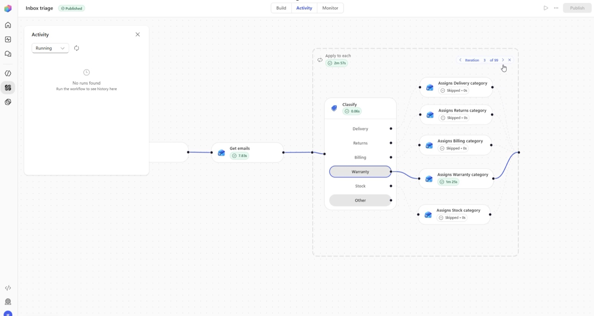
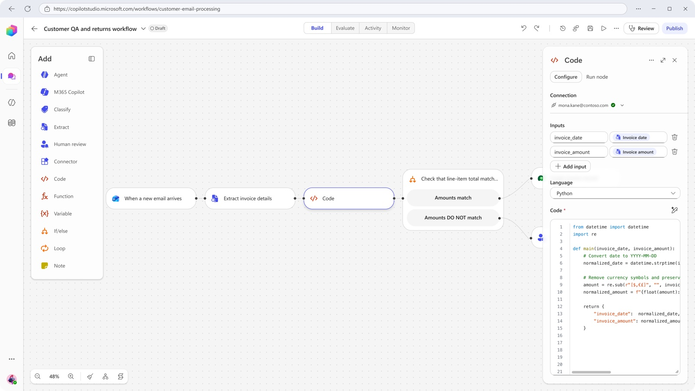
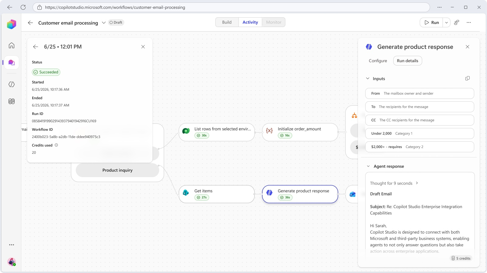
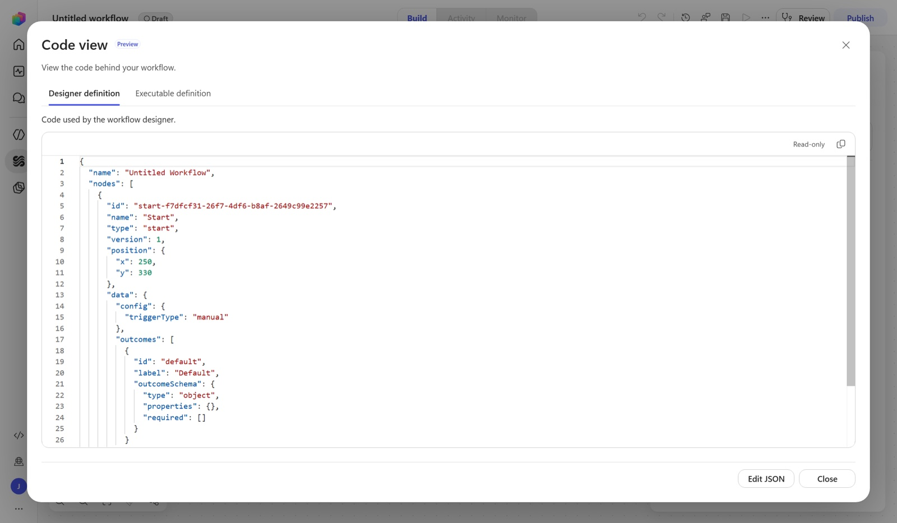

## #automation-imperative 01 / Automation Economics & Guardrails :: 自动化经济账与确定性悖论：为何纯智能体项目面临 40% 撤项红线 || Automation Economics & Determinism: Why Unguarded Agent Projects Risk 40% Cancellation

麦肯锡全球研究院测算显示，利用当今已落地的技术即可将美国约 **57%** 的日常工作时长自动化；若组织围绕员工、智能体与机器人重构业务流程，到 2030 年可释放约 **2.9 万亿美元**经济价值 [1][2]。Joe Fernandez 在开场特别廓清了一个关键边界：自动化 57% 的工时绝不等于裁撤 57% 的岗位，而是把团队从差旅报销核验、会后纪要群发与跨系统手工录单中解脱出来 [1]。以企业最核心的销售角色为例，高德纳（Gartner）调研指出销售代表每月仅有 **14%** 的时间真正花在潜在客户开拓上，大量精力被繁琐的线上搜集与客户关系管理系统手工录入吞噬；智能体则能全天候满负荷（**100%**）接管线索初筛与建档，把面对面解决客户难题的时间还给销售 [1][2]。 || McKinsey Global Institute research shows that **57%** of US work hours could be automated with technology available today, unlocking roughly **$2.9 trillion** in economic value by 2030 when organizations redesign workflows around people, agents, and robots [1][2]. Joe Fernandez opened BRK258 by clarifying that automating 57% of task hours does not replace 57% of jobs; instead, it strips out expense reconciliations, recap emails, and manual data entry [1]. Gartner data illustrates the bottleneck clearly: sellers spend just **14%** of a typical month prospecting because online research and manual CRM updates consume their calendar, whereas an agent can prospect continuously (**100%**) overnight [1][2].

规模扩张的速度同样陡峭。国际数据公司（IDC）预测到 2029 年全球活跃部署的智能体将突破 **10 亿个**（为 2025 年规模的 **40 倍**），每日执行动作高达 **2,170 亿次**；微软《2026 工作趋势指数》亦录得生态内智能体规模同比激增 **15 倍** [2]。然而，缺乏顺序约束与成本护栏的纯智能体试点正撞上残酷的投产高墙：高德纳警告到 2027 年底将有 **超过 40%** 的智能体项目因算力账单失控、业务回报模糊或风控薄弱而被迫关停，并预测到 2030 年 **10%–15%** 的市场份额将专门用于监督其他智能体的“守护智能体” [2]。德勤同样指出，缺乏集中监控的自主代理极易在后台悄然制造难以察觉的业务差错 [2]。 || Scale projections reinforce the urgency. IDC forecasts over **1 billion** active AI agents worldwide by 2029 (**40x** the 2025 baseline) executing **217 billion** actions daily, while the Microsoft 2026 Work Trend Index already tracks **15x** year-over-year agent growth across Microsoft 365 [2]. Yet unguarded agent pilots hit a steep production wall: Gartner warns that **over 40%** of agentic AI projects will be canceled by the end of 2027 due to runaway costs, unclear value, or weak risk controls, projecting that **10%–15%** of the market by 2030 will consist of guardian agents policing other agents [2]. Deloitte likewise notes that unmonitored agents introduce silent mistakes at scale [2].

下方交互导览台内嵌了 BRK258 官方点播流、高清封面、原版 46 页幻灯片直链与六大核心实录时间点，点击右侧章节即可对照查阅 [1][2]： || The interactive navigator below embeds the official BRK258 Medius on-demand stream, session poster, 46-slide PPTX download, and six timestamped transcript milestones [1][2]:

:::sandbox { id: "brk258-video-navigator", canvas: false, script: "./brk258-session-showcase.js", style: "./brk258-session-showcase.css", title: "Microsoft Ignite 2026 [BRK258] 官方点播播放器与时间轴导览 || Microsoft Ignite 2026 [BRK258] Official On-Demand Stream & Timestamp Navigator", desc: "支持在当前卡片一键加载微软官方 Medius 点播视频流，或点击右侧六个实录时间戳快速定位核心架构论点与实机演示环节。 || Load the official Medius video stream inline or click across six transcript timestamps to inspect architectural claims and live demo segments." }
BRK258 官方点播视频与 46 页原版课件交互导览台：涵盖经济账数据、双向编排架构、0.06 秒决策模型与共享邮箱六路分流实机演示。 || Interactive BRK258 video and 46-slide deck navigator covering automation economics, bidirectional architecture, the 0.06s Decision model, and the live six-branch inbox demo.
:::

:::insight-grid { cols: 3, title: "BRK258 盘点的企业五大高价值自动化价值域 || Five Enterprise Value Pillars Highlighted in BRK258" }
::card 01
### 前台营收与客户体验 || Front Office & Customer Experience
覆盖销售线索挖掘、商机建档、订单合同管理与客户支持分流：用智能体阅读多变邮件起草带引用的回复，再用确定性工作流记录工单并升级紧急诉求 [1][2]。 || Spans sales prospecting, order/contract management, and support triage—letting agents draft cited replies while deterministic workflows log tickets and escalate urgent cases [1][2].

::card 02
### 员工体验与供应商协同 || Employee Experience & Partner Supply Chain
贯穿招聘筛选、新员工入职引导、采购付款、库存物料与退货逆向物流，消除跨门户重复填表与供应商邮件手工催办 [2]。 || Streamlines recruiting, onboarding, procurement payments, inventory, and returns management without repetitive portal re-entry [2].

::card 03
### 中后台财务、法务与运维合规 || Back-Office Finance, Legal & IT Ops
聚焦报价到回款、月末结账异动解读、SharePoint 合同条款风险评分与红线批注，在容忍版式变化的同时锁死合规归档与法务审批链路 [1][2]。 || Targets quote-to-cash, month-end KPI variance narratives, and SharePoint contract redlining—combining flexible document comprehension with locked legal routing [1][2].
:::

## #bidirectional-blending 02 / Bidirectional Blending & Economics :: 双向融合架构与计费选型：工作流嵌智能节点 vs 智能体调工作流 || Bidirectional Architecture & Licensing: Agents Inside Workflows vs. Workflows as Tools

Copilot Studio 将企业数字化转型的底座收敛为三块积木：**智能体**负责感知、非结构化推理与自主行动，**工作流**保证可重复、可审计的步骤顺序，**微应用**则提供超越纯文本聊天的标准化录入与数据可视化界面 [1][2][5]。聚焦到智能体与工作流的协同，纯智能体每次达成目标的路径可能随上下文动态变化——这在供应商突然更换发票模板时是优势，但在涉及资金划拨与合规留痕时却是隐患；反之，纯工作流能以零偏差执行固定步骤，可一旦上游输入稍有偏离就会直接报错中断 [1]。Copilot Studio 的解法是支持**正反两个方向的自由组装** [1][2][5]： || Copilot Studio unifies business process transformation around three building blocks: **Agents** for sensing, unstructured reasoning, and action; **Workflows** for repeatable, auditable sequencing; and **Apps** for structured data entry and visual interfaces beyond chat [1][2][5]. Left alone, an agent may take a different path tomorrow than today—great when an invoice template changes unexpectedly, risky when compliance demands a strict sequence; a pure workflow guarantees order but breaks on unexpected deviations [1]. Copilot Studio resolves this tension by supporting **composition in either direction** [1][2][5]:

:::comparison { title: "两种双向组装模式与适用边界 || Two Composable Blending Patterns and Selection Criteria" }
::versus 模式 A：工作流内嵌智能体（Agents Inside Workflows） || Pattern A: Agents Inside Workflows
### 用确定性主干锁死全局顺序，局部外包推理 || Deterministic Spine with Scoped Reasoning Steps
在工作流任意位置插入智能体节点（可直接调用环境内已发布的独立智能体，也在画布内当场新建行内智能体），强制其按结构化格式返回三单匹配结论或回信正文，再交由下游确定性步骤归档或发信 [1][2]。 || Add an existing or inline-built agent as a single step inside a workflow, constrain its output schema (such as clean HTML reply text or three-way invoice match status), and pass results to deterministic downstream actions [1][2].

::versus 模式 B：工作流作为智能体工具（Workflows as Agent Tools） || Pattern B: Workflows as Agent Tools { highlight: true }
### 由智能体主控对话全局，关键路径调确定性工具 || Agent-Led Orchestration Calling Guaranteed Sub-Flows
在智能体的工具（Tools）配置页挂载工作流；何时触发由智能体结合对话意图自主判断，但一旦触发，内部每一步数据写入、通知与审批都严格按工作流预设轨迹执行，绝不跳步跑偏 [1][2]。 || Attach a workflow on the agent's Tools page; the agent decides when the user's goal warrants calling it, while the workflow guarantees every underlying write and approval executes in exact order [1][2].
:::

:::figure { src: "./media/brk258-bidirectional-architecture.figure.json", title: "BRK258 智能体自动化三层双向编排拓扑 || BRK258 Three-Layer Bidirectional Agentic Automation Topology" }
图 1：顶层打通自由画布设计器、协同画布与模型上下文协议服务三路入口；中层融合五类原生智能节点与“工作流作工具”反向调用；底层锚定 1,500+ 连接器、服务主体托管及逐动作额度账本 [1][2]。 || Figure 1: Three-layer topology connecting visual Designer, Cowork, and MCP Server entry points on top, five AI workflow nodes plus workflow-as-tool invocation in the middle, and 1,500+ connectors, service principals, and per-action credit metering underneath [1][2].
:::

在展台答疑中，客户提问率最高的问题是：**既有的 Power Automate 云端流与全新的 Copilot Studio 工作流究竟该如何选型，计费又如何核算？** Joe Fernandez 给出了清晰的决策标尺与公开透明的单步定价公式 [1][2]。纯确定性自动化且团队已持有 Power Automate 席位许可时，完全可以继续沿用 Power Automate（其产品线保持长期稳健演进）；但只要业务流程需要深度混编多模态推理智能体、0.06 秒分类节点、文档抽取或计算机操作（Computer Use），并希望统一纳入 **Copilot Credits** 消费池核算（支持预付费额度包或绑定 Azure 订阅按量计费），就应首选 Copilot Studio 工作流 [1][2]： || At the Ignite expo booth, the two most frequent customer questions centered on **Power Automate flows versus Copilot Studio workflows** and **exact credit pricing** [1][2]. Joe Fernandez emphasized that teams running purely deterministic tasks on existing Power Automate licenses should keep using Power Automate; however, end-to-end processes blending multi-file reasoning agents, built-in Classify/Extract/Copilot/Computer Use nodes, and unified **Copilot Credits** licensing (via upfront Prepaid Packs or Azure Pay-As-You-Go) belong in Copilot Studio workflows [1][2]:

| 选型维度 || Selection Dimension | Power Automate 云端流 || Power Automate Flows | Copilot Studio 工作流 || Copilot Studio Workflows |
|------|------|------|
| 最佳适用场景 || Best For | 规则明确、输入高度结构化的纯确定性任务自动化 [1][2] || Reliable deterministic automation of predictable tasks [1][2] | 端到端业务流程重构：在确定性编排主干中混编推理智能体与多模态判断 [1][2] || End-to-end processes combining deterministic orchestration with AI agents [1][2] |
| 原生 AI 能力深度 || Built-in AI Depth | 以轻量提示词（Prompts）文本生成为主 [2] || Focused primarily on standalone AI Builder prompts [2] | 完整智能体节点（最新前沿模型、多文件输入输出、工具与代码）+ 内置 Classify / Extract / Copilot / Computer Use 动作 [2] || Full Agents (latest models, files, tools, code) + Classify, Extract, Copilot, and Computer Use nodes [2] |
| 许可与计费模型 || Licensing & Metering | Power Automate 席位/流程许可 + 提示词附加额度 [1][2] || Power Automate license plus add-on credits for prompts [1][2] | 统一消费模型：非 AI 确定性动作固定 **`0.13 Credit/步`**（约 `$0.0013`）+ 智能体动作按模型/工具/时长计量 [1][2] || Unified Copilot Credits: **`0.13 Credit/action`** (`$0.0013`) for non-AI steps + agent credit consumption [1][2] |
| 开放模板生态 || Community Templates | 传统云端流模板库 || Classic cloud flow templates | 全新开源 **Copilot Studio Gallery**（`microsoft.github.io/copilot-studio-gallery`），汇聚微软官方与署名社区最佳实践 [1][2][3] || New open **Copilot Studio Gallery** featuring credited community and Microsoft reference solutions [1][2][3] |

由于 `1 Copilot Credit` 折合 `0.01 美元`（1 美分），任何不调用人工智能的确定性连接器、条件判断或邮件归档动作仅花费 **`0.0013 美元`** [1]。只有真正触发推理节点时，系统才会叠加模型档位（如轻量模型 GPT-6 Luna 与重型模型 Fable 5.2 的单价差异）、工具调用次数及运行时长消耗 [1][2]： || Because `1 Copilot Credit` equals `$0.01` (one cent), every non-AI connector, condition, or archive action costs just **`$0.0013`** [1]. Credits scale up only on steps where AI reasoning actually runs—governed by model tier (such as lightweight GPT-6 Luna versus frontier Fable 5.2), tool/knowledge calls, and execution duration [1][2]:

$$
C_{\text{workflow}} = 0.13 \times N_{\text{det}} + \sum_{k=1}^{N_{\text{AI}}} f_{\text{agent}}\!\left(\text{Model}_k,\,\text{Tools}_k,\,\text{Time}_k\right), \qquad 1\text{ Credit} = \$0.01
$$

:::figure { src: "./media/brk258-step-economics-latency.figure.json", title: "Copilot Studio 混合工作流单步动作消耗量级对比 || Copilot Studio Workflow Per-Step Credit Consumption Scale" }
图 2：对数标尺下对比专用决策模型极速分类、0.13 Credit 确定性连接器动作、单步智能体回信（5 Credits）、BRK258 实机演示复合 AI 动作（7.29 Credits）与完整多分支运行（20 Credits）的成本梯度 [1][2]。 || Figure 2: Logarithmic cost progression across Decision-model classification, 0.13-Credit deterministic steps, single agent email drafting (5 Credits), BRK258 live demo AI steps (7.29 Credits), and full multi-branch workflow runs (20 Credits) [1][2].
:::

## #smarter-steps-scale 03 / Smarter Steps & Enterprise Scale :: 三大演进路线图：0.06 秒决策模型、行内 Python 与企业级生命周期治理 || Roadmap Deep Dive: 0.06s Decision Model, Inline Python, and Enterprise Scale

全面商用的新版工作流设计器不仅支持自由拖拽画布、水平与垂直布局一键切换、行内协作便签，更引入了极其关键的**单节点就地测试（Node Testing）**——创作者修改某一步智能体指令或分类条件后，无需每次从头触发整条端到端长流程，直接在当前节点内点击运行即可秒级校验输出（例如测试邮件分类节点在 `1.4 秒` 内返回 `Billing` 类别与 `96%` 置信度）[1][2]。在此基础上，BRK258 揭晓了围绕**更聪明步骤（Smarter Steps）**、**规模化投产（Ready to Scale）**与**极速构建（Faster to Build）**铺开的 15 项重磅能力更新 [1][2]： || Now generally available, the rebuilt Workflow Designer pairs a freeform canvas, one-click horizontal/vertical layout toggling, and collaborator notes with **in-place Node Testing**—allowing makers to tweak instructions or models on a single AI step and validate outputs immediately (such as classifying a billing email at `96%` confidence in `1.4 s`) without re-running the entire pipeline [1][2]. Building on this foundation, BRK258 unveiled 15 roadmap updates across **Smarter Steps**, **Ready to Scale**, and **Faster to Build** [1][2]:

### 更聪明步骤：Microsoft-Decision-1.1 分类模型、文件输出与原生 Python 节点 || Smarter Steps: Microsoft-Decision-1.1 Classify, Real File Outputs, and Python Code Node

传统大语言模型就像“散文作家”，每次做简单二选一或路由分拣都要从头自回归生成词元，既慢又贵；而微软在本届大会发布的 **Microsoft-Decision-1.1** 专用小模型更像经验老到的“急诊分诊护士”，专攻文本或图像的多路分类与打分 [1][2]。将其接入工作流 **Classify 节点**（现已正式商用推送）后，单条数据分类耗时骤降至 **`0.06 秒`**，中位延迟比传统大模型**快约 35 倍**、成本**降低 200 倍**，且原生输出校准后的置信度分数（便于配置“低于 85% 置信度自动转人工”护栏）[1][2]。与此同时，**Extract 节点**支持拖入任意样本文件自动生成 PDF、Word、Excel 与演示文稿的结构化抽取指令；**Agent 节点**新增**真实文件输出（Files as output，正式商用推送）**，可直接吐出生成的 `.xlsx` 报表、`.pdf` 证书或 `.pptx` 简报传给下游连接器；**Copilot 节点**打通了对话（Chat）、协同画布（Cowork）与前沿预览的自主领航（Autopilot）三种委派模式；而开启公测的 **Code 节点**则允许直接在画布内嵌入 **Python** 脚本（支持自然语言生成代码）完成正则清洗、日期标准化与复杂金额核对，彻底告别以往为了几行数据转换而专门额外部署云端函数的繁琐链路 [1][2]。 || Whereas a traditional LLM acts like an essay writer generating tokens from scratch, the new **Microsoft-Decision-1.1** model acts like a triage nurse purpose-built for fast, calibrated judgment over text or images [1][2]. Selecting the Decision model inside the **Classify node** (GA rolling out) slashes classification latency to **`0.06 seconds`**—roughly **35x faster** at median (P50) latency and **200x cheaper** than an LLM—while returning a confidence score so flows can escalate items below `85%` certainty [1][2]. Alongside Classify, the **Extract node** turns PDF, Word, Excel, and PowerPoint files into structured schemas from a dropped sample; the **Agent node** now hands back **real files as output** (`.xlsx`, `.pdf`, `.pptx`, `.csv`, GA rolling out) rather than plain text; the **Copilot node** delegates tasks across Chat, Cowork, or Autopilot (Frontier); and the **Code node** (Public Preview) runs **Python** directly inside the workflow canvas for regex cleaning or totals validation without spinning up external Azure Functions [1][2].

### 规模化投产：逐动作额度透视、服务主体接管、环境变量与 JSON 源码视图 || Ready to Scale: Credit Visibility, Service Principals, Env Variables, and JSON Code View

过去几个月企业客户呼声最高的需求是算力账单透明化。现已正式商用的**额度透视（Credit Visibility）**在运行历史（Activity）面板中精确展示每一次运行及每一个具体步骤消耗的点数（例如同屏清晰列出整条流程总耗 `20 Credits`，其中产品回复智能体耗时 36 秒、思考 9 秒并消耗 `5 Credits`），并在监控（Monitor）面板中聚合选定时间窗的总趋势与错误明细 [1][2]。为消除“员工休假或离职导致生产工作流断档”的治理顽疾，将于 **12 月上线**的**服务主体与连接管理**允许将工作流所有权移交给企业服务账号（Service Principal），且当工作流作为智能体工具被调用时，支持**逐个动作精细指定使用终端用户凭据还是创建者凭据**执行 [1][2]。此外，解决方案**环境变量**支持已正式商用（在任意输入框键入 `/` 即可插入令牌，跨开发、测试、生产环境晋升无需手工改图），配合公测上线的 **Code View（JSON 源码视图）**，开发者可随时检视或复制底层节点定义交由编码智能体批量重构 [1][2]。 || Answering the top enterprise request from recent months, **Credit visibility** (GA now) exposes exact per-run and per-action credit burn inside the Activity view alongside time-range totals and error trends in Monitor [1][2]. To eliminate single-employee ownership risk in production, **Service principal & connections management** (coming December) lets teams assign workflow ownership to a service account and choose per action whether a workflow tool runs under end-user credentials or maker credentials [1][2]. **Environment variables** are also GA now—type `/` in any field to insert stage-specific tokens across dev, test, and prod without touching the flow—complemented by **Code view** (Public Preview) for inspecting and editing the underlying JSON workflow definition [1][2].

### 极速构建与现场投票冠军：Copilot Studio MCP 服务、Cowork 联产与画布操控升级 || Faster to Build & Live Poll Winner: MCP Server, Cowork Authoring, and Canvas Ergonomics

除了在浏览器画布里手工编排，团队现在拥有两条自然语言极速通道：其一是正式商用的 **Copilot Studio MCP 服务**（执行 `npx -y @microsoft/copilot-studio-mcp@latest` 即可接入 VS Code、GitHub Copilot、Codex 或 Claude Code），一句指令即可自动检索连接器、草拟五步大额发票审核流并在 `14 秒` 内跑通测试 [1][2][4]；其二是前沿预览的 **Copilot Cowork 构建技能**，自动读取组织实时邮件与团队审批规范，同步生成配套的审核智能体与工作流草稿 [1][2][5]。画布本身也迎来了游戏级交互式**新手导览（Guided Tour，正式商用）**、框选多节点平移、鸟瞰**小地图（Minimap）**、缩放预设（`Shift+1` 适配全屏）、**拖拽互换节点自动重连线**以及 **12 月上线**的可视化**版本历史差异对比** [1][2]。在演讲第 26 分钟的现场实时扫码投票（`hum.vote/4VBY`）中，全场线下与线上观众票选出的最受期待特性前三名依次为：**第一名 Copilot Studio MCP 服务、第二名 Copilot Cowork 自然语言构建、第三名搭载决策模型的 Classify 节点** [1]。 || Beyond visual authoring, makers gained two natural-language fast lanes. The **Copilot Studio MCP server** (GA via `npx -y @microsoft/copilot-studio-mcp@latest` in VS Code, GitHub Copilot, Codex, or Claude Code) discovers Outlook and Teams connections, drafts a five-step `>$10K` invoice triage flow, and completes a test run in `14s` [1][2][4]. Meanwhile, **Build from Copilot Cowork** (Frontier) grounds in Work IQ team context to co-create paired workflows and agents [1][2][5]. Inside the canvas, Microsoft shipped an interactive **Guided tour** (GA), multi-node box select, a **Minimap**, zoom presets (`Shift+1`), **drag-to-swap node auto-reconnection**, and visual **Version history diffing** (coming December) [1][2]. When Joe Fernandez ran a live audience poll (`hum.vote/4VBY`) at minute 26, attendees crowned **Copilot Studio MCP server #1**, followed by **Build from Cowork (#2)** and **Classify with Decision model (#3)** [1].

下方四宫格精选自 BRK258 官方原版幻灯片，直观定格了 0.06 秒分类节点、行内 Python 代码节点、逐动作额度回放与 JSON 源码定义四大工程界面 [2]： || The four-panel gallery below, extracted directly from the official BRK258 slide deck, captures the 0.06s Classify node, inline Python Code node, per-action Activity credit trace, and JSON Code view [2]:

  <article class="brk258-media-card">
    

      
    

    

      BRK258 官方课件第 23 页 · GA
      <h4 data-zh="Classify 节点：0.06 秒决策模型极速多路分拣" data-en="Classify Node: 0.06-Second Decision Model Routing">Classify 节点：0.06 秒决策模型极速多路分拣</h4>
      
在收件箱循环批处理中，Classify 节点仅耗 0.06 秒即锁定保修（Warranty）分支，未命中的配送、退货、账单与库存分支全部 0 秒跳过 [2]。

    

  </article>
  <article class="brk258-media-card">
    

      
    

    

      BRK258 官方课件第 26 页 · 公测
      <h4 data-zh="Code 节点：工作流画布内原生运行 Python 脚本" data-en="Code Node: Native Inline Python Inside the Designer">Code 节点：工作流画布内原生运行 Python 脚本</h4>
      
紧接发票抽取节点之后直接编写 Python 函数标准化日期与多币种金额符号，再交由条件分支比对明细总额 [1][2]。

    

  </article>
  <article class="brk258-media-card">
    

      
    

    

      BRK258 官方课件第 29 页 · GA
      <h4 data-zh="Activity 面板：单次运行与单步智能体额度透明账单" data-en="Activity View: Per-Run and Per-Step Credit Transparency">Activity 面板：单次运行与单步智能体额度透明账单</h4>
      
左侧运行摘要清晰标注整趟耗时与总消耗（20 Credits），右侧点选智能体节点即可检视 9 秒思考过程与该步独立花费（5 Credits）[1][2]。

    

  </article>
  <article class="brk258-media-card">
    

      
    

    

      BRK258 官方课件第 32 页 · 公测
      <h4 data-zh="Code View：双视图透视与直接编辑底层 JSON 定义" data-en="Code View: Inspect and Edit Underlying Workflow JSON">Code View：双视图透视与直接编辑底层 JSON 定义</h4>
      
提供设计器定义与可执行定义双标签页，支持一键复制或直接编辑节点坐标、触发器配置与输出结构契约，方便交由外部编码智能体做版本比对与批量重构 [1][2][4]。

    

  </article>

## #live-demo-walkthrough 04 / Live Demo Anatomy :: 实机演示全链路复盘：Ignite 大会千封共享邮箱的六路混合分流 || Live Demo Anatomy: Six-Branch Agentic Triage for the Ignite Shared Mailbox

在专场后半段的 13 分钟实机演示（`00:28:15–00:41:03`）中，Joe Fernandez 以真实世界的高并发难题切入：当数千名参会者向 Ignite 官方咨询共享邮箱涌入议程排期、团体购票、参会证明开具、讲者差旅机票报销、企业赞助洽谈以及垃圾推销等五花八门的邮件时，小团队如何用**一条工作流串联多种形态的智能节点与确定性连接器**完成全自动接管 [1]？整套方案完美示范了“按每条分支的不确定性复杂度精准匹配最轻算力”的工程铁律 [1]： || In the 13-minute live demo (`00:28:15–00:41:03`), Joe Fernandez tackled a high-volume operational scenario: staffing the official Ignite FAQ shared mailbox where thousands of attendees send agenda questions, group ticket requests, attendance certificate requests, speaker flight receipts, sponsorship inquiries, and spam [1]. Rather than throwing one giant monolithic prompt at every email, the demo matched **each branch's exact uncertainty profile to the lightest viable runtime primitive** [1]:

:::flow { title: "BRK258 实机演示：从共享邮箱触发到六路差异化处置与成本审计 || BRK258 Live Demo: Shared Inbox Trigger to Six Specialized Execution Branches" }
1. **入口极速分诊：Classify 节点切换 GPT-6 Luna 与 Decision 模型实测 || Entry Triage: Benchmarking GPT-6 Luna vs. Decision Model Inline** — 以共享邮箱收到新邮件为触发器，先用自然语言定义六大类别并在节点内粘贴一封赞助商洽谈邮件就地测试：选用轻量生成模型 `GPT-6 Luna` 时需等待数秒才吐出 `Sponsorship`；切回默认 **Decision 模型**后几乎瞬间返回结果并附带置信度分数，支持设置 `< 85%` 置信度自动转人工复核 [1]。 || Triggered by new shared-mailbox arrivals, Joe tested a sponsorship email inline on `GPT-6 Luna` (taking several seconds) before switching to the **Decision model**, which classified it almost instantaneously with a confidence score to gate `< 85%` human escalation [1].
2. **分支一（大会议程咨询）：复用独立智能体并强约束纯 HTML 输出 || Branch 1 (Agenda Questions): Reuse Standalone Agent with Strict Output Schema** — 调用环境内已构建并同时服务于聊天渠道的独立议程智能体（Agenda Agent）；为避免智能体寒暄啰嗦，在工作流节点输出契约中强制声明“仅返回干净的 HTML 邮件回复正文”，直接传给下游确定性回信动作 [1]。 || Invokes an existing standalone Agenda Agent published in the environment, constraining its node output contract to return *only* clean HTML reply markup—stripping conversational chatter before the deterministic email reply step [1].
3. **分支二（票务与注册变更）：画布行内构建智能体 + Dataverse MCP + 人工挂起审批 || Branch 2 (Ticketing): Inline Agent + Dataverse MCP + Human Review Pause** — 无需跳出工作流界面，直接在画布内一键展开全屏设计器创建行内票务智能体，挂载 `Dataverse MCP` 查询参会注册表；一旦识别出需人工核准的特殊退改签，下游立即命中 **Human review（人工审核）**步骤挂起整条工作流，通过邮件或聊天推送完整上下文等待批准或驳回后再继续发信 [1]。 || Builds a ticketing agent inline inside the Workflow Designer (expanding full-screen for tool setup) wired to `Dataverse MCP`; when human validation is flagged, a **Human review** step pauses workflow execution until an approver responds via Teams or email [1].
4. **分支三（参会证明开具）：Agent 节点真实文件输出自动排版品牌 PDF 证书 || Branch 3 (Attendance Certificates): Agent Real File Output Generating Branded PDFs** — 针对参会者回公司报销所需的旧金山现场参会证明，专职智能体核验数据库签到记录后，利用新增的 **Files as output** 能力直接排版生成带微软与 Ignite 视觉标识的 `.pdf` 证书文件（亦可声明 `.pptx` 或 `.csv`），随后由确定性步骤存入文档库并作为邮件附件发出 [1]。 || Verifies attendance in Dataverse and uses the new **Files as output** capability on the Agent node to generate a branded Microsoft Ignite `.pdf` certificate, saving it to SharePoint and emailing it back as an attachment [1].
5. **分支四（讲者差旅报销）：拖入带咖啡渍机票扫描件自动训练 Extract 抽取节点 || Branch 4 (Speaker Reimbursement): Coffee-Stained Plane Ticket via Extract Node** — 面对扫描模糊且沾有咖啡渍的讲者报销机票，现场直接将样本图片拖入 **Extract 节点**；系统在后台数秒内自动推导生成包含航空公司、乘机人姓名及航段明细列表的通用字段描述与抽取指令，后续任意版式的机票均可直接结构化入账 [1]。 || Drops a low-quality, coffee-stained plane ticket scan directly onto an **Extract node**, which automatically synthesizes generalized field names, descriptions, and list schemas (airline, passenger, segments) working across arbitrary ticket layouts [1].
6. **分支五与分支六（赞助商委派 Cowork vs 垃圾邮件 0 词元删除）及账单复盘 || Branches 5 & 6 (Cowork Delegation vs. Zero-Token Spam Cleanup) & Credit Audit** — 复杂的赞助商排期与会议简报撰写通过 **Copilot 节点**一键委派给 `Cowork`（刷新协同画布即可实时接管触发出的会话）；而垃圾邮件与杂项则直接走纯确定性删除/归档动作，**不烧一颗大模型词元** [1]。最后打开运行历史（Activity）实测对账：调用推理的复合智能动作消耗 **`7.29 Credits`**，而所有非 AI 确定性步骤恒定仅需 **`0.13 Credit`** [1]！ || Complex sponsor scheduling and brief drafting delegate via the **Copilot node** to `Cowork` (spawning a live inspectable session), while spam routes to a deterministic delete/archive step burning **zero tokens**—verified in Activity at **`7.29 Credits`** for AI actions versus **`0.13 Credit`** for every non-AI step [1].
:::

:::callout { variant: "callout", title: "企业落地选型黄金法则：先试跑一趟看清逐动作账单 || Production Architecture Rule: Run One Test Trace to Audit Step Credits" }
面对“我的混合自动化上线后每月到底会花多少钱”的预算追问，无需凭空盲猜词元公式：先用真实业务样本在设计器内跑通一次端到端测试，打开 Activity 面板逐个点击节点对比 AI 推理开销（如 5–7.29 Credits）与确定性动作（0.13 Credit），把高频分拣切换至 0.06 秒决策模型、把固定清洗下沉至行内 Python 或确定性连接器，即可在保障合规顺序的同时将单次运行成本压缩一个数量级以上 [1][2]。 || Instead of guessing monthly token bills on spreadsheets, run one realistic test in the Designer and inspect the Activity trace node by node: shift high-volume routing onto the 0.06s Decision model, push formatting into inline Python or 0.13-Credit deterministic steps, and reserve full reasoning agents strictly for steps requiring unstructured judgment [1][2].
:::

## 参考资料：官方一手信源与工程规范 || References: Official Primary Sources & Engineering Guides

1. **Joe Fernandez (Microsoft Ignite 2026 BRK258 Video & Transcript)** — https://ignite.microsoft.com/en-US/sessions/1787856612311001EcDa-1791588242520001CJup | 《Agentic automation: How Copilot Studio blends workflows and agents》45 分钟官方点播实录与双语时间轴字幕（Medius ID: `884ed343-acbc-4e75-b5d0-4dc057f66e78`） || Official 45-minute breakout session recording and verbatim WebVTT transcript (Nov 2026)
2. **Joe Fernandez (Microsoft Ignite 2026 BRK258 Official Slide Deck)** — https://medius.microsoft.com/video/asset/PPT/884ed343-acbc-4e75-b5d0-4dc057f66e78 | BRK258 官方原版 46 页演示文稿（含麦肯锡/Gartner/IDC 基准数据、0.13 Credit 定价表、Decision 模型 35x/200x 对比及 15 项路线图截图） || Official 46-slide PPTX deck with McKinsey/Gartner/IDC benchmarks, 0.13 Credit pricing matrix, Decision model specs, and UI captures
3. **Microsoft Copilot Studio Gallery** — https://microsoft.github.io/copilot-studio-gallery | BRK258 发布的官方与开源社区智能体及工作流模板库 || Official and community-contributed Copilot Studio agents and workflows gallery announced in BRK258
4. **Copilot Studio MCP Server Official Registry** — https://github.com/mcp/com.microsoft/copilot-studio | 官方模型上下文协议服务（支持从 VS Code、GitHub Copilot 及各类编码智能体构建、测试与监控工作流） || Official `@microsoft/copilot-studio-mcp` server for building, testing, and managing workflows from coding agents
5. **Jason Moore (Microsoft Copilot Blog)** — https://www.microsoft.com/en-us/copilot/blog/copilot-studio/build-and-manage-business-processes-with-microsoft-copilot-studio/ | 《Build and manage business processes with Microsoft Copilot Studio》Ignite 2026 智能体、工作流与托管应用三位一体官方综述（2026-11-18） || Official Ignite 2026 announcement covering unified agents, deterministic workflows, and apps in Copilot Studio
