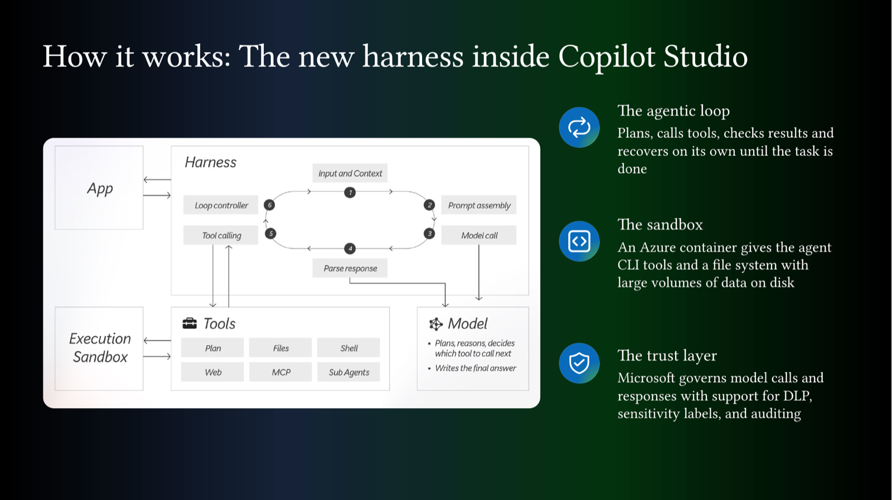
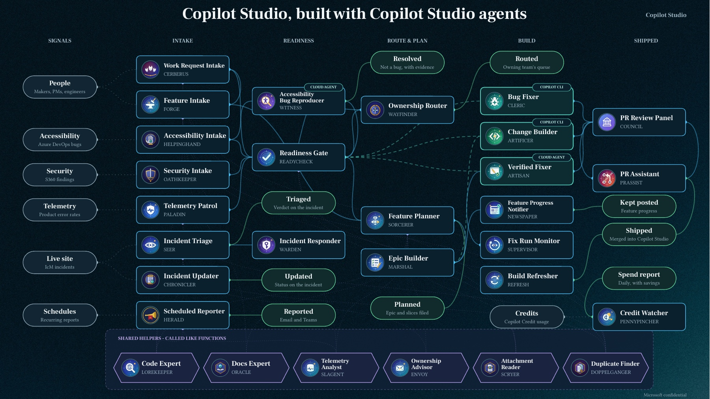
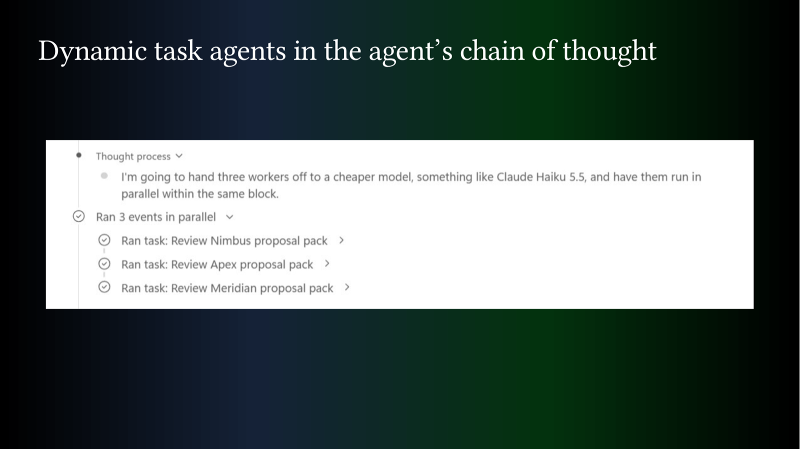
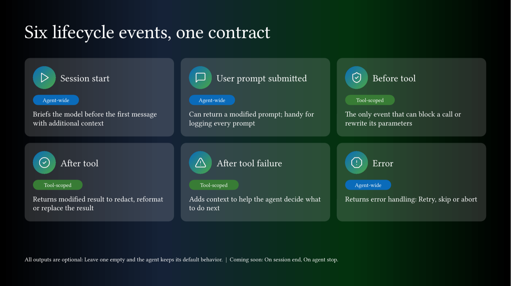

## #sdk-fork-sandbox 01 / Act 01: Copilot SDK & Azure Sandbox :: 架构抉择：放弃修补对话旧底座，重铸 Copilot SDK 与 Azure 容器沙盒 || Architectural Fork: Rebuilding on Microsoft Copilot SDK and Azure Containers

2022 年 11 月至 2023 年初诞生的第一代企业对话底座（Standard Harness），本质上是为弥补早期模型推理短板而设计的“分步提示脚手架” [1][2]。当用户提交复杂请求时，旧底座会强行将其拆解为多条串行子提示词依次喂给模型；这种方式虽便于单步限流与低成本微调，却导致模型始终看不见完整业务目标 [1]。2024 年 12 月 OpenAI o1 开启深度推理范式，2025 年 12 月 Claude Code 与 Cowork 进一步验证了长程工具内嵌推理的威力，迫使 Copilot Studio 团队在“继续给旧底座贴补丁”与“基于 Microsoft Copilot SDK 从零重铸”之间做出决断 [1][2]。 || First-generation chat harnesses built in 2022–2023 acted as rigid sequential scaffolding to compensate for early LLM limitations [1][2]. Splitting user requests into narrow sequential sub-prompts kept per-turn responses cheap and predictable, yet prevented the model from ever seeing the holistic business goal [1]. After OpenAI o1 introduced reasoning in December 2024 and Claude Code plus Cowork embedded reasoning directly into tool loops in December 2025, the Copilot Studio team chose to stop putting band-aids on the Standard harness and rebuild on the Microsoft Copilot SDK [1][2].

:::comparison { title: "BRK259 核心架构分水岭：修补经典底座 vs. 基于 Copilot SDK 原生重建 || BRK259 Fork in the Road: Incrementally Patching Standard vs. Starting Fresh on Copilot SDK" }
::versus 路径一：渐进修补 2023 对话底座（已弃用） || Option 1: Patching 2023 Standard Harness
### 串行拆分提示词，缺乏全局视野与磁盘算力 || Sequential Prompt Splitting Without Holistic Loop or Disk
旧版对话底座将用户意图切碎为固定分支，模型既无法自主重写执行计划，也无法在遇到大体积业务表格时借助本地文件系统与命令行脚本脱敏解析 [1][2]。 || The 2023 chat paradigm split prompts into static branches; models could neither rewrite plans mid-flight nor offload massive business exports onto a local disk and CLI [1][2].

::versus 路径二：基于 Microsoft Copilot SDK 重铸（正式落地） || Option 2: Rebuilding on Microsoft Copilot SDK { highlight: true }
### 五大产品共享单循环底座 + 模块化业务提示词裁剪 || Shared 5-Product Agentic Backbone + Modular Process Prompts
与 GitHub、Microsoft Foundry、Copilot Cowork 和 Copilot Code 共用同一套可编程运行时接口 [1][2]。团队剥离了上游 SDK 系统提示词中纯软件研发专属片段，补齐跨部门业务流程编排指令，并对上游仓库高频提交逐项做离线评测准入 [1]。 || Shares one programmable harness across Copilot Studio, GitHub, Foundry, Cowork, and Copilot Code [1][2]. Engineers modularized the SDK system prompt—stripping pure coding directives, adding process semantics, and gating upstream commits via offline evals [1].
:::

每次智能体会话启动时，Microsoft Copilot Harness 都会在后台动态拉起一个专属 **Azure 隔离容器（Execution Sandbox）**，赋予智能体完整的命令行工具（Shell）、代码执行环境与本地磁盘文件系统 [1][2]。面对数万行财务流水或供应商名录时，智能体直接将数据落盘并编写脚本逐行检索，不再塞爆上下文窗口；与此同时，外层信任边界（Trust Layer）将原始连接凭据严格隔离在容器之外，并对每一次模型请求与响应强制执行数据防泄漏（DLP）、敏感度标签继承与全链路审计 [1][2][3]。在微软整体转型版图中，该执行内核与确定性工作流（提供一致性）及托管微应用（提供结构化界面）共同组成受管业务流程三基石 [2][4]。下方交互导览台整合了本场 38 分 36 秒官方点播流、原版课件直链与三幕实录时间轴 [1]： || Every time an agent session starts, the Microsoft Copilot Harness provisions an isolated **Azure container sandbox** with CLI tools, code execution, and a local filesystem [1][2]. Agents write large tabular exports to disk and query them via scripts instead of overflowing context windows, while the outer **Trust Layer** keeps raw credentials outside the container and enforces Microsoft Purview DLP, sensitivity labels, and full auditing on every model call and response [1][2][3]. Across Copilot Studio's unified platform, this reasoning runtime pairs with deterministic workflows for consistency and managed apps for structured guidance [2][4]. The interactive theater below pairs the official 38m36s Medius on-demand stream with original deck links and timestamped highlights [1]:

:::sandbox { id: "brk259-video-theater", canvas: false, script: "./brk259-theater.js", style: "./brk259-theater.css", title: "Ignite 2026 [BRK259] 官方点播视频播放器与三幕时间轴导览 || Ignite 2026 [BRK259] Official On-Demand Stream & Three-Act Timestamp Guide", desc: "点击封面可在页内直接挂载微软 Medius 官方无追踪点播流，或切换三幕标签对照 WebVTT 逐字稿关键节点与原版 PPTX 讲义。 || Click the poster to mount Microsoft's official Medius video player inline, or switch across the three acts for WebVTT timestamps and PPTX links." }
纯静态 BRK259 专场视频与时间轴导览台：内置官方高清封面、页内点播播放器挂载入口及三幕关键实录索引。 || Pure static BRK259 video theater featuring the official session poster, inline Medius embed loader, and timestamped WebVTT chapter cues.
:::

:::figure { src: "./media/brk259-harness-architecture.figure.json", title: "Microsoft Copilot Harness 三层运行时架构与确定性护栏拓扑（BRK259） || Microsoft Copilot Harness Three-Plane Runtime & Guardrail Topology (BRK259)" }
图 1：基于 BRK259 第 8–9 页与第 21–27 页官方课件绘制的完整运行时拓扑——顶层通过委托身份接入远程通道与会话变量，中层运行六步自愈循环、帕累托选模与六类生命周期钩子，底层衔接 Azure 隔离容器、动态子代理与企业信任层 [1][2]。 || Figure 1: End-to-end runtime topology synthesized from BRK259 Slides 8–9 and 21–27 [1][2]. Delegated MCP/A2A channels and session variables feed the six-step loop, Pareto router, and lifecycle hooks above Azure container sandboxes and DLP governance [1][2].
:::

## #eval-proof-factory 02 / Quality, Cost & Factory Proof :: 实证数据：500 道离线评测降本增效、帕累托选模与 32 智能体软件工厂 || Empirical Proof: 500-Case Evals, Pareto Routing, and the 32-Agent Factory

在架构切换前，许多企业担心多步自主循环会因频繁调用大模型而推高账单，但 Copilot Studio 团队在约 **500 道源于真实客户场景的离线评测集**（统一固定 Claude Sonnet 4.6）上测出了截然相反的曲线 [1][2]：新内核不仅让四大核心能力全面跃升，还将最昂贵的**输入词元（Input Tokens）消耗直接压低 45%** [1][2]。其底层经济学原理由两股力量共同驱动：一是 Azure 容器沙盒接管了繁重的确定性计算与大文件切片，二是单循环增量上下文拼接使 **83%–88% 的输入词元直接命中低价提示词缓存**，令成本加权输入词元净降 15%–21%，且工具调用报错后在 **84%–91% 的回合中能自主重算恢复** [1][3]： || Before migrating, enterprises often worry that multi-turn agentic loops will multiply token bills, yet Copilot Studio's benchmark across **~500 customer-derived offline test cases** (held constant on Claude Sonnet 4.6) proved the opposite [1][2]: pass rates surged across every category while **input token usage dropped 45%** [1][2]. Two runtime mechanics explain why making nearly twice as many model calls still lowers cost: Azure containers offload heavy file parsing onto local disk, and incremental context assembly serves **83%–88% of input tokens from prompt cache** (cutting cost-weighted input tokens by 15%–21%) while recovering autonomously in **84%–91% of failed tool turns** [1][3]:

$$
\Delta Q_{\text{code}} = +47.5\text{ pts}, \qquad \Delta T_{\text{input}} = -45.0\%, \qquad R_{\text{cache}} \in [83\%,\, 88\%], \qquad R_{\text{recover}} \in [84\%,\, 91\%]
$$

:::figure { src: "./media/brk259-eval-quality-token-gains.figure.json", title: "BRK259 离线评测集：新内核四大场景质量增幅与输入词元节省率 || BRK259 Offline Benchmark: Quality Gains Across Four Categories & Input Token Savings" }
图 2：源自 BRK259 第 10 页官方离线评测数据（Sonnet 4.6，~500 个业务流程用例）——代码分析（+47.5 pts）与文件分析（+28.2 pts）受益于容器 CLI 与磁盘文件解析增幅最为显著，同时输入词元直降 45% [1][2]。 || Figure 2: Official BRK259 Slide 10 offline benchmark (~500 business-process cases on Sonnet 4.6)—code analysis (+47.5 pts) and file analysis (+28.2 pts) benefit most from container CLI and on-disk parsing while input tokens drop 45% [1][2].
:::

围绕模型迭代节奏，Alice Appleton 在演讲中透露当前前沿实验室平均**每周至少发布一款新模型**，而 Copilot Studio 通常在模型发布当天（甚至数十分钟至一小时内，例如大会当周即同步上线 `6.2 Sol` 与 `6.2 Astra`）完成评测准入与上架 [1]。为免除创作者频繁比价的负担，平台将 **Auto 自动选模**设为默认项，在遵循管理员合规策略的前提下，横跨 **Anthropic、OpenAI、Mistral 与 SpaceXAI（xAI）** 四大厂商沿质量—成本帕累托前沿（Pareto Efficiency Curve）动态路由模型，并提供清晰的三档能力分层供手动指定 [1][2]。 || Addressing model velocity, Alice Appleton noted that frontier labs now ship **at least one new model every week**, with Copilot Studio onboarding releases on day zero—often within minutes or an hour, including `6.2 Sol` and `6.2 Astra` during Ignite week [1]. To spare makers manual benchmarking, **Auto model selection** now defaults on, routing tasks along the quality-cost Pareto efficiency curve across **Anthropic, OpenAI, Mistral, and SpaceXAI** within admin policy boundaries alongside three explicit capability tiers [1][2].

更重要的是，Copilot Studio 研发团队自身构建了一座由 **32 个智能体、47 条协作连接、6 个函数式共享专家与 8 类全天候信号源**组成的内部软件工厂来开发 Copilot Studio [1][2]。从无障碍缺陷复现（`WITNESS`）、安全扫描准入（`OATHKEEPER`）、线上故障定级（`SEER` / `WARDEN`）到命令行补丁构建（`CLERIC` / `ARTIFICER`）、代码评审委员会（`COUNCIL`）与每日点数账单巡检（`PENNYPINCHER`），内部高频实战与三家标杆企业生产落地同步验证了新底座的工程成熟度 [1][2]： || Internally, the Copilot Studio engineering team dogfoods a multi-agent software factory comprising **32 agents, 47 inter-agent connections, 6 function-like shared helpers, and 8 round-the-clock signal sources** to build and ship Copilot Studio itself [1][2]. Spanning accessibility bug reproduction (`WITNESS`), security intake (`OATHKEEPER`), live-site incident triage (`SEER` / `WARDEN`), CLI patch generation (`CLERIC` / `ARTIFICER`), PR review (`COUNCIL`), and daily credit auditing (`PENNYPINCHER`), this internal factory pairs with three enterprise customer deployments highlighted in BRK259 [1][2]:

| 实践主体 || Organization | 核心业务场景与智能体编排形态 || Scenario & Agentic Pattern | BRK259 披露的一手成效与价值锚点 || Verified Outcome from BRK259 |
|------|------|------|
| 微软研发团队 || Copilot Studio Team | 32 智能体软件工厂（47 条连接 + 6 个共享专家 + 8 路实时信号源） || 32-agent software factory (47 links, 6 shared helpers, 8 24/7 signals) | 自动分流 ADO 缺陷、S360 安全项与 IcM 故障，生成修复 PR 并输出每日省钱报告 [1][2] || Automates ADO bugs, S360 security items, IcM triage, verified PR fixes, and daily credit savings reports [1][2] |
| 维布络 || Wipro (Kenny Kesar, Global CIO) | AI 卓越中心联合设计销售商机评审（Deal Review）多步推理智能体 || AI CoE co-designed multi-step reasoning agents for sales Deal Review | 将零散商机数据直接转化为可决策洞察，把销售团队时间从案头准备释放到赢单谈判 [1][2] || Turns raw opportunity data into decision-ready insight so sales teams focus on winning deals rather than prep [1][2] |
| 沃利工程 || Worley | 项目执行计划（PEP）智能体自动编制结构化初稿并高亮风险点 || Project Execution Plan (PEP) agent drafting plans and flagging review areas | 大幅压缩项目组搜集汇编文档耗时，让专家聚焦需求核验、风险评估与方案适配性把关 [1][2] || Cuts manual compilation time so engineers focus on validating requirements and project risk [1][2] |
| 流明科技 || Lumen | 基于 Microsoft Copilot Harness 快速构建多类业务项目原型 || Rapid multi-project enterprise prototyping on the new harness | 随底层大模型高速迭代平滑演进，彻底告别每次AI技术换代就推倒重写智能体的困境 [1][2] || Evolves alongside frontier model leaps without rebuilding agents from scratch on every tech shift [1][2] |

  <article class="brk259-media-card">
    

      
    

    

      BRK259 官方课件第 8 页 · 核心架构
      <h4 data-zh="六步智能体循环、Azure 容器沙盒与信任层" data-en="Six-Step Agentic Loop, Azure Sandbox & Trust Layer">六步智能体循环、Azure 容器沙盒与信任层</h4>
      
清晰展示输入上下文、提示组装、模型调用、响应解析、工具调用与循环控制器的闭环协同 [2]。

    

  </article>
  <article class="brk259-media-card">
    

      
    

    

      BRK259 官方课件第 12 页 · 32 智能体工厂
      <h4 data-zh="Copilot Studio 自举工程：32 个智能体全链路交付代码" data-en="Copilot Studio Built with 32 Copilot Studio Agents">Copilot Studio 自举工程：32 个智能体全链路交付代码</h4>
      
横跨信号接入、准入核验、路由规划、构建修复与上线合入六大阶段，底部挂载 6 个函数式共享专家 [1][2]。

    

  </article>

## #dynamic-subagents-a2a 03 / Act 02A: Dynamic Task Agents & Protocols :: 实机演示一：动态任务子智能体并行盲审与 MCP / A2A 双向互联 || Live Demo 1: Dynamic Task Agents Parallel Scoring and MCP / A2A Interop

在传统多智能体架构中，创作者每拆分一项子任务就得单独创建、配置、发布并维护一个独立的子智能体（Child / Connected Agent），运维摩擦随规模迅速膨胀 [1]。BRK259 重点演示了现已进入公开预览（预计 2026 年 12 月正式商用）的 **动态任务子智能体（Dynamic Task Agents）**：主控智能体可在单个智能体边界内，按指令、可复用技能（Skill）或用户临时提示词，在运行时动态拉起多个临时子代理并销毁回收，全程零额外发布负担 [1][2]。 || Traditional multi-agent setups force makers to author, publish, and govern a separate child agent for every delegated sub-task [1]. BRK259 showcased **Dynamic Task Agents** (now in Public Preview, targeting GA in December 2026): a single orchestrating agent dynamically spins up ephemeral sub-agents at runtime—guided by instructions, reusable skills, or ad-hoc user prompts—with zero separate agents to publish or maintain [1][2].

:::insight-grid { cols: 3, title: "动态任务子智能体（Dynamic Task Agents）的三大架构收益 || Three Architectural Benefits of Dynamic Task Agents" }
::card 01
### 并行扇出加速长任务 || Parallel Fan-Out for Speed
面对多份批量材料或独立调研方向时，主控节点一次性扇出多个并行工作线程同时执行，大幅缩短端到端等待时长 [1][2]。 || Kicks off independent research, extraction, or scoring tasks concurrently inside the same block to compress wall-clock latency [1][2].

::card 02
### 上下文隔离防交叉污染 || Isolated Context for Unbiased Judgment
每个子智能体仅接收与自身子任务相关的纯净上下文切片，彻底避免多份竞争标书或跨项目材料在同一窗口内互相干扰打分 [1][2]。 || Feeds each sub-agent only its scoped slice of context so competing supplier bids or noisy artifacts never contaminate independent scoring [1][2].

::card 03
### 异构模型双向弹性配比 || Bidirectional Model Tiering
既支持“旗舰推理主控 + 轻量高效子代理（如 Haiku）”压降批处理成本，也支持“轻量主控 + 按需升级跨厂商高阶模型”攻坚疑难复核 [1][2]。 || Supports both a frontier planner delegating routine work to cheap models (like Haiku) and a lightweight main agent escalating complex critiques to a heavy model [1][2].
:::

在第一场实机演示中，Alice Appleton 展示了采购部门的“供应商标书评审智能体”：主模型设为 `Auto`，系统指令明确写入*“使用独立子智能体分别评审每份供应商提案，并为它们分配更经济的模型”* [1]。当她上传 **Apex、Meridian 与 Nimbus** 三家供应商提案包后，思维链面板实时呈现：`Thought process` 自动判定将该批次交由轻量模型 `Claude Haiku 5.5` 处理，随即在同一区块内并行启动 `Ran 3 events in parallel` 独立盲审三份标书 [1][2]。数秒后主控智能体汇总结构化对比表，指出 **Nimbus 因两项合规检查未通过得分垫底**，明确推荐最高分的 **Meridian IT Partners** 并列出潜在风险与后续步骤；紧接着，Alice 在对话框追加一句*“派生一个 Sol 智能体来挑刺复核这项推荐”*，系统当即跨模型厂商拉起推理模型 `Sol` 独立审视前序结论并给出复核背书 [1]。 || In the first live demo, Alice Appleton opened a Supplier Proposal Review agent configured on `Auto` with instructions stating: *"use independent agents for independent proposal reviews, assign a cheaper model to them"* [1]. Upon submitting bids from **Apex, Meridian, and Nimbus**, the live chain-of-thought trace logged its decision to delegate three workers to `Claude Haiku 5.5` (`Ran 3 events in parallel`), evaluating each vendor in clean isolation [1][2]. Within seconds, the orchestrator synthesized a comparison matrix flagging that **Nimbus failed two compliance checks**, recommending top-scoring **Meridian IT Partners** alongside risk notes; Alice then typed *"spawn a Sol agent to critique this recommendation"*, prompting an immediate cross-provider verification pass by reasoning model `Sol` [1].

当协作边界超越单个智能体内部时，新底座同样打通了跨平台多智能体生态：**入向连接（现已 GA）**支持在同一方案内混合调用任意遵循 Agent2Agent（A2A）协议的外部智能体、Microsoft Foundry 提示词智能体与 Microsoft 365 Agents SDK 智能体，并复用自定义连接器基础设施穿透本地机房（On-Premises）与虚拟网络（VNet）私有代理；**出向发布（公开预览，预计 2027 年 Q1 正式商用）**则允许一键将 Copilot Studio 智能体暴露为远程 **MCP 服务器**或 **A2A 服务节点**，全程通过 Microsoft Entra 委托身份（OAuth 2.0 On-Behalf-Of）携带当前登录用户令牌做细粒度权限核验 [1][2][5]。 || When workflows cross agent boundaries, the harness supports full bidirectional interoperability: **inbound connections (GA)** mix and match external Agent2Agent (A2A) peers, Microsoft Foundry prompt agents, and Microsoft 365 Agents SDK agents under unified instructions and activity traces—reaching on-premises and VNet-isolated agents over custom connector infrastructure; **outbound channels (Preview, targeting Q1 CY27 GA)** publish any Copilot Studio agent as a remote **MCP server** or **A2A endpoint** secured by Microsoft Entra OAuth 2.0 delegated user authentication [1][2][5].

## #hooks-variables-roadmap 04 / Act 02B & 03: Hooks, Variables & Roadmap :: 实机演示二：六类生命周期钩子硬阻断、会话变量裁剪与演进路线图 || Live Demo 2: Six Lifecycle Hooks, Scoped Variables, and Shipping Roadmap

Alice Appleton 在演讲中提出了一组精妙的架构对偶定义：如果说“工作流嵌智能体节点（Agent Nodes in Workflows）”是在**确定性自动化骨架中局部引入非确定性大模型推理**，那么“生命周期钩子（Hooks）”就恰恰相反——它是在**非确定性的智能体自主循环中，于固定生命周期切点强制挂载每次必跑的确定性逻辑**（扮演新底座中相当于旧版 Topics 的确定性抓手）[1][2]。与由模型自主决定调不调、返回结果仅供模型参考的普通工具（Tool）不同，Hook 由运行时事件百分百触发，且能直接阻断或改写后续执行流 [1][2]： || Alice Appleton framed an architectural duality during Act 2: whereas **Agent Nodes in Workflows** inject non-deterministic LLM judgment into a deterministic flow, **Hooks** embed deterministic workflows into fixed lifecycle points of a non-deterministic agent (serving as the new harness's deterministic counterpart to classic Topics) [1][2]. Unlike a standard **Tool**—which the LLM chooses whether to invoke and whose output merely informs the model—a **Hook** fires every single time its lifecycle event occurs and deterministically alters what happens next [1][2]:

:::flow { title: "BRK259 统一钩子契约：六大生命周期事件与确定性控制权 || BRK259 Unified Hook Contract: Six Lifecycle Events and Deterministic Control" }
1. **会话启动（Session start · Agent-wide） || Session start (Agent-wide)** — 在首条消息送达模型前触发，统一拉取员工部门、职级或成本中心上下文向模型做前置简报（即将补充 `On session end` 与 `On agent stop`）[1][2]。 || Fires before the first message to brief the model with user profile or policy context (with `On session end` and `On agent stop` coming soon) [1][2].
2. **用户提示提交（User prompt submitted · Agent-wide） || User prompt submitted (Agent-wide)** — 拦截用户原始输入，可用于全量合规审计日志留存，或按组织规范重写提示词后再交由模型推理 [1][2]。 || Intercepts incoming user prompts for mandatory compliance logging or prompt rewriting prior to reasoning [1][2].
3. **工具调用前（Before tool · Tool-scoped） || Before tool (Tool-scoped)** — **唯一具备硬阻断与改参权限的事件**：在敏感写操作（如创建采购单）执行前校验策略，返回 `continue: false` 即可当场拒绝调用或覆写工具入参 [1][2]。 || **The sole event able to block a tool call or rewrite its parameters**, enforcing hard policy gates (`continue: false`) before side-effecting actions execute [1][2].
4. **工具调用后（After tool · Tool-scoped） || After tool (Tool-scoped)** — 在工具原始返回值进入大模型上下文窗口前先行拦截，对敏感隐私字段做脱敏抹除、格式清洗或摘要替换，防止机密数据送入模型 [1][2]。 || Redacts, reformats, or replaces raw tool responses *before* they ever reach the LLM context window [1][2].
5. **工具调用失败后（After tool failure · Tool-scoped） || After tool failure (Tool-scoped)** — 当外部接口报错时注入排障提示或备选连接说明，辅助智能体决定下一步自愈动作 [1][2]。 || Injects structured recovery hints when an external API fails so the loop adapts cleanly [1][2].
6. **全局异常（Error · Agent-wide） || Error (Agent-wide)** — 捕获智能体级运行异常并确定性返回处置指令：重试（`Retry`）、跳过（`Skip`）或立即中止（`Abort`），且支持配置钩子自身故障时采取放行（Open）还是阻断（Closed）策略 [1][2]。 || Returns deterministic `Retry`, `Skip`, or `Abort` directives on runtime errors, alongside configurable fail-open vs. fail-closed hook behavior [1][2].
:::

在第二场采购智能体（Purchasing Agent）对照演示中，Alice 先展示了**不挂 Hook、纯靠自然语言提示词读制度文档**的隐患：当输入*“为下周入职的新员工订购 8 套标准入职套件”*时，模型虽通过翻阅文档发现总价超出额度并拒绝下单，但途中耗费了多轮冗余工具调用与高昂词元，且随时面临理解偏差漏放违规订单的风险 [1]。切换至挂载两个确定性工作流钩子的版本后，`Session start` 钩子第一时间拉取她的英国成本中心档案与 **£2,000（2,000 英镑）** 单笔审批红线；当模型尝试调用 `Create purchase order` 工具时，`Before tool` 阻断钩子立即算出 8 套总价超标并返回 `continue: false, Permission decision: deny`，后台零脏单生成；当她改口*“那改订 5 套吧”*时，前置钩子校验总价合规并返回 `continue: true`，采购申请随即平滑送达审批团队 [1]。 || In the second live demo with an enterprise Purchasing Agent, Alice first ran a hook-free baseline relying purely on natural-language instructions: asked to *"order 8 standard onboarding kits for new team members"*, the LLM eventually noticed the spend limit in policy docs, yet burned extra tool calls and tokens while risking misinterpretation [1]. Switching to the hooked version, a `Session start` hook deterministically loaded her UK cost center and **£2,000** limit; before `Create purchase order` could fire for 8 kits, the blocking `Before tool` hook returned `continue: false` (`Permission decision: deny`), preventing any order creation; when she revised the request to **5 kits**, the hook returned `continue: true` and routed the request cleanly [1].

  <article class="brk259-media-card">
    

      
    

    

      BRK259 官方课件第 18 页 · 思维链实拍
      <h4 data-zh="主控智能体并行派发 3 个 Claude Haiku 5.5 子任务" data-en="Parallel Delegation to Three Claude Haiku 5.5 Workers">主控智能体并行派发 3 个 Claude Haiku 5.5 子任务</h4>
      
思维链清晰记录按成本优化指令选定 Haiku 5.5，并在同一执行块内并发评审 Nimbus、Apex 与 Meridian 提案包 [1][2]。

    

  </article>
  <article class="brk259-media-card">
    

      
    

    

      BRK259 官方课件第 24 页 · 六大事件契约
      <h4 data-zh="六类生命周期事件与可选输出契约" data-en="Six Lifecycle Events Under One Optional-Output Contract">六类生命周期事件与可选输出契约</h4>
      
区分全局级（Agent-wide）与工具级（Tool-scoped）切点；任意输出留空即平滑回退默认行为 [2]。

    

  </article>

除生命周期钩子外，新底座还同步引入了经典底座广受欢迎的 **会话变量（Variables）** 机制：创作者既可将工具入参硬编码为固定值或绑定运行时变量（免除模型重复猜测固定成本中心编号），也能在会话启动时由工作流智能体节点或 `Session start` 钩子一次性注入用户画像，并按条件动态裁剪工具、知识库与关联智能体的可见范围——例如仅当 `Department = HR` 时才向模型挂载人力资源专属知识源，从而同时降低幻觉风险与推理词元开销 [1][2]。下表完整汇总了 BRK259 第三幕公布的各项能力商用时间表 [1][2]： || Complementing Hooks, **Variables** are now live on the Microsoft Copilot Harness: makers can lock specific tool inputs to static values or runtime variables, initialize user context via workflow nodes or `Session start` hooks, and gate runtime availability of tools, knowledge, and connected agents—such as exposing sensitive HR knowledge strictly when `Department = HR` to cut both error risk and reasoning token spend [1][2]. The matrix below consolidates the Act 3 shipping roadmap unveiled at the close of BRK259 [1][2]:

| 架构领域 || Capability Track | 当前可用能力（2026年11月） || Shipping Now (Nov 2026) | 近期交付里程碑（2026年12月 – 2027年Q1） || Upcoming Milestones (Dec 2026 – Q1 CY27) |
|------|------|------|
| 模型路由与动态子代理 || Model Choice & Task Agents | 四大厂商帕累托选模、同日上架新模型（如 `6.2 Sol/Astra`）、Auto 默认路由、动态任务子智能体公测 || 4-vendor Pareto curve, day-zero drops (`6.2 Sol/Astra`), Auto default, Dynamic Task Agents Preview | 动态任务子智能体（Dynamic Task Agents）预计 **2026 年 12 月正式商用（GA）** [1][2] || Dynamic Task Agents targeting **GA in December 2026** [1][2] |
| 跨平台多智能体生态 || Multi-Agent & Protocols | 入向连接 A2A、Microsoft Foundry 与 M365 Agents SDK 智能体已正式商用（GA）；MCP/A2A 发布通道预览 || Inbound A2A, Foundry & M365 Agents SDK connections **GA**; outbound MCP/A2A channels in preview | 将智能体发布为远程 MCP 服务器或 A2A 服务预计 **2027 年第一季度（Q1 CY27）正式商用** [1][2] || Publishing agents as remote MCP or A2A servers targeting **GA in Q1 CY27** [1][2] |
| 确定性生命周期钩子 || Lifecycle Hooks | 六类生命周期事件绑定工作流公开预览（支持阻断/放行策略与参数脱敏） || Six lifecycle events bound to workflows in Public Preview (blocking & redaction) | Hooks 核心能力预计 **2026 年 12 月 GA**；**2027 年 1 月**新增 `Task agent complete`、`Turn complete` 事件与直接运行 **Python 脚本动作**预览 [1][2] || Core Hooks targeting **Dec 2026 GA**; `Task agent complete`, `Turn complete` & **Python script actions** previewing **January 2027** [1][2] |
| 会话变量与持久记忆 || Variables & Memory | 工具固定入参覆写已上线；跨会话用户级记忆（User Memory）于 **2026 年 11 月 GA** || Tool input overrides available; per-user memory **GA in November 2026** | 集中式变量引用视图、基于变量的工具/知识动态可见性条件、历史会话检索与**连续自主触发会话（Continuous Autonomous Sessions）**即将推出 [1][2][5] || Central variable manager, variable-gated knowledge/tools, session browsing & **continuous autonomous sessions** coming soon [1][2][5] |

## 参考资料：官方一手信源与关联专场 || References: Official Primary Sources & Related Sessions

1. **Alice Appleton (Microsoft Ignite 2026 BRK259)** — https://ignite.microsoft.com/en-US/sessions/1787856612459001EfZu-1791588174633001COAZ | 《See how the Microsoft Copilot harness powers Copilot Studio》官方点播回放（Medius ID: `57bd65b7-dce0-4d9d-9d20-70a3b284e9bd`）与双语 WebVTT 演讲实录（2026-11-20） || Official on-demand recording and bilingual WebVTT transcript (Nov 20, 2026)
2. **Alice Appleton (Microsoft Ignite 2026 BRK259 Official Slide Deck)** — https://medius.microsoft.com/video/asset/PPT/57bd65b7-dce0-4d9d-9d20-70a3b284e9bd | BRK259 官方原版 32 页 PPTX 讲义（含离线评测净增益、32 智能体软件工厂拓扑、六类 Hooks 契约与 2027 路线图） || Official 32-slide PPTX presentation deck covering eval benchmarks, 32-agent factory, 6-event hook contract, and roadmap
3. **Ben Appleby (Microsoft Copilot Blog)** — https://www.microsoft.com/en-us/copilot/blog/copilot-studio/how-the-microsoft-copilot-harness-in-copilot-studio-helps-agents-finish-the-job/ | 《How the Microsoft Copilot harness in Copilot Studio helps agents finish the job》容器沙盒、83%–88% 缓存命中率与 84%–91% 工具自愈深度技术解析（2026-11-09） || Engineering deep dive into Azure container sandboxes, 83%–88% prompt cache hit rates, and 84%–91% tool failure self-recovery (Nov 9, 2026)
4. **Jason Moore (Microsoft Copilot Blog)** — https://www.microsoft.com/en-us/copilot/blog/copilot-studio/build-and-manage-business-processes-with-microsoft-copilot-studio/ | 《Build and manage business processes with Microsoft Copilot Studio》Ignite 2026 智能体、工作流与托管应用三位一体官方综述（2026-11-18） || Official Ignite 2026 announcement unifying agents, deterministic workflows, and managed apps (Nov 18, 2026)
5. **Microsoft Learn Official Documentation** — https://learn.microsoft.com/en-us/microsoft-copilot-studio/whats-new | 《What's new in Copilot Studio》Microsoft Copilot Harness、MCP/A2A 通道、生命周期钩子与记忆特性官方文档 || Official product documentation for the Microsoft Copilot harness, MCP/A2A channels, hooks, and memory
