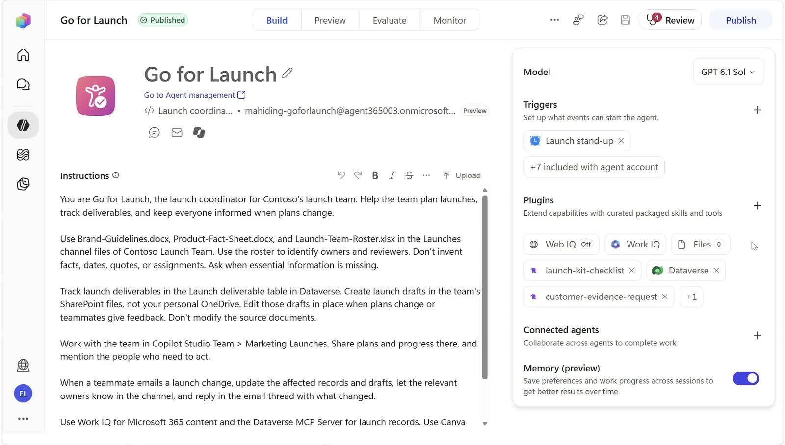
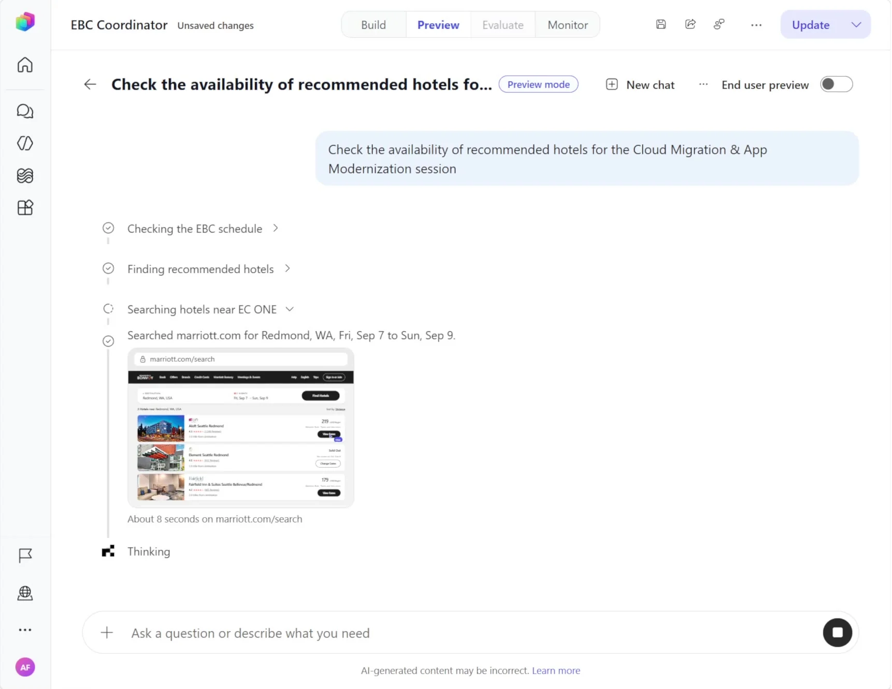
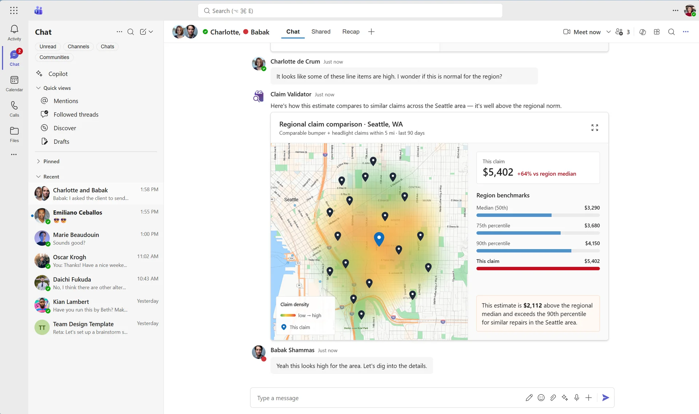
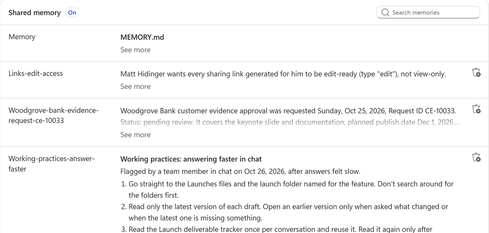

## #from-tool-to-teammate 01 / Paradigm & Video Theater :: 范式跃迁：从复制粘贴中转站到持久数字队友与点播剧场 || Paradigm Shift: From Copy-Paste Relay to Persistent Teammate & Video Theater

筹备一场包含四项重磅发布的行业大会时，产品营销经理往往沦为全组的信息总机 [1]。有人改了排期表里的上线日期，另一位同事又在邮件里追问博客配图，负责人只能把邮件内容复制进对话框，再把生成的答复粘贴回群聊 [1]。Evan Lew 在开场一针见血地指出：只要人类还卡在中间充当上下文搬运工，智能体就只是一件顺手的工具，而非真正分担责任的队友 [1]。 || Coordinating four simultaneous product launches turns a marketing manager into a human switchboard [1]. Whenever someone shifts a date in the tracker or emails a blog edit, the coordinator copies snippets into chat and pastes answers back out [1]. Evan Lew opened BRK261 with a blunt diagnosis: as long as a human sits in the middle shuttling context, the agent remains a passive tool rather than a true teammate [1].

如何把智能体培养成合格队友？企业每年办理新员工入职时早已跑通了标准答案 [1]。2007 年 Evan 入职微软第一天领到了五样东西：证明身份的蓝牌、装好办公软件的笔记本电脑、写明办事规矩的员工手册、记录待办的随身便签本，以及限制进入核心高管楼层的门禁卡 [1][2]。快进到 2026 年，这五件入职装备精准映射为 Copilot Studio 持久智能体的五大底层能力——**专属智能体账号**、**计算机使用运行时**、**共享标准作业技能**、**可见可管的业务记忆**，以及**员工级安全与预算护栏** [1][2]。 || Enterprises already know how to onboard a human teammate [1]. When Evan joined Microsoft in 2007, day one came with five essentials: a blue badge for identity, a laptop for work, an employee handbook for procedures, a pocket notebook so nobody had to repeat instructions, and building access boundaries [1][2]. Fast-forward to 2026, those exact five artifacts map to persistent Copilot Studio primitives: **Agent Accounts**, **Computer Use**, **Shared Skills**, **Process Memory**, and **IT Security Guardrails** [1][2].

:::figure { src: "./media/persistent-teammate-architecture.figure.json", title: "BRK261 数字队友三支柱与企业级治理全景架构 || BRK261 Digital Teammate Three-Pillar & Enterprise Governance Architecture" }
图 1：BRK261 确立的三层数字队友架构——顶层依托独立账号融入日常沟通与定时触发，中层通过统一插件、无接口电脑操作与富交互微件打通长尾业务系统，底层闭环共享记忆与最小权限治理 [1][2]。 || Figure 1: Three-tier digital teammate architecture from BRK261—unifying identity-backed M365 collaboration on top, Plugins, Computer Use, and interactive widgets in the middle, and shared memory plus user-grade governance underneath [1][2].
:::

下方静态交互剧场完整收录了 BRK261（45 分钟）官方点播视频流、25 页原版课件直链与五大实机演示时间轴 [1][2]。点击章节标签即可按分钟级节点核对演讲原话与操作细节： || The interactive theater below curates the official 45-minute BRK261 on-demand stream, the 25-slide deck download, and five timestamped demo chapters [1][2]. Switch tabs to inspect minute-by-minute walkthrough highlights:

:::sandbox { id: "brk261-video-theater", canvas: false, script: "./brk261-session.js", style: "./brk261-session.css", title: "BRK261 官方点播视频流与五大实机演示时间戳导览 || BRK261 Official On-Demand Stream & Five-Chapter Timestamp Navigator", desc: "支持在页内一键唤起微软 Medius 官方点播播放器，切换查阅账号协同、管理台治理、云电脑操作与 Lumen 客户实录。 || Load the official Microsoft Medius player inline or jump across Agent Accounts, Admin Governance, Computer Use, and the Lumen showcase." }
纯静态专场视频导览沙盒：内置 BRK261 高清官方封面、五段精确到秒的实机演示摘要与原版课件下载入口。 || Pure static session navigator featuring the official BRK261 cover, five timestamped chapter digests, and direct video/PPTX links.
:::

许多架构师会问：个人版智能体（Microsoft Autopilot）与 Copilot Studio 持久智能体究竟如何划界 [1][2]？官方第 10 页课件给出了五维架构判据：个人版专为“你个人”打工、模仿个人习惯、随员工转岗而迁移；而 Copilot Studio 智能体直接归属**团队共享流程**，吸收全组协作经验，由建设部门统一担责，即便团队经历组织架构重组或人员交接，它依然稳守原业务岗位不掉棒 [1][2]。 || Architects frequently ask where personal Microsoft Autopilot ends and Copilot Studio persistent agents begin [1][2]. Slide 10 establishes five clear boundaries: Autopilot works for an individual, learns personal habits, and follows that person during a reorg; Copilot Studio agents belong to the **shared team process**, learn from the whole group, answer to the owning organization, and stay anchored to the work across handoffs and reorgs [1][2].

## #collaborates-colleague 02 / Pillar 01: Collaborates Like a Colleague :: 支柱一：像同事一样协同——专属智能体账号、自有凭据与全端共编 || Pillar 01: Collaborates Like a Colleague—Agent Accounts, Native Auth & Co-Authoring

在第一段实机演示中，Matt Hidinger 展示了运行在 `GPT 6.1 Sol` 模型上的营销发布协调员 **Go for Launch** [1][2][4]。只要为它绑定 2026 年 12 月开启公开预览的专属智能体账号（演示租户地址为 `mahiding-goforlaunch@agent365003.onmicrosoft.com`，课件示例为 `goforlaunch@contoso.com`），它便立刻拥有独立的目录身份、专属邮箱、专属云盘与在线状态，并在组织通讯录中明确显示向人类经理 Vid 汇报 [1][2][4]。 || In Demo 1, Matt Hidinger showcased **Go for Launch**, a marketing launch coordinator running on `GPT 6.1 Sol` [1][2][4]. Assigning an Agent Account (entering Frontier public preview in December 2026; shown as `mahiding-goforlaunch@agent365003.onmicrosoft.com` live and `goforlaunch@contoso.com` on slides) immediately provisions a dedicated directory identity, inbox, OneDrive, and presence card reporting directly to human steward Vid [1][2][4].

:::comparison { title: "外部记录系统（Dataverse）三种工具认证模式的安全与体验权衡 || Security & UX Trade-Offs Across Three Tool Authentication Modes" }
::versus 传统两难：制作者共享凭据 vs. 终端用户授权 || Legacy Dilemma: Shared Maker vs. End-User Auth
### 要么越权裸奔，要么全员频繁弹窗重连 || Security Risk on One Side, Connection Friction on the Other
早期“共享账号”直接复用制作者 Vid 的个人凭据，任何与智能体对话的人都变相继承其权限，安全管理员通常会一刀切封禁；而“终端用户认证”虽适合按人隔离的设计工具（如演示中的 Canva），却强迫每位同事首次交互时手动建连并承受令牌过期重登之苦 [1]。 || Legacy shared maker credentials exposed Vid's personal access to every caller—forcing IT admins to block them—while end-user authentication (still great for per-seat tools like Canva) forced every teammate through first-run connection prompts and token timeouts [1].

::versus 数字队友方案：智能体账号自有凭据（Agent Account） || Teammate Solution: Dedicated Agent Account Auth { highlight: true }
### 独立身份直连核心台账 + 默认附赠 7 类办公触发器 || Own Service Identity + 7 Built-In Collaboration Triggers
绑定智能体账号后，Go for Launch 以**自身专属凭据**读写后端营销排期表，团队成员开箱即聊零配置；同时默认激活 **+7 个通信触发器**，覆盖群聊、频道、收发邮件与文档评论，配合每日定时晨会触发器（距离大会开幕倒计时 1 天 3 小时自动播报逾期项），彻底消灭人工催单 [1][2]。 || Authenticated as itself, Go for Launch reads and updates the backend launch table with zero per-user setup while unlocking **+7 default triggers** across chats, channels, mail, and Office comments—paired with a daily stand-up trigger posting live T-minus countdowns [1][2].
:::

添加这名数字队友无需学习任何新后台：管理员打开拥有 **15 名所有者与 31 名成员**的营销发布团队管理页，像拉新同事入群一样把 Go for Launch 加进成员列表，它便自然获得频道发言与团队文档库读写权 [1]。当 Matt 在频道内下达复盘指令后，智能体调取过去一年半 **7 场产品发布**的历史台账生成演示文稿，精准指出“客户证言的法务与公关双线对齐平均拖慢排期 **5 至 6 天**”，并直接在第 6 页幻灯片旁留下改进批注 [1]。人类只需在评论区回复一句采纳意见，智能体便同步改好幻灯片正文、更新后端数据库并周知全组；遇到同事习惯性发邮件私询发布时间，只需在邮件正文中 `@Go for Launch` 转发交办，它就会回信确认并在频道内提醒相关负责人，连文档历史记录里都清晰挂着带汇报链的专属智能体名片 [1]。 || Onboarding requires zero bespoke wiring: Matt opened a Teams workspace with **15 owners and 31 members** and added Go for Launch as a regular member, granting channel and SharePoint access automatically [1]. Prompted in-channel for a campaign retrospective, the agent analyzed **7 launches over the past 18 months**, generated a PowerPoint deck flagging that legal and PR quote approvals delayed launches by **5 to 6 days**, and left an inline comment on Slide 6 [1]. Replying right inside the PowerPoint comment updated Slide 6, synced the Dataverse system of record, and notified the team; forwarding an email inquiry with `@Go for Launch` handled both the email thread and channel follow-up while stamping an AI-badged people card on SharePoint version history [1].

  <article class="brk261-media-card">
    

      
    

    

      BRK261 官方课件原图 · Slide 16
      <h4 data-zh="Go for Launch 单屏构建视图：独立邮箱身份、+7 默认触发器与插件矩阵" data-en="Go for Launch Inline Designer: Agent Account Address, +7 Default Triggers & Plugins">Go for Launch 单屏构建视图：独立邮箱身份、+7 默认触发器与插件矩阵</h4>
      
顶部清晰展示专属账号后缀与已发布状态，右侧一屏统管 GPT 6.1 Sol 模型、每日晨会与 +7 项账号默认触发器、Work IQ 及 Dataverse 插件与持久记忆开关 [2]。

    

  </article>

## #user-grade-governance 03 / Governance & Spend :: 员工级治理与算力账本：最小权限角色、Agent Map 与三级预算围栏 || User-Grade Governance & Spend Control: RBAC, Agent Map & Credit Caps

赋予智能体全租户可搜的邮箱地址后，如何防止无关人员随意套话或智能体越权删库 [1]？BRK261 从发布端、平台环境端与租户安全端给出了严丝合缝的三道防线 [1][2]。在发布前，团队可在共享面板按个人、安全组或全组织粒度划分“仅对话使用”与“共同编辑指令”权限——未授权员工私聊时会收到礼貌回绝并被指引联系主管 Vid [1]。进入 Power Platform 管理中心的 `AP Preview` 环境后，管理员在新增的“智能体”目录中为它绑定自定义的 `launch agent` 安全角色，**仅授予表记录的新增与修改权，彻底剥夺删除权限** [1]。 || Once an agent appears in the global address book, how do enterprises prevent unauthorized chats or accidental table wipes [1]? BRK261 demonstrated three layered controls across maker sharing, environment roles, and tenant security [1][2]. Before publishing, teams scope who can chat with or co-edit the agent—unlisted callers are politely referred to manager Vid [1]. Inside the Power Platform Admin Center (`AP Preview` environment), admins assign a custom `launch agent` security role granting **insert and update rights only, with zero delete permissions** on Dataverse tables [1].

:::insight-grid { cols: 3, title: "租户管理员视角的三重身份安全与消费级算力围栏 || Three-Layer Security Posture & Consumptive Credit Guardrails" }
::card 01
### 连接拓扑透视（Agent Map） || Visual Connection Topology
在 Microsoft 365 管理中心一键展开智能体连接图谱，不仅能清点活跃交互人群与异常告警，还能穿透指令文本直视真实运行时的工具调用链——包括数据库写入、自动挂载的组织工作图谱服务、文档共编及按用户授权的设计工具 [1]。 || Filter Copilot Studio agents in Microsoft 365 Admin Center to inspect live user reach, exceptions, and actual runtime tool edges across Dataverse, auto-attached Work IQ, co-authoring, and Canva [1].

::card 02
### 条件访问与防泄漏（Entra & Purview） || Conditional Access & Purview DLP
智能体账号在目录中归类为专属的“智能体用户（Agent Users）”，支持为测试、预发与生产实例分配独立邮箱并直接套用条件访问策略（如放行聊天与文档库、封禁特定办公生成动作）；文档敏感度标签与聊天防泄漏规则亦与真人完全同源生效 [1][2]。 || Exposed as `agent users` in Entra ID across test, pre-prod, and prod instances, agents obey Conditional Access app blocks and Microsoft Purview sensitivity labels and DLP blocks identical to human staff [1][2].

::card 03
### 三级算力硬封顶（Spend Control） || Three-Tier Copilot Credit Caps
针对消耗式计费顾虑，后台提供单次会话点数明细与可下载报表；支持为单个智能体设定月度额度预警并在触及 **100%** 时自动暂停运行（Stop Usage）；更支持按环境划拨独立算力池，关停租户公共池抽水并锁死按量付费上限 [1][2][3]。 || Combines per-conversation credit telemetry with per-agent alerts that pause execution at **100%** (`Stop Usage`) and environment-level credit fences that block drawing from the shared tenant pool [1][2][3].
:::

## #equipped-employee 04 / Pillar 02: Equipped Like an Employee :: 支柱二：像员工一样装备——共享插件、无接口电脑操作与富交互微件 || Pillar 02: Equipped Like an Employee—Unified Plugins, Computer Use & Rich UI

把团队规章写成静态文档往往面临“人忙起来就忘”的尴尬 [1]。在 Copilot Studio 中，创作者可通过自然语言草拟、录制操作或上传 `SKILL.md` 文件（如包含四步标准动作的 `launch-kit`），将其沉淀为全组织共享的标准作业规程 [1][2]。自 2026 年 11 月起，平台进一步用**插件（Plugins）**将知识库、工具连接器与技能合三为一，创作者无需再纠结底层挂载类型，一处打包即可跨智能体与办公套件复用 [1][2]。 || Written SOPs only work when busy humans remember to follow them [1]. Makers can draft via prompt, record actions, or upload a `SKILL.md` file (such as the four-step `launch-kit` playbook) to enforce repeatable execution across agents and Office apps [1][2]. Starting November 2026, **Plugins** unify Knowledge, Tools, and Skills into one discoverable package in the Microsoft Plugin Registry [1][2].

当业务流程撞上没有开放接口的传统网页或老旧桌面软件时，全新亮相的**计算机使用（Computer Use）**补齐了最后一块长尾拼图 [1][2]。Matt 在现场先后演示了两套无接口实战：第一幕唤起云端浏览器打开法务部门网页表单，替产品团队填入 Woodgrove Bank 数字运营主管 Isaiah 的引语及 `12/1` 上线节点并一键提交 [1]。第二幕回放了运行在专属云电脑（Windows 365 for Agents）上的采购场景——智能体点击桌面开始菜单启动老旧的 `Java procurement` 客户端，逐项填写下拉框与供应商生成采购订单 [1][2]。官方同步披露了三阶段交付时间表：**2026 年 11 月**开放公共网页云浏览器预览，**12 月**支持凭据保险箱登录与“录屏变技能”教学模式，**年底**交付以智能体自身账号登录的专属云电脑 [1][2]。 || Whenever a process hits legacy web portals or API-less desktop apps, **Computer Use** bridges the last mile [1][2]. Matt ran two live scenarios [1]. First, a cloud browser filled and submitted an internal legal Microsoft Form for a Woodgrove Bank quote from digital operations head Isaiah targeting a `12/1` launch [1]. Second, a dedicated Cloud PC clicked the Windows Start menu, launched a legacy `Java procurement` desktop app, and populated dropdowns to raise a purchase order [1][2]. The rollout spans three milestones [1][2]. Cloud browser support for public web arrives in **November 2026**, followed by Key Vault sign-in and video **Teach mode** in **December 2026** [2]. Agent-authenticated **Windows 365 for Agents** Cloud PCs then ship by year-end [1][2].

除了后台能动手，前台交互也告别了枯燥的纯文本表格 [1][2]。借助开放标准的交互微件（MCP Apps，2026 年 11 月公开预览），外部服务可直接在聊天窗口内渲染可交互的地图或排期日历 [1][2]。正如官方第 18 页课件实拍所示，当理赔审核员询问西雅图地区维修估价是否偏高时，`Claim Validator` 智能体直接返回一张带密度热力图的区域理赔对比卡片 [2]。卡片直观标出本单 **$5,402** 报价较区域中位值（**$3,290**）高出 **+64%**（净超 **$2,112**），且远超 75 分位线（**$3,680**）与 90 分位线（**$4,150**） [2]。结合第 12 页监控台实测遥测，下方矢量统计图汇总了这两组关键生产指标： || Front-end responses also move beyond flat Markdown tables [1][2]. With open-standard **MCP Apps** (public preview November 2026), servers return live interactive UIs directly inside chat [1][2]. As captured on Slide 18, when an adjuster questions an estimate, `Claim Validator` returns an interactive Seattle claim-density map [2]. It flags a **$5,402** estimate as **+64%** (**$2,112**) above the **$3,290** regional median—well past both the 75th (**$3,680**) and 90th (**$4,150**) percentiles [2]. Paired with Slide 12 Monitor telemetry, Figure 2 summarizes both quantitative datasets:

:::figure { src: "./media/brk261-telemetry-and-benchmarks.figure.json", title: "MCP App 西雅图理赔基准分布与 Monitor 算力消耗结构 || MCP App Seattle Claim Benchmarks & Monitor Credit Breakdown" }
图 2：基于 BRK261 第 12 页与第 18 页官方课件实测数据绘制——上半部分展示 1,504 次会话（92% 成功率）近 28 天 987 点数的四维去向，下半部分还原交互微件内西雅图保险杠与大灯理赔分位对比 [2]。 || Figure 2: Plotted from BRK261 Slides 12 and 18—contrasting 987 twenty-eight-day credits across 1,504 sessions (92% success rate) alongside Seattle bumper-and-headlight claim percentile benchmarks [2].
:::

  <article class="brk261-media-card">
    

      
    

    

      BRK261 官方课件原图 · Slide 17
      <h4 data-zh="计算机使用（Computer Use）：云端浏览器约 8 秒完成万豪酒店实时查房" data-en="Computer Use in Action: Cloud Browser Searches Marriott Availability in ~8s">计算机使用（Computer Use）：云端浏览器约 8 秒完成万豪酒店实时查房</h4>
      
EBC 协调智能体在推理链中无缝拉起隔离云浏览器，自动检索雷德蒙德园区周边酒店房态并回传可视化执行快照 [2]。

    

  </article>
  <article class="brk261-media-card">
    

      
    

    

      BRK261 官方课件原图 · Slide 18
      <h4 data-zh="MCP Apps 富交互回复：在对话流内直出西雅图理赔热力地图与分位标尺" data-en="Rich UI via MCP Apps: Interactive Regional Claim Map Embedded in Teams Chat">MCP Apps 富交互回复：在对话流内直出西雅图理赔热力地图与分位标尺</h4>
      
告别枯燥数字墙，理赔核验智能体在群聊内直接渲染近 90 天 5 英里内同类案件热力图与四档金额对比条 [2]。

    

  </article>

## #memory-and-lumen 05 / Pillar 03 & Customer Case :: 支柱三与客户实证：可审计共享记忆账本、Lumen 品牌卫士与五问落地清单 || Pillar 03 & Customer Proof: Auditable Memory, Lumen Brand Buddy & 5-Step Checklist

真正靠谱的队友绝不会让同事把同一句偏好重复交代十遍，也绝不能把记错的规则锁死在黑盒里 [1]。在已正式商用的**记忆（Memory GA）**演示中，Matt 私聊追问是否已提交前文那条客户证言申请，Go for Launch 秒速调出历史记录确认“已于 2026 年 10 月 25 日提交，申请单号 `CE-10033`，覆盖主题演讲与文档且计划 12 月 1 日发布”，并附上一键跳转的记忆管理链接 [1][2]。打开透明的共享记忆面板（底层对应 `MEMORY.md`），全组成员都能清晰审阅甚至随时删除三类结构化记忆 [1][2]。第一类是**个人偏好**（例如为 Matt 生成的分享链接一律默认可编辑而非只读），第二类是**关键工作台账**（如 `CE-10033` 审批单状态）[2]。第三类则是**团队自优化工作流**——当有成员抱怨群聊响应偏慢后，智能体自主总结出提速三条铁律：直奔特性专属目录免全盘盲搜、默认只读最新草稿、单轮对话仅读取一次交付物追踪表并全程复用 [1][2]。 || Great teammates never force colleagues to repeat preferences ten times, nor do they trap bad assumptions inside an opaque black box [1]. In the **Memory (GA)** demo, when Matt asked in 1:1 chat whether the Woodgrove quote had been filed, Go for Launch immediately cited saved request **`CE-10033`** (submitted Oct 25, 2026 for Dec 1 publication) alongside a direct Manage Memories link [1][2]. Opening the shared `MEMORY.md` ledger revealed three auditable and user-deletable memory classes [1][2]. The first covers **personal preferences** (generating edit-ready rather than view-only links for Matt), and the second tracks **work milestones** (`CE-10033` status) [2]. The third captures **self-optimizing working practices**: after a teammate flagged slow chat replies on Oct 26, the agent codified three latency rules—jump straight to the named feature folder, read only the latest draft unless asked what changed, and read the deliverable tracker once per conversation [1][2].

  <article class="brk261-media-card">
    

      
    

    

      BRK261 官方课件原图 · Slide 21
      <h4 data-zh="可见可管的共享记忆面板：透明呈现个人偏好、单号记录与回答提速三原则" data-en="Transparent Shared Memory Ledger: Preferences, CE-10033 Log & Latency Rules">可见可管的共享记忆面板：透明呈现个人偏好、单号记录与回答提速三原则</h4>
      
无需改动系统提示词，团队在日常邮件与聊天中的反馈自动沉淀为可检索条目，右侧垃圾桶按钮支持任意成员一键纠偏清理 [1][2]。

    

  </article>

专场压轴环节，连接人工智能经济体数据与应用底座的通信巨头 **Lumen** 首席解决方案架构师 Andrew Gaskins 登台分享了真实投产经验 [1]。过去 Lumen 营销团队需要投入大量人力逐份审阅各部门提交的品牌宣传物料并来回批注退改；如今团队直接基于全新 **Microsoft Copilot Harness** 构建出专属技能集（同步开放给 Word 与 PowerPoint 复用），并为品牌合规智能体 **Brand Buddy** 开通了独立的智能体身份 [1][2][5]。业务同事只需在日常聊天窗口像呼唤真人专家一样拉入 Brand Buddy 并甩入待审文档，它便自动逐页核查视觉与表述规范，直接回传一份**附带完整违规位置批注（Full Markup）的审查报告 PDF**，将跨团队品牌把关彻底升级为端到端闭环 [1][5]。 || Closing the session, **Lumen** Principal Solution Architect Andrew Gaskins shared how the networking leader operationalized agent accounts in production [1]. Previously, Lumen's marketing reviewers manually triaged and marked up inbound brand submissions; using the **Microsoft Copilot Harness**, the marketing team authored reusable brand skills (accessible across Word and PowerPoint) and provisioned a dedicated agent identity for **Brand Buddy** [1][2][5]. Colleagues now pull Brand Buddy directly into everyday chat, drop in an asset, and receive a **fully marked-up PDF** pinpointing every brand deviation end to end [1][5].

针对准备动手的企业团队，Evan Lew 在第 24 页课件给出了按需选配的**共享流程交接五问清单** [1][2]： || To help teams hand off their first shared process immediately, Evan Lew closed on Slide 24 with a pragmatic **five-question rollout checklist** [1][2]:

| 业务交接核心追问 \|\| Process Handoff Question | 推荐启用的平台能力 \|\| Recommended Capability | 发布节奏与可用状态 \|\| Availability Window |
| --- | --- | --- |
| **1. 需要它作为正式成员加入团队吗？** \|\| **Need it to join the team?** | 绑定专属智能体账号（Agent Account），接入邮箱、频道与文档共编 \|\| Add an **Agent Account** for inbox, channel & co-authoring | 2026 年 12 月 Frontier 公开预览 \|\| Frontier Public · Dec 2026 |
| **2. 需要它 7×24 小时主动值守吗？** \|\| **Need it always on?** | 配置定时晨会或文件变更事件触发器（Triggers） \|\| Add recurrence or SharePoint event **Triggers** | 现已正式可用 \|\| Available Now |
| **3. 需要它严格按团队标准规程办事吗？** \|\| **Need it to do it your way?** | 封装 `SKILL.md` 共享技能与统一插件包（Skills + Plugins） \|\| Encode SOPs in **Skills + Plugins** | 技能现已可用 · 插件 2026 年 11 月上线 \|\| Skills Now · Plugins Nov 2026 |
| **4. 需要它触达内外部业务与老旧系统吗？** \|\| **Need it to reach your systems?** | 挂载工具连接器、无接口计算机使用与交互微件（Tools, CUA, MCP Apps） \|\| Combine **Tools, Computer Use & MCP Apps** | 工具现已可用 · CUA 与微件 11 月预览 \|\| Tools Now · CUA & MCP Apps Nov 2026 |
| **5. 需要它在每次执行后越用越懂团队吗？** \|\| **Need it to learn and remember?** | 开启可视化共享业务记忆（Memory）与改进建议审批 \|\| Turn on auditable **Memory** & refinements | 现已正式商用（GA） \|\| Available Now (GA) |

## 参考资料：官方一手信源与关联文档 || References: Official Primary Sources & Related Guides

1. **Evan Lew, Matt Hidinger & Andrew Gaskins (Microsoft Ignite 2026 BRK261)** — https://ignite.microsoft.com/en-US/sessions/1787856612754001EwNc-1791588132209001CdtH | 《From tool to teammate: Persistent agents for shared processes in Copilot Studio》45 分钟官方点播实录与双语时间轴字幕（Medius 直连流：`https://medius.microsoft.com/Embed/video-nc/9ff88e92-a86a-4077-8aa5-7e5819913ce0`，2026-11-19） || Official 45-minute breakout recording, Medius stream, and bilingual WebVTT transcript (Nov 19, 2026)
2. **BRK261 Official Slide Deck (Microsoft Medius Slide Asset)** — https://medius.microsoft.com/video/asset/PPT/9ff88e92-a86a-4077-8aa5-7e5819913ce0 | 《From Tool to Teammate》25 页官方原版幻灯片（含入职映射、Autopilot 五维对比、监控台 987 点数报表、西雅图理赔地图微件与共享记忆截图） || Official 25-slide presentation deck featuring Go for Launch designer, Claim Validator map, and Memory ledger captures
3. **Jason Moore (Microsoft Copilot Blog)** — https://www.microsoft.com/en-us/copilot/blog/copilot-studio/build-and-manage-business-processes-with-microsoft-copilot-studio/ | 《Build and manage business processes with Microsoft Copilot Studio》Ignite 2026 业务流程智能体、托管微应用与规模治理发布综述（2026-11-18） || Official Ignite 2026 Copilot Studio announcement covering unified agents, workflows, apps, and governance (Nov 18, 2026)
4. **Jason Moore (Microsoft Copilot Blog)** — https://www.microsoft.com/en-us/copilot/blog/copilot-studio/new-and-improved-agents-that-are-persistent-agents-for-customer-conversations-and-improved-maker-experience-in-microsoft-copilot-studio/ | 持久智能体账号设计理念、跨会话协同与创作体验演进详解（2026-11-04） || Deep dive into persistent agent accounts, team collaboration, and maker experience updates (Nov 4, 2026)
5. **Ben Appleby (Microsoft Copilot Blog)** — https://www.microsoft.com/en-us/copilot/blog/copilot-studio/how-the-microsoft-copilot-harness-in-copilot-studio-helps-agents-finish-the-job/ | 《How the Microsoft Copilot harness in Copilot Studio helps agents finish the job》支撑 Lumen Brand Buddy 与 Go for Launch 长程执行的底层安全容器内核解析（2026-11-09） || Engineering breakdown of the Microsoft Copilot Harness powering multi-step execution and error recovery (Nov 9, 2026)
