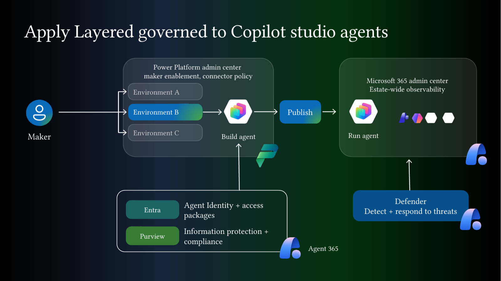
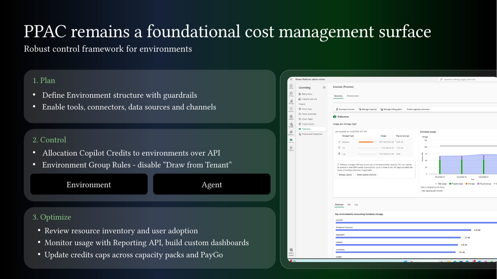
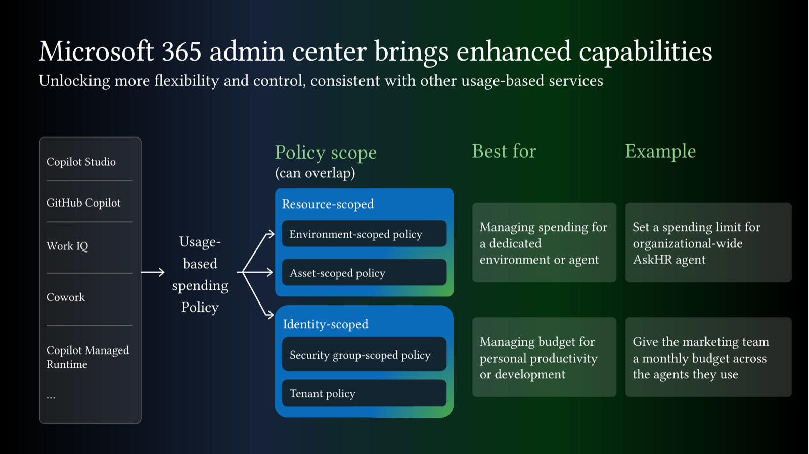
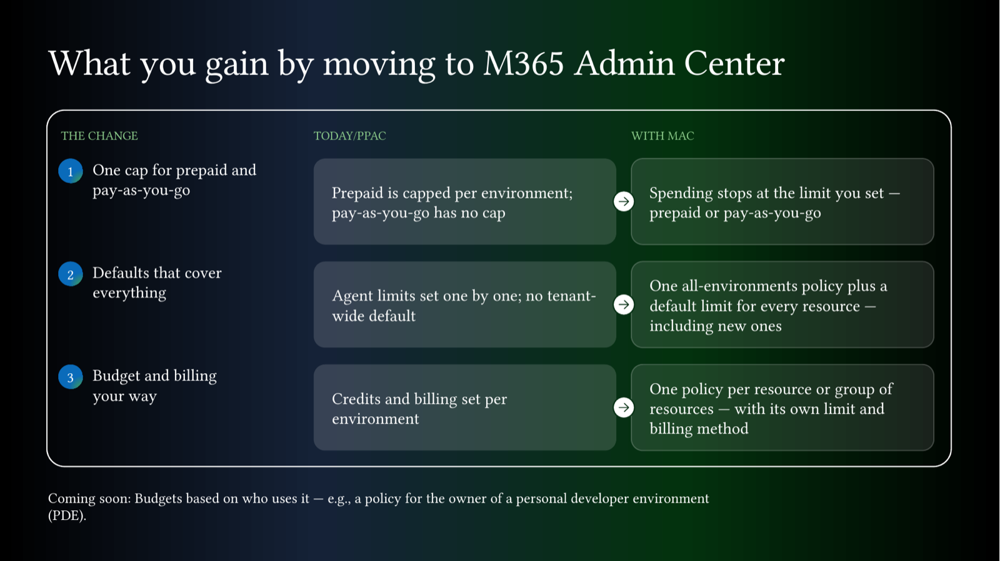

## #layered-governance 01 / Layered Governance & Five IT Roles :: 风险随能力跃迁：三层治理架构、五类管理员分工与专场实录导览 || Risk Scales with Capability: Three-Layer Architecture, Five Admin Roles, and Session Theater

智能体的治理厚度必须严格匹配其自主行动半径 [1][2]。仅挂载几份文档做检索增强问答时，基础租户权限足以兜底；一旦智能体接入业务连接器读写外部系统，乃至获配专属用户身份（Agent User ID）、独立收件箱、日历与事件触发器并在文档中被同事直接提及交办长程任务，IT 团队就必须精确锁定其连接边界与潜在故障爆炸半径 [1][5]。Copilot Studio 恰好处于低代码敏捷创新与专业代码高阶能力的交汇点，天然依托微软安全与管理生态承载分层治理闭环 [1][2]。 || Governance depth must scale directly with an agent's operational autonomy [1][2]. While basic tenant permissions suffice for simple document Q&A, connecting external systems or assigning a dedicated Agent User ID—complete with its own inbox, calendar, `@mention` collaboration, and long-running triggers—requires IT to bound data access and blast radius explicitly [1][5]. Standing at the intersection of rapid low-code creation and pro-code extensibility, Copilot Studio anchors this layered governance model natively inside the Microsoft ecosystem [1][2].

:::diagram { src: "./media/layered-governance-finops-architecture.figure.json", title: "企业智能体三层治理与统一 FinOps 控制架构（BRK262） || Enterprise Three-Layer Agent Governance & Unified FinOps Control Architecture (BRK262)" }
图 1：BRK262 确立的三层协同控制面——顶层在环境容器内赋能创作者并前置点数与风险反馈，中层联合身份、合规与安全套件维持跨生态可观测性，底层通过统一花费策略与四维报表接口闭环财务运营 [1][2][3]。 || Figure 1: Three-tier control plane detailed in BRK262—enabling makers inside governed environments on top, enforcing identity, compliance, and cross-cloud observability in the middle, and closing the FinOps loop via unified spending policies and 4D APIs underneath [1][2][3].
:::

Thomas Zou 在演讲开篇指出，“IT 团队”在大型企业中从来不是单一个人或单一部门，而是五类专职管理员围绕各自结果指标协同运作的集合体 [1]。下表还原了 BRK262 将五大管理角色与三大控制面浓缩而成的“管理员七问”职责矩阵 [1][2]： || As Thomas Zou emphasized in Act 1, "the IT team" in an enterprise is never a monolith, but a coalition of five specialized admin personas driving distinct outcomes [1]. The table below maps those five roles across three product surfaces and seven operational questions [1][2]:

| 管理角色 || Admin Persona | 主工作台 || Primary Console | 核心治理必答题与工程抓手 || Core Governance Questions & Technical Controls |
|------|------|------|
| 平台环境管理员 || Power Platform Admin | 平台管理中心（PPAC） || Power Platform Admin Center | **问题 1–3**：创作者去哪构建（环境策略与自动路由）？能用什么工具构建（共享阈值与高级连接器策略）？谁能发布与运行（应用生命周期管理）[1][2] || **Q1–Q3**: Where can makers build (environment routing)? What can they build with (sharing & connector policies)? Who can release and run (ALM) [1][2] |
| 身份与访问管理员 || Identity & Access Admin | Microsoft Entra | **问题 4**：谁能访问该智能体？配置专属智能体身份与访问包，决定按安全组强制预装至左侧导航栏或开放按需自愿安装 [1][5] || **Q4**: Who can access the agent? Configures Agent Identity and Entra access packages for mandatory left-rail rollout vs. optional install [1][5] |
| 数据合规管理员 || Compliance Admin | Microsoft Purview | **问题 6（合规侧）**：保护智能体读取与生成的信息资产，落盘敏感度标签、数据防泄漏策略与完整合规审计日志 [1][2] || **Q6 (Compliance)**: Protects information agents consume and produce via sensitivity labels, DLP baselines, and audit logs [1][2] |
| 安全运营管理员 || Security Admin | Microsoft Defender | **问题 6（威胁侧）**：在运行态实时检测异常调用并响应安全威胁，联动合规与身份信号输出高、中、低三级风险告警 [1] || **Q6 (Threat)**: Detects and responds to runtime threats in real time, surfacing consolidated High/Medium/Low risk alerts [1] |
| 全域智能体管理员 || AI Admin | M365 管理中心 / Agent 365 || M365 Admin Center (MAC) | **问题 5 & 7**：智能体能触达哪些数据与动作？如何跨平台统管微软及第三方智能体可观测性，并用花费策略核算业务产出（与平台管理员共管成本）[1][3] || **Q5 & Q7**: What data/actions can agents touch, and how do we govern estate-wide observability, ROI value, and spending policies (shared with PPAC admin) [1][3] |

下方交互导览台内嵌了 BRK262 官方 45 分钟点播视频流、原版 34 页幻灯片下载直链与五段核心时间轴索引，点击顶部胶囊标签即可分段检索实机演示细节 [1]： || The interactive theater below embeds the official 45-minute BRK262 on-demand video stream, the original 34-slide PPTX deck link, and five timestamped chapter digests covering every live demo and customer interview [1]:

:::sandbox { id: "brk262-video-theater", canvas: false, script: "./brk262-session.js", style: "./brk262-session.css", title: "Ignite 2026 [BRK262] 官方点播视频与五幕时间戳导览台 || Ignite 2026 [BRK262] Official On-Demand Stream & Five-Chapter Navigator", desc: "按时间轴切换分层治理模型、15 分钟定制看板与 Agent 365 演示、创作者点数透视、Lumen 客户访谈及 PowerShell 智能体竞速建策略实录。 || Switch across the layered model, 15-minute dashboard & Agent 365 demos, maker credit visibility, Lumen architecture interview, and live PowerShell policy race." }
纯静态议题导览沙盒：内置 BRK262 官方高清封面、内嵌流媒体播放器加载开关及五大章节精确到秒的演讲实录提要。 || Pure static session theater featuring the official BRK262 HD poster, on-demand Medius player toggle, and second-accurate transcript highlights.
:::

## #observability-value 02 / Agentic Admin & Estate Observability :: 第二幕实机拆解：15 分钟定制托管看板与 Agent 365 跨云价值归因 || Act 2 Live Walkthroughs: 15-Minute Custom Admin Apps and Agent 365 Cross-Cloud ROI

面对动辄成千上万个环境的大型租户，管理员逐层点选传统控制台菜单并手工拼凑月度汇报往往耗时费力 [1]。Graham Mosley 在第一场实机演示中展示了“以智能体治理智能体”的敏捷范式：直接在协同界面启用内置平台本体的 **Power Platform 管理员插件**，用自然语言提问“列出规模最大的前十个环境”，约一分钟即可拉回各环境的资源类型与归属明细，并一键起草完成度达 80% 的管理层高管简报文档 [1]。 || Navigating nested admin menus and manually compiling leadership briefs across thousands of environments drains IT bandwidth [1]. In his first live demo, Graham Mosley showcased "agentic governance" by invoking the **Power Platform Admin plugin** backed by a built-in platform ontology: asking in plain English for the ten largest environments returned resource breakdowns in roughly one minute and drafted an 80%-complete executive summary document for leadership [1].

当标准控制台视图无法满足特定审计口径时，管理员无需等待排期开发外部报表系统 [1]。Graham 现场输入一份两页长的 Markdown 提示词，底层自动调用 `Power Platform Admin V2` 连接器与新开放的报表接口，仅耗时约 **15 分钟**便生成了一款运行在托管运行时（Copilot Managed Runtime）中的定制监控微应用 [1]。该应用不仅清晰对比受管与非受管环境增长曲线、按创作者与智能体类型下钻资产清单，还允许管理员将脱敏洞察直接分享给无后台管理权限的业务负责人审阅 [1]。 || When standard portal views fall short, admins no longer wait on custom BI backlogs [1]. Feeding a two-page Markdown prompt over the `Power Platform Admin V2` connector and new reporting endpoints built a custom observability app on **Copilot Managed Runtime** in roughly **15 minutes**—breaking down managed vs. unmanaged environment growth and agent inventories by maker while sharing curated views safely with non-admin stakeholders [1].

  <article class="brk262-media-card">
    

      
    

    

      BRK262 官方课件原图 · Slide 6
      <h4 data-zh="跨生命周期分层治理全链路视图" data-en="End-to-End Layered Governance Across the Agent Lifecycle">跨生命周期分层治理全链路视图</h4>
      
创作者在受控环境中完成构建后，经身份访问包与数据合规基线注入发布上线，最终在统一管理中心内接受全域观测与实时威胁防护 [1][2]。

    

  </article>

智能体发布上线后，治理视角随即切换至 Microsoft 365 管理中心内的 **Agent 365** 全域面板，集中解决跨生态资产盘点与业务价值自证四大难题 [1][5]： || Once agents enter production, oversight shifts to **Agent 365** inside the Microsoft 365 Admin Center to solve four estate-wide challenges [1][5]:

:::insight-grid { cols: 2, title: "Agent 365 四大核心观测与安全管控机制 || Four Core Observability & Security Pillars in Agent 365" }
::card 01
### 跨云异构资产一屏统揽 || Multi-Cloud Heterogeneous Inventory
打破单一平台视野局限，在同一智能体清单中并排汇聚 Copilot Studio 原生智能体以及运行在 Amazon、Salesforce、ServiceNow 等外部生态上的异构智能体 [1]。 || Unifies native Copilot Studio agents alongside external agents running on Amazon, Salesforce, and ServiceNow in one consolidated inventory [1].

::card 02
### 访问包预装与病毒式分享闸门 || Access Packages & Viral Sharing Gates
以理赔处理智能体为例，管理员可直接绑定安全组与访问包决定左栏强制预装或选装，并精细管控创作者能否通过链接跨部门“病毒式”传播自建智能体 [1][5]。 || Using a Claims Processing agent example, admins bind Entra access packages for mandatory left-rail pin vs. optional install and govern viral link-based maker sharing [1][5].

::card 03
### 三源风险聚合与连接拓扑图 || Consolidated Alerts & Blast-Radius Map
安全面板将平台原生告警与 Defender、Purview、Entra 外部信号折算为高、中、低风险等级；交互式关系图直观展开邮件智能体等高频节点挂载的全部工具与关联业务用例 [1]。 || Consolidates runtime alerts from Defender, Purview, and Entra into High/Medium/Low severity while an interactive topology map reveals connected tools and downstream use cases [1].

::card 04
### 按岗位时薪微调的用例价值核算 || Wage-Tuned Use-Case Value Attribution
正面回应管理层对词元经济学的追问：将智能体消耗的算力成本与具体业务用例（如机器学习辅助、招聘规划简报）对齐，支持按特殊技能岗位时薪与单次节省工时精准校准净回报 [1]。 || Answers leadership tokenomics scrutiny by mapping token spend against task completions and letting admins tune hourly wages and time saved per specialized use case [1].
:::

## #maker-visibility-api 03 / Maker Telemetry & 4D Reporting API :: 成本共担与精细度量：创作者实时点数透视、预扣陷阱与四维报表接口 || Shared FinOps Ownership: Maker Credit Telemetry, Allocation Pitfalls, and 4D Reporting API

财务治理绝不能沦为管理员单方面追着创作者限流关停的猫鼠游戏 [1]。BRK262 提出了“成本责任下沉与前置可见”的产品设计：让业务创作者在动手搭建与测试智能体的第一时间就能看清每一次交互的真实算力代价，并自主完成早期成本测算与安全隐患修复 [1][3]。 || Cost governance fails when admins constantly police makers after bills spike [1]. BRK262 treats FinOps as a shared responsibility by pushing credit and risk telemetry directly into the maker studio so builders can estimate org-wide rollout costs and remediate warnings before escalating to IT [1][3].

在第三场 Contoso HR 智能体实机演示中，Graham 逐层展示了贯通开发全周期的四项创作者端新能力 [1]：第一，在右侧**预览测试窗**内与智能体实时对话时，界面近乎零延迟回显当前会话燃烧的点数明细；第二，切入**评测与点数优化区**，创作者可同时维护四套独立测试集，并排对比每套测试集的质量得分、执行耗时与累计耗费点数，据此精简冗余用例或调优指令；第三，上线后无论是定时触发还是他人共享调用，全部真实扣费统一沉淀在 **Monitor 运行监控页**，彻底消除环境额度被静默耗尽的盲区；第四，原先仅管理员可见的部分高风险与爆炸半径警告现已**主动下沉至创作者视图**，引导创作者在提审前自行收敛过宽权限 [1]。 || Walking through a **Contoso HR** agent in Demo 3, Graham highlighted four maker-facing capabilities [1]: first, **live preview chat** surfaces near-real-time Copilot Credit burn per turn; second, the **Evaluations & Credit Optimization** pane tracks cumulative and per-suite credit spend alongside quality scores across four test sets; third, the runtime **Monitor** tab logs final billed credits across scheduled triggers and shared runs; fourth, **security and blast-radius warnings** float directly down to makers for self-service remediation [1].

  <article class="brk262-media-card">
    

      
    

    

      BRK262 官方课件原图 · Slide 21
      <h4 data-zh="环境级规划、管控与优化三步闭环" data-en="Environment-Centric Plan, Control & Optimize Framework">环境级规划、管控与优化三步闭环</h4>
      
支持通过接口批量配置成百上千个个人开发环境额度，并利用环境组规则一键关闭“从租户总池抽水”开关 [1][4]。

    

  </article>
  <article class="brk262-media-card">
    

      
    

    

      BRK262 官方课件原图 · Slide 25
      <h4 data-zh="统一覆盖五大按量计费服务的双维策略" data-en="Overlapping Resource & Identity Spending Policies in MAC">统一覆盖五大按量计费服务的双维策略</h4>
      
将 Copilot Studio 与协同画布、托管运行时等纳入同一套花费策略引擎，支持资源域与身份域灵活叠加 [1][3]。

    

  </article>

在管理员一侧，平台管理中心依然承担着环境隔离（如在大规模个人开发环境中通过环境组规则禁用 `Draw from Tenant` 防止挤占公共池）与细粒度账单下钻的基石职责，并在本次大会正式开启 **PPAC Reporting API** 公开预览 [1][4]。该接口首次提供 **`User × Agent × Feature × Day` 四维日切片粒度**——管理员只需拉取接口数据，就能一眼查出究竟是哪位用户在哪一天违背团队规范私自调用昂贵的 Astra 模型（而非推荐的高性价比 Sonnet 模型），或是定位具体是生成式回答节点还是外部工单连接器在异常消耗点数 [1][4]。 || On the admin side, PPAC remains foundational for environment-group guardrails—such as disabling `Draw from Tenant` across hundreds of thousands of personal developer environments—and launched the **PPAC Reporting API** in Public Preview at Ignite [1][4]. Delivering **`User × Agent × Feature × Day`** daily granularity, the API lets admins pinpoint exactly which user invoked a heavyweight Astra model instead of recommended Sonnet, or isolate whether generative answers vs. ServiceNow connectors drove a sudden spend spike [1][4].

更重要的是，Graham 剖析了为什么微软决定逐步淘汰传统的“静态分配（Allocation）”并全面转向“扁平限额（Flat Limits）” [1][3]： || Crucially, Graham explained the architectural nuance driving Microsoft to retire legacy static **Allocations** in favor of **Flat Limits** [1][3]:

:::comparison { title: "旧版静态预扣分配（Allocation）vs. 新版扁平花费限额（Flat Limits） || Legacy Static Credit Allocation vs. Unified Flat Spending Limits" }
::versus 旧架构痛点：预扣锁死总池与双后台失联 || Legacy Flaw: Locked Tenant Pools & Split Consoles
### 闲置预扣导致协同画布断粮，按量计费无硬顶 || Idle Reservations Starve Cowork While PayGo Lacks Caps
旧版在环境中执行分配时会直接从租户总额度池中硬性扣减；由于两大管理中心的管理员日常缺乏实时对账，许多低活跃项目常年占着预扣额度不用，竟导致全公司总额度被意外分空、员工无法在协同画布中正常办公 [1]。此外，旧版按量计费与 Azure P3 额度无法设上限，新智能体还必须先空跑满一天才能配置限额 [1]。 || Allocating credits to an environment in classic PPAC immediately deducted them from the shared tenant total; because PPAC and MAC admins rarely synced daily, underutilized project allocations routinely locked up 100% of credits and blocked Cowork usage [1]. Classic PPAC also lacked hard PayGo caps and forced new agents to run for a full day before an agent limit could be applied [1].

::versus 新架构解法：可重叠扁平限额与双池顺次扣减 || Modern Solution: Overlapping Flat Caps & Ordered Rollover { highlight: true }
### 按需消耗共享池、触线即停，预付包优先于按量计费 || Shared Pool Elasticity, Instant Hard Stops, Capacity-First Rollover
迁移至 Microsoft 365 管理中心后，策略不再提前冻结总池额度，而是设置触线即停的扁平支出上限，支持全租户默认策略、特定环境策略与个人策略多层重叠 [1][3]。管理员首次可对预付容量包与按量计费统一设置硬封顶；当同一策略同时勾选两类计费计划时，系统严格优先消耗预付容量包，耗尽后再平滑结转至按量计费直至触及设定上限 [1][3]。 || In MAC, policies set flat stop-limits without pre-freezing the shared pool, supporting overlapping tenant defaults, resource caps, and identity budgets [1][3]. Admins get a single hard cap across both Capacity Packs and Pay-As-You-Go; when both billing plans are selected on a policy, **Capacity Packs always burn first** before rolling over cleanly to PayGo up to the cap [1][3].
:::

## #dual-scope-lumen 04 / Dual Scopes & Lumen Case Study :: 双域预算模型与 Lumen 规模化实战：关键资产兜底、10 人晋升线与 80% 预警 || Dual Policy Scopes and Lumen Case Study: Critical Asset Shielding, 10-User Promotion, and 80% Alerts

将 Copilot Studio、协同画布、Work IQ 以及承载所有自建微应用的托管运行时统一接入 Microsoft 365 管理中心后，企业终于能够按“保关键生产资产”与“放个人探索活力”两条正交逻辑组合编排花费策略 [1][3]。当管理员资助 Copilot Studio 服务时，该额度覆盖创作者在工作台内构建智能体、工作流与微应用以及运行智能体和工作流的开销；而微应用上线后的实际运行消耗则统一归口至托管运行时（Copilot Managed Runtime）结算 [1]。 || Bringing Copilot Studio, Cowork, Work IQ, and Copilot Managed Runtime under MAC lets enterprises combine **Resource-scoped** protection for production workloads with **Identity-scoped** freedom for maker experimentation [1][3]. Funding Copilot Studio covers building agents, apps, and workflows plus running agents and workflows, while running deployed micro-apps bills cleanly through Copilot Managed Runtime [1].

:::figure { src: "./media/spending-policy-scope-matrix.figure.json", title: "企业智能体花费策略选型象限：资源域保障 vs. 身份域灵活创新（BRK262） || Enterprise Spending Policy Matrix: Resource Continuity vs. Identity Flexibility (BRK262)" }
图 2：基于 BRK262 两大标准场景与 Lumen 生产治理经验绘制的四象限策略矩阵——左上角用资源级策略保障 AskHR 等核心服务永不断供，右上角用可重叠的身份与环境限额兼顾创作者跨工具实验与财务确定性 [1][3]。 || Figure 2: Four-quadrant policy matrix synthesizing BRK262's canonical scenarios and Lumen's production architecture—shielding mission-critical assets like AskHR via resource caps on the upper left while enabling governed cross-surface innovation on the upper right [1][3].
:::

围绕图 2 中的象限分野，BRK262 结合微软内部 **AskHR** 实践与特邀嘉宾 **Lumen 首席解决方案架构师 Andrew Gaskins** 的现场对谈，给出了极具实操参考价值的落地标尺 [1]： || Grounding Figure 2 in production reality, Graham's **AskHR** scenario and the onstage interview with **Lumen Principal Solution Architect Andrew Gaskins** established concrete operational benchmarks [1]:

1. **全员关键资产的资源级专款兜底（AskHR 铁律）**：企业内部的人事服务智能体（AskHR）或财务夜间批处理作业必须绑定独立的**资源级（Resource-scoped）**花费策略 [1][3]。哪怕某位员工在周末沉迷氛围编程（Vibe Coding）彻底烧光了个人名下的月度点数，周一早晨打开聊天窗口提交休假申请或违规事件工单时也绝不能因个人余额归零而被拒之门外 [1]。 || **Resource-Scoped Shielding for Critical Assets (The AskHR Rule)**: Core org-wide agents like Microsoft's internal AskHR or nightly finance jobs must carry dedicated **resource-scoped** policies [1][3]. Even if an employee burns through their entire personal monthly credit pool vibe-coding over the weekend, they must never be blocked from filing an HR incident on Monday morning [1].
2. **身份级共享池赋能跨工具自由探索**：针对市场团队或跨多项目协作的研发人员，管理员可按安全组或个人配置**身份级（Identity-scoped）**月度预算（个人与组级 Copilot Studio 策略将于 2027 年初开启公测），让员工在 Copilot Studio、协同画布等任意顺手入口共享同一月度额度池，无需后台人为指定工具边界 [1][3]。 || **Identity-Scoped Pools for Cross-Surface Experimentation**: Project teams, marketing groups, or multi-project developers receive **identity-scoped** monthly budgets (launching in preview for Copilot Studio in early 2027), drawing from one portable credit pool across Studio, Cowork, and Work IQ [1][3].
3. **Lumen 个人开发环境孵化与“超 10 人晋升”机制**：Lumen 基于多年平台治理积淀，将每位新入场创作者默认路由至受高级连接器策略保护的**个人开发环境（PDE）**，依托 Microsoft 365 Copilot 许可自带权益与经典底座安全试水，并在新版微软智能体底座上线后平滑承接创新 [1]。系统限制个人环境的分享人数规模——一旦某个自建日历助手等原型因口碑裂变需要分享给**超过 10 人**，或业务部门主动申请团队/全公司级推广，即触发正式立项流程，由 AI 治理团队介入完成环境晋升与成本建模 [1]。 || **Lumen's PDE Incubation & ">10-User" Promotion Gate**: At Lumen, makers land by default in connector-guarded **Personal Developer Environments (PDEs)** leveraging M365 Copilot license entitlements for low-risk incubation [1]. Sharing limits act as an organic radar: once an agent needs to scale beyond **10 users**—or a division requests broad deployment—Lumen's formal intake process engages the AI governance team to promote it into dedicated environments [1].
4. **Lumen 副总裁级审批与 80% 月度阈值柔性预警**：当高价值工作负载需要挂载按量计费或独立额度进入生产环境时，Lumen 执行**副总裁（VP）级别**的月度预期支出审批，并配置 **80% 预算消耗告警阈值**——在月度账单触及 80% 水位时提前预警业务方评估扩容或调优，避免业务毫无征兆地在月中被硬性断电；同时借助新管理中心细粒度策略摆脱以往“为管清一笔账被迫单智能体建单环境”的运维泥潭 [1]。 || **Lumen's VP-Level Approval & 80% Alert Guardrail**: Workloads requesting dedicated PayGo funding undergo **VP-level** monthly spend approval paired with **80% consumption alerts**, giving teams runway to adjust before hitting hard shutoffs while freeing Power Platform admins from the "complete mess" of isolating one agent per environment just to track Azure resource group billing [1].

## #agentic-finops-roadmap 05 / Agentic Policy Provisioning & 5-Step Migration :: 智能体竞速代建策略与迁移路线图：20,000 点数实测及五步落地指南 || Agentic Policy Provisioning and 5-Step Roadmap: 20,000-Credit Live Race and Migration Guide

全场的最高潮出现在第四场实机演示——Graham 发起了一场**人工点击控制台 vs. 智能体后台调接口**的现场竞速 [1]。他将一份填有预算参数的 Excel 表格与一份 Markdown 规则说明拖入 Copilot，直接用语音下达免确认指令（“YOLO 模式”），要求智能体自动创建花费策略并在完成后通过现场音响语音播报 [1]。当 Graham 才刚刚在管理中心网页里手动点开策略范围、演示如何为开发或生产资产勾选标准模型组以及设置预付包转按量计费的计费计划时，会场扬声器已传出清脆的合成语音打断演示：*“抱歉打断您的演示，您的 Ignite 花费策略已创建完毕并通过配置核验。”* [1] || Act 3 culminated in a live race between manual portal clicks and **API-first agentic FinOps** [1]. Dropping an Excel parameter sheet and Markdown instructions into Copilot, Graham issued an audio prompt in hands-free "YOLO mode" asking the agent to build a spending policy and announce completion over the room speakers [1]. While Graham was still manually clicking through scope selectors, curated model groups, and billing plans in the MAC web UI, the synthesized voice interrupted onstage: *"Sorry to interrupt your demo. Your Ignite spending policy has been created and its settings verified."* [1]

切回测试租户核验可见，该智能体在后台自动拉起 PowerShell 会话、复用缓存的管理员鉴权令牌调用 **Create Policy API**，于纽约时间 `12:34` 精准创建了一条面向指定安全组、总额度为 **`20,000` Copilot Credits** 的协同与知识花费策略 [1]。这一设计印证了微软 API 优先（API-First）的治理哲学：无论是拉取四维日消耗数据构建定制看板，还是批量下发上百个事业部的月度花费上限，企业皆可通过脚本流水线或治理智能体全自动闭环，无需人工逐页点选表单 [1][3]。 || Inspecting the test tenant confirmed that the agent spun up PowerShell in the background, authenticated with cached tokens against the **Create Policy API**, and provisioned a **`20,000`-credit** policy scoped to Graham's security group at `12:34` ET [1]. Together with the 4D Reporting API, Create Policy APIs let enterprises automate multi-department FinOps without touching portal forms manually [1][3].

  <article class="brk262-media-card">
    

      
    

    

      BRK262 官方课件原图 · Slide 31
      <h4 data-zh="从传统平台中心升级至 M365 管理中心的三大质变" data-en="Three Structural Gains Moving Cost Controls from PPAC to MAC">从传统平台中心升级至 M365 管理中心的三大质变</h4>
      
打通预付容量包与按量计费统一硬上限、提供覆盖新建资源的租户级默认限额，并支持按单一或组合资源独立绑定计费方式 [1][3]。

    

  </article>

压轴问答环节聚焦了全场得票最高的问题：“企业应当何时从旧控制台迁往 Microsoft 365 管理中心？”Graham 给出的答复是**立即启动（Start now）** [1]。他同时明确了一条扣费优先级规则：**只要环境或资源在 Microsoft 365 管理中心配置了花费策略，系统就会优先按新策略扣减**，不会在两侧重复计费 [1]。企业可按以下五步路线稳妥推进迁移 [1][3]： || Answering the top-voted audience Q&A question—"When should we start moving Copilot Studio cost controls from PPAC to MAC?"—Graham's answer was unequivocal: **Start now**, noting a critical precedence rule: **any spending policy configured in MAC automatically takes precedence over PPAC**, preventing double consumption [1]. Organizations can execute the transition cleanly through five structured steps [1][3]:

:::flow { title: "企业智能体成本治理向 M365 管理中心平滑演进五步法 || Five-Step Enterprise Migration Roadmap to MAC Cost Management" }
1. **第一步：对齐跨后台管理角色权限 || Step 1: Align Cross-Console Admin Roles** — 许多传统平台管理员默认没有 Microsoft 365 管理中心入口权限；需为策略制定者授予 **AI Administrator** 角色，为仅需查阅账单的环境管理员授予 **AI Reader** 只读角色（官方推荐角色辅助工具计划于 2027 年初推出）[1]。 || Grant **AI Administrator** in MAC to policy authors and **AI Reader** to environment admins who only review spend (a recommended-roles helper tool is planned for early 2027) [1].
2. **第二步：全面清点存量环境与账单基线 || Step 2: Audit Existing Environment & Billing Baselines** — 结合管理插件与四维报表接口逐一摸清存量环境的已分配点数、绑定计费计划、单智能体限额及业务归属责任人，识别长期闲置的预扣额度 [1][4]。 || Inventory allocated credits, billing plans, agent caps, and business owners per environment while identifying idle pre-allocated pools [1][4].
3. **第三步：按工作负载性质映射策略作用域 || Step 3: Map Policy Scopes to Workload Archetypes** — 部门级智能体集群优先采用**环境级策略**，全员核心生产智能体（如人事与IT服务台）绑定独立**资源级策略**，创作者个人孵化与跨工具办公则预留**用户/安全组策略** [1][3]。 || Assign department agent portfolios to **environment policies**, mission-critical agents to **resource policies**, and maker experimentation to **user or security-group policies** [1][3].
4. **第四步：选取低风险环境先行试点闭环 || Step 4: Pilot in Low-Risk Environments First** — 挑选若干低风险环境或少量个人开发环境启动试点，开启 **100% 硬限额拦截**与月度水位告警（如 80% 阈值），并关联对应事业部的 Azure 订阅跑通财务内部核算分摊（Chargeback）[1][3]。 || Pilot a handful of lower-risk or personal developer environments with **100% cap enforcement**, threshold alerts, and department Azure subscription links for chargeback [1][3].
5. **第五步：逐环境推广并叠加默认与按人策略 || Step 5: Expand Estate-Wide & Layer Identity Policies** — 配置租户级全环境默认限额（彻底消除新智能体首日裸奔盲区），随后按业务线逐批平滑切换环境，并在 2027 年初按用户定额预览上线后无缝纳入个人生产力治理 [1][3]。 || Set tenant-wide default resource caps to eliminate day-one blind spots, expand environment by environment, and layer in user-scoped Copilot Studio budgets as preview rolls out in early 2027 [1][3].
:::

## 参考资料：官方一手信源与技术文档 || References: Official Primary Sources & Documentation

1. **Graham Mosley, Thomas Zou & Andrew Gaskins (Microsoft Ignite 2026 BRK262)** — https://ignite.microsoft.com/en-US/sessions/1787856612903001EK5O-1791588157241001CqrV | 《Scale agents, not risk: Governance and FinOps for the enterprise》官方 45 分钟点播视频、34 页原版演示幻灯片与完整演讲实录（2026-11-18） || Official 45-minute breakout recording, 34-slide presentation deck, and WebVTT transcript featuring Lumen customer case study (Nov 18, 2026)
2. **Microsoft Learn — Copilot Studio Layered Governance & Security** — https://learn.microsoft.com/en-us/microsoft-copilot-studio/security-and-governance | Copilot Studio 企业级分层安全治理、环境路由与高级连接器策略官方文档 || Official documentation on environment routing, data loss prevention, connector guardrails, and lifecycle governance
3. **Microsoft Learn — Copilot Studio Cost Management & Spending Policies** — https://aka.ms/MCScostmanagementdocs | BRK262 官方指定成本管理与花费策略技术文档（涵盖预付容量包、按量计费封顶与管理中心策略配置） || Official cost management documentation referenced in BRK262 Slide 32 covering Capacity Packs, Pay-As-You-Go caps, and spending policies
4. **Microsoft Power Platform Admin Center — Licensing, Capacity & Reporting API** — https://learn.microsoft.com/en-us/power-platform/admin/manage-copilot-studio-messages-capacity | 平台管理中心点数容量管理、关闭租户池抽水规则及细粒度用量报表接口指南 || Official guide to Copilot Credit capacity management, disabling Draw from Tenant, and programmatic usage reporting
5. **Microsoft 365 Admin Center — Agent 365 & Entra Agent Identity Governance** — https://learn.microsoft.com/en-us/microsoft-365/admin/manage/manage-copilot-agents-integrated-apps | Microsoft 365 管理中心智能体注册表、Entra 访问包分发与跨生态运行态观测文档 || Official admin documentation for managing organizational agents, Entra access packages, and estate-wide telemetry
