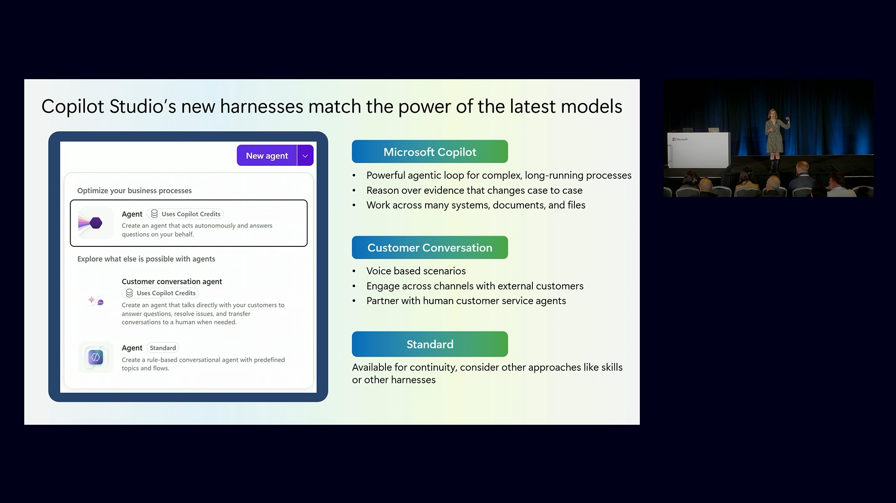
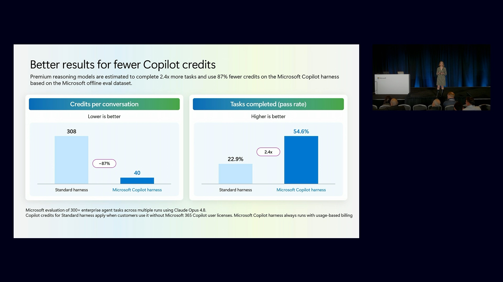
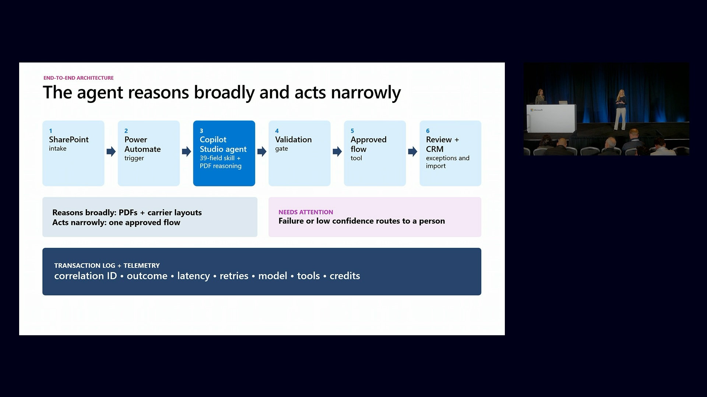
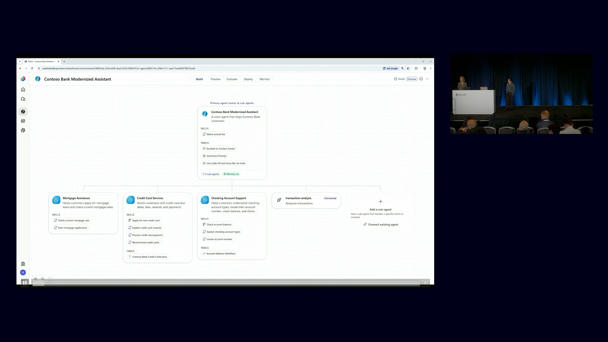

## #three-harnesses-economics 01 / Act 01: Landscape & Token Economics :: 三底座分野与评测账本：为何换底座比单纯升级模型更能降本提质 || Three-Harness Landscape & Economics: Why Switching Harnesses Beats Upgrading Models Alone

企业落地人工智能的价值通常归入三大支柱：面向个人日常办公提效的随身助手（如 Copilot 与 Cowork）、面向对外售卖软件研发的编码底座（如 GitHub Copilot），以及面向市场、人事、客服等跨部门可重复业务流程的编排平台 [1]。Copilot Studio 正是锚定第三支柱的核心载体 [1]。回顾底层架构演进，2022 年 11 月对话式大模型兴起后，微软于 2023 年推出了第一代标准底座（Standard Harness）：它刻意把用户请求切碎为窄小的单步提示词依次喂给模型，既便于单轮限流防守，又能掩盖早期模型能力参差不齐的短板 [1][2]。然而在 2024 年 12 月推理模型问世、2025 年底工具内嵌长程规划循环普及之后，当年“不让模型看见完整任务全貌”的保护性约束，反而锁死了新一代推理模型的上限 [1][2]。为此，Copilot Studio 现已在新建向导中并列提供三套目标鲜明的执行底座 [1][2]： || Enterprise AI value concentrates into three pillars: personal productivity tools like Copilot and Cowork, software product engineering tools like GitHub Copilot, and repeatable cross-departmental business processes powered by Copilot Studio [1]. Following the November 2022 chat wave, Copilot Studio launched its 2023 Standard harness around single-turn narrow prompts that intentionally hid the full task so weaker early models stayed cheap, fast, and guarded [1][2]. Once reasoning models arrived in December 2024 and long-horizon plan-execute-verify loops matured in late 2025, those protective blinders began throttling frontier model capability [1][2]. Today, the Copilot Studio creation wizard exposes three specialized harnesses side by side [1][2]:

:::insight-grid { cols: 3, title: "Copilot Studio 新建智能体三大执行底座定位对比 || Positioning the Three Agent Harnesses in Copilot Studio" }
::card Microsoft Copilot 底座 || Microsoft Copilot Harness
### 长周期跨系统自主推理首选 || Built for Complex Long-Running Processes
基于 Microsoft Copilot 软件开发工具包与每会话专属 Azure 隔离容器构建，提供命令行与本地磁盘文件系统，擅长处理逐案变化的异构证据与多系统协同，统一采用按用量消耗点数计费 [1][2]。 || Built on the Microsoft Copilot SDK with per-session Azure containers (CLI + local disk), ideal for case-by-case evidence reasoning across systems under usage-based credit billing [1][2].

::card 客户对话底座（现已正式商用） || Customer Conversation Harness (GA)
### 外部全渠道超低延迟语音与在线客服 || Optimized for Real-Time Omnichannel & Voice
原生内建实时低延迟语音模型与多语种音色，在单一画布内混编多子智能体、生成式技能与确定性主题，直连电话热线、官网微件与人工坐席转接 [1][2]。 || Native ultra-low-latency speech and web chat in one multi-agent canvas blending generative skills with deterministic topics and human contact center handoff [1][2].

::card 标准底座（延续性支持） || Standard Harness (Continuity)
### 保障既有预定义分支资产平稳运行 || Retained for Existing Rule-Based Investments
继续支持绑定坐席许可或按量计费的存量规则型对话机器人；对于新立项智能体，官方明确建议优先选用前两款现代底座以获取更高业务回报 [1][2]。 || Preserves existing topic-tree bots under seat licenses or consumption plans; Microsoft recommends choosing one of the two newer harnesses for net-new builds [1][2].
:::

下方交互导览台汇总了 BRK264 全场 44 分 42 秒官方点播流、原版讲义下载入口及四幕核心实录时间轴 [1]： || The interactive theater below pairs the official 44m42s Medius on-demand stream with slide deck links and timestamped cues across all four acts [1]:

:::sandbox { id: "brk264-video-theater", canvas: false, script: "./brk264-theater.js", style: "./brk264-theater.css", title: "Ignite 2026 [BRK264] 官方点播视频播放器与四幕时间轴导览 || Ignite 2026 [BRK264] Official On-Demand Stream & Four-Act Timestamp Guide", desc: "点击封面可在页内直接挂载微软 Medius 官方点播流，或切换四幕标签检视三底座评测、投顾穿透演示、NFP 医保实战与客户对话底座时间点。 || Click the poster to mount Microsoft's official Medius player inline, or switch across the four acts for WebVTT timestamps and slide deck links." }
纯静态 BRK264 专场视频与时间轴导览台：集成官方高清封面、页内点播流加载器及四幕逐字稿关键节点索引。 || Pure static BRK264 video theater featuring the official session poster, inline Medius embed loader, and four-act WebVTT chapter cues.
:::

:::figure { src: "./media/brk264-harness-decision-architecture.figure.json", title: "Copilot Studio 三大执行底座工作负载分流与统一企业治理拓扑（BRK264） || Copilot Studio Three-Harness Workload Routing & Unified Governance Topology (BRK264)" }
图 1：依据 BRK264 开场选型页与收官治理矩阵绘制的架构全景——顶层按流程复杂度与延迟敏感度分流至三大底座，底层共享多模型选型、联络中心智能、全生命周期管理与数据防泄漏安全护栏 [1][2]。 || Figure 1: Full decision and platform topology synthesized from BRK264's opening picker and closing governance matrix—routing workloads by complexity and latency into three harnesses atop shared model choice, Contact Center Intelligence, lifecycle management, and data security [1][2].
:::

针对许多按量付费客户担心“多步自主循环更烧钱”的顾虑，Alice Appleton 披露了三组硬核离线评测账本 [1][2]。首先在统一运行 Claude Sonnet 4.6 的业务邮件与流程评测集中，Microsoft Copilot 底座在四大维度全面胜出：知识问答从 66.0% 升至 86.4%（+20.4 个百分点），代码分析从 40.6% 跃升至 88.1%（+47.5 个百分点）；文件分析从 63.5% 升至 91.7%（+28.2 个百分点），多工具调用从 87.0% 升至 98.9%（+11.9 个百分点），同时单任务输入词元反而从 47.8K 降至 26.5K（净省 45%）[1][2]。其次在“究竟什么推动通过率”的归因对照中，停留在标准底座上单纯更换更强模型，通过率仅微动 **0.2 个百分点**（67.0% 至 67.2%）；而保持同一批任务与模型直接切换至新底座，OpenAI 模型通过率净涨 **10.8 个百分点**（达 78.0%），Anthropic 模型更飙升 **22.1 个百分点**（达 89.1%）[1][2]。 || Addressing customer concern that autonomous multi-step loops might inflate consumption bills, Alice Appleton presented three offline evaluation datasets proving the opposite [1][2]. First, on identical Claude Sonnet 4.6 business-process tasks, the Microsoft Copilot harness lifted knowledge pass rates from 66.0% to 86.4% (+20.4 pts) and code analysis from 40.6% to 88.1% (+47.5 pts). File analysis also rose from 63.5% to 91.7% (+28.2 pts) and multi-tool runs from 87.0% to 98.9% (+11.9 pts), while input tokens fell 45% from 47.8K to 26.5K [1][2]. Second, isolating what actually moves pass rates showed that upgrading to a stronger model on the Standard harness shifted pass rates by just **0.2 pts** (67.0% to 67.2%), whereas switching to the Microsoft Copilot harness on the exact same models unlocked **+10.8 pts** on OpenAI (78.0%) and **+22.1 pts** on Anthropic (89.1%) [1][2].

### 展开深读：提示词缓存代际差异与 Claude Opus 4.8 点数账本 || Deep Dive: Prompt Caching Mechanics & Claude Opus 4.8 Credit Math

这种“干活更多却花钱更少”的反直觉现象，源于提示词缓存架构的代际差异 [1][3]。新底座每轮会话发起的模型调用次数接近标准底座的两倍（OpenAI 为 4.3 次对比 2.6 次，约 1.7 倍；Anthropic 为 4.8 次对比 2.3 次，约 2 倍），但增量上下文拼接让提示词缓存命中率从 45% 跃升至 **83%**（OpenAI，+38.6 个百分点）、从 39% 跃升至 **88%**（Anthropic，+48.2 个百分点），使折算缓存权重后的净输入词元成本再降 **15%–21%**（OpenAI 由 29.5K 降至 18.2K，Anthropic 由 37.2K 降至 15.6K）[1][3]。折算为真实的客户账单：在涵盖 300 余项企业任务的 Claude Opus 4.8 多轮评测中，新底座将任务完成率从 22.9% 推高至 **54.6%**（2.4 倍），单次会话消耗的 Copilot 点数则从 **308 点骤降至 40 点**，降幅高达 **87%** [1][2]： || Prompt caching mechanics explain why making nearly twice as many model calls per conversation (4.3 vs. 2.6 on OpenAI; 4.8 vs. 2.3 on Anthropic) still lowers net spend [1][3]. Incremental context assembly boosts prompt cache hit rates from 45% to **83%** on OpenAI (+38.6 pp) and from 39% to **88%** on Anthropic (+48.2 pp), trimming cache-normalized input token cost by **15%–21%** (29.5K to 18.2K on OpenAI; 37.2K to 15.6K on Anthropic) [1][3]. Translated directly into customer billing across 300+ enterprise tasks evaluated on Claude Opus 4.8, the Microsoft Copilot harness raised task completion from 22.9% to **54.6%** (2.4x) while slashing average spend from **308 down to 40 Copilot credits per conversation**—an **87% reduction** [1][2]:

$$
\Delta P_{\text{Opus 4.8}} = 22.9\% \rightarrow 54.6\%\; (2.4\times), \qquad \Delta C_{\text{credits}} = 308 \rightarrow 40\; (-87\%), \qquad R_{\text{cache}} \in [83\%,\, 88\%]
$$

:::figure { src: "./media/brk264-harness-economics-benchmarks.figure.json", title: "BRK264 官方离线评测对比：点数降幅、缓存命中率跃升与跨任务提质幅度 || BRK264 Official Offline Benchmarks: Credit Savings, Cache Hit Gains & Quality Lifts" }
图 2：汇总 BRK264 第 1 幕四页连续评测数据——无论是 Sonnet 4.6 单项能力、OpenAI/Anthropic 跨代换底座增益，还是 Claude Opus 4.8 单会话点数账单（−87%），现代循环底座均同步改善了交付质量与单位成本 [1][2]。 || Figure 2: Consolidated benchmark deltas from BRK264 Act 1—spanning Sonnet 4.6 task lifts, Anthropic/OpenAI harness-swap gains, prompt cache efficiency, and the 87% per-conversation credit drop on Claude Opus 4.8 [1][2].
:::

  <article class="brk264-media-card">
    

      
    

    

      BRK264 实录 06:32 · 产品新建入口
      <h4 data-zh="Copilot Studio 三大执行底座选型界面" data-en="Three Harnesses Inside the New Agent Experience">Copilot Studio 三大执行底座选型界面</h4>
      
顶部置顶 Microsoft Copilot 底座与客户对话底座，底部保留标准底座服务存量延续需求 [1][2]。

    

  </article>
  <article class="brk264-media-card">
    

      
    

    

      BRK264 实录 12:22 · Opus 4.8 成本实证
      <h4 data-zh="300+ 企业任务：2.4 倍完成率与 87% 点数节省" data-en="300+ Enterprise Tasks: 2.4x Completions for 87% Fewer Credits">300+ 企业任务：2.4 倍完成率与 87% 点数节省</h4>
      
在同用旗舰推理模型 Claude Opus 4.8 时，单次会话点数由 308 降至 40，彻底打消按量迁移顾虑 [1][2]。

    

  </article>

## #wealth-advisor-demo 02 / Act 02: Financial Insights Live Demo :: 实机演示：投顾智能体穿透核查基金持仓，单次仅耗 87.91 点数 || Live Demo: Financial Advisor Agent Fund Look-Through for 87.91 Credits

在第二幕实机演示中，Alice Appleton 扮演财富管理机构 Northwind Traders 的理财顾问，展示了如何在 Microsoft Copilot 底座上用“非确定性模型判断 + 确定性审批工作流”组装生产级 `Financial Insights Agent v8` [1]。与旧时代动辄编写数页死板操作步骤提示词的做法不同，新底座的智能体指令只交代业务目标与核心纪律：市场行情仅允许引用经过核验的晨星（Morningstar）实时数据源，严禁抓取公开网页传言；行文保持中立分析并提供对比表格与时间戳链接 [1]。模型栏直接开启 **Auto 自动选模**，无需人工干预即可随前沿新模型上线平滑获益 [1]。 || In Act 2, Alice Appleton stepped into the role of a Northwind Traders wealth advisor to demonstrate `Financial Insights Agent v8` on the Microsoft Copilot harness, pairing non-deterministic reasoning with deterministic workflow guardrails [1]. Rather than writing multi-page procedural prompt scripts, her instructions concisely stated the business objective and non-negotiable rules: pull market data strictly from verified Morningstar sources rather than random web pages, maintain an analytical tone, and lead with timestamped comparison tables [1]. Model selection stayed on **Auto**, passing along frontier model upgrades automatically [1].

为了避免无关规范长期挤占上下文窗口，团队将公司品牌邮件排版要求封装为独立的 Markdown **技能（Skill：`northwind-traders-email-template`）**，智能体仅在真正起草邮件的那一轮才将其按需调入上下文 [1]。外部动作层共挂载晨星模型上下文协议服务（Morningstar MCP Server）、顾问个人资料查询、客户持仓读取，以及一条名为 `Send Client Email with Approval` 的**确定性审批工作流**（新版设计器支持上下或左右拓扑切换）——确保任何发往客户的调仓提醒都必须先经顾问本人点击批准方可发出，同时外挂《Northwind 投资理念》文档供循环按需检索 [1]。 || To keep formatting rules from polluting reasoning turns, branded email guidelines lived inside a modular Markdown **Skill** (`northwind-traders-email-template`) loaded into context strictly when drafting an email [1]. External connections combined the third-party **Morningstar MCP Server**, advisor profile lookup, client holdings retrieval, firm philosophy knowledge (`Northwind-Traders-Investment-Philosophy.docx`), and a deterministic **`Send Client Email with Approval` workflow** (viewable left-to-right or top-to-bottom in the redesigned workflow canvas) so no client message ever leaves without human sign-off [1].

当提交开放式评估请求后，智能体针对任职于微软的客户账户 `LAMBERT233`（投资组合总市值 **$1,942,933.72**）展开了超越字面指令的深度核查 [1]： || Given an open-ended portfolio review prompt for Microsoft-employed client `LAMBERT233` (**$1,942,933.72** total portfolio value), the agent reasoned beyond literal instructions [1]:

1. **自主穿透指数与共同基金底层持仓 || Autonomous Direct + Index-Fund Look-Through** — 尽管客户直接持有的 156 股微软股票（净值 $506.24，市值 $78,973.44）仅占组合 **4.06%**，表面未触及员工约定的 **5%** 集中度上限，但智能体主动穿透核查了客户所持指数基金的前十大重仓股，算出微软总敞口高达 **9.48%（$184,212.62）**，超出目标红线 **$87,065.93** [1]。 || Although 156 direct MSFT shares ($78,973.44 at $506.24 NAV) represented just **4.06%**—seemingly under the **5%** cap agreed for a Microsoft employee—the agent autonomously looked through index-fund holdings to uncover **9.48% ($184,212.62)** total MSFT exposure, **$87,065.93** over target [1].
2. **顺带揪出第二重单一标的超限风险 || Proactive Single-Equity Guardrail Check** — 对照公司投资理念文档第 9.2 表规定的“单一股票不超过 10%”纪律，智能体进一步检出客户穿透后的英伟达（NVIDIA）总敞口已达 **10.68%**，一并纳入高优预警 [1]。 || Cross-checking firm Philosophy Table 9.2 (10% single-equity limit), the agent proactively flagged that look-through NVIDIA exposure had reached **10.68%** [1].
3. **低于 1 美元完成全套三表简报与合规建议 || Sub-Dollar Execution with Actionable Tax & Window Advice** — 智能体按品牌模板生成含三张明细表的审批草稿，建议核实员工交易窗口期、与注册会计师评估税负批次并将重叠成长型基金调入国际或债券资产；现场实时运行完整闭环仅消耗 **87.91 Copilot 点数（折合不到 1 美元）** [1]。 || Drafted a branded high-importance email with three breakdown tables and concrete next steps—checking Microsoft employee trading windows and CPA tax lots before trimming shares—completing live in **87.91 Copilot credits (under $1)** [1].

## #nfp-medicare-case 03 / Act 03: NFP Customer Production Case :: 客户实战：NFP 以“广域推理、窄域行动”攻克 20+ 版式医保单据入库 || Customer Proof: How NFP Automated 20+ Medicare Carrier Formats with "Reason Broadly, Act Narrowly"

第三幕由保险经纪、员工福利与财富管理机构 **NFP**（业务横跨美国、加拿大、英国与爱尔兰）应用工程副总裁 Jennifer Ratten 登台分享真实规模化经验 [1]。NFP 自 2025 年起开展全员面对面实训并普及 Copilot Studio 创作者许可，内部智能体数量呈复利式增长；但当新底座与按用量计费模式推出时，面对数千名创作者可能全选高价模型、挂载大量外部服务并触发自主重试的“最坏推演”，团队一度面临因担忧账单失控而停滞观望的风险 [1]。NFP 的破局之道是**用限时实测遥测取代主观空想**：在固定时间切片内真实采集新旧底座的运行轨迹、模型选择与点数变化，将模糊焦虑转化为可量化的治理仪表盘，使治理机制成为加速交付的护航器而非审批路障 [1]。 || In Act 3, Jennifer Ratten, VP of Application Engineering at **NFP**—a human capital, risk, benefits, and wealth firm operating across the US, Canada, the UK, and Ireland—shared how a federated enterprise scaled adoption safely [1]. After in-person training fueled compounding maker growth starting in 2025, consumption-based billing initially sparked fear: thousands of makers might pick the priciest models, attach sprawling MCP servers, and trigger runaway autonomous retries [1]. Rather than freezing innovation, NFP replaced worst-case imagination with **time-bound telemetry**, measuring real segment behavior across Standard and Microsoft Copilot harnesses so governance acted as an accelerator rather than a gate [1].

在核心生产场景中，NFP 落地了**联邦医疗保险（Medicare）与个人健康险申请单处理智能体** [1]。每逢年度开放投保高峰期，分布在 **4 个联邦大区**的一线业务员每天上传海量投保申请 PDF，涵盖 **20 余种承保商版式**（含手写扫描件与机打表格，各区域目录规范各异）[1][2]。过去团队完全依赖人工逐份打开 PDF、核验并重复敲入 **39 个客户关系管理（CRM）字段**，真正的产能瓶颈并非业务需求不足，而是沉重的手工重录负荷 [1][2]。Jennifer 将该系统的成功浓缩为一句工程准则：**“广域推理，窄域行动（Reasons broadly, acts narrowly）”** [1][2]： || NFP applied this operating model to its **Medicare and Individual Health application processing agent** [1]. Especially during open-enrollment surges, producers across **four federated regions** submit applications spanning **20+ carrier PDF formats**—mixing handwritten scans and typed forms—previously forcing staff to manually open each PDF, re-key **39 CRM fields**, validate entries, and re-attach source files [1][2]. Because manual effort—not demand—was the bottleneck, NFP engineered an event-driven pipeline around a crisp architectural principle: **the agent reasons broadly and acts narrowly** [1][2]:

:::flow { title: "NFP 医保与个人健康险无头处理管线（20+ 版式 → 39 个 CRM 字段） || NFP Event-Driven Medicare Application Pipeline (20+ Carrier Layouts → 39 CRM Fields)" }
1. **区域文件夹事件接入（SharePoint + Power Automate） || Regional SharePoint Intake & Trigger** — 四大区域业务员按各自习惯将保单 PDF 放入对应 SharePoint 目录，由 Power Automate 触发器以无头（Headless）事件驱动方式唤醒智能体 [1][2]。 || Producers drop PDFs into regional SharePoint folders, firing an event-driven Power Automate trigger for headless execution [1][2].
2. **单一可复用技能广域解析（39-Field Skill） || Broad Reasoning via One Reusable 39-Field Skill** — 无需为 20 多家承保商分别编写条件分支流，智能体加载统一的 39 字段结构化提取技能，自适应识别手写字迹、异构版式与区域口径差异 [1][2]。 || Without maintaining separate conditional flows per carrier, the agent applies one modular 39-field extraction skill across diverse handwritten and typed layouts [1][2].
3. **精度校验门禁与人工异常复核（Validation Gate） || Rigorous Validation Gate & Exception Routing** — 对提取结果执行严格的字段置信度与完整性核验；低置信度或异常条目自动分流至业务专员复核，实现“自动化重复劳动，保留人类专业判断” [1][2]。 || Validates field accuracy automatically and routes low-confidence outliers to human reviewers—automating repetition while preserving human judgment [1][2].
4. **单一受批工作流窄域写回与全链路遥测（CRM + Logs） || Narrow Approved CRM Flow & Observable Runtime** — 校验通过的数据仅允许通过唯一受控工作流写入核心系统，并全量记录关联编号、结果、延迟、重试次数、模型、工具与消耗点数供审计调优 [1][2]。 || Writes clean records through one approved CRM flow while logging correlation IDs, latency, retries, model calls, tools, and credits [1][2].
:::

## #customer-conversation-cci 04 / Act 04: Customer Conversation Harness & CCI :: 何时不应选 Copilot 底座：客户对话底座与联络中心智能（现已 GA） || When Not to Use Copilot Harness: Customer Conversation Harness & Contact Center Intelligence (GA)

既然 Microsoft Copilot 底座如此强大，何时**不应当**用它构建智能体？微软产品经理 Jason Xian 在第四幕给出了明确边界：深度推理循环以任务完结质量为第一目标，并未针对外部客户通话所需的**毫秒级超低延迟与实时双向语音交互**做专门优化 [1]。当你构建部署在企业官网、400/800 客服电话号码、交互式语音应答（IVR）或 Teams Phone 上直接面向外部消费者的智能体时，应当选择上月发布并于大会当日正式全面商用（GA，覆盖美、欧、澳、英、加、亚、瑞士及阿联酋，后续扩展至政府云 GCC）的 **客户对话底座（Customer Conversation Harness）** [1][2]。 || Returning to the session's central question—when should you *not* use the Microsoft Copilot harness?—Jason Xian drew a crisp boundary in Act 4: deep reasoning loops optimize for complex goal completion rather than sub-second speech turn-taking [1]. Whenever an agent engages external customers directly across websites, phone numbers, IVRs, or Teams Phone, teams should pick the **Customer Conversation harness**, now generally available across the US, EU, Australia, the UK, Canada, Asia, Switzerland, and the UAE (with GCC planned) [1][2].

该底座并非在文本机器人外临时拼接语音插件，而是将**实时潜空间语音模型（Real-time Latent Speech Models）**原生融于内核：创作者不仅能按语种配置丰富音色（如现场分享的意大利语口语陪练），还能精细调节响应延迟阈值与拾音灵敏度，从容过滤环境背景噪音或捕捉轻声细语，并跨来电回拨持久保留历史对话记忆 [1]。在单画布多智能体编排界面中，自然语言描述即可一键生成如同真实客服班组般协同的专职子智能体（每个子智能体独立拥有专属工具、指令、知识库与技能），且同时兼容**生成式技能、确定性工作流以及经典 Copilot Studio 主题（Classic MCS Topics）** [1][2]。与此同时，同日正式商用的 **Microsoft Contact Center Intelligence（CCI，联络中心智能）** 让企业无需改动既有呼叫路由队列，仅粘贴客户端标识即可直连 **Genesys、Avaya、Five9 与 Cisco** 等主流联络中心，原生解锁来电声纹生物识别核身与后台逐通会话自动质检打分 [1][2]。 || Rather than bolting speech onto a text bot, the harness embeds **real-time latent voice models** natively—supporting per-language voice fonts, configurable latency and microphone sensitivity thresholds for noisy environments, and persistent cross-call memory [1]. Its single-canvas multi-agent builder generates specialized sub-agents from natural language, each carrying scoped tools, instructions, knowledge, generative skills, workflows, and **classic MCS Topics** [1][2]. Paired with **Microsoft Contact Center Intelligence (CCI)**—also reaching GA at Ignite—enterprises connect existing **Genesys, Avaya, Five9, or Cisco** contact centers without altering routing queues, adding caller-ID + **voice biometric authentication** and background QA scoring agents [1][2].

  <article class="brk264-media-card">
    

      
    

    

      BRK264 实录 28:35 · NFP 端到端架构
      <h4 data-zh="NFP 医保单据“广域推理、窄域行动”六步管线" data-en="NFP's Six-Stage 'Reason Broadly, Act Narrowly' Pipeline">NFP 医保单据“广域推理、窄域行动”六步管线</h4>
      
前端开放兼容 20+ 承保商 PDF 版式推理，后端收口至单一受控工作流落库并全量沉淀遥测日志 [1][2]。

    

  </article>
  <article class="brk264-media-card">
    

      
    

    

      BRK264 实录 38:10 · 客户对话多子代理画布
      <h4 data-zh="Contoso 银行现代助手：单画布统管三大业务子代理" data-en="Contoso Bank Assistant: Three Scoped Sub-Agents in One Canvas">Contoso 银行现代助手：单画布统管三大业务子代理</h4>
      
主代理挂载声纹核身与人工转接工具，下辖房贷、信用卡与支票账户专员，混编生成式技能与确定性流 [1][2]。

    

  </article>

在 `Contoso Bank Modernized Assistant` 双模态实机演示中，Jason 上传信用卡手册创建生成式推荐技能后直接发起免号码语音预览：智能体在询问年费偏好与贵宾厅需求后，自然流畅地推荐了年费 **$495**、附带 Sky Lounge 权益的 `Contoso Horizon Reserve` 信用卡；切回银行官网聊天微件输入申卡指令时，同一智能体立即调用确定性主题弹出富交互自适应卡片（Adaptive Card）；随后直接拨打绑定的客服电话查询支票账户余额，智能体基于来电号码与 Jason 本人声纹当场完成免密核身（若换旁边的 Alice 说话则会立即拒止），并触发受保护工作流准确播报账户余额 **$68** [1]。下表浓缩了三大执行底座在全部关键选型维度上的实战对照，无论最终选定哪套底座，底层均共享同一套企业级应用生命周期管理（ALM）、数据最小权限治理、审计日志与点数成本管控 [1][2]： || In the `Contoso Bank Modernized Assistant` demo, Jason uploaded a card brochure into a generative skill and ran a phone-free voice preview that naturally pitched the **$495/year** `Contoso Horizon Reserve` card with Sky Lounge access; on the Contoso Bank website widget, typing *"apply for credit card"* invoked a deterministic topic rendering a visual Adaptive Card; finally, dialing the live phone number triggered **caller ID + voice biometric authentication** (which would reject Alice's voice) before running a gated workflow to read out his **$68** checking balance [1]. The matrix below summarizes how to pick across all three harnesses—every one of which inherits unified Copilot Studio ALM, least-privilege security, audit logs, and spend controls [1][2]:

| 选型评估维度 || Selection Factor | Microsoft Copilot 底座 || Microsoft Copilot Harness | 客户对话底座（GA） || Customer Conversation Harness (GA) | 标准底座（延续支持） || Standard Harness (Continuity) |
|------|------|------|------|
| 最佳适用场景 || Ideal Workload | 跨多系统、逐案多变证据的长周期复杂业务流程（如投顾穿透、20+ 版式保单入库）[1][2] || Complex, long-running multi-system processes & variable document/code analysis [1][2] | 面向外部客户的官网在线客服、电话热线、IVR 与人机协同联络中心 [1][2] || External customer voice agents, IVRs, web widgets & human contact center handoffs [1][2] | 已投产的规则分支型内部或轻量问答智能体资产平滑维护 [1][2] || Maintaining existing rule-based conversational agents with predefined flows [1][2] |
| 延迟与交互模态 || Latency & Modality | 侧重多轮深度规划、工具自愈与高完成率，支持对话及无头事件触发 [1][2] || Optimizes accuracy & autonomous multi-step completion (interactive or headless) [1][2] | 原生实时潜空间语音模型，主打毫秒级超低延迟双工对话与多音色抗噪 [1] || Ultra-low-latency real-time speech + multimodal web chat in one single agent [1] | 单轮快速响应，受限于窄提示词拆分而缺乏全局多步推理视野 [1] || Fast single-turn replies constrained by narrow sequential sub-prompts [1] |
| 编排与确定性抓手 || Orchestration & Control | Copilot SDK 循环 + Azure 容器沙盒 + 模块化技能 + 确定性工作流 / 生命周期钩子 [1][4] || Copilot SDK loop + Azure CLI/disk sandbox + skills + workflows & hooks [1][4] | 单画布多子代理，混编生成式技能、工作流、跨通话记忆与经典 Topics [1][2] || Single-canvas sub-agents mixing generative skills, workflows, memory & classic Topics [1][2] | 传统预定义主题（Topics）分支树与连接器动作编排 [1][2] || Predefined topic trees and connector action sequences [1][2] |
| 身份与渠道扩展 || Identity & Channels | 企业委托身份、Work IQ、MCP 服务及动态任务子智能体（BRK259 深入展开）[1][4] || Enterprise delegated auth, Work IQ, MCP servers & dynamic sub-agents [1][4] | 直连网站、电话网、Teams Phone 及 Genesys/Avaya/Five9/Cisco（含声纹核身）[1][2] || Web, telephony, Teams Phone & CCI links to Genesys, Avaya, Five9, Cisco + voice bio [1][2] | Microsoft 365 内部渠道及常规网页/消息通道 [1] || Microsoft 365 employee channels and standard chat endpoints [1] |
| 计费与经济模型 || Licensing & Economics | 纯按用量消耗 Copilot 点数；高缓存命中（83%–88%）在 Opus 4.8 上较标准按量省 87% [1][2] || Pure usage-based Copilot credits; 83%–88% cache hit cuts Opus 4.8 credits by 87% [1][2] | 按用量消耗 Copilot 点数（配备官方成本估算器辅助容量规划）[1] || Usage-based Copilot credits with built-in cost estimation calculator [1] | 支持 M365 Copilot 员工坐席许可包含，或预购/按需消耗点数 [1][2] || Included with M365 Copilot user licenses or billed via consumption credits [1][2] |

## 参考资料：官方一手信源与延展专场 || References: Official Primary Sources & Related Sessions

1. **Alice Appleton, Jennifer Ratten & Jason Xian (Microsoft Ignite 2026 BRK264)** — https://ignite.microsoft.com/en-US/sessions/1787856613195001Eigo-1791588173931001C2oW | 《Pick the right harness to build your agents with using Copilot Studio》官方点播视频（Medius ID: `840f0781-2aae-4992-a99e-1c0e984a71c0`）与双语 WebVTT 演讲逐字稿（2026-11-18） || Official on-demand recording and bilingual WebVTT transcript (Nov 18, 2026)
2. **Alice Appleton, Jennifer Ratten & Jason Xian (BRK264 Official Slide Deck)** — https://medius.microsoft.com/video/asset/PPT/840f0781-2aae-4992-a99e-1c0e984a71c0 | BRK264 官方原版 PPTX 演示讲义（含三大底座选型入口、Opus 4.8 点数评测、NFP 39 字段医保架构与 Contoso 银行多子代理画布） || Official presentation deck covering the three-harness picker, Opus 4.8 credit benchmarks, NFP 39-field pipeline, and Contoso Bank sub-agent canvas
3. **Ben Appleby (Microsoft Copilot Blog)** — https://www.microsoft.com/en-us/copilot/blog/copilot-studio/how-the-microsoft-copilot-harness-in-copilot-studio-helps-agents-finish-the-job/ | 《How the Microsoft Copilot harness in Copilot Studio helps agents finish the job》官方架构白皮书解读：Azure 隔离容器、83%–88% 提示词缓存命中率与离线评测方法论（2026-11-09） || Official architectural analysis of Azure container sandboxes, 83%–88% prompt cache hit rates, and offline benchmark methodology (Nov 9, 2026)
4. **Microsoft Ignite 2026 Companion Sessions (BRK259 & BRK379)** — https://learn.microsoft.com/en-us/microsoft-copilot-studio/whats-new | Copilot Studio 官方更新文档及讲者现场推荐的两场进阶专场：BRK259（Microsoft Copilot 底座钩子、变量与动态子代理深度剖析）与 BRK379（构建面向外部客户的对话智能体实战） || Official Copilot Studio release notes alongside companion deep-dive sessions BRK259 and BRK379 referenced on stage
