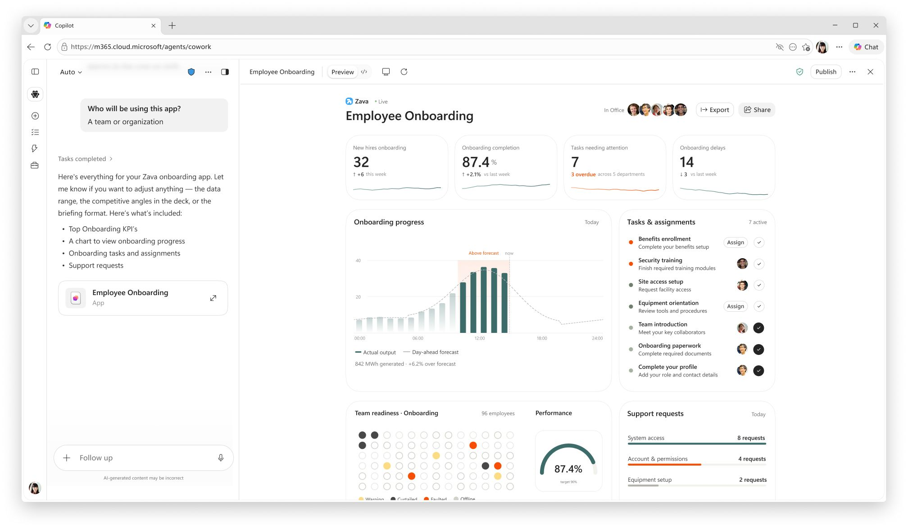
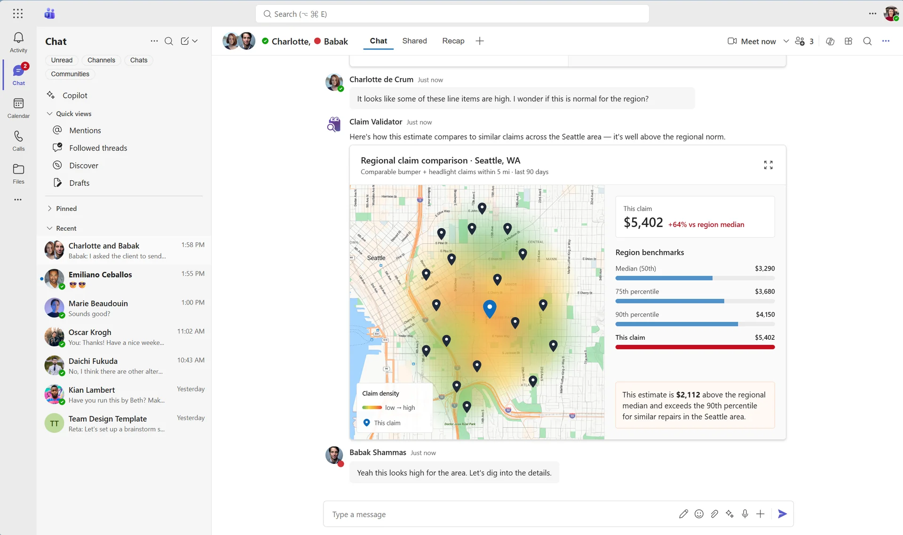
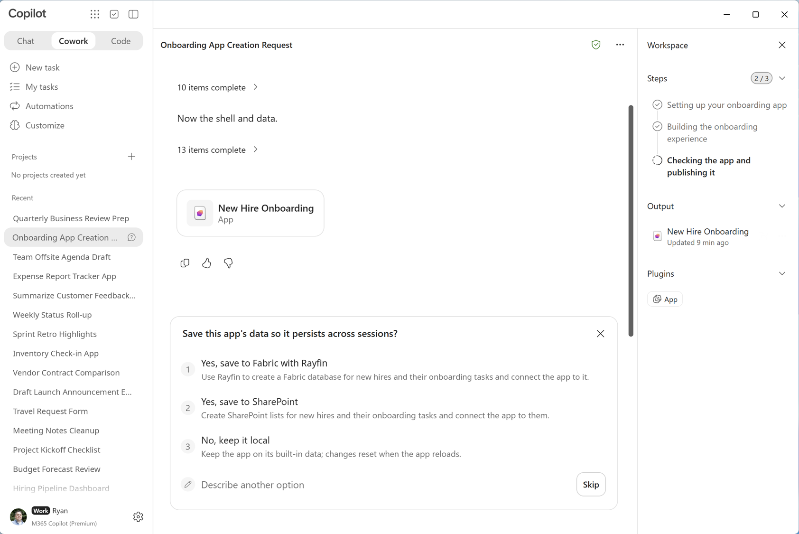
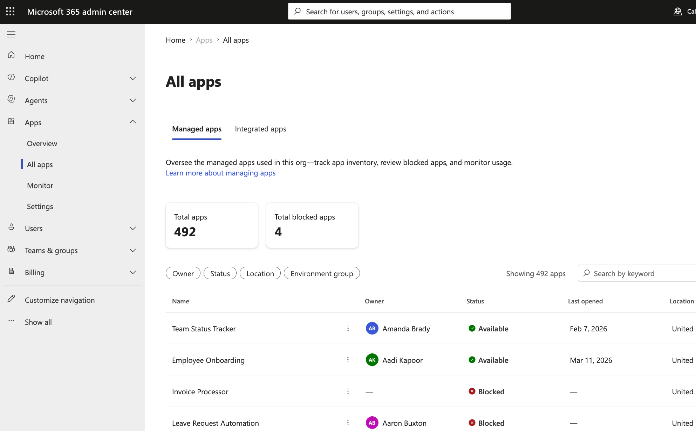

## #portfolio-and-trinity 01 / Portfolio & Trinity :: 战略坐标与反模式破局：AI 转型的三条路径与三位一体架构 || Portfolio Framing & Anti-Patterns: Three Ways to AI Transformation and Process Trinity

技术团队在推进智能化落地时，最常遇到的架构分歧并非底层模型优劣，而是工具职责错位：何时直接用 Microsoft Copilot，何时投入 Copilot Studio，何时下沉到 Microsoft Foundry [1]。Ashvini Sharma 在开场指出，微软每 36 小时部署 100 万颗处理器核心以夯实算力底座，而在应用层必须按业务形态切分三条清晰路径，并由新发布的 Microsoft Agent 365 在顶层统一承接全组织的可观测性与安全管控 [1][2]。 || Engineering leaders adopting enterprise AI rarely stall on raw model capability; they stall on portfolio boundaries—deciding when to use Microsoft Copilot, Copilot Studio, or Microsoft Foundry [1]. Opening BRK265, Ashvini Sharma noted that while Microsoft deploys one million compute cores every 36 hours, software teams need a top-down decision frame across three distinct tracks, overseen across the board by Microsoft Agent 365 for observability and protection [1][2].

:::insight-grid { cols: 3, title: "企业 AI 转型的三层坐标与统一监管底座 || Three Tracks of Enterprise AI Transformation Under Agent 365" }
::card 01
### 个人生产力：Microsoft Copilot + Cowork || Productivity AI: Microsoft Copilot & Cowork
面向每位员工的日常通用智能助手 [1]。从早期跨邮件、文档与群聊的快速检索摘要，演进至今年结合 Cowork 承接长周期个人任务（如会前材料筹备与多轮方案起草）[1]。 || Serves every employee as a general intelligence workspace [1]. Evolved from quick chat summarization across mail and SharePoint into long-running personal task execution through Cowork [1].

::card 02
### 业务流程转型：Microsoft Copilot Studio || Business Process AI: Microsoft Copilot Studio
面向跨团队、跨利益相关方的单实例多人业务流程（如新员工入职、费用报销与交易审批台）[1][2]。在同一平台内组合智能体、确定性工作流与全栈应用，重塑部门运转方式 [1]。 || Targets single-instance, multiplayer processes spanning stakeholders—such as employee onboarding, expense reporting, or deal desks—by composing agents, workflows, and apps [1][2].

::card 03
### 专业研发底座：Microsoft Foundry || AI Platform PaaS: Microsoft Foundry
面向熟悉云订阅与资源编排的专业研发、机器学习与数据科学团队，将定制模型与智能服务内嵌至自有商业软件并对外交付；三层方案既可独立运行，也可跨层互相调用 [1]。 || Equips professional engineering and data science teams managing Azure subscriptions to embed custom AI services into customer-facing products, interoperating cleanly with Studio and Copilot [1].
:::

聚焦到业务流程内部，早期团队常掉入一个典型陷阱：试图把全部流程逻辑塞进单一对话智能体，一次性挂载 15 至 20 个工具与 50 份参考文档，再手写长达数页的指令反复强调“必须先执行甲步骤、绝不可提前执行乙步骤” [1]。这种做法强迫概率推理系统去模拟刚性状态机，既昂贵又极易跑偏 [1]。BRK265 给出的解法是将流程拆回三个正交原语——让智能体专注上下文理解与多轮推理，让工作流锁定已知先后顺序的确定性步骤，让应用提供结构化视觉交互界面——三者按需互调 [1][2]。 || Zooming into business processes reveals a widespread anti-pattern: teams previously stuffed 15 to 20 tools and 50 documents into a single agent alongside pages of capitalized prompt rules repeating "always do X before Y, never do Z first" [1]. Forcing a probabilistic model into a hard-coded path breeds fragility [1]. BRK265 replaces prompt stuffing with three composable primitives—agents for contextual reasoning, workflows for predictable step-by-step execution, and apps for structured visual engagement [1][2].

:::figure { src: "./media/brk265-unified-process-architecture.figure.json", title: "BRK265 核心架构：无断层同源创作、三位一体流程编排与托管运行时治理 || BRK265 Architecture: Zero-Cliff Authoring, Process Trinity, and Managed Runtime Control" }
图 1：Copilot Studio 端到端业务流程架构——顶层打通对话、画布与终端代码三类入口并共享后台源码仓库，中层按职责组合动态应用、确定性工作流与容器化智能体，底层由正式商用的托管运行时统一挂载企业数据与管理中心策略 [1][3]。 || Figure 1: End-to-end architecture from BRK265—unifying conversational, studio, and CLI entry points over a shared Git repository on top, composing apps, workflows, and sandboxed agents in the middle, and enforcing data schemas and admin governance on Copilot Managed Runtime underneath [1][3].
:::

下方导览台内嵌了 BRK265 官方 45 分钟点播视频流、原版 29 页课件下载入口与四段式实机时间轴，点击上方章节胶囊即可对照查阅讲者演示脉络 [1]： || The interactive theater below embeds the official 45-minute BRK265 on-demand stream, original 29-slide PPTX deck download, and four timestamped walkthrough chapters [1]:

:::sandbox { id: "brk265-video-theater", canvas: false, script: "./brk265-session-showcase.js", style: "./brk265-session-showcase.css", title: "BRK265 官方点播视频剧场与 45 分钟实机时间轴导览 || BRK265 Official On-Demand Video Theater & Timestamped Walkthrough", desc: "按四大演进段落切换查阅核心论据，支持在页内直接挂载微软官方 Medius 点播播放器或一键下载原版 PPTX 课件。 || Switch across the four session chapters, mount the official Medius player in-page, or download the original PPTX slide deck." }
纯静态专场点播导览沙盒：内置 BRK265 官方高清封面、四段式实机时间轴及 Medius 点播与课件直链。 || Pure static session theater featuring the official BRK265 poster, four timestamped chapter digests, and direct Medius video and PPTX links.
:::

## #copilot-harness 02 / Containerized Harness :: 执行内核解密：安全沙盒容器如何让同模型准确率飙升且词元降本 45% || Inside the Harness: How Sandboxed Agentic Loops Boost Accuracy and Cut Tokens by 45%

决定企业流程智能体成败的关键变量早已不止于底层基础模型，围绕模型构建的执行脚手架——即智能体执行内核（Agentic Harness）——直接决定了复杂任务的完结率与账单成本 [1][4]。在 BRK265 第 5 页官方对照实验中，研发团队固定同一款 Claude Sonnet 4.6 模型、同一套指令集、同一组工具与知识文档，仅将底层编排从经典标准底座（Standard Harness）切换至全新的 **Microsoft Copilot Harness**，四类企业高频场景的准确率便同步跃升，同时单次会话净输入词元反而下降 45% [1][4]。 || Beyond foundation model weights, the scaffolding around the model—the agentic harness—governs whether long-horizon business tasks actually finish and what they cost [1][4]. On Slide 5 of BRK265, holding Claude Sonnet 4.6, instructions, tools, and knowledge strictly constant while switching from the classic Standard Harness to the **Microsoft Copilot Harness** drove double-digit accuracy gains across four enterprise benchmarks while cutting net input tokens by 45% [1][4].

:::figure { src: "./media/brk265-harness-benchmark.figure.json", title: "BRK265 官方同模型对照：Microsoft Copilot Harness 质量跃升与词元降幅 || BRK265 Same-Model Benchmark: Quality Gains and Token Reduction on Microsoft Copilot Harness" }
图 2：固定 Sonnet 4.6 模型实测——代码与数学计算从 40.6% 跃升至 88.1%（+47.5 个百分点），文件解析涨 28.2 个百分点（63.5% → 91.7%），长文档知识溯源涨 20.4 个百分点（66.0% → 86.4%），多工具调用达 98.9%，单次会话输入词元由 47.8K 降至 26.5K [1][4]。 || Figure 2: Holding Sonnet 4.6 constant—code analysis jumped from 40.6% to 88.1% (+47.5 pts), file analysis rose 28.2 pts (63.5% → 91.7%), knowledge grounding gained 20.4 pts (66.0% → 86.4%), multi-tool hit 98.9%, and net input tokens fell from 47.8K to 26.5K [1][4].
:::

为何多轮推理循环发起更多次思考，消耗的净输入词元却从 47.8K 压缩至 26.5K [1][4]？Ashvini 结合第 6 页内核架构图拆解了三项工程设计 [1][4]： || How does an iterative loop think across more turns yet drop net input tokens from 47.8K to 26.5K [1][4]? Slide 6 reveals three architectural mechanisms inside the runtime [1][4]:

1. **跨页长文档自主循环溯源，取代单次拼凑回答**：面对长达数百页的企业制度手册，当关键条款分散在第 54 页与第 350 页时，旧版标准底座仅做单次检索拼装提示词并给出勉强回答；新底座运行“决策—行动—观察—重复”循环，拿到首批片段后会主动追问文档其余章节是否藏有补充依据，持续检索直至达成业务目标 [1]。 || **Iterative Multi-Turn Retrieval Over Single-Shot Best Effort**: When answers span page 54 and page 350 of a dense policy manual, the classic Standard Harness ran a single-shot prompt and returned partial answers; the new harness loops—evaluating initial chunks and fetching related sections until the user's outcome is satisfied [1].
2. **隔离沙盒容器内置工作文件系统与命令行**：大语言模型原生并不擅长逐行心算大表数学题 [1]。新底座在受控的安全沙盒容器中内置本地文件系统与命令行工具（`create`、`bash`、`view`），将成批表格落盘后编写代码脚本精确统计，并原生创建或编辑 Word、Excel、PowerPoint 与 PDF 文件 [1][4]。容器与外部凭据严格隔离：Copilot Studio 运行时在外层代理每一次模型请求并持有连接器密钥，沙盒内部绝不触碰原始凭据 [1][4]。 || **Secure Sandbox Container with Local Filesystem & CLI**: Rather than feeding massive tables row-by-row into raw LLM math, the harness runs inside a sandbox container equipped with `create`, `bash`, and `view` over a working filesystem [1]. Agents write scripts over local files and natively generate Word, Excel, PowerPoint, and PDF documents [1][4]. Outside the container, the Copilot Studio runtime brokers every model call and holds connector credentials so raw secrets never enter the sandbox [1][4].
3. **持久上下文缓存消除重复传输开销**：由于循环在同一连续上下文中增量推进，系统无需在每一步重新向模型发送完整背景材料，高比例命中底层缓存直接压低了净词元账单 [1][4]： || **Stateful Context Caching Slashes Redundant Token Transfers**: Maintaining continuous state across loop iterations enables aggressive prompt caching instead of resending full context every turn, yielding a 44.56% net input reduction [1][4]:

$$
\Delta Q_{\text{code}} = 88.1\% - 40.6\% = +47.5\text{ pts}, \qquad \Delta T_{\text{net}} = \frac{26.5\text{K} - 47.8\text{K}}{47.8\text{K}} \approx -44.56\%
$$

针对不同交互时延与存量迁移诉求，第 7 页同步明确了三大底座选型分工 [1]： || Slide 7 pairs this flagship engine with two sibling harnesses so teams match runtime behavior to workload latency [1]:

| 执行内核类型 || Harness Option | 适用场景与时延特征 || Target Scenario & Latency Profile | 官方工程选型建议 || Official Engineering Guidance |
|------|------|------|
| **Microsoft Copilot Harness** | 跨系统长周期推理、大文件计算、文档生成与复杂异常处理 [1] || Long-running multi-step processes, file math, document authoring, and self-recovery [1] | 新建企业业务流程智能体的首选默认底座，共享持久记忆与组织上下文 [1][4] || Default choice for rich internal process agents requiring Work IQ, skills, and file loops [1][4] |
| **Customer Conversation Harness** | 面向外部客户的网页在线客服与低延迟语音电话交互 [1] || External customer service across low-latency voice and web chat [1] | 专为实时语音对话与全渠道联络中心转人工优化，避免长推理等待 [1] || Purpose-built for low-latency voice and customer-facing service interactions [1] |
| **Standard Harness** | 存量经典问答机器人与固定对话树平滑运行 [1] || Legacy classic Copilot Studio bots with lightweight single-turn Q&A [1] | 维持存量兼容；新建复杂场景建议改用技能封装或切换至前两类新底座 [1] || Maintained for existing classic agents; migrate complex logic to skills or newer harnesses [1] |

## #zava-onboarding-demo 03 / Live Agent & Flow Demo :: 实机演示复盘（上）：Zava 新员工入职智能体、共享邮箱分类流与 Cowork 共创 || Live Walkthrough (Part 1): Zava Onboarding Agent, Mailbox Triage Workflow, and Cowork Co-Build

为了展示智能体与确定性工作流如何在真实业务中咬合，Ashvini 现场切入虚构企业 Zava 的“新员工入职”端到端方案 [1]。在重构后的单屏智能体设计器内，原本割裂的“对话式智能体”与“自主后台智能体”合二为一：同一个入职伙伴智能体既能在群聊中解答新员工提问，也能挂载邮件事件触发器在后台静默监听收件箱 [1]。 || To demonstrate how reasoning agents and predictable workflows interlock in production, Ashvini switched live to an end-to-end employee onboarding solution for fictional enterprise Zava [1]. Inside the unified agent designer, the old divide between conversational and autonomous agents disappears: a single Onboarding Buddy agent both chats interactively in Teams and listens autonomously to mailbox events via triggers [1].

:::flow { title: "BRK265 现场演示：从个体记忆对话到共享邮箱确定性路由的四步闭环 || Four-Step Live Walkthrough: From Stateful Agent Chat to Deterministic Mailbox Routing" }
1. **节假日推理、安全拒答与技能生成文档 || Holiday Reasoning, Security Guardrails & Skill-Driven Word Output** — 当新员工提问“录用通知写着 11 月 26 日周四报到，当天该准备什么”时，智能体自动识别当天为美国感恩节假期，提示大厅无人办公并建议顺延至下周一报到；面对“无线网密码是多少”的试探，智能体严格遵循安全指令拒绝透露密码并给出合规联网指引；随后调用可复用的“首周计划”技能（Skill），当场生成一份结构化的首周行动指南 Word 文档 [1]。 || When a new hire asks about starting Thursday, November 26, the agent recognizes U.S. Thanksgiving and advises reporting the following Monday; when asked for the Wi-Fi password, security instructions block disclosure while offering setup steps; asked for a week-one game plan, a reusable Skill generates a structured Word document on the spot [1].
2. **共享邮箱六分支确定性工作流编排 || Six-Branch Deterministic Workflow for Shared Mailbox Triage** — 针对企业普遍存在的公共邮箱杂乱来信痛点，工作流在新邮件到达时首先执行分类节点，精准识别“入职确认”“福利咨询”“移民等敏感人事问题”与“外部供应商推销垃圾信” [1]。确定性弧线清晰掌控全局流向，仅在需要推理的节点局部嵌入智能体调用——例如入职确认分支自动调用智能体抽取员工信息并写入 Excel 台账，另一分支则直接唤起 IT 服务台智能体或生成回复草稿 [1]。 || Tackling the classic general-purpose HR inbox, a deterministic workflow triggers on incoming mail and classifies messages into hire confirmations, benefits questions, sensitive immigration matters, or vendor spam [1]. Predictable branches govern routing while invoking specialized agents only where needed—extracting hire details into Excel on one branch or calling an IT helpdesk agent on another [1].
3. **Work IQ 组织脉络感知与跨会话习惯记忆 || Work IQ Team Grounding & Persistent Calendar Memory** — 当招聘经理输入“Maya Robinson 感恩节后入职产品经理，推荐一位入职导师并约欢迎午餐”时，智能体借助 Work IQ 实时检索团队协作图谱，自动提名现场负责工作流研发的同事 Joe 担任导师 [1]。发现经理周一 12:00–13:00 日历标为“外出”后，经理口头告知“只有我一人的午休占位可视为空闲”，智能体立即将该规则连同“新员工欢迎午餐”惯例一并写入持久记忆库，后续入职排期自动生效 [1]。 || When the hiring manager asks to suggest a buddy and book lunch for incoming PM Maya Robinson, Work IQ identifies teammate Joe from live org context [1]. Seeing a 12:00–1:00 PM "Out of Office" block, the manager explains solo lunch blocks are bookable; the agent stores both the solo-lunch rule and welcome-lunch preference in persistent memory for future hires [1].
4. **Cowork 自然语言多轮共创完整方案 || Multi-Day Conversational Co-Authoring in Cowork** — 回应现场观众“工作流是否必须逐行手搭”的提问时，Ashvini 展示了上周五启动的真实 Cowork 提示词：他仅描述了演讲目标与入职业务痛点，Cowork 便自动读取他与 Clay、营销伙伴 Vid 的历史聊天记录及幻灯片草稿，自主生成智能体、包含六至七个节点的邮件分类工作流以及配套评测集，将以往耗时数周的跨角色演示筹备缩短至数小时 [1]。 || Answering an unscripted audience question on manual wiring, Ashvini revealed his actual Cowork prompt from the prior Friday [1]. Given high-level problem goals, Cowork read his Teams chats and slide drafts with Clay and marketing partner Vid [1]. It then assembled the agents, 6-to-7-node classification workflow, and evaluation suites in hours rather than weeks [1].
:::

## #managed-runtime-apps 04 / Managed Runtime & Apps :: 实机演示复盘（下）：Copilot 托管运行时正式商用、智能体应用与零断层源码仓库 || Live Walkthrough (Part 2): Copilot Managed Runtime GA, Agentic Apps, and Zero-Cliff Git Repos

如果说智能体与工作流解决了后台逻辑运转，Clay Wesener 主讲的下半场则展示了 **2026 年 11 月 17 日正式商用（GA）的 Copilot 托管运行时（Copilot Managed Runtime）与 Studio 应用磁贴** 如何补齐前端交互与全栈数据闭环 [1][3]。Clay 分享了一条关键生产洞察：团队以“是否被分享、终端用户是否持续使用并自然增长”衡量应用成败时发现，**真正高留存的企业应用极少诞生于一句空白提示词**，而是源于结合 Work IQ 引用真实会议录音、演示文稿、列表组件甚至设计稿插件（如连接 Figma 直接导入界面原型）的多轮演进对话 [1]。 || While agents and workflows automate backend logic, Clay Wesener demonstrated how **Copilot Managed Runtime and Apps in Copilot Studio—both Generally Available as of November 17, 2026**—complete the full-stack experience [1][3]. Measuring app success by real sharing and organic adoption, Clay shared a critical finding: **the most successful enterprise apps rarely start from a blank one-line prompt**; they grow out of evolving conversations grounded in Work IQ meetings, decks, Loop components, and design plugins like Figma [1].

:::comparison { title: "传统静态表单应用与新一代双向智能体应用的架构跃迁 || Evolution from Rigid Static Apps to Bidirectional Agentic Apps" }
::versus 传统静态业务应用（Static App） || Legacy Static Business App
### 被动响应点击，低代码与专业代码存在重写断层 || Waits for Input and Hits Low-Code Rewrite Cliffs
界面仅绑定固定数据表执行增删改查，遇到跨部门延期风险无法主动研判；一旦业务复杂度超出可视化画布上限，专业研发团队往往只能推倒重写 [1]。 || Bound to rigid CRUD tables that wait passively for clicks; when complexity outgrows visual builders, pro developers face painful rewrites [1].

::versus 智能体原生应用（Agentic App on CMR） || Agentic App on Managed Runtime { highlight: true }
### 界面与对话双向互嵌，后台自动拉起源码仓库 || Bidirectional UI-Agent Fusion Backed by Auto Git Repos
一方面，应用看板内可直接点击任务指派给后台智能体审查排期并主动给出调整建议；另一方面，智能体在群聊中可通过对话微件（MCP Apps，11 月公开预览）直接返回交互式地图而非满屏数字 [1]。每次创建应用时，平台后台自动生成 Git 源码仓库完成版本提交，开发者随时可拉取至本地终端继续深加工 [1][3]。 || Tasks inside the Zava board delegate directly to inline-built background agents for proactive scheduling advice, while agents in chat answer with live interactive MCP App maps (Public Preview Nov 2026) instead of walls of numbers [1]. Every app automatically spins up a managed Git repo in the background so pro-code teams can pull and extend locally with zero cliffs [1][3].
:::

在 Zava 入职配套应用的实机演示中，当创作者未指定存储位置时，构建智能体会主动追问数据持久化方案，并支持一键在 **Dataverse、SharePoint 列表或新发布的 Microsoft Fabric（Rayfin 数据库集成，前沿预览）** 中自动创建表结构并保持同步 [1][3]。更进一步，Clay 未离开应用构建界面，仅追加一句“在 Copilot Studio 中添加一个管理该入职流程的智能体”，系统便在行内自动生成并绑定后台入职智能体，立即揪出培训截止期冲突、建议将门禁卡办理推迟至周五，支持管理员在看板内一键点击委派执行 [1]。 || During the live Zava app build, whenever storage details are omitted, the builder agent prompts whether to persist data in **Dataverse, SharePoint lists, or Microsoft Fabric via the new Rayfin database integration (Frontier Preview)**—automatically generating schemas and keeping tables synced [1][3]. Without leaving the app studio, Clay sent one follow-up prompt to add an onboarding agent; the platform generated and wired the Copilot Studio agent inline, flagging training deadlines and recommending moving badge setup to Friday for one-click delegation [1].

  <article class="ignite-media-card">
    

      
    

    

      BRK265 官方课件原图 · Slide 10
      <h4 data-zh="Zava 新员工入职全栈应用：左栏对话迭代、右栏实时预览与源码检视" data-en="Zava Employee Onboarding App: Side-by-Side Conversational Build & Code View">Zava 新员工入职全栈应用：左栏对话迭代、右栏实时预览与源码检视</h4>
      
展示 32 名在途入职员工、87.4% 完成率及待办指派列表，顶部随时切换多端预览与底层源码视图，一键安全分享给团队成员 [1]。

    

  </article>
  <article class="ignite-media-card">
    

      
    

    

      BRK265 官方课件原图 · Slide 16
      <h4 data-zh="以界面作答（Answer with UI）：群聊内嵌西雅图理赔热力地图微件" data-en="Answer with UI (Nov '26 Preview): Live Regional Claim Map Inside Teams Chat">以界面作答（Answer with UI）：群聊内嵌西雅图理赔热力地图微件</h4>
      
理赔核验智能体告别枯燥文本刷屏，直接在对话流内渲染西雅图周边 5 英里同型维修热力图，直观标出当前估价 $5,402 高出区域中位数 $3,290 达 64% [1]。

    

  </article>
  <article class="ignite-media-card">
    

      
    

    

      BRK265 官方课件原图 · Slide 22
      <h4 data-zh="托管运行时原生集成 Fabric 数据库（Rayfin 前沿预览）" data-en="Copilot Managed Runtime + Microsoft Fabric Rayfin Database Integration">托管运行时原生集成 Fabric 数据库（Rayfin 前沿预览）</h4>
      
应用需要跨会话持久化数据时，支持一键通过 Rayfin 在 Microsoft Fabric 中自动创建新员工与任务数据库并完成后端API绑定 [1][3]。

    

  </article>
  <article class="ignite-media-card">
    

      
    

    

      BRK265 官方课件原图 · Slide 20
      <h4 data-zh="Microsoft 365 管理中心全域托管应用盘点与一键拦截" data-en="Centralized Managed Apps Inventory in Microsoft 365 Admin Center">Microsoft 365 管理中心全域托管应用盘点与一键拦截</h4>
      
无论源自终端命令行、Cowork 还是 Studio，全组织 492 个托管应用的归属人、开放状态与 4 个违规拦截项均在单一管理平面透明可控 [1][3]。

    

  </article>

## #enterprise-governance-finops 05 / Governance & FinOps :: 首日即受控：四阶企业护栏、代码智能体与 FinOps 成本隔离 || Governed from Day One: Four-Stage Guardrails, Code Agents, and FinOps Quarantine

当业务人员用自然语言“氛围编程（Vibe Coding）”快速产出微应用，而专业开发者又在本地终端使用任意框架编写代码智能体（Code Agents，早期访问预览）或通过命令行本地构建 Studio 智能体与工作流（公开预览）时，企业绝不能容忍多入口沦为治理盲区 [1][3]。BRK265 第 19 至 25 页给出了“任意工具构建，单一控制面运行”的四阶治理与财务管控体系，且所有运行在托管运行时上的代码智能体无需在 Azure 手工配置即可默认接入 Agent 365 [1][5]： || Empowering business makers to vibe-code apps alongside developers building local Git-backed Studio workflows (Public Preview) and custom **Code Agents** (Early-Access Preview) cannot fragment security oversight [1][3]. Slides 19 through 25 establish a "build anywhere, run in one enterprise control plane" architecture where every artifact—including custom-orchestrator Code Agents—integrates with Agent 365 by default without manual Azure setup [1][5]:

| 治理阶段 || Governance Stage | 核心控制面机制 || Control Plane Mechanism | 解决的企业级风险与业务收益 || Enterprise Risk Mitigated & Operational Payoff |
|------|------|------|
| **1. 构建隔离（Build）** | 受管个人沙盒与多入口创建策略 [1] || Isolated personal sandboxes & entry-point policies [1] | 每位创作者默认隔离在受管个人环境中试错，构建智能体实时感知组织合规规则，源头杜绝野蛮生长 [1] || Isolates makers in managed personal environments while the builder agent enforces routing and policy rules during authoring [1] |
| **2. 连接边界（Connect）** | 1,500+ 连接器组合白名单与端点边界 [1] || Granular policies across 1,500+ connectors & data boundaries [1] | 管理员在管理中心精确限定哪些数据源允许组合调用，在开放丰富连接能力的同时锁死数据外泄通道 [1] || Lets admins dictate exact connector combinations and endpoint restrictions from one central console [1] |
| **3. 分发门禁（Share）** | 目录身份认证、安全组与上线前评测（Evals） [1][5] || Entra Conditional Access, guest rules & pre-publish Evals [1][5] | 发布前通过内置评分器与安全测试验证回答质量，预检面板直接拦截配置缺陷，杜绝带病推向终端用户 [1][5] || Built-in graders and the Review panel catch quality or policy blockers before users ever see the agent [1][5] |
| **4. 巡检与账本（Oversee & FinOps）** | 全量盘点、级联额度上限与一键隔离（Quarantine） [1][5] || App/agent inventory, cascading credit caps & instant quarantine [1][5] | 按单个智能体、用户与环境透视按量点数消耗、预测预算并设硬性上限；发现超支或违规时立即隔离切断访问 [1][5] || Eliminates unpredictable usage bills via per-agent/per-user credit caps, spend forecasting, and instant quarantine [1][5] |

正如 Ashvini 在收尾总结时所言，企业流程转型的本质不是寻找单一万能工具，而是让智能体、工作流与应用在同一个受控底座上各司其职：需要跨文档上下文推理与对话时交给智能体，流程分支明确固定时交给工作流，需要直观动态交互时交给托管应用 [1][2]。借助托管运行时与后台共享源码仓库，业务团队的敏捷创意与工程团队的严谨代码得以在同一企业控制面内合流交付 [1][3]。 || As Ashvini concluded, transforming enterprise processes is never about forcing one tool to do everything—it is about assigning each job to the right primitive on one governed platform: agents for contextual reasoning, workflows for deterministic execution, and apps for dynamic human engagement [1][2]. Backed by Copilot Managed Runtime and shared Git repositories, business agility and engineering rigor converge without rewrites or governance blind spots [1][3].

## 参考资料：官方一手信源与关联议题 || References: Official Primary Sources & Related Sessions

1. **Ashvini Sharma & Clay Wesener (Microsoft Ignite 2026 BRK265)** — https://ignite.microsoft.com/en-US/sessions/1787856613341001ExL3-1791588120437001CBBg | 《Apps and agents: Business process transformation in Copilot Studio》官方 45 分钟点播视频（Medius ID `8d0d9425-456a-4e32-95df-ad46ce72395a`）、原版 29 页 PPTX 课件与双语逐字稿（2026-11-18） || Official 45-minute breakout recording, 29-slide PPTX deck, and full WebVTT transcript (Nov 18, 2026)
2. **Jason Moore (Microsoft Copilot Blog)** — https://www.microsoft.com/en-us/copilot/blog/copilot-studio/build-and-manage-business-processes-with-microsoft-copilot-studio/ | 《Build and manage business processes with Microsoft Copilot Studio》Ignite 2026 业务流程三位一体官方发布综述（2026-11-18） || Official Ignite 2026 announcement unifying agents, workflows, and apps in Copilot Studio (Nov 18, 2026)
3. **Microsoft Ignite 2026 Copilot Managed Runtime Track (BRK378 & LTG1264)** — https://medius.microsoft.com/Embed/video-nc/8d0d9425-456a-4e32-95df-ad46ce72395a | BRK265 官方课件第 12、18–22 页披露的 Copilot 托管运行时正式商用（11 月 17 日 GA）、后台 Git 仓库、本地 CLI 构建及 Microsoft Fabric Rayfin 数据库集成规范 || Official BRK265 slides 12 & 18–22 detailing Copilot Managed Runtime GA (Nov 17), auto Git repos, local CLI builds, and Fabric Rayfin integration
4. **Ben Appleby (Microsoft Copilot Blog)** — https://www.microsoft.com/en-us/copilot/blog/copilot-studio/how-the-microsoft-copilot-harness-in-copilot-studio-helps-agents-finish-the-job/ | 《How the Microsoft Copilot harness in Copilot Studio helps agents finish the job》安全容器沙盒、Sonnet 4.6 同模型评测基准与上下文缓存降本解析（2026-11-09） || Engineering deep dive into the sandboxed Copilot Harness loop, Sonnet 4.6 benchmarks, and 45% net input token reduction (Nov 9, 2026)
5. **Microsoft Learn Official Documentation** — https://learn.microsoft.com/en-us/microsoft-copilot-studio/whats-new | 《What's new in Copilot Studio》官方特性矩阵：涵盖 Work IQ 默认挂载、MCP Apps 对话界面、发布前评测器与 FinOps 额度管控 || Official documentation covering Work IQ grounding, MCP Apps UI, pre-publish evaluations, and Copilot Credit FinOps controls
