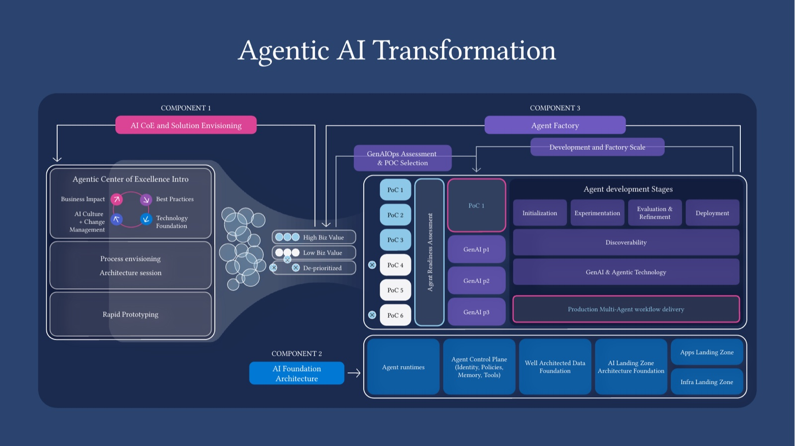
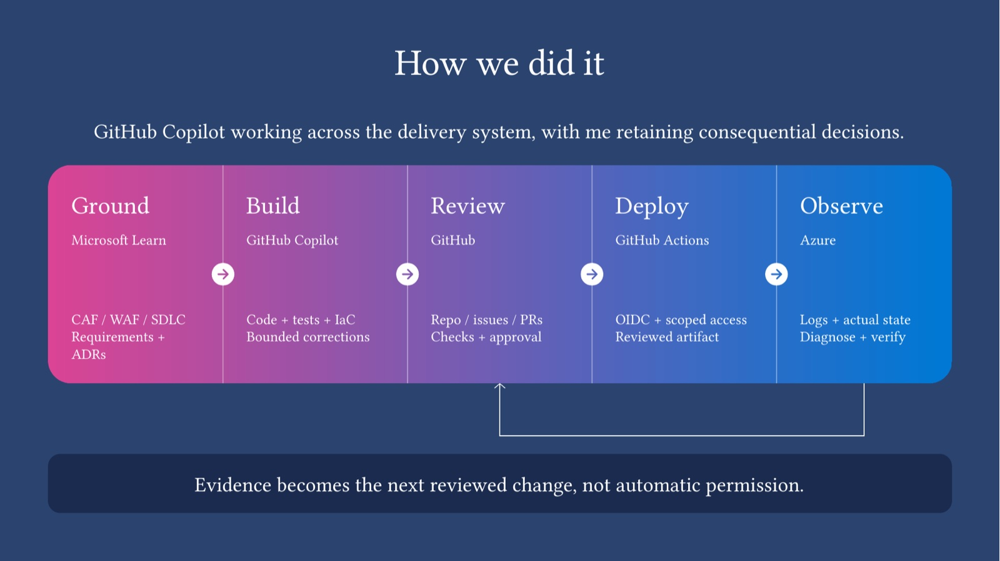
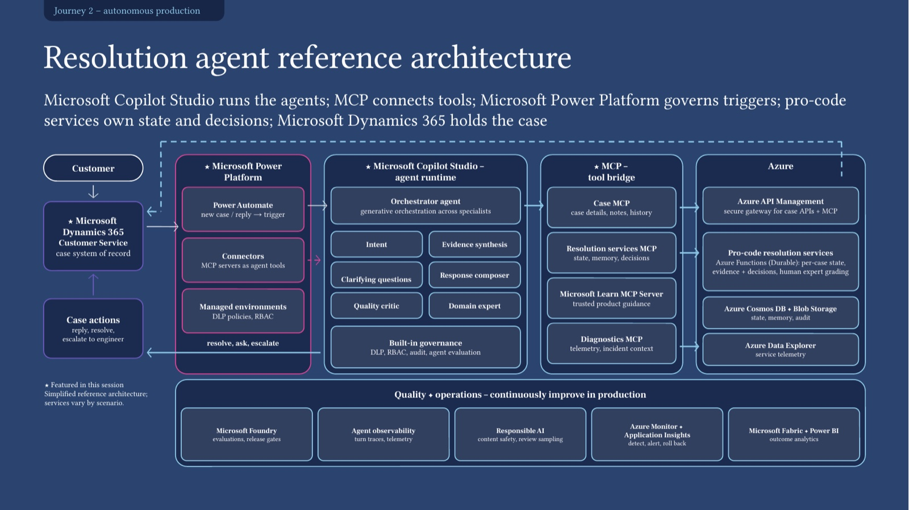
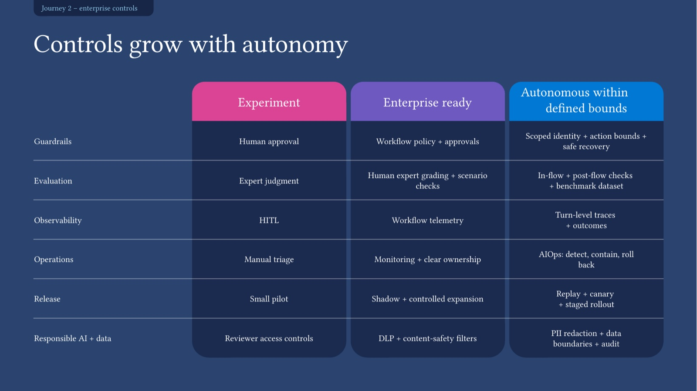
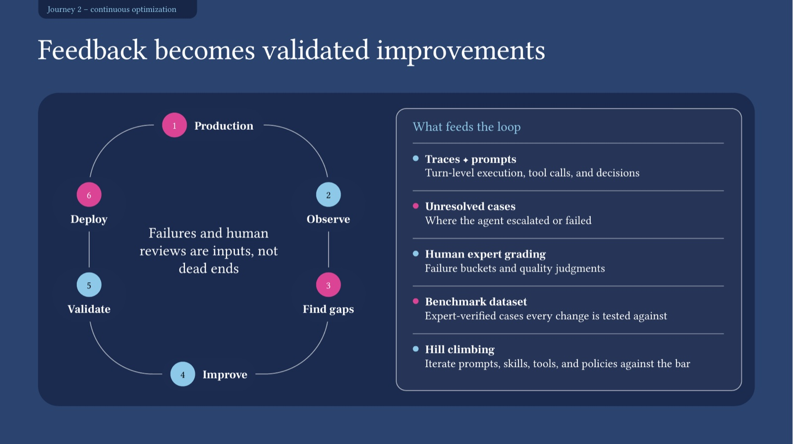

## #trust-gap-and-theater 01 / Production Trust Gap :: 生产信任鸿沟：从“能跑通的原型”到三阶责任委派模型 || The Production Trust Gap: From Working Prototype to Three-Stage Delegation

BRK285 开场的两次现场举手提问直接戳破了企业智能体落地的最大错觉：全场大半听众都已经搭出过能给出实用回答的智能体，但当主讲人追问“谁敢不逐条审批就直接放它进生产系统执行动作”时，举手者寥寥无几 [1]。Azure 云运营需求工程（CODE）团队首席客户工程经理 Omprakash Reddy Adudodla 指出，演示原型只回答“它能不能工作”，而企业生产系统追问的是“我们能否信任它、看清它，并在工具超时或推理跑偏时安全兜底” [1][2]。 || Two audience polls at the opening of BRK285 exposed the central illusion in enterprise AI: most attendees had built an agent that produced a genuinely useful answer, yet almost none would let that agent act in production without approving every step [1]. As Omprakash Reddy Adudodla of Azure Cloud Operational Demand Engineering (CODE) noted, a prototype asks whether an idea works, whereas an enterprise asks whether teams can trust, observe, and safely recover it when tools time out or reasoning drifts [1][2].

在实际排障场景中，智能体最隐蔽的风险并非胡言乱语，而是“针对错误的资源给出一段措辞完美的诊断” [1]。如果自主监控智能体仅仅告知“你的应用挂了”，却搞错了目标应用或订阅边界，流畅的文本反而会拖慢工程师发现幻觉的时间 [1]。因此，BRK285 将两条看似迥异的工程路线——合作伙伴带客户从零孵化方案（旅程一）与微软 Azure 支持团队打造全自主结案系统（旅程二）——收束到同一套三阶段成熟度框架中：每个阶段的核心标尺并非“如何把人踢出局”，而是**当前积累的证据允许安全委派多少决策责任** [1][2]。 || In real support operations, the most insidious failure is not gibberish—it is a beautifully written diagnosis about the wrong Azure resource [1]. Fluent prose aimed at the wrong subscription delays human detection of hallucinations [1]. BRK285 therefore aligns two distinct journeys—partner prototype-to-architecture transformation (Journey 1) and Azure Support's autonomous case resolution (Journey 2)—under one three-stage maturity framework whose governing question is never how to remove humans, but **how much responsibility current evidence earns the right to delegate** [1][2].

| 演进阶段 || Maturity Stage | 优化重心 || Optimization Target | 人类介入角色 || Human Role | 准入与放行核心标尺 || Core Qualification Bar |
| --- | --- | --- | --- |
| **1. 快速试验（Experiment）** | 学习速度与业务价值验证 [2] || Speed of learning & scenario value [2] | 人工逐条审核全部输出 [1][2] || Human-in-the-loop reviews every output [1][2] | 合成数据跑通核心流程；若明天关停该智能体，团队是否会感知价值缺失 [1][2] || Proves useful work on synthetic/pilot data; passes the "would anyone miss it tomorrow?" test [1][2] |
| **2. 企业就绪（Enterprise-Ready）** | 信任度、系统集成与风险控制 [2] || Trust, system integration & control [2] | 结构化抽检、审批策略与明确归属 [2] || Structured grading, policy approvals & clear owner [2] | 接入真实权限边界与持久状态，在行动前核验证据强度与安全合规 [1][2] || Scoped runtime identity, persistent case state, and pre-action critic validation [1][2] |
| **3. 有界全自主（Bounded Autonomous）** | 生产级执行效率、规模化与自愈 [2] || Production scale, resilience & optimization [2] | 达标场景免逐单人工复核 [1][2] || Zero case-by-case review for qualified scenarios [1][2] | 仅对质量、控制与历史证据全部达标的限定场景开放有界动作与自动回滚 [1][2] || Bounded authority granted one qualified scenario at a time with timeout escalation [1][2] |

下方交互导览台内嵌了 BRK285 官方 Medius 点播流、原版 38 页课件下载直链与四段式逐分钟演讲时间轴，点击顶部阶段标签即可切换审阅完整议程脉络 [1][2]： || The interactive theater below embeds the official BRK285 Medius on-demand stream, the 38-slide PPTX deck link, and a four-part timestamped transcript guide [1][2]:

:::sandbox { id: "brk285-video-theater", canvas: false, script: "./brk285-theater.js", style: "./brk285-theater.css", title: "BRK285 官方点播视频与 51 分钟演讲时间轴导览台 || BRK285 Official On-Demand Stream & 51-Minute Timestamped Walkthrough", desc: "一键展开微软官方 Medius 内嵌播放器，按『成熟度总纲 → 旅程一架构重构 → 旅程二 FACS 实机排障 → 爬山闭环』四幕检索实录细节。 || Toggle the inline Microsoft Medius player and browse timestamped highlights across all four chapters of BRK285." }
纯静态专场点播导览沙盒：内置 BRK285 高清官方封面图、Medius 内嵌视频流开关、原版课件直链与四阶段时间轴索引。 || Pure static session theater featuring the official BRK285 thumbnail, inline Medius video player toggle, PPTX link, and timestamped chapter digests.
:::

## #journey1-prototype-to-arch 02 / Journey 01: Prototype to Architecture :: 旅程一：拒绝在演示界面上盲堆功能——用架构契约重铸原型 || Journey 01: Stop Rebuilding the Screen—Ground Prototypes in Engineering Contracts

许多企业的智能体项目始于董事会的一句“我们要上人工智能”，随后团队在一天之内拉起令人惊艳的最小可行原型，却在推向生产时陷入泥潭 [1]。微软合作伙伴解决方案架构师 Tim Schaeps 现场展示了他在一天内构建的“订单到回款（Order-to-Cash）”用例发现原型：用户输入行业与业务流程后，系统利用合作伙伴探索卡片拆解流程步骤、绩效指标与角色痛点，当场生成 8 个候选智能体用例并关联公开案例库 [1]。 || Many enterprise AI initiatives start with a boardroom mandate and a dazzling one-day prototype, only to stall at production handoff [1]. Partner Solution Architect Tim Schaeps demonstrated his own one-day **Order-to-Cash** discovery prototype: given a process and industry, the web app mapped steps, role pain points, and partner discovery cards into eight prioritized AI use cases [1].

然而当 Tim 回放该原型的代码演进轨迹时，隐患暴露无遗：每一次提交都在容器应用上顺手叠加新功能，直到接入 Azure Cosmos DB 存储数据时，因触犯演示租户“严禁启用公网端点”的平台安全策略而突然瘫痪 [1]。尽管代码助手帮他临时修补了连接，但这种“坏一处补一处”的被动打补丁模式根本无法支撑企业级运维 [1]。Tim 由此给出了一条反直觉的实战忠告：**在生成式编码时代，推倒脆弱原型按边界重写的成本极低；千万不要从重画漂亮前端界面开始，而必须先锁死可评审的工程契约** [1][2]。 || Replaying the prototype's commit history exposed the trap: commits piled feature onto feature inside a single container app until adding an Azure Cosmos DB backend abruptly broke against an Azure policy forbidding public endpoints [1]. Fixing policy violations reactively after outages cannot scale [1]. Schaeps offered a candid rule for modern AI engineering: **restarting cleanly with explicit boundaries now costs far less than retrofitting a fragile prototype—and engineers must begin with a reviewable engineering contract rather than rebuilding the UI screen** [1][2].

  <article class="brk285-media-card">
    

      
    

    

      BRK285 官方课件 Slide 09
      <h4 data-zh="智能体转型三大支柱：卓越中心、基础底座与智能体工厂" data-en="Three Pillars: AI CoE, Foundation Architecture & Agent Factory">智能体转型三大支柱：卓越中心、基础底座与智能体工厂</h4>
      
组件 1 负责高价值用例筛选，组件 2 提供着陆区与控制面底座，组件 3 以标准化流水线批量交付多智能体方案 [1][2]。

    

  </article>
  <article class="brk285-media-card">
    

      
    

    

      BRK285 官方课件 Slide 20
      <h4 data-zh="受控工程交付闭环：证据驱动变更而非自动放权" data-en="Controlled Delivery Loop: Evidence Feeds Reviewed Change, Not Automatic Permission">受控工程交付闭环：证据驱动变更而非自动放权</h4>
      
串联 Microsoft Learn 架构锚定、GitHub 受审拉取请求、OIDC 免密发布与 Azure 线上状态核验，由架构师保留关键裁决权 [1][2][3]。

    

  </article>

在重铸名为“Superagents”的五层虚拟企业平台时，Tim 在开发环境中直接挂载 **Microsoft Learn 文档桥接服务**，强制编码智能体在动笔前先检索云采用框架与卓越架构指南，列出取舍理由并停下来等待人工架构评审 [1][2][3]。整套交付流水线将指导原则转化为五条刚性工程决策，并通过开放身份联邦实现全程零密码安全部署 [1][2]： || When rebuilding the virtual **Superagents** platform across five architectural planes, Schaeps wired the **Microsoft Learn documentation server** into Visual Studio Code, instructing GitHub Copilot to search Cloud Adoption Framework and Well-Architected Framework guidance, justify what to include or defer, and pause for human review before writing implementation code [1][2][3]. That pipeline translated abstract guidance into five concrete design principles with passwordless federated deployments [1][2]:

:::flow { title: "旅程一五步工程交付闭环与五大架构铁律（P1–P5） || Journey 1 Five-Step Delivery Pipeline & Architectural Principles (P1–P5)" }
::item 01 · Ground
### 权威知识锚定与架构决策记录（Microsoft Learn MCP + ADR） || Ground in CAF/WAF via Microsoft Learn MCP & ADRs
用检索到的官方着陆区与安全规范挑战备选方案，显式区分保留项与延后项，杜绝凭经验盲猜平台策略 [1][3]。 || Challenge design options against retrieved Microsoft Learn guidance and record explicit trade-offs in Architecture Decision Records [1][3].

::item 02 · Build
### 职责分离（P1）与最小权限（P2）：提案绝不等于执行许可 || Separate Responsibilities (P1) & Least Privilege (P2)
不仅严格限制线上运行智能体的权限范围，同样收紧负责写代码的构建智能体权限；所有代码、测试与基础设施即代码均在受控边界内生成 [1][2]。 || Restrict both runtime agents and build-time coding agents—proposal is never permission, and every action runs under scoped authority [1][2].

::item 03 · Review
### 预设故障恢复（P3）与面向变化设计（P4）：先评测再晋级 || Assume Failure (P3) & Design for Change (P4)
将需求变更收束为拉取请求与自动化门禁审核；每当底层前沿模型升级时，重新跑通代码与模型双重核验 [1][2]。 || Gate pull requests with automated checks so teams can swap rapidly evolving models safely after re-evaluating against known failure modes [1][2].

::item 04 · Deploy & Observe
### 保持规模适度（P5）：复用托管底座并让日志回归评审闭环 || Keep It Proportional (P5): Reuse Managed Foundations & Observe
优先复用 Agent 365、Foundry 与现成云底座而非自造轮子，通过 GitHub Actions 开放身份联邦免密发布，采集真实状态反哺下一轮受审变更 [1][2]。 || Reuse managed platform runtimes, deploy via passwordless OIDC, and turn Azure logs into the next reviewed engineering change [1][2].
:::

## #journey2-facs-architecture 03 / Journey 02: FACS Reference Architecture :: 旅程二：Azure 支持团队 18 个月实战——低代码推理与全代码持久控制 || Journey 02: Inside Azure Support's 18-Month FACS Journey—Low-Code Reasoning Meets Pro-Code State

如果说旅程一解决了“新项目如何定架构”，由 Arun Masilamani 与 Ali Ijaz 主讲的旅程二则展示了微软自身最具挑战性的生产试验田：**全自主客户服务（Fully Autonomous Customer Service，简称 FACS）** [1]。这套系统目前已在线上真实承接 Azure 客户技术支持工单，但它并非一上来就追求无人值守，而是耗时 18 个月从“人工逐单把关的低代码试验”一步步挣得了有界自主权 [1][2]。 || Where Journey 1 tackled greenfield architecture, Journey 2—led by Arun Masilamani and Ali Ijaz—revealed Microsoft's own production proving ground: **Fully Autonomous Customer Service (FACS)** for live Azure support cases [1]. Live in production today, FACS did not begin with autonomy; over 18 months, the team earned bounded authority one qualified scenario at a time [1][2].

在现场实机走查中，客户 Contoso 的工程师 Jordan 提交了一张应用服务报 `503 Service Unavailable` 的紧急故障单 [1]。工单落入 Dynamics 365 客户服务系统后由 FACS 自动接管：智能体**无需追问客户索要订阅号**，直接调用诊断工具查明“上午 09:08 刚完成一次新版本部署，当前 3 个实例中健康实例数为 0（`0 of 3 healthy`）”，精准锁定最新部署引发的启动崩溃并给出回滚指引 [1]。在回复发出前，内置审校门禁先完成了证据强度、质量与安全核验；更关键的是，智能体并未在给出建议后擅自关单，而是保留跨轮上下文追问健康检查结果，直到 Jordan 确认回滚后服务恢复正常才执行受控结案 [1]。 || During the live case walkthrough, Contoso customer Jordan reported an App Service outage throwing `503` errors [1]. Once the ticket landed in Dynamics 365 Customer Service, FACS handed investigation to the resolution agent: **without asking Jordan for a subscription ID**, the agent queried diagnostics, found `0 of 3` instances healthy immediately after a `09:08` deployment, inferred startup failure, and recommended a rollback [1]. Before replying, an in-flow gate verified evidence, quality, and safety; crucially, the agent kept multi-turn context rather than closing the ticket prematurely, waiting until Jordan confirmed health checks passed before executing bounded resolution [1].

:::figure { src: "./media/brk285-resolution-architecture.figure.json", title: "BRK285 Azure 自主支持排障生产参考架构（低代码协同推理 + 全代码持久状态机） || BRK285 Live Azure Autonomous Support Reference Architecture (Low-Code Orchestration + Pro-Code Durable State)" }
图 1：重构自 BRK285 第 28–29 页官方架构蓝图——由 Dynamics 365 托管工单事实源，Power Platform 管控事件触发与数据防泄漏策略，Copilot Studio 调度六类专职智能体，并通过四路模型上下文协议（MCP）桥接 Azure 持久状态机与 Foundry 质量门禁 [1][2][4]。 || Figure 1: Reconstructed from BRK285 Slides 28–29—Dynamics 365 holds the case record, Power Platform governs triggers and DLP, Copilot Studio orchestrates six specialist roles, and four MCP bridges connect Azure Durable Functions state with Foundry release gates [1][2][4].
:::

Ali Ijaz 特别强调，支撑这套复杂系统的秘诀**不是在成熟后推倒低代码重写，而是确立“低代码做敏捷推理、全代码管持久状态”的精密分工** [1][2]。在真实的 Azure 支持场景中，一张疑难工单往往跨越数天甚至数周，中途频繁遭遇外部诊断接口超时或客户隔周追问 [1]。团队因此保留 Copilot Studio 作为主控与专员编排运行时，同时在右侧叠加 Azure Durable Functions 与 Cosmos DB 接管单案状态机与审计账本 [1][2]： || Ali Ijaz emphasized that scaling across Azure's diverse customer base required **a division of labor rather than a migration away from low-code** [1][2]. Real cloud support cases span days or weeks, suffer tool timeouts, and resume mid-investigation when customers reply days later [1]. The team kept Copilot Studio for fast instruction iteration and specialist orchestration while extending durable per-case state and testable decision logic into Azure pro-code services [1][2]:

  <article class="brk285-media-card">
    

      
    

    

      BRK285 官方课件原图 · Slide 29
      <h4 data-zh="Azure 线上生产排障智能体完整参考拓扑" data-en="Production Resolution Agent Reference Topology">Azure 线上生产排障智能体完整参考拓扑</h4>
      
主控智能体在内部协同调度意图、证据合成、澄清追问、回复生成、质量审校与领域专家六大角色，所有外部工具统一经由 Azure API Management 安全网关接入 [1][2]。

    

  </article>

| 架构层次与核心组件 || Stack Component | 不可替代的工程适配优势 || Why It Fits in Production | 真实生产局限与配套工程代价 || Production Trade-Off & Engineering Cost |
| --- | --- | --- |
| **Microsoft Copilot Studio**（智能体运行时） || **Microsoft Copilot Studio** (Agent Runtime) | 极速迭代提示词指令与六类专职子智能体，开箱自带数据防泄漏与审计治理 [2][4] || Rapid iteration on instructions and specialist agents with built-in governance [2][4] | 原生会话难以支撑跨数周复杂工单的可靠恢复，需外挂单案持久状态与编排服务 [1][2] || Requires external durable per-case state and orchestration for multi-week reliability [1][2] |
| **Microsoft Power Platform**（触发器与连接器） || **Microsoft Power Platform** (Triggers & DLP) | 便捷监听工单新建与客户回复事件，统一实施受管环境连接器与防泄漏策略 [2] || Governed event triggers, enterprise connectors, and Managed Environment DLP [2] | 故障链路横跨多个底层平台团队，缺乏逐轮追踪时极难定位根因与责任归属 [1][2] || Failures span multiple platform owners, making cross-team triage harder without traces [1][2] |
| **模型上下文协议桥（MCP Tool Bridge）** || **MCP Tool Bridge** (4 Domain Servers) | 无需改动智能体本体即可动态挂载工单、排障记忆、官方文档与线上遥测工具 [1][2] || Plug in case, memory, Microsoft Learn, and diagnostics tools without rewriting agents [1][2] | 每一台接入生产网的 MCP 服务器都必须独立加固网关鉴权与实时可用性监控 [2][3] || Every MCP server must be independently secured behind API Management and monitored [2][3] |
| **Microsoft Foundry**（评测与质量系统） || **Microsoft Foundry** (Quality & Gates) | 支撑大规模自动化评测、前沿新模型对比验证与上线发布门禁拦截 [1][2][5] || Scales automated evaluations, frontier model testing, and release gates [1][2][5] | 高度依赖前期高质量专家标注基准集与定制化评分器设计投入 [1][2] || Demands upfront investment in SME-labeled datasets and custom rubric evaluators [1][2] |
| **Azure 全代码服务**（Durable Functions + Cosmos DB） || **Pro-Code on Azure** (Functions & Cosmos DB) | 提供确定性的单工单跨天状态持久化、工具超时自动升级兜底与可单测决策逻辑 [1][2] || Delivers deterministic multi-day state, timeout escalation fallbacks, and testable logic [1][2] | 引入更高的软件研发、基础设施代码化与全天候值班运维门槛 [2] || Carries higher software engineering and 24/7 operational discipline requirements [2] |

## #controls-and-evals 04 / Earned Autonomy & Controls :: 挣得自主权：四步人工核验阶梯与六维企业控制矩阵 || Earning Autonomy: Four-Step Human Validation and the Six-Dimension Control Matrix

在从人工辅助走向自主执行的过程中，许多团队把人工复核视为“智能体不够聪明”的临时拐杖，但 Arun 提出了截然相反的工程视角：**人工评审不是失败的标志，而是生产高价值训练证据、为系统挣得自主权的唯一途径** [1][2]。Arun 在现场追问听众：当人工坐席修改了智能体起草的回复时，你的系统是否结构化记录了“他为什么改” [1]？正是这些修改原因构成了首版定制评测集的核心资产 [1]。 || Teams often treat human review as an embarrassing crutch, yet Masilamani framed it as the exact opposite: **human review is not a sign of agent failure—it is the mechanism that generates the evidence required to earn autonomy** [1][2]. Capturing *why* a support engineer edited a drafted answer turns routine operations into custom evaluation assets [1].

:::insight-grid { cols: 2, title: "通往有界自主的四步信心构建阶梯与两条授权铁律 || Four Confidence-Building Steps & Two Iron Rules of Delegation" }
::card Step 01–02
### 专家量表打分（Rubric）与影子并行比对（Shadow Runs） || Expert Rubric Grading & Production Shadow Runs
先由资深支持专家对照定制评分量表给智能体输出打分，沉淀出第一代业务专属评测器；随后在线上开启静默影子运行，将智能体推理结果与真人工程师在同一工单上的实际处置做盲测比对 [1][2]。 || Domain SMEs first grade outputs against a structured rubric to seed custom evaluators, followed by silent shadow runs comparing agent proposals directly against human engineer outcomes on live cases [1][2].

::card Step 03–04
### 失败模式分桶（Failure Buckets）与单场景准入门禁 || Trace Failure Bucketing & Per-Scenario Autonomy Gate
摒弃按单救火的低效习惯，对执行追踪与审核批注做聚类分析，提炼共性失败分桶集中攻坚；只有当某一细分场景的质量指标、安全护栏与历史证据同时跨过红线时，才对该场景单独放开免审自主权 [1][2]。 || Group turn traces and reviewer edits into systemic failure buckets rather than patching one-off tickets; unlock unreviewed execution one scenario at a time, governed by two rules: **never grant authority you cannot explain, and never grant authority you cannot reverse** [1][2].
:::

随着自主权逐级放大，单靠人工盯屏已无法兜底风险，控制体系必须同步升级 [1]。BRK285 给出了两条不可逾越的授权铁律：**绝不授予你无法解释的权限，绝不授予你无法撤销的权限** [1]。下方雷达图与官方课件矩阵清晰呈现了护栏、评测、可观测性、运维、发布与数据合规六个维度在三阶段中的同步硬化轨迹 [1][2]： || Once an agent acts without case-by-case human approval, a person can no longer serve as the sole safeguard [1]. Governed by two iron rules—**do not grant authority you cannot explain, and do not grant authority you cannot reverse**—enterprise controls must harden across six dimensions simultaneously [1][2]:

:::figure { src: "./media/brk285-autonomy-controls-radar.figure.json", title: "BRK285 三阶段自主权晋级对应的六维企业级控制强度演进 || BRK285 Six-Dimension Enterprise Control Progression Across Three Autonomy Stages" }
图 2：从左至右每晋级一档自主权，外围控制环必须同步外扩——在有界全自主阶段，系统强制要求受限身份边界、流程中与流程后双重评测、逐轮执行追踪、智能运维自动熔断回滚以及金丝雀重放发布 [1][2][5]。 || Figure 2: Advancing from Experiment to Bounded Autonomous requires expanding all six control axes in lockstep—enforcing scoped identity, in-flow/post-flow checks, turn-level traces, AIOps containment, canary replay, and PII audit trails [1][2][5].
:::

  <article class="brk285-media-card">
    

      
    

    

      BRK285 官方课件原图 · Slide 26
      <h4 data-zh="控制随自主权同步生长：六维企业级护栏演进全表" data-en="Controls Grow with Autonomy: Six-Dimension Enterprise Matrix">控制随自主权同步生长：六维企业级护栏演进全表</h4>
      
发布策略从『小范围试点 → 影子运行与受控扩面 → 历史重放 + 金丝雀灰度』逐级递进；数据安全同步收紧至敏感信息脱敏、租户边界隔离与全量审计留痕 [1][2][6]。

    

  </article>

## #hill-climbing-and-playbook 05 / Hill Climbing & Playbook :: 直面线上幻觉：六步爬山迭代法、跨团队定责与五步落地自检 || Confronting Live Hallucinations: Six-Step Hill Climbing, Trace Ownership, and the 5-Step Playbook

在演讲尾声，Ali Ijaz 坦诚分享了一个令全场共鸣的真相：**即便搭好了上述整套混合架构与发布门禁，智能体在线上依然会出现幻觉** [1]。当智能体漏看启动报错日志或推理跑偏时，团队曾试图在系统提示词里反复叮嘱“请更聪明地思考、更努力地排查”，结果证明这类许愿式调优毫无作用 [1]。真正让准确率稳步攀升的，是团队围绕生产反馈建立的**爬山（Hill Climbing）工程闭环** [1][2]。 || Near the close of BRK285, Ali Ijaz shared a candid confession: **even after standing up durable state and release gates, the production agent still hallucinated** [1]. Worse, instructing the prompt to "think smarter or work harder" achieved nothing [1]. Sustained reliability came only when the team instituted a disciplined **hill-climbing** engineering loop [1][2].

  <article class="brk285-media-card">
    

      
    

    

      BRK285 官方课件原图 · Slide 30
      <h4 data-zh="把生产失败与人工复核转化为经验证的系统升级" data-en="Feedback Becomes Validated Improvements: The 6-Step Hill-Climbing Loop">把生产失败与人工复核转化为经验证的系统升级</h4>
      
汇聚逐轮追踪与提示词、升级未决工单、专家打分分桶及基准测试集，围绕提示词、技能、诊断工具与策略开展防回退爬山迭代 [1][2][5]。

    

  </article>

在实际排查幻觉根因时，发现错误很容易，定位“究竟是技能过期、产品文档陈旧，还是诊断接口返回缺失”却极难 [1]。与此同时，Omprakash 指出了大型企业上线多平台智能体后必遇的两大组织摩擦：一是故障横跨低代码、网关与后端多个平台管理团队，出问题时极易互相推诿，团队为此全面启用**逐轮追踪工作台（Trace Studio）**，一眼锁定哪一轮工具调用报错及对应责任团队；二是当智能体跑通后，财务部门立即追问算力账单为何高企，倒逼工程团队利用全链路可观测性同步压降时延与词元消耗 [1][6]。 || Finding a wrong answer in production is easy; diagnosing whether it stemmed from an outdated skill, stale documentation, or incomplete diagnostic output is far harder [1]. Omprakash highlighted two organizational collisions every enterprise hits at scale: first, cross-platform finger-pointing when a failure spans connectors, gateways, and backend APIs—solved by enabling **turn-level trace studios** across all agents to pinpoint exact fault ownership; second, inevitable finance scrutiny over token spend and latency once volume ramps, requiring full telemetry visibility to optimize cost per resolution [1][6].

:::callout { title: "BRK285 五步企业智能体自检清单：你的智能体今天卡在哪一格？ || BRK285 Reusable Five-Step Enterprise Agent Playbook: Where Is Your Agent Today?" }
1. **快速构建（Build）——它真的有业务价值吗？** 用低代码或合成数据极速验证场景；若明天关掉它没人觉得不便，切勿盲目投入生产化改造 [1][2]。 || **1. Build — Is it valuable?** Prove the scenario fast with synthetic or pilot data before investing in heavy infrastructure [1][2].
2. **证据核验（Validate）——我们凭什么信任它的输出？** 建立领域专家评分量表、记录人工改稿原因并开展线上影子比对，攒够准入证据再谈放权 [1][2]。 || **2. Validate — Can we trust the output?** Capture reviewer edit reasons, grade against SME rubrics, and run shadow comparisons before delegating actions [1][2].
3. **工程运维化（Operationalize）——我们能看清、管住并定责吗？** 补齐跨天持久状态机、最小权限身份、逐轮追踪日志与跨部门明确归属人 [1][2]。 || **3. Operationalize — Can we run, see, and own it?** Wire durable per-case state, scoped runtime identity, turn-level traces, and clear team ownership [1][2].
4. **有界自动化（Automate）——哪些合格场景能免审执行？** 逐个场景核发受限动作许可，配置工具超时自动升级人工兜底，坚守可解释与可回滚铁律 [1][2]。 || **4. Automate — What can it do without review?** Delegate bounded authority one qualified scenario at a time with automatic escalation fallbacks [1][2].
5. **爬山持续优化（Optimize）——它是否在真实故障中越跑越稳？** 把每一次线上升级与幻觉沉淀进专家基准集，在重放门禁保护下持续迭代文档、技能与工具 [1][2][5]。 || **5. Optimize — Is it getting better?** Feed unresolved cases and traces into benchmark datasets, hill-climbing prompts, docs, and tools behind regression gates [1][2][5].
:::

## 参考资料：官方一手信源与关联专场 || References: Official Primary Sources & Related Sessions

1. **Ali Ijaz, Arun Masilamani, Tim Schaeps & Omprakash Reddy Adudodla (Microsoft Ignite 2026 BRK285)** — https://ignite.microsoft.com/en-US/sessions/1787856616329001EyM8-1791588352535001C8TA | 《Your agent works. Now make it enterprise-ready.》51 分钟官方点播实录与 WebVTT 完整演讲逐字稿（2026-11-19） || Official breakout session on-demand video stream and full WebVTT transcript (Nov 19, 2026)
2. **Microsoft Ignite 2026 BRK285 Official Slide Deck** — https://medius.microsoft.com/video/asset/PPT/048e7075-9b0a-458d-b28b-3fa6113f248b | 《Your agent works. Now make it enterprise-ready.》原版 38 页 PPTX 架构讲义（含三阶成熟度、Superagents 原则、FACS 参考架构与六步爬山图） || Official 38-slide PowerPoint deck covering the maturity framework, FACS reference architecture, and hill-climbing loop
3. **Microsoft Learn Documentation Server Guide** — https://learn.microsoft.com/en-us/training/support/mcp | Microsoft Learn 模型上下文协议服务器接入指南：在开发环境中实时检索微软云采用框架与卓越架构规范 || Official guide to grounding coding agents and architecture reviews in authoritative Microsoft Learn documentation via Model Context Protocol
4. **Microsoft Copilot Studio Official Documentation** — https://learn.microsoft.com/en-us/microsoft-copilot-studio/ | Copilot Studio 多智能体协同编排、受管环境数据防泄漏（DLP）策略与模型上下文协议工具挂载规范 || Official documentation for generative orchestration, specialist agents, Managed Environments DLP, and MCP tool integration
5. **Microsoft Ignite 2026 Related Foundry & Landing Zone Sessions (BRK251 & BRK284)** — https://ignite.microsoft.com/en-US/sessions/ | 《Agents in production: Observe, evaluate, and optimize with Foundry》(BRK251) 与《Production-ready Microsoft Foundry agents with Azure AI Landing Zones》(BRK284) 关联深度专场 || Companion Ignite 2026 sessions on Foundry production evaluations, release gates, and Azure AI Landing Zones
6. **Microsoft Ignite 2026 Governance & FinOps Track (BRK262)** — https://ignite.microsoft.com/en-US/sessions/1787856612903001EK5O-1791588157241001CqrV | 《Scale agents, not risk: Governance and FinOps for the enterprise》企业级智能体权限管控、成本透视与合规审计专场 || Companion Ignite 2026 breakout session on enterprise agent governance, cost visibility, and compliance auditing
