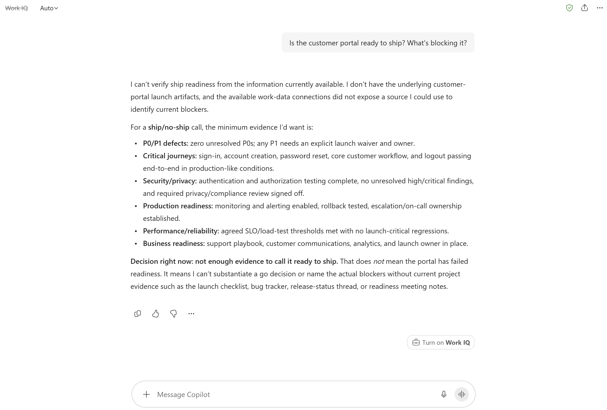
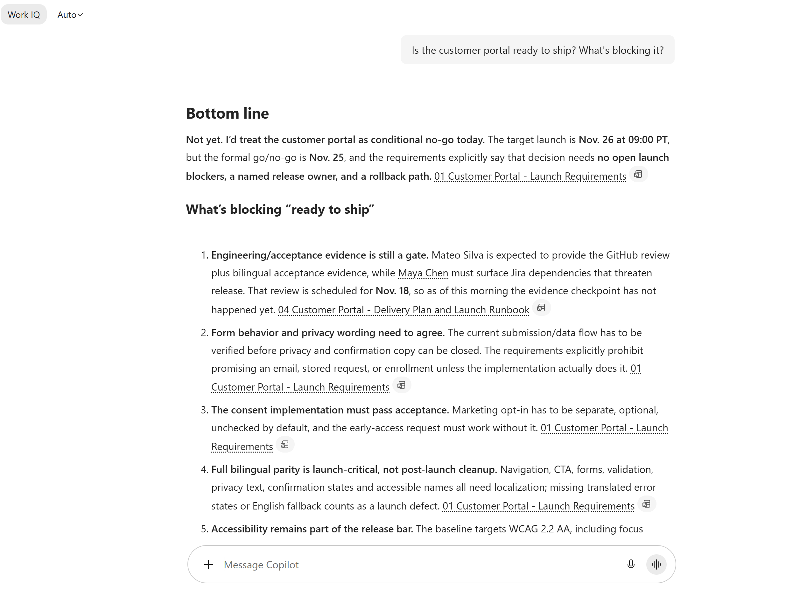
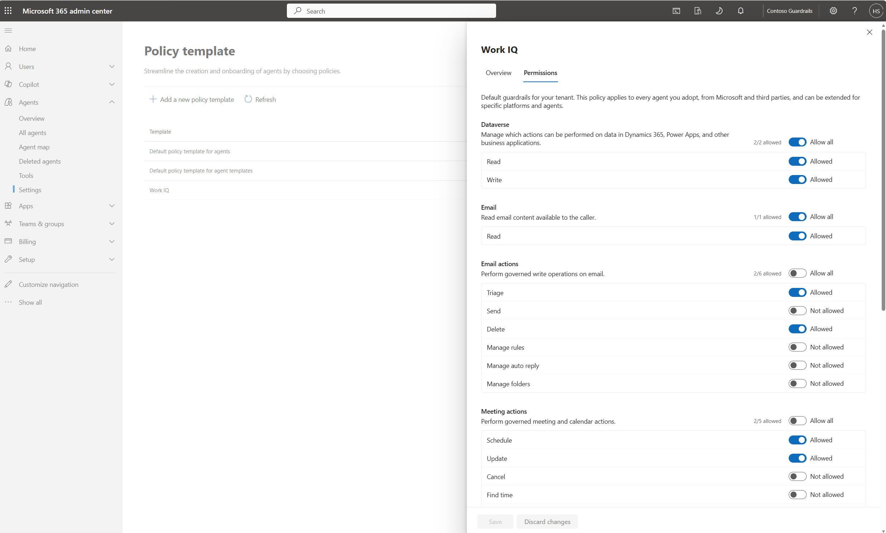
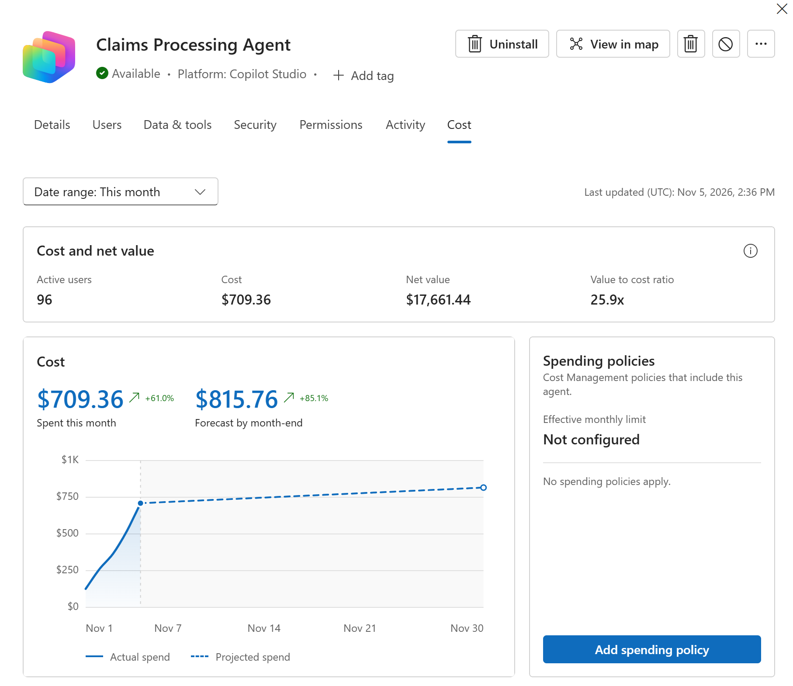

## #context-gap-architecture 01 / Context Gap & Architecture :: 为什么代码全绿仍不能发版：组织脉络断层与 Work IQ 三层底座 || Why Green Repos Still Miss Launch: Context Gaps and the Work IQ Stack

大模型早已能流利总结代码仓库，却回答不出一句最朴素的工程追问：“客户门户下周能按时发版吗？” [1]。在 BRK302 还原的 Fourth Coffee 加拿大站点上线事故中，代码托管在 GitHub，工单追踪在 Jira，两套系统都显示功能开发就绪；唯独法务团队在一次内部会议与聊天频道里拍板的“首发必须支持英法双语”，既没建单也没写进代码 [1][2]。与此同时，两张阻塞上线的未结工单锁在智能体无权访问的外部系统里，而主力研发人员整天停留在本地编辑器中，根本不会切去独立聊天窗口反复交代背景 [1][2]。 || Frontier models summarize repositories fluently yet stumble on a basic shipping question: “Is the customer portal ready to launch next week?” [1]. In the Fourth Coffee Canadian rollout dissected in BRK302, source code lived in GitHub and tickets lived in Jira, making features appear complete; however, Legal's mandate for bilingual English-French support stayed buried inside meeting transcripts and chat threads [1][2]. Meanwhile, two open launch blockers sat in disconnected trackers while developers worked inside local editors disconnected from standalone chat windows [1][2].

:::figure { src: "./media/work-iq-three-layer-architecture.figure.json", title: "Work IQ 企业智能底座三层架构：从数据脉络到全平台智能体动作 || Work IQ Three-Layer Enterprise Intelligence Stack: From Signals to Cross-Platform Action" }
图 1：Work IQ 将底层邮件、会议、文档、第一方业务表及 300 余个外部系统信号提炼为人际协作、记忆与优先级语义，再经三种开放协议统一供给顶层自建智能体与研发工具 [1][2]。 || Figure 1: Work IQ distills mail, meetings, files, Dataverse tables, and 300+ SaaS signals into people, memory, and priority intelligence, serving studio agents and coding tools over MCP, REST, and A2A [1][2].
:::

要把孤立问答变成可靠代办，智能体必须在模型推理之外补齐三块拼图：**脉络（Context）**负责看清散落在聊天、邮件与业务表里的最新团队决议和协作关系；**行动（Action）**负责跨系统改写记录、起草文档与推进流程；**信任（Trust）**负责把每一次读写死死锁在调用者权限与企业预算护栏之内 [1][2]。下方导览台内嵌了 BRK302 全长 45 分钟官方点播流、原版课件直链与四幕时间轴索引，点击章节标签即可切换查阅 [1][2]： || Turning fluent chat into dependable execution requires three pillars beyond raw model weights: **Context** to connect decisions and people across chats and business records, **Action** to update systems and advance workflows, and **Trust** to enforce organizational permissions and spend caps [1][2]. The interactive theater below embeds the official 45-minute BRK302 stream, original slide deck link, and four-act timestamped guide [1][2]:

:::sandbox { id: "brk302-session-theater", canvas: false, script: "./brk302-showcase.js", style: "./brk302-showcase.css", title: "Ignite 2026 BRK302 官方点播视频与四幕实战时间轴导览台 || Ignite 2026 BRK302 Official On-Demand Stream & Four-Act Walkthrough Theater", desc: "按演讲时间轴切换四大实战章节，一键内嵌播放微软官方 Medius 点播流或下载 32 页原版课件。 || Switch across the four session acts, load the inline Microsoft Medius player, or download the 32-slide official deck." }
纯静态议题导览沙盒：含 BRK302 官方高清封面、内嵌视频加载器、分钟级实录索引与原版讲义入口。 || Pure static session theater featuring the official BRK302 poster, inline Medius player toggle, minute-level highlights, and slide deck download.
:::

同一套模型与同一句提问，在开关 Work IQ 前后给出了截然相反的上线裁决 [1][2]。未开启 Work IQ 时，智能体只能抛出一份泛泛而谈的六条通用发版核对清单，无法指出任何具体阻塞项；开启 Work IQ 后，它直接调取《01 客户门户上线需求》与《04 交付计划与运行手册》原件，明确给出“有条件暂缓发版（Conditional No-Go）”结论——指出正式发版日为 11 月 26 日上午 9 点（太平洋时间）、准入评审定在 11 月 25 日，并逐条列出双语全链路本地化缺口、隐私勾选框默认未勾选验收以及无障碍标准等五项实证阻断源 [2]： || Asking the exact same model “Is the customer portal ready to ship?” before and after enabling Work IQ yields opposite operational verdicts [1][2]. Without Work IQ, the assistant falls back to a generic six-bullet checklist because it lacks launch artifacts; with Work IQ enabled, it cites *01 Customer Portal - Launch Requirements* and *04 Delivery Plan and Launch Runbook* to issue a **conditional no-go** ahead of the Nov. 26 09:00 PT launch and Nov. 25 gate—pinpointing missing bilingual parity, unchecked-by-default marketing opt-in rules, and WCAG 2.2 AA gaps [2]:

  <article class="brk302-media-card">
    

      
    

    

      BRK302 第 5 页原图 · 未开 Work IQ
      <h4 data-zh="缺乏组织脉络：只能罗列空泛的通用上线准则" data-en="Blind to Work Context: Generic Launch Boilerplate">缺乏组织脉络：只能罗列空泛的通用上线准则</h4>
      
模型虽能流畅作答，但因看不见项目运行手册与会议纪要，无法点出任何真实阻塞单或责任人 [1][2]。

    

  </article>
  <article class="brk302-media-card">
    

      
    

    

      BRK302 第 6 页原图 · 开启 Work IQ
      <h4 data-zh="证据直达裁决：精准锚定双语缺口与 11 月 25 日评审门禁" data-en="Grounded Verdict: Cited Blockers & Nov. 25 Gate">证据直达裁决：精准锚定双语缺口与 11 月 25 日评审门禁</h4>
      
直接引用两份内部上线文档，点名 Mateo Silva 的双语验收责任、Maya Chen 的依赖排查与隐私文案核对要求 [2]。

    

  </article>

## #api-design-benchmarks 02 / 13-Verb Surface & Benchmarks :: 极简接口哲学：13 个不变工具动词如何换来 3.9 倍吞吐与 74% 降本 || Compact API Philosophy: How 13 Invariant Verbs Drive 3.9x Output and 74% Savings

为什么同样读取企业邮件、文档和工单，直接把传统 Microsoft 365 接口挂给智能体往往既慢又贵 [1]？Tolga Kilicli 在现场披露了对照组实测机制：传统智能体为了找齐散落各处的线索，必须在一堆细碎端点间反复发起搜索、逐页拉取列表、下载长文档并整篇塞进上下文窗口，导致交互轮次与输入词元急剧膨胀 [1]。Work IQ 则在服务端先行完成语义理解与权限过滤，直接向智能体交付高信噪比证据，从而用更少的轮次和词元跑完任务 [1][2]。 || Why does wiring raw Microsoft 365 endpoints directly into an agent inflate latency and token bills [1]? Tolga Kilicli explained the control-group bottleneck: agents using traditional APIs must search across fragmented endpoints, page through result lists, download full documents, and stuff everything into the context window [1]. Work IQ resolves relevance and permissions server-side, returning focused answers and evidence in far fewer turns [1][2].

:::figure { src: "./media/work-iq-production-benchmarks.figure.json", title: "Work IQ 生产基准实测：对比传统 Microsoft 365 API 检索拼装路径 || Work IQ Production Benchmark vs. Raw Microsoft 365 API Search & Paging" }
图 2：在相同底层模型与相同生产任务集下，接入 Work IQ 的智能体组完成了 1.7–3.9 倍的任务量，单次完工耗时最高缩短 70%，单次完工综合成本下降 40%–74% [1][2]。 || Figure 2: Holding models and tasks constant, agents backed by Work IQ completed 1.7–3.9x as many tasks, reduced time per completed task by up to 70%, and lowered cost per completed task by 40%–74% [1][2].
:::

支撑这套效率跃迁的核心工程设计，是将接口拆解为**“13 个恒定动词 × 持续生长的名词路径”** [1][2]。无论底层新增多少套业务系统或合作伙伴数据源，模型上下文窗口里永远只需要理解这 13 个内聚工具：`retrieve`、`ask`、`list_agents`、`fetch`、`fetch_blob`、`create_entity`、`update_entity`、`delete_entity`、`do_action`、`call_function`、`search_paths`、`get_schema` 与 `listen` [2]。新接入的约 60 个 SharePoint 内容与站点管理工具、第一方业务表或外部连接器全部作为路径命名空间动态挂载，彻底消除了“每接十个系统就往提示词里塞几百个新函数定义”的上下文污染，确保今天编写的智能体在未来数据源扩容时零改代码持续生效 [1][2]： || Behind these gains sits a deliberate factorization: **13 invariant tool verbs paired with continuously growing path namespaces** [1][2]. Regardless of how many enterprise systems connect underneath, the model only ever selects from 13 stable tools in its context window: `retrieve`, `ask`, `list_agents`, `fetch`, `fetch_blob`, `create_entity`, `update_entity`, `delete_entity`, `do_action`, `call_function`, `search_paths`, `get_schema`, and `listen` [2]. Roughly 60 new SharePoint tools, business tables, and partner sources surface as paths rather than sprawling endpoint schemas, ensuring agents built today keep working unchanged as coverage expands [1][2]:

| 组合范式（工具 + 路径） || Tool + Path Composition | 请求示例 || Concrete Invocation | 确定性行为与权限边界 || Deterministic Execution & Guardrail |
|------|------|------|
| 证据检索（模型自持推理） || Grounded Passage Retrieval | `retrieve` + `strategy=grounding` (`query=portal language decision`) | **只返原句段落、绝不越俎代庖合成答案**：按登录用户身份裁剪权限，返回《10月21日法务评审》与《需求文档 §4.2》带源引文，由开发者自选模型掌控最终推理 [1][2] || **Passages only, zero black-box synthesis**: runs as signed-in user and returns cited excerpts from Legal review and `Requirements.docx §4.2` so your model owns the reasoning [1][2] |
| 个人协作图谱读写 || Personal Graph Operations | `fetch` `/me/messages/{id}` 或 `do_action` `/me/messages/{id}/forward` | 在 `/me/…` 命名空间下读取个人邮件、聊天记录或转发讨论串，自动继承组织邮件与会话合规策略 [1][2] || Reads messages or forwards threads under `/me/…`, automatically inheriting organizational mail and Teams compliance rules [1][2] |
| 业务记录系统增改 || Business Record Mutation | `update_entity` `/businessapps/…/records/{id}` | 在 `/businessapps/…` 或 `/<provider>/…` 路径下统一更新客户关系管理记录、工单状态或跨表实体，无需学习异构接口方言 [1][2] || Mutates CRM records or synced SaaS entities under `/businessapps/…` or `/<provider>/…` without bespoke SDK dialects [1][2] |
| 零轮询事件订阅唤醒 || Proactive Intent Subscription | `listen`（发现事件 → 注册意图 → 按需唤醒） | 2026 年 12 月 4 日开启公测：告别每秒烧词元的定时轮询，在“缺席会议被指派待办”“临近一对一汇报”或“共享文件未审阅”时携带精准上下文唤醒长时任务并起草 Word/Excel/PPT [1][2] || Public Preview Dec 4, 2026: replaces token-wasting polling loops by waking long-running agents on missed-meeting action items or upcoming 1:1s to draft Office docs [1][2] |

## #end-to-end-demos 03 / Three Connected Demos :: 一条缺陷追到底：横跨 Copilot Studio、GitHub Actions 与本地编辑器的三连实战 || One Gap Followed Through: Three Live Demos Across Studio, GitHub Actions, and IDEs

为了证明同一套组织脉络能无缝跟进完整研发闭环，Manuel Cerrutti 围绕 Fourth Coffee 加拿大客户门户遗漏法语支持这一真实隐患，现场串联了三场环环相扣的实机演示，横跨业务自助、持续集成流水线与本地代码修复三个工位 [1][2]： || To prove organizational intelligence travels wherever work happens, Manuel Cerrutti followed Fourth Coffee's missing French localization gap end to end across three live demos spanning self-serve inquiry, continuous integration, and code remediation [1][2]:

:::flow { title: "Fourth Coffee 双语合规缺口从发现、拦截到修复的跨工具三步闭环 || Three-Stage Cross-Platform Loop: Find, Catch, and Fix the Bilingual Gap" }
1. **第一步（Copilot Studio 发现缺口与权限分流） || Demo 1 — Find the Gap & Trim by Role in Copilot Studio** — 开发者 Mateo 在 Copilot Studio 中新建“发布就绪度智能体（Release Readiness Agent）”，利用已正式商用且默认开启的 Work IQ 连接器联动 Jira、GitHub 与标准化评估技能 [1][3]。当被问及门户上线风险时，智能体从数周前的一段聊天记录里揪出“加拿大首发须支持英法双语”却未入库的高危断层 [1]。更关键的是**同源异构权限裁剪**：研发经理 Maya 提问同一智能体时，除了看到双语缺口，还会额外看到团队成员 Victor 即将离职的人力补缺预警（Mateo 无权查看该人事信息），随后 Maya 一句话指令该智能体于 10:26 将脱敏后的状态摘要推送至营销经理频道 [1]。 || Mateo builds a **Release Readiness Agent** in Copilot Studio—where Work IQ is GA and on by default—connected to Jira, GitHub, and a readiness skill [1][3]. It flags the untracked French requirement from an old Teams chat [1]. Crucially, **permission trimming** adapts to the caller: manager Maya sees both the bilingual blocker and confidential staffing risk (Victor leaving the company) invisible to Mateo, then posts a contextual update to the marketing managers' Teams channel in seconds [1].
2. **第二步（GitHub Actions 与 n8n 每次提交自动对齐业务） || Demo 2 — Catch Every Pull Request & Translate for Marketing** — 营销团队成员 Tessa 不希望每天追问研发进度，而是希望每次代码变动都能自动转化为营销侧待办 [1][2]。Mateo 配置了 GitHub 智能体工作流：每当仓库发生提交，GitHub Actions 内的智能体先解析代码差异与安全隐患，随即以登录用户身份调用挂载 Work IQ 的聊天智能体，于 10:30 自动向 Tessa 推送结构化通知——明确告知门户新增英法双语改动，提醒营销侧立即核查行动号召按钮（CTA）措辞、语言切换与隐私条款 [1]。现场同步展示了在第三方自动化平台 **n8n** 中挂载 Work IQ 服务节点，零障碍复刻完全一致的跨系统触发流 [1]。 || Marketing lead Tessa needs code commits translated into business actions [1][2]. Mateo wires a GitHub agentic workflow where a repo push triggers a Copilot agent to inspect diffs and invoke a Teams agent with Work IQ, delivering a 10:30 alert telling Tessa to review CTA copy, language toggles, and privacy terms [1]. Manuel also demonstrated wiring the exact same Work IQ MCP node inside **n8n** for teams outside GitHub Actions [1].
3. **第三步（本地代码编辑器与终端智能体闭环） || Demo 3 — Remediate in Local Editor & Invoke Studio Agents from Terminal** — 回到代码修复环节，Mateo 在 Visual Studio Code 的聊天扩展中挂载 Work IQ 服务与配套插件，直接向编辑器发问：“当前代码是否符合团队最新工作决议？” [1][2]。编辑器跨出代码仓拉取相关聊天讨论，不仅指出未启用法语，还点出行动号召文案需同步微调，并自动生成双语切换代码 [1]。等待编译期间，Manuel 切换至终端内的 **Claude Code**，同样通过协议挂载 Work IQ，先用 `list_agents` 列出租户内已安装的智能体，再直接跨平台唤醒第一步在 Copilot Studio 里创建的“发布就绪度智能体”查询最新进展，最终刷新浏览器验证英法双语门户成功上线 [1][2]。 || To fix the code, Mateo connects Work IQ inside Visual Studio Code and asks whether the repository matches latest team decisions—surfacing both the missing French toggle and call-to-action wording updates before generating the bilingual patch [1][2]. Simultaneously inside **Claude Code**, he attaches the same server, calls `list_agents` to discover tenant agents, invokes the Copilot Studio Release Readiness Agent directly from the terminal, and reloads the live English-French portal [1][2].
:::

## #ecosystem-governance-finops 04 / Ecosystem, Trust & FinOps :: 企业级规模化：多助手插件共享、双层防注入护栏与 25.9× 价值账本 || Enterprise Scale: Multi-Host Plugins, Two-Level Guardrails, and 25.9x Value Ledger

个人工作脉络如何平滑扩展为全公司共享的数字生产力 [1]？BRK302 给出的答案是 **Microsoft 插件注册表（Plugin Registry）** 与跨生态开放接入 [1][2]。团队将验证过的业务技能（Skills）、底层系统连接工具（Tools）与编排智能体（Agents）一次性打包为标准插件并交由 Agent 365 统一纳管，即可在员工偏好的任意工作台复用——目前 Work IQ 已正式上架 **ChatGPT 插件目录**并原生内置于 Copilot，针对 **Claude（Anthropic）** 与 **Gemini Business** 的官方接入也即将推出 [1][2]。在行业伙伴侧，**Adobe** 正将 Work IQ 融入客户体验协同助手以打通客户内容与内部工作脉络，**Atlassian** 将其接入 Rovo Studio 串联研发工作流，能源科技巨头 **SLB** 则把地下勘探专业数据与 Work IQ 组织上下文结合以加速科研攻关；反向通道上，管理员只需一次配置 **300 余款官方连接器**，全组织智能体即可按既有权限安全访问客户关系、工单、人力与财务系统 [1][2]。 || Scaling personal context across an enterprise relies on the **Microsoft Plugin Registry** and multi-assistant openness [1][2]. Teams package proven skills, system tools, and agents once under Agent 365 governance and reuse them across assistants—Work IQ is already live in Copilot and the **ChatGPT Plugin Directory**, with **Anthropic Claude** and **Gemini Business** arriving soon [1][2]. Partners including **Adobe** (CX coworker), **Atlassian** (Rovo Studio), and **SLB** (subsurface energy research) build on the same API and MCP server, while admins configure **300+ enterprise connectors** once for governed access across CRM, ticketing, HR, and finance [1][2].

:::comparison { title: "Agent 365 双层权限边界与内容防注入纵深防御 || Agent 365 Two-Level Policy Boundaries & Prompt-Injection Defense" }
::versus 第一层：租户全局策略上限（Tenant Policy） || Level 1: Tenant-Wide Upper Boundaries
### 管理员划定红线：可读邮件与分拣，严禁代发外信 || Admin Sets Ceiling: Allow Triage, Block Sending on Behalf
在 Microsoft 365 管理中心的 Work IQ 策略模板中，管理员统一设定所有第一方与第三方智能体的能力天花板——例如开放业务表读写（2/2 允许）与邮件读取，但在 6 项邮件写操作中仅放行“分拣（Triage）”与“删除”，明确封禁“代表用户发送邮件”、篡改转发规则与自动回复 [1][2]。 || In Microsoft 365 Admin Center policy templates, admins cap what any 1P or 3P agent can do—allowing Dataverse read/write and mail triage while explicitly blocking sending mail as users or altering inbox rules [1][2].

::versus 第二层：单智能体窄策略与净室过滤（Agent Policy） || Level 2: Narrower Agent Policy & Sanitizer { highlight: true }
### 未显式授权即默认阻断，读取前剥离隐藏恶意指令 || Default-Deny Per Agent + Hidden Instruction Stripping
单个智能体（如销售管线准备助手）仅被授予比租户更窄的只读权限，一切创建、更新、删除与动作执行均被硬性阻断（“策略未列出的能力一律禁止”）[2]。同时，由于智能体会广泛读取非自己撰写的外部邮件与文档，Work IQ 在内容进入模型前会自动剥离暗藏的提示词注入指令，确保智能体只拿到干净事实 [1]。 || Individual agents receive narrower admin-approved policies—such as allowing Dataverse reads while blocking Create, Update, Delete, and Execute—and Work IQ strips hidden prompt-injection instructions out of untrusted enterprise content before the agent reads it [1][2].
:::

当成百上千个智能体投入生产后，IT 与财务部门最关心两个问题：钱花在了哪里？回报是否值回票价 [1][2]？在管理中心账单看板上，管理员不仅能按部门（如工程部 250,000 点数、法务部 30,000 点数）、具体服务（如协同画布与 Work IQ 接口）及个人透视预付费与按量计费消耗、设置月度硬上限并将账单映射回企业既有财务分摊体系（支持一键导出至 **Fabric IQ** 自定义报表），还能把实时消耗与业务产出并排对比 [1][2]。下方两幅提取自 BRK302 第 24 页与第 26 页原版课件的高清控制台实拍，完整展示了双层权限模板与单智能体 25.9 倍投资回报核算界面 [2]： || Once fleets scale, IT and finance leaders demand spend attribution and return-on-investment proof [1][2]. Inside Microsoft 365 Admin Center, admins track prepaid and pay-as-you-go Copilot Credits by department, service, and user, enforce monthly spending limits, map chargebacks to existing billing structures (with direct export to **Fabric IQ**), and benchmark cost against delivered business value [1][2]. The two official slide captures below from BRK302 Slides 24 and 26 illustrate tenant Work IQ permission toggles alongside a live per-agent value-to-cost scorecard [2]:

  <article class="brk302-media-card">
    

      
    

    

      BRK302 第 24 页原图 · 租户策略护栏
      <h4 data-zh="精细到动作级的 Work IQ 租户权限开关" data-en="Granular Action-Level Work IQ Tenant Permissions">精细到动作级的 Work IQ 租户权限开关</h4>
      
逐项管控业务表读写、邮件分拣/代发（2/6 允许）与日程排期/取消（2/5 允许），每次调用强制鉴权 [1][2]。

    

  </article>
  <article class="brk302-media-card">
    

      
    

    

      BRK302 第 26 页原图 · 价值回报透视
      <h4 data-zh="理赔处理智能体：USD 709.36 月度成本撬动 25.9× 净价值" data-en="Claims Processing Agent: USD 709.36 Spend Driving 25.9x Net Value">理赔处理智能体：USD 709.36 月度成本撬动 25.9× 净价值</h4>
      
96 名活跃用户当月消耗 709.36 美元（月末预测 815.76 美元），创造高达 17,661.44 美元净价值，辅助管理员精准保优汰劣 [1][2]。

    

  </article>

对于准备动手落地的架构师与开发者，两位讲者在收官环节给出了明确的起步路线：**“先管住访问边界与成本上限，再挑一条高频工作流切入”** [1][2]。团队可直接拉取官方开源仓库获取示例配置，结合点数估算器测算月度预算 [4][5]。需要延伸探索业务系统融合与安全治理的读者，可继续查阅同系列专场 BRK299 与 BRK296；若重点关注主动事件监听与动手实操，则可跟进剧场分享 THR874 与实验课 LAB671 [2]。 || Closing the session, Tolga and Manuel distilled a pragmatic rollout rule for engineering leaders: **“Control access and cost first, then start with one high-friction workflow”** [1][2]. Builders can pull starter configurations from the official GitHub repository and model credit usage upfront with the estimator [4][5]. Readers exploring business-system grounding or intelligence governance can continue with breakouts BRK299 and BRK296, while hands-on event trigger patterns are covered in theater THR874 and lab LAB671 [2].

## 参考资料：官方一手信源与工程规范 || References: Official Primary Sources & Engineering Guides

1. **Tolga Kilicli & Manuel Cerrutti (Microsoft Ignite 2026 Breakout 302)** — https://ignite.microsoft.com/en-US/sessions/1787856618898001EAOa-1791588268002001CvT5 | 《Build personalized intelligent experiences》官方点播视频流（`https://medius.microsoft.com/Embed/video-nc/e241973d-6bc2-4333-8aa4-d78d94c37b2b`）与完整双语演讲实录（2026-11-20） || Official breakout on-demand recording, Medius stream, and verbatim transcripts (Nov 20, 2026)
2. **Microsoft Ignite 2026 Official Slide Presentation (Session 302)** — https://medius.microsoft.com/video/asset/PPT/e241973d-6bc2-4333-8aa4-d78d94c37b2b | 原版 32 页演示讲义：涵盖 1.7–3.9× 生产基准、13 工具动词表、`retrieve`/`listen` 契约与 Agent 365 实拍（2026-11-20） || Official 32-slide presentation covering production benchmarks, 13-tool surface, grounded `retrieve`, `listen`, and Agent 365 FinOps captures
3. **Microsoft Learn — Copilot Studio & Enterprise Intelligence Documentation** — https://aka.ms/WorkIQdocs | 官方开发者技术文档、Copilot Studio 默认组织脉络挂载规范与开放协议接入指南 || Official developer documentation, Copilot Studio default grounding reference, and Model Context Protocol integration guides
4. **Microsoft Official Open-Source Starter Repository** — https://github.com/microsoft/work-iq | 官方开源示例库、协议服务配置模板与跨代码编辑器集成脚手架 || Official GitHub repository with sample agents, protocol configuration templates, and editor workflow starters
5. **Microsoft Copilot Credit Estimator** — https://aka.ms/WorkIQ/costestimator | 官方智能体与企业脉络服务点数测算工具，支持上线前评估预付费与按量计费规模 || Official Copilot Credit cost estimator for forecasting agent capacity before enterprise rollout
