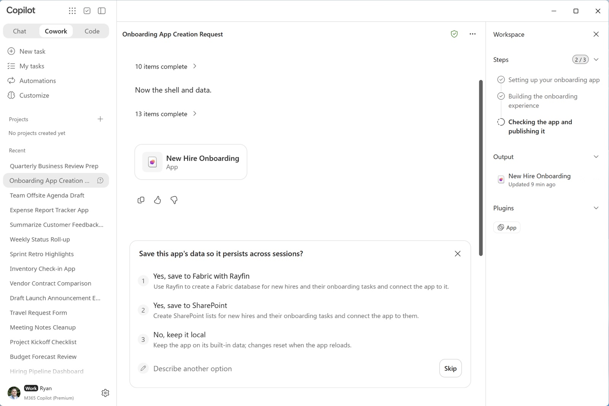
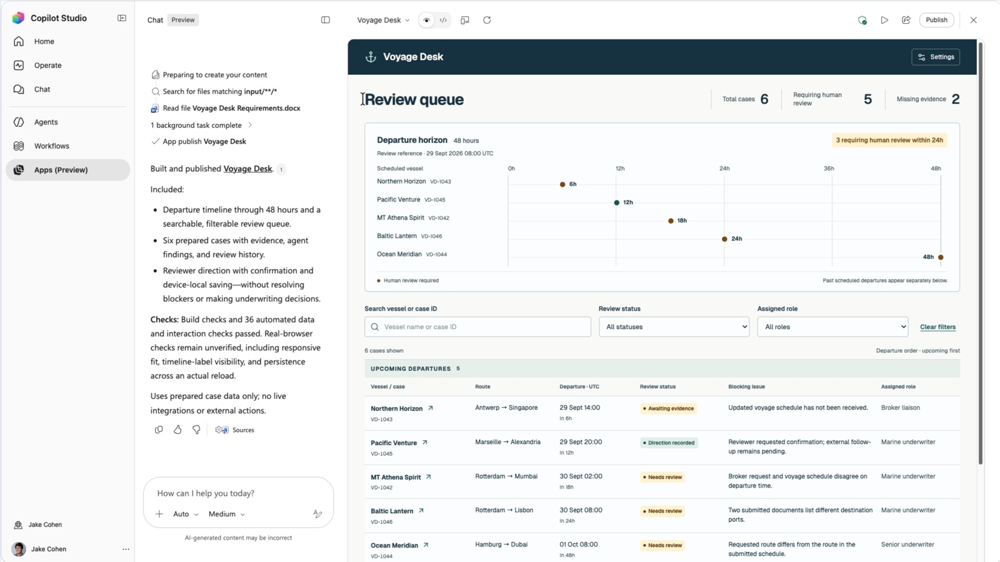
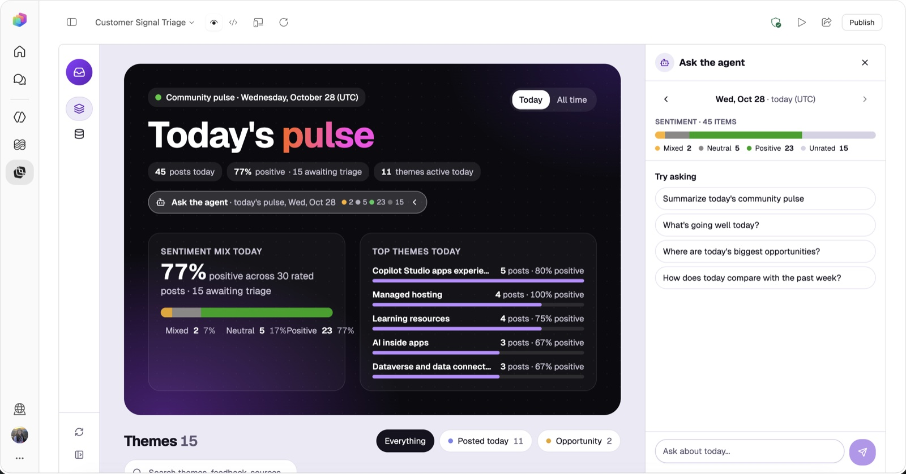
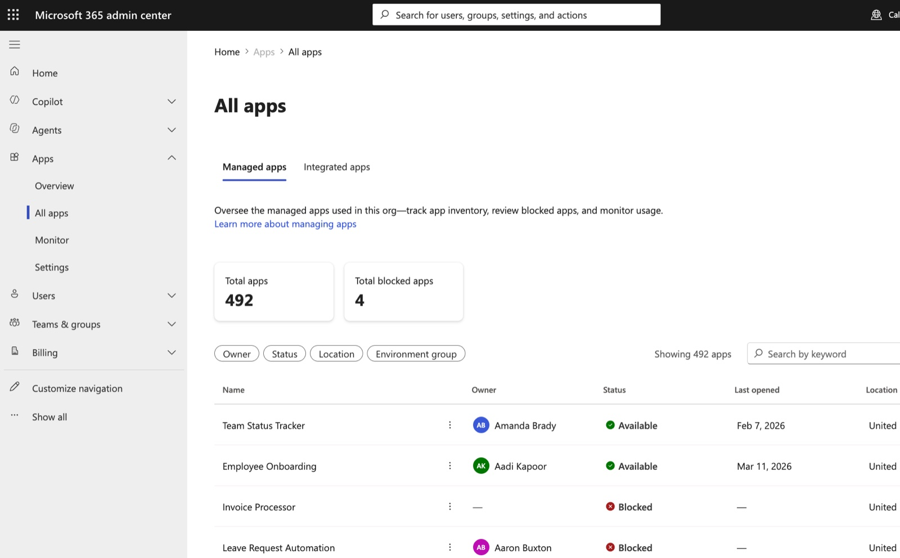

## #runtime-paradigm 01 / Runtime Architecture & Session Theater :: 统一托管底座：终结本地端口孤岛与构建期策略前置 || Unified Runtime: Ending Localhost Silos with Build-Time Policy Awareness

企业员工利用生成式工具编写内部应用时，最常见的工程挫败并非写不出前端界面，而是原型跑在个人电脑的本地端口上，既无企业目录鉴权，也无法通过合规审查部署上线 [1]。Clay Wesener 在 BRK378 开场指出，团队在准备演示时混合使用了协同画布（Cowork）、Copilot Studio、命令行工具与多款前沿大模型（涵盖 OpenAI 与 Claude Opus 等），但产出的每一款应用都彻底告别了 `localhost` 地址 [1][2]。只要应用发布至 2026 年 11 月 17 日正式商用的 **Copilot 托管运行时（Copilot Managed Runtime）**，系统便会自动为其绑定 Microsoft Entra 安全认证、创建后台 Git 远程源码仓库，并实时登记至 Microsoft 365 管理中心 [1][2]。 || When enterprise teams generate internal software with AI coding tools, the hardest blocker is rarely drafting the user interface—it is escaping `localhost` prototypes that lack corporate authentication and fail security review [1]. Opening BRK378, Clay Wesener noted that even though the team built session demos across Cowork, Copilot Studio, the CLI, and mixed frontier models including OpenAI and Claude Opus, not a single resulting app ran on a local port [1][2]. Every artifact deployed to the **Copilot Managed Runtime** (GA as of November 17, 2026) automatically receives Microsoft Entra authentication, a backing Git remote repository, and live registration inside the Microsoft 365 Admin Center [1][2].

更关键的机制在于**构建期策略前置感知** [1]。传统影子开发往往在耗费大量算力额度写完应用后，才在上线审批时因触碰禁用数据源而被迫推翻重来 [1]。在托管运行时体系下，管理员在管理中心设定的环境组路由、连接器准入范围与共享限制会直接注入构建智能体的上下文；智能体在动笔生成代码前便已知晓组织红线，从源头避免无效的词元与点数消耗 [1][3]。 || Even more consequential is **policy awareness during authoring** [1]. Unmanaged shadow projects frequently burn substantial model credits building an application only to discover at deployment review that its target data connector is prohibited [1]. Under Copilot Managed Runtime, environment routing rules, approved data boundaries, and sharing restrictions configured in the Microsoft 365 Admin Center feed directly into the authoring agent so makers never waste tokens building unshippable software [1][3].

:::figure { src: "./media/cmr-unified-runtime-architecture.figure.json", title: "Copilot Managed Runtime 三层统一构建、托管与治理全景架构（BRK378） || Copilot Managed Runtime Three-Tier Build, Host, and Govern Architecture (BRK378)" }
图 1：顶层允许业务专家、全栈开发者与三方工具用户按习惯选型；中层收口至统一 Git 远程仓库、双模智能体与 1,500+ 连接器；底层由 Microsoft 365 管理中心默认接管台账隔离、动作级防护与消费限额 [1][2]。 || Figure 1: Domain experts, pro developers, and third-party builders work in their preferred tools on top, converging on a shared Git remote, dual agentic intelligence, and 1,500+ connectors in the middle under default M365 Admin Center governance [1][2].
:::

下方官方专场点播导览台整合了 BRK378 全长 45 分钟的微软官方流媒体播放器、原版幻灯片直链与四段实机演示时间轴，点击顶部阶段标签即可对照查阅 [1]： || The interactive theater below pairs the official 45-minute Medius on-demand stream and original slide deck link with timestamped walkthroughs across all four BRK378 live segments [1]:

:::sandbox { id: "brk378-video-theater", canvas: false, script: "./brk378-theater.js", style: "./brk378-theater.css", title: "Ignite 2026 BRK378 官方点播流媒体与四段实机时间轴导览台 || Ignite 2026 BRK378 Official On-Demand Video & Four-Segment Demo Theater", desc: "切换架构定调、Cowork/Studio 实机、Lovable 三方集成与 CLI/管理中心四段议程，支持在页内直接加载微软官方点播流。 || Switch across Runtime Vision, Cowork/Studio Demos, Lovable Integration, and CLI/Admin Governance, or load the official Medius player inline." }
纯静态议题视频导览沙盒：内置 BRK378 官方高清封面、逐分钟核对的四幕演示时间轴与官方视频/课件直达入口。 || Pure static session video theater featuring the official BRK378 thumbnail, minute-verified chapter digests, and direct stream/PPTX links.
:::

随同托管运行时本体正式商用，微软在 11 月 17 日同步解锁了跨角色扩展能力矩阵 [1][2]：其一，**本地构建与 Git 源码化智能体及工作流（公开预览）**支持创作者在本地机器与自选开发工具中构建 Copilot Studio 智能体与工作流，通过 GitHub 等源码平台做版本控制后再发布回云端 [2]；其二，**全代码智能体（早期访问预览）**允许开发者自带模型、编排器或运行内核编写纯代码智能体并直接跑在托管运行时上，无需在 Azure 中做任何额外配置即可默认打通 Agent 365 [2]；其三，**Microsoft Fabric 数据库开箱集成（前沿预览）**让需要跨会话持久化的应用一键调用代号为 Rayfin 的能力创建托管数据库、存储与数据接口，而无需自行运维后端服务器 [1][2]。 || Alongside the runtime GA on November 17, Microsoft unlocked three companion capabilities across personas [1][2]: first, **local Git-backed builds of Copilot Studio agents and workflows (Public Preview)** let makers author locally in their own toolsets, version through GitHub, and publish back to Copilot Studio [2]; second, **Code Agents (Early-Access Preview)** run custom code-built models, orchestrators, or harnesses on Copilot Managed Runtime with default Agent 365 integration and zero Azure setup [2]; third, **Fabric database integration (Frontier Preview)** lets stateful apps provision persistent storage and data APIs out of the box via Rayfin while keeping hosting inside the managed control plane [1][2].

## #in-flow-apps 02 / In-Flow Intelligent Apps :: 工作流内构建与智能跃迁：从 Cowork 脉络出图到 Studio 智能体协同 || In-Flow Intelligent Apps: From Work IQ Grounding in Cowork to Agent-Backed Studio UX

在日常办公流中，业务团队往往把关键项目进度散落在会议纪要、演示文稿与多张电子表格里，手工同步极易过期失真 [1]。Emma Cooper 在第一幕实机演示中展示了如何零上下文切换地把静态文档升级为受管交互应用：在 **Copilot 协同画布（Cowork，现已正式商用）**内输入构建诉求后，应用构建技能会直接调取 **Work IQ** 组织图谱上下文——自动识别刚开完的升级复盘会、Loop 协作组件、团队成员名单与企业视觉规范，几分钟内生成《2026 年第四季度 Atlas 项目路线图》应用 [1][2]。原本死板躺在表格行里的交付物变成了可筛选、可下钻改期并按 Office 文档习惯一键复制组织链接共享的鲜活系统 [1]。 || Operational teams routinely scatter critical milestones across meeting notes, slide decks, and disconnected spreadsheets that go stale within days [1]. In her first live walkthrough, Emma Cooper demonstrated upgrading static files without switching tools [1]. Prompting inside **Copilot Cowork (now GA)** invokes the built-in app skill grounded in **Work IQ** to pull context from recent meetings, Loop components, team rosters, and brand styles, generating the interactive **Q4 2026 Atlas Roadmap** app in minutes [1][2]. Spreadsheet rows become live deliverables that teammates filter, drill into, update, and share using familiar Office-style organization links [1].

插件与可复用技能进一步放大了工作流内构建的上限 [1]。创作者不仅能编写并共享“应用使用手册自动生成技能”，还能直接调用 **Figma 设计插件**——只需粘贴设计团队打磨好的蓝调图表界面链接，智能体便会读取设计规范并绑定真实业务数据源，在几分钟内交付像素高度还原且受组织策略纳管的可交互应用 [1]。当应用需要跨会话保存数据时，系统会主动弹出持久化引导卡片，供创作者在“通过 Rayfin 保存至 Fabric 数据库”、“创建 SharePoint 列表”或“仅保留会话内本地演示数据”之间一键抉择 [2]。 || Plugins and reusable skills push in-flow creation even further [1]. Makers can share custom skills—such as an automated user-guide generator—or invoke the **Figma plugin** by pasting a mockup link so Cowork translates polished chart layouts into a live, data-bound managed app in minutes [1]. Whenever an app requires cross-session state, Cowork prompts the maker to persist records into a **Fabric database via Rayfin**, provision **SharePoint lists**, or keep ephemeral built-in data [2].

:::insight-grid { cols: 3, title: "托管微应用的三大进化阶梯与双模智能分工 || Three Evolutionary Tiers & Dual Intelligence Inside Managed Apps" }
::card 01
### 连接器驱动的数据交互层 || 1,500+ Governed Data Connectors
预置超 1,500 个连接器直连 Dataverse、SQL、Fabric、SharePoint 与 Outlook 等动作服务，同时支持挂载任意自定义接口；构建阶段更可直接调用 Dataverse 插件自动建表与演进表结构 [1][2]。 || Connects out of the box to 1,500+ prebuilt data and action services plus custom REST APIs, while the Dataverse plugin creates tables and updates schemas directly during app authoring [1][2].

::card 02
### 轻量行内提示词摘要（Inline LLM） || Lightweight Inline Prompt Summaries
针对无需多轮工具编排的即时态势感知（如巡检看板顶部的“今日风险概览”），直接在前端视图中嵌入单次大模型提示词函数，以极低时延提炼当前筛选窗口下的核心待办 [1]。 || Embeds single-call LLM prompt functions directly inside app views—such as an instant risk overview card—delivering low-latency situational summaries without spinning up a full agent loop [1].

::card 03
### 完整 Studio 智能体深度协同（GA） || Full Copilot Studio Agent Backing (GA)
针对跨表关联与复杂合规规程，将已发布的 Copilot Studio 专职智能体嵌入应用专属交互侧栏；告别“静态表单等指令”旧范式，让应用理解意图、主动推理并给出整改动作建议 [1][2]。 || Binds published Copilot Studio agents into custom in-app chat panes so applications move beyond passive data entry to reason over domain rules and recommend concrete actions [1][2].
:::

切入面向端到端业务流程改造的 **Copilot Studio（应用构建现已正式商用）**后，Emma 现场展示了 **Gauge 现场巡检分析应用（Gauge Field Inspections）** [1]。该应用底层通过 Dataverse 插件自动构建巡检结果表，主屏实时渲染合格率走势、高频复发缺陷与故障热力图；右侧则内嵌定制对话界面直连已发布的 **Gauge 风险顾问智能体（Gauge Risk Advisor Agent）** [1]。当巡检主管追问“北场（North Yard）有哪些逾期未闭环的整改动作”时，智能体即刻检索 Dataverse 台账与安全作业规程知识库返回精准处置清单，与顶部的轻量行内风险摘要形成高低搭配 [1]。下方四张提取自 BRK378 原版课件的高清实机界面完整还原了上述关键场景 [2]： || Moving into **Copilot Studio (Apps now GA)** for deeper process transformation, Emma showcased the **Gauge Field Inspections** app [1]. Backed by Dataverse tables generated via plugin, its main dashboard renders pass-rate trends, recurring findings, and failure heatmaps, while a custom UX pane hosts the live **Gauge Risk Advisor Agent** [1]. Asking which corrective actions are overdue in North Yard triggers the agent to cross-reference Dataverse records against safety instructions, complementing the lightweight inline AI risk overview above it [1]. The four high-resolution captures extracted from the official BRK378 slide deck below illustrate these surfaces [2]:

  <article class="brk378-media-card">
    

      
    

    

      BRK378 官方课件原图 · Slide 20
      <h4 data-zh="Cowork 构建流一键接入 Fabric (Rayfin) 持久化数据库" data-en="Cowork App Creation with Out-of-Box Fabric (Rayfin) Persistence">Cowork 构建流一键接入 Fabric (Rayfin) 持久化数据库</h4>
      
生成新员工入职应用时，系统主动引导将跨会话数据一键落盘至 Fabric 数据库或 SharePoint 列表 [1][2]。

    

  </article>
  <article class="brk378-media-card">
    

      
    

    

      BRK378 官方课件原图 · Slide 15 GA
      <h4 data-zh="Copilot Studio 托管应用：Voyage Desk 航运核保审查台" data-en="Apps in Copilot Studio: Voyage Desk Underwriting Review Queue">Copilot Studio 托管应用：Voyage Desk 航运核保审查台</h4>
      
读取需求文档自动生成 48 小时离港时间轴与人工复核队列，发布前自动跑通构建检查与 36 项数据交互校验 [2]。

    

  </article>
  <article class="brk378-media-card">
    

      
    

    

      BRK378 官方课件原图 · Slide 17 GA
      <h4 data-zh="智能体协同应用（Intelligent Apps）：舆情分诊与对话侧栏" data-en="Intelligent Apps GA: Customer Signal Triage + Ask the Agent">智能体协同应用（Intelligent Apps）：舆情分诊与对话侧栏</h4>
      
左侧可视化看板实时聚合 77% 正向情绪与热点主题，右侧内嵌智能体侧栏供业务人员随时追问异动根因 [1][2]。

    

  </article>
  <article class="brk378-media-card">
    

      
    

    

      BRK378 官方课件原图 · Slide 18 GA
      <h4 data-zh="Microsoft 365 管理中心：全域托管应用盘点与风险阻断" data-en="M365 Admin Center: Unified Inventory of 492 Managed Apps">Microsoft 365 管理中心：全域托管应用盘点与风险阻断</h4>
      
新增 Apps 专属分类统一透视组织内 492 款托管应用与所有者状态，对违规高危应用一键执行 Blocked 拦截 [1][2]。

    

  </article>

## #open-ecosystem-git 03 / Open Ecosystem & Pro-Dev Handoff :: 跨生态与专业代码无缝接力：Lovable 直发托管与 VS Code 免密演进 || Open Ecosystem & Pro-Dev Relay: Lovable Direct Publish and Keyless VS Code Git Handoff

低代码与自然语言生成平台长期困扰研发团队的一大顽疾是“能力断崖（Cliff）”：一旦业务专家做出的原型升级为核心生产系统，专业工程师往往拿不到干净源码，只能推倒重写 [1]。Copilot 托管运行时在底层架构上彻底消除了工具孤岛——无论应用诞生于协同画布、Copilot Studio、Copilot Code 还是命令行，系统都会在后台自动初始化并维护同一个 **Git 远程源码仓库**，完整保存标准的 TypeScript 与 React 组件树及历史版本记录 [1][2]。与此同时，多工具协同还可围绕单一业务 Git 仓库（如课件示例 `storyops/main` 统一存放 `.github/`、`agents/`、`skills/`、`prompts/` 与 `templates/`）读写共享资产 [2]。 || Low-code and AI prototyping tools have long suffered from a painful capability cliff: once a domain expert's prototype becomes mission-critical, software engineers cannot access clean source files and end up rewriting everything from scratch [1]. Copilot Managed Runtime eliminates entry-point silos by provisioning a shared **Git remote repository** behind every app—preserving standard TypeScript and React component trees plus full commit history regardless of whether authoring started in Cowork, Copilot Studio, Copilot Code, or the CLI [1][2]. Teams can likewise coordinate around a single Git repository (illustrated in Slide 22 as `storyops/main` housing `agents/`, `skills/`, `prompts/`, and `templates/`) across desktop, studio, editor, and terminal workflows [2].

:::figure { src: "./media/cmr-entry-points-quadrant.figure.json", title: "五大构建入口的源码工程掌控度与企业治理完备性分布象限（BRK378） || Source-Code Engineering Control vs. Enterprise Governance Across Five Entry Points (BRK378)" }
图 2：从工作流内的 Cowork/Studio 到三方平台 Lovable，再到专业研发的 CLI + VS Code，全部入口均摆脱底部未纳管的本地端口断档区，在顶部高治理安全区内围绕同一 Git 仓库自由接力 [1][2]。 || Figure 2: Spanning Cowork, Copilot Studio, Lovable, and CLI + VS Code, every managed entry point escapes unmanaged localhost prototypes into the governed upper zone backed by one Git remote [1][2].
:::

这种开放性同样延伸至微软生态之外的第三方构建平台 [1]。作为广受欢迎的对话式软件生成平台，**Lovable** 目前已服务超过 **40,000 家企业**（覆盖个体创业者直至德国电信 Deutsche Telekom、英伟达 Nvidia 等大型跨国机构），累计诞生逾 **7,000 万个项目** [1]。Malavika Balachandran Tadeusz 在现场演示了基于托管平台开发套件（Managed Platform SDK）打通的企业级工作流：IT 管理员在工作区仅需约 **20 分钟**即可完成租户绑定；随后创作者在 Lovable 中以 Excel 电子表格作为入职任务后端，一句话生成按员工 Microsoft Entra ID 个性化展示的新员工入职应用 [1][2]。点击发布按钮后，**Lovable 仅将纯 React 前端代码直接推送至微软 Copilot 托管运行时，全程零权限触碰企业底层业务数据**——所有数据读写、身份登录与合规审计完全在客户的 Microsoft 365 租户边界内闭环运行 [1]。 || That architectural openness extends directly to third-party builders through the Managed Platform SDK [1]. Powering over **40,000 businesses**—from small shops to global enterprises such as Deutsche Telekom and Nvidia—with more than **70 million projects** created, **Lovable** joined the BRK378 stage to demonstrate its native integration [1]. An IT administrator connects a Lovable workspace to Copilot Managed Runtime in roughly **20 minutes**; makers then prompt an Entra-personalized new-hire onboarding app backed by an Excel tracker and publish with one click [1][2]. Crucially, **Lovable ships only the compiled React frontend straight to Copilot Managed Runtime and never accesses underlying enterprise data**—every connector binding, Entra ID sign-in, and policy check executes strictly inside the customer's Microsoft 365 tenant [1].

而在“业务专家交棒专业研发”的第三幕压轴演示中，Emma 戴上全栈工程师帽，接手了前文在 Copilot Studio 中由业务人员生成的 Gauge 现场巡检应用 [1]： || In the pro-developer handoff walkthrough, Emma switched hats to extend the exact Gauge Field Inspections app originally built in Copilot Studio [1]:

| 跨工具接力与多入口选型维度 || Relay Step & Entry Surface | 核心技术状态与认证机制 || Engineering Mechanism & Auth | 实机验证细节与研发收益 || Live Demo Outcome & Developer Payoff |
|------|------|------|
| 1. CLI 权限核验与免密克隆 || CLI Discovery & Keyless Clone | 正式商用（GA）· Git Credential Manager || GA · Git Credential Manager | 运行命令行列出当前账号获授权编辑的托管应用，无需手工配置任何密钥或个人令牌即可将 Gauge 远程仓库直接克隆至本地目录 [1] || Queries editable managed apps via CLI and clones the live Gauge Git remote locally through GCM without raw API keys or PAT tokens [1] |
| 2. VS Code 全栈源码编辑 || Full React/TS Editing in VS Code | 标准 TypeScript + React 组件工程 || Standard TypeScript + React Tree | 打开完整前端源码树（含首页 `Home.tsx`、自定义 Hooks 与图表组件库），唤起编辑器内 Copilot 编码智能体复用既有指标逻辑新增巡检地理位置地图组件 [1] || Exposes clean `Home.tsx`, hooks, and libraries in VS Code so GitHub Copilot adds an interactive inspection geolocation map reusing existing calculations [1] |
| 3. 本地开发服隔离调测与回推 || Local Dev Mode & Governed Push | 本地开发沙盒标识 + 原路发布上线 || Local Dev Banner + Managed Deploy | 启动本地开发服务器（顶部清晰提示“运行于本地开发模式，尚未对终端用户生效”），验证地图渲染与数据联动无误后一键推回托管运行时供全员使用 [1] || Verifies the new map component on a local dev server flagged safely off-production before pushing updates back to the shared managed URL [1] |
| 4. Copilot Code 与三方工具矩阵 || Copilot Code & 3P Dev Surfaces | 前沿预览（Frontier）与开放生态 || Frontier Preview & Open SDK | 除 VS Code 与命令行外，开发者也可直接在 Copilot Code、GitHub Copilot 应用或 Claude 等外部兼容开发环境使用同一套技能向托管运行时交付制品 [1][2] || Supports building and deploying to the exact same runtime from Copilot Code, the GitHub Copilot app, Claude, or SDK-integrated third-party workspaces [1][2] |

## #day-one-governance 04 / Day-One Governance & FinOps :: 首日默认治理与成本护栏：环境隔离、动作级白名单、严格 CSP 与额度账本 || Day-One Governance & FinOps: Personal Sandboxes, Action DLP, Strict CSP, and Credit Caps

当组织放开手脚让成百上千名员工在五六种不同工具里快速构建应用时，安全与财务失控是首席信息安全官最核心的顾虑 [1]。Copilot 托管运行时的回答是**“默认即受管（Governed by default）”**——管理员无需事先手工搭建复杂管道，每一款托管应用从诞生第一秒起便自动落入隔离的**个人托管沙盒环境（Personal Sandboxes）**，并受控于环境组（Environment Groups）的绿色安全基线策略 [1][2]。 || When hundreds of employees start shipping apps across half a dozen authoring tools, security sprawl and runaway spend quickly top every CISO's risk register [1]. Copilot Managed Runtime addresses this by making every artifact **governed by default**: without manual setup, new apps isolate inside managed **personal sandboxes** and inherit baseline "green zone" environment group policies from second one [1][2].

:::flow { title: "Microsoft 365 管理中心对托管应用的四维全生命周期管控闭环 || Four-Pillar Lifecycle Governance Inside Microsoft 365 Admin Center" }
1. **全景资产台账与一键隔离排险（Inventory & Quarantine） || Unified App Inventory & Instant Quarantine** — 在 Microsoft 365 管理中心全新上线的 **Apps** 一级目录下，管理员可在 `All apps` 视图一屏盘点全租户所有入口创建的托管应用（课件实机展示共纳管 **492 款应用**，其中 **4 款已阻断**），逐一穿透查看创建者、最后更新时间、活跃用量与底层连接器清单；一旦发现业务风险，可立即点击 **Block** 将应用隔离下线，待排查修复后再恢复运行或彻底删除 [1][2]。 || Under the dedicated **Apps** category in the Microsoft 365 Admin Center (`All apps` tracking **492 total apps** and **4 blocked apps** in Slide 18), admins inspect makers, last-modified timestamps, usage, and active connectors—and can immediately **Block** (quarantine) risky apps while remediating issues or delete them outright [1][2].
2. **连接器准入与细粒度动作级白名单（Action-Level DLP） || Connector Allowlists & Per-Action Granular Controls** — 面对 1,500+ 预置连接器，管理员不仅能按环境组与人员范围划定允许接入的数据源列表，还能进一步向下钻取至**单个连接器内的具体动作（Individual Actions）**逐项开启或禁用（例如允许读取记录但严禁高风险删除或外发动作），且该规则在智能体构建期与运行时双重强制生效 [1][2]。 || Beyond approving or blocking whole connectors out of the 1,500+ catalog per environment group, admins drill down into **individual actions** inside a connector—enabling safe reads while disabling destructive writes—enforced both while agents build code and at runtime [1][2].
3. **分发共享边界与默认严格内容安全策略（Sharing & Strict CSP） || Distribution Guardrails & Default Strict CSP** — 管理员集中设定应用允许按指定人名点对点共享、启用类似 Office 文档的全组织链接共享、绑定 Entra 安全组及条件访问（Conditional Access），或是否向外部访客（Guest Users）开放；同时平台默认施加**严格的内容安全策略（Content Security Policy）**，即使前端代码试图私自调用未经授权的外部第三方 API 或脚本域名，也会被浏览器与运行时安全策略直接拦截 [1][2]。 || Admins govern whether apps can share via org-wide links, named individuals, Entra security groups with Conditional Access, or guest accounts; simultaneously, a **strict default Content Security Policy (CSP)** blocks unauthorized external APIs or untrusted endpoints at runtime [1][2].
4. **计费策略与可扩展点数上限（Billing Policies & Spend Caps） || Copilot Credit Billing Policies & Scalable Limits** — 在管理中心的 `Copilot > Cost management` 面板下，管理员可创建专属计费策略并将 **Copilot Managed Runtime** 纳入受控服务范围；在 Emma 的现场演示中，她为“现场巡检（Field inspections）”策略设定了 **5,000 点数（Copilot Credits）**的消费上限，既防止单个试点应用意外烧穿预算，又能在应用向全公司推广时随时在线上调配额 [1][3]。 || Inside `Copilot > Cost management`, admins bind **Copilot Managed Runtime** into targeted spending policies; in the live demo, Emma configured a **5,000-credit limit** for the `Field inspections` policy, preventing runaway pilot spend while letting IT raise caps smoothly as adoption scales [1][3].
:::

### 企业落地选型与常见治理问答精要 || Enterprise Rollout Checklist & Architecture FAQ

在组织落地 Copilot 托管运行时前，建议架构师与管理员按三步走快速收口治理基线：首先在 Microsoft 365 管理中心核对默认环境组的“绿区（Green Zone）”连接器白名单与内容安全策略，确保业务人员在协同画布或 Copilot Studio 内首次体验时即处于合规边界内 [1]；其次针对 Lovable 等外部前端构建平台，利用 20 分钟标准流程完成租户级单点绑定，替代散落在业务部门的未授权个人账号 [1]；最后在 `Cost management` 中按核心业务线建立分层计费策略（如试点期设定 5,000 点数软硬阈值），打通从灵感验证、专业研发 Git 接力到规模化推广的完整闭环 [1][2][3]。 || Before rolling out Copilot Managed Runtime org-wide, architects and IT leads can establish a clean baseline in three steps: first, review default "green zone" environment group connector allowlists and CSP rules in the Microsoft 365 Admin Center so first-time Cowork and Copilot Studio makers build safely [1]; second, complete the ~20-minute workspace integration for approved external builders like Lovable to eliminate unmanaged shadow accounts [1]; third, attach tiered Copilot Credit spending limits (such as 5,000-credit pilot caps) under `Cost management` so grassroots prototypes can graduate smoothly via Git into pro-dev production [1][2][3].

## 参考资料：官方一手信源与专场链接 || References: Official Primary Sources & Session Links

1. **Clay Wesener, Emma Cooper & Malavika Balachandran Tadeusz (Microsoft Ignite 2026 BRK378)** — https://ignite.microsoft.com/en-US/sessions/1787856630704001Ep9J-1791588308254001CRyh | 《Host apps from anywhere with the new Copilot Managed Runtime》45 分钟官方点播视频实录与双语 WebVTT 逐字稿（2026-11-18） || Official 45-minute breakout session recording and verbatim WebVTT transcript (Nov 18, 2026)
2. **Microsoft Ignite 2026 Official Presentation Deck (BRK378)** — https://medius.microsoft.com/video/asset/PPT/c5c8ac76-0384-4a0c-acf5-83488136a4f1 | 《Host apps from anywhere with the new Microsoft Copilot Managed Runtime》34 页官方原版演示文稿（含 11 月 17 日正式商用矩阵、Voyage Desk、Fabric Rayfin 及管理中心 492 款应用实拍） || Official 34-slide presentation deck covering November 17 General Availability announcements, Voyage Desk, Fabric Rayfin persistence, and Microsoft 365 Admin Center inventory captures
3. **Microsoft Ignite 2026 BRK378 On-Demand Stream & Copilot Managed Runtime Portal** — https://medius.microsoft.com/Embed/video-nc/c5c8ac76-0384-4a0c-acf5-83488136a4f1 | Medius 官方流媒体直连播放器与专场配套技术公告入口（`aka.ms/cmrblog` / `aka.ms/managedapps`） || Official Medius embedded video player and companion Copilot Managed Runtime documentation links (`aka.ms/cmrblog` / `aka.ms/managedapps`)
