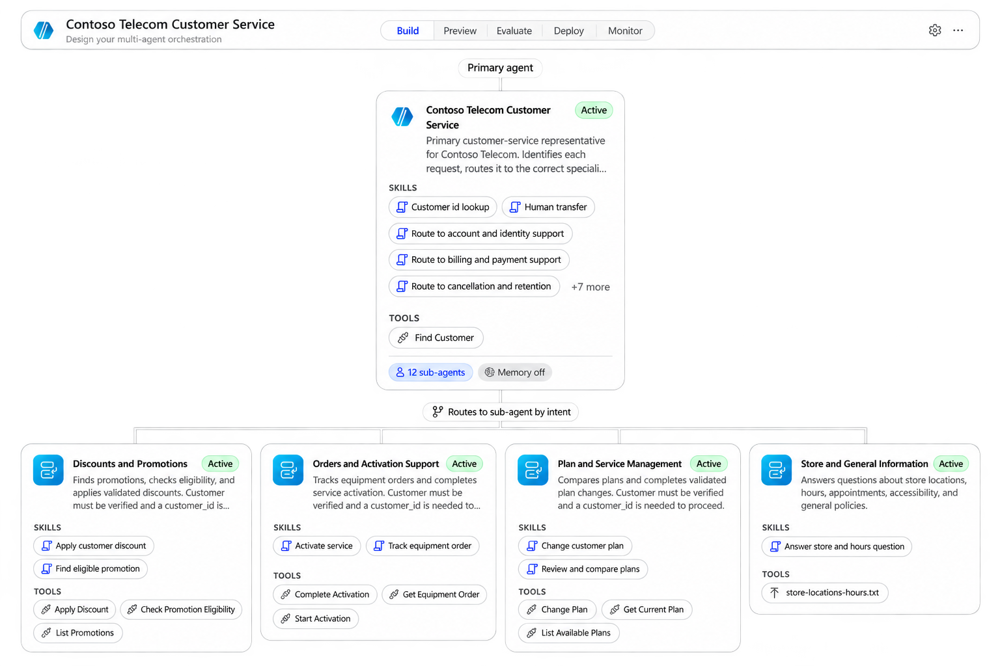
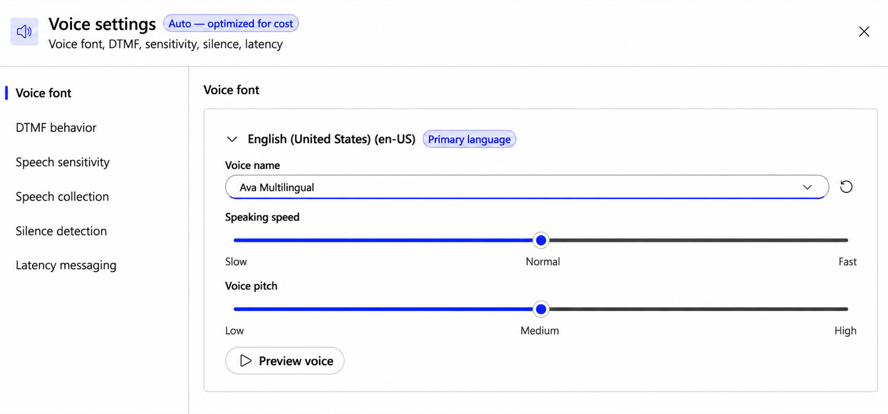
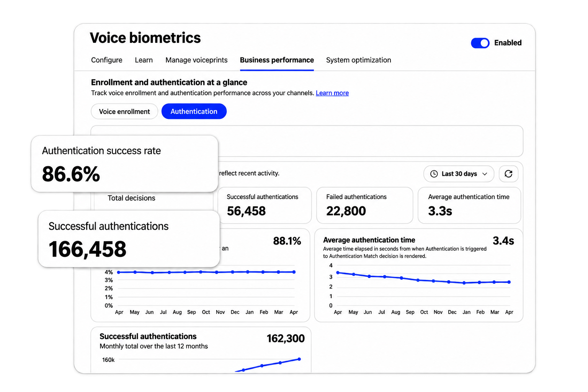
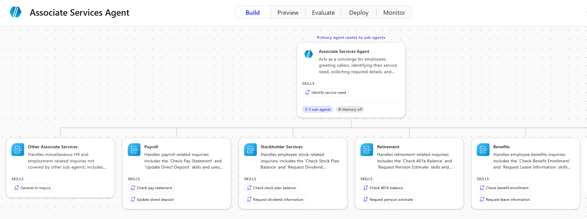

## #omnichannel-harness 01 / Dedicated Customer Harness :: 市场拐点与专属底座：终结按键菜单断层的多智能体全渠道架构 || Market Inflection & Dedicated Harness: Ending IVR Silos with Multi-Agent Architecture

习惯每天与前沿推理模型自然交谈的消费者，已无法容忍传统电话按键导航（“存款请按 1，预约请按 2”）和换个渠道就丢失前文的网页机器人 [1]。Gartner 在 2025 年《人工智能代理与交互式语音应答性能》报告中指出，到 2028 年至少 70% 的客户旅程将以对话式人工智能作为第一触点 [2]。微软为此在 Copilot Studio 内推出正式商用的 **Customer Conversation Harness**，将过往割裂的电话语音树、网页富媒体聊天与后台业务智能体收拢进同一套工程底座 [1][4]。 || Consumers accustomed to fluid daily chats with reasoning models no longer tolerate rigid DTMF phone trees or stateless web widgets that forget context mid-journey [1]. Gartner's 2025 report on AI Agents and IVR Performance projects that at least 70% of customer journeys will start with conversational AI by 2028 [2]. Microsoft answered in BRK379 by shipping the generally available **Customer Conversation Harness** inside Copilot Studio, unifying voice trees, rich web chat, and backend workflows on one canvas [1][4].

:::figure { src: "./media/brk379-customer-harness-architecture.figure.json", title: "Customer Conversation Harness 全渠道多智能体与联络中心协同架构 || Customer Conversation Harness Omnichannel Multi-Agent & CCI Architecture" }
图 1：BRK379 确立的三层客户对话架构——顶层统一接入网页富媒体与原生电话流并执行 3.3 秒声纹反欺诈核验；中层由主控接待代理调度混合推理子代理与外部账务代理；底层挂载企业三域语境、零改造联络中心交接与创建即生效的注册表治理 [1][2][3]。 || Figure 1: Three-tier BRK379 architecture—combining web/voice ingress and 3.3s biometric verification on top, primary-to-specialist hybrid orchestration in the middle, and Microsoft IQ grounding, contact center escalation, and Agent 365 governance underneath [1][2][3].
:::

与单打独斗的早期问答机器人不同，新底座复刻了真实联络中心的专家分工模式：主控接待智能体负责识别来电意图与维护全局记忆，再按需分发给信用卡、支票账户、按揭贷款或外部 Microsoft Foundry 专职子智能体 [1][2]。会话上下文直接绑定在经过身份认证的客户智能体层而非单一通信管道——即便客户驾车穿过隧道导致电话掉线，重新拨入后对话也能直接从中断处续接，无需从头自报家门 [1]。下方交互点播台集成了 BRK379 官方 45 分钟录播流、原版课件直链与三段核心实录时间轴，点击即可直接在页内加载视频或按章节检索 [1][2]： || Rather than cramming every prompt into one monolithic bot, the harness mirrors human specialist teams: a primary concierge identifies caller intent and maintains cross-call memory, delegating specialized tasks to credit card, checking, mortgage, or external Microsoft Foundry sub-agents [1][2]. Because context lives with the verified agent session rather than the transport pipe, a caller whose phone drops inside a highway tunnel can redial and resume right where the conversation paused [1]. The interactive theater below embeds the official 45-minute BRK379 Medius stream, PPTX deck link, and three-part timestamped guide [1][2]:

:::sandbox { id: "brk379-video-theater", canvas: false, script: "./brk379-showcase.js", style: "./brk379-showcase.css", title: "BRK379 官方点播视频流、课件下载与三幕时间轴导览 || BRK379 Official On-Demand Stream, Slide Deck & Three-Act Timeline", desc: "支持在页面内直接挂载微软 Medius 官方播放器，按架构主旨、7.5 分钟实机改造与 Publix 客户案例分段查阅精确时间戳。 || Load the official Microsoft Medius stream inline and browse exact timestamps across Architecture, 7.5-Min Live Demo, and the Publix Case Study." }
纯静态专场点播导览台：内嵌 BRK379 官方高清封面、Medius 视频流开关、原版 PPTX 下载与核实时间轴。 || Pure static session theater featuring the official BRK379 thumbnail, inline Medius player toggle, PPTX link, and verified timestamps.
:::

## #voice-hybrid-biometrics 02 / Voice-Native & Hybrid Reasoning :: 语音原生与混合推理：声纹防伪、双态编排与定制模型矩阵 || Voice-Native & Hybrid Reasoning: Voice Biometrics, Dual-Mode Flows, and Custom Models

在外部客服场景中，纯大模型自由发挥与纯流程图死板跳转各有致命短板：推荐信用卡权益时需要模型灵活追问偏好，而涉及法律合规告知或提交开卡申请时则要求一步不差地执行标准话术 [1][2]。Customer Conversation Harness 允许创作者在同一个子智能体内混编**生成式技能（Generative Skills）**与**确定性话题（Deterministic Topics）**，并通过画布级变量双向传值——生成式对话收集到的客户偏好可直接注入确定性审批流，确定性节点查出的客户档案也能动态拼入生成式指令 [1][2]。 || Pure open-ended prompting and rigid flowcharts each fail half of customer service: recommending travel perks demands flexible follow-up questions, whereas regulatory disclosures and formal card submissions require exact step-by-step control [1][2]. Customer Conversation Harness lets makers combine **generative skills** and **deterministic topics** inside the same sub-agent while passing canvas variables both ways—feeding conversationally gathered preferences into deterministic topics and hydrating generative instructions from system records [1][2].

:::insight-grid { cols: 3, title: "专为实时客户交互打造的三大底层技术突破 || Three Core Engineering Advances for Real-Time Customer Engagement" }
::card 01
### 原生语音管道与精细声学调优 || First-Class Voice Fonts & Acoustic Controls
语音不再是文字机器人的事后补丁：内置全新 Harper 多语种音色（同一智能体可按英语、意大利语、越南语分别指定专属音色、语速与音高），并开放按键双音多频行为、语音灵敏度、静默等待阈值与高延迟安抚话术配置，支持直接在工作台申领并绑定 Teams Phone 号码 [1][2]。 || Voice ships as a native citizen with Harper multilingual fonts (configurable speed, pitch, and per-language voices across English, Italian, and Vietnamese), granular DTMF, speech sensitivity, silence detection, latency messaging, and direct Teams Phone number acquisition [1][2].

::card 02
### 面向延迟与成本的分层模型矩阵 || Outcome-Tuned SLMs & Realtime Speech Model
支持按子智能体职责独立选配模型：深度账务推理挂载高算力大模型，高频常规问答挂载微软内部实验室专为实时客服精调的处理器级第三方小语言模型（压低响应延迟与词元开销，并提升高并发可用性），同时即将上线击败多项联络中心行业基准的首款端到端语音大模型 **Microsoft AI Realtime 1** [1][2]。 || Assigns models per specialist job: pair deep reasoning models on complex disputes with CPU-based fine-tuned 3P small language models for low-latency, low-cost everyday turns, alongside the upcoming speech-to-speech **Microsoft AI Realtime 1** model [1][2].

::card 03
### 3.3 秒声纹生物识别与反欺诈防线 || 3.3-Second Voice Biometrics & Anti-Spoofing
彻底告别“报生日、核对账单地址”的繁琐盘问，原生集成的声纹生物识别可在自然寒暄中比对来电号码与声纹特征；官方 30 天业务看板显示认证成功率达 **86.6%**（56,458 次成功 / 22,800 次拦截，近 12 个月月度成功核验达 162,300 次），平均核验仅需 **3.3 秒**，并主动防御录音回放、深度伪造与合成语音攻击 [1][2][3]。 || Replaces repetitive security trivia with native voiceprint matching; official 30-day telemetry records an **86.6%** authentication match rate (56,458 matches vs. 22,800 blocks) in **3.3 seconds** on average while blocking replay attacks, deepfakes, and AI synthetic speech [1][2][3].
:::

下方三幅提取自 BRK379 官方原版幻灯片的高清界面实拍，完整呈现了单画布多智能体编排视图、成本优先语音参数抽屉以及声纹生物识别 30 天生产监控面板 [2]： || The three high-resolution captures extracted directly from the official BRK379 slide deck illustrate the single-canvas multi-agent builder, the cost-optimized voice settings drawer, and the 30-day voice biometrics telemetry board [2]:

  <article class="brk379-media-card">
    

      
    

    

      BRK379 官方课件第 6 页 · 多智能体画布
      <h4 data-zh="单画布总览主控代理与 12 个专职子智能体" data-en="Full Specialist Team on One Orchestration Canvas">单画布总览主控代理与 12 个专职子智能体</h4>
      
主控客服代理统一执行客户身份查询与人工转接，按意图精准分发至促销折扣、设备激活、套餐变更与门店政策等独立子代理 [2]。

    

  </article>
  <article class="brk379-media-card">
    

      
    

    

      BRK379 官方课件第 8 页 · 语音原生配置
      <h4 data-zh="语音原生调参：音色、灵敏度、静默与延迟提示" data-en="Native Voice Font, Sensitivity & Silence Controls">语音原生调参：音色、灵敏度、静默与延迟提示</h4>
      
默认启用成本优化自动选模，支持在线试听多语种音色并精细调节按键行为、收音时长、静默追问与长耗时等待提示 [1][2]。

    

  </article>

  <article class="brk379-media-card">
    

      
    

    

      BRK379 官方课件第 13 页 · 声纹核验监控
      <h4 data-zh="内置声纹注册与核验看板：86.6% 通过率与 3.3 秒极速响应" data-en="Built-In Voice Biometrics: 86.6% Success Rate & 3.3s Verification">内置声纹注册与核验看板：86.6% 通过率与 3.3 秒极速响应</h4>
      
集中管理客户声纹库、业务通过率与系统阈值校准，支持人机及人人通话双向核验，从源头阻断录音回放与合成语音欺诈 [1][2][3]。

    

  </article>

## #live-modernization-cci 03 / 7.5-Min Live Demo & CCI :: 实机拆解与联络中心集成：7.5 分钟重构银行客服并零改造直连 Avaya || 7.5-Min Live Demo & CCI: Rebuilding Contoso Bank and Connecting Avaya with Zero Rewiring

为验证“一次编写、全渠道发布”的真实工程效率，首席产品经理 Jason Xian 在舞台现场把一套只会机械重复“信用卡还款请按 1”的传统银行语音系统，用 **7.5 分钟**彻底重构为横跨网页与电话的多智能体系统，并当场接入真实 Avaya 坐席桌面 [1]。 || To prove real-world engineering velocity onstage, Principal PM Jason Xian took a legacy Contoso Bank phone tree trapped repeating “press 1 for credit card payment” and rebuilt it end-to-end in **7.5 minutes** across web chat, live voice, and an existing Avaya agent desktop [1].

:::flow { title: "BRK379 舞台实机演示全链路：从一句话生成到声纹防冒名转人工 || BRK379 Live Demo Walkthrough: From Single Prompt to Spoof-Blocked Avaya Escalation" }
1. **自然语言生成专职团队与混合技能 || Prompt-Generated Specialist Team & Hybrid Skills** — 输入一句自然语言指令自动创建支票、信用卡与按揭三个子智能体；为信用卡子代理上传宣传册文档作为知识源，编写询问年费与出行偏好的生成式推荐技能（精准匹配 `$495` 年费含机场贵宾厅与 `$300` 旅行抵扣金的 Contoso Horizon Reserve 卡），同时挂载按渠道自适应的确定性开卡话题（网页端弹出交互式卡片，电话端校验声纹通过后直接调取档案提交并在 24 小时内发信确认）[1]。 || One prompt scaffolds checking, credit card, and mortgage sub-agents; makers attach card brochures for generative recommendations (`$495` annual fee Contoso Horizon Reserve card with `$300` travel credit and Sky Lounge access) alongside a channel-aware deterministic application topic that renders an Adaptive Card on web chat or submits on-file details on verified voice calls [1].
2. **跨底座复用工作流与外部账务代理 || Cross-Harness Workflow Reuse & Foundry Agent Link** — 在支票账户子代理中直接复用其他底座已建好的余额查询工作流，并输入名称一键挂载同环境下的 Azure AI Foundry 交易分析智能体；当实测发现账户余额仅剩 `$68` 时，由外部交易代理自动穿透账单明细，定位出 `$325` 初始余额之外的 `$5,000` 玩偶投资扣款与两笔合计 `$493`（`$168` 与 `$325`）的咖啡消费 [1]。 || The checking sub-agent reuses an existing balance-lookup workflow built in another Copilot Studio harness and links an Azure AI Foundry transaction analyzer by name—explaining a surprise `$68` balance by tracing a `$5,000` Beanie Baby debit and two Starbucks charges (`$168` + `$325` = `$493`) [1].
3. **零代码挂载联络中心与掉线记忆续接 || Endpoint-Only Avaya Integration & Dropped-Call Resume** — 通过同周正式商用的 **Microsoft Contact Center Intelligence（CCI）** 门户生成连接端点并粘贴至 Avaya 控制台，无需编写软件开发工具包代码或改动任何既有电话号码、呼叫队列与路由规则（同样原生兼容 Dynamics 365、Genesys、Five9，无专业联络中心的企业也可一键转接至 Teams 聊天、频道或电话队列）[1][3]。在真实拨测中，故意挂断电话模拟信号中断再重拨，系统先通过声纹确认身份，随即自动唤醒记忆接着上一通的贵宾厅偏好继续推荐，并支持中途切换意大利语问答 [1]。 || Using **Microsoft Contact Center Intelligence (CCI)** (GA), copying one endpoint into Avaya connects the agent while keeping existing phone numbers, queues, and routing untouched (also supporting Dynamics 365, Genesys, Five9, or direct Microsoft Teams queues) [1][3]. Hanging up mid-call and redialing triggers instant voiceprint verification, restores the in-progress lounge card conversation from memory, and handles mid-call Italian switching [1].
4. **舞台冒名攻防拦截与双轨治理闭环 || Onstage Impersonation Block, IQ Grounding & A365 Audit** — 当副总裁 Omar Aftab 拿走 Jason 的手机拨打同一号码谎称本人要求向外部转账时，声纹核验当场判定不匹配并平滑转接至 Avaya 真人坐席（右侧同步呈现实况通话转录与核验失败记录），而未转人工的自助结案通话则由 CCI 后台智能体自动按客户流失风险等指标打分 [1][3]。底层由 **Microsoft IQ**（整合办公政策文档、精编产品手册与实时订单理赔业务库）供给统一企业语境，且每个新建客服代理在发布前即自动登记至 **Agent 365** 目录，完整暴露所有者、身份标识、连接器权限与防数据泄漏策略 [1][2]。 || When Omar Aftab borrowed Jason's phone onstage claiming to be Jason to transfer funds, voice biometrics rejected the voiceprint and transferred the call with live transcript context into the Avaya rep desktop, while CCI automatically scored deflected calls in the background [1][3]. Underneath, **Microsoft IQ** unifies Work IQ, Foundry IQ, and Fabric IQ business context, and every new agent auto-registers in **Agent 365** at creation under existing Entra ID and DLP policies [1][2].
:::

## #publix-case-study 04 / Customer Spotlight: Publix :: 客户实证：财富 500 强 Publix 跨越 34 座联络中心与月均 20 万通来电的生产演进 || Customer Spotlight: How Fortune #72 Publix Scales Voice & Chat Across 34 Contact Centers

创立于 1930 年佛罗里达州温特黑文的 **Publix Super Markets** 是全美最大的员工持股企业及前十大高销量连锁超市（位列《财富》美国 500 强第 72 位），在美东南拥有 **1,453 家门店**、超 **260,000 名员工**，2025 年零售额达 **627 亿美元** [1][2]。支撑庞大门店网络、药房与地产业务的背后，是 **34 座联络中心**与约 **800 名客服专员**，每月需处理超过 **200,000 通**呼入与呼出电话 [1][2]。Publix 资深信息技术经理 Chris Povolish 在现场完整复盘了团队从旧版声明式语音机器人迈向实时多智能体底座的真实踩坑与架构升级 [1][2]。 || Founded in 1930 in Winter Haven, Florida, **Publix Super Markets** is the largest employee-owned company in the United States (Fortune 500 #72), operating **1,453 stores** with over **260,000 associates** and **$62.7 billion** in 2025 retail sales [1][2]. Behind its retail, pharmacy, and real estate operations sit **34 contact centers** and roughly **800 support associates** handling **200,000+ inbound and outbound calls each month** [1][2]. Senior IT Manager Chris Povolish shared a candid architectural retrospective on migrating from classic declarative voice bots to the new real-time harness [1][2].

:::figure { src: "./media/brk379-contact-center-metrics.figure.json", title: "客服交互演进、声纹核验表现与 Publix 联络中心生产规模实证 || Conversational AI Shift, Voice Biometrics & Publix Fleet Scale Metrics" }
图 2：汇总 BRK379 披露的核心量化基准——从 2028 年 70% 对话式首触点趋势、CCI 声纹 86.6% 认证通过率与 3.3 秒极速核验，到 7.5 分钟现场改造速度及 Publix 月均 20 万通电话的联络中心生产规模 [1][2][3]。 || Figure 2: Quantitative benchmarks from BRK379—spanning Gartner's 70% conversational AI threshold, CCI's 86.6% match rate at 3.3s speed, the 7.5-minute live modernization, and Publix's 200K+ monthly contact center call volume [1][2][3].
:::

:::comparison { title: "Publix 两代联络中心智能体架构实测对比 || Publix Generation-over-Generation Contact Center Agent Comparison" }
::versus 第一代（已投产）：经典声明式技术支持语音代理 || Gen 1 (Completed): Declarative Tech Support Agent
### 擅长重大故障自动分流，但困于单向流程无法打断换题 || Strong Major-Incident Deflection, Trapped in Rigid Topics
已在技术支持联络中心全面落地：能识别来电门店身份、播报已知的门店级重大故障并自动建单发券以抵御呼入洪峰，还能纠偏拨错中心的来电 [1][2]。但受限于旧版声明式语音框架，意图覆盖窄、播报冗长、响应偏慢；一旦员工中途插话打断或临时更换话题，对话就会卡死在错误分支中 [1][2]。 || Deployed across Tech Support centers to identify callers, automate ticket creation during store-wide major incidents, and reroute misdialed calls [1][2]. Yet classic declarative voice prevented callers from interrupting or changing subjects, leaving callers stuck in verbose, narrow topic branches [1][2].

::versus 第二代（12月9日上线）：实时员工服务助手 Sage || Gen 2 (Live Dec 9): Real-Time Associate Services Agent "Sage" { highlight: true }
### 支持随时打断换题、跨代理共享技能降词元与自动评测门禁 || Natural Barge-In, Token-Saving Shared Skills & Automated Evals
面向全公司 26 万余名员工构建统一实时语音与聊天助手 **Sage**（定于 2026 年 12 月 9 日正式投产），单画布统筹薪资管理、股东服务、退休金、员工福利与通用人事五大专职子智能体，对接 Dynamics 联络中心携带完整对话前文转接人工 [1][2]。通过**共享技能**仅按需向模型发送当前动作指令以大幅节省上下文窗口，配合双态共享变量、实时语音工具调用透明活动图及知识更新后的自动化评测集，实现病假请假与带薪休假指引的自然多轮对话 [1][2]。 || Unifies voice and chat self-service for 260,000+ associates under **Sage** (launching December 9, 2026), orchestrating Payroll, Stockholder Services, Retirement, Benefits, and General HR sub-agents integrated with Dynamics Contact Center [1][2]. **Shared skills** send only next-action instructions to save context tokens, paired with hybrid variables, live voice activity maps, and automated evaluation suites whenever HR policies update [1][2].
:::

  <article class="brk379-media-card">
    

      
    

    

      BRK379 官方课件第 28 页 · Publix 真实生产画布
      <h4 data-zh="Publix 员工服务总控智能体：一屏统管五大核心人事与财务子域" data-en="Publix Associate Services Concierge: Five HR & Financial Specialist Sub-Agents">Publix 员工服务总控智能体：一屏统管五大核心人事与财务子域</h4>
      
主控接待代理识别员工诉求并收集必要字段后，精准路由至薪资单与直接存款、员工持股分红、401k 与养老金测算、福利休假登记等子智能体；现场播放的真实通话录音中，生病沙哑的员工一句话同时咨询当日缺勤与次日续假，Sage 即时给出联系值班经理与登录 Passport 提交带薪病假的清晰指引 [1][2]。

    

  </article>

| 架构选型与落地维度 || Architectural Dimension | 适用能力组合 || Recommended Capability Mix | 生产环境工程准则（源自 BRK379 实证） || Production Guidance (Verified in BRK379) |
|------|------|------|
| 业务话术与流程控制 || Dialogue & Process Control | 生成式技能 + 确定性话题混编 || Generative Skills + Deterministic Topics | 开放式选品问答交由生成式技能动态追问；涉及合规确认、开户提单或故障排查标准步骤时切入确定性话题，用共享变量无损衔接 [1][2] || Use generative skills for open discovery and deterministic topics for mandatory legal or transactional steps via shared variables [1][2] |
| 电话身份核验与防伪 || Voice Identity & Security | 原生声纹识别 + 会话级记忆门控 || Voice Biometrics + Auth-Gated Memory | 结合来电号码与 3.3 秒声纹核验阻断合成语音与录音回放；仅在身份核验通过后解锁跨通对话记忆与账户敏感操作，未通过者自动转接人工坐席 [1][3] || Gate cross-call memory and account actions behind ~3.3s anti-spoofing voice biometrics; route unverified callers straight to live reps [1][3] |
| 存量联络中心升级路径 || Contact Center Integration | CCI 端点直连 / Teams 队列兜底 || CCI Endpoint Link / Teams Queue Escalation | 已部署 Avaya、Genesys、Five9 或 Dynamics 的企业直接配置 CCI 端点保留原有号码与坐席桌面；中小型业务直接申领 Teams 号码并转交内部员工队列 [1][3] || Keep existing Avaya/Genesys/Five9/Dynamics queues via CCI endpoint configuration, or route calls directly to Microsoft Teams queues [1][3] |
| 上下文降本与质量守护 || Token Efficiency & QA Gate | 跨代理共享技能 + 自动化评测集 || Shared Skills + Automated Evaluations | 将通用规范沉淀为共享技能按需加载以压缩提示词窗口；每次更新业务知识库后强制重跑自动评测集，并开启 Agent 365 统一权限审计 [1][2] || Modularize shared skills to trim context window overhead, re-run automated eval sets on every knowledge update, and audit via Agent 365 [1][2] |

## 参考资料：官方一手信源与工程规范 || References: Official Primary Sources & Engineering Guides

1. **Omar Aftab, Jason Xian & Chris Povolish (Microsoft Ignite 2026 BRK379)** — https://ignite.microsoft.com/en-US/sessions/1787856630856001Eccy-1791814920810001CGXz | 《Build Customer-Facing Agents in Copilot Studio, Teams, and CCI》45 分钟官方点播录播与 WebVTT 双语逐字稿（2026-11-19） || Official 45-minute breakout recording and bilingual WebVTT transcript (Nov 19, 2026)
2. **Microsoft Ignite 2026 BRK379 Official Slide Deck** — https://medius.microsoft.com/video/asset/PPT/724b5fa5-2c1d-41bb-a265-970a7c3481b9 | 官方原版 30 页演示讲义（含 Gartner 2028 预测、多智能体画布、声纹核验 30 天指标与 Publix 案例架构图） || Official 30-slide PPTX presentation deck with Gartner metrics, voice biometric telemetry, and Publix architecture
3. **Microsoft Contact Center Intelligence & Customer Conversation Harness Resources** — https://aka.ms/Ignite2026CCH | Customer Conversation Harness 与 Microsoft Contact Center Intelligence 正式商用发布文档与联络中心接入指南（2026-11） || Official Ignite 2026 Customer Conversation Harness and CCI general availability documentation (Nov 2026)
4. **Jason Moore (Microsoft Copilot Blog)** — https://www.microsoft.com/en-us/copilot/blog/copilot-studio/build-and-manage-business-processes-with-microsoft-copilot-studio/ | 《Build and manage business processes with Microsoft Copilot Studio》三轨执行底座与全渠道客服综述（2026-11-18） || Overview of Copilot Studio's three-track harnesses and enterprise governance (Nov 18, 2026)
