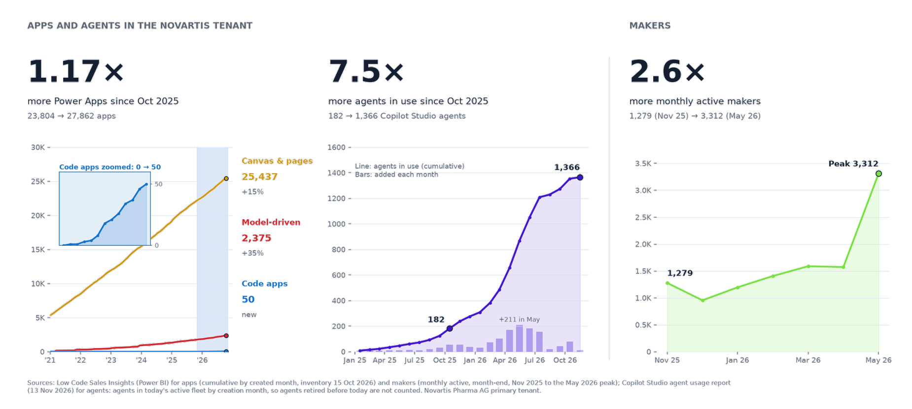
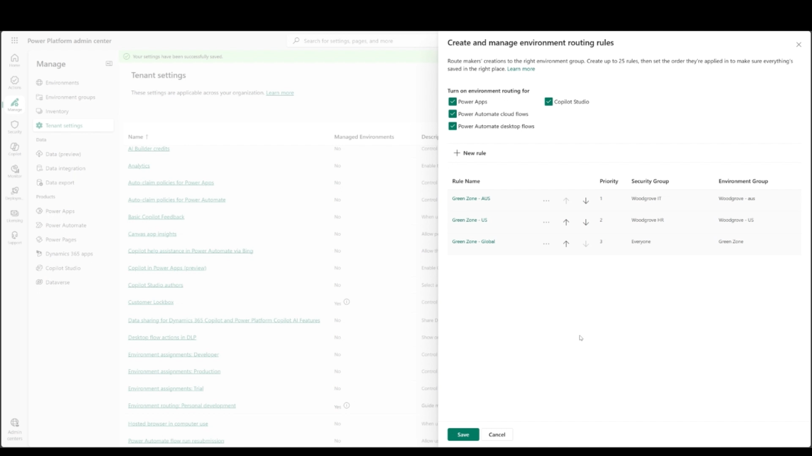
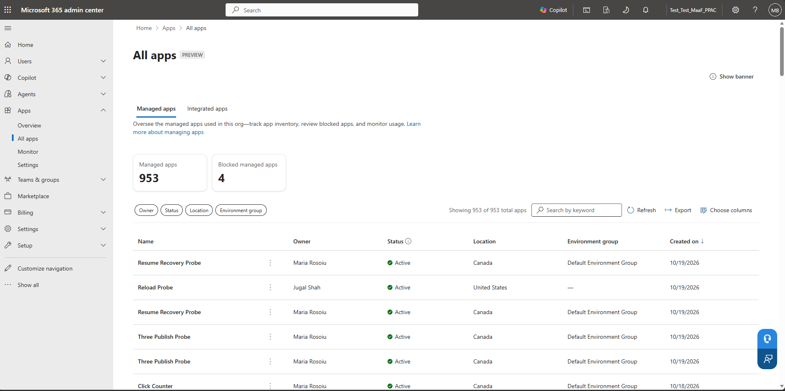
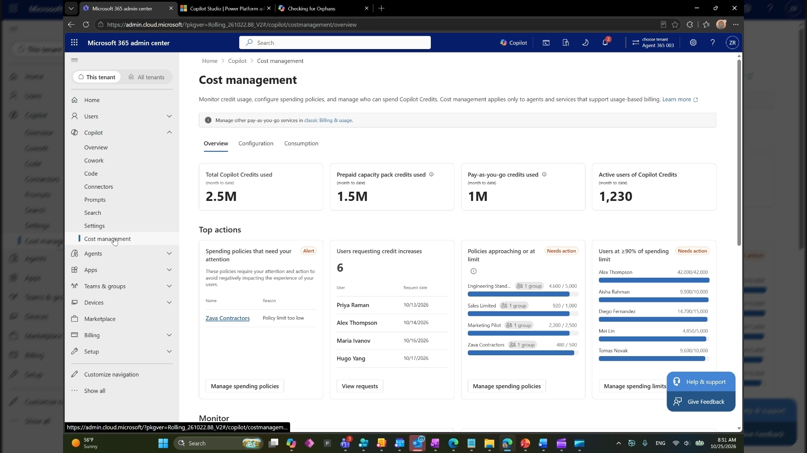

## #managed-pillars-novartis 01 / Managed Platform & Novartis Story :: 从达·芬奇画作到诺华 7.5 倍扩张：平衡全员创新与企业风险的四根支柱 || From Da Vinci to Novartis's 7.5× Scale: Four Managed Pillars Balancing Innovation and Risk

五百年前委托达·芬奇绘制《蒙娜丽莎》这样的传世杰作，需要专业画师收集需求并耗费三年打磨；而在全员皆可用自然语言构建智能体、工作流与微应用的企业里，员工每天都会产出海量草稿与部门工具 [1]。安全与治理负责人 Zohar Raz 在开场指出，企业若把每一份个人效率工具都当成《蒙娜丽莎》层层设卡，就会扼杀一线创新；反之若放任所有人在拥挤的默认环境“野蛮生长”，一旦草根脚本演变为核心业务依赖，安全与合规团队便会陷入被动 [1][3]。 || Five hundred years ago, commissioning a portrait meant hiring a master like Leonardo da Vinci and waiting three years for the Mona Lisa; today, any employee can prompt dozens of working drafts, agents, and micro-apps in an afternoon [1]. Opening BRK382, Zohar Raz argued that treating every personal productivity draft like the Mona Lisa chokes innovation, whereas leaving everyone inside an unguarded default environment creates shadow dependencies when grassroots tools quietly become mission-critical [1][3].

为此，微软将历经三年演进的托管平台归纳为面向四类高管角色的协同体系：**首席信息官**（CIO）依托托管治理获得全域资产可见性与批量环境控制；**首席信息安全官**（CISO）通过托管安全落实身份访问、威胁防护与合规审计；**运营主管**借助托管运维打通应用生命周期管理与异常告警；**首席人工智能官**（CAIO）则通过托管转型追踪真实使用率、投资回报与额度账单 [2]。2026 年 11 月，这一底座正式迎来了两位重量级新成员——支撑前沿推理智能体的 **Microsoft Copilot Harness**，以及专为跨工具生成式应用打造的 **Copilot Managed Runtime**（已正式商用）[1][2]。 || Microsoft structures its managed platform around four executive pillars: **Managed Governance** for the CIO, **Managed Security** for the CISO, **Managed Operations** for the Head of Operations, and **Managed Transformation** for the CAIO [2]. At Ignite 2026, two major runtime additions joined this family—the **Microsoft Copilot Harness** for reasoning agents and the newly generally available **Copilot Managed Runtime** for natural-language and code-generated apps [1][2].

:::figure { src: "./media/brk382-unified-runtime-architecture.figure.json", title: "BRK382 跨开发入口统一托管与治理架构：Power Platform 与 Copilot Managed Runtime || BRK382 Unified Enterprise Governance Topology: Power Platform & Copilot Managed Runtime" }
图 1：BRK382 三层治理拓扑——顶层允许创作者自由选用低代码画布、协同画布或外部编码工具；中层通过双管理中心与单一接口规范统一编排连接器与点数策略；底层由托管运行时宿主逐请求执行安全沙盒校验、分级晋升与小时级告警 [1][2][4]。 || Figure 1: Three-tier BRK382 topology—empowering makers across low-code studios, Cowork, and external coding tools on top; unifying connector policies and credit ledgers across PPAC, MAC, and a single OpenAPI spec in the middle; and enforcing sandbox security, tiered ALM, and 1-hour alerts in the Managed Host underneath [1][2][4].
:::

下方导览台汇总了 BRK382 完整 47 分钟官方点播视频流、54 页原版课件下载直链以及诺华访谈与四场实机演示的逐分钟时间轴，点击顶部章节药丸即可切换核查关键节点 [1][2]： || The interactive theater below pairs the official 47-minute Medius on-demand stream and 54-slide presentation deck with timestamped highlights across the Novartis customer interview and all four live engineering demos [1][2]:

:::sandbox { id: "brk382-video-theater", canvas: false, script: "./brk382-session.js", style: "./brk382-session.css", title: "BRK382 官方点播视频与四场实机演示时间轴导览 || BRK382 Official On-Demand Stream & Four-Demo Timestamp Navigator", desc: "切换诺华实战访谈与 Demo 1–4 核心时间段，支持在页内直接加载微软官方 Medius 点播播放器或下载原版课件。 || Switch across the Novartis interview and Demos 1–4, load the embedded Microsoft Medius player on demand, or download the official slide deck." }
纯静态点播与议题导览沙盒：内置 BRK382 官方高清封面图、五段分章实录摘要及官方点播流与课件直链。 || Pure static session theater featuring the official BRK382 cover, five timestamped chapter digests, and direct video/slide links.
:::

瑞士跨国药企**诺华**（Novartis）的真实租户账本验证了“让合规路径成为最省力路径”的规模效应 [1][2]。诺华拥有约 **77,000 名员工**，药品惠及全球 **3.04 亿患者**，企业文化兼具“去科层赋能（Unbossed）”与“护栏内放行（Integrity）” [1][2]。执行总监 Nicholas Balestrino 披露，自 2025 年 10 月起，诺华主租户在用 Copilot Studio 智能体从 **182 个激增至 1,366 个**（7.5 倍），月活创作者从 **1,279 人升至 3,312 人**（2.6 倍） [2]。同期 Power Apps 总量从 **23,804 个扩至 27,862 个**（1.17 倍），涵盖 25,437 个画布与门户、2,375 个模型驱动应用（+35%）及 **50 个全新代码应用**（Code Apps） [2]。 || Global pharmaceutical leader **Novartis** employs roughly **77,000 associates** whose medicines reach **304 million patients**, pairing an *Unbossed* builder culture with *Integrity* guardrails [1][2]. Executive Director Nicholas Balestrino shared primary tenant telemetry showing active Copilot Studio agents surging **7.5× from 182 to 1,366** since October 2025, while monthly active makers climbed **2.6× from 1,279 to a May 2026 peak of 3,312** [2]. Total Power Apps expanded **1.17× from 23,804 to 27,862** across 25,437 canvas apps, 2,375 model-driven apps (+35%), and **50 new Code apps** [2].

:::figure { src: "./media/brk382-novartis-scale-metrics.figure.json", title: "诺华（Novartis）主租户规模化治理实效：应用、智能体与创作者增长对比 || Novartis Primary Tenant Scale Trajectory: Apps, Agents & Makers Growth" }
图 2：基于诺华主租户 2026 年 10–11 月官方统计报表——在用智能体实现 7.5 倍跃升，月活创作者达 2.6 倍，且为期 10 周的公民开发者训练营实现约 50% 的生产上线转化率 [1][2]。 || Figure 2: Official Novartis primary tenant telemetry (Oct–Nov 2026)—highlighting the 7.5× surge in active agents, 2.6× growth in monthly active makers, and ~50% live production conversion across Citizen Developer cohorts [1][2].
:::

### 诺华防僵尸清退机制与公民开发者三期实战 || Novartis Anti-Sprawl Attestation & Citizen Developer Cohorts

为避免全员实训演变为无人维护的僵尸智能体坟场，诺华在美国商业部门组织 **6,000 名员工**结业自建智能体的同时，引入了**周期性所有者确权**（Periodic Owner Attestation）机制自动清退闲置与无主资产 [1]。针对由业务主管提名并承诺产能的进阶骨干，诺华开设了包含 3 条学习路径与 9 场专家门诊的 **8–10 周公民开发者训练营** [1][2]。过去一年三期累计培养约 **500 名活跃成员**，产出约 **250 个活跃生产级智能体**（课件时点录得 218 个项目发布代理、1,760 个全平台发布代理及服务 8,192 名用户的 9,282 个轻量代理）[1][2]。继 2026 年 6 月高管试点后，诺华已于 **2026 年 9 月 30 日**向全体许可员工开放协同画布自动审批并实施按角色配额管理 [2]。 || To prevent mass enablement from leaving behind a graveyard of unused agents, Novartis trained **6,000 US commercial associates** while enforcing **periodic owner attestation** to retire stale or orphaned assets [1]. Nominated power users enter a **10-week Citizen Developer cohort** featuring three learning paths and nine expert clinics [1][2]. Roughly **500 active graduates** across three waves delivered **~250 live production agents**, alongside 9,282 lightweight Agent Builder agents serving 8,192 users [1][2]. Following a June 2026 executive pilot, Novartis opened **Copilot Cowork** with auto-approval to all Copilot users on **September 30, 2026** under persona-based credit allowances [2].

## #ppac-green-zone 02 / Demo 01: Experimentation Green Zone :: 搭建安全试验绿区：环境路由、OAuth 连接器细粒度策略与创作者前置引导 || Demo 01: Building the Green Zone—Environment Routing, OAuth Connector Rules, and Maker Onboarding

怎样在企业内部复刻诺华“既放手让员工试验、又不污染核心环境”的秩序？Zohar Raz 在第一场实机演示中给出了标准答案——用**环境路由**（Environment Routing）将创作者从所有人混居的默认环境（Default Environment）分流至独立的个人开发环境，使每个人拥有类似个人云盘的受控沙盒，再通过**环境组**（Environment Groups）批量锁死安全基线 [1][3]。管理员甚至可以设置多层环境组（最多支持 25 条优先级路由规则）：普通员工落入兜底的全员绿区组，而经过认证的业务骨干则路由至权限更宽的“进阶创作者组（Pro Maker Group）” [1][2]。 || How can IT teams replicate Novartis's balance without micromanaging thousands of makers one by one? In Demo 1, Zohar Raz demonstrated **Environment Routing**, which steers makers out of the crowded Default Environment into personal, OneDrive-like Developer environments clustered inside bulk-governed **Environment Groups** [1][3]. Admins layer up to 25 prioritized routing rules—placing everyday employees into a catch-all Green Zone group while routing certified power users into a higher-trust **Pro Maker Group** [1][2].

更受管理员欢迎的升级是全面接棒传统数据防泄漏策略的**高级连接器策略**（Advanced Connector Policies，简称 ACP） [1][3]。管理员只需在环境组面板勾选一个单选框，即可让该组忽略历史遗留的旧版规则，平滑切换至可读性极高的白名单视图 [1]。演示中，Zohar 点开 **SQL Server** 连接器展示了三重纵深控制：不仅能逐项开关具体数据动作（例如放行查询但禁止 `Delete` 删除或 `Update` 更新），还新增了**身份认证方式拦截**——强制规定仅当采用 **OAuth** 认证时才允许连接数据库，直接封堵静态账号密码等高风险认证方式，后续还将进一步下探至具体服务器实例级（如允许连接 `SQL Server 001` 但拦截 `005`）的端点白名单 [1]。 || Replacing hard-to-read legacy DLP rules, **Advanced Connector Policies (ACP)** let admins check a single migration box to govern an environment group through a clean allow-list [1][3]. Drilling into the **SQL Server** connector live, Zohar showcased granular action and authentication controls: admins can block `Delete` or `Update` operations individually and now enforce **OAuth-only authentication**, blocking weaker credential types automatically before future server-instance scoping (such as allowing `SQL Server 001` while blocking `005`) rolls out [1].

  <article class="brk382-media-card" data-present-surface="unframed">
    

      
    

    

      BRK382 官方课件原图 · Slide 15
      <h4 data-zh="诺华主租户应用、智能体与创作者增长实录" data-en="Novartis Tenant Telemetry: Apps, Agents & Makers">诺华主租户应用、智能体与创作者增长实录</h4>
      
直观呈现 27,862 款应用（含 50 款新代码应用）、1,366 个活跃智能体与 3,312 名峰值月活创作者的真实扩张曲线 [2]。

    

  </article>
  <article class="brk382-media-card" data-present-surface="unframed">
    

      
    

    

      BRK382 官方课件原图 · Slide 19
      <h4 data-zh="PPAC 环境路由：按安全组自动分流个人绿区" data-en="PPAC Environment Routing: Priority Green Zone Rules">PPAC 环境路由：按安全组自动分流个人绿区</h4>
      
勾选覆盖应用、自动化流与智能体后，按优先级将不同地区或角色的安全组自动路由至受管环境组 [1][3]。

    

  </article>

治理规则并非等到发布报错那刻才“突然弹窗砸向创作者”，而是前置融入日常构建界面之中 [1][2]： || Rather than surprising makers with cryptic errors at publish time, governance expectations surface directly inside the authoring studio [1][2]:

:::insight-grid { cols: 3, title: "绿区创作者端引导与中央盘点三件套（均已正式商用） || Three GA Capabilities Guiding Makers and Informing Admins" }
::card 01
### 审计级必读欢迎守则 || Purview-Audited Welcome Terms
创作者首次进入 Copilot Studio 时会看到组织定制的安全指引，且必须点开阅读服务条款链接才能关闭弹窗（确认记录写入 Microsoft Purview 审计日志）；每当管理员更新条款内容，系统都会自动覆盖“不再提示”强制全员重读 [1][2]。 || Makers must open linked terms of service upon sign-in before dismissing welcome guidance (audited in Microsoft Purview), and policy updates automatically override “don't show again” [1][2].

::card 02
### 受限连接器置灰与 Ask Mica 助手 || Up-Front Greyed Limits & Ask Mica
被策略禁用的连接器在工具面板直接置灰，半受限连接器（如仅开放特定动作的 SQL）明确提示边界；常驻状态栏实时汇总阻断项并嵌入申诉通道——微软内部即挂载了名为 **Ask Mica** 的专属引导智能体协助员工自助申请例外或投产环境 [1][2]。 || Disallowed connectors appear greyed out up front while an always-visible status panel links to self-service help—like Microsoft IT's internal **Ask Mica** exception agent [1][2].

::card 03
### 准实时全量资产库与使用率看板 || Near-Real-Time Inventory & Usage
全新中央资产清单（Inventory）与使用率（Usage）页面支持界面透视与接口拉取，汇总日活/月活用户、工作流运行次数与智能体会话量，既能帮团队识别高价值标杆创作者，也能像诺华一样通过接口批量清退零使用僵尸资产 [1][3]。 || Central Inventory and Usage hubs expose near-real-time connector, sharing, and DAU/MAU metrics via UI and APIs—spotting top champions and automating stale-asset cleanup [1][3].
:::

## #copilot-managed-runtime 03 / Demo 02: Copilot Managed Runtime :: 跨出低代码围墙：Copilot Managed Runtime 与 M365 管理中心的默认绿区 || Demo 02: Beyond Low-Code Walls—Copilot Managed Runtime and the Default Green Zone in MAC

Power Platform 的绿区工具箱虽已高度成熟，但首席工程经理 Ryan Jansen 指出了两项结构性局限：它仅覆盖 Power Platform 内部资产，且环境路由默认属于“选配开启（Opt-in）”模式 [1]。如今业务人员在协同画布里用一句话生成应用，专业开发者使用 VS Code 与 GitHub Copilot 编写前端，还有团队直接采用 **Lovable、Claude 或 OpenAI** 生成网页制品 [1][2]。产出应用代码本身变得极度容易，但身份登录、数据安全连接、部署流水线与运行监控这些企业级底座却落在开发者肩上 [1][2]。 || Power Platform's green zone excels for low-code makers, yet Principal Group Engineering Manager Ryan Jansen pointed out two structural limits: policies apply only inside Power Platform, and environment routing remains opt-in [1]. Today, business users prompt apps in Copilot Cowork and Copilot Code, pro developers build in VS Code, and teams experiment with external builders like **Lovable, Claude, and OpenAI** [1][2]. Producing application code is now the easy part, whereas enterprise hosting, authentication, pipelines, and monitoring still fall on developers [1][2].

在 Ignite 2026 正式商用的 **Copilot Managed Runtime**（简称 CMR） 正是为了填平这道鸿沟而生：无论应用诞生自微软自有入口还是外部第三方生成工具，均可统一托管运行在微软运维的运行时宿主之上，原生打通企业连接器与组织工作上下文（Work IQ），并将控制面统一收口至通才管理员日常使用的 **Microsoft 365 管理中心**（MAC） [1][2]。更重要的是，CMR 彻底反转了安全默认项——**绿区策略在租户首日即默认开启**（On by Default），开箱仅放行 Microsoft 365、Office 与 SharePoint 等核心办公连接器（而非默认敞开全部 1,500 余个连接器），让管理员哪怕尚未做任何配置也不会遭遇数据裸奔 [1]。 || Newly generally available at Ignite 2026, **Copilot Managed Runtime (CMR)** bridges that gap by hosting apps built in Microsoft or third-party tools on a single Microsoft-operated runtime while unifying administration inside the **Microsoft 365 admin center (MAC)** [1][2]. Crucially, CMR flips the governance posture: **the Green Zone is on by default from day one**, scoping new apps down to core Microsoft 365, Office, and SharePoint connectors out of the box rather than exposing all 1,500+ connectors [1].

:::comparison { title: "Power Platform 托管底座 vs. Copilot Managed Runtime（CMR）治理范式对照 || Power Platform Managed Estate vs. Copilot Managed Runtime Governance Model" }
::versus Power Platform 专家级治理底座 || Power Platform Expert Governance
### 面向结构化业务应用、自动化流与智能体的深度定制管控 || Deep Granular Controls for Apps, Flows, and Studio Agents
控制面位于专职管理员熟悉的 **Power Platform 管理中心**（PPAC）；个人开发环境路由采用**选配开启**（Opt-in）模式，依托 Dataverse、解决方案包与 Git 流水线支撑严苛的金融合规与复杂多环境晋升 [1][2]。 || Centered in the **Power Platform Admin Center (PPAC)** with **opt-in** environment routing, rich Dataverse backing, solution packaging, and multi-stage Git pipelines for complex enterprise workloads [1][2].

::versus Copilot Managed Runtime 全域默认托管 { highlight: true } || Copilot Managed Runtime Default Safety { highlight: true }
### 跨微软与三方工具构建，开箱默认锁定绿区与沙盒围栏 || Build in Any AI Tool, Governed on Day One in M365 Admin Center
控制面原生集成于 **Microsoft 365 管理中心**（MAC）；接纳来自 Cowork、Copilot Code、VS Code 乃至 Lovable、Claude 的应用，**默认开启绿区**收敛核心连接器、禁止病毒式公开链接扩散并锁死内容安全策略（CSP）网络沙盒 [1][2]。 || Managed in the **Microsoft 365 admin center (MAC)**; hosts apps from Cowork, VS Code, Lovable, or Claude with an **on-by-default green zone**, viral-sharing controls, and strict Content Security Policy (CSP) sandboxing [1][2].
:::

在第二场实机演示中，Ryan 在协同画布中输入单条自然语言提示词并附上大会公开议程链接，快速生成了一款个人定制的 **Ignite 议程规划微应用**（Ignite Session Planner） [1]。该应用不仅依托组织上下文自动识别团队同事、通过内置连接器拉取同事头像渲染日历视图，甚至在现场自动高亮标出“BRK382 当前正在进行中” [1]。随后切入 Microsoft 365 管理中心左侧的 `Apps -> All apps` 清单（课件实拍统计纳管了全租户 **953 款受管应用**与 **4 款已封禁应用**），管理员可一键钻取任意应用的连接器依赖、共享范围与活跃度；一旦发现可疑应用，当场即可点击禁用（Disable）或彻底删除，并通过**内容安全策略**（CSP）精细管控沙盒是否允许访问特定内部接口 [1][2]。 || Live in Demo 2, Ryan prompted Copilot Cowork to build a personalized **Ignite Session Planner** app that automatically pulled colleague avatars via built-in connectors and highlighted BRK382 happening live on a calendar view [1]. Switching to `Apps -> All apps` in the Microsoft 365 admin center (tracking **953 managed apps** and **4 blocked apps** in Slide 30), Ryan inspected data dependencies and sharing scope with one-click power to disable or delete rogue apps while tuning **Content Security Policy (CSP)** rules for internal API endpoints [1][2].

## #managed-host-alm-ops 04 / Demo 03: Managed Host, ALM & Ops :: 生产级运行底座：Managed Host 实时沙盒拦截、双层 ALM 与小时级告警 || Demo 03: Operating Production Assets—Managed Host Sandbox, Tiered ALM, and 1-Hour Alerts

“只要业务依赖某套软件运转，那它就已经处于生产状态——无论开发者自己承不承认。”负责托管应用与智能体运行时的首席产品经理 Austin Laugesen 用这句话点明了生产运维的起点 [1][2]。在人工智能自由选工具时代，创作者可以在外部任意位置写代码，但微软用三大核心运行机制吸引企业将负载放心交由托管平台承载：**Managed Host**（托管宿主）、**无感起步的应用生命周期管理**（ALM）与**高灵敏度生产监控**（Monitor） [1][4]。 || “All software a business depends on is production,” Principal Group PM Austin Laugesen reminded the audience [1][2]. When makers can author code in any external editor, three runtime pillars make the managed platform safe for business-critical workloads: the **Managed Host**, **ALM from personal stages to enterprise pipelines**, and **1-hour operational alerting** [1][4].

Managed Host 按负载类型分别为应用、智能体与工作流提供专属安全运行容器 [1]：每一次终端用户打开或被共享访问应用时，宿主都会强制执行 Microsoft Entra 单点登录与条件访问校验（数据连接严格绑定访问者本人身份授权），同时在后台自动向 Microsoft Purview 吐出全量活动审计日志并向管理中心上报开箱健康度指标——创作者哪怕一行监控代码不写，合规与可观测性也已全部就位 [1][2]。为了直观验证沙盒威力，Austin 在第三场演示中打开了一款他在 Power Apps 之外用命令行、开发套件与 GitHub Copilot 编写的三栏式代码应用 [1]：连击左侧按钮调用白名单内的企业连接器时请求顺畅返回；而当他连击中间按钮试图发起任意外部网络请求（演示中指向未列入策略白名单的 `Bing` 端点）时，右侧面板瞬间爆出成片拦截报错——Managed Host 在运行态严格依据内容安全策略（CSP）当场掐断了越界外呼 [1]。 || Each workload runs inside a dedicated **Managed Host** that enforces Microsoft Entra SSO and per-user data consent on every request while emitting Microsoft Purview audit logs and out-of-box health metrics automatically [1][2]. In Demo 3, Austin tested a three-column pro-code app built outside Power Apps using the CLI, SDK, and GitHub Copilot [1]: clicking the left button called an admin-approved connector cleanly, whereas clicking the middle button to hit an unauthorized external endpoint (`Bing`) immediately blew up with runtime errors on the right as the Managed Host's **Content Security Policy** blocked the outbound call live [1].

:::flow { title: "从个人敏捷迭代到严管生产环境的阶梯式部署与小时级监控闭环 || Tiered ALM Promotion and Sub-Hour Operational Alerting Loop" }
1. **个人与团队级应用：单环境内零配置三阶段（Personal & Team Stages） || Personal & Team Apps: Zero-Setup In-Environment Stages** — 针对尚未配备专职运维支持的小型应用，Copilot Managed Runtime 原生内置“部署目标（Targets）”概念，无需管理员介入即可在同一环境边界内划分 `Dev -> Test -> Prod` 阶段，确保日常改代码绝不弄崩线上正在使用的版本 [1][2]。 || Even without admin setup, Copilot Managed Runtime provides built-in `Dev -> Test -> Prod` targets inside a single environment so ongoing maker edits never break live users [1][2].
2. **部门与企业核心负载：跨环境严管流水线（Hardened Cross-Environment Pipelines） || Department & Enterprise Workloads: Shrink-Wrapped Cross-Environment Pipelines** — 针对反洗钱（AML）、客户尽职调查（KYC）与零售银行等关键系统，创作者在策略宽松的开发环境构建并通过 Git 版本审计、自动化测试套件与人工审批门禁，由受控流水线一键晋升至最小权限锁死的独立生产环境（Shrink-wrap Governance）[1][2][4]。 || Mission-critical banking workloads (such as KYC and AML) build in permissive dev environments with Git versioning, automated test suites, and human approvals before promoting via pipelines into least-privilege production environments [1][2][4].
3. **上线后高敏巡检：1 小时内故障捕获与外部工单联动（1-Hour Monitor Alerts） || Post-Launch Observability: Within-1-Hour Alerts & API Export** — 正式商用的 Monitor 看板在今年秋季迎来低延迟高灵敏度告警升级（预览）：应用、智能体或工作流一旦出现健康度劣化，系统可在 **1 小时内**发现异常，支持事件订阅直推运维团队的 Teams 频道或自动创建 ServiceNow 工单，并开放优先接口供企业长期导出历史遥测数据 [1][2][4]。 || Upgraded with high-sensitivity alerts (Preview), Monitor detects production degradations **within an hour**, routes event subscriptions directly to Teams channels or ServiceNow tickets, and unlocks API-first metric export for long-term trend storage [1][2][4].
:::

## #finops-admin-extensibility 05 / Demo 04: FinOps & OpenAPI Extensibility :: 算力账本与管理自动化：双轨计费透视及 10 美元半小时生成超级 CoE || Demo 04: FinOps & Extensibility—Dual-Billing Visibility and Building a CoE App in 30 Minutes for $10

回应前文诺华执行总监提出的“头号心愿——不仅让 IT 看见账单，更要让一线创作者实时看清自己的构建成本”，Zohar Raz 在压轴环节系统拆解了覆盖全平台的双轨财务治理与管理面开放架构 [1][2]。企业如今同时管理两类授权模型：一类是按人头包月固定付费的**用户订阅许可**（USL），适合全员日常高频使用的基础应用、智能体与自动化流；另一类是按实际消耗计费的**按量计费点数**（UBB / Copilot Credits），用于驱动前沿推理内核（Microsoft Copilot Harness）与构建运行托管微应用 [1][2]。 || Directly answering Novartis's top wish—giving makers transparent cost visibility alongside IT—Zohar Raz closed BRK382 by detailing dual-track **FinOps** and **Admin Extensibility** [1][2]. Enterprises now balance predictable per-user monthly **User Subscriptions (USLs)** for everyday workflows with consumption-based **Copilot Credits (UBB)** powering frontier reasoning harnesses and Copilot Managed Runtime apps [1][2].

在创作者视角，Copilot Studio 现已在左上角实时展示当前会话与工作流内联智能节点（含分类、抽取、图像处理、预览对话及评测历史）的点数消耗计数器（如课件第 43 页实拍顶栏清晰标注 `88 credits`），而在协同画布中只需输入 `/cost` 命令即可当场调出本次构建账单 [1][2]。在管理员视角，成本管控横跨环境级、资源级与全新的**用户级消费策略**（User Policy），且全租户点数管理主阵地正在从 PPAC 平滑迁往 **Microsoft 365 管理中心**（MAC）——如课件第 46 页实拍所示，管理员可在一屏总览当月累计消耗（`2.5M` 点数，含 `1.5M` 预付容量包与 `1M` 按量计费点数）、`1,230` 名活跃点数用户、6 份提额申请及消费达 `≥90%` 警戒线的个人与项目组 [1][2]。 || Makers now track credit burn in real time via the top-left counter in Copilot Studio (showing `88 credits` in Slide 43 across preview chat, evals, and inline workflow AI nodes) or by typing `/cost` inside Cowork [1][2]. Meanwhile, admin credit management is consolidating into the **Microsoft 365 admin center**—adding **User-level spending policies** alongside environment and resource caps, with Slide 46 showcasing `2.5M` monthly credits used (`1.5M` prepaid + `1M` pay-as-you-go), `1,230` active users, quota increase requests, and `≥90%` threshold alerts [1][2].

  <article class="brk382-media-card" data-present-surface="unframed">
    

      
    

    

      BRK382 官方课件原图 · Slide 30
      <h4 data-zh="M365 管理中心受管应用全景清单（953 款）" data-en="M365 Admin Center Managed Apps Inventory (953 Apps)">M365 管理中心受管应用全景清单（953 款）</h4>
      
跨构建入口统一盘点全租户受管应用（953 款活跃、4 款已封禁），集中透视归属人、地理位置与默认环境组 [1][2]。

    

  </article>
  <article class="brk382-media-card" data-present-surface="unframed">
    

      
    

    

      BRK382 官方课件原图 · Slide 46
      <h4 data-zh="MAC 全局成本管理：预付/按量双轨与限额预警" data-en="MAC Cost Management: Prepaid/PAYG & User Spending Alerts">MAC 全局成本管理：预付/按量双轨与限额预警</h4>
      
一屏掌握 2.5M 总点数消耗、待批提额单以及触发 ≥90% 预算上限的部门策略与个人用户名单 [1][2]。

    

  </article>

本场最令现场管理员振奋的压轴发布，当属“单一规范驱动全工具链”的**管理面开放架构**（Admin Extensibility） [1][5]。微软将环境、治理、许可、门户与智能体管理能力统一抽象为一份权威 **OpenAPI 规范**，每月自动同步生成并发布整套工具矩阵 [2][5]： || Closing the session, Zohar unveiled what he called the most exciting Ignite announcement for Power Platform administrators—a **single OpenAPI specification** that defines every management capability once and ships synchronized tooling every month [1][2][5]:

| 衍生工具层 || Generated Surface | 组件标识与规模 || Package / Scale | 典型管理与自动化场景 || Core Administrative & Agentic Use Cases |
|------|------|------|
| 官方版本化接口文档 || Versioned REST API | `Power Platform API`（Learn 在线规范） || Versioned REST operations on Learn | 供企业安全信息与事件管理平台或自研运维门户直接调用环境、资产清单与配额接口 [2][5] || Direct REST integration for enterprise SIEMs, custom portals, and credit allocation automation [2][5] |
| 原生多语言开发包 || Typed SDKs | `Microsoft.PowerPlatform.Management`（.NET）与 `powerplatform-management`（Python） || Official .NET & Python SDKs | 供平台工程团队用强类型代码编写批量环境巡检、孤儿资产归档与合规审计任务 [2][5] || Strongly typed .NET and Python libraries for bulk tenant hygiene and compliance automation [2][5] |
| 流程与跨命令行组 || Connector & PAC CLI | `Admin V2` 连接器 + **15 个自动生成命令组** || Admin V2 Connector + **15 PAC CLI Groups** | 在自动化流、逻辑应用、持续集成管线及编码智能体中以脚本化指令执行全栈治理 [2][5] || Powers Power Automate flows, Logic Apps, CI/CD pipelines, and coding agents across 15 CLI command groups [2][5] |
| 对话式管理插件 || Agentic Cowork Plugin | **Power Platform Admin Plugin in Cowork** + 样板包 `aka.ms/powerplatform360` || Native Cowork Admin Plugin + Sample App | 用自然语言生成租户周报与高管汇报幻灯片，或耗资约 **10 美元**在 **30 分钟**内构建超越传统 CoE Toolkit 的托管治理应用 [1][2][5] || Query tenant posture in plain language, export leadership decks, or build a full CoE Toolkit superset app in **30 minutes for ~$10** [1][2][5] |

在第四场实机演示中，Zohar 直接以管理员身份登录协同画布，调用新嵌入的 **Power Platform Admin Plugin** 现场盘点租户态势并一键生成可供管理层审阅的演示文稿 [1]。更令人印象深刻的是对经典“卓越中心工具包（CoE Starter Kit）”的重构实战：过去管理员手动部署配置传统 CoE 解决方案往往耗时费力；而微软客户顾问团队专家 Reza 在晚间 9 点至午夜 12 点的 **3 个小时**内与协同画布及管理插件多轮对话，便打磨出一套功能全面超越传统工具包的超级治理方案 [1]。Zohar 拿到该压缩包导入自己的租户后，仅耗时 **30 分钟**、在 `/cost` 中实测花费 **10 美元**，便全自动构建出一款运行在 Copilot Managed Runtime 上的现代化全栈治理应用（官方已通过 `https://aka.ms/powerplatform360` 开放样板下载），助力组织稳步跨越采用成熟度模型直至最高阶的“高效赋能阶段（Efficient Stage）” [1][2]。 || Live in Demo 4, Zohar queried tenant posture in plain English via the embedded **Power Platform Admin Plugin** in Cowork and auto-generated an executive PowerPoint briefing [1]. Even more striking was how Microsoft customer advisory engineer Reza spent **three hours** (9 PM to midnight) iterating with Cowork and the plugin to build a superset of the classic CoE Starter Kit—which previously took days to install and configure [1]. Importing Reza's package into his own tenant, Zohar ran `/cost` on stage to show Cowork compiling the entire solution into a live Copilot Managed Runtime app in **30 minutes for $10** (released publicly as the `https://aka.ms/powerplatform360` sample app) [1][2].

## 参考资料：官方一手信源与工程指南 || References: Official Primary Sources & Engineering Guides

1. **Zohar Raz, Ryan Jansen, Austin Laugesen & Nicholas Balestrino (Microsoft Ignite 2026 BRK382 Video & Transcript)** — https://ignite.microsoft.com/en-US/sessions/1787856631314001Eynh-1791814918515001Cspr | 《Deploy solutions at scale with Power Platform or Copilot Managed Runtime》47 分钟官方点播实录与双语时间轴字幕（2026-11-20） || Official 47-minute breakout recording and WebVTT transcripts featuring Novartis and four live demos (Nov 20, 2026)
2. **BRK382 Official Slide Deck & Medius Stream** — https://medius.microsoft.com/Embed/video-nc/8698eb3b-5f0b-4284-bf98-188eb338d15e | BRK382 官方内嵌点播流与 54 页原版 PPTX 课件（`https://medius.microsoft.com/video/asset/PPT/8698eb3b-5f0b-4284-bf98-188eb338d15e`） || Official Medius on-demand player and 54-slide presentation deck covering Novartis metrics, CMR architecture, and FinOps
3. **Microsoft Learn — Green Zone & Environment Governance** — https://aka.ms/Learn/EnvironmentRouting | Power Platform 环境路由、环境组（`aka.ms/Learn/EnvironmentGroups`）、高级连接器策略（`aka.ms/Learn/AdvancedConnectorPolicies`）与中央资产库官方指南 || Official Microsoft Learn documentation for Environment Routing, Environment Groups, Advanced Connector Policies, and Inventory
4. **Microsoft Learn — ALM, Pipelines & Operational Monitor Alerts** — https://aka.ms/Learn/PowerPlatformALM | 应用生命周期管理、部署流水线（`aka.ms/Learn/PowerPlatformPipelines`）、Git 集成与生产环境低延迟监控告警（`aka.ms/MonitorAlerts`）技术规范 || Official engineering guides on Power Platform ALM, Pipelines, Git integration, and sub-hour Monitor alerts
5. **Microsoft Learn — Copilot Credits FinOps & OpenAPI Admin Extensibility** — https://aka.ms/Learn/PowerPlatformAPI | 统一 OpenAPI 管理规范、PAC CLI 管理命令组（`aka.ms/Learn/PACAdmin`）、点数治理（`aka.ms/Learn/GovernCreditConsumption`）与 `aka.ms/powerplatform360` 样板应用 || Official documentation for the Power Platform Management API, PAC CLI, Copilot Credit governance, and the Power Platform 360 sample app
