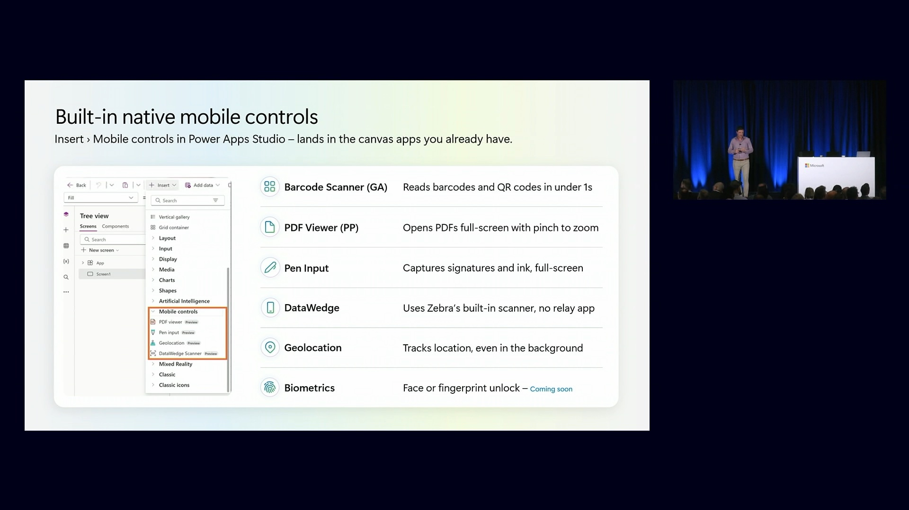
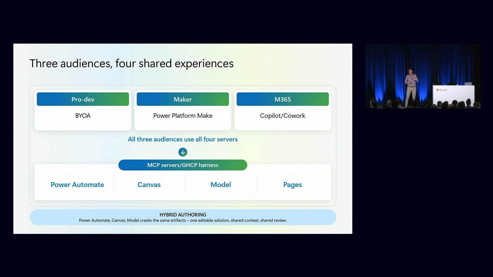
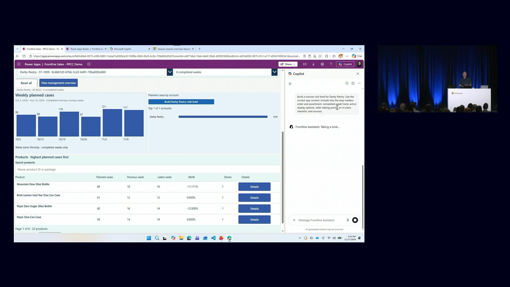
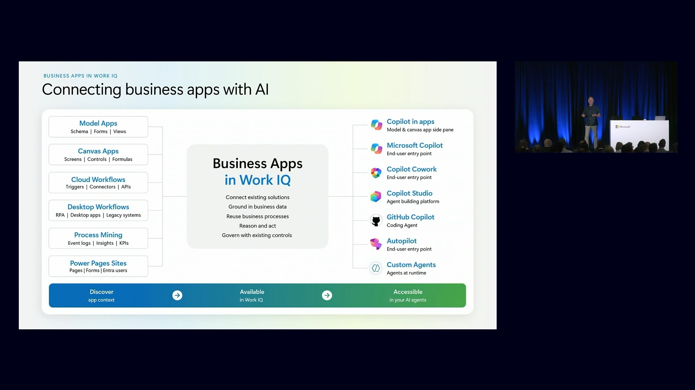

## #principles-pillars 01 / Guiding Principles & Strategic Pillars :: 拒绝推倒重建：四大决策原则与 65% 质量资源倾斜 || No Need to Rebuild: Four Product Filters and 65% Investment in Core Quality

许多企业技术团队在引入生成式工具时都听过一种激进论调：要想赢得智能时代，必须把过往系统推倒重来 [1]。Jed Brown 在 BRK386 开场直接否定了这种说法——画布应用、模型驱动应用与自动化流不仅不会退场，反而迎来了平台历史上最大规模的研发投入 [1]。企业多年沉淀的每一张表单、每一条审批规则和每一段业务流，本质上都是组织运转的真实知识资产；平台演进的目标是让既有投资直接成为智能时代的共享上下文，而非强迫客户重复造轮子 [1][2]。 || Many engineering leaders have been told that winning with artificial intelligence requires tearing down legacy applications and starting from scratch [1]. Opening BRK386, Jed Brown rejected that premise outright: Canvas apps, Model-Driven apps, and Power Automate are not going away—they are receiving the largest engineering investment in platform history [1]. Every existing app and workflow already encodes how an organization approves, routes, and governs real work, turning prior investments into shared context rather than technical debt [1][2].

研发团队将全部路线图取舍收敛为四条硬性过滤原则 [1]：**第一，聚焦端到端高回报方案**，打通问题发现、低成本构建、自动化执行与持续观测闭环；**第二，性能与可靠性优先**，哪怕新功能再炫目，底座不够快就毫无意义；**第三，预算与节奏完全由客户做主**，本场演示的所有核心底座能力均不强制消耗任何大模型词元，何时调用智能完全取决于团队账本；**第四，延续并放大既有资产价值**，消除员工在孤立工具间频繁切换的疲劳感 [1][2]。在这套准则驱动下，团队过去 12 个月累计交付超过 **130 项平台改进**，其中高达 **65%** 属于性能优化与日常体验打磨，同时主动清理下线了 **24 处以上**未达预期或阻碍易用性的冗余功能区 [1]。 || Every roadmap trade-off passes through four strict product filters [1]: **high-ROI end-to-end solutions** from discovery to observation; **uncompromising foundation quality**; **AI strictly on your terms**, meaning zero mandatory token burn for core platform capabilities; and **preserving and amplifying existing investments** [1][2]. Guided by those filters over the past 12 months, the team shipped **130+ platform improvements**—allocating **65%** directly to performance and quality-of-life gains while deprecating **24+ underperforming areas** that previously added maker or end-user friction [1].

:::figure { src: "./media/brk386-hybrid-workiq-architecture.figure.json", title: "Power Platform 全栈演进架构：模型上下文协议混合共创与业务应用智能中枢 || Power Platform Architecture: Hybrid Co-Authoring & Business App Intelligence" }
图 1：BRK386 四大战略支柱技术拓扑——顶层让专业开发者、低代码创作者与业务人员按各自习惯切入；中层通过四路协议服务器共编同一份可编辑方案并强化原生性能；底层借助应用内助手与 Work IQ 实现权限随行的双向业务操作 [1][2][4]。 || Figure 1: BRK386 technical topology—uniting Pro-Dev, Maker, and M365 entry points on top; connecting them via four MCP servers to one shared, high-performance solution estate in the middle; and enabling identity-scoped bidirectional collaboration via Copilot in Apps and Work IQ underneath [1][2][4].
:::

下方导览台集成了 BRK386 完整 48 分钟微软官方点播视频流、高清实录下载入口及五段核心演示时间轴，点击顶部标签即可按分钟定位核查 [1]： || The interactive theater below pairs the official 48-minute Medius stream and MP4 recording link with timestamped chapter digests across all BRK386 live demos [1]:

:::sandbox { id: "brk386-video-theater", canvas: false, script: "./brk386-session.js", style: "./brk386-session.css", title: "官方专场点播流媒体与五段实机演示时间轴导览 || Official Breakout Stream & Five-Chapter Timestamp Navigator", desc: "切换四大原则、原生移动与服务端渲染、混合共创技能、一线销售巡店助手与跨应用两阶段写回，支持页内加载官方播放器。 || Switch across Principles, Native Mobile, Hybrid Co-Authoring, Frontline Sales Copilot, and Cross-App Two-Phase Save, or load the Medius player inline." }
纯静态议题点播导览沙盒：内置 BRK386 官方高清封面、逐分钟核实的五幕实录摘要及官方视频直链。 || Pure static session theater featuring the official BRK386 thumbnail, five timestamped chapter digests, and direct video links.
:::

## #core-velocity-mobile 02 / Core Velocity, Native Mobile & Unified Portal :: 打磨核心体验：现代控件、移动端冷启动提速 55% 与服务端渲染 || Core Velocity: Modern Controls, 55% Faster Mobile Boot, and Server-Side Rendering

兑现“65% 研发资源投向质量”的第一站是画布与移动一线场景 [1][3]。团队密集更新了一批开箱即用的**现代控件（Modern Controls）**：它们不仅交互更流畅、默认满足无障碍标准，而且属性结构高度规范，后续让编码智能体读取或修改界面时能显著节省词元消耗 [1][3]。而在仓库巡检、门店盘点等员工随身携带手机作业的场景中，最新一轮底层优化将移动端应用冷启动时间**缩短了最高 55%**，并同步强化了后台数据同步与离线读写稳定性 [1][2]。 || Delivering on that 65% quality commitment starts in Canvas and frontline mobile workloads [1][3]. Newly shipped out-of-the-box **Modern Controls** pair cleaner styling and built-in accessibility with standardized schemas that consume far fewer tokens when coding agents inspect or modify screens later [1][3]. For field employees carrying phones and rugged handhelds, the latest runtime push accelerates mobile cold-boot times by **up to 55%** alongside deeper background sync and offline reliability [1][2].

针对移动硬件能力的调用，团队从“即插即用内置控件、自定义原生组件、全代码原生应用”三个层级打开了天花板 [1][3]。创作者现在只需打开画布工作室的 `Insert -> Mobile controls` 面板，即可将 **6 款内置原生移动控件**直接拖入现有画布应用 [1][2]。其中正式商用的**条码与二维码扫描器**直接调用手机操作系统原生视觉栈，在 iPhone 15 现场演示的 Event 360 签到应用中不到 1 秒即完成识别；其余五项涵盖公开预览的全屏手势缩放 **PDF 阅读器**、全屏**手写签批输入**、免中继应用的斑马手持终端 **DataWedge 扫码**、后台**地理定位**，以及即将上线的面部或指纹**生物识别登录** [1][2]。当企业遇到更特殊的硬件外设时，专业开发者可借助全新编码技能为现有画布应用编写自定义原生插件——例如某仓储客户通过定制蓝牙测温探针组件，让员工走到冷链设备旁即可实时自动读数，彻底告别纸笔抄录 [1]。而对于追求极致原生手势与端到端代码掌控的纯移动团队，平台现已支持直接构建并托管 **React Native** 移动应用 [1]。 || Mobile hardware integration now spans three tiers: built-in controls, custom native components, and full native-first code [1][3]. Inside `Insert -> Mobile controls` in Power Apps Studio, makers can drag **six built-in native controls** straight into existing Canvas apps [1][2]. Leading the set, the generally available **Barcode Scanner** taps native OS vision stacks to read QR badges in under 1 second on an iPhone 15 during the live Event 360 check-in demo; alongside it sit the full-screen **PDF Viewer** (Public Preview), **Pen Input** for signatures, relay-free Zebra **DataWedge** scanning, background **Geolocation**, and upcoming face or fingerprint **Biometrics** [1][2]. When specialized hardware is required, pro developers and coding agents use new component skills to extend Canvas apps—such as a warehouse customer reading Bluetooth temperature probes automatically on walk-up instead of typing readings manually [1]. Teams requiring end-to-end gesture control can also author and host full **React Native** mobile apps directly on Power Platform [1].

:::figure { src: "./media/brk386-platform-quality-metrics.figure.json", title: "BRK386 官方披露工程与性能实测指标（过去 12 个月质量攻坚） || BRK386 Verified Engineering Quality & Performance Gains (Past 12 Months)" }
图 2：汇总 BRK386 披露的量化交付账本——从 130+ 项平台演进、24+ 处冗余清理，到移动端 55% 启动提速、模型驱动页面近 50% 服务端渲染提速及 81 个控件实机审计规模 [1][2]。 || Figure 2: Verified BRK386 engineering metrics—spanning 130+ platform improvements, 24+ deprecated friction points, up to 55% faster mobile boot, ~50% faster Model-Driven rendering, and the 81-control live audit [1][2].
:::

模型驱动应用（Model-Driven Apps）同样交出了肉眼可见的提速答卷 [1]。除了呼声极高的原生**日历视图**与直接基于数据列计算的**网格列内可视化组件**外，工程团队将大量界面渲染逻辑从纯浏览器本地迁移至**服务端渲染（Server-Side Rendering）** [1]。现场慢动作分屏对比显示，新架构下的表单页与数据网格加载速度比启用旧版全部优化项的基线还要**快出近 50%**——对于每天高频录入上百条记录的销售与营销人员而言，每一次眨眼间的秒开都在直接转化为有效工时 [1]。面向创作者本人，微软还预告了性能优先的**全新统一创作者门户（Unified Maker Portal）**：在不强制关停现有各分立入口的前提下，将门户站点、自动化流与各类应用的最近编辑列表整合进同一秒开视图，消除跨三四个工作台来回找资产的割裂感 [1]。 || Model-Driven apps received equally visible upgrades [1]. Alongside a long-requested native **Calendar view** and direct data-calculated **grid column visualizers**, shifting heavy layout work to **server-side rendering** cut form and grid load times by **nearly 50%** in side-by-side slow-motion benchmarks—saving substantial daily wait time for high-volume sales and marketing teams [1]. For makers themselves, Microsoft previewed a performance-first **Unified Maker Portal** that brings Power Pages, Power Automate, and Power Apps recent assets together into one instant-loading home without retiring existing standalone portals prematurely [1].

  <article class="brk386-media-card" data-present-surface="unframed">
    

      
    

    

      BRK386 官方演示实拍 · 12:55
      <h4 data-zh="即插即用的 6 款原生移动控件矩阵" data-en="Six Drag-and-Drop Built-In Native Mobile Controls">即插即用的 6 款原生移动控件矩阵</h4>
      
无需重构现有画布应用即可拖入低于 1 秒识别的原生扫码器、斑马手持终端集成、后台定位与生物识别能力 [1][2]。

    

  </article>
  <article class="brk386-media-card" data-present-surface="unframed">
    

      
    

    

      BRK386 官方架构原图 · 23:45
      <h4 data-zh="三类受众共享四路 MCP 服务的混合共创底座" data-en="Three Audiences Sharing Four MCP Servers">三类受众共享四路 MCP 服务的混合共创底座</h4>
      
专业开发、创作者与办公用户跨入口操作同一份可编辑解决方案，共享上下文与代码审查闭环 [1][3]。

    

  </article>

## #hybrid-authoring-mcp 03 / Hybrid Authoring & Lifecycle Skills :: 混合共创与全生命周期技能：编码智能体同屏协作与 81 控件巡检 || Hybrid Authoring & Skills: Live MCP Agent Co-Authoring and 81-Control Audits

过去几十年，构建软件意味着死记菜单层级、快捷键与属性面板；如今人类自然语言意图成为了新界面，但人是天生的视觉动物——微调像素对齐或顺手改个标签时，直接鼠标拖拽不仅更快，还能做到**零词元消耗** [1]。Jed Brown 将这种自由切换的工作方式定义为**混合共创（Hybrid Authoring）**：三类截然不同的角色通过底层的**模型上下文协议（MCP）服务器**与智能体运行框架，共同读写自动化流、画布应用、模型驱动应用与门户站点这四类完全一致的标准产物 [1][3]： || For decades, building software meant memorizing nested menus, flyouts, and keyboard shortcuts; today human intent leads, yet humans remain visual thinkers who often prefer tweaking layouts directly without burning a single token [1]. Jed Brown calls this **Hybrid Authoring**—connecting three distinct audiences through shared **Model Context Protocol (MCP) servers** to co-edit the exact same underlying artifacts across Power Automate, Canvas, Model-Driven, and Power Pages [1][3]:

| 角色入口 || Persona Surface | 典型开发环境与模型选择 || Environment & Model Choice | 混合共创核心工作流 || Core Hybrid Co-Authoring Workflow |
|------|------|------|
| 专业开发者 || Pro-Dev (`BYOA`) | Visual Studio / VS Code / GitHub Copilot CLI；可自带 Claude、Mistral 或任意前沿模型 [1][3] || Favorite IDE + GitHub Copilot CLI; bring Claude, Mistral, or frontier models [1][3] | 通过本地命令行直连云端协议服务，挂载性能、无障碍与安全技能批量审查并重构方案源码 [1][3] || Connects via CLI + MCP to run performance, security, and accessibility skills against live studio solutions [1][3] |
| 低代码创作者 || Studio Maker | Power Platform Make 工作室（画布拖拽画板与模型视图设计器）[1] || Power Platform Make visual studios (Canvas & Model designers) [1] | 零词元可视化微调与内置编码智能体混用；实时看清智能体以个人身份加入多人共创会话 [1][3] || Alternates zero-token visual drag-and-drop with live in-studio coding agents scoped to the maker's identity [1][3] |
| 业务与办公用户 || M365 User | Microsoft Copilot 与协同画布（Cowork）分屏交互界面 [1] || Microsoft Copilot & Copilot Cowork side-by-side workspace [1] | 用自然语言描述业务目标，审阅分步构建计划并在右侧实时预览、随时打断纠偏与控制点数消耗 [1] || Reviews step-by-step plans in plain language while steering the live Canvas or Model app side by side [1] |

现场实机演示揭开了“人与多个智能体同屏共创”的真实工程细节 [1]。Jed 打开了一款基于 SharePoint 列表构建的深色模式咖啡店库存货运画布应用，首先在工作室内部直接登录关联 **GitHub Copilot**（后续也将支持直接抵扣组织点数并按成本自选模型）生成洞察页面 [1]。更亮眼的是，顶栏多人协作头像区清晰浮现出专属智能体徽标——明确标注该代理归属 Jed 本人而非同场协作的同事 Adrian，并指明其接入通道 [1]。紧接着，Jed 在本地终端启动 GitHub Copilot 命令行，通过协议服务器连入同一个画布会话（此时顶栏显示两个代理同时在线协作），并调用团队与客户顾问团队（PowerCAT）联合研发的**画布性能诊断技能（Performance Skill）** [1]。短短片刻，代理便扫完了整套应用并精准指出：当前页面包含旧版时期搭建的 **81 个传统控件**，建议一键升级为现代控件以同时获得无障碍合规、渲染提速与后续迭代的词元减半红利 [1]。 || Live on stage, Jed opened a dark-mode Coffee Shop inventory Canvas app backed by SharePoint and connected **GitHub Copilot** directly inside Power Apps Studio (with native Copilot Credit billing and model selection arriving soon) [1]. Immediately, the studio presence bar showed the agent joining the live co-authoring session—explicitly tagged to Jed's identity rather than a human co-author—alongside its entry channel [1]. Switching to his terminal, Jed attached a second agent via the **GitHub Copilot CLI** over the MCP server and invoked a **PowerCAT Performance Skill** [1]. Within moments, the agent audited the live app, flagged **81 legacy controls**, and recommended upgrading metric cards to Modern Controls for instant accessibility, faster rendering, and higher token efficiency [1].

“写一个新原型往往只占软件成本的零头，真正的重头戏在于长年累月的维护、合规加固与故障抢修。”Jed 分享了一家强监管行业大型客户的真实用法：该机构某核心部门受内部法规约束，**严禁任何由人工智能生成的业务代码直接进入生产环境**；但他们依然全情投入编码智能体与维护技能，专门让代理负责无障碍合规扫描、品牌视觉规范对齐、连接器审批核验以及自动补全高水准交接文档 [1]。同样在自动化领域，确定性云端流平时既便宜又可靠，可一旦下游系统表结构变动导致断流，排查起来往往令人头疼；借助全新的流程诊断与修复技能，创作者既能用一句话为库存应用挂上“新增强制高优请求时自动发消息提醒经办人”的自动化流，也能在旧流程报错时直接唤醒代理定位根因并给出修复补丁 [1][3]。 || Creation is only the opening fraction of software cost; long-term maintenance, security auditing, and downstream breakage consume the bulk of engineering budgets [1]. Jed highlighted a customer in a heavily regulated industry whose compliance rules strictly prohibit shipping AI-generated code to production—yet that division relies heavily on coding agents to audit accessibility profiles, verify connector approvals, enforce style standards, and generate handoff documentation for future maintainers [1]. The same lifecycle skills extend to Power Automate: while deterministic flows run cheaply and reliably until a downstream schema changes, new MCP diagnostic skills both wire up fresh flows (such as alerting Teams whenever an inventory request is marked critical) and pinpoint root-cause fixes when existing flows break [1][3].

## #copilot-in-apps-gjpepsi 04 / Collaborating with Agents in Apps :: 应用内双向智能协同：GJ Pepsi 一线销售助手与画布 Copilot 正式商用 || Collaborating Inside Apps: GJ Pepsi Frontline Assistant and Copilot in Canvas Apps GA

当创作者把业务应用交付到一线员工手中，智能体如何嵌入日常作业流而不打破权限围栏？Adrian Orth 接棒展示了第三大战略支柱——**让智能助手走进业务应用内部（Copilot in Apps）** [1][4]。继模型驱动应用内智能侧栏于今年 4 月正式商用后，微软在会上宣布**画布应用内智能助手（Copilot in Canvas Apps）于 2026 年 11 月正式全面商用（GA）** [1][4]。它并非挂在应用旁边的通用聊天框，而是严格受限于当前登录用户的角色权限与屏幕实时上下文的业务思考搭档 [1]。 || Once makers publish an application, how do end users collaborate with agents without leaving their workflow or bypassing security rules? Taking the stage for the third pillar, Adrian Orth announced that following Model-Driven GA in April, **Copilot in Canvas Apps reaches General Availability in November 2026** [1][4]. Far from a generic chat sidebar, it operates strictly within the signed-in user's data permissions and active screen state [1].

:::insight-grid { cols: 3, title: "画布应用内 Copilot 正式商用版三大核心定制能力 || Three Maker-Configurable Capabilities in Copilot for Canvas Apps (GA)" }
::card 01
### 按屏幕定制零触控引导提示词 || Per-Screen Guided Zero-Touch Prompts
创作者可针对不同业务页面预先配置高频提示词菜单；一线人员切屏时无需苦思如何提问，轻点一下即可触发贴合当前工序的分析任务 [1][4]。 || Makers define contextual starter prompts tailored to each screen so frontline workers trigger complex analyses with a single tap rather than crafting prompts from scratch [1][4].

::card 02
### 挂载专属声明式代理与屏幕状态 || Default Declarative Agent & Screen Context
支持为应用绑定专属声明式智能体（如巡店助手），自动读取当前打开的视图筛选条件与记录字段作为推理依据，告别手工复制粘贴上下文 [1][4]。 || Binds a dedicated declarative agent grounded in live screen variables and multi-table app data so answers reflect what the user is actively viewing [1][4].

::card 03
### 自适应卡片与画布双向联动交互 || Bidirectional Adaptive Card Actions
智能体不仅能回答问题，还能通过侧栏自适应卡片反向驱动主应用跳转指定客户档案，或基于新打开的页面上下文继续执行二次深度汇总 [1][4]。 || Agents return interactive adaptive cards that navigate the host Canvas app directly to target records and execute follow-up actions across screens [1][4].
:::

在 **GJ Pepsi** 一线销售巡店路线管理应用的实机演示中，这套双向交互机制展现得淋漓尽致 [1]。销售代表清晨打开门店账户列表，无需手动翻查数十家商超的周度销量表，直接点击创作者预设的引导提示词，唤醒应用绑定的声明式代理“一线销售助手（Frontline Assistant）”排定今日巡店优先级 [1]。智能体当场给出透明的测算依据，锁定最需优先拜访的重点门店 **Derby Pantry（门店编号 ST-1009）**，并在聊天流中推出一张交互式自适应卡片 [1]。点击卡片上的查看按钮后，左侧画布主屏瞬间联动跳转至 Derby Pantry 的专属门店详情页（呈现 2026 年 10 月 5 日至 11 月 15 日连续 6 个完结自然周的计划箱数走势，以及激浪 20 盎司瓶装、百事零度等 22 款在售单品的周环比明细） [1]。销售代表随即在详情页触发“生成门店拜访简报”指令，智能体跨多张授权业务表秒级提炼出下期补货重点、活跃陈列方案、沟通话术要点与店内执行核查清单，全程未离开当前应用一步 [1]。 || Adrian demonstrated all three capabilities live inside **GJ Pepsi's** frontline route-management Canvas app [1]. Opening a morning account list, a sales representative clicked a maker-configured prompt asking the embedded declarative **Frontline Assistant** to prioritize today's stops [1]. Showing its ranking math, the agent highlighted **Derby Pantry (Store ST-1009)** and rendered an adaptive card directly in chat [1]. Clicking the card navigated the left-hand Canvas screen straight into Derby Pantry's store record—displaying 6 completed weeks of planned case volume (Oct 5 – Nov 15, 2026) across 22 beverage SKUs [1]. From that screen context, a second click generated a comprehensive **Derby Pantry visit brief** synthesizing next-order opportunities, active display options, seller talking points, and an in-store checklist across multiple authorized tables without ever switching apps [1].

  <article class="brk386-media-card" data-present-surface="unframed">
    

      
    

    

      BRK386 实机演示实拍 · 39:00
      <h4 data-zh="GJ Pepsi 一线销售应用：画布与声明式代理双向联动" data-en="GJ Pepsi Frontline Sales: Bidirectional Canvas Copilot">GJ Pepsi 一线销售应用：画布与声明式代理双向联动</h4>
      
左侧呈现 Derby Pantry 连续 6 周箱数与 22 款饮品明细，右侧助手结合当前屏幕上下文一键生成驻店拜访简报 [1][4]。

    

  </article>
  <article class="brk386-media-card" data-present-surface="unframed">
    

      
    

    

      BRK386 官方架构原图 · 43:05
      <h4 data-zh="Business Apps in Work IQ：六大业务资产接入智能入口" data-en="Business Apps in Work IQ: Six Platform Context Sources">Business Apps in Work IQ：六大业务资产接入智能入口</h4>
      
将表结构、公式、云端与桌面流、流程挖掘日志及门户统一注入智能中枢，严格继承原系统安全角色 [1][5]。

    

  </article>

## #work-iq-unlock 05 / Unlocking Business Apps in Work IQ :: 向 AI 解锁业务应用：Work IQ 权限随行与 Cowork 两阶段安全写回 || Unlocking Apps to AI: Governed Work IQ Context and Two-Phase Commits in Cowork

高频作业的一线专员习惯整天停留在业务系统内，但管理层或跨部门协作者往往只在开会、写文档或对话时临时需要调取某项业务数据 [1]。过去一旦工作流离开原应用界面，受管控的业务上下文便随之断裂；而第四大战略支柱推出的 **Business Apps in Work IQ** 正是为了让“受治理的应用上下文跟着人走” [1][5]。它将模型驱动应用（表结构、表单、视图）、画布应用（屏幕、控件、公式）、云端工作流（触发器、连接器、接口）、桌面流（机器人流程自动化与传统桌面系统）、流程挖掘（事件日志与绩效指标）以及门户站点六大类现有资产，统一暴露给应用内侧栏、日常办公助手、协同画布、智能体开发台与自治代理 [1][5]。最核心的安全铁律在于**身份与权限严格随行**：用户在对话界面里通过人工智能所能读取或修改的每一行记录，绝不会超出其本人在原业务应用安全角色与业务规则下的授权边界 [1]。 || Daily operators live inside dedicated line-of-business apps, whereas executives and cross-functional teammates often need quick answers mid-meeting or inside chat without hunting down URLs [1]. Previously, leaving an app meant leaving its governed context behind; the fourth strategic pillar solves that through **Business Apps in Work IQ** [1][5]. It connects six existing platform pillars—Model Apps, Canvas Apps, Cloud Workflows, Desktop RPA Workflows, Process Mining logs, and Power Pages—directly into Copilot, Cowork, Copilot Studio, GitHub Copilot, and custom runtime agents [1][5]. Crucially, **identity and governance travel with the data**: an employee cannot read or mutate anything through an agent that their underlying role-based security and business rules would forbid inside the app itself [1].

:::flow { title: "Work IQ 跨应用免配置发现、关联风险推理与两阶段安全保存闭环 || Zero-Hint App Discovery, Relational Reasoning, and Two-Phase Governed Save in Cowork" }
1. **免环境定位与显式插件授权（Zero-Hint Discovery & Consent） || Zero-Hint Discovery & User Consent** — 在压轴演示中，Adrian 在协同画布（Cowork）内直接询问伦敦路演议程进展，全程未指定该系统部署在哪个环境（甚至在许多日常提问中无需点明应用名称）；Work IQ 自动遍历当前用户有权访问的全部业务应用，精准定位 `Event Command Center` 并在首次连接时弹窗请求用户显式授权运行数据插件 [1]。 || Prompting inside Cowork about an upcoming London Roadshow without specifying any environment ID, Adrian let Work IQ scan his accessible apps, locate `Event Command Center`, and request explicit user permission before querying live tables [1].
2. **跨表关联检索与潜在风险主动预警（Relational Pattern Surfacing） || Relational Pattern & Risk Surfacing** — 系统不仅查出目标记录，更顺着底层数据表关联关系主动发出预警：距离大会开幕仅剩约两天半，容纳 **300 个座位**的全场最大主旨演讲仍处于未分配听众状态，且主讲人 **Mateo Kim** 是整场活动唯一尚未确认出席的嘉宾，同时排查确认关联任务表中尚无催办工单 [1]。 || Rather than returning a flat row, Work IQ traversed table relationships to warn that the 300-seat keynote was two and a half days away with zero allocated attendees, speaker **Mateo Kim** remained the sole unconfirmed presenter, and no follow-up task existed yet [1].
3. **遵循应用业务规则的两阶段写回（Two-Phase Governed Commit） || Rule-Enforced Two-Phase Save** — 当 Adrian 下达“将讲者状态更新为已确认”指令后，系统并未鲁莽直写数据库，而是调用原应用内嵌的业务校验规则启动**两阶段保存**：第一阶段先向用户清晰展示字段变更前后对比（`Pending -> Confirmed`），待人工核对点击保存后才进入第二阶段正式提交入库，完美兼顾对话效率与生产级数据严谨性 [1]。 || Ordering Cowork to mark Mateo Kim confirmed triggered the app's native validation rules via a **two-phase save**: first previewing the exact state transition (`Pending -> Confirmed`) with options to edit or approve, then committing cleanly to Dataverse upon confirmation [1].
:::

## 参考资料：官方一手信源与工程指南 || References: Official Primary Sources & Engineering Guides

1. **Jed Brown & Adrian Orth (Microsoft Ignite 2026 BRK386 Video & Transcript)** — https://ignite.microsoft.com/en-US/sessions/1787856631949001EQzf-1791588350490001C50X | 《What's new in Power Platform》48 分钟官方专场点播实录、逐字稿与双语时间轴字幕（2026-11-17） || Official 48-minute breakout recording and WebVTT transcripts covering all four Power Platform strategic pillars and live demos (Nov 17, 2026)
2. **BRK386 Official Medius On-Demand Stream & High-Definition Recording** — https://medius.microsoft.com/Embed/video-nc/9738309b-7e2d-4954-94da-58c99c9aae8d | BRK386 官方内嵌点播流与高清实录源（`https://medius.microsoft.com/video/asset/HIGHMP4/9738309b-7e2d-4954-94da-58c99c9aae8d`） || Official Microsoft Medius player and high-definition MP4 video asset featuring slow-motion benchmarks, mobile controls, and architecture slides
3. **Microsoft Learn — Power Apps Modern Controls, Native Mobile & Code Apps** — https://learn.microsoft.com/en-us/power-apps/maker/canvas-apps/controls/modern-controls/overview-modern-controls | 画布现代控件规范、内置原生移动控件（扫码、离线同步与移动性能优化）及专业开发者扩展官方指南 || Official Microsoft Learn documentation on modern Canvas controls, mobile performance optimization, and pro-developer component extensibility
4. **Microsoft Learn — Copilot in Canvas & Model-Driven Power Apps** — https://learn.microsoft.com/en-us/power-apps/user/use-copilot-canvas-apps | 应用内智能助手配置指南：按屏幕预设引导提示词、默认声明式代理绑定与双向交互安全边界 || Official engineering documentation for configuring Copilot in Canvas and Model-Driven apps with contextual prompts and declarative agents
5. **Microsoft Power Platform Blog & Release Planner — Agentic Business Applications & Work IQ** — https://www.microsoft.com/en-us/power-platform/blog/ | Power Platform 年度创新发布总览、模型上下文协议（MCP）混合共创技能与 Work IQ 业务应用上下文治理技术解读 || Official Microsoft Power Platform product announcements covering hybrid agentic authoring, maintenance skills, and Work IQ integration
