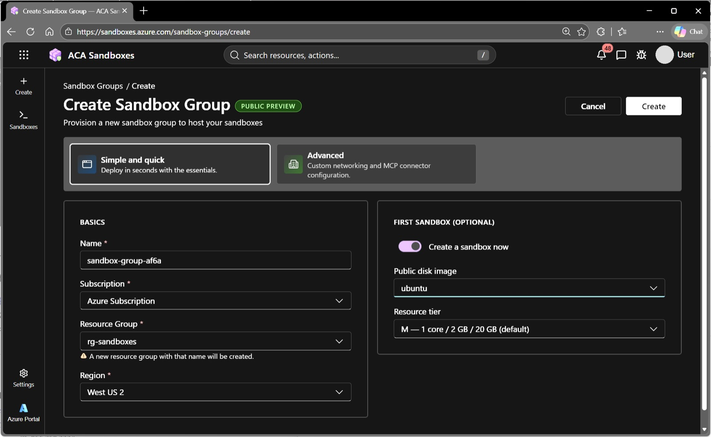
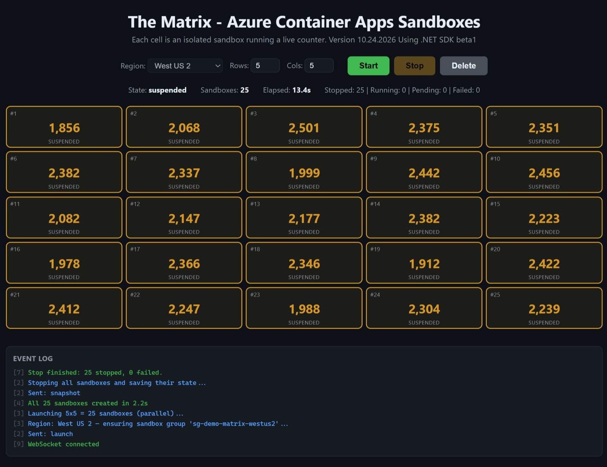
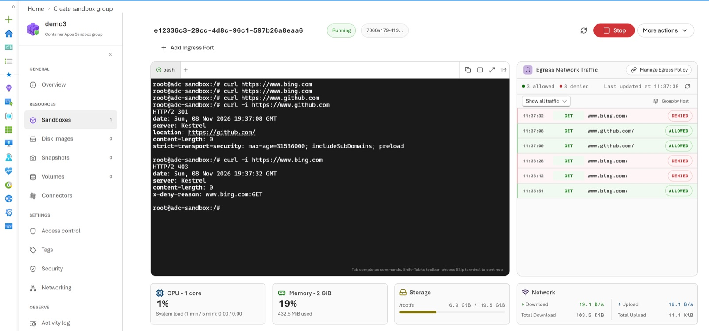
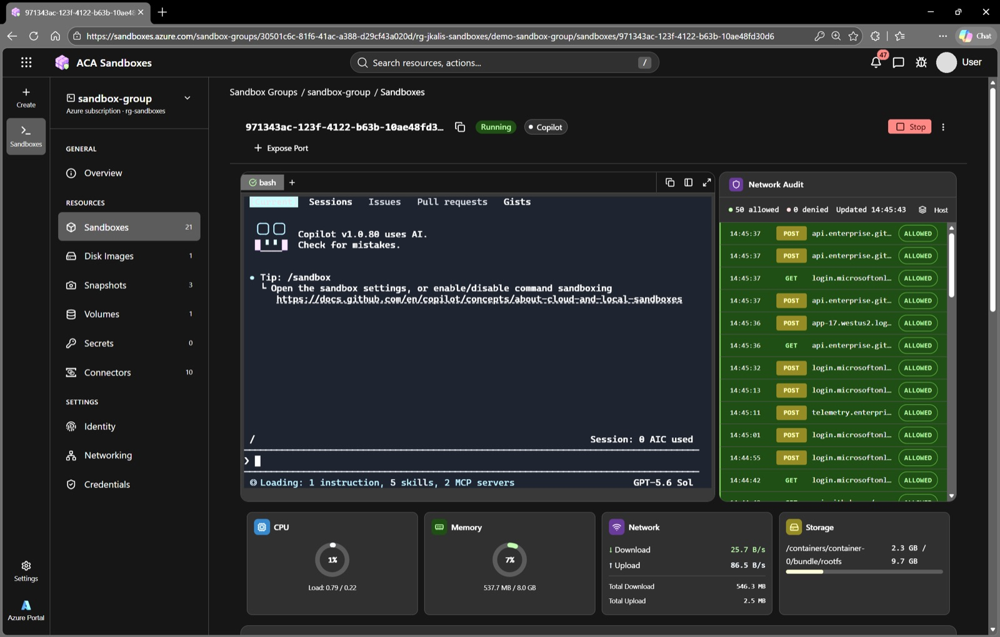

## #governance-gap 01 / Governance Gap & Substrate :: 生产困局：74% 攻击面焦虑与硬件隔离微虚拟机的破局 || Production Reality: The 74% Attack-Surface Gap and the microVM Breakthrough

智能体一旦获准读写文件、编写脚本并调用外部业务接口，单纯依靠提示词约束便彻底失效 [1]。越是通过削减工具权限来换取安全，智能体解决复杂任务的业务价值就越萎缩；反之若放开执行权限，模型动态生成的非受信代码又随时可能击穿边界 [1]。2025 年 9 月发布的 Gartner 调查显示，在接受访谈的 360 位信息技术应用负责人中，74% 认为人工智能智能体构成了组织的新型攻击面，却仅有 13% 确信自身已具备管理大规模智能体集群的治理架构 [1][4]。 || Once an agent reads files, writes scripts, and invokes external business APIs, prompt-level instructions cease to be a security boundary [1]. Stripping permissions to keep an agent safe drains its operational utility, whereas granting broad execution rights exposes enterprise systems to untrusted model-generated code [1]. A September 2025 Gartner survey of 360 IT application leaders found that 74% view AI agents as a new organizational attack vector, yet only 13% strongly agree they have the governance structures required to manage them [1][4].

:::figure { src: "./media/sandbox-isolation-economics-quadrant.figure.json", title: "智能体计算底座选型象限：内核隔离强度与弹性缩零经济性对比 || Agent Compute Substrate Quadrant: Kernel Isolation vs. Burst Economics" }
图 1：传统虚拟机具备强隔离但被慢启动与闲置计费拖垮，标准容器启动快却因共享宿主机内核难以承接多租户非受信代码；托管微虚拟机将独立内核边界与亚秒级缩零推入右上角目标区 [1][2]。 || Figure 1: Dedicated VMs isolate kernels at high idle cost while shared-kernel containers expose multi-tenant risks; managed microVMs combine hardware boundaries with sub-second scale-to-zero in the upper-right target zone [1][2].
:::

面向智能体时代的生产级沙盒不再是仅供概念验证或早期测试的临时游乐场，而是承载全天候业务循环的基础设施主干 [1]。微软宣布正式商用的 Azure Container Apps Sandboxes 采用硬件隔离微虚拟机架构，在全球 44 个区域日均运行超过 200 万个实例，目标可用性达 99.95% [1][3]。在微软内部，这套微虚拟机底座已成为跨产品线的公共安全执行层——同时支撑 Microsoft Foundry Agent Service、Microsoft Copilot Studio、GitHub Copilot 研发体验、Azure 站点可靠性智能体以及简化版应用托管服务 [1][2]。下方导览台内嵌了 BRK448 官方点播视频流、完整时间轴与原版讲义入口，点击顶部章节即可对照查阅四位讲者的核心拆解 [1]： || Production sandboxes in the agentic era are no longer throwaway playgrounds for proofs of concept; they serve as the primary runtime backbone for live enterprise workloads [1]. Newly Generally Available Azure Container Apps Sandboxes pair hardware-isolated microVMs with managed networking and identity, running over 2 million daily instances across 44 regions against a 99.95% availability target [1][3]. Inside Microsoft, this same substrate powers Microsoft Foundry Agent Service, Microsoft Copilot Studio, GitHub Copilot experiences, Azure SRE Agent, and Azure Container Apps Express [1][2]. The interactive theater below embeds the official BRK448 on-demand stream, slide deck link, and chapter timestamps across all four speakers [1]:

:::sandbox { id: "brk448-video-theater", canvas: false, script: "./brk448-showcase.js", style: "./brk448-showcase.css", title: "Ignite 2026 BRK448 官方点播视频剧场与四段式时间轴导览 || Ignite 2026 BRK448 Official On-Demand Video Theater & Chapter Guide", desc: "支持一键内嵌加载 Medius 官方点播流，按章节检视 Microsoft、Nous Research 与 Cognite 的演讲及四场实机演示。 || Load the official Medius on-demand player inline or jump across Microsoft, Nous Research, and Cognite chapters and live demos." }
纯静态议题点播导览卡：集成官方封面图、Medius 无广告嵌入播放器、四段演讲时间轴与原版课件直链。 || Pure static session guide featuring official cover art, on-demand Medius embed player, four-chapter timeline, and PPTX link.
:::

## #hermes-enterprise 02 / Nous Research Case :: 自进化飞轮治理：Nous Research 如何用 2 万个云沙盒驯服开源榜首智能体 || Governing Self-Improvement: How Nous Research Runs 20K+ Hermes Cloud Sandboxes

开源智能体向企业多租户生产迁移时，最棘手的矛盾在于“自主进化收益”与“跨团队风险扩散”同步放大 [1][5]。Nous Research 联合创始人兼首席技术官 Jeffrey Quesnelle 在专场中复盘了 Hermes Agent 的演进：这款一年前源于内部递归自我改进训练实验的开源项目，发布两周即登顶代码托管平台热门榜单，目前在公开模型路由平台上位居开源智能体调用量榜首，日均处理近 2 万亿词元 [1][5]。与早期要求用户手工编写技能文件的工具不同，Hermes 会在后台审视任务执行轨迹，自动把成功经验提炼为技能文件，并将重复出现的确定性步骤直接编译为无需反复消耗大模型算力的代码工作流 [1][5]。 || Migrating an open-source agent into multi-tenant enterprise production magnifies both compounding learning gains and cross-tenant security risks [1][5]. Nous Research Co-founder and CTO Jeffrey Quesnelle recounted how Hermes Agent—open-sourced a year earlier from internal recursive self-improvement research—hit #1 on GitHub within two weeks and now ranks #1 among public open agents on OpenRouter at nearly 2 trillion tokens processed per day [1][5]. Unlike early frameworks that forced users to hand-author skill files, Hermes inspects its own execution traces in the background, distilling successful runs into reusable skills and compiling deterministic routines into code workflows that bypass redundant LLM calls [1][5].

:::comparison { title: "单机个人智能体闭环 vs. Hermes Enterprise 多租户受控飞轮 || Local Workstation Loop vs. Governed Hermes Enterprise Fleet" }
::versus 单机探索态：整机即信任边界（难以规模化） || Local Laptop Mode: Whole Machine as Trust Boundary
### 共享宿主机权限、隐私混入技能且常驻算力昂贵 || Unisolated Execution, Unreviewed Skills, and Idle VM Waste
个人在笔记本电脑上运行自进化智能体时，默认将整台设备作为信任域；一旦直接搬入大型企业，智能体编写的脚本与浏览器操作绝不能与其他租户共享内核，且员工个人的私密上下文若未经审核就自动写入全员技能库，会以同等速度向全公司扩散错误或泄漏敏感信息 [1][5]。 || On a personal laptop, the entire machine acts as the trust boundary; in an enterprise, untrusted code and browser tools cannot share a kernel across tenants, and unreviewed skill promotion risks broadcasting personal habits or data leaks across every team [1][5].

::versus 企业生产态：硬件沙盒 + 受控晋升（20K+ 实例实证） || Enterprise Production: Hardware Sandboxes + Governed Promotion { highlight: true }
### 微虚拟机隔离执行、技能血缘评审与空闲缩零经济模型 || Kernel Isolation, Provenance-Checked Skills, and Scale-to-Zero
Hermes Enterprise 在上层构建身份路由与成本治理控制面，底层全面切换至 Azure 容器应用沙盒：每个工作空间独占微虚拟机内核与受限密钥网络，经评测审批的高价值工作流沉淀为企业自有集体智慧资产，且在用户切换窗口的 99% 空闲时段利用快照释放算力 [1][5]。 || Hermes Enterprise pairs a SaaS or bring-your-own-cloud control plane with Azure Container Apps Sandboxes underneath: each workspace runs inside an isolated microVM while reviewed skills become company IP and snapshots release compute during 99% idle gaps [1][5].
:::

在商业经济账上，Quesnelle 给出了清晰的量化推演：随着每位员工同时驱使多个长程有状态智能体，企业并发规模正迈向数十万乃至上百万实例；而用户随时切出聊天窗口的交互习惯决定了负载高度突发、高达 99% 的时间处于等待或空闲状态 [1]。若为每个有状态工作空间维持一台常驻传统虚拟机，仅硬件账单就会在业务扩张期拖垮平台（假设单实例常驻占空比为 $\alpha \approx 0.01$，常驻计费浪费率高达 $1 - \alpha = 99\%$）[1]。切换至亚秒级启动并支持挂起恢复的微虚拟机沙盒后，Hermes 云平台截至 2026 年 10 月已稳定支撑超过 20,000 个活跃云端实例与 100 余家大型企业客户，同时在控制面提供“支出智能（Spend Intelligence）”滑杆——允许管理员测试将某类高阶模型调用比例从 100% 微调至 95% 时是否仍能维持同等任务表现，从而把词元与算力成本双双锁在可控区间 [1][5]。 || On unit economics, Quesnelle highlighted why traditional stateful hosting breaks at scale: as organizations deploy multiple stateful agents per employee, fleet counts climb toward hundreds of thousands, yet human-in-the-loop multitasking leaves workspaces idle roughly 99% of the time [1]. Paying 24/7 for dedicated VMs at a 1% active duty cycle ($\alpha \approx 0.01$) destroys margins just as adoption succeeds [1]. By migrating its hosted cloud from another provider onto sub-second suspend-and-resume ACA Sandboxes, Nous scaled past 20,000 active cloud instances and 100+ large enterprises by October 2026, pairing compute elasticity with a **Spend Intelligence** slider that tests whether dialing frontier model routing from 100% to 95% preserves task quality [1][5].

## #sandbox-anatomy 03 / Architecture & Live Demos :: 沙盒解剖学：双层外部代理、零密钥凭据注入与四连实机演示 || Sandbox Anatomy: External Proxies, Secretless Injection, and Four Live Demos

为什么智能体在沙盒内拥有完整的根文件系统与命令行权限，却依然无法篡改网络边界或窃取接口密钥？微软首席产品经理 Jan Kalis 在架构深潜环节揭示了核心设计原则：**所有网络策略与凭据注入组件均部署在沙盒微虚拟机边界之外**，沙盒内部运行的模型代码对其既不可见也无权修改 [1][3]。 || How can an agent hold root shell access and a full filesystem inside its sandbox without altering network rules or exfiltrating API keys? Principal Product Manager Jan Kalis demonstrated the core architectural invariant: **both ingress and egress proxies enforce policy strictly outside the microVM boundary**, beyond the reach of any code executing inside the sandbox [1][3].

:::figure { src: "./media/aca-sandbox-boundary-architecture.figure.json", title: "Azure Container Apps Sandboxes 零密钥安全边界与持久状态全景架构 || Azure Container Apps Sandboxes Secretless Boundary & Stateful Architecture" }
图 2：区域级沙盒群组统一纳管从 0.25 核至 16 核的微虚拟机池；入站与出站代理由平台在沙盒外强制执行，配合内存快照、托管存储与 1,700+ 连接器构成完整生产闭环 [1][3]。 || Figure 2: A regional Sandbox Group governs microVMs from 0.25 to 16 cores; external ingress and egress proxies enforce per-sandbox auth and header injection alongside snapshots, durable volumes, and 1,700+ connectors [1][3].
:::

围绕这一架构，Kalis 在现场连续完成了四场零剪辑实机演示，覆盖沙盒创建、并发矩阵快照、零密钥出站转换以及企业连接器协同 [1]： || Kalis validated every layer onstage through four consecutive live demos spanning multi-tool provisioning, parallel snapshot matrices, secretless header transformation, and enterprise connector grounding [1]:

| 演示序号与主题 || Live Demo | 核心技术规格与配置项 || Key Technical Specifications | 现场实测现象与工程验证结论 || Verified Onstage Outcome |
|------|------|------|
| Demo 1：三端秒级创建 || 0-to-Sandbox Provisioning | 官方月更镜像（Ubuntu / Python / 智能体底座）；规格横跨 XS（0.25 核 / 0.5 GiB / 5 GiB）至 3XL（16 核 / 32 GiB / 320 GiB）[1] || Monthly Microsoft base images; tiers from XS (0.25c / 0.5 GiB / 5 GiB) to 3XL (16c / 32 GiB / 320 GiB) [1] | 先后通过门户界面、`az containerapp sandbox create` 命令行及全新发布的 VS Code 资源扩展秒建实例，直连远端 Ubuntu 终端并实时观测处理器、内存与文件系统 [1] || Provisioned sandboxes via Azure Portal, CLI, and the newly announced VS Code extension, opening a live remote Ubuntu shell with real-time CPU, memory, and filesystem telemetry [1] |
| Demo 2：并发矩阵与快照续跑 || Pause & Resume Matrix | OCI 容器镜像自动转换为可引导自定义磁盘镜像；外部入站代理默认全关，按端口显式开启流量唤醒与目录身份认证 [1] || OCI images converted to bootable custom disk images; opt-in ingress proxy with Entra ID auth and wake-on-traffic [1] | 编排沙盒在 **2.2 秒内并发拉起 5×5 共 25 个计数沙盒**；点击停止即生成内存加磁盘快照并释放算力，再次启动时 25 个计数器从暂停数值处毫秒级无损续跑 [1] || An orchestrator spawned **25 parallel counter sandboxes in 2.2 seconds**; stopping captured memory+disk snapshots at zero compute cost, and restarting resumed exact counter states [1] |
| Demo 3：出站管控与零密钥沙盒 || Egress & Secretless Injection | 出站代理默认拒绝全部流量（`Deny All`），按域名配置白名单；支持自定义转换规则（Transform Rules）与外部网络钩子 [1] || Default-deny egress proxy with per-host allowlists, credential Transform Rules, and custom policy webhooks [1] | 沙盒内请求 `bing.com` 立即返回 `HTTP 403` 拦截，请求白名单 `github.com` 放行；配置转换规则后，沙盒无需持有真实密钥即可由外部代理在出站瞬间动态覆写注入 `X-API-Key` 请求头 [1] || Outbound calls to `bing.com` hit `HTTP 403` while allowlisted `github.com` passed; a Transform Rule dynamically injected the real `X-API-Key` header outside the sandbox [1] |
| Demo 4：连接器与日程智能体 || Connectors & Work IQ Agent | 群组级一次挂载超 **1,700 个逻辑应用连接器**（覆盖 Teams、SharePoint、Jira、GitHub 与 Work IQ），支持代理用户身份授权（OBO）[1] || Attach **1,700+ Logic Apps MCP connectors** once per group with Entra ID On-Behalf-Of (OBO) delegation [1] | 拉起预置令牌转换规则的 GitHub Copilot 沙盒，挂载 Work IQ 日历连接器并完成个人授权后，沙盒内智能体直接安全读取并汇总讲者当周的完整参会日程 [1] || A GitHub Copilot sandbox with preset GitHub token transforms attached the Work IQ calendar connector via OBO auth and summarized the speaker's live Ignite schedule [1] |

下方四宫格展示了从 BRK448 官方原版幻灯片提取的四幅实机演示高清截图，直观呈现了沙盒群组创建台、25 并发矩阵挂起面板、出站流量审计与零密钥控制台，以及挂载双模型上下文服务与 10 个连接器的智能体终端 [1]： || The four-card gallery below presents high-resolution captures extracted directly from the official BRK448 slide deck—showing the Sandbox Group creation portal, the 25-sandbox suspended matrix, the live egress audit console, and the Copilot sandbox terminal running with MCP servers and connectors [1]:

  <article class="brk448-media-card">
    

      
    

    

      BRK448 官方课件实拍 · Demo 1
      <h4 data-zh="极简沙盒群组与资源规格配置台" data-en="Streamlined Sandbox Group & Resource Tier Provisioning">极简沙盒群组与资源规格配置台</h4>
      
一步选定区域、官方月更镜像与微虚拟机规格（默认 M 档 1 核 / 2 GB / 20 GB），同时全面兼容 Bicep、Terraform 与 Python/.NET 开发包 [1]。

    

  </article>
  <article class="brk448-media-card">
    

      
    

    

      BRK448 官方课件实拍 · Demo 2
      <h4 data-zh="The Matrix：2.2 秒并发拉起 25 沙盒与快照休眠" data-en="The Matrix: 25 Parallel Sandboxes Spawned in 2.2s & Snapshot Suspended">The Matrix：2.2 秒并发拉起 25 沙盒与快照休眠</h4>
      
底部事件日志实证：5×5 共 25 个独立微虚拟机在 2.2 秒内全部创建完毕，执行快照停止后完整冻结各自计数内存且零失败释放计算资源 [1]。

    

  </article>
  <article class="brk448-media-card">
    

      
    

    

      BRK448 官方课件实拍 · Demo 3
      <h4 data-zh="出站网络实时审计与零密钥请求头注入" data-en="Real-Time Egress Network Audit & Secretless Credential Injection">出站网络实时审计与零密钥请求头注入</h4>
      
右侧审计流清晰记录未授权域名返回 403 拒绝（x-deny-reason）而白名单域名放行；敏感凭据由外部代理通过转换规则动态注入 [1][3]。

    

  </article>
  <article class="brk448-media-card">
    

      
    

    

      BRK448 官方课件实拍 · Demo 4
      <h4 data-zh="沙盒内运行智能体：预置技能、模型上下文服务与连接器" data-en="Agent Inside a Sandbox: Preloaded Skills, MCP Servers & 10 Connectors">沙盒内运行智能体：预置技能、模型上下文服务与连接器</h4>
      
终端底部显示智能体已加载 1 条指令、5 项技能与 2 个模型上下文服务，配合左侧挂载的持久卷与连接器安全访问企业日程与代码库 [1]。

    

  </article>

由于沙盒本身可随时销毁重建，跨会话记忆与长程工作产物可通过群组挂载的托管数据磁盘、托管块存储、自有对象存储，以及即将上线的零密钥关系型数据库（支持 SQL 与 PostgreSQL）实现跨生命周期持久化 [1][3]。 || Because individual sandboxes remain ephemeral by design, long-term agent memory and workspace artifacts persist beyond sandbox deletion via out-of-the-box Managed Disks, Managed Blob storage, customer-owned Blob accounts, and upcoming secretless SQL and PostgreSQL integrations [1][3].

## #cognite-industrial 04 / Industrial AI & Rollout :: 重资产工业实战：Cognite 百亿图节点上的炼油厂检修智能体与落地指南 || Heavy-Asset Industrial AI: Cognite Refinery Isolation Agents and Rollout Playbook

在石油天然气、能源与高端制造等重资产行业，哪怕单台泵机的数据也分散在压力传感器时序库、工单维护系统、管道及仪表流程图（P&ID）与三维工程模型等异构孤岛中 [1][6]。工业人工智能厂商 Cognite 首席解决方案架构师 Christian Flasshoff 介绍，其核心数据平台 Cognite Data Fusion 通过统一工业知识图谱消除了点对点集成瓶颈，目前已沉淀超过 **100 万亿个工业数据点、50 亿个知识图谱节点与 4 亿份工程文档图纸**，并通过单一接口向运行了三年的工业智能体套件 Atlas AI 供数 [1][6]。 || Across oil and gas, energy, and heavy manufacturing, even a single refinery pump scatters telemetry across pressure historians, ERP work orders, piping and instrumentation diagrams (P&IDs), and 3D CAD models [1][6]. Cognite Principal Solution Architect Christian Flasshoff explained how **Cognite Data Fusion** unifies these silos into an industrial Knowledge Graph spanning **100 trillion datapoints, 5 billion graph nodes, and 400 million documents**, exposed through a single API to its **Atlas AI** industrial agent workforce [1][6].

然而，现场工程师提出的复杂工程问题无法靠几十个固定预置工具穷尽——智能体必须针对特定图纸动态编写并运行解析代码，同时严禁触碰高敏运营网络的未授权端点 [1]。将 Azure 容器应用沙盒作为“安全计算机”接入 Atlas AI 执行内核后，Cognite 仅用**数天便跑通首个沙盒智能体原型，并在数周内推入生产环境成为核心标配** [1][6]： || Yet real field engineering questions rarely fit a static menu of predefined tools—agents must write and execute custom analysis code against live schematics while connected to highly sensitive operational networks [1]. By attaching ACA Sandboxes as a governed "computer" inside the Atlas AI harness, Cognite built its first sandbox-enabled agent **in days and shipped it to production within weeks** [1][6]:

:::flow { title: "Cognite Atlas AI 炼油厂换热器安全检修隔离四步闭环 || Cognite Atlas AI Four-Step Refinery Heat-Exchanger Isolation Loop" }
1. **检索并核验工程原图 || Retrieve & Validate P&ID Schematics** — 维修工程师下达换热器检修准备指令，智能体检索工业知识图谱定位目标管道及仪表流程图，交由工程师确认双椭圆换热器主设备基准 [1]。 || A maintenance engineer requests heat-exchanger isolation prep; Atlas AI queries the Knowledge Graph to fetch the exact P&ID drawing for human confirmation [1].
2. **沙盒内拉取多源拓扑并执行解析代码 || Execute Custom Graph & Diagram Code in Sandbox** — 无需预先硬编码专用工具，智能体在独立微虚拟机沙盒内下载工程图纸文件、结合图谱设备层级编写并运行检验脚本，追踪冷热流体两侧全部相连管线 [1]。 || Without rigid prebuilt tools, the agent downloads the schematic into its kernel-isolated microVM, writes custom inspection scripts, and cross-references graph equipment hierarchies [1].
3. **生成安全隔离边界与阀门操作清单 || Synthesize Valve Isolation Plan** — 智能体综合管线连通性与运行上下文生成完整隔离方案，同时访问令牌始终滞留在沙盒外部出站代理中，并通过私有虚拟网络保持内网闭环 [1][6]。 || The agent formulates a step-by-step isolation boundary plan while private VNet attachment and external egress rules keep operational API tokens outside the sandbox [1][6].
4. **工程图纸原位高亮复核放行 || Highlight Valves Directly on Drawing for Sign-Off** — 智能体在原始复杂工程图上精准框选高亮每一处待关闭隔离阀门与关联设备，将原本耗时易错的人工描图排查转化为分钟级可视化审批 [1]。 || Atlas AI renders visual highlights directly onto the original P&ID schematic to pinpoint every valve that must close, turning hours of manual tracing into rapid engineer sign-off [1].
:::

面向准备在企业内部复刻同类安全智能体架构的技术团队，BRK448 讲者团结合微软配套动手实验 **LAB722（Caldova 多租户临床医药研究智能体架构）** 凝练出三条可立即执行的工程落地准则 [1][3]： || Synthesizing lessons from Nous Research, Cognite, and Microsoft's companion hands-on lab **LAB722 (the Caldova multi-tenant clinical research reference app)**, the BRK448 panel distilled three production rollout rules [1][3]:

:::insight-grid { cols: 3, title: "企业生产级智能体沙盒落地三原则 || Three Architectural Rules for Production Agent Sandboxes" }
::card 01
### 在内核层而非提示词层强制信任 || Enforce Trust at the Kernel, Not the Prompt
永远假设大模型生成的代码与外部网页输入可能越界；为每个会话或租户分配独立微虚拟机内核，开启入站默认全关与出站默认全拒白名单 [1][6]。 || Assume model-generated code and web inputs can misbehave; isolate every session behind its own microVM kernel with default-off ingress and default-deny egress [1][6].

::card 02
### 用零密钥代理与快照兼顾安全与成本 || Pair Secretless Egress with Snapshot Economics
通过外部出站代理的转换规则动态注入凭据，确保沙盒文件系统内零明文令牌；利用自定义磁盘镜像预装依赖，配合内存快照实现闲置零计费 [1][3]。 || Inject credentials externally via egress Transform Rules so sandboxes hold zero raw secrets, and combine custom rootfs images with snapshots for zero-idle cost [1][3].

::card 03
### 编排层与执行层解耦协同 || Decouple Orchestration from Specialist Sandboxes
参照 LAB722 范式，用宿主编排器负责认证与任务拆解，按需拉起并行的临床与药物专职沙盒并在全部完成后触发独立质检沙盒，避免自建底层管道 [1]。 || Mirror the LAB722 Caldova pattern: let a Foundry/ACA Express orchestrator authorize runs, fan out parallel specialist sandboxes, and trigger an independent QA sandbox afterward [1].
:::

## 参考资料：官方一手信源与工程规范 || References: Official Primary Sources & Engineering Guides

1. **Devanshi Joshi, Jeffrey Quesnelle, Jan Kalis & Christian Flasshoff (Microsoft Ignite 2026)** — https://ignite.microsoft.com/en-US/sessions/1787856641427001EIEu-1791588175102001CcC9 | 《Run secure agent loops in production with isolated sandboxes at scale》官方点播视频、43 页原版幻灯片与双语逐字稿（2026-11-19） || Official breakout recording, 43-slide deck, and full WebVTT transcript (Nov 19, 2026)
2. **Microsoft Ignite 2026 On-Demand Media Stream (Medius Asset)** — https://medius.microsoft.com/Embed/video-nc/d8734a1a-bcf5-4871-ab79-ddfed898b641 | 官方无广告点播流与四连实机架构演示实录 || Official Medius embedded video stream covering Nous Research, Azure Container Apps Sandboxes live demos, and Cognite Atlas
3. **Microsoft Azure Container Apps Documentation & Sandbox Portal** — https://aka.ms/aca/sandbox | Azure Container Apps Sandboxes 官方技术文档、快速入门与开发工具包规范（关联发布综述：`https://aka.ms/aca/ignite`） || Official product documentation, resource tier specs, egress transform rules, and Ignite announcement blog
4. **Gartner Application Leaders Survey (Slide 5 Citation)** — https://www.gartner.com/en/information-technology | 针对 360 位应用负责人的企业智能体安全与治理就绪度调研（2025 年 5–6 月调研，2025-09-30 发布） || Survey of 360 application leaders on agent attack vectors (74%) vs. governance readiness (13%), published Sep 30, 2025
5. **Nous Research — Hermes Agent & Hermes Enterprise** — https://portal.nousresearch.com/business | Hermes 自进化开源智能体架构与企业级多租户治理控制面文档 || Hermes Enterprise collective intelligence, Spend Intelligence routing, and cloud sandbox runtime overview
6. **Cognite — Cognite Data Fusion & Atlas Industrial Agents** — https://www.cognite.com/en/product/atlas-ai | 工业知识图谱（100 万亿数据点 / 50 亿节点）与重资产行业智能体工作台技术白皮书 || Industrial Knowledge Graph and Atlas sandboxed engineering workflow overview
