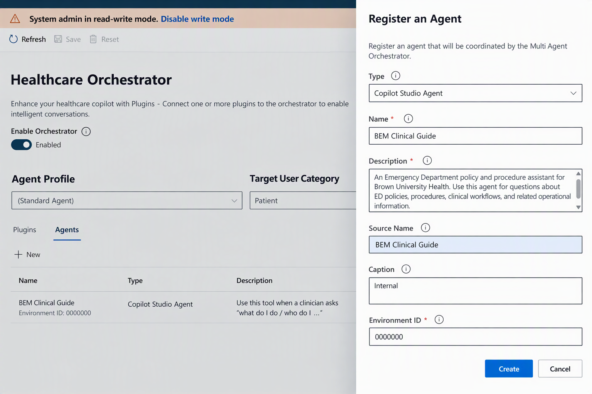
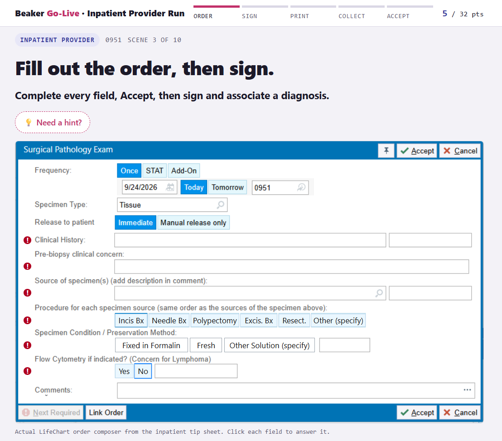
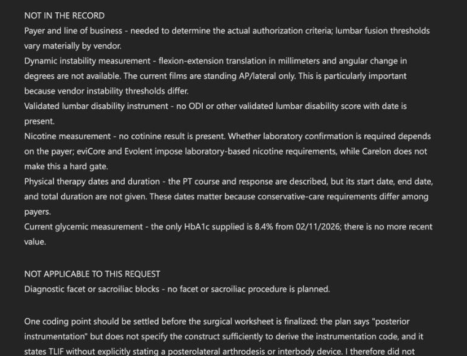
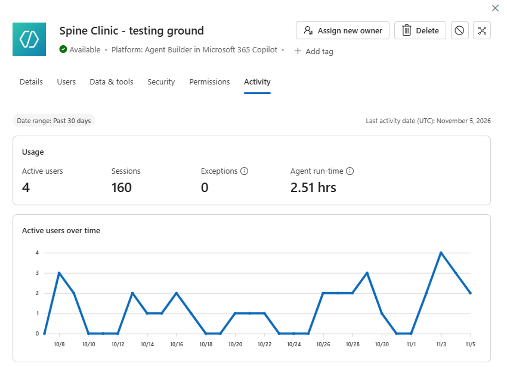

## #connected-intelligence 01 / Connected Intelligence :: 行业拐点：从病历听写到跨十余套系统的连接智能与点播导览 || Industry Inflection: From Dictation to Cross-System Connected Intelligence

医疗人工智能正跨越单纯“帮医生写病历”的早期阶段 [1]。Jonathon Dreyer 在开场指出，过去数年行业依次经历了语音听写、诊室环境感知转录与信息检索式临床助手三波浪潮；如今真正的拐点在于第四阶段**连接智能（Connected Intelligence）**——让智能体直接出现在医护人员正在操作的临床上下文中，把“记录刚才发生了什么”延伸为“理清下一步该做什么并顺手办妥” [1][2]。这一路线严守一条医疗安全红线：智能体绝不替代医生的临床判断，只负责剥离围绕在临床判断外围的繁琐事务工作 [1]。 || Healthcare AI is moving past simple encounter documentation [1]. Opening BRK460, Jonathon Dreyer traced four stages—dictation, ambient capture, clinical assistants, and now **connected intelligence**, where AI surfaces directly inside the active clinical context to clarify what matters next and make follow-through easier [1][2]. One boundary governs every workflow: AI never automates clinical judgment; it strips away the administrative friction surrounding that judgment [1].

为什么单点工具难以缓解临床倦怠？以患者眼中最普通的一次门诊化疗输注为例，单次预约背后需要 **5 至 25 名**医师、护士、药师、影像技师与排班专员协同配合，并频繁进出电子病历、医学影像归档、药房处方、商保预授权门户、转诊管理与传真文档交换等 **10 余套独立系统** [1][2]。临床医生熟悉诊疗方案，药师紧盯剂量审核，行政团队追着商保核准跑，大量工时消耗在跨系统拼装“之前做过什么、审批过了没有、缺哪项化验”的上下文核对上 [1]。连接智能的目标并非推翻现有记录系统，而是在其上方铺设一层跨系统协同层，让医护跨越系统推进诊疗，而非整日绕着系统手工搬运数据 [1][2][3]。 || Why do isolated point tools struggle to relieve burnout? Behind a single chemotherapy infusion appointment, **5 to 25 staff members**—physicians, nurses, pharmacists, radiologists, and schedulers—must coordinate across **10+ separate systems**, spanning the electronic health record, imaging archives, pharmacy systems, insurance authorization portals, referral trackers, and document exchange tools [1][2]. Massive effort goes simply into assembling context across silos [1]. Connected intelligence does not replace systems of record; it layers governed orchestration across them so care teams work across systems rather than around them [1][2][3].

下方导览台内嵌了 Microsoft Ignite 2026 官方 BRK460 点播流入口、40 页原版课件直链与四段精确到秒的实录章节索引，点击顶部时间轴标签即可切换查阅或直接唤醒官方播放器 [1][2]： || The interactive theater below embeds the official Microsoft Ignite 2026 BRK460 on-demand stream, the 40-slide PPTX deck link, and four timestamped transcript chapters—switch tabs above to inspect highlights or launch the official Medius player inline [1][2]:

:::sandbox { id: "brk460-video-theater", canvas: false, script: "./brk460-session.js", style: "./brk460-session.css", title: "BRK460 官方点播视频与 45 分钟逐章时间轴导览台 || BRK460 Official On-Demand Video & 45-Minute Timestamped Session Guide", desc: "涵盖 Jonathon Dreyer 行业框架与 Adam Landman 博士三项真实临床智能体演示，支持在线加载 Medius 官方视频流。 || Covers Jonathon Dreyer's framework and Dr. Adam Landman's three live clinical use cases with inline Medius stream playback." }
纯静态点播导览沙盒：内置官方高清封面图、四段演讲时间轴精要及 Medius 点播流与原版 PPTX 下载入口。 || Pure static session theater featuring the official BRK460 cover, four timestamped chapter digests, inline Medius embed toggle, and PPTX link.
:::

## #brown-ai-matrix 02 / Five-Track Strategy :: 破局三重逆风：Brown University Health 的五维部署矩阵与草根构建模型 || Countering Three Headwinds: Five-Track AI Matrix and Grassroots Builder Model

作为罗德岛州最大的私营雇主兼布朗大学沃伦·阿尔珀特医学院附属学术医疗体系，Brown University Health 运营着横跨罗德岛州与马萨诸塞州东南部的多家急症与专科医院及 **200 余个门诊网点** [2]。全系统配备 **1,500 余张核定床位**与 **21,000 余名员工**（含 **3,000 余名执业医师、执业护师与医师助理**），2025 财年营业收入达 **44 亿美元**且外部科研经费逾 **1.6 亿美元** [1][2]。从事急诊临床与医疗信息化 20 年的 Adam Landman 坦言，当前是医疗行业经营最艰难的时期，三大逆风正形成相互加剧的负向飞轮 [1][2]： || Anchored by Brown University's Warren Alpert Medical School, Brown University Health is Rhode Island's largest private employer, operating acute and psychiatric hospitals plus **200+ ambulatory sites** [2]. Across the system sit **1,500+ licensed beds** and **21,000+ employees** (including **3,000+ providers**), generating **$4.4B in FY25 operating revenue** alongside **$160M+ in external research funding** [1][2]. Drawing on 20 years in emergency medicine, Dr. Adam Landman identified three reinforcing headwinds straining healthcare delivery [1][2]:

1. **财务剪刀差（Financial Pressure）** — 药品耗材与临床人力成本每年以 **6% 以上**的速度刚性上涨，而医保与商业保险的固定偿付费率每年仅上调 **2%–3%**，收支增速长期倒挂 [1]； || **Fiscal Scissors** — Labor and supply expenses climb at **6%+ annually** while fixed payer reimbursement rates rise only **2%–3%**, squeezing operating margins [1];
2. **就医可及性瓶颈（Access to Care）** — 患者预约全科首诊或专科门诊往往需等待数周乃至数月，复杂慢病与急症风险在漫长候诊期中持续累积 [1]； || **Care Access Bottlenecks** — Patients wait weeks or months for primary and specialty appointments while complex conditions worsen [1];
3. **临床人力倦怠与流失（Workforce Burnout）** — 疫情后繁重的文书录入将大批医师、护士与药师推向职业倦怠甚至离开医疗行业，反过来进一步收紧接诊能力 [1]。 || **Workforce Attrition** — Heavy clerical burden drives physicians, nurses, and pharmacists out of practice, compounding access shortages [1].

$$
\Delta g_{\text{fiscal}} = r_{\text{reimb}}\;(2\%\text{–}3\%) - r_{\text{cost}}\;(>6\%) < -3\%/\text{yr}, \qquad R_{\text{query-cut}} = \frac{43 - 13}{43} \approx 69.8\%
$$

为系统性对冲上述压力并严密保护受保护健康信息（PHI），院方在 AI 卓越中心负责人 Matt Butler 推动下，放弃了“一刀切放开”或“全封闭禁令”的极端做法，按角色分层落地了五维微软 AI 矩阵 [1][2]： || To counter these pressures while safeguarding protected health information (PHI), Brown University Health—with AI Center of Excellence lead Matt Butler—deployed a five-track Microsoft AI architecture tailored by workforce role [1][2]:

:::figure { src: "./media/brown-connected-clinical-architecture.figure.json", title: "Brown University Health 三层连接智能架构与五维角色赋能版图 || Brown University Health Three-Tier Connected Intelligence & Five-Track Architecture" }
图 1：底层锁定电子病历、关闭公网检索的科室知识库与带敏感度标签的医保规则；中层通过 Copilot Studio 沙盒与医疗编排器路由智能体；顶层直达床旁 Dragon Copilot 并由 Purview 与 Agent 365 实施全量审计 [1][2]。 || Figure 1: Grounded in Epic, web-isolated SharePoint libraries, and sensitivity-labeled payer rules, orchestrated through Copilot Studio and Healthcare Orchestrator, and delivered inside Dragon Copilot under Purview and Agent 365 oversight [1][2].
:::

| 战略轨道 || Track | 核心平台 || Platform | 覆盖人群与实测规模 || Target Cohort & Verified Scale | 安全边界与业务定位 || Guardrails & Operational Role |
|------|------|------|------|
| 普惠对话 || Democratize | Copilot Chat | 面向全部 **21,000+** 名员工开放，已达约 **8,000** 名活跃用户（占全员超三分之一）[1][2] || Open to all **21,000+** staff with **~8,000** active users (>1/3 of workforce) [1][2] | 院内合规环境隔离受保护健康信息与敏感经营数据，提供零门槛安全问答 [1] || Protects PHI and sensitive business data inside an enterprise-governed boundary [1] |
| 办公提效 || Productivity | Microsoft 365 Copilot | 面向高频使用电脑的行政与运营知识工作者配置高级许可 [1][2] || Premium licenses deployed to computer-intensive knowledge workers [1][2] | 深度嵌入日常文档、邮件与表格流，削减行政协调耗时 [1] || Embedded in Office productivity workflows to cut administrative overhead [1] |
| 先锋自建 || Build | Copilot Studio | 赋能 **189** 名临床与运营先锋，截至 2026 年 8 月 24 日盘点 **1,045** 个智能体（约 **55%** 聚焦临床）[2] || **189** unique builders created **1,045** inventoried agents (**~55%** clinical) as of Aug 24, 2026 [2] | 遵循“小步构建、沙盒验证、受控扩面”，管理员默认关闭外部公网检索开关 [1][2] || Isolated sandbox prototyping with external public web search disabled by admin control [1][2] |
| 床旁交付 || Deliver | Dragon Copilot | 面向全院 **3,000+** 名医师、执业护师与医师助理全量开放使用 [1][2] || Enabled across all **3,000+** physicians, nurse practitioners, and PAs [1][2] | 诊室环境感知自动生成病历草稿，并充当床旁自定义临床智能体的统一交互窗口 [1][2] || Ambient encounter documentation plus point-of-care host for custom clinical agents [1][2] |
| 科研攻坚 || Discover | Azure AI Foundry | 面向医学院与附属医院临床科研人员（首期建设安全科研飞地）[1][2] || Clinical investigators launching a secure research enclave [1][2] | 在受控存储与算力飞地内挖掘高维电子病历信号与不良反应队列 [1][2] || Governed compute and storage enclave for longitudinal EHR signal discovery [1][2] |

在构建者培养上，Brown University Health 设计了清晰的四阶成长路径：**探索者（Explorer，理解模型能力边界与负责任使用准则）→ 构建者（Builder，在隔离沙盒中用纯文本指令、内部知识库与可选的 OpenAI 或 Claude 前沿模型快速试制原型）→ 所有者（Owner，承担日常运维与质量监控职责）→ 先锋导师（Champion，辅导同事并沉淀可复用模板）** [1][2]。 || To cultivate frontline makers without losing control, Brown University Health established a four-step Builder Journey: **Explorer** (learn AI limits) → **Builder** (prototype in an approved no-code sandbox using plain-text instructions, internal SharePoint/OneDrive sources, and OpenAI or Claude models) → **Owner** (accept support and monitoring duties) → **Champion** (mentor peers and reuse patterns) [1][2].

## #point-of-care-agents 03 / Point-of-Care & Training :: 实战一与二：把急诊指南嵌进 Dragon Copilot，用 10 分钟生成单文件病历实训 || Use Cases 1 & 2: ED Guidelines Inside Dragon Copilot and 10-Minute EHR Simulator

有了无代码构建工具，真正的难点在于如何触达分秒必争的一线临床场景，以及如何让 21,000 名员工顺畅适应新系统切换 [1]。Adam Landman 现场演示了前两项分别针对床旁临床决策辅助与全院电子病历上线培训的落地成果 [1][2]： || Once no-code tools exist, the real test is reaching busy clinicians mid-shift and guiding 21,000 staff through workflow changes [1]. Dr. Landman demonstrated two production deployments addressing point-of-care clinical reference and rapid EHR change management [1][2]:

:::insight-grid { cols: 2, title: "急诊床旁指南智能体 vs. Epic Beaker 单文件交互实训的工程拆解 || Engineering Breakdown: ED Point-of-Care Agent vs. Single-File Epic Simulator" }
::card 案例 01 · 急诊医学科 || Case 01 · Emergency Medicine
### BEM 临床指南直通 Dragon Copilot 床旁窗口 || BEM Clinical Guide Embedded in Dragon Copilot
联合急诊医学系临床主任兼执行副主席 Anthony Napoli 博士构建：严格限定仅读取急诊科内部维护的临床政策与收治流程库，禁止跨文档臆测或推算药物剂量；随后通过**医疗编排器（Healthcare Orchestrator）**仅填写 4 项映射字段，便将该智能体直接注入医生正在 Epic 内使用的 Dragon Copilot 侧边栏 [1][2]。 || Co-designed with ED Executive Vice Chair Dr. Anthony Napoli, the agent strictly queries curated Brown Emergency Medicine SharePoint protocols with zero unstated inference or medication guessing; registering 4 fields in **Healthcare Orchestrator** surfaces it directly inside Dragon Copilot within Epic [1][2].

::card 案例 02 · 全院变更管理 || Case 02 · System-Wide Change Management
### 一条提示词 10 分钟生成零后端 Epic 交互实训 || One Prompt to Single-File HTML Epic Trainer in 10 Minutes
2026 年 11 月 7 日全院切换上线 Epic Beaker 解剖病理模块前夕，针对传统 1–3 页静态提示单无人细读的痛点，Adam Landman 将住院端提示单（含 Epic 界面截图）与沙盒任务清单喂入 Microsoft 365 Copilot，10 分钟内生成单文件封装的交互式 HTML 网页并发布至内网供全员实操 [1][2]。 || Ahead of the November 7, 2026 Epic Beaker anatomic pathology go-live, Dr. Landman fed static Epic screenshot tip sheets and sandbox guides into Microsoft 365 Copilot—producing a self-contained single-file HTML simulator in 10 minutes (refined over two weekend hours) for instant intranet deployment [1][2].
:::

两项案例在交互细节上均展现出极高的临床贴合度 [1][2]。在罗德岛医院急诊科实机画面中，医生刚用环境感知生成完病历草稿，直接在同一窗口提问：“*在罗德岛医院，70 岁头部外伤患者的出院指南是什么？*” [1][2]。智能体秒级调取院内老年创伤（65 岁以上）与轻度创伤性颅内出血文档并附上可点击原文链接，同时在正文中**诚实声明空白**：“*现有资料中并无单一专属的出院核对表*”，仅客观列出神经外科会诊放行与无需重复头颅 CT 的适用情形供主治医师拍板 [1][2]。而在病理医嘱实训网页中，系统自动编排出住院患者“Mr. Okafor 发热伴右腿皮疹需行活检”的 10 幕闯关情境：当受训医生误选“先采样后补医嘱”时，页面即时给出安全规范纠偏，并将原本静态的提示单截图重构为可逐格点击填写、勾选福尔马林固定方式并完成诊断关联签名的逼真仿真器——省去了高昂的商业培训软件采购与数月定制周期 [1][2]。 || Both deployments highlight practical workflow fit [1][2]. Inside Rhode Island Hospital's ED, when a physician asks Dragon Copilot, *"What are the guidelines for discharging a 70 year old with head trauma at RIH?"*, the agent cites curated geriatric trauma (age 65+) and mild traumatic intracranial hemorrhage sources while **honestly admitting gaps**—explicitly stating that no single dedicated discharge checklist exists so clinical judgment stays with the physician [1][2]. Meanwhile, the Beaker trainer builds a 10-scene inpatient scenario (*Mr. Okafor* with fever and right-leg rash requiring biopsy): selecting the unsafe *"enter order after procedure"* option triggers constructive safety feedback before converting a static Epic screenshot into a clickable order composer with diagnosis signing—avoiding costly vendor software and months of build time [1][2].

  <article class="brk460-media-card">
    

      
    

    

      BRK460 官方课件原图 · Slide 19
      <h4 data-zh="Healthcare Orchestrator：四步映射打通床旁最后一公里" data-en="Healthcare Orchestrator: Wiring Custom Agents into Dragon Copilot">Healthcare Orchestrator：四步映射打通床旁最后一公里</h4>
      
无需让急诊医生切出 Epic 去翻找 Teams 或网页目录，直接将 Copilot Studio 构建的 BEM 临床指南注册为床旁对话路由插件 [1][2]。

    

  </article>
  <article class="brk460-media-card">
    

      
    

    

      BRK460 官方课件原图 · Slide 26
      <h4 data-zh="静态提示单蜕变为可交互的外科病理医嘱仿真器" data-en="Static Tip Sheet Turned into Interactive Pathology Order Composer">静态提示单蜕变为可交互的外科病理医嘱仿真器</h4>
      
单文件 HTML 实训还原外科病理医嘱必填红叹号、标本类型、福尔马林保存与签字关联流程，周末两小时打磨即覆盖多临床角色上线 [1][2]。

    

  </article>

## #spine-documentation 04 / Clinician-Built Spine Agent :: 实战三：神经外科医生自研脊柱文档智能体——编码追问从 43 降至 13 与商保前置排雷 || Use Case 3: Surgeon-Built Spine Agent—Cutting Coding Queries 43 to 13 and Pre-Auth Checks

第三项标杆案例并非出自 IT 部门，而是由一线神经外科医生 David B. Kurland（MD, PhD）在沙盒中自主构建 [1][2]。脊柱外科初诊信息密度极高：外科医生除完成查体与手术方案外，还必须通读全科转诊信、疼痛科记录、物理治疗总结及核磁共振与 X 光报告 [1][2]。随后医生还需撰写完整会诊病历、提取手术计费编码，并对照不同商业保险公司的苛刻条款准备预授权材料 [1][2]。Kurland 博士利用纯文本指令与附带敏感度标签的手术编码及商保规则文件，搭建出一套包含门诊病历、手术记录与复杂度捕获的三智能体组合并投入日常临床使用 [1][2]。 || The third flagship solution came directly from the clinical front line, built by neurosurgeon Dr. David B. Kurland (MD, PhD) [1][2]. Evaluating a spine surgery patient requires synthesizing primary care referrals, pain management notes, physical therapy summaries, MRI/X-ray reports, and the physical exam into a consult note, accurate billing codes, and payer-specific prior authorization packets [1][2]. Using plain-text rules and sensitivity-labeled coding and insurer criteria files, Dr. Kurland built three daily-use spine agents covering clinic consults, operative notes, and complexity capture [1][2].

:::flow { title: "脊柱外科智能体从多源病历包输入到零虚构预授权输出的三步闭环 || Three-Step Closed Loop from Referral Packet to Honest Prior-Auth Readiness" }
1. **吞吐全量病历包并前置追问缺项 || Ingest Full Encounter Packet & Flag Missing Criteria** — 智能体一次性通读转诊记录、理疗病程、影像报告与主刀医师查体计划，对照目标商保的腰椎融合核准门槛列出全部缺失要素 [1][2]。它会逐项指出缺少承保商名称、缺少过伸过屈位动态不稳测量值与功能障碍评分日期，并提示唯一一份糖化血红蛋白 `8.4%` 采自 `2026-02-11` 已过时效 [2]。 || Reads referrals, PT notes, imaging, and exam plans at once [1][2]. Checking target lumbar-fusion criteria, it lists missing flexion-extension translation measurements, absent Oswestry Disability Index scores, payer-dependent cotinine lab rules (eviCore/Evolent vs. Carelon), or a stale `8.4%` HbA1c from `02/11/2026` [2].
2. **主刀医生一次补充，自动重写病历与编码 || Surgeon Answers Once, Note & Codes Rewrite Automatically** — 外科医生在对话中补充一次器械构造与保险方信息后，智能体即以医生本人口吻重写出可直接归档的纯文本病历，并严格依据已述明的操作推导 6 项计费编码 [1][2]。若术式仅写“后路内固定”而未指明椎间融合器细节，智能体拒绝强行猜码并在结尾单独提请确认 [2]。 || Once the surgeon supplies missing details in a single reply, the agent rewrites the consult note in the surgeon's own voice and derives six billing codes strictly from stated procedures [1][2]. Whenever construct details remain ambiguous, it refuses to guess instrumentation codes and flags the open question [2].
3. **带诚实黄牌的预授权就绪输出 || Prior-Authorization Output with Honest Pending Flags** — 输出完全对齐商保审核条款的预授权核对单；若某项必需化验（如尼古丁代谢物可替宁检测）仍在待出结果状态，系统如实标明“1 项检验待回传”，绝不捏造任何临床事实，且全部规则均以合规审计员可直接通读的纯文本存储 [1][2]。 || Produces a payer-matched authorization readiness block that explicitly flags any still-pending lab test rather than inventing facts, keeping every rule in plain text readable by compliance reviewers [1][2].
:::

这套由外科医生自研的方案交出了硬核的临床经营改善数据：在其手术记录智能体投入使用的**前 5 个月内，每 100 台手术触发的病案编码员追问次数从 43 次大幅降至 13 次（降幅达 69.8%）**；不仅显著减轻了编码审核团队的往返沟通负担，更因复杂医疗决策被完整记录而推高了医师工作量相对价值单位（RVU），并在预授权发出前提前堵住了拒付漏洞 [1][2]。 || Quantitative results caught enterprise leadership's attention immediately: in the operative note agent's **first five months, coding questions per 100 surgeries plunged from 43 down to 13 (-69.8%)**, cutting back-and-forth coder queries, increasing physician relative value units (RVUs) through complete documentation, and preventing payer denials before requests went out [1][2].

:::figure { src: "./media/brown-clinical-agent-impact.figure.json", title: "BRK460 披露的五大核心临床采用率与质量效率实测指标 || Five Verified AI Adoption and Clinical Quality Metrics Disclosed in BRK460" }
图 2：汇总 BRK460 官方课件与演讲披露的量化基线——神经外科编码追问削减 69.8%，全院 1,045 个自建智能体中约 55% 扎根临床，肿瘤免疫治疗智能体瞄准约 40% 的免疫相关不良反应筛查，全员安全对话覆盖率达 38.1% [1][2]。 || Figure 2: Summary of BRK460 quantitative benchmarks—69.8% reduction in operative coding queries, ~55% clinical share across 1,045 inventoried agents, ~40% checkpoint-inhibitor adverse-event target rate in oncology, and 38.1% workforce Copilot Chat adoption [1][2].
:::

## #grassroots-governance 05 / Governance & Scaling :: 从草根沙盒到受控生产：六阶治理门禁、Purview 全链路审计与百万美元创新基金 || From Grassroots Sandbox to Governed Scale: Six-Stage Gates, Purview Audit, and $1M Grant

当一线医生和员工在沙盒中涌现出上千个原型时，医疗机构如何既保住草根创新热情、又守住患者安全与合规底线？Brown University Health 确立了一条铁律：**任何人都能在批准的沙盒里原型试错，但唯有 AI 卓越中心（AI CoE）有权将智能体晋升至试点或生产环境** [1][2]。 || When frontline staff prototype over a thousand agents, how does a health system preserve grassroots momentum without compromising patient safety? Brown University Health enforces one clear rule: **anyone can prototype in an approved sandbox, but only the AI Center of Excellence (AI CoE) can promote, share, or publish an agent to pilot or production** [1][2].

  <article class="brk460-media-card">
    

      
    

    

      BRK460 官方课件原图 · Slide 32
      <h4 data-zh="零幻觉预授权缺项核查（NOT IN THE RECORD）" data-en="Zero-Hallucination Prior-Auth Gap Check (NOT IN THE RECORD)">零幻觉预授权缺项核查（NOT IN THE RECORD）</h4>
      
精确指出缺失过伸过屈位片、功能障碍量表、不同商保对尼古丁化验的差异要求及过期糖化血红蛋白数值，拒绝强猜内固定编码 [2]。

    

  </article>
  <article class="brk460-media-card">
    

      
    

    

      BRK460 官方课件原图 · Slide 34
      <h4 data-zh="Agent 365 与 Purview 真实运行态纳管" data-en="Agent 365 & Purview Runtime Telemetry and Audit">Agent 365 与 Purview 真实运行态纳管</h4>
      
正如图中脊柱外科测试台所示（过去 30 天 4 名活跃用户、160 次会话、0 次异常、累计运行 2.51 小时），治理团队正是凭此后台发掘高价值草根项目 [1][2]。

    

  </article>

这套受控扩面体系由“六阶生命周期门禁 + 三层监控栈 + 百万美元创新基金”共同咬合运转 [1][2]： || Three operational pillars lock grassroots experimentation and enterprise safety together [1][2]:

- **六阶受控晋升门禁（Idea → Builder Sandbox → AI CoE Registration → Risk & Governance Review → Test/Pilot → Production）**：一旦智能体进入注册阶段，必须明确登记项目发起人、智能体所有者、知识库责任人与运维支持路径，完成风险分级评估、已知局限与故障画像验证，并绑定试点指标与监控预案；高风险临床场景接受严格临床验证，低风险行政工具则快速放行 [1][2]。 || **Six-Stage Promotion Gate**: Moving from sandbox to pilot requires formal AI CoE registration establishing a named sponsor, agent owner, knowledge owner, risk classification, validation approach, failure profile, and monitoring plan—applying deeper clinical scrutiny to higher-risk tools [1][2].
- **三层全链路监控栈（Purview + Agent 365 + Epic AI Dashboards）**：Microsoft Purview 逐笔留存智能体真实提示词与回复日志（例如术后腰骶融合康复指导记录）供合规回溯；Agent 365 实时汇总全院智能体台账、版本号、会话量与异常率；再叠加院内企业级模型卡片与 Epic 原生看板，实现无盲区监管 [1][2]。 || **Three-Layer Monitoring Stack**: Microsoft Purview captures prompt-and-response interaction logs for compliance review, Agent 365 tracks versions, users, sessions, and exceptions per agent, and Enterprise AI Registry model cards pair with Epic AI dashboards [1][2].
- **2027 财年 100 万美元临床 AI 创新基金（$1M FY27 Grant）**：受早期成果鼓舞，院方高管层拨出 **100 万美元**向全学术社区征集提案，从数十份一线申报中深度评审 **12 项**并首轮立项资助 **3 个标杆项目** [1][2]。入选队列除推进全科扩面的**神经外科脊柱文档智能体群**外，还涵盖急诊科 Henny Hong 团队基于环境转录识别**社会孤立风险并对接社区资源**的智能体，以及肿瘤内科 Jeremy Warner 与 Matt Hadfield 团队针对免疫检查点抑制剂**约 40% 不良反应率**而构建的跨病历早期预警智能体 [1][2]。 || **$1M FY27 Clinical AI Innovation Grant**: Leadership committed **$1 million** to scale frontline prototypes, selecting **3 funded projects** from **12 deeply reviewed** submissions (out of dozens) [1][2]. Alongside scaling Dr. Kurland's **neurosurgery documentation suite**, funded work includes an emergency medicine **social-isolation risk agent** (led by Dr. Henny Hong) analyzing ambient Dragon Copilot transcripts and an oncology agent (led by Drs. Jeremy Warner and Matt Hadfield) scanning longitudinal records to catch **checkpoint-inhibitor immune-related adverse events (~40% incidence)** early [1][2].

在专场尾声的现场问答中，面对明尼苏达州 CentraCare Health 与伊利诺伊州 Memorial Health 同行的提问，Adam Landman 浓缩了两条落地准则 [1]。第一，**按工作发生地决定分发入口**：只有诊室床旁接诊瞬间需要唤醒的能力才嵌入 Dragon Copilot 侧边栏，而日常协作与实训工具则分发至内网或聊天端 [1]。第二，**用“小切口实效”赢得高管层共识**：与其抽象解释智能体概念，不如先在一个科室跑通可量化、可审计的真实闭环，把省下的文书时间真正还给医患沟通 [1]。 || Closing Q&A with peers from Memorial Health and CentraCare Health distilled two pragmatic lessons for healthcare leaders [1]. First, **match the channel to where work happens**: reserve Dragon Copilot embedding for point-of-care clinical tasks while serving operational or training tools via intranet or Teams [1]. Second, **win executive buy-in with contained, measurable wins**: prove value in one service line under Purview and Agent 365 governance, returning time to patient care and restoring joy to medicine [1].

## 参考资料：官方一手信源与课件实录 || References: Official Primary Sources & Session Artifacts

1. **Jonathon Dreyer & Adam Landman, MD (Microsoft Ignite 2026 BRK460 Video & Transcript)** — https://ignite.microsoft.com/en-US/sessions/1787856643249001EdAR-1791588097028001C4nX | 《Reimagining clinical workflows: A Brown University Health story》45 分钟官方专场点播回放（Medius 流：`https://medius.microsoft.com/Embed/video-nc/5c127f35-8522-4c26-b42f-eaf15096ba75`）与中英双语 WebVTT 演讲实录（2026-11-17） || Official 45-minute breakout recording, Medius on-demand stream, and bilingual WebVTT verbatim transcript (Nov 17, 2026)
2. **Microsoft & Brown University Health (BRK460 Official Slide Deck)** — https://medius.microsoft.com/video/asset/PPT/5c127f35-8522-4c26-b42f-eaf15096ba75 | 《Reimagining clinical workflows: A Brown University Health story》官方原版 40 页 PPTX 讲义（含系统规模、1,045 个智能体盘点、Healthcare Orchestrator 配置、Epic Beaker 实训、脊柱外科 43→13 编码追问及六阶治理架构图） || Official 40-slide PPTX presentation deck with verified FY25 health-system metrics, Healthcare Orchestrator setup, Epic Beaker simulator captures, Spine Clinic gap checks, and AI CoE governance pipeline
3. **Microsoft Cloud for Healthcare & Dragon Copilot Official Hub** — https://aka.ms/microsoftforhealthcare | 微软医疗健康云、Dragon Copilot 床旁环境感知智能与医疗编排器（Healthcare Orchestrator）官方产品与架构文档 || Official Microsoft for Healthcare product hub covering Dragon Copilot ambient clinical workflows and partner/agent orchestration
