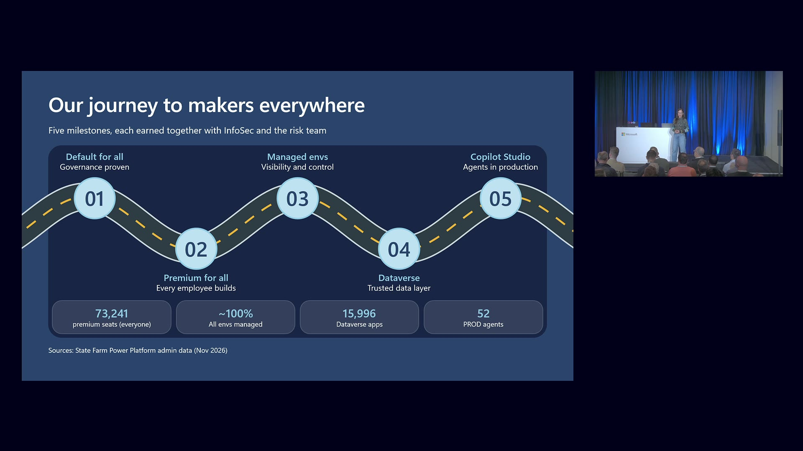
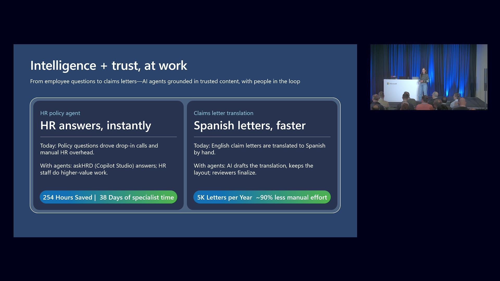
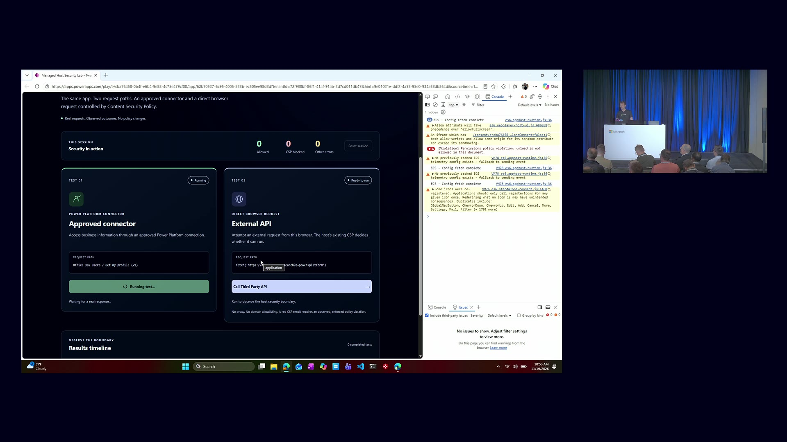
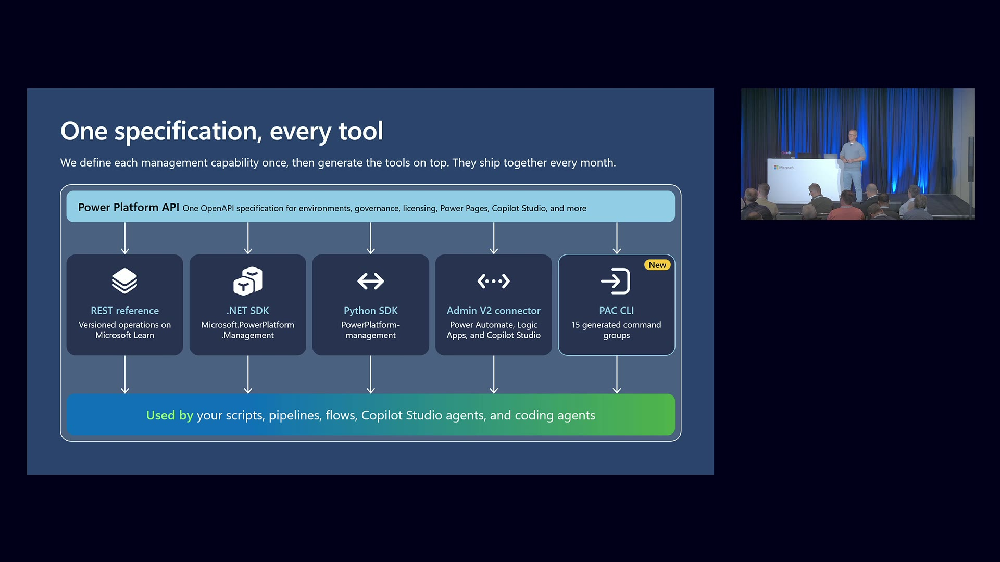

## #drafts-vs-monalisa 01 / Governance Philosophy & Session Theater :: 破除“蒙娜丽莎”管控误区：平衡金融合规与全员创新的第一性原理 || Escaping the "Mona Lisa" Trap: Balancing Financial Compliance with Grassroots Innovation

金融机构推进智能体规模化时，最大的制度阻力往往源于把“早期探索草稿”与“核心生产系统”混为一谈 [1]。微软平台治理、安全与成本管理负责人 Zohar Raz 在开场用五百年前的绘画作比：过去企业交付软件如同委托达·芬奇耗费三年精雕细琢一幅《蒙娜丽莎》；如今借助自然语言，任何业务人员在协同画布或 Copilot Studio 中几分钟就能生成应用、工作流与智能体——其中极少数会沉淀为关键业务资产，绝大多数只是验证想法的随手草稿 [1]。如果安全团队把每一份个人草稿都当作传世画作严防死守、未审先封，过高的合规摩擦力只会彻底冻结内部创新 [1]。 || Financial institutions scaling AI agents routinely stall when security teams treat early personal prototypes identically to core banking systems [1]. Opening BRK473, Zohar Raz contrasted software engineering five centuries apart: building an application once resembled commissioning Leonardo da Vinci for three years to paint a single *Mona Lisa*, whereas natural language now lets every employee generate apps, workflows, and agents in minutes—most remaining disposable drafts while a select few mature into enterprise assets [1]. Monitoring and blocking every personal draft like a *Mona Lisa* introduces paralyzing friction [1].

本次大会为平台家族补齐了两块更具自主性的拼图：一是支持在协同画布、代码标签页或 Copilot Studio 中纯靠自然语言构建微应用的**托管运行时应用（Copilot Managed Runtime Apps）**，二是驱动长周期任务编排的**微软智能体线束（Microsoft Copilot Harness）** [1]。多位全球企业平台负责人在开场实录中复盘了共同踩过的深坑：早期放任创作者涌入共享的“默认环境（Default Environment）”，短短两三年就会演变为缺乏边界的“西部荒野”，大量原本服务个人的应用和流程在IT毫不知情时悄然变成了业务命脉 [1]。治理本质上是一门关乎人的工程——唯有把可见性、连接器护栏与环境自动路由铺设成最顺手、最省力的默认道路，一线员工才不会绕道寻找非受控工具 [1]。 || Two agentic additions expand the platform surface at Ignite: **Copilot Managed Runtime applications** built purely via natural language across Cowork, Code tab, or Copilot Studio, alongside the **Microsoft Copilot Harness** for agent orchestration [1]. Customer platform leads opening the session recalled a shared cautionary tale: letting makers pile into the shared Default Environment created a multi-year "Wild West" where personal productivity flows quietly became business-critical outside IT's line of sight [1]. Governance succeeds as a people business—when the governed path is the easiest path, makers walk it willingly instead of seeking workarounds [1].

下方交互导览台内嵌了 BRK473 官方 47 分钟点播流、原版课件直链以及按双语逐字稿逐分钟校核的五幕核心时间轴，点击顶部标签即可分段检索 State Farm 案例数据与三场实机演示细节 [1][2]： || The interactive theater below embeds the official 47-minute BRK473 Medius video stream, official slide deck link, and five WebVTT-verified chapter digests spanning the State Farm case study and three live admin walkthroughs [1][2]:

:::sandbox { id: "brk473-video-theater", canvas: false, script: "./brk473-session.js", style: "./brk473-session.css", title: "Ignite 2026 [BRK473] 官方点播视频与五幕逐字稿时间戳导览 || Ignite 2026 [BRK473] Official On-Demand Stream & Five-Chapter VTT Navigator", desc: "支持一键加载微软官方 Medius 播放器、查阅原版课件，或按时间轴跳转检索 State Farm 54 个生产智能体、SQL OAuth 策略、托管主机拦截与 10 美元自建管控台演示。 || Load the official Medius stream inline or jump across timestamped highlights covering State Farm's 54 production agents, SQL OAuth rules, Managed Host blocking, and the $10 Cowork admin portal." }
纯静态议题点播导览沙盒：内置 BRK473 官方高清封面、内嵌视频开关及五幕精确到秒的实录提要。 || Pure static session theater featuring the official BRK473 HD poster, on-demand player toggle, and second-accurate transcript digests.
:::

## #state-farm-case 02 / State Farm Deep Dive :: State Farm 实战拆解：73,241 席位、阶梯式培育与四级点数池 || State Farm Case Study: 73,241 Builder Seats, the Maker Ladder, and Four-Tier Credits

作为美国规模最大的财产与意外伤害保险公司之一，State Farm 每天处理海量车险事故与冰雹灾害理赔，直面极度严苛的安全、隐私与保险监管 [1]。工程经理 Azsure Dorton 复盘了与信息安全、隐私、合规及法务并肩推进的五步路线：团队先从严控共享与连接器白名单的默认环境起步，有意为全公司每位员工配发高级创作者许可（共 **73,241 个高级席位**） [1][2]。随后平台实现**近 100% 环境受管化**，逐步放开可信数据层（现承载 **15,996 个 Dataverse 应用**），并稳步推开 Copilot Studio [1][2]。就在演讲当天清晨，第 54 个上线申请刚刚获批，全司**生产级智能体达到 54 个**（课件截稿时为 52 个），约 **85% 的员工**日常消费平台应用 [1][2]。 || Insuring millions of US households against auto collisions and hailstorms, property and casualty insurer State Farm operates under stringent security and privacy rules [1]. Engineering Manager Azsure Dorton traced five milestones co-designed with InfoSec, privacy, compliance, and legal [1][2]. The team started in a locked-down default environment limited to core Microsoft 365 connectors, then provisioned **73,241 premium seats** so every employee closest to business friction could build [1][2]. Next came **~100% managed environments**, **15,996 Dataverse apps**, and enterprise-wide Copilot Studio [1][2]. With another approval landing that morning, State Farm reached **54 production agents** (up from 52 at slide lock) while **~85% of employees** consume Power Apps [1][2].

  <article class="brk473-media-card">
    

      
    

    

      BRK473 官方课件实录 · 10:25
      <h4 data-zh="State Farm 全员创作者五步演进里程碑" data-en="Five Milestones Earned Together with InfoSec and Risk">State Farm 全员创作者五步演进里程碑</h4>
      
每一步均与安全合规部门联合验证：覆盖 73,241 个全员高级席位、近 100% 环境受管、15,996 个数据应用及 54 个生产智能体 [1][2]。

    

  </article>
  <article class="brk473-media-card">
    

      
    

    

      BRK473 官方课件实录 · 11:58
      <h4 data-zh="可信内容挂载与人在回路：两大高价值生产标杆" data-en="Intelligence + Trust at Work: Two Production Flagships">可信内容挂载与人在回路：两大高价值生产标杆</h4>
      
人事政策助手月省 254 小时（38 个专家人天）；西语理赔函翻译年处理 5,000 封并自动保留 HTML 排版，人工减负约 90% [1][2]。

    

  </article>

一线创作者围绕真实痛点构建的智能体很快交出了可审计的量化回报 [1][2]。全司调用量最高的 **askHRD 人事政策问答智能体**直接挂载内部规章手册，替代了繁琐的人工热线咨询 [1][2]。该助手**每月稳定节省 254 小时（约合 38 个专家工作日）**，让资深人力专员得以转向绩效辅导与人才梯队建设 [1][2]。另一款**西班牙语信函翻译智能体**最初由业务创作者为市场材料搭建，走红后迅速扩展至车险与财险外发理赔信函 [1][2]。智能体完成初译后会自动按西语版式重排为合规 HTML 结构交由人工终审，**每年处理 5,000 封理赔函并削减约 90% 手工工时**，成为跨部门共享的“翻译即服务”底座 [1][2]。 || Grounding agents in trusted enterprise content with human review delivered rapid, auditable returns [1][2]. First, State Farm's most-used Copilot Studio build—the **askHRD** policy assistant—answers employee handbook inquiries instantly instead of routing drop-in calls to live specialists, **saving 254 hours (roughly 38 specialist workdays) every month** and freeing HR staff for performance coaching and talent strategy [1][2]. Second, a builder originally created a **Spanish letter translation agent** for marketing collateral that expanded to outbound insurance claims correspondence [1][2]. It drafts translations and reformats HTML layouts for Spanish structure before human sign-off, handling **5,000 letters per year with ~90% less manual effort** as a shared "translation-as-a-service" utility [1][2].

:::figure { src: "./media/state-farm-fsi-impact-benchmarks.figure.json", title: "State Farm 受控创作者生态覆盖率、业务减负幅度与微软治理引擎基准（BRK473） || State Farm Governed Adoption, Workload Reduction & Microsoft Admin Engine Benchmarks (BRK473)" }
图 1：汇总 BRK473 官方披露的核心量化里程碑——State Farm 实现近 100% 托管环境覆盖与 73,241 个全员高级席位普及，带动 85% 员工日常使用与 90% 理赔函翻译减负，底层依托微软 50 秒级百万资产盘点引擎 [1][2]。 || Figure 1: Verified BRK473 benchmarks combining State Farm's ~100% managed environment coverage, 73,241 employee seats, 85% app consumption, and ~90% claims translation effort reduction alongside Microsoft's 50-second inventory sync [1][2].
:::

如何让数万名非技术背景的保险员工从“不敢碰”走到产出企业级资产？Azsure 将其提炼为**“阶梯效应（The Laddering Effect）”**与**风险豁免沙盒机制** [1][2]：先用一句直击人心的电梯游说——“想不想每天早点干完活、准点回家陪家人吃晚饭？”点燃个人提效动力；员工在 Agent Academy 与工作坊入门后进入受限的个人环境解决自身琐事，建立信心后自然开始帮团队、帮事业部乃至代表全公司攻坚痛点 [1][2]。最关键的制度设计在于：State Farm 与安全及 AI 治理部门达成协议，**凡在底层个人环境中自建自用的探索项目，一律免除繁琐的额外风险评估文书**；只有当方案成熟、申请晋升至由自动化流水线按需拉起的**虚拟环境集群（Virtual Environment Cluster，含开发、测试与生产三态）**并正式成为 IT 资产时，才触发严格的合规与架构评审 [1][2]。 || How does a regulated insurer guide tens of thousands of employees from curiosity to enterprise-grade software? Azsure credited **the Laddering Effect** paired with a **low-friction risk exemption** [1][2]. Sparking personal motivation first—"Would you like to finish your day earlier to have dinner on time with your family?"—State Farm trains staff via workshops and Agent Academy before placing them in locked-down personal environments to solve individual tasks, naturally laddering up to team, department, and enterprise solutions [1][2]. Crucially, State Farm co-designed an AI intake pattern with InfoSec so **builders experimenting inside lower-level personal environments skip extra risk-assessment paperwork entirely** until a solution matures into an official IT asset promoting into an automated **Virtual Environment Cluster (VEC)** spanning Dev, QA, and Prod [1][2].

针对自今年 6 月起全面转型的按量消耗计费（Copilot Credits），State Farm 率先跑通了清晰的**四级点数预算池架构** [1][2]： || Preparing for the platform's shift toward usage-based Copilot Credits that began in June, State Farm established a **four-tier credit allocation strategy** [1][2]:

| 点数预算层级 || Credit Tier | 对应环境边界 || Environment Scope | 额度拨付规则与治理目标 || Allocation Logic & Governance Goal |
|------|------|------|
| 1. 个人探索池 || Personal | 个人生产力与个人开发环境（PPE / PDE） || Personal Productivity & Dev Environments | 面向每位创作者预先拨付基础启动额度，超额需走增量申请流程，保障全员零门槛日常提效 [1][2] || Upfront baseline allocation for every maker with an exception request path if exceeded [1][2] |
| 2. 培训与创新池 || Innovation | 独立黑客松与 Agent Academy 实训沙盒 || Dedicated Hackathon & Training Environments | 专款承接实训课程与全司黑客马拉松（如 Ignite 当天同步举办的大赛），绝不挤占员工个人或生产项目额度 [1][2] || Isolates workshops and company hackathons so learners never burn personal or production credits [1][2] |
| 3. 开发与验证池 || DEV & QA | 虚拟环境集群（VEC）开发与测试态 || Virtual Environment Cluster Dev/QA Stages | 自动前置配发验证额度免除排队审批，聚焦“把业务问题解决好而非盲目省钱”，随方案成熟动态校准预算 [1][2] || Pre-allocated automatically so builders prove solution quality first, then refine budgets with IT [1][2] |
| 4. 核心生产池 || Production | 硬化生产运行环境（Production VEC） || Hardened Production Runtime Environments | 依托测试与试运行积累的历史消耗基线精准预测峰值，预留采纳增长缓冲水位以保障核心智能体永不断供 [1][2] || Forecasted from historical run telemetry with built-in headroom as enterprise adoption expands [1][2] |

## #green-zone-guardrails 03 / Green Zone & Connector Policies :: 构筑创作者“绿区”：SQL 强制 OAuth 连接器策略与 250 万资产秒级盘点 || Building the Maker "Green Zone": SQL OAuth Connector Guardrails and 50-Second Inventory

承接 State Farm 的实战经验，Zohar Raz 在首场实机演示中展示了金融机构如何在后台搭建“掉进成功坑（Pit of Success）”的创作者绿区——让员工在 IT 雷达全覆盖的安全孤岛中顺畅起步 [1]。微软当前明确建议企业弃用拥挤失序的共享默认环境，全面开启**环境自动路由（Environment Routing）**：就像员工先在个人 OneDrive 里起草文档、定稿后再发往 SharePoint 广播一样，新创作者首次打开 Copilot Studio 时，系统会自动按需为其派生独立的**个人开发环境**，并自动归入管理员指定的**环境组（Environment Group）**，一次性继承组内多达 **50 余项治理规则** [1]。 || Building on State Farm's blueprint, Zohar Raz demonstrated how financial IT teams engineer a "pit of success" **Green Zone** where every maker starts safely on IT's radar [1]. Microsoft now recommends retiring the crowded Default Environment via **Environment Routing**: much like drafting files privately in OneDrive before publishing to SharePoint, a maker opening Copilot Studio for the first time automatically receives an isolated **Personal Developer Environment** routed straight into a designated **Environment Group** governed by roughly **50 configurable rules** [1].

:::figure { src: "./media/fsi-trusted-agent-governance-architecture.figure.json", title: "金融机构智能体三层受控架构：创作者绿区、托管运行时与智能体自管理底座（BRK473） || Financial Services Three-Tier Agent Governance: Maker Green Zone, Managed Host & Agentic Admin Stack (BRK473)" }
图 2：BRK473 完整技术蓝图——顶层用环境路由、SQL OAuth 连接器白名单与工作台状态栏引导构筑创作者绿区，中层以托管主机强制执行 Entra 鉴权、CSP 网络阻断与小时级健康告警，底层通过单一 OpenAPI 规范打通双中心成本治理与 Cowork 自动化运维 [1][3][4]。 || Figure 2: End-to-end BRK473 technical architecture—pairing Environment Routing and OAuth-only SQL guardrails in the top Green Zone with Managed Host CSP runtime enforcement in the middle and OpenAPI-driven Cowork/CLI administration underneath [1][3][4].
:::

在环境组规则库中，最受金融安全团队关注的是全面升级的**高级连接器策略（Advanced Connector Policy）**与内嵌式创作者协同体验 [1][3]： || Inside the environment group gallery, three capabilities directly address financial CISO and maker pain points [1][3]:

1. **1,500+ 连接器动作级裁剪与 SQL 强制 OAuth 鉴权（Ignite 全新发布）**：管理员不仅能默认封禁平台超过 1,500 个外部连接器、仅放行白名单数据源，还能深入单个连接器裁剪具体读写动作；本次大会更全新推出连接认证方式强制约束——例如允许智能体调用 SQL 连接器查询数据，但**强制规定仅限使用 OAuth 身份令牌，严禁使用传统 SQL Server 账号密码等高危鉴权方式** [1]。 || **Action-Level Filtering & Mandatory SQL OAuth (New at Ignite)**: Beyond whitelisting approved sources out of 1,500+ connectors and toggling specific read/write actions, admins can now enforce authentication schemes—allowing SQL connector queries **exclusively via OAuth while blocking legacy SQL Server credential auth** [1].
2. **首登合规确认与状态栏“自助解封”智能体**：创作者首次登录工作台时必须阅读并勾选管理员定制的欢迎须知与合规条款；当创作者在构建界面因触碰连接器策略被拦截时，无需四处打听工单入口——管理员可将微软内部实践的“合规答疑智能体”直接注入 Copilot Studio 的**状态检查栏（Status Pane）**，一步指导创作者如何申请豁免、升级环境或提报自定义连接器 [1]。 || **Mandatory Onboarding Gate & In-Studio Unblock Agent**: First-time makers must acknowledge custom IT terms before building; if a policy blocks a connector, IT can inject a dedicated guidance agent right inside Copilot Studio's **Status** tab to walk builders through exception requests or environment promotion [1].
3. **250 万级全域资产库 50 秒刷新与 MAC 开箱即用防护**：在微软内部 IT 租户承载高达 **250 万个应用、智能体与工作流**的体量下，新版全局资产清单（Inventory）依然实现瞬时加载，资产改名后**仅需约 50 秒即可完成增量同步**，并支持直接按智能体底层线束（如是否采用 Microsoft Copilot Harness）或所调用的具体大模型排序筛查 [1]。同时，回应金融客户“减少繁琐点击”的呼声，微软将托管运行时应用的连接器与外部接口安全策略同步预置进 **Microsoft 365 管理中心（MAC）** 并默认开启，让非平台专职的综合管理员也能开箱即管 [1]。 || **50-Second Sync Across 2.5M Assets & Default-On MAC Guardrails**: Proven on Microsoft IT's own **2.5M-asset** estate, the PPAC Inventory renders instantaneously, reflects asset updates within **50 seconds**, and filters agents by underlying **Copilot Harness** or foundation model [1]. Responding to financial roundtable feedback, Microsoft also brought default-on connector and API security policies for Copilot Managed Runtime apps directly into the **Microsoft 365 Admin Center** [1].

## #managed-host-runtime 04 / Managed Host & Runtime CSP :: 生产运行态硬边界：托管主机 CSP 强拦截、塑封级晋升与小时级告警 || Enterprise Production Runtime: Managed Host CSP Enforcement, Shrink-Wrap ALM, and 1-Hour Alerts

当一线草稿演变为支撑核心理赔或投顾流程的生产软件时，运行态底座决定了首席信息安全官能否安稳入睡 [1]。产品负责人 Austin Laugesen 指出，在生成式编程时代，创作者完全可以用各种顺手工具编写代码，但企业必须为这些软件指定一个自带治理基因的统一宿主——即 **Managed Host（托管主机）** [1][3]。创作者在画布里搭建智能体或微应用时往往根本不会考虑身份鉴权、审计落盘或健康埋点，正是底层的托管主机默默接管了一切：强制校验每一位终端用户的 **Microsoft Entra 授权身份**，自动将全量活动日志实时泵入 **Microsoft Purview** 开启异常行为检测，并在无需创作者手写一行监控代码的前提下原生输出运行健康指标 [1][3]。 || Once a grassroots prototype becomes software the business depends on, runtime infrastructure determines whether CISOs sleep at night [1]. As Austin Laugesen emphasized, makers today build across many tools of choice, making a hardened **Managed Host** essential [1][3]. Even when builders never think about telemetry or auth, the Managed Host enforces **Microsoft Entra** user authentication and sharing checks, streams activity logs into **Microsoft Purview** for anomaly detection, and surfaces operational health metrics out of the box [1][3].

  <article class="brk473-media-card">
    

      
    

    

      BRK473 实机拦截演示 · 38:35
      <h4 data-zh="托管主机运行态实证：放行合规连接器，CSP 当场阻断越权外部 API" data-en="Managed Host Live Proof: Approved Connectors Pass, CSP Blocks Arbitrary APIs">托管主机运行态实证：放行合规连接器，CSP 当场阻断越权外部 API</h4>
      
Austin 使用 GitHub Copilot 与 CLI/SDK 在平台外部编写纯代码应用并部署至托管主机：左侧合规连接器顺畅返回数据，中间违规直连外部未授权接口则被默认内容安全策略实时拦截并在右侧控制台报错 [1][3]。

    

  </article>

为了让台下安全架构师眼见为实，Austin 现场演示了一个极具代表性的攻防场景 [1]：他并未在低代码画布中点选搭建，而是使用 **GitHub Copilot 配合平台 CLI 与 SDK** 在外部编写了一款纯代码应用（Code App），随后将其部署进 Power Platform 托管主机运行 [1]。作为纯代码应用，源码里既调用了受高级连接器策略批准的内部连接器，也写死了直接向外部任意第三方接口发起网络请求的代码 [1]。实机运行结果显示：左侧按钮经用户授权同意连接后每次点击均顺畅拉回业务数据；而每当点击中间按钮试图绕过连接器直连外部接口时，右侧浏览器开发者工具立即刷出红色运行时阻断错误——**托管主机默认启用的高严格度内容安全策略（Content Security Policy，简称 CSP）在运行态直接掐断了一切未经 IT 显式放行的外部网络通信** [1][3]。 || To prove runtime isolation live, Austin showcased an app built *outside* low-code studios using **GitHub Copilot with the platform CLI and SDK**, then deployed to run inside the Power Platform **Managed Host** [1]. Because code-first apps can attempt arbitrary `fetch` calls in source code, Austin wired one button to an approved connector and another to an unapproved external endpoint [1]. Clicking the approved connector succeeded cleanly after Entra consent, whereas every attempt to hit the arbitrary external API threw immediate runtime errors in browser DevTools—blocked cold by the Managed Host's **highly restrictive default Content Security Policies (CSP)** [1][3].

在开发态向生产态跃迁及运行期连续性保障上，平台同步补齐了两项关键工程能力 [1][3]： || Supporting smooth promotion into this runtime and continuous operational resilience, Austin highlighted two companion capabilities [1][3]:

- **解耦创新的“塑封级（Shrink-Wrap）”无感晋升**：在传统解决方案结合 Git 源码控制与部署流水线的基础上，托管运行时引入了默认将“宽松创作者探索”与“硬化生产运行边界”解耦的混合生命周期模型——个人与团队微应用可在单环境内免 IT 介入快速分阶段迭代（预览），而部门与企业级关键资产则按管理员策略跨环境晋升至最小权限的“塑封级”生产目标 [1][2]。 || **Decoupled "Shrink-Wrap" Hybrid ALM**: Pairing classic Git-backed solution pipelines with Copilot Managed Runtime stages, maker innovation stays decoupled from hardened production boundaries—supporting zero-IT in-environment stages (preview) for team builds alongside cross-environment promotion into least-privilege production targets [1][2].
- **1 小时级高灵敏度退化告警与工单直连（秋季预览）**：针对“智能体在生产环境静默故障却无人知晓”的运维盲区，Monitor 监控中心在今秋预览中将服务退化检测延迟大幅压缩至**最快 1 小时内感知**，支持全量监控指标经由 API 开放导出，并允许运维团队直接订阅告警事件——一旦生产智能体异常跌落，自动向值班 **Teams 频道告警或直切一张 ServiceNow 故障工单** [1]。 || **1-Hour Low-Latency Health Alerts & ServiceNow Routing (Preview)**: Answering "if an agent falls over in a forest, will Ops know?", new Monitor previews detect operational degradations in **as little as one hour**, expose all health data over API, and route alert subscriptions straight into **Teams channels or automated ServiceNow tickets** [1].

## #finops-agentic-admin 05 / Dual-Console FinOps & Agentic CLI :: 双中心计费分治与智能体管平台：单一 OpenAPI 规范与 10 美元自建 360 管控台 || Dual-Console FinOps and Agentic Administration: Single OpenAPI Spec and the $10 Power Platform 360 App

进入压轴环节，Zohar Raz 先厘清了金融机构最关心的财务计费转型架构，随后揭晓了被其称为“本届大会最重磅治理变革”的智能体自管理工具链 [1][4]。随着平台从单一固定订阅全面迈向“固定坐席 + 按量消耗”混合模式，两大管理中心的职责边界被清晰切分 [1][2]： || Closing the session, Zohar clarified the platform's dual-console financial model before unveiling what he called Ignite's biggest governance shift: API-first agentic administration [1][4]. As licensing blends fixed seats with usage-based consumption, admin responsibilities split cleanly across two portals [1][2]:

:::comparison { title: "Power Platform 管理中心（PPAC）固定坐席 vs. Microsoft 365 管理中心（MAC）按量点数 || PPAC User Subscriptions (USLs) vs. MAC Usage-Based Billing (Copilot Credits)" }
::versus 固定月费坐席底座：PPAC 许可中心 || Predictable Seat Baseline: PPAC License Hub
### 面向全员日常应用与基础智能体的固定预算包干 || Fixed Monthly Per-User Fee for Everyday Apps, Flows & Basic AI
**Power Platform 管理中心（PPAC）** 的 Licensing 标签页继续作为管理用户订阅许可（USL）与环境级按量订阅绑定的大本营 [1][2]。按人头固定包月计费、成本完全可预测，适合铺开全员日常应用、自动化流与不限次数的常规智能能力 [1][2]。 || The **PPAC License Hub** remains home for managing fixed per-user subscriptions (USLs) and environment billing links—providing predictable, headcount-based "all-you-can-eat" access for everyday apps, flows, and baseline AI [1][2].

::versus 高阶模型弹性算力：MAC 成本管理页 || Elastic Frontier Compute: MAC Cost Management { highlight: true }
### 统一管控 Copilot Credits 点数池，工作台左上角实时显账 || Unified Copilot Credit Policies with Live Top-Left Studio Meter
**Microsoft 365 管理中心（MAC）** 的 Copilot 成本管理页成为全租户分配、限额与治理按量消耗点数（Copilot Credits）的唯一中枢，专供调用最前沿推理模型的构建与运行场景 [1][2]。同时，**Copilot Studio 工作台左上角新增实时点数计价表**，让创作者在动手调试时随时看清自身消耗水位 [1]。 || **MAC Cost Management** under the Copilot tab centralizes Copilot Credit policies and allocations for frontier models, paired with a new **top-left live credit meter inside Copilot Studio** so makers see exact burn while building [1][2].
:::

过去 18 个月里，微软将管理中心内的治理能力全部统一到**单一 OpenAPI 规范**之上，每月同步自动生成五大工具栈 [1][4]。这套工具涵盖版本化 REST 文档、双语言 SDK、Admin V2 连接器，以及本次大会发布的 **PAC CLI（含 15 个自动生成的命令组）** 与 **Cowork 管理员插件** [1][4]。正如 Zohar 所言，“智能体天生热爱命令行”——研发与办公智能体现在无需打开网页菜单，即可直接读取租户态势并执行管理操作 [1][4]。 || Over the past 18 months, Microsoft re-engineered every PPAC governance capability atop **one unified OpenAPI specification** that ships five synchronized tools every month [1][4]. The stack spans versioned REST docs, `.NET` and `Python` SDKs, the `Admin V2` connector, **15 generated command groups in PAC CLI**, and a **Power Platform Admin plugin for Cowork** [1][4]. Because "agents love CLI," coding and productivity agents can now query and administer tenants directly without opening portal menus [1][4].

  <article class="brk473-media-card">
    

      
    

    

      BRK473 官方课件实录 · 42:45
      <h4 data-zh="单一 OpenAPI 规范驱动全栈自动化：每月同步交付五大管理工具" data-en="One OpenAPI Specification, Every Tool: Shipped Together Monthly">单一 OpenAPI 规范驱动全栈自动化：每月同步交付五大管理工具</h4>
      
一次定义环境、治理、许可与 Copilot Studio 管理契约，自动派生 REST 文档、双语言 SDK、Admin V2 连接器及 15 组 PAC CLI 命令 [1][4]。

    

  </article>

在压轴演示中，Zohar 先用协同界面的管理员插件生成全租户周度运行简报（Weekly Digest），汇总智能体消耗与投资回报并一键导出管理层汇报文稿 [1]。紧接着，他拖入顾问专家 Reza 开源至 GitHub 的模板包（`aka.ms/powerplatform360`），让协同插件联动托管运行时与 PAC CLI 自动构建定制管理门户 [1][4]。现场 `/cost` 指令验账显示，整个构建仅耗费约 1,000 词元量级算力（无折扣标价**约 10 美元**）、用时 **10 至 30 分钟**，便产出了超越经典卓越中心工具包（CoE Toolkit）的 **Power Platform 360 管控工作台** [1][4]。管理员不仅能多维下钻检索，还能直接调用 CLI **一键隔离（Quarantine）或删除违规资产**，真正从“只读看表”跨越到可执行治理 [1][4]。 || Zohar's closing live demo illustrated how radically this collapses admin toil [1]. First, invoking the **Power Platform Admin plugin** inside Cowork generated a comprehensive tenant **Weekly Digest**—complete with agent consumption, ROI metrics, and exportable leadership Word or PowerPoint decks [1]. Next, dropping in an open-source prompt archive built by Microsoft's Reza (`aka.ms/powerplatform360`) combined the Cowork plugin with Copilot Managed Runtime and PAC CLI [1][4]. Checking `/cost` live showed that **roughly $10 in undiscounted compute and 10–30 minutes of build time** produced **Power Platform 360**—a custom admin portal richer than the classic CoE Toolkit that goes beyond read-only charts to **quarantine or delete non-compliant assets directly via CLI** [1][4].

:::insight-grid { cols: 2, title: "金融机构周一即可落地的四步可信智能体行动清单 || Four Monday-Morning Actions for Financial Institutions" }
::card 01
### 第一天就拉信息安全与隐私团队共建环境分级 || Co-Design Risk-Tiered Environments with InfoSec on Day One
借鉴 State Farm 经验，切勿等智能体做完再补合规审批；主动向安全与隐私人员普及平台隔离机制，用个人环境豁免低风险试水、用自动化虚拟环境集群严把生产资产关口 [1][2]。 || Bring InfoSec, privacy, and legal in on day one to co-design tiered guardrails—exempting personal learning builds from heavy risk reviews while gating Dev/QA/Prod promotion [1][2].

::card 02
### 开启环境自动路由并下发 SQL OAuth 连接器护栏 || Turn On Environment Routing & OAuth-Only Connector Rules
立即启用环境路由将创作者迁出拥挤的默认环境，利用环境组批量下发高级连接器策略（限制具体动作并强制 OAuth 鉴权），并在状态栏嵌入自助申诉智能体 [1][3]。 || Route makers out of Default into grouped personal environments, enforce action-level and OAuth-only SQL connector policies, and inject unblock guidance in the Studio status pane [1][3].

::card 03
### 选准“低风险、高容量”内部场景点燃阶梯效应 || Spark the Maker Ladder with Low-Risk, High-Volume Work
优先从内部人事制度问答（如月省 38 专家天的 askHRD）或格式标准化文档翻译等低风险高频痛点破局，配合四级点数预算池隔离培训黑客松与生产账单 [1][2]。 || Ignite adoption with low-risk, high-volume internal workflows like policy Q&A or correspondence formatting while isolating hackathon, dev, and prod Copilot Credit buckets [1][2].

::card 04
### 用托管主机兜底运行态，试点 CLI 智能体自管理 || Anchor Production on Managed Host & Pilot CLI Admin Apps
将外部专业代码与低代码资产统一部署至强制执行 Entra 鉴权与 CSP 策略的托管主机，配置小时级健康告警直连工单系统，并下载开源模板体验 10 美元级定制治理门户 [1][3][4]。 || Run pro-code and low-code builds inside Managed Host CSP boundaries with 1-hour ServiceNow alerts, and clone `aka.ms/powerplatform360` to automate tenant governance via PAC CLI [1][3][4].
:::

## 参考资料：官方一手信源与延伸阅读 || References: Official Primary Sources & Further Reading

1. **Zohar Raz, Azsure Dorton & Austin Laugesen (Microsoft Ignite 2026 BRK473)** — https://ignite.microsoft.com/en-US/sessions/1787856645220001EUhq-1791588268917001CGsN | 《Building and governing trusted AI agents in financial services》官方专场录播（Medius 流：`https://medius.microsoft.com/Embed/video-nc/5fd1a5a1-f386-4f89-a525-5b5c39952c4f`）与完整双语 WebVTT 演讲逐字稿（2026-11-19） || Official breakout recording, Medius stream, and full bilingual WebVTT transcript featuring Microsoft and State Farm Insurance (Nov 19, 2026)
2. **Microsoft Ignite 2026 Official Slide Deck (Session BRK473)** — https://medius.microsoft.com/video/asset/PPT/5fd1a5a1-f386-4f89-a525-5b5c39952c4f | 《Building and governing trusted AI agents in financial services》官方演示文稿（涵盖 State Farm 五步演进、askHRD 与西语理赔函量化指标、创作者阶梯、四级点数池及 USL/UBB 双轨对比） || Official session presentation slides covering State Farm's 73,241-seat journey, agent ROI metrics, four-tier credit strategy, and licensing architecture
3. **Microsoft Power Platform Managed Environments, Routing & Advanced Connector Policies** — https://learn.microsoft.com/en-us/power-platform/admin/managed-environment-overview | 微软官方托管环境、个人开发环境自动路由、高级连接器动作级与 OAuth 策略、托管主机内容安全策略（CSP）及 Monitor 告警技术文档 || Official technical documentation on environment routing, action-level OAuth connector rules, Managed Host Content Security Policies, and Monitor health alerts
4. **Power Platform API, PAC CLI Admin & Power Platform 360 Sample App** — https://learn.microsoft.com/en-us/power-platform/admin/programmability-overview-v2 | 单一 OpenAPI 管理规范（`aka.ms/Learn/PowerPlatformAPI`）、PAC CLI 15 组管理命令（`aka.ms/Learn/PACAdmin`）、Cowork 管理员插件及开源示例应用（`http://aka.ms/powerplatform360`）官方指南 || Official documentation for the unified Power Platform OpenAPI spec, PAC CLI admin command groups, Admin V2 connector, and Power Platform 360 sample portal
