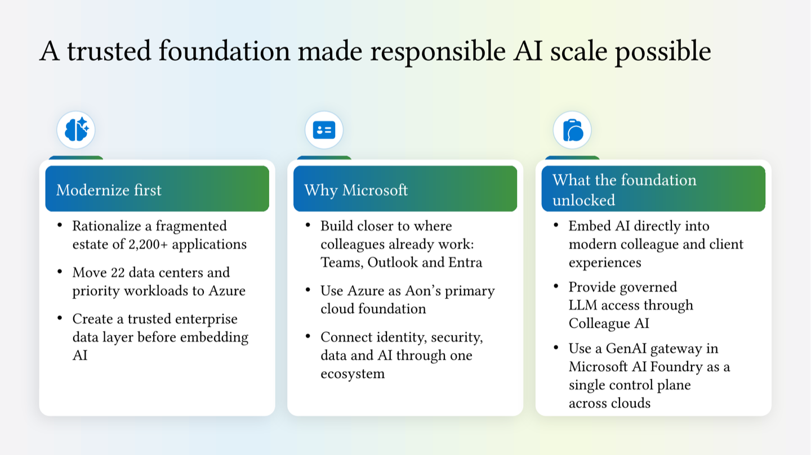
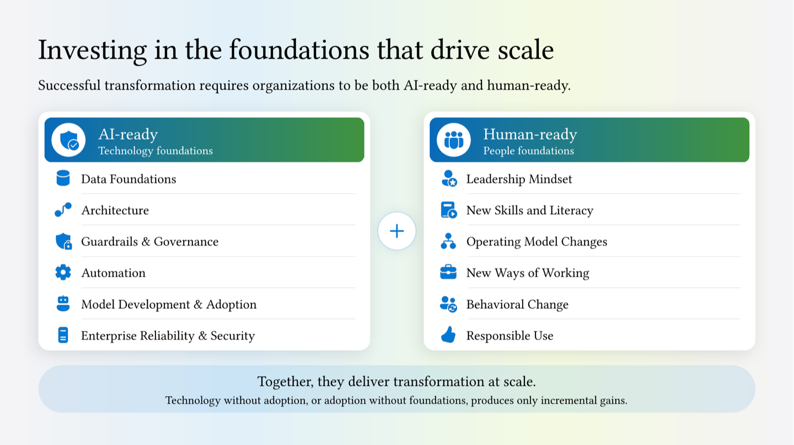
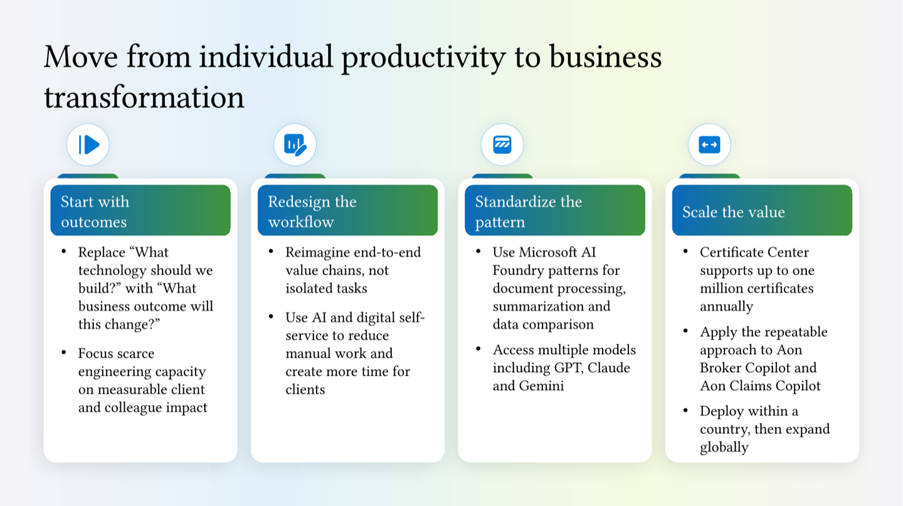
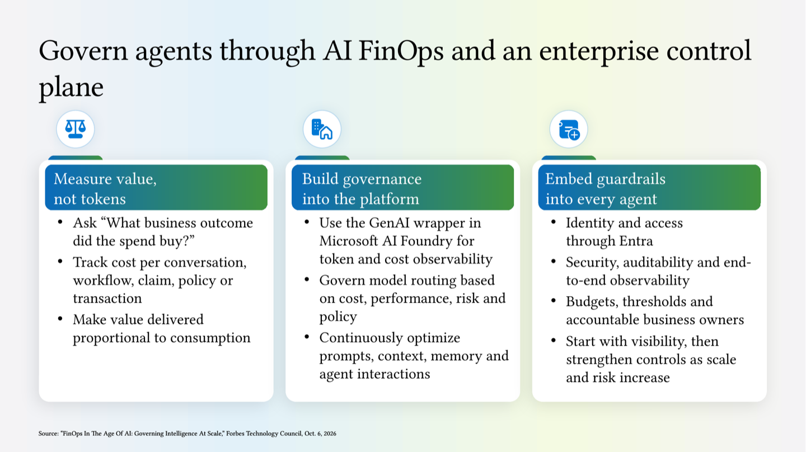

## #megatrends-foundation 01 / Megatrends & Foundation :: 破局逻辑：四大交织风险趋势与 14 亿美元现代化筑底 || Strategic Context: Four Interlocking Risk Megatrends and a $1.4B Foundation

风险顾问行业的客户决策正被贸易、技术、气候与劳动力四股交织放大的结构性力量改写 [1][2]。怡安（Aon）全球首席数据与分析官 Magnus Roe 在开场用超大规模数据中心建设举例：一座算力园区的落地看似属于技术命题，实则同时绑定跨国设备供应链与关税波动、极端天气下的水电灾害敞口，以及建设运维团队的医疗与退休保障方案 [1]。面对环环相扣的复合风险，客户不再接受按传统条线割裂的零散建议，而是要求顾问机构给出跨领域的整体研判 [1]。 || Client decisions in risk advisory are being reshaped by four mutually amplifying forces: trade, technology, weather, and workforce [1][2]. Opening the session, Aon Global Chief Data and Analytics Officer Magnus Roe illustrated this coupling through hyperscale data center construction—a technology project simultaneously exposed to cross-border tariff and supply-chain bottlenecks, severe-weather power and water hazards, and long-term healthcare and retirement planning for specialized staff [1]. Clients navigating compound exposure demanded a connected firm rather than siloed practice lines [1].

过去三年间，怡安实施了内部称为“3×3”的深层组织重构，将全球业务收拢为风险资本（Risk Capital）与人力资本（Human Capital）两大板块，并在底层新建“怡安业务服务（Aon Business Services）”统一引擎 [1]。管理层没有把预算撒向表面炫目的零星试点，而是向最不讨巧却决定上限的数据治理、网络安全、分析平台与应用精简回投了 **13 至 14 亿美元** [1]。这套共享底座让遍布 **150 个国家**的团队彻底告别僵化的三五年长周期规划，转入 6 至 12 个月的敏捷迭代节奏；就在本场演讲当周周一，怡安刚刚完成对 USI 的并购交割，单日顺畅吸纳 **10,500 名新同事**，使全球员工总数从 60,000 人跃升至 **70,000 人** [1]。 || Over the past three years, Aon executed its "3x3" restructuring, aligning global operations around Risk Capital and Human Capital atop a unified engine called **Aon Business Services** [1]. Leadership reinvested **$1.3B–$1.4B** into unglamorous foundational priorities—data governance, security, analytics, and application rationalization [1]. Operating across **150 countries**, Aon replaced static five-year plans with rolling 6-to-12-month execution cycles, enabling the firm to onboard **10,500 new colleagues** from its USI acquisition on the Monday of Ignite week and bring total headcount from 60,000 to **70,000** [1].

下方交互导览台内嵌了 BRK474 官方 50 分钟点播流、原版课件直链以及按 WebVTT 逐字稿校核的五段核心时间轴，点击右侧标签即可分段查阅四位讲者的关键论据与现场问答细节 [1][2]： || The interactive theater below embeds the official 50-minute BRK474 Medius on-demand stream, original PPTX download link, and five WebVTT-verified chapter digests covering every speaker segment and live audience Q&A [1][2]:

:::sandbox { id: "brk474-video-theater", canvas: false, script: "./brk474-showcase.js", style: "./brk474-showcase.css", title: "Ignite 2026 BRK474 官方点播视频与五段逐字稿时间轴导览 || Ignite 2026 BRK474 Official On-Demand Stream & Five-Chapter VTT Guide", desc: "支持一键加载微软官方 Medius 内嵌播放器、下载原版 18 页课件，或按时间轴跳转查阅四大趋势、主数据层、百万证书中心与澳洲灰区治理问答。 || Click to load the official Medius video stream inline, download the 18-slide deck, or browse timestamped highlights across data foundations, Certificate Center, and FinOps Q&A." }
纯静态议题点播导览沙盒：内置 BRK474 官方高清封面、内嵌视频开关与五段精确到秒的实录摘要。 || Pure static session theater featuring the official BRK474 poster, on-demand player toggle, and five timestamped transcript digests.
:::

为什么必须先啃下存量系统现代化的硬骨头？怡安全球数据与智能平台负责人 Sudipto Dasgupta 给出了直接的技术判据：风险顾问的核心资产是数据，一旦在脏乱或割裂的数据源之上强行叠加生成式模型，推理加速只会成倍放大幻觉与错误定价风险 [1]。在向业务流程注入智能能力前，工程团队确立了两条硬指标：先将 **2,200 余套存量应用削减 30%–40%**，再将 **22 座线下数据中心与 80% 的应用负载迁入云端** [1][2]。针对横跨百余个司法管辖区与两条业务主线的现实，怡安放弃了不切实际的“全球单一数据库实例”幻想，转而构建统一的主数据管理与抽象层，将保单、理赔、风险敞口、账单与客户全生命周期沉淀为受治理的战略数据资产 [1]。由于全员日常沟通早已运行在 Teams 与 Outlook 上、身份边界统一由 Microsoft Entra 托管，将 Azure 选作主云底座实现了零断层衔接，同时保留多云弹性 [1][2]。 || Why insist on estate modernization before scaling generative models? Sudipto Dasgupta, Global Head of Data and AI Platforms at Aon, stated the engineering trade-off plainly: in risk advisory, placing generative models atop fragmented or inaccurate records accelerates hallucinations and flawed advice [1]. Before embedding intelligence into core workflows, Aon targeted a **30%–40% reduction across its 2,200+ legacy applications** while migrating **22 data centers and 80% of workloads to the cloud** [1][2]. Recognizing that 150+ jurisdictions and two major solution lines could never collapse into a single monolithic database, Aon built a master data abstraction layer governing policies, claims, exposures, invoices, and client records end to end [1]. Because colleagues already collaborated daily in Teams and Outlook under Microsoft Entra security, selecting Azure as Aon's primary cloud met users in their native flow while preserving multi-cloud flexibility [1][2].

  <article class="brk474-media-card">
    

      
    

    

      BRK474 官方课件 · 第 6 页
      <h4 data-zh="可信底座三步走：先精简迁云，再由单一网关放权" data-en="Trusted Foundation: Estate Rationalization to Single Control Plane">可信底座三步走：先精简迁云，再由单一网关放权</h4>
      
精简 2,200+ 应用并将 22 座数据中心迁入 Azure，通过 Colleague AI 与 Foundry 跨云网关输出受控大模型能力 [2]。

    

  </article>
  <article class="brk474-media-card">
    

      
    

    

      BRK474 官方课件 · 第 11 页
      <h4 data-zh="技术就绪与人的就绪并重：缺一只能换来零敲碎打" data-en="AI-Ready + Human-Ready: Dual Foundations for Scale">技术就绪与人的就绪并重：缺一只能换来零敲碎打</h4>
      
左侧筑牢数据、架构、护栏与企业安全，右侧同步推进管理层认知、岗位技能演进与运营模式重塑 [2]。

    

  </article>

## #three-zone-workforce 02 / Three-Zone Tooling & Activators :: 同事赋能与变革管理：三区分层配权与 2,000 名一线激活师 || Workforce Empowerment: Three-Zone Tooling Strategy and 2,000 Grassroots Activators

早期推进工具普及时，Magnus Roe 团队在 18 个月内收到了全球各地业务部门潮水般的邮件，纷纷索要原本面向专业研发的高阶编程工具权限 [1]。在拥有 70,000 名员工且高阶能力普遍按消耗量计费的体量下，“把所有工具无差别发给所有人”既脱离实际岗位需求，也会瞬间引爆算力账单 [1]。怡安由此确立了“合适角色匹配合适工具”的三区分层治理架构，甚至明确提醒研发工程师不要动用昂贵的代码助手去生成日常演示文稿 [1]。 || Over an 18-month rollout window, Magnus Roe's office was flooded with requests from business units asking for pro-code developer tools [1]. Across a 70,000-person enterprise where advanced runtimes bill on consumption, handing every tool to every employee invites rapid cost overruns [1]. Aon replaced blanket provisioning with a strict "right tool for the right role" **Three-Zone Architecture**, coaching even software engineers not to burn pro-code tokens when drafting routine slide decks [1].

:::figure { src: "./media/aon-ai-control-plane-architecture.figure.json", title: "Aon 企业级三区员工工具矩阵、Foundry 单一网关与主数据底座全景架构 || Aon Three-Zone Workforce Matrix, Foundry Control Plane & Trusted Data Architecture" }
图 1：怡安将 70,000 名同事划分为全员协同、受控低代码与专业工程三个赋能区，中层由构建在 Azure AI Foundry 上的强制性 GenAI Wrapper 统一路由多模型并计量业务成本，底层依托精简后的 Azure 云底座与主数据层保障合规准确 [1][2][3]。 || Figure 1: Aon segments 70,000 colleagues into universal productivity, governed low-code, and pro-code engineering zones, routing every LLM call through a mandatory Azure AI Foundry GenAI Wrapper grounded on rationalized Azure workloads and master data [1][2][3].
:::

三个赋能区各自承担清晰的职责边界与治理策略 [1][2]： || Each of the three colleague zones enforces distinct capability boundaries and cost rules [1][2]:

| 赋能分区 || Tooling Zone | 核心工具栈 || Core Toolstack | 目标人群与典型业务场景 || Target Personas & Scenarios | 成本与治理策略 || FinOps & Governance Rule |
|------|------|------|------|
| 第一区：全员个人生产力 || Zone 1: Universal Productivity | Microsoft 365 Copilot（嵌于 Teams / Outlook / Office） || Microsoft 365 Copilot in Teams, Outlook & Office | 覆盖全公司 60,000+ 名同事的日常邮件处理、会议纪要与客户沟通准备 [1] || 60,000+ colleagues handling daily mail, meeting synthesis, and client prep [1] | 定性为类似 Excel 的现代经营基础设施，不纠结单点微观财务测算，重在全员高频习惯养成 [1] || Treated like Excel as baseline cost of doing business rather than micro-metered per prompt [1] |
| 第二区：属地受控低代码 || Zone 2: Controlled Low-Code | Microsoft Copilot Studio 与 Power Platform || Microsoft Copilot Studio & Power Platform | 排不进全球总部研发队列、但对单一国家至关重要的属地流程（如澳大利亚小型商业险与亲和营销工具）[1][4] || Country-specific workflows outside global engineering queues (e.g., Australia affinity commercial sales) [1][4] | 开放敏捷自建自由度，但预设连接器黑白名单、预算阈值与“勿盲目调用顶配大模型”选型辅导 [1][4] || Grants local autonomy inside strict guardrails, consumption monitoring, and right-sized model coaching [1][4] |
| 第三区：专业工程构建 || Zone 3: Pro-Code Engineering | GitHub Copilot 与 Azure AI Foundry 标准模式库 || GitHub Copilot & Azure AI Foundry Patterns | 全球平台工程师与数据科学家打造企业级核心产品（Certificate Center、Broker Copilot、Claims Copilot）[1][2][4] || Platform engineers building enterprise products (Certificate Center, Broker Copilot, Claims Copilot) [1][2][4] | 强制复用 Foundry 标准模板并经由统一网关上线，按端到端业务产出核算投资回报 [1][2][4] || Enforces reusable Foundry patterns, mandatory gateway routing, and outcome-level ROI tracking [1][2][4] |

在现场问答环节，Magnus Roe 坦诚剖析了第二区（Copilot Studio 低代码创新）的“灰区治理”实战得失 [1]：澳大利亚团队面临本土特有的小型商业险与亲和市场（Affinity Market）销售流程诉求，这类场景无法全球通用，自然排不进 Sudipto 执掌的全球平台研发序列 [1]。借助 Copilot Studio，澳洲团队自主搭起了贴合本地市场的销售与工作流应用；但早期放权时也暴露出典型痛点——缺乏工程训练的业务创作者往往一上来就默认勾选最昂贵的顶配前沿模型，哪怕业务任务本身只需轻量级模型即可胜任 [1]。把可观测性护栏与模型性价比教育同步下沉到一线，成为守住第二区投入产出比的关键一环 [1]。 || During live Q&A, Magnus Roe candidly examined the governance gray areas of Zone 2 low-code innovation [1]. Aon's Australia practice needed localized sales workflows for its small-commercial affinity market—high-value in-country scenarios that could not scale globally and therefore never reached Sudipto's global engineering backlog [1]. Using Copilot Studio, the Australian team built and shipped localized tools rapidly, yet early usage revealed a classic pitfall: business makers instinctively selected the heaviest frontier model even for straightforward tasks [1]. Pairing studio guardrails with hands-on model-sizing education proved essential to keeping Zone 2 ROI healthy [1].

工具配发到位后，真正的瓶颈迅速转移到组织文化与变革管理。Magnus 直言：“即便大模型厂商从今天起不再发布任何新模型，现役模型的能力也足以解决我们 **98%** 的业务场景 [1]。”为了让技术真正落地，怡安摒弃了自上而下单向灌输的网络研讨会，并向全员公开承诺**绝不以裁员缩编为目的推进智能化**——恰恰相反，公司的目标是在不靠堆砌人头的前提下，让 **70,000 名同事创造出 2 至 3 倍的业务增量与营收上限** [1]。董事会与执行委员会全体高管被请进线下教室，手把手打开笔记本电脑完成 Copilot 实操训练；面向基层发起全球志愿者招募时，管理层原本预期仅有两三百人响应，结果**一周之内涌入 2,500 名报名者** [1]。经与微软联合集训后，超过 **2,000 名“AI 激活师（Activators）”** 扎根进全部 **150 个国家**的一线业务团队，既用同事间熟悉的信任关系带教实操，又充当感知员工焦虑或抵触情绪的双向脉搏探针 [1]。 || Once tooling settled, organizational change became the decisive frontier. As Magnus noted candidly, "If model providers never released another model again, current models could already solve **98%** of our scenarios [1]." Rather than relying on top-down webinars—or chasing headcount cuts—Aon publicly committed to **workforce amplification over workforce reduction**, aiming to multiply the business impact of its **70,000 colleagues by 2x to 3x** [1]. Every board director and executive committee member completed in-person, laptop-open Copilot training, while a call for grassroots volunteers—expected to draw a few hundred names—attracted **2,500 sign-ups within a single week** [1]. Co-trained with Microsoft, **2,000 active AI Activators** now sit inside every one of Aon's **150 countries**, coaching peers in daily workflows and feeding ground-level sentiment back to leadership [1].

## #value-chain-redesign 03 / End-to-End Value Redesign :: 从效率工具到业务转型：百万级保险证明中心与 Foundry 模式复用 || From Productivity to Transformation: 1M+ Certificate Center and Foundry Pattern Reuse

个人办公效率提升只是起点，企业级转型的分水岭在于端到端业务价值链重构 [1][2]。在保险经纪业务中，跨国建筑承包商或商业地产集团每当派遣工人进入全球 50 余个国家的施工现场前，都必须查验每位承包方的有效保险证明（Certificate of Insurance，简称 COI）[1]。作为保险经纪人，怡安本身并非单一承保商，每签发一份证明往往需要跨越多家承保人、核对主保单条款与历次批单（Endorsements）[1]。在传统模式下，客户发来邮件申请后，后台人员必须逐封比对保单与批单并手工录入字段 [1]。**单份保险证明平均耗时高达 60 分钟**（复杂跨承保人场景甚至拖延数周），而怡安全球每年需要处理 **超过 100 万份** 此类证明请求 [1][2]。 || Individual productivity gains mark only the starting line; enterprise transformation requires redesigning end-to-end value chains [1][2]. Whenever global construction or real estate clients deploy crews onto job sites across 50+ countries, every contractor requires verified proof of coverage via a **Certificate of Insurance (COI)** [1]. Because Aon coordinates multiple underwriters as a broker, generating one COI traditionally forced back-office staff to read inbound emails and cross-check master policies against endorsements [1]. Manual re-keying consumed **60 minutes per certificate** across a volume exceeding **1,000,000 certificates annually** [1][2].

:::comparison { title: "传统局部自动化思维 vs. Aon Certificate Center 端到端价值链重塑 || Isolated Bot Automation vs. Aon Certificate Center End-to-End Redesign" }
::versus 误区路径：只替后台省键盘的原样自动化 || Legacy Trap: Automating Broken Back-Office Typing
### 保留邮件往返与割裂工序，客户体验零改善 || Preserves Email Queues and Departmental Splits
如果只站在“用技术自动化现有步骤”的视角，团队只会造出一个替代后台专员敲键盘的录入脚本：客户依然要发邮件苦等回复，冗余的内部流转环节原封不动，遇到跨国组织架构差异即刻失灵 [1]。 || Focusing narrowly on automating existing steps merely replaces human keystrokes with a back-office bot while leaving email delays, redundant handoffs, and client friction intact [1].

::versus 怡安路径：以客户数字自助体验倒推全链路重构 || Aon Approach: Client-First Digital Self-Service { highlight: true }
### 对标手机钱包即时亮证，单证交付从 60 分钟压至分钟级 || Apple Wallet-Style Proof in Minutes Across 1M+ Annual Volume
以“如何让企业客户像在 Apple Wallet 里调出车险凭证一样即时获取保险证明”作为业务成果锚点，删减非必要人工中转，用多文档智能解析打通保单与批单核验，将数周或一小时的等待直接压缩至**分钟级自助签发**，同时彻底解放后台运营同事的机械录入负担 [1][2]。 || Anchored on delivering an Apple Wallet-like instant digital proof experience, Aon eliminated manual re-keying, unified multi-underwriter policy checks, and compressed 60-minute turnarounds into **minutes** across 1M+ annual certificates [1][2].
:::

在推进跨国复制时，标准化模式展现出强大的组织拉动力 [1][2]。怡安首先在美国上线了新版 Certificate Center，随后推广至加拿大市场；尽管理赔与证明核发逻辑高度相似，加拿大团队原先却分属两个独立部门——一拨人专管批单审核，另一拨人专管存量保单核对 [1]。借由统一的工作流重设计，怡安顺势弥合了加拿大前后台的部门墙，拉齐了北美作业标准 [1]。 || Scaling Certificate Center across borders also harmonized fragmented operating structures [1][2]. After launching in the United States, Aon expanded to Canada, where two separate teams historically split endorsements from existing policies [1]. Applying the redesigned workflow brought both Canadian groups onto one unified process matching the US standard [1].

在底层技术实现上，Sudipto 团队拒绝让每个项目组“各自重复造轮子”——哪怕全球各地的优秀工程师天然偏爱从零手写专属架构 [1]。团队将“读取多份非结构化文档 → 交叉比对条款差异 → 抽取转换为结构化数据”的共性链路沉淀为 **Microsoft AI Foundry（Azure AI Foundry）中的标准化可复用组件**，底层按需灵活接入 GPT、Claude 与 Gemini 等多家族模型 [1][2]。这一套经过生产验证的文档解析与核对模式，随后被快速复用到 **Aon Broker Copilot（经纪人助手）** 与 **Aon Claims Copilot（理赔助手）** 等核心业务产品中，真正兑现了“一处构建、全球多线复用”的复利提速 [1][2]。 || Beneath the application surface, Sudipto's platform group countered engineers' natural instinct to build bespoke stacks from scratch [1]. They codified the recurring pipeline—ingesting multiple documents, cross-comparing clauses, and extracting structured records—into **reusable Azure AI Foundry patterns** backed by multi-model access across GPT, Claude, and Gemini [1][2]. Once hardened on Certificate Center, those exact document-intelligence and comparison templates transferred directly into **Aon Broker Copilot** and **Aon Claims Copilot**, accelerating delivery velocity with each subsequent country rollout [1][2].

:::figure { src: "./media/aon-transformation-impact-metrics.figure.json", title: "Aon 现代化精简、证书中心压缩率与全球激活师覆盖实测进展 || Aon Estate Rationalization, Certificate Turnaround Compression & Global Activator Reach" }
图 2：汇总 BRK474 官方实录与课件披露的五项核心量化进展——涵盖 80% 核心应用上云、30%–40% 存量应用压降、单份保险证明耗时从 60 分钟压缩至分钟级、150 国激活师全覆盖，以及现役模型对 98% 业务场景的支撑度 [1][2]。 || Figure 2: Five verified transformation milestones from BRK474—80% cloud workload migration, 30%–40% app estate reduction, 60-minute-to-minutes certificate compression across 1M+ annual requests, 100% activator coverage across 150 countries, and ~98% scenario readiness on current models [1][2].
:::

## #finops-control-plane 04 / AI FinOps & Control Plane :: 规模化治理与 AI FinOps：GenAI Wrapper 单一控制面与成果账本 || Governed Scale & AI FinOps: The Mandatory GenAI Wrapper and Outcome Economics

当大模型供应商每隔一两天就推送新版本或调价、而企业又身处强监管的金融与保险顾问赛道时，传统的云成本核算体系彻底失效 [1][3]。Sudipto 在演讲中指出了词元经济学（Tokenomics）的核心痛点：过去虚拟机按规格计价、数据库按存储行数计价，成本边界一目了然；如今不同模型与不同云厂商之间的词元计费规则高度模糊，若不加约束极易失控飙升，但若把逐次计算词元账单的包袱甩给一线业务研发团队，又会严重拖慢交付节奏并偏离业务目标 [1][3]。 || When model providers ship updates every other day inside a heavily regulated industry like insurance advisory, classic cloud cost accounting breaks down [1][3]. Sudipto pinpointed the core friction of enterprise tokenomics: unlike predictable virtual-machine SKUs or database row counts, token pricing varies opaquely across models and clouds [1][3]. Unchecked consumption spirals rapidly, yet forcing every product squad to manually calculate per-run token math paralyzes delivery [1][3].

:::flow { title: "Aon 企业级智能体与大模型治理的四道刚性防线 || Four Architectural Pillars of Aon's AI FinOps and Control Plane" }
1. **强制单一入口：绕过 GenAI Wrapper 网关一律禁发生产 || Mandatory Single Gateway: Zero Path to Production Outside GenAI Wrapper** — 怡安与微软在 Azure AI Foundry 中联合打造了名为 **GenAI Wrapper** 的企业级单一控制面网关 [1][2][4]。无论来自研发编程场景、Certificate Center 还是 Broker / Claims Copilot，全公司任何触发词元消耗的大模型调用及跨云路由都必须穿过该网关；**凡绕过网关的应用一律阻断生产环境发布通道** [1]。 || Co-engineered with Microsoft inside Azure AI Foundry, the **GenAI Wrapper** serves as Aon's single pane of glass across clouds [1][2][4]. Every agent or coding tool invoking an LLM must route through this gateway; **any workload that bypasses the gateway has zero path to production deployment** [1].
2. **动态策略路由：按成本、性能、风险与合规四维分配算力 || Policy-Driven Model Routing: Balancing Cost, Performance, Risk & Policy** — 中心平台实时采集各应用在不同云与模型上的词元吞吐，优先保障高业务放大效应产品的算力配额 [1][2]。系统在逼近预算预测红线前自动触发预警，同时持续调优提示词、上下文与记忆开销 [1][2]。 || Central telemetry tracks token flow per application and cloud to guarantee capacity for highest-impact business products [1][2]. Forecast overruns trigger early alerts while teams continuously optimize prompts, context windows, and memory [1][2].
3. **按业务成果记账：核算单笔保单与理赔成本而非碎片词元 || Measure Value, Not Raw Tokens: Cost per Policy, Claim, or Certificate** — 财务治理从追问“烧了多少词元”转向追问“这笔开销买回了什么业务结果” [2][3]。第一区办公助手按基础经营成本管理，第二区与第三区则精确核算**单次对话、工作流、理赔、保单或保险证明**的单位履约成本 [1][2]。 || Shifting from raw token counts to business outcomes, Aon treats Zone 1 Copilot as baseline operating infrastructure [1][2][3]. Zone 2 and Zone 3 workloads roll gateway telemetry into unit economics—tracking cost **per conversation, workflow, claim, policy, or transaction** [1][2].
4. **内生安全护栏：Entra 身份绑定、责任人问责与分级收紧 || Embedded Agent Guardrails: Entra Identity, Budgets & Accountable Owners** — 每一个上线的智能体均原生继承 Microsoft Entra 身份与最小权限控制、全链路审计留痕及明确挂名的业务预算责任人；治理策略遵循“先拉通全局可见性，再随规模与风险等级逐步收紧管控”的演进节奏 [2][3]。 || Every production agent inherits Microsoft Entra identity, end-to-end auditability, budget thresholds, and an accountable business owner—starting with full visibility before tightening controls as scale and risk grow [2][3].
:::

  <article class="brk474-media-card">
    

      
    

    

      BRK474 官方课件 · 第 9 页
      <h4 data-zh="从个人提效迈向业务转型的四步标准打法" data-en="Four-Step Playbook from Productivity to Business Transformation">从个人提效迈向业务转型的四步标准打法</h4>
      
以可衡量的客户与同事成果替换技术导向提问，依托 Foundry 多模型模式支撑百万份证书并向经纪与理赔扩展 [2]。

    

  </article>
  <article class="brk474-media-card">
    

      
    

    

      BRK474 官方课件 · 第 13 页
      <h4 data-zh="AI FinOps 与企业控制面：按单笔理赔与保单度量价值" data-en="AI FinOps & Control Plane: Governing Intelligence at Scale">AI FinOps 与企业控制面：按单笔理赔与保单度量价值</h4>
      
引自 Sudipto 发表于福布斯技术理事会的方法论：通过 Foundry 封装层统一观测词元，确保算力消耗与业务回报成正比 [2][3]。

    

  </article>

## #enterprise-playbook 05 / First-Principles Playbook :: 企业实战启示录：告别千个零散试点，做对开局三件事 || Enterprise Playbook: Escaping POC Purgatory by Getting Three Fundamentals Right

复盘 ChatGPT 掀起浪潮之初的决策分岔口，Magnus Roe 坦言怡安也曾险些掉进“撒胡椒面式立项成百上千个概念验证（POC）、往墙上乱扔方案看哪个能粘住”的行业通病 [1]。面对台下追问“外部世界变化太快，定义业务成果会不会追不上靶心移动”，两位负责人给出了极具实操价值的跨职能处方 [1][2]： || Reflecting on the early generative AI wave, Magnus Roe noted that Aon nearly fell into the industry trap of launching hundreds of disconnected proofs of concept just to see what might stick [1]. Addressing audience questions on how to define business outcomes when technology targets move monthly, the speakers distilled four battle-tested execution rules [1][2]:

:::insight-grid { cols: 2, title: "Aon 给大型受监管企业的四条一线落地铁律 || Four Field-Tested Rules for Regulated Enterprises" }
::card 01
### 先做战略取舍，用六个月路线图小步快跑 || Place Differentiated Bets & Ship with 6-Month Roadmaps
彻底剥离技术术语来定义客户能力：区分哪些领域必须构建竞争对手没有的差异化壁垒、哪些落后环节只需追平行业基准、哪些非核心地带可以主动让渡 [1]。放弃耗时三四年的“大爆炸式完美发版”，像交付风险分析器（Analyzers）套件一样快速推出首版并同步向客户公开未来 6 个月演进路线图，在高频迭代中建立客户信任 [1]。 || Define client capabilities without mentioning technology: decide where to differentiate to win, where merely to reach parity, and where to cede ground [1]. Replace multi-year "big-splash" releases with rapid iterations paired with transparent six-month client roadmaps [1].

::card 02
### 重金投入“不性感”的数据底座与主数据治理 || Fund the Unglamorous Data & Security Foundation
舞台聚光灯往往偏爱炫酷智能体演示，但真正决定规模化上限的是应用精简、云端迁移与主数据抽象层 [1][2]。没有三年 13–14 亿美元对存量孤岛的清洗打通，任何上层智能应用都会在跨国推广时撞上数据失真与合规红牌 [1]。 || Stage demos spotlight flashy agents, yet scale depends on application rationalization, cloud migration, and master data management [1][2]. Without Aon's $1.3B–$1.4B cleanup of fragmented silos, downstream copilots would stall on untrusted data and regulatory blocks [1].

::card 03
### 把法务、合规、人力与运营拉进中基层同一间屋子 || Connect Multidisciplinary Teams Two Rungs Down
高管层在会议室里点头微笑很容易，往下走两三个层级却往往还是互不往来的部门孤岛 [1]。必须从立项第一天就把业务、后台运营、人力资源、法务与合规团队编入同一支跨职能战队，在下沉执行层提前排雷，而不是把合规痛点拖到上线前夕才被动返工 [1]。 || Executive alignment at the top means little if teams two or three rungs down remain siloed [1]. Bring business, operations, people org, legal, and compliance into a single multidisciplinary squad on day one rather than discovering regulatory roadblocks months later [1].

::card 04
### 回答“这对我有什么好处”，把人与技术合成一张蓝图 || Answer "What's In It for Me?" Inside One Unified Strategy
切忌把技术路线图与人才战略拆成两份各写各的文件 [1][2]。当员工还在问“公司围绕 AI 做了什么”而非“我们为客户构建了什么新能力”时，说明转型尚未真正内化；唯有通过透明沟通、岗位重塑培训与一线激活师陪伴，清楚回答每位使用者自身的获益，技术潜能才能转化为真实的业务胜势 [1][2]。 || Never run separate technology and people strategies hoping they align by chance [1][2]. Combine transparent communication, role-evolution training, and local activators to answer what each individual gains—turning AI from a buzzword into measurable client decisions [1][2].
:::

## 参考资料：官方一手信源与延伸阅读 || References: Official Primary Sources & Further Reading

1. **Alex Knizhnik, Sudha Kumar, Magnus Roe & Sudipto Dasgupta (Microsoft Ignite 2026 BRK474)** — https://ignite.microsoft.com/en-US/sessions/1787856645372001Euij-1791588243916001CFOX | 《Modernization to AI transformation: How Aon enables better decisions》官方 50 分钟专场录播（Medius 流：`https://medius.microsoft.com/Embed/video-nc/7b1b7044-629b-46dd-a33c-8a3b7bcc3631`）与完整双语 WebVTT 演讲逐字稿（2026-11-19） || Official 50-minute breakout recording, Medius video stream, and full WebVTT transcript (Nov 19, 2026)
2. **Microsoft Ignite 2026 Official Slide Deck (Session 474)** — https://medius.microsoft.com/video/asset/PPT/7b1b7044-629b-46dd-a33c-8a3b7bcc3631 | 《Modernization to AI transformation: How Aon enables better decisions》官方原版 18 页演示文稿（涵盖四大交织趋势、2,200+ 应用精简、百万级保险证明中心、技术与人才双底座及财务治理控制面架构） || Official 18-slide presentation deck covering megatrends, estate modernization, Certificate Center, and enterprise financial governance control plane
3. **Sudipto Dasgupta (Forbes Technology Council)** — https://www.forbes.com/councils/forbestechcouncil/ | 《FinOps In The Age Of AI: Governing Intelligence At Scale》（2026 年 10 月 6 日发表，BRK474 官方课件第 13 页引用之企业级词元治理与业务价值归因框架） || Enterprise AI FinOps framework cited on BRK474 Slide 13 for governing token economics and outcome attribution (Oct 6, 2026)
4. **Microsoft Azure AI Foundry & Copilot Studio Documentation** — https://learn.microsoft.com/en-us/azure/ai-foundry/ | 企业级生成式 AI 网关路由、多模型统一评测、Microsoft Entra 身份集成与 Copilot Studio 受管环境治理技术文档 || Official technical documentation on enterprise model routing, token observability, Entra identity guardrails, and governed low-code agents
