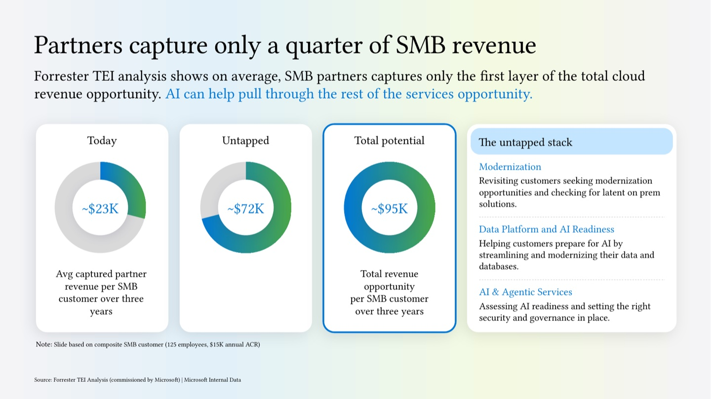
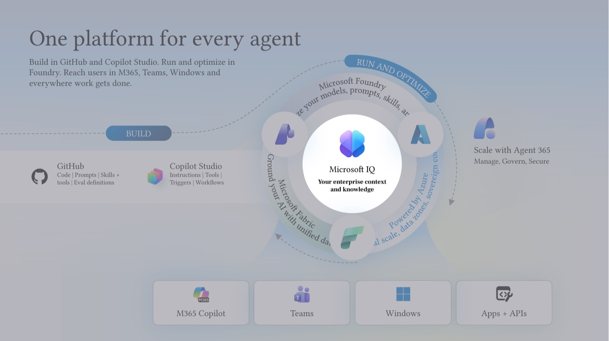
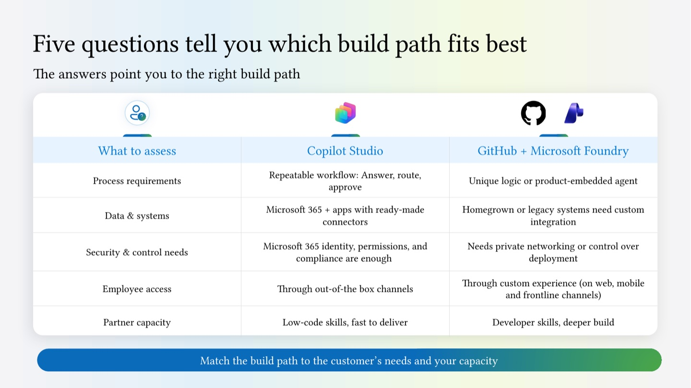
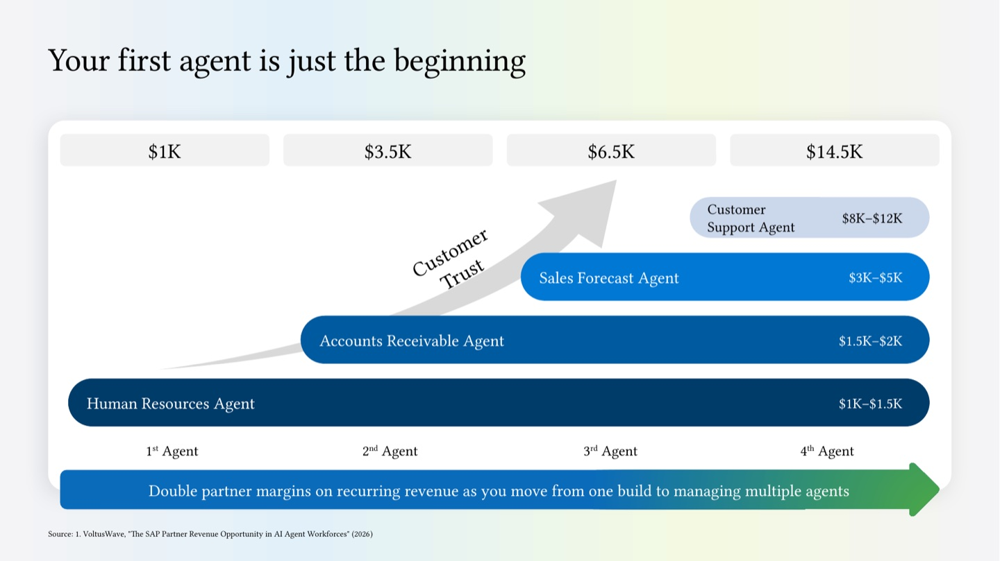

## #market-gap-video 01 / Market Gap & Session Theater :: 市场破局：7.2 万美元中小企业服务缺口与官方点播时间轴剧场 || Market Imperative: The $72K SMB Services Gap and Official Session Theater

中小企业已经跨过人工智能概念观望期，正迫切寻求可量化的业务结果 [1]。微软中小企业与渠道全球总监 Naila Byrne 在 BRK487 开场披露了四组合作伙伴真实交付数据：DEMV 基于 Microsoft Foundry 搭建的多智能体平台令周活跃用户增长 65%，且 70% 的对话直接完成实际业务办理；Bespoke 部署 Copilot Studio 智能体每周为团队节省 7–10 小时，推动赢单率提升 20% 以上；CallRevu 为 5,000 余家汽车经销商提供通话洞察，线索转化率提高 15%；Qualiserve 结合 Microsoft Fabric 与 Foundry 模型，每分钟处理高达 500 万份税务文档 [1]。 || Small and midsize businesses have moved past experimentation and now demand measurable operational outcomes [1]. Opening BRK487, Naila Byrne cited four live partner deployments: DEMV grew weekly active users by 65% on a Microsoft Foundry multi-agent platform where 70% of chats complete real work; Bespoke lifted win rates by over 20% while saving 7–10 hours weekly in Copilot Studio; CallRevu boosted lead conversion by 15% across 5,000+ auto dealerships; and Qualiserve processes 5 million tax documents per minute using Azure OpenAI in Foundry Models with Microsoft Fabric [1].

然而大多数渠道伙伴仍将自己局限于薄利的许可证转售商角色 [1][2]。微软委托 Forrester 针对一家拥有 125 名员工、年均 Azure 消耗额（ACR）15,000 美元的典型中小企业建模发现：三年周期内该客户可为合作伙伴贡献约 **95,000 美元**总收入，但当前伙伴平均仅捕获第一层云转售的 **23,000 美元**（约占四分之一）[1][2]。剩余 **72,000 美元**无人认领的高毛利需求集中在三大层级：存量本地系统现代化改造、数据平台流线化与治理就绪，以及智能体安全评估与托管运营 [1][2]。下方交互导览台内嵌了 BRK487 官方点播视频流、四幕时间轴精华与原版课件下载入口 [1]： || Yet most channel partners still confine themselves to thin-margin license resale [1][2]. Forrester's Total Economic Impact analysis of a composite 125-employee SMB ($15,000 annual Azure consumed revenue) shows a **~$95,000** three-year partner opportunity, of which partners capture only **~$23,000** today [1][2]. The remaining **~$72,000** sits unclaimed across application modernization, data platform readiness, and governed agentic services [1][2]. The interactive theater below embeds the official Medius on-demand stream, four timestamped chapter digests, and original slide deck links [1]:

:::sandbox { id: "brk487-video-theater", canvas: false, script: "./brk487-showcase.js", style: "./brk487-showcase.css", title: "BRK487 官方点播视频与四幕时间轴导览台 || BRK487 Official On-Demand Stream & Timestamped Chapter Theater", desc: "按需加载微软 Medius 官方录播流，切换查阅 Naila Byrne、Jayden Lee 与 RSM 嘉宾在四大章节的核心论据与问答实录。 || Mount the official Microsoft Medius stream on demand and switch across all four timestamped acts featuring Naila Byrne, Jayden Lee, and RSM US LLP." }
纯静态点播导览沙盒：内置官方高清封面图、按需挂载视频播放器、四幕逐分钟纪要与原版 PPTX 直链。 || Pure static session theater with official thumbnail, on-demand iframe mount, timestamped chapter notes, and direct PPTX download.
:::

为何在微软生态构建智能体业务无需从零冷启动获客 [1][3]？因为目标客户每天的工作流早已长在微软底座之上：全球商业办公席位已突破 **4.5 亿**（2026 财年第二季度财报口径），Teams 月活跃用户达 **3.2 亿**，付费办公助手席位达 **2,000 万** [1][3]。演讲逐字稿进一步补充了幻灯片之外的两项关键增速：全平台月活跃智能体使用量在年内飙升 **6 倍**，而 Microsoft Foundry 企业客户数已突破 **120,000 家**，同比收入翻了 **3 倍**，其中中小企业贡献了极为强劲的增长势能 [1]。 || Why can partners launch an agent practice on Microsoft without customer-acquisition cold starts [1][3]? Customers already live inside the ecosystem across **450M+** commercial Microsoft 365 seats, **320M** Teams monthly active users, and **20M** Microsoft 365 Copilot seats [1][3]. Beyond the slide numbers, Byrne revealed in the live talk that monthly active agent usage grew **6x** year-to-date, while Microsoft Foundry surpassed **120,000 customers** and tripled revenue year-over-year with surging SMB adoption [1].

  <article class="brk487-media-card">
    

      
    

    

      BRK487 官方课件 · 第 3 页
      <h4 data-zh="Forrester 中小企业三年单客收益冰山（23K 与 72K 美元对比）" data-en="Forrester 3-Year SMB Revenue Iceberg (USD 23K Captured vs. 72K Untapped)">Forrester 中小企业三年单客收益冰山（23K 与 72K 美元对比）</h4>
      
以智能体为牵引锚点，顺势拉动老旧本地系统上云、数据库治理与安全护栏建设三层服务收入 [1][2]。

    

  </article>
  <article class="brk487-media-card">
    

      
    

    

      BRK487 官方课件 · 第 6 页
      <h4 data-zh="构建、运行优化与规模治理的一体化平台环" data-en="One Platform to Build, Optimize, and Scale Every Agent">构建、运行优化与规模治理的一体化平台环</h4>
      
左侧以 GitHub 与 Copilot Studio 承接构建，中心以 Microsoft IQ 汇聚企业知识，外环由 Foundry、Fabric、Azure 与 Agent 365 闭环治理 [1]。

    

  </article>

## #platform-iq 02 / Microsoft IQ & Stack :: 架构底座：Microsoft IQ 五源上下文、角色分工与合作伙伴三层抓手 || Platform Architecture: Microsoft IQ Context Layer, Persona Alignment, and Partner Levers

搭出一个演示原型只需几小时，但交付可跨数十家客户复用的生产级智能体，必须同时解决企业数据挂载、跨系统权限边界、持续性能调优与多租户安全治理四大工程难题 [1]。微软将这套全栈架构浓缩为以 **Microsoft IQ** 为圆心的协同底座：由生产力工作流脉络（Work IQ）、Microsoft Fabric 统一业务数据（Fabric IQ）、非结构化文档与多模型知识（Foundry IQ）、实时外部商业信号（Web IQ）以及客户现用第三方业务系统（3rd-Party IQ）五股数据流交汇，共同为每家企业锻造独一无二的受管组织上下文——即 **Customer IQ** [1]。 || Prototyping a chatbot takes hours, whereas shipping a repeatable production solution across dozens of accounts demands governed enterprise data grounding, permission boundaries, continuous tuning, and fleet security [1]. Microsoft anchors this stack around **Microsoft IQ**: five context streams—Work IQ (productivity workflows), Fabric IQ (operational data), Foundry IQ (unstructured data), Web IQ (live world signals), and 3rd-Party IQ (existing line-of-business systems)—converge into a governed **Customer IQ** unique to each organization [1].

:::figure { src: "./media/csp-partner-agent-architecture.figure.json", title: "CSP 合作伙伴智能体全栈平台与双轨构建路径全景图 || CSP Partner Agent Platform & Dual Build Paths Topology" }
图 1：依据 BRK487 第 6–12 页课件重构的三层业务拓扑——顶层通过五大 IQ 汇聚客户专属知识，中层经由五问评估矩阵分流至托管速赢（Path A）或代码级深度集成（Path B），底层打通内建办公入口、Agent 365 安全治理与经常性账单运营 [1]。 || Figure 1: Three-tier topology reconstructed from BRK487 Slides 6–12—unifying five Microsoft IQ streams on top, routing customer scenarios via the five-question matrix into Path A or Path B in the middle, and anchoring built-in distribution, Agent 365 governance, and CSP billing underneath [1].
:::

面对多样化的构建工具，合作伙伴的核心价值在于消除客户的“选型决策疲劳”，坚持从业务结果而非技术名词出发匹配入口 [1]。信息工作者个人搭建看板、追踪表与轻量微应用，可直接使用自然语言驱动的办公助手代码画布；业务部门负责人与信息技术主管改造明确的跨团队审批及问答流程，首选受管低代码平台 Copilot Studio；而专业研发团队攻坚复杂业务逻辑、沉淀自有知识产权并纳入软件开发生命周期流水线时，则采用 GitHub 与 Microsoft Foundry 组合 [1]。围绕这一底座，合作伙伴可抓住三项高毛利服务入口 [1]： || Partners earn trust by eliminating technology decision fatigue and starting strictly from business outcomes [1]. Information workers building personal trackers use natural-language Copilot app creation; business and IT decision-makers automating defined processes turn to Copilot Studio; and professional developers creating custom agent IP with full software lifecycle rigor pair GitHub with Microsoft Foundry [1]. Across this stack, partners monetize three distinct value layers [1]:

:::insight-grid { cols: 3, title: "基于 Microsoft IQ 加速智能体业务的三大合作伙伴抓手 || Three Partner Practice Levers on the Microsoft IQ Platform" }
::card 01
### 承揽端到端智能体交付与治理 || Own End-to-End Agentic Delivery
包揽从前期场景诊断、最优多模型选型与路由策略、人机审批边界设定到 Agent 365 上线安全合规的全生命周期专业服务 [1]。 || Deliver full-lifecycle services spanning scenario discovery, multi-model routing, human-in-the-loop boundaries, and Agent 365 governance [1].

::card 02
### 为客户锻造受管的“Customer IQ” || Build the Governed “Customer IQ”
盘点客户散落在本地旧库、电子表格与异构软件中的暗数据与制度流程，通过 Fabric 与连接器清洗沉淀为智能体随时可读写的专属上下文底座 [1][2]。 || Modernize fragmented on-premises databases, handbooks, and workflows into a clean, permission-aware Customer IQ layer via Fabric and connectors [1][2].

::card 03
### 封装行业插件实现“一次构建、多次售卖” || Package Reusable Industry IP Plugins
将自身在财税、制造、医疗或汽车经销领域的专有流程、提示词模板与评估套件打包为标准化技能插件，补齐通用底座并跨客户快速复制 [1]。 || Codify vertical workflows, prompts, skills, and eval suites into modular plugins that complement Microsoft IQ—building once to resell repeatedly [1].
:::

## #five-questions-paths 03 / Path A vs. Path B :: 双轨选型：五问决策矩阵与 HR 智能体同题双解实证 || Dual Build Paths: Five-Question Triage Matrix and One HR Agent Built Two Ways

在实战售前环节，客户最常追问“我究竟该用 Copilot Studio 还是 Foundry？”微软高级业务战略经理 Jayden Lee 在第二幕给出了清晰的工程裁决准则 [1]。他以中小企业最典型的痛点——“人手紧缺的人力资源小团队每天重复回答入职清单、考勤制度、医保福利与休假审批”为例，展示了如何用**五个标准化问题**在两套技术栈之间精准分流 [1]： || In pre-sales discovery, customers constantly ask whether to build in Copilot Studio or Microsoft Foundry [1]. Using a universal pain point—a lean HR team buried under repetitive onboarding checklists, handbook policy questions, open-enrollment benefits confusion, and email-thread time-off requests—Senior Business Strategy Manager Jayden Lee demonstrated how **five diagnostic questions** determine the right path [1]:

| 评估维度 || Assessment Dimension | Path A：Copilot Studio（托管速赢路径） || Path A: Copilot Studio (Managed Quick Win) | Path B：GitHub + Microsoft Foundry（深度集成路径） || Path B: GitHub + Microsoft Foundry (Deep Control & IP) |
|------|------|------|
| 1. 流程逻辑诉求 || Process Requirements | 标准化可重复流程：政策问答、表单分派、主管审批 [1] || Repeatable workflow: answer, route, and approve [1] | 高度定制化业务逻辑，或需深度内嵌进自有软件产品 [1] || Unique domain logic or product-embedded multi-agent [1] |
| 2. 数据与业务系统 || Data & Systems | 运行在 Microsoft 365 及具备现成连接器的主流云应用 [1] || Microsoft 365 + SaaS apps with ready-made connectors [1] | 依赖自研系统或 Workday、ADP 等需自定义接口双向写回的系统 [1] || Homegrown/legacy stacks requiring custom API write-back [1] |
| 3. 安全与部署控制 || Security & Control | 沿用现有组织目录身份、文档权限与内置合规即满足要求 [1] || Standard M365 identity, permissions, and compliance suffice [1] | 强制要求虚拟私网隔离、跨国双法域数据驻留或底层部署控制 [1] || Demands private networking, two-country data rules, or full control [1] |
| 4. 员工触达渠道 || Employee Access | 直接在 Teams、办公助手等开箱即用原生界面交互 [1] || Out-of-the-box channels such as Teams and M365 Copilot [1] | 需覆盖网页、移动端及车间无办公许可证轮班工人的自助终端 [1] || Custom web, mobile, and unlicensed frontline shift-worker kiosks [1] |
| 5. 合作伙伴交付人力 || Partner Capacity | 低代码配置顾问为主，追求数天至数周快速上线破冰 [1] || Low-code consultants optimizing for live delivery in days–weeks [1] | 拥有专业全栈开发团队，构建可上架交易市场的自有资产 [1] || Pro developers building CI/CD-tested repeatable IP and Marketplace offers [1] |

把同一个人力资源智能体放进两家禀赋迥异的企业，技术选型与商业边界便一目了然 [1]。下方对比卡片完整还原了 Jayden Lee 在现场推演的两套真实落地方案，右侧同步附上原版第 11 页评估矩阵课件与第 20 页复利演进课件 [1]： || Placing that exact same HR agent inside two distinct customer profiles makes the architectural boundary unmistakable [1]. The comparison below reconstructs both reference scenarios walked through onstage, followed by official Slide 11 and Slide 20 captures [1]:

:::comparison { title: "同一款 HR 智能体在两类典型客户中的落地方案对比 || Same HR Agent Goal Applied Across Two Customer Profiles" }
::versus Path A 标杆画像：小型企业（数天至数周上线） || Path A Scenario: Small Business (Live in Days–Weeks)
### 兼职人事主管 + IT 外包 + 零专职开发人员 || Part-Time HR Lead, Outsourced IT & Zero In-House Devs
企业员工日常驻留在 Teams，全部人事制度手册存放在 SharePoint，项目预算有限且无内部研发。选用 **Copilot Studio + SharePoint + Teams + Dataverse** 托管底座，无需编写底层代码即可直接基于现有文档权限给出带原文链接的政策解答并自动流转请假单，数天至数周即可上线，每周为人事团队夺回 **10 小时以上**核心工时 [1]。 || With handbooks in SharePoint and staff in Teams, a managed **Copilot Studio + Dataverse** build ships in days to weeks without developers—linking policy sources directly in Teams and saving HR **10+ hours/week** [1].

::versus Path B 标杆画像：中型制造企业（代码级深度受控） || Path B Scenario: Mid-Size Manufacturer (Integrated & Controlled) { highlight: true }
### 自有 GitHub 研发团队 + 跨国双法域合规 + 大量车间无证工人 || In-House GitHub Devs, Two-Country Data Rules & Unlicensed Shift Workers
企业人事与薪资主数据位于 Workday 与 ADP，智能体不仅要查询，还必须通过自定义接口完成薪资与假期双向写回；同时必须满足两个国家的数据合规隔离，并通过车间自助终端（Kiosk）与手机端服务没有办公软件许可证的一线排班工人。选用 **Microsoft Foundry + GitHub + Azure AI Search + Entra ID**，以代码级持续集成流水线保障安全迭代，并沉淀合作伙伴专属可复用资产 [1]。 || Requiring Workday/ADP write-back, two-country data residency, and kiosk access for unlicensed factory workers, **Foundry + GitHub + Azure AI Search** provides custom APIs, model choice, built-in evals/tracing, and CI/CD repeatability [1].
:::

  <article class="brk487-media-card">
    

      
    

    

      BRK487 官方课件 · 第 11 页
      <h4 data-zh="五问选型标尺：告别技术教条，按场景与能力匹配" data-en="Five-Question Triage: Match Build Path to Need and Capacity">五问选型标尺：告别技术教条，按场景与能力匹配</h4>
      
真正成熟的合作伙伴不会只押注单一路径，而是同时具备 Path A 敲门破冰与 Path B 纵深攻坚的双重交付能力 [1]。

    

  </article>
  <article class="brk487-media-card">
    

      
    

    

      BRK487 官方课件 · 第 20 页
      <h4 data-zh="首个智能体只是起点：四阶扩展实现托管利润率翻倍" data-en="First Agent Is Just the Start: 4-Agent Expansion Doubles Margins">首个智能体只是起点：四阶扩展实现托管利润率翻倍</h4>
      
随客户信任累积，从 HR 智能体顺势扩展至应收账款、销售预测与客户支持，年经常性收入跃升至 1.45 万美元 [1][4]。

    

  </article>

对于选择 Path B 的团队，还必须跨越两道工程断层。第一道断层是“惊艳的原型永远上不了生产”：Microsoft Foundry 连接上千款前沿模型，并内置上线前准确性、安全性评测集（Evaluations）与全链路追踪（Tracing），打通从演示样本到商业系统的落地闭环 [1]。第二道断层是“每个客户项目都沦为一次性定制孤岛”：GitHub Copilot 让开发者在现有代码仓库中复用提示词、技能与连接器组件库，每次变更自动跑通持续集成测试，使合作伙伴交付**第 10 个智能体时的速度与利润率远超第 1 个** [1]。 || Teams executing Path B must bridge two classic engineering chasms [1]. First, great demos often stall before production—Microsoft Foundry closes this gap via its multi-model catalog, pre-launch accuracy/safety evaluations, and runtime tracing [1]. Second, bespoke client builds easily become one-off silos—GitHub Copilot CI/CD pipelines and shared prompt/connector repositories standardize delivery, making a partner's **10th agent dramatically faster and more profitable than the first** [1].

## #monetization-ledger 04 / 6-Stream Monetization :: 变现账本：六层收益叠加公式与多智能体托管复利曲线 || Monetization Ledger: Six-Stream Partner Take-Home and Multi-Agent Recurring Compounding

切勿将智能体交易简化为软件许可证或云资源差价——许可证与官方返利只是撬动大门的支点，真正的利润主体来自围绕业务结果打包的专业服务与常年托管 [1]。BRK487 第 14 页与第 16 页首次公开拆解了两条路径在第一年的**六层合作伙伴到手收入（Partner Take-Home）明细账本** [1]： || Never treat licensing or cloud consumption as the whole deal—resale margin and rebates merely open the door, while high-margin services drive the bulk of partner profit [1]. Slides 14 and 16 of BRK487 disclose the exact **six-stream Year-1 partner take-home breakdown** across both paths [1]:

:::figure { src: "./media/csp-partner-revenue-economics.figure.json", title: "CSP 合作伙伴智能体经济模型：机会缺口、双路径首年收益与多智能体复利 || CSP Partner Agent Economics: SMB Gap, Path A/B Year-1 Take-Home & Multi-Agent Compounding" }
图 2：横向对比 Forrester 三年单客未开发空间（约 7.2 万美元）、Path A 首年到手收益中位值（1.4 万美元）与 Path B 首年到手收益中位值（6.4 万美元）；扩展至第 4 个托管智能体时，年经常性收入可达 1.45 万美元 [1][2][4]。 || Figure 2: Comparing Forrester's ~$72K untapped 3-year SMB stack and Year-1 take-home midpoints ($14K in Path A, $64K in Path B). Reaching a fourth managed agent lifts annual recurring revenue to ~$14.5K [1][2][4].
:::

按官方一级直签云解决方案提供商（Tier 1 CSP Direct）假设口径，两套账本的逐层进账结构与收益放大乘数精确满足如下关系 [1]： || Under Microsoft's illustrative Tier 1 CSP Direct assumptions, the six stacked earning streams and total Year-1 revenue multipliers satisfy [1]:

$$
M_{\text{Path A}} = \frac{\$10\text{K}\text{–}\$18\text{K}}{\$2.4\text{K}} \approx 4.17\times \text{–} 7.50\times \quad \big|\quad M_{\text{Path B}} = \frac{\$44\text{K}\text{–}\$84\text{K}}{\$15.0\text{K}} \approx 2.93\times \text{–} 5.60\times
$$

| 收益层级（首年） || Year-1 Earnings Stream | Path A 到手金额（基准：$2.4K 许可） || Path A Take-Home ($2.4K Licensing Base) | Path B 到手金额（基准：$15K Azure 消耗） || Path B Take-Home ($15K Azure ACR Base) | 核算假设与服务交付内容 || Official Assumptions & Scope |
|------|------|------|------|
| 1. CSP 新负载返利 || CSP Incentives (*New Workload) | **$250** | **$1,575** | 标准新工作负载返利与合作营销金（按 10.5% 测算）[1] || Standard rebate + coop mix at 10.5% on M365 / Azure workloads [1] |
| 2. 转售毛利 / PEC 激励 || Reseller Margin / PEC | **$360** | **$2,250** | 一级直签 CSP 15% 许可转售毛利或合作伙伴赚取抵扣激励 [1] || 15% Tier 1 CSP Direct resale margin / Partner Earned Credit [1] |
| 3. 里程碑部署补贴 (MCI) || Accelerate Payouts (MCI) | **$1,000–$3,000** | **$4,000–$13,000** | Path A 走 Copilot Accelerate；Path B 走 Frontier Accelerate 里程碑奖金 [1] || Milestone payouts via Microsoft Commerce Incentives (Copilot / Frontier Accelerate) [1] |
| 4. 咨询与流程设计服务 || Advisory Services | **$3,000–$5,000** | **$10,000–$20,000** | 高毛利前导咨询：请假入职流程梳理 vs. Workday/ADP 接口与跨国合规规划 [1] || High-margin workflow mapping vs. Workday/ADP & two-country data planning [1] |
| 5. 构建与系统集成服务 || Build & Deploy / Integration | **$5,000–$8,000** | **$22,000–$40,000** | 主体项目收入：SharePoint 知识库挂载 vs. Foundry 双向写回与自助终端开发 [1] || Primary build revenue: SharePoint/Teams vs. Foundry API write-back & kiosks [1] |
| 6. 首年智能体托管服务 || Managed Services (Year 1) | **$1,000–$1,500**（每年续费） || **$1,000–$1,500** (recurs/yr) | **$4,000–$7,000**（每年续费） || **$4,000–$7,000** (recurs/yr) | 按构建费约 10%–20%/年收取年金：持续微调、政策更新、监控与成本治理 [1] || Annuitized retainer (~10%–20% of build/yr) for tuning, policy updates & monitoring [1] |
| **首年总到手收入合计** || **TOTAL Year-1 Take-Home** | **$10,000–$18,000** | **$44,000–$84,000** | **纯专业服务与托管收入占比均超过 80%，彻底摆脱薄利转售依赖 [1]** || **Services + retainers account for >80% of total take-home across both paths [1]** |

更可观的商业复利发生在第 1 个智能体成功上线之后 [1][4]。援引 VoltusWave 2026 年智能体劳动力经济研究与微软渠道模型：人事智能体（年经常性托管费 `$1K–$1.5K`）赢得信任后，伙伴可横向扩展第 2 个应收账款智能体（`+$1.5K–$2K`，累计达 **`$3.5K`**）与第 3 个销售预测智能体（`+$3K–$5K`，累计达 **`$6.5K`**）[1][4]。推进至第 4 个外部客户支持智能体（`+$8K–$12K`）时，累计年经常性收入即跃升至 **`$14.5K/年`** [1][4]。由于底层身份治理、连接器组件与监控台高度复用，跨多智能体统一托管不仅摊薄了边际交付成本，还能让合作伙伴的**经常性业务利润率直接翻倍** [1][4]。而作为掌控客户账单与真实消耗遥测的云解决方案提供商，伙伴更能顺理成章切入 **AI FinOps（人工智能财务运营）**——帮客户抑制随调用量攀升的算力账单，并在用量异动中第一时间捕捉下一个业务扩建商机 [1]。 || Even stronger compounding kicks in after the first deployment [1][4]. Citing VoltusWave's 2026 AI Agent Workforces research, partners expand from a 1st HR agent (`$1K–$1.5K` recurring) to a 2nd Accounts Receivable agent (`+$1.5K–$2K`, **`$3.5K`** cumulative) and a 3rd Sales Forecast agent (`+$3K–$5K`, **`$6.5K`** cumulative) [1][4]. Adding a 4th Customer Support agent (`+$8K–$12K`) lifts annual recurring revenue to **`~$14.5K`** while **doubling partner margins** through shared governance and reusable components [1][4]. Because CSP partners own customer billing and usage telemetry, **AI FinOps**—keeping token and Azure spend in check as adoption grows—becomes a natural ongoing retainer [1].

## #rsm-spotlight-playbook 05 / RSM Spotlight & Playbook :: 实战标杆与行动指南：RSM 十倍交付转型、告别工时费与 60 天破局清单 || Partner Spotlight & Playbook: RSM's 10x Capacity, Outcome Pricing, and 60-Day Action Plan

理论模型之外，头部咨询与财税服务机构 **RSM US LLP** 在保持原有团队人员编制不变的前提下，基于 Azure 智能体工具链实现了 **10 倍以上的客户项目并发交付能力** [1]。在炉边谈话与现场观众犀利提问环节，RSM 协作与内容总监 Pat Petersen（微软认证讲师及最有价值专家）与战略联盟负责人 Dolly Bali 分享了四条经过一线实战检验的转型铁律 [1]： || Validating the economics in practice, leading middle-market assurance and consulting firm **RSM US LLP** scaled to deliver **10x more engagements with the exact same headcount** on Azure [1]. During the onstage fireside chat and live audience Q&A, RSM Director Pat Petersen (MCT, MVP) and Strategic Alliance Lead Dolly Bali distilled four hard-won operational lessons [1]:

:::flow { title: "RSM US LLP 智能体商业模式演进与微软 60 天启动路线图 || RSM Practice Transformation Lessons & Microsoft 60-Day Execution Roadmap" }
1. **坚守“零号客户（Customer Zero）”信条，携高管赞助人直击业务结果 || Lead as Customer Zero & Anchor Executive Sponsorship** — RSM 先在内部各业务线实测选型并举办高满座率的客户实战复盘会，证明自己每天都在用所售工具；拜访客户时绕开孤立的技术采购对话，直接与企业高管对齐核心业务结果，并全面盘点翻新云市场（Marketplace）智能体上架方案以承接联合销售 [1]。 || RSM proves credibility by running Copilot Studio, Foundry, and GitHub internally across service lines first, engaging client executives around business outcomes rather than siloed tools, and refreshing its Marketplace catalog for co-sell alignment [1].
2. **从“人天工时制（T&M）”切换至“按业务结果计费（Outcome-Based）” || Shift from Hourly T&M to Outcome-Based Pricing** — 传统按每小时数百美元兜售工时的咨询模式正在失效（法律巨头 Baker McKenzie 等同行亦在同步转型）。Pat Petersen 给出了极务实的过渡策略：**第 1 个智能体项目可采用工时制或接受略低毛利以摸清真实开发工期，从第 2–3 个可复用智能体起果断转为按结果一口价加长期托管追回溢价** [1]。 || Hourly time-and-materials billing is losing relevance. Petersen advises using T&M (or accepting tighter margin) on build #1 to calibrate effort, then pivoting on builds #2–3 to repeatable outcome-based project pricing backed by recurring retainers [1].
3. **重构计费边界：把大模型迭代学习与持续微调装入托管服务包 || Redefine Billable Scope: Absorb Model Drift into Managed Retainers** — 现场观众追问“中小企业对人工智能尚陌生，如何划清计费与非计费边界？”Pat 指出：定制智能体本质上是需要持续进化调优的活体软件，而非传统坏了才修的基础设施工单；应将跟进新模型迭代的持续调优打包进托管服务（为缺研发的中小企业提供全包托管，为自带研发的大中型团队提供按需菜单式顾问加 Agent 365 治理）[1]。 || Answering an audience question on billable boundaries, Petersen noted that custom agents behave like living software rather than break-fix helpdesk tickets—partners should bundle ongoing model-release learning and prompt tuning into full or à-la-carte managed retainers [1].
4. **用足微软四大赋能支柱，60 天内跑通“1 客 1 智能体 1 结果”首单 || Stack Microsoft Support Pillars & Ship a 60-Day Pilot** — 立即启动三步走：① 组织团队考取 **Frontier Engineer Badge** 并学习伙伴专属课程（`aka.ms/partner/skilling`）；② 冲击全新 **Frontier Partner** 专长认证与智能体伙伴能力分，下载官方《中小企业合作伙伴作战手册》（`https://aka.ms/SMBPartnerPlaybook`）；③ 申领 **Frontier Accelerate** 与 **CSP Incentives** 资金池，锁定 1 家客户与 1 项可量化结果在 60 天内上线首单 [1][5]。 || Execute Jayden Lee's three-step close: (1) train staff on the Frontier Engineer Badge (`aka.ms/partner/skilling`), (2) differentiate via the Frontier Partner spec and `aka.ms/SMBPartnerPlaybook` discovery kits, and (3) leverage Frontier Accelerate (`aka.ms/FrontierAccelerate`) to ship one live customer outcome within 60 days [1][5].
:::

## 参考资料：官方一手信源与工程规范 || References: Official Primary Sources & Engineering Guides

1. **Naila Byrne & Jayden Lee, feat. Pat Petersen & Dolly Bali (Microsoft Ignite 2026 BRK487)** — https://ignite.microsoft.com/en-US/sessions/1787856647353001EOcm-1791588267111001Ciqj | 《Build, Monetize, and Grow: The CSP Partner Agent Opportunity》官方 45 分钟点播视频、27 页原版 PPTX 课件与双语逐字稿（2026-11-18） || Official 45-minute breakout recording, 27-slide PPTX deck, and WebVTT transcripts (Nov 18, 2026)
2. **Forrester Consulting & Microsoft Internal Data (Cited in BRK487 Slide 3)** — https://medius.microsoft.com/video/asset/PPT/dc4cab96-4d61-4a7a-a622-5d9149ccb179 | 微软委托 Forrester 总体经济影响（TEI）分析：基于 125 名员工、$15K 年均 Azure 消耗复合中小企业模型的三年 $95K 总空间与 $72K 未开发服务栈测算 || Commissioned Forrester TEI composite SMB model (125 employees, $15K annual ACR) quantifying ~$23K captured vs. ~$72K untapped 3-year services revenue
3. **Microsoft Investor Relations (FY26 Q2 & Q3 Earnings Disclosures, Cited in BRK487 Slide 5)** — https://www.microsoft.com/en-us/investor | 微软商业办公席位（超 4.5 亿，FY26 Q2）、Microsoft 365 Copilot 席位（2,000 万，FY26 Q3）及 Teams 月活跃用户（3.2 亿）官方披露口径 || Official earnings disclosures for 450M+ M365 commercial seats, 20M M365 Copilot seats, and 320M Teams MAU
4. **VoltusWave Research (Cited in BRK487 Slide 20)** — https://medius.microsoft.com/Embed/video-nc/dc4cab96-4d61-4a7a-a622-5d9149ccb179 | 《The SAP Partner Revenue Opportunity in AI Agent Workforces》（2026）：从第 1 个智能体（$1K–$1.5K）扩展至第 4 个智能体（累计 $14.5K/年）与经常性利润率翻倍基准 || Multi-agent recurring revenue compounding model from 1st HR agent to 4th Customer Support agent (~$14.5K/yr) and 2x margin benchmark (2026)
5. **Microsoft AI Cloud Partner Program & SMB Partner Playbook (BRK487 Slide 24)** — https://aka.ms/SMBPartnerPlaybook | 微软合作伙伴智能体赋能总入口：涵盖技能培训（`aka.ms/partner/skilling`）、Frontier Accelerate 激励（`aka.ms/FrontierAccelerate`）与 CSP 返利政策（`aka.ms/CSPIncentive`） || Official SMB Partner Playbook, Frontier Engineer skilling path, Frontier Accelerate payouts, and CSP incentive guides
