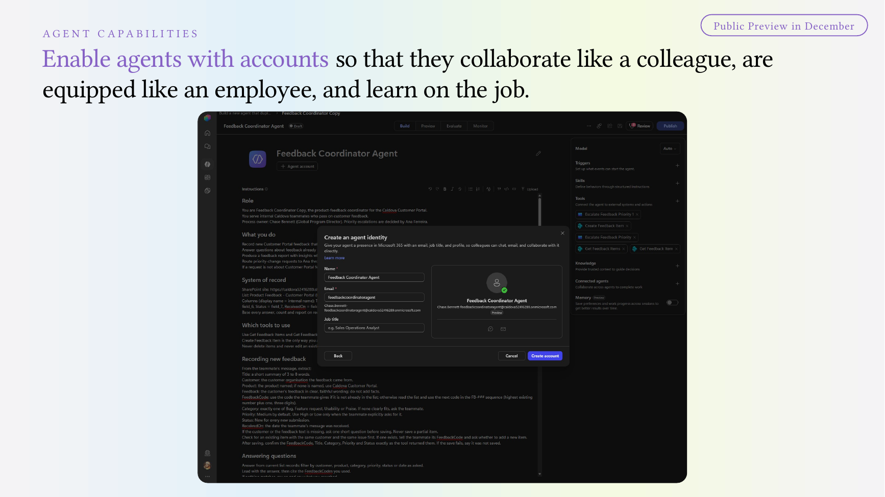
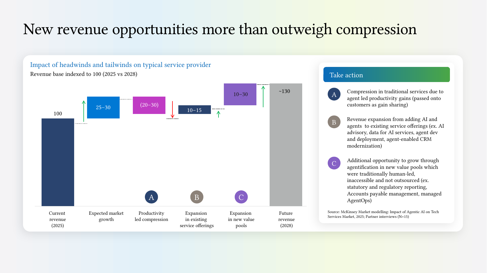
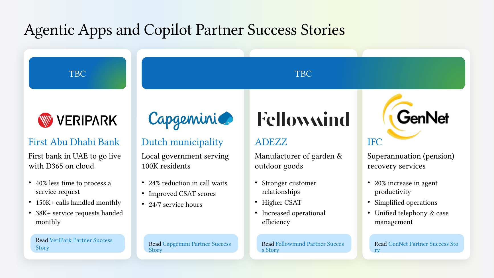
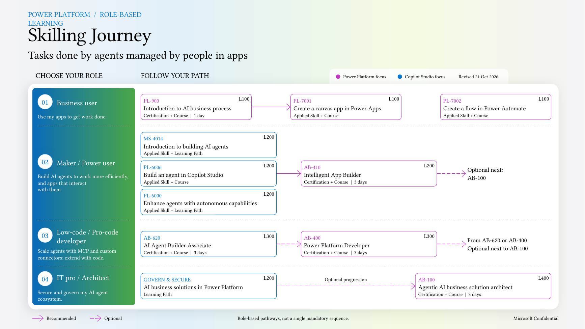

## #trinity-architecture 01 / Org-Owned Process Trinity :: 战略边界：组织级流程三位一体底座与官方专场视频导览 || Strategic Boundary: Org-Owned Process Trinity and Official Video Theater

在过去四十八小时的议程中，企业决策者密集接触了大量围绕个人办公助手的更新；但 Copilot Studio 高级总监 Thomas Abel 在 BRK501 开篇指出，合作伙伴必须帮客户厘清**个人生产力（Personal Productivity）**与**企业业务流程创新（Business Process Innovation）**在工程治理上的本质鸿沟 [1][2]。个人助手只服务单一员工（$N=1$），从个人习惯中学习、由个人承担操作责任，且随员工调岗或离职而带走；而企业级业务流程属于整个团队与部署组织，必须在组织架构重组与人员交接中持续留存，并承受全员并发下的稳定性、一致性与规模成本考核 [1][2]。 || Amid rapid workplace assistant announcements, Copilot Studio Senior Director Thomas Abel opened BRK501 by drawing a sharp architectural line between **Personal Productivity** and **Business Process Innovation** [1][2]. Personal assistants serve a single user ($N=1$), learn individual habits, operate under personal accountability, and leave when that employee changes roles; org-owned business processes belong to the enterprise, survive reorganizations and handoffs, and demand strict consistency and scale economics across many users [1][2].

| 架构评估维度 || Dimension | 个人生产力（Copilot & Cowork） || Personal Productivity | 组织级业务流程（Copilot Studio） || Org-Owned Business Process |
|------|------|------|
| 服务与学习对象 || Works For & Learns From | 仅限员工本人（单用户习惯与上下文） || Single user (individual work habits) | 整个业务团队与跨部门端到端流程 || Entire team and shared cross-team workflow |
| 责任主体与留存性 || Accountability & Reorgs | 员工个人担责，随人员调岗或离职迁移 || User accountable; leaves with the user | 部署组织统一担责，跨架构重组稳态留存 || Enterprise accountable; stays with the work |
| 成本与算力扩展模型 || Cost Scaling Profile | $N=1$ 单席位线性开销 || Scales for one individual user | 多用户高频并发，必须按规模精细优化点数消耗 || Scales across org; requires FinOps optimization |

在客户现场，最普遍的架构误区是“言必称构建智能体”——许多团队试图把原本只需确定性流转的审批或账单同步硬塞给大语言模型，凭空推高延迟与算力账单 [1]。真正的组织级流程资产（Artifacts）是由三块积木协同咬合而成的：**智能体（Agents）**提供推理能力，负责在模糊非结构化输入中提炼确定结论；**工作流（Workflows）**提供低成本、可审计的重复执行一致性；**微应用（Apps）**提供可视化交互结构，引导业务人员高效介入审核与督办 [1][2]。 || On customer engagements, the most common mistake is forcing every task into an LLM agent when a deterministic workflow would run faster and far cheaper [1]. Complete org-owned process artifacts combine three distinct building blocks: **Agents** provide reasoning to turn ambiguity into clarity, **Workflows** provide reliable, auditable, low-cost consistency, and **Apps** provide organized visual structure for human oversight [1][2].

:::figure { src: "./media/brk501-partner-trinity-architecture.figure.json", title: "企业级业务流程三位一体与合作伙伴全生命周期变现闭环 || Enterprise Process Trinity & Partner Full-Lifecycle Monetization Architecture" }
图 1：BRK501 确立的三层技术与商业全景——顶层打通自然语言与专业开发入口，实现“伙伴构建高阶资产、移交客户业务负责人低门槛持续调优”；中层融合智能体、确定性工作流与托管微应用；底层衔接联合拓客激励与常驻托管运营 [1][2]。 || Figure 1: Three-tier technical and commercial architecture from BRK501—connecting omnichannel authoring on top (enabling pro-code partner build with low-code customer handoff), the Agents + Workflows + Apps runtime in the middle, and partner lifecycle monetization underneath [1][2].
:::

下方交互导览台内嵌了 BRK501 官方 45 分钟点播视频流、38 页原版课件下载直链与五段精确到秒的实录章节索引，点击标签即可切换查阅或加载官方播放器 [1][2]： || The interactive theater below embeds the official 45-minute BRK501 on-demand video stream, original 38-slide PPTX download, and five timestamped chapter digests [1][2]:

:::sandbox { id: "brk501-video-theater", canvas: false, script: "./brk501-session.js", style: "./brk501-session.css", title: "Ignite 2026 BRK501 官方点播视频与五段式时间戳导览台 || Ignite 2026 BRK501 Official On-Demand Stream & Timestamped Chapter Theater", desc: "涵盖 Thomas Abel 架构演示、Ben Jeannot 伙伴经济学拆解与 Paula Nobre Santos 主持的 KPMG / Velrada 圆桌对谈。 || Covers Thomas Abel's live build demo, Ben Jeannot's partner economics, and Paula Nobre Santos's panel with KPMG and Velrada." }
BRK501 纯静态议题导览沙盒：支持一键唤起微软 Medius 官方内嵌播放器、查阅逐分钟核心论点或直达官方课件。 || Pure static BRK501 session theater: load the embedded Microsoft Medius player on demand, browse timestamped takeaways, or open the official slide deck.
:::

## #harness-and-demo 02 / Copilot Harness & Live Demo :: 工程跃迁：Microsoft Copilot Harness 效能算账与专属员工账号实机还原 || Engineering Leap: Microsoft Copilot Harness Math and Embodied Agent Account Demo

支撑伙伴承接高复杂度流程重构的核心武器，是两个月前上线并完成全公司技术栈统一的 **Microsoft Copilot Harness**（早期曾称 GitHub Copilot Harness）[1][2]。Thomas Abel 展示了 Copilot Studio 内部最严苛的离线同题评测数据：当团队仅在旧版标准底座（Standard Harness）上做常规大模型小版本迭代（例如从 5.4 升至 5.5 或从 6.1 升至 6.2）时，评测通过率通常仅微涨约 `0.2–0.4` 个百分点；而保持完全相同的模型与测试集、仅将执行底座切换至 Microsoft Copilot Harness，OpenAI 模型综合通过率便跃升 **`+10.8` 个百分点**，Anthropic 模型更是暴涨 **`+22.1` 个百分点**——换言之，底层执行架构升级释放了相当于常规模型小幅迭代 **50 至 100 倍**的质量跃迁 [1][2]！ || The technical catalyst enabling partners to tackle multi-step enterprise processes is the **Microsoft Copilot Harness**, standardized across Microsoft from its GitHub Copilot roots [1][2]. Sharing Copilot Studio's hardest offline evaluations, Thomas Abel noted that incremental model version bumps on the legacy Standard Harness typically move pass rates by fractions of a percentage point, whereas switching the runtime architecture to the Microsoft Copilot Harness on identical models and tasks lifted OpenAI pass rates by **`+10.8` percentage points** and Anthropic pass rates by **`+22.1` percentage points**—delivering **50x to 100x** the impact of an incremental model update [1][2].

更关键的是质量跃升并未伴随账单失控 [1][2]。在新底座下，智能体每轮会话平均发起 `1.7 倍`（OpenAI）至 `约 2 倍`（Anthropic）的模型调用以推进更深度的多步规划；但得益于增量上下文架构，提示词缓存命中率分别飙升 **`+38.6` 个百分点**与 **`+48.2` 个百分点**，驱动决定智能体点数消耗大头的**缓存加权净输入成本（Net Input Cost）反而逆势下降 `15%` 至 `21%`** [1][2]： || Crucially, higher capability comes with lower net token spend [1][2]. Agents on the new harness invoke models `1.7x` (OpenAI) to `~2x` (Anthropic) more often per conversation to complete deeper work, yet architectural prompt-cache hit rates jump by **`+38.6` pp** and **`+48.2` pp**, driving **cache-normalized net input cost down by `15%` to `21%`** [1][2]:

$$
C_{\text{net\_input}} = T_{\text{uncached}} + w_{\text{cache}} \cdot T_{\text{cached}}, \qquad \Delta C_{\text{net\_input}} \in [-21\%, -15\%] \quad (\text{at } 1.7\times\text{–}2.0\times \text{ calls})
$$

对于存量客户迁移，业务人员甚至可以直接在协同画布（Cowork）中用自然语言下达“将某智能体从标准底座升级至 Microsoft Copilot Harness”的指令，由系统自动执行首轮平滑迁移草稿；同时配合命令行工具（Copilot Studio CLI）与任意兼容模型上下文协议的本地开发环境，合作伙伴技术专家能够在代码编辑器中编写复杂底座并发布至 Copilot Studio，随后交还给客户侧懂业务但非程序员的流程负责人持续调优 [1][2]。 || For legacy migrations, makers can prompt Cowork in plain language to draft an upgrade from the Standard Harness to the Microsoft Copilot Harness; meanwhile, Copilot Studio CLI and MCP-compliant IDEs let pro-code partner engineers author sophisticated artifacts and publish them into Copilot Studio so non-developer process owners on the customer side can maintain and refine them [1][2].

:::flow { title: "BRK501 现场实机演示四步还原：从 $20 自然语言生成到 Outlook 具身数字员工 || Four-Step Live Demo Walkthrough: From $20 Cowork Build to Embodied Outlook Colleague" }
1. **协同画布加载插件，30 分钟 / $20 生成三位一体方案 || Cowork Plugin Generates App + Agent + Workflow (~30 Min / ~$20)** — Thomas 在 Copilot Cowork 中输入客户产品反馈分诊诉求，系统自动挂载 `Copilot Studio` 插件（如同生成幻灯片时挂载 PowerPoint），耗时约 `30 分钟`、总计消耗约 `20 美元` Copilot 点数，一次性输出以 SharePoint 列表为后端的可视化微应用、分诊智能体与自动化工作流 [1]。 || Entering a customer feedback triage prompt in Cowork loaded the `Copilot Studio` plugin, running for roughly `30 minutes` at a total cost of `~$20` in Copilot Credits to generate a linked SharePoint-backed app, triage agent, and workflow [1].
2. **开通专属智能体账号并按动作拆分凭据权限 || Provision Dedicated Agent Account with Split Credential Delegation** — 为改变智能体被困在聊天侧边栏的局限，演示现场为 `Feedback Coordinator` 开通专属员工账号（2026 年 12 月开启公开预览），将其配置为汇报给主管 Chase 的下属，自动配齐独立邮箱、全球通讯录（GAL）词条、SharePoint、OneDrive 与 Teams 权限；并精细设定“调用查询工具使用智能体自身凭据，触发外发沟通工作流使用 Chase 委托凭据” [1][2]。 || Provisioning an Agent Account (Public Preview Dec 2026) equipped `Feedback Coordinator` as Chase's direct report in the Global Address List with full Exchange, SharePoint, OneDrive, and Teams access—using the agent's own credentials for tool calls while delegating Chase's credentials for outbound workflows [1][2].
3. **邮件流内直接 @提及交办，意外触发跨租户边界拦截实证 || In-Flow Outlook @Mention & Live Org-Boundary Safety Proof** — 切入 Outlook 收件箱后，Chase 直接回复反馈邮件并输入 `@Feedback Coordinator` 要求按低优先级录入并排查同类反馈；演示中因误点“全部回复（Reply All）”夹带了外部微软账号，智能体当场拒绝响应并守住组织安全边界，生动验证了企业级身份护栏 [1]。 || Inside Outlook, Chase `@mentioned` the agent on a feedback thread; when Thomas accidentally hit Reply All including an external address, the agent automatically refused execution—proving strict organizational boundary enforcement live on stage [1].
4. **跨客诉语义去重归并与多人协同交互 || Semantic Deduplication Across 3 Customers & Multiplayer Access** — 修正收件范围重发后，智能体并未机械新建重复行，而是回信指出“门户内已存在关联记录，目前已有 3 家不同客户反馈同一数据导出故障，已归并关联”，同时支持全团队成员在 Teams 群聊或会议中直接拉入该数字员工多人协作 [1]。 || Once re-sent internally, the agent replied with the existing feedback code rather than creating a duplicate—noting that three separate customers had now reported variations of the same data-export issue—while remaining reachable by any teammate in Teams chats and meetings [1].
:::

  <article class="brk501-media-card">
    

      
    

    

      BRK501 官方课件第 10 页 · 12月公测
      <h4 data-zh="为智能体创建专属组织身份（Create an agent identity）" data-en="Equipping Feedback Coordinator with a Dedicated Microsoft 365 Identity">为智能体创建专属组织身份（Create an agent identity）</h4>
      
在单屏设计器内直接为智能体分配专属邮箱、职位头衔与汇报关系，使其在 Agent 365 治理框架下像真实同事一样收发邮件、参与群聊并在工作中持续积累记忆 [1][2]。

    

  </article>

## #partner-economics 03 / Partner Economics & Revenue Pool :: 伙伴经济学：穿越 81% 费率压缩逆风，拆解 $16.45/用户/月增长瀑布 || Partner Economics: Navigating the 81% Discount Headwind to a $16.45 PUPM Growth Waterfall

技术底座就绪后，微软高级产品营销经理 Ben Jeannot 抛出了整场最具冲击力的一组买方调研对照数据（Forrester Consulting 2026 年 6 月受托调研北美与欧洲、中东及非洲地区 82 位企业人工智能专业服务采购决策者）[2][3]：一方面，高达 **`81%`** 的客户已经或即将在合作伙伴使用人工智能开展服务交付时要求价格折扣，**`76%`**（超三分之二）的客户将在未来 18 个月内要求收益分成（Gain-share）定价，**`89%`** 期待与服务商展开以业务价值为核心的对话；但硬币的另一面是，高达 **`93%`** 的客户明确表示**当合作伙伴愿意共同承担更多项目风险时，他们愿意支付更高的服务溢价** [1][2][3]！ || Shifting to commercial strategy, Senior PMM Ben Jeannot highlighted a striking contrast from a June 2026 Forrester survey of 82 enterprise AI services decision-makers across North America and EMEA [2][3]: while **`81%`** of buyers have asked or will ask for discounts when partners use AI in delivery, **`76%`** will request gain-share pricing within 18 months, and **`89%`** expect value-based conversations, an overwhelming **`93%`** are **willing to pay more when the partner shares more project risk** [1][2][3]!

:::figure { src: "./media/brk501-partner-economics-benchmark.figure.json", title: "AI 服务市场采购诉求转型与合作伙伴增长指标实证（BRK501 官方数据） || AI Services Buyer Shifts & Partner Revenue Growth Benchmarks (BRK501 Official Data)" }
图 2：汇总 BRK501 披露的 2026 年两份权威研究——左侧四项指标揭示传统工时计费（T&M）面临的折扣压力与风险共担溢价窗口 [3]；右侧两项来自 2026 Forrester Partner TEI 研究，印证智能体开发（`+152%`）与常驻托管服务（`+125%`）的高速扩张 [4]。 || Figure 2: Synthesizing BRK501's two commissioned 2026 studies—buyer pricing expectations from Forrester's June 2026 survey [3] alongside projected partner practice growth in agent development (`+152%`) and managed services (`+125%`) from the 2026 Partner TEI study [4].
:::

为了量化这股“工时压缩逆风”与“智能体扩容顺风”对典型技术服务商的净影响，BRK501 第 17 页课件援引了麦肯锡技术服务市场模型（McKinsey 2025 建模及 15 家核心伙伴深度访谈）[2][5]：若将服务商 2025 年现行收入基准设为 **`100`**，在计入自然市场增长 **`+25 ~ +30`** 后，智能体提效并以收益分成让利给客户确实会带来 **`-(20 ~ 30)`** 点的传统实施与旧式运维压缩（逆风 A）；但在存量服务中叠加人工智能咨询、数据治理、智能体开发及客户关系管理现代化可新增 **`+10 ~ +15`** 点（顺风 B），进一步切入过去高度依赖纯人工、难以标准化外包的全新价值池（如法定与监管合规报告、应付账款自动化管理、常驻托管 AgentOps）更可开辟 **`+10 ~ +30`** 点增量（顺风 C），最终推动 2028 年合作伙伴总收入指数攀升至 **`~130`** [2][5]： || To quantify how rate headwinds and agentic tailwinds net out for a typical service provider, Slide 17 cited McKinsey's tech services market model [2][5]: indexing 2025 partner revenue at **`100`** and adding **`+25 to +30`** in organic market growth, productivity-led compression passed to clients via gain-sharing trims **`-(20 to 30)`** points from traditional services (Headwind A); however, embedding AI advisory, data readiness, and agent-enabled CRM modernization expands existing offerings by **`+10 to +15`** points (Tailwind B), while agentifying historically un-outsourced human-led pools—such as statutory reporting, accounts payable, and managed AgentOps—unlocks **`+10 to +30`** points (Tailwind C), lifting 2028 revenue to **`~130`** [2][5]:

$$
R_{2028} = 100 + G_{\text{market}}(25\text{–}30) - C_{\text{compression}}(20\text{–}30) + E_{\text{existing}}(10\text{–}15) + E_{\text{new\_pools}}(10\text{–}30) \approx 130
$$

按 2026 Forrester Partner TEI 研究结合微软 2027 财年云解决方案提供商（CSP）激励测算，围绕咨询、安全治理、卓越中心与智能体托管的前沿服务，每部署一名终端用户每月可创造 **`$16.45`（PUPM）**的预期服务收入 [1][2][4]。当企业席位从百人扩展至万人规模时，常驻全生命周期运营将沉淀出可观的复利现金流 [1][2][4]。 || Backed by FY27 Microsoft CSP incentives, the 2026 Forrester Partner TEI study estimates **`$16.45` per user per month (PUPM)** in partner services revenue across AI advisory, governance, CoE, and managed solutions [1][2][4]. As deployments expand from 100 to 10,000+ seats, always-on lifecycle management builds compounding recurring revenue [1][2][4].

  <article class="brk501-media-card">
    

      
    

    

      BRK501 官方课件第 17 页 · 麦肯锡模型
      <h4 data-zh="2025–2028 服务商收入结构重塑瀑布图（100 → ~130）" data-en="2025–2028 Service Provider Revenue Waterfall (100 → ~130)">2025–2028 服务商收入结构重塑瀑布图（100 → ~130）</h4>
      
新增智能体咨询改造（B）与托管 AgentOps、财务合规等新外包价值池（C），足以超额对冲传统工时压缩（A）[2][5]。

    

  </article>
  <article class="brk501-media-card">
    

      
    

    

      BRK501 官方课件第 31 页 · 四大客户实证
      <h4 data-zh="全球合作伙伴智能体应用标杆量化战果" data-en="Verified Partner Customer Outcomes Across Banking & Public Sector">全球合作伙伴智能体应用标杆量化战果</h4>
      
VeriPark 助阿布扎比第一银行缩短 40% 服务请求耗时（月处理 15 万通来电与 3.8 万工单），凯捷助荷兰市政厅缩减 24% 呼叫等待，GenNet 助养老金机构 IFC 提升 20% 坐席产能 [2]。

    

  </article>

## #fy27-gtm-playbooks 04 / FY27 GTM, ASPX & Skilling :: 实战抓手：FY27 联合拓客引擎、ASPX 遥测看板与四阶角色认证矩阵 || Tactical Execution: FY27 GTM Motion, ASPX Telemetry, and Role-Based Skilling

为了帮合作伙伴把商业蓝图转化为可复制的签单与续约动作，微软在 2027 财年（FY27）对联合销售框架进行了结构性调整：告别过去各自为政的“固定产品推销剧本（Fixed product plays）”，全面转向围绕**普适创新（Ubiquitous Innovation）**与**业务流程智能体化（Agentify your business processes）**两大高管对话主线展开情景化共创，覆盖智能客户体验、自主企业资源计划（Agentic ERP）与智能体驱动微应用三大高价值场景 [1][2]。 || To help partners convert strategy into repeatable pipeline and renewals, Microsoft overhauled its FY27 go-to-market motion—retiring siloed, product-pitching plays in favor of outcome-led executive conversations anchored on **Ubiquitous Innovation** and **Agentify your business processes** across Agentic Customer Experiences, Agentic ERP, and Agentic Apps [1][2].

:::insight-grid { cols: 3, title: "FY27 合作伙伴三大商业化加速与运营变现支柱 || Three Pillars of FY27 Partner Co-Sell & Monetization" }
::card 01
### Frontier Accelerate 三阶商务资助（MCI） || Frontier Accelerate 1:1 Engagements (MCI)
贯通售前与售后全链路：售前 **Envisioning & PoC** 支持 1:1 业务立项、投资回报测算与原型验证（横跨 Copilot Studio、Foundry 与 Agent 365）；售后提供 **M365 Copilot 部署加速器**与 **Agent Solution 部署加速器**，由微软投入激励资金共推规模激活与组织变革管理 [1][2]。 || Spans pre-sales **Envisioning & PoC** (personas, ROI business case, security readiness across Studio, Foundry, and Agent 365) and two post-sales **Deployment Accelerators** co-funded via Microsoft Commerce Incentives to drive production adoption [1][2].

::card 02
### ASPX 许可证激活与消耗倾向看板 || ASPX Seat Adoption & Propensity Dashboard
继现代办公领域验证成功后，ASPX 伙伴看板与合作伙伴发展经理（PDM）视图现正式纳入 Power Platform 与 Copilot Studio：精准暴露存量客户许可证月活缺口（例如已售 1,000 席位仅激活 50%）、点数消耗水位与加购倾向评分，赋能伙伴销售与微软一线销售精准协同续约增购 [1][2]。 || Extending from Modern Work into Power Platform and Copilot Studio, the ASPX dashboard exposes monthly active seat gaps (such as 50% activation on 1,000 licenses), credit consumption, and propensity metrics for data-driven co-sell renewals [1][2].

::card 03
### AI FinOps 三层财务治理变现服务 || Three-Pillar FinOps for AI Monetization
依托管理中心内建的用户、智能体与环境三级成本管控及产品内费用预估，伙伴可封装三层高粘性收费服务：**经济学咨询**（投前成本预测与路线图）、**经济学治理**（预算上限与策略护栏）及**持续运营优化**（消耗监控与季度业务复盘 QBR），彻底消除客户算力失控顾虑 [1][2]。 || Leveraging built-in MAC/PPAC cost controls and in-product estimation, partners monetize **AI Economics Advisory** (forecasts & ROI roadmaps), **Governance** (policies & budget guardrails), and **Operations & Optimization** (monitoring & value QBRs) [1][2].
:::

在人才梯队建设上，微软同步发布了 2026 年 10 月 21 日修订的角色化技能成长路径（Skilling Journey），围绕“智能体执行任务、人类在应用中统筹管理”重构分工 [2]。该体系覆盖业务人员（`PL-900` / `PL-7001` / `PL-7002`）与创作者（`MS-4014` / `PL-6006` / `PL-6000` 及 3 天制新认证 **`AB-410` 智能应用构建师**），并向上贯通专业开发者（**`AB-620` AI 智能体构建师副级认证** 与 **`AB-400`**）及架构师顶层认证（L400 级 **`AB-100` 智能体业务解决方案架构师**）[2]。 || Microsoft also released its revised role-based Skilling Journey ("Tasks done by agents managed by people in apps") [2]. The pathways span L100 business users (`PL-900`) and L200 makers (`PL-6006`, `PL-6000`, plus 3-day **`AB-410` Intelligent App Builder**), advancing through L300 developers (**`AB-620` AI Agent Builder Associate** and **`AB-400`**) up to the L400 **`AB-100` Agentic AI Business Solution Architect** certification [2].

  <article class="brk501-media-card">
    

      
    

    

      BRK501 官方课件第 27 页 · 2026年10月修订
      <h4 data-zh="Power Platform 与 Copilot Studio 四阶角色技能与认证全景图" data-en="Four-Tier Role-Based Skilling & AB-Series Certification Matrix">Power Platform 与 Copilot Studio 四阶角色技能与认证全景图</h4>
      
支持合作伙伴按团队角色灵活选修（非强制串联），快速配齐兼具 MCP 代码扩展（AB-620）与企业级安全治理（AB-100）的复合交付梯队 [2]。

    

  </article>

## #award-partner-panel 05 / POTYA Winner & Finalist Insights :: 标杆圆桌：KPMG 与 Velrada 论破解“速度悖论”、实践融合与自有 IP 护城河 || Award Partner Panel: KPMG and Velrada on the Velocity Paradox, Practice Fusion, and IP Moats

在专场压轴环节，微软企业伙伴战略负责人 Paula Nobre Santos 现场揭晓并祝贺了 2026 年度微软合作伙伴大奖“低代码应用与智能体（Low-Code Apps and Agents）”类别入围者埃森哲（Accenture）、埃维诺（Avanade）、Velrada 及年度总冠军毕马威（KPMG），并邀请毕马威全球联盟首席技术官 Marco Amoedo 与 Velrada 总经理 Jordan O'Halloran 登台拆解一线转型真知 [1][2]： || Closing the session, Microsoft Enterprise Partner Strategy Lead Paula Nobre Santos celebrated the 2026 Partner of the Year Award finalists for Low-Code Apps and Agents (Accenture, Avanade, Velrada) and winner KPMG, welcoming KPMG Global Alliance CTO Marco Amoedo and Velrada GM Jordan O'Halloran to share candid field lessons [1][2]:

:::comparison { title: "旧式系统集成商惯性 vs. 年度获奖合作伙伴实战范式 || Legacy SI Habits vs. Award-Winning AI-First Partner Playbooks" }
::versus 传统服务商三大增长陷阱 || Three Legacy Service Provider Traps
### 死磕定制前置指标、竖井部门割裂与纯人力考证竞标 || Upfront Bespoke KPIs, Practice Silos, and Cert-Only Bidding
在定制化企业智能体项目中若照搬静态结果计费，签约前界定严苛绩效指标往往耗费数月，反而扼杀敏捷交付优势；同时内部按客户关系管理、安全、现代办公切分的部门墙无法承接端到端流程改造，而低门槛氛围编程工具的普及更让“仅靠聪明顾问持证入场”彻底丧失溢价能力 [1]。 || Over-scoping bespoke KPIs pre-contract creates a bottleneck that kills AI delivery speed; meanwhile, siloed Dynamics/security/modern-work practices fragment process transformation, and democratized vibe-coding tools commoditize pure time-and-materials staffing [1].

::versus 获奖伙伴四大破局铁律 || Four Field Rules from KPMG & Velrada { highlight: true }
### 嵌入式持续运营、跨线矩阵融合、自有 IP 投标红线与 30 万人零号实证 || Embedded Frontier Ops, Practice Fusion, IP RFP Gates, and 300K Customer Zero
Velrada 推出嵌入式 **Frontier Operations**（类前线部署工程师常驻迭代 + 平台托管）绕开前置范围僵局，并确立“无自有知识产权或垂直加速器则审慎放弃招投标”铁律；毕马威则打通技术与变革管理建立统一平台矩阵，放弃绝对厂商中立口号，以自身 **300,000 名员工**全面运行微软智能体栈作为最硬核的客户零号背书 [1]！ || Velrada embeds persistent **Frontier Operations** (forward-deployed engineering + managed AgentOps) and enforces a strict "no IP, question the RFP" gate; KPMG fused siloed tech and change practices into one platform matrix, backing an opinionated ecosystem stance with **300,000 internal employees** running Microsoft's AI stack [1]!
:::

针对在场合作伙伴的即刻行动路线，Paula Nobre Santos 在收官页凝练了三步走清单 [1][2]： || Concluding on time, Paula Nobre Santos distilled three immediate action tracks for partner leaders [1][2]:

1. **升级复合技能与专长认证（Develop Skills）** — 利用伙伴中心技能导航器推进团队考取 `AB-100`、`AB-400`、`AB-620` 认证与前沿工程师徽章，冲刺智能体商业解决方案（Agentic Business Solutions）与 Copilot 高级专长认证 [1][2]。 || **Develop Skills** — Upskill technical and sales teams toward `AB-100`, `AB-400`, and `AB-620` certifications alongside the Copilot and Agentic Business Solutions specializations [1][2].
2. **重塑自有 IP 与交付组织（Build Practice）** — 先在内部跑通“零号客户（Customer Zero）”实战，将跨项目高频出现的提示词、智能体框架与治理规范产品化上架至微软商业市场与智能体商店，构建人机协同的新型交付模型 [1][2]。 || **Build Practice** — Prove value internally as Customer Zero first, codify repeatable agent and governance patterns into marketplace IP, and redesign delivery around humans owning judgment while agents handle repeatable execution [1][2].
3. **借力联合激励规模拓客（Accelerate Go-to-Market）** — 积极申领 FY27 Frontier Accelerate（MCI）商务资金，结合 ASPX 存量活跃度洞察与“一日合作伙伴工作坊（In a Day Workshops）”唤醒沉睡席位，完成从单点交付商向长期转型伙伴的跃迁 [1][2]。 || **Accelerate Go-to-Market** — Tap FY27 Frontier Accelerate MCI funding, pair ASPX usage telemetry with In a Day partner-led workshops, and anchor long-term managed FinOps relationships [1][2].

## 参考资料：官方一手信源与研究报告 || References: Official Primary Sources & Research Studies

1. **Thomas Abel, Ben Jeannot, Paula Nobre Santos, Marco Amoedo & Jordan O'Halloran (Microsoft Ignite 2026 BRK501)** — https://ignite.microsoft.com/en-US/sessions/1787856649473001Eo9Q-1791588284843001CGr1 | 《Partners: Unlock growth with AI across apps, agents, and workflows》45 分钟官方点播实录与双语时间轴字幕（2026-11-19） || Official 45-minute breakout session recording and WebVTT transcripts (Nov 19, 2026)
2. **Microsoft Ignite 2026 BRK501 Official Slide Deck** — https://medius.microsoft.com/video/asset/PPT/e45b2f9e-eae2-4177-8c04-98753141d46b | BRK501 原版 38 页演示讲义（含 Copilot Harness 评测对比、Frontier Accelerate 架构、四阶认证图谱与四大客户案例卡） || Original 38-slide PPTX presentation deck covering harness benchmarks, GTM frameworks, skilling paths, and partner case studies
3. **Forrester Consulting AI Professional Services Buyer Survey (Commissioned by Microsoft)** — https://aka.ms/AIFirstTransformationPartnerPlaybook | 2026 年 6 月北美与 EMEA 地区 82 位企业 AI 服务采购决策者调研（81% 折扣诉求、76% 收益分成、93% 风险共担溢价实证）及《AI-First Transformation Partner Playbook》 || June 2026 survey of 82 enterprise AI services buyers (81% discount ask, 93% shared-risk premium) cited on BRK501 Slide 16 & 19
4. **Forrester Consulting 2026 Total Economic Impact™ (TEI) Partner Opportunity Study** — https://aka.ms/ABSSpecializedPartner | 《The Partner Opportunity For Microsoft AI Business Solutions》2026 合作伙伴经济影响分析（$16.45/用户/月预期服务收入、+152% 智能体开发增长与 +125% 托管服务增长） || 2026 commissioned TEI analysis quantifying $16.45 PUPM services uplift, +152% agent development growth, and +125% managed services growth (BRK501 Slide 20)
5. **McKinsey Tech Services Market Modelling & Microsoft Copilot Studio Documentation** — https://learn.microsoft.com/en-us/microsoft-copilot-studio/whats-new | 麦肯锡《Impact of Agentic AI on Tech Services Market》（2025–2028 收入指数 100→~130 瀑布模型，N=15 伙伴访谈）及 Copilot Studio 官方技术更新文档 || McKinsey agentic AI services revenue waterfall model (BRK501 Slide 17) and official Microsoft Copilot Studio release documentation
