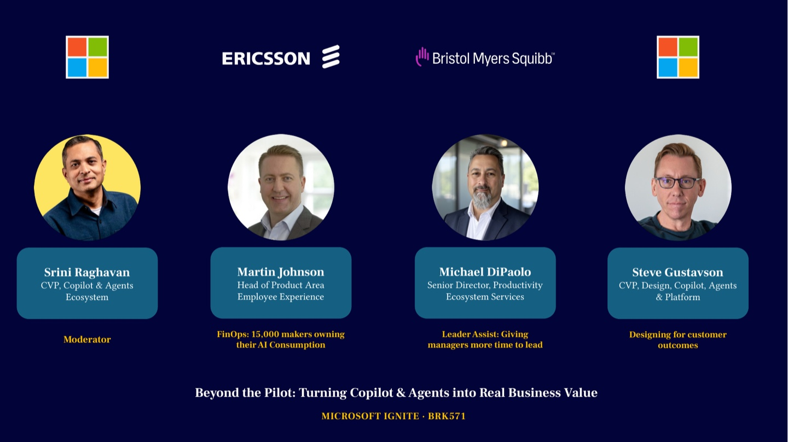
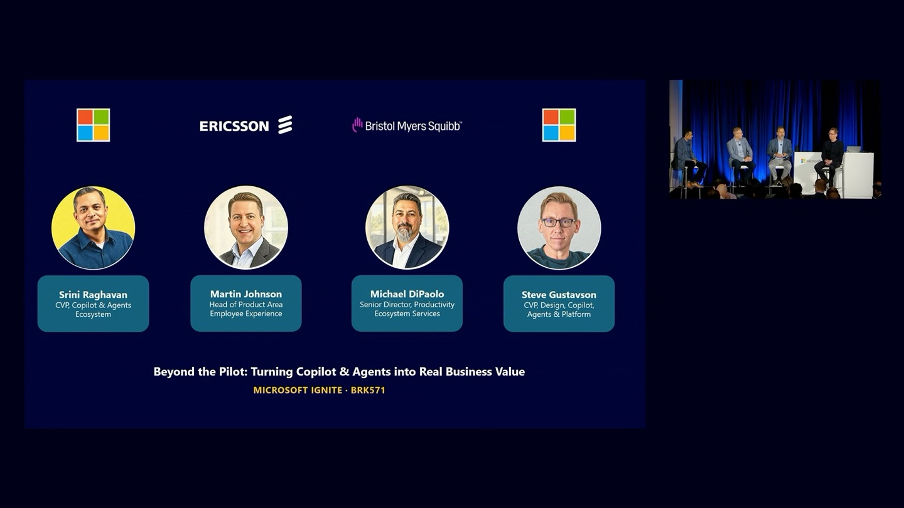

## #beyond-pilot-trap 01 / Beyond the Pilot Trap :: 破局试点泥潭：告别“周会纪要套娃”，走向七倍速战略决策与主动式团队赋能 || Escaping the Pilot Trap: Beyond Recap Loops to 7x Strategy Sprints and Leader Assist

演示厅里的单点智能体试点总能赢得掌声，但把掌声变成财报上的业务产出则是另一场硬仗 [1]。Srini Raghavan 在开场时一针见血地指出：如果企业引入人工智能只是为了自动生成上一场进度周会的纪要，再把这份纪要带进下一场周会继续做纪要，组织并未创造任何增量业务价值 [1]。真正跨越试点鸿沟需要同时立住三根支柱——依托组织工作脉络（Work IQ）确保每次执行都可靠的**情境智能**、看清智能体权限与行为边界的**可信治理**，以及算清投入产出比的**经济学闭环** [1][3]。 || Stage demos and isolated pilots easily win applause, yet converting excitement into durable P&L impact requires far harder engineering [1]. Opening BRK571, Srini Raghavan warned against recursive productivity theater—summarizing one status meeting simply to feed the next status meeting [1]. Moving beyond personal efficiency demands three enterprise pillars: **reliable intelligence** grounded in Work IQ context, **observable governance** over agent data access, and **disciplined economics** tying spend to measurable outcomes [1][3].

:::figure { src: "./media/brk571-enterprise-value-architecture.figure.json", title: "BRK571 从单点试点迈向规模商业价值的三层跃迁架构 || BRK571 Three-Tier Enterprise Value & Surface Convergence Architecture" }
图 1：BRK571 揭示的企业级落地全栈——顶层通过内测智能路由器连接聊天、并排画布与左侧栏后台自动代理；中层以流程重连（18 步压至 4 步）、前端推理加后端确定性轨道及 150 余款开源行业插件重构业务主干；底层依托历史权限清洗、硬边界沙盒与三级成本归属账本稳控规模风险 [1][2][4]。 || Figure 1: Three-tier BRK571 architecture—connecting Chat, Cowork, and left-rail Autopilot through an internal smart router on top; recoding 18-step processes onto deterministic rails and 150+ industry plugins in the middle; and enforcing permission hygiene, bordered maker sandboxes, and 3-tier FinOps ledgers underneath [1][2][4].
:::

下方导览台集成了 BRK571 官方 46 分钟点播视频流、原版 PPTX 课件下载与五段核心对话的时间轴索引，点击顶部章节标签即可按分钟检索四位嘉宾的原声论点与客户问答实录 [1][2]： || The interactive theater below pairs the official 46-minute Microsoft Medius video stream and original PPTX slide deck with five timestamped chapter digests covering executive frameworks, customer deployments, and live audience Q&A [1][2]:

:::sandbox { id: "brk571-video-theater", canvas: false, script: "./brk571-session.js", style: "./brk571-session.css", title: "BRK571 官方点播视频与五段圆桌实录时间轴导览 || BRK571 Official On-Demand Stream & Five-Chapter Panel Navigator", desc: "切换五大核心议题与现场尖锐提问章节，支持按需加载微软官方内嵌播放器或下载原版 PPTX 课件。 || Switch across five timestamped panel segments and live Q&As, load the embedded Medius player on demand, or download the official PPTX deck." }
纯静态圆桌导览沙盒：内置 BRK571 官方高清封面、五段分章摘要及视频与课件直达入口。 || Pure static session theater featuring the official BRK571 HD cover, five timestamped chapter digests, and direct video/slide links.
:::

两家跨国行业龙头在开场即亮出了脱离试点期后的代表作 [1][2]。爱立信拥有长达七年的低代码规模化积淀，内部活跃着 **15,000 名创作者**与 **20,000 个业务应用**（随着智能体与协同画布全面铺开，广义业务创作者规模已拓展至 **50,000 人**）[1][2]。其销售团队在客户会议中启用协同画布技能，会议进行中实时抓取客户关注焦点、商机、风险与决策点，会议刚一结束便自动释放可执行的客户跟进方案，彻底终结了手写笔记锁死在个人本子里的信息断层 [1]。更典型的是爱立信旗下业务部门的五年战略规划重构：过去管理层需耗费数周拉齐背景与基础分析，如今团队首日便用协同画布汇总数据并产出机会点与关键绩效指标草案 [1]。随后团队专门调用一个扮演“魔鬼代言人（Devil's Advocate）”的智能体反向挑刺、追问深层漏洞，使整体周期**提速 7 倍**，把原本一周的工作浓缩进单日拍板决策会 [1]。 || Both customer panelists opened with concrete post-pilot deployments [1][2]. Drawing on a seven-year low-code foundation of **15,000 makers** and **20,000 Power Apps**—now expanding toward **50,000 innovators** across Copilot and Cowork—Ericsson captures customer priorities and decision points live during meetings so teams release engagement plans the moment a call ends [1][2]. Even more striking, an Ericsson division leadership team overhauled its five-year strategy cycle with Cowork drafting first-day opportunities and KPIs [1]. A dedicated **devil's advocate agent** then probed weak assumptions, delivering a **7x speedup** that compressed a full week of prep into a single day of high-granularity decisions [1].

  <article class="brk571-media-card" data-present-surface="unframed">
    

      
    

    

      BRK571 官方课件原图 · Slide 1
      <h4 data-zh="四位政企与设计领军者核心议题分工" data-en="BRK571 Panel Lineup & Core Value Pillars">四位政企与设计领军者核心议题分工</h4>
      
聚焦三大实战命题：爱立信 15,000 名创作者自担 AI 消耗、百时美施贵宝 Leader Assist 解放管理者时间，以及面向客户成果的交互设计 [1][2]。

    

  </article>
  <article class="brk571-media-card" data-present-surface="unframed">
    

      
    

    

      BRK571 官方录播实拍 · 05:25
      <h4 data-zh="从单点绩效工具演进为跨系统管理助手" data-en="Evolving Review Pilots into Cross-System Leader Assist">从单点绩效工具演进为跨系统管理助手</h4>
      
Michael DiPaolo 现场复盘如何将上一年辅助撰写绩效评语的试点，升级为聚合 3–5 套人事培训系统的 Teams 主动轻推助手 [1]。

    

  </article>

在高度合规的生命科学领域，百时美施贵宝（BMS）同样走过了“小试点到大产品”的蜕变路径 [1]。一年前 Ignite 大会上，BMS 仅聚焦于辅助员工起草年度绩效总结并缩短经理审阅耗时的单一试点 [1]。今年该方案已全面进化为 **Leader Assist**：过去部门主管为了掌握下属入职周年、合规培训进度与一对一沟通记录，不得不手动翻找 **3 至 5 套**孤立系统 [1]。如今智能体在后台自动聚合多源状态并在 Teams 内弹出情境化提醒（Nudges），把管理者的精力重新拉回团队引领与加速新药惠及患者的核心使命上 [1]。与此同时，Srini 也分享了微软高管自身的日常用法：由于每周至少主持 **2 场**客户高管简报会，他的后台自动代理（Autopilot）会持续扫描日历 [1]。一旦识别到爱立信等客户即将到访雷德蒙德总部，代理便自动汇集往来邮件、历史演示文稿与真实用量数据生成高管仪表盘，还能在会场上直接向客户展示后台运作链路 [1]。 || In regulated life sciences, Bristol Myers Squibb demonstrated a similar post-pilot evolution [1]. What began at the prior Ignite as a narrow pilot helping staff draft performance reviews matured into **Leader Assist** [1]. Instead of managers hunting across **3 to 5** separate HR and training systems, the agent unifies signals and surfaces timely Teams nudges around anniversaries, compliance training, and one-on-ones so leaders focus on advancing medicines to patients [1]. Srini mirrored this pattern from his own calendar, where he runs at least **2 customer executive briefings per week** [1]. His background Autopilot continuously scans upcoming Redmond visits like Ericsson's, compiling historical decks, touchpoints, and live usage metrics into a ready-to-share executive dashboard [1].

## #hygiene-and-surfaces 02 / Permission Hygiene & Surface Convergence :: 权限卫生与交互收敛：清查三十年历史共享漏洞，用智能路由消解认知负荷 || Permission Hygiene & Surface Convergence: Fixing 30-Year Oversharing and Dissolving UX Cognitive Load

“人工智能有一条铁律：只要你的文件分类漏打标签或存在过度共享漏洞，智能体一定会找到它，而且找得极快。”Michael DiPaolo 在谈及医药监管准备度时坦言，有时组织必须先迈出看似后退的一步，才能稳步向前 [1]。BMS 在早期小范围测试 SharePoint 智能体时，安全团队敏锐捕捉到了历史遗留的过度共享（Oversharing）现象——在长达 **30 年**的文档沉淀与人员轮岗中，不少员工调离原岗位加入新项目组后，并未从旧业务权限组中清退 [1]。尽管未触发实质泄密风险，BMS 依然果断按下暂停键，花费整年时间推进全量 SharePoint 站点复核、敏感文件分类打标与跨角色权限组清理，并确立了“受控小规模灰度释放 → 观察细微权限偏差 → 修正后再全量铺开”的稳健节奏 [1]。 || “If you have a hole or a file that isn't classified correctly or is overshared, AI is going to find it—and find it fast,” Michael DiPaolo noted candidly [1]. Early SharePoint agent pilots at BMS exposed **30 years** of accumulated permission drift: employees changing roles had been added to new security groups without being removed from legacy ones [1]. Rather than rushing ahead, BMS stepped back to revalidate SharePoint sites, enforce sensitivity tagging, clean up stale group memberships, and adopt controlled pilot waves that catch subtle permission gaps before enterprise-wide release [1].

权限问题不仅困扰安全团队，也深刻重塑了产品交互设计 [1]。统管 Dynamics、Copilot Studio、Power Platform 与 SharePoint 设计体系的 Steve Gustavson 指出，面对 Copilot 内新发布的资料库与工作空间，设计重心已转向**人类可观测性（Human Observability）与人本角色明示（Humanist UX）** [1]。当员工在群聊里与同事的后台代理交互时，往往不清楚对方究竟能否读取自己的日历或会议录像 [1]。因此界面必须允许用户直接向智能体发问并获得清晰直白的权限边界答复，而不应把判断“这封文档有没有挂红盾机密标”的负担全盘甩给普通员工 [1]。例如 Srini 在前一天客户会议途中接到团队求助，需要为 **3 位**无权限同事开通另一场会议的录像与纪要访问权；手工操作原本要在 Teams 里连点 **8 步**，他在会中发出一句自然语言指令，后台自动代理便合规读取邮件、完成授权并逐一发信通知了这 3 位同事 [1]。 || Permission clarity is equally a frontline UX challenge [1]. Leading design across Dynamics, Copilot Studio, Power Platform, Agent 365, and SharePoint, Steve Gustavson emphasized **human observability** across Cowork and Autopilot [1]. When messaging a colleague's Autopilot in Teams, users shouldn't have to guess whether it can see their calendar or carry the burden of checking internal sensitivity shields [1]. Users must be able to ask any agent directly what permissions apply [1]. That transparency enables frictionless delegation—such as Srini's mid-meeting command instructing his Autopilot to grant recording access and email **3 teammates**, replacing **8 manual clicks** without breaking focus [1].

| 协同模式与入口 || Work Mode & Surface | 典型适用场景与交互形态 || Core Scenario & Interaction Model | 计费属性与演进方向 || Licensing Economics & Convergence |
|------|------|------|
| **Copilot Chat**（轻量即时问答） || **Copilot Chat** (Fast In-Flow Q&A) | 快速总结单场会议纪要、日常信息检索，或为复杂任务预先生成高性价比的优化版提示词 [1] || Quick meeting recaps, fast lookups, or generating token-optimized prompts before heavier runs [1] | 包含在标准席位许可证内（边际成本极低）；前沿预览版已支持识别复杂任务主动提示切入画布 [1] || Included in base license; Frontier builds already detect multi-step tasks and suggest Cowork [1] |
| **Copilot Cowork**（深度并排画布） || **Copilot Cowork** (Deep Side-by-Side Canvas) | 全天沉浸式重度作业：并排审阅修改 Excel 表格、Word 文档与五年战略规划，支持挂载外部业务插件 [1] || Locked-in power sessions: side-by-side Excel/Word/PPT co-creation, 5-year strategy drafts, and ERP plugins [1] | 按实际消耗扣除点数（Credits）；现已与 Chat 融于同一 Home 首页，后台正内测智能路由器自动分流 [1] || Consumes variable credits; unified on Copilot Home with an internal smart router under test [1] |
| **Autopilot**（左侧栏后台委派） || **Autopilot** (Left-Rail Async Delegation) | 差旅参会途中通过 Teams 异步交办日常杂务（代开录像权限、持续扫描日历汇总高管简报）[1] || On-the-go delegation via Teams or Copilot's left rail (permission grants, continuous briefing prep) [1] | 入驻 Copilot 寸土寸金的左侧主导航栏；未来将支持把 Cowork 作为底层工具直接调用 [1] || Promoted into Copilot's left rail; roadmap enables Autopilot to invoke Cowork as a tool [1] |
| **Copilot Studio + 行业插件** || **Copilot Studio + Industry Plugins** | 将验证成熟的复杂多步流程固化到确定性轨道，连接 SAP、Dynamics 等核心账务系统执行季度关账 [1][3] || Harden complex, repeatable workflows onto deterministic rails spanning SAP, Dynamics ERP, and SOPs [1][3] | 微软已在 GitHub 开源约 **150 款行业插件**（凝练自 **1,700 场**深度客户访谈），免去从零造轮子 [1] || Backed by **~150 open-source GitHub industry plugins** distilled from **1,700 customer interviews** [1] |

面对观众普遍困惑的“什么时候该用 Chat、什么时候切 Cowork 或 Autopilot”，Steve Gustavson 坦承当前多标签并存只是提供选择权的过渡态，绝非终局设计——因为每多一次模式抉择，用户就要被迫心算一次“哪个入口含在免费许可证里、哪个入口要烧按量点数” [1]。为此，微软不仅打通了 Cowork 与 Autopilot 的用户研究团队，更在内部实测**智能路由器（Smart Router）**：简单如“总结这场会议”直接留在许可证内的轻量通道完成；复杂如“协助完成第四季度销售财务关账”则自动路由至连接 Dynamics ERP 或 SAP 插件的长程执行环境，让技术边界在体验层自然消融 [1]。而在智能路由全面普及前，Michael DiPaolo 分享了一个极其实用的过渡期省钱技巧：先在免费的 Chat 里描述诉求，如果任务超出范围，就让 Chat **反向编写一段针对 Cowork 深度优化的高效提示词**再粘贴过去执行，实测既显著提升了运行质量，又大幅压缩了词元消耗 [1]。 || Addressing the elephant in the room—when to use Chat versus Cowork, Autopilot, or Code—Steve Gustavson acknowledged that forcing users to mentally calculate license-included chats versus credit-consuming runs is a temporary stage, not the end state [1]. Having unified the Cowork and Autopilot research teams, Microsoft is internally testing a **smart router** that handles simple meeting summaries in-license while routing complex Q4 ERP financial closes to plugin-backed execution automatically [1]. As a practical interim tactic, BMS trains staff to start in Chat and ask it to **generate a token-optimized prompt for Cowork** whenever a task needs deeper execution—boosting reliability while trimming credit burn [1].

## #finops-and-rewiring 03 / Benefit-Owned FinOps & Process Rewiring :: 成本归属与流程重连：8.5 万员工算力透视账本，把 18 步陈旧流程压至 4 步 || Accountable FinOps & Process Rewiring: 85,000-Employee Spend Transparency and 18-to-4 Step Recoding

当企业同时运行多套大模型底座与数万名员工账号时，如何防止算力账单变成一笔糊涂账？Martin Johnson 给出了爱立信服务全集团 **85,000 名员工**（其中已部署约 **30,000 席** Microsoft Copilot 许可，并从起步阶段就采取多平台并存策略，同时连接大型软件与标准作业资产）的核心治理铁律：**人工智能的可变消耗成本，必须归属到业务收益真正发生的部门与个人身上** [1]。 || How does a global enterprise running a multi-platform AI strategy across **85,000 employees**—including **30,000 Microsoft Copilot licenses** alongside major ERP and enterprise estates—keep variable token bills accountable [1]? Martin Johnson shared Ericsson's foundational rule: **variable AI consumption must belong where the business benefit happens** [1].

为此，爱立信团队在内部专门构建了一款全集团级 Power App 成本足迹看板：最初用于归集各类软件授权费与站点存储开销，如今已全面接入人工智能消耗数据——每一位普通员工打开应用都能看清“我的个人算力足迹是多少”，直线经理能透视“我所带团队的整体消耗”，而事业部财务总监（Controller）则能核算整个业务单元的投入产出盈亏 [1]。伴随 Ignite 2026 发布的 **Agent 365 业务分析模块（Business Analytics）**，这套多平台账本正进一步延伸至跨生态度量：不仅统计微软原生点数消耗，还把 OpenAI、Anthropic 等异构平台的用量数据与业务结果指标纳入同一张治理报表中 [1][4]。 || Ericsson operationalized this rule by building an enterprise Power App originally designed for software license and storage chargebacks and extending it to AI consumption—giving every employee, line manager, and division controller real-time visibility into their exact footprint and profitability [1]. Newly announced **Agent 365 Business Analytics** pushes this model further by correlating tokenomics with business outcomes across both Microsoft and non-Microsoft platforms such as OpenAI and Anthropic [1][4].

:::figure { src: "./media/brk571-adoption-maturity-quadrant.figure.json", title: "BRK571 企业级智能体演进象限：流程重构深度与治理账本成熟度对标 || BRK571 Enterprise Agent Adoption Quadrant: Process Rewiring vs. Governance & FinOps Maturity" }
图 2：将 BRK571 披露的真实案例映射至二维成熟度象限——左下角为“会议纪要套娃”与未盘点民间重复造轮子的试点陷阱；左上角通过每月 50 美元硬限额建立预算安全感；右上角则代表爱立信与百时美施贵宝通过端到端流程重连（Rewiring / Recode）叠加三级成本归属与权限重验所抵达的规模商业价值区 [1][2][4]。 || Figure 2: Mapping BRK571 real-world deployments across rewiring depth and governance maturity—moving out of bottom-left recap loops and unvetted citizen sprawl, establishing predictable $50/month CFO caps, and reaching the upper-right zone via BMS SOP rewiring and Ericsson's 85,000-employee FinOps model [1][2][4].
:::

在算清账本的同时，真正的超额回报来自对业务流程做“外科手术式拆解”而非“表面外挂聊天框” [1]。BMS 将内部人工智能版图清晰划分为三座业务塔：主攻分子发现与新药研制的**重度科研塔**、服务结构化商业与研发协同的**业务流程塔**，以及覆盖全员日常办公的**知识工作者塔** [1]。针对生命科学行业沿用了整整 **10 年**、高度依赖标准作业程序（SOP）的传统流程，BMS 推行名为 **“流程重连（Rewiring）”** 的专项行动——把旧流程彻底拆开逐一拷问：“这一步今天还必须存在吗？每一级人工审批真的都不可替代吗？如果从零用人工智能原生构建，它应该长什么样？” [1] || Alongside financial transparency, outsized returns come from tearing apart legacy workflows rather than bolting a chatbot onto the side of old screens [1]. BMS structures its portfolio across three towers—**molecule discovery research**, **structured commercial/R&D operations**, and **day-to-day knowledge work**—and runs an initiative called **“Rewiring”** across **10-year-old** SOP-driven processes, questioning whether every historical human approval and handoff still belongs [1].

Srini Raghavan 将这种改造称为 **“流程重编码（Recode）”**，并引用了工业史上的经典一课：电力刚取代蒸汽机时，守旧工厂只是把原本巨大的蒸汽机原位换成一台巨大的电动机，却没意识到电力真正的革命在于造出无数小型电机、直接装进每一台需要动力的终端设备里 [1]。如果在旧流程上生套智能体，企业最多只能拿到 **20%** 的局部提速；唯有彻底重想端到端链路，才能解锁剩余 **80%** 的结构性收益 [1]。Steve 与 Srini 结合一线客户共创给出了三条立即可用的重构手法 [1]： || Srini Raghavan reinforced this as **“Recoding”** business processes, citing industrial history: early electrified factories merely swapped giant steam engines for giant central electric motors instead of placing compact motors directly where work happened [1]. Applying agents to old workflows yields at best a **20%** incremental speedup; reimagining the end-to-end process captures the remaining **80%** [1]. Together, the panelists highlighted three field-proven recoding techniques [1]:

1. **录屏直喂压缩法（18 步压至 4 步） || Over-the-Shoulder Recording Compression (18 Steps → 4)** — 无需编写厚重的业务需求文档，直接用 Teams 录下员工真实的物理或数字屏幕操作流并输入 Copilot Studio，下达指令将原本繁琐的 **18 个步骤直接重排压缩为 4 步** [1]。 || Skip manual spec writing: record an employee's live physical or digital workflow in Teams, feed it straight into Copilot Studio, and ask it to re-architect **18 steps down to 4** [1].
2. **前端弹性推理 + 后端确定性轨道 || Stochastic Upfront, Deterministic Rails Behind** — 从员工日常使用 Cowork 的高频复杂场景中反向挖掘流程，对金融与医药等强监管环节将其沉淀回 Copilot Studio：允许前端意图理解保持灵活性，但后端审批与账务写入严格锁死在可审计的确定性轨道上 [1][3]。 || Mine complex patterns discovered in Cowork and harden them in Copilot Studio—keeping upfront intake flexible while locking regulated financial or clinical execution onto deterministic rails [1][3].
3. **深入泥土的一线调研与硬边界沙盒 || Field Immersion & Guarded Box with Borders** — 微软用户体验团队与农机巨头约翰迪尔（John Deere）合作时直接派研究员下地“亲手摸拖拉机（Touch the tractors）”，瞬间激发出横跨销售、财务与运营的接地气方案；而在组织内部，爱立信坚持提供“带硬边界的盒子（Box with Borders）”——边界之外严禁越雷池一步，边界之内则放心交给最高 **50,000 名**最懂业务的领域专家自由创造 [1]。 || Just as Microsoft sent researchers to John Deere to physically “touch the tractors” with frontline staff, Ericsson pairs non-negotiable governance borders with complete creative freedom inside the box for up to **50,000** domain makers [1].

## #audience-field-qa 04 / Five Candid Enterprise Q&As :: 五大现场实战拷问：收敛 2.5 万民间代理、CFO 月度封顶与中枢辐射共建 || Five Candid Field Q&As: Curating 25,000 Citizen Agents, $50 CFO Caps, and Hub-and-Spoke Ownership

在圆桌最后十三分钟的开放提问环节，来自安朗杰（Allegion）、法国跨国药企、荷兰私人银行与吉利德科学（Gilead Sciences）的四位企业数字化负责人抛出了转型深水区最棘手的五个真问题，台上一线操盘手给出了毫无保留的实操答案 [1]： || During the final thirteen minutes of live Q&A, enterprise leaders from Allegion, a French pharmaceutical company, a Dutch bank, and Gilead Sciences pressed the panel on the five hardest operational hurdles in scaling enterprise agents [1]:

:::insight-grid { cols: 2, title: "BRK571 现场四大行业客户痛点与生产级解法对照 || Four Live Enterprise Challenges & Battle-Tested Panel Playbooks" }
::card Q1 · Allegion
### 全民开发涌现 25,000 个智能体，如何升维至全企业复用？ || Scaling Beyond 25,000 Departmental Citizen Agents
BMS 曾面临全民开发者自建 **25,000 个智能体**的分散局面。解法分三步：先拉出全量清单与负责人简述；横向比对各部门都在重复造的共性场景（如项目管理助手）；按**“试点证明兴趣，重复使用率证明产品价值”**的标准将高频共性代理提拔为企业级官方智能体，同时优先复用微软已开源的 **150 款**行业插件模板 [1]。 || Facing **25,000** citizen-built agents, BMS inventoried owners and descriptions, spotted cross-department duplicates like PM bots, and elevated high-repeatability winners (“pilots prove interest, repeatability proves the product”) alongside Microsoft's **150** open-source plugins [1].

::card Q2 · French Pharma
### 按量计费动辄成百上千美元，如何向财务总监（CFO）交账？ || Convincing the CFO on Pay-Per-Use Token Budgets
微软内部对部分供应商团队直接启用 FinOps **每人或每组每月 50 美元硬性点数封顶（Hard Cap）**——触顶即停并提前向员工与经理开放余额看板，彻底封死账单失控风险 [1]。爱立信则建议重构人力与算力总账：倘若 **3 名**深度消耗算力的工程师能跑出相当于原先 **5 至 7 人**（甚至替代 10 人团队传统模式）的综合产出，总经济账依然显著为正 [1]。 || Microsoft enforces hard **$50/month** credit caps per individual or vendor group with live balance dashboards [1]. Ericsson advises reframing total economics: if **3** heavy-token developers deliver the output equivalent of **5 to 7** roles, net ROI remains strongly positive [1].

::card Q3 · Dutch Bank
### 仅 5 人技术小队，如何从数百名私人银行家手里“掏出”业务流程？ || Capturing Workflows with a 5-Person Central AI Team
切忌带着“我是来抽走并接管你们工作流”的姿态下业务线——这会瞬间激起业务人员的文化戒备 [1]。一方面可用 Teams 旁观录屏免访谈直接还原真实操作；另一方面学习 BMS 建立由业务高管提名、承诺**一整年固定投入期**的**业务先锋网络（Champions Network）**，让懂业务的自己人拉着同伴主动找技术团队结对共建 [1]。 || Never frame outreach as “extracting” workflows from private bankers—that triggers cultural resistance [1]. Combine low-friction Teams screen recordings with nominated **1-year business champions** who invite peers to co-design with IT [1].

::card Q4 · Gilead Sciences & Multi-Agent
### 该搞“唯一超级总管代理”还是多专职代理？提拔后谁来运维？ || Single Superagent vs. Specialists & Hub-and-Spoke Ownership
当前调用外部 SAP Joule 或 Atlassian 代理仍需显式 `@提及`，未来将演进为语义无感调度；但金融客户调研表明，人类往往主动偏好清晰的角色分工（如独立的幕僚长代理、销售代理与项目代理，例如 1 个主编排器挂 **5 个**子代理）[1]。在归属权上，BMS 实行**中枢辐射模型（Hub-and-Spoke）**：经统一立项漏斗（Intake）筛选后，中枢提供治理护栏，业务IT能自建则自建、需扶持则结对、超纲复杂系统则由中枢团队全权承接 [1]。 || Today cross-agent calls require `@mention` (moving toward semantic routing), yet users often prefer distinct role boundaries—such as 1 orchestrator coordinating **5 sub-agents** [1]. For elevated agents, BMS runs a **hub-and-spoke intake** model: central IT supplies guardrails, co-builds when needed, or owns complex builds outright [1].
:::

## 参考资料：官方一手信源与工程规范 || References: Official Primary Sources & Engineering Guides

1. **Srini Raghavan, Steve Gustavson, Martin Johnson & Michael DiPaolo (Microsoft Ignite 2026 BRK571)** — https://ignite.microsoft.com/en-US/sessions/1791521573359001iLsm-1791930938746001bmQL | 《Beyond the Pilot: Turning Copilot & Agents into Business Value》46 分钟圆桌录播实录与中英双语 WebVTT 逐字稿（2026-11-18） || Official 46-minute panel recording and bilingual WebVTT transcripts featuring Microsoft, Ericsson, and Bristol Myers Squibb (Nov 18, 2026)
2. **Microsoft Ignite 2026 BRK571 Official Slide Deck & Medius Stream** — https://medius.microsoft.com/Embed/video-nc/3396087b-841c-4f43-b435-e0630bd79f88 | BRK571 官方内嵌点播流与原版 PPTX 讲义（`https://medius.microsoft.com/video/asset/PPT/3396087b-841c-4f43-b435-e0630bd79f88`） || Official Medius on-demand stream and downloadable PPTX presentation deck
3. **Jason Moore (Microsoft Copilot Blog)** — https://www.microsoft.com/en-us/copilot/blog/copilot-studio/build-and-manage-business-processes-with-microsoft-copilot-studio/ | 《Build and manage business processes with Microsoft Copilot Studio》Ignite 2026 端到端业务流程重构、确定性工作流与治理综述（2026-11-18） || Official Ignite 2026 announcement covering process innovation across agents, deterministic workflows, and apps (Nov 18, 2026)
4. **Microsoft Ignite 2026 Governance & FinOps Companion Track (BRK262)** — https://ignite.microsoft.com/en-US/sessions/1787856612903001EK5O-1791588157241001CqrV | 《Scale agents, not risk: Governance and FinOps for the enterprise》Agent 365 业务分析、Purview 权限治理与点数预算上限详解 || Companion session detailing Agent 365 business analytics, Purview data hygiene, and Copilot Credit spend caps
