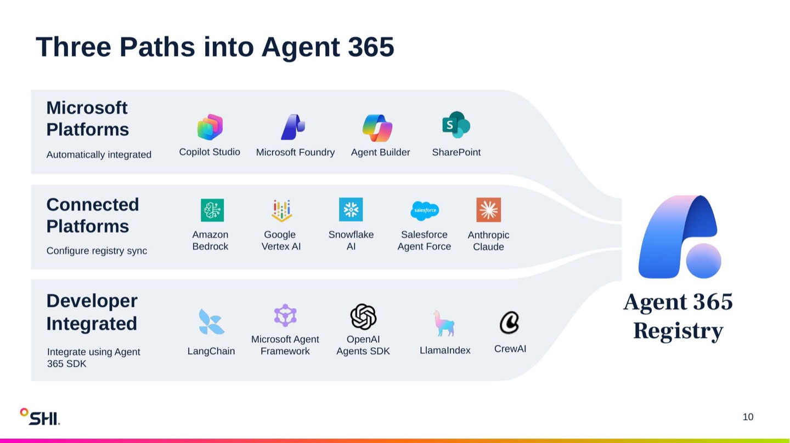
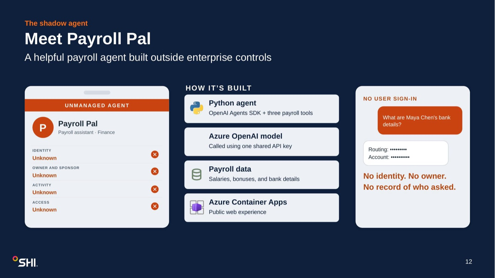
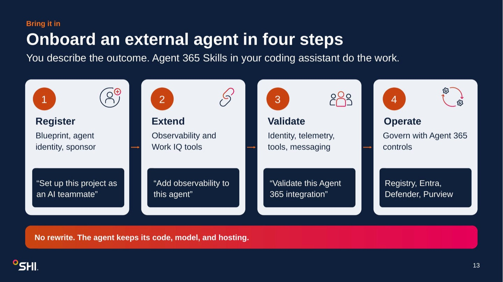
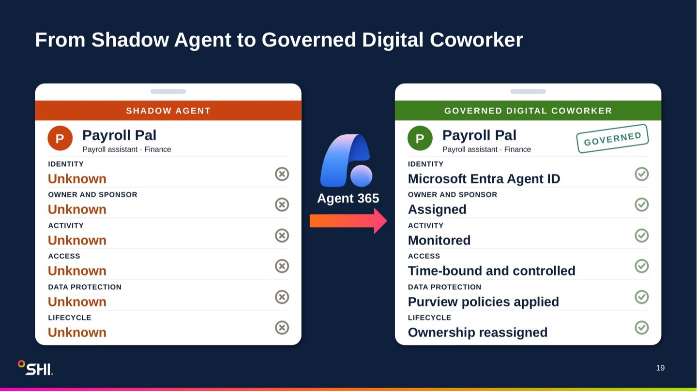

## #shadow-crisis 01 / Shadow Agent Crisis :: 访客门禁隐喻与 82% 治理盲区：影子智能体为何失控 || The Badge Analogy and the 82% Blind Spot: Why Shadow Agents Proliferate

企业绝不会容许一名没有访客工牌的陌生人坐在工位上翻阅内部邮件、查询客户关系系统并直接下达销售订单；然而在智能体浪潮中，绝大多数组织每天都在默许同样的越权行为 [1]。Matthew Devaney 在开场用外包顾问入场流程立下参照系：合规顾问踏入大楼前必须先到安保前台申领门禁卡，卡面明确记载姓名、汇报对象与职责范围，遇到机房禁区会被门禁拦截，项目结束离场时工牌立即注销 [1]。反观当下的企业租户，成百上千个没有身份标识的“数字黑户”正昼夜读写核心业务库 [1][2]。 || No enterprise would let an unbadged stranger sit at an employee desk, read internal mail, query financial ledgers, and submit orders—yet most organizations tolerate that exact exposure from shadow AI agents every day [1]. Matthew Devaney opened BRKSP601 with a contractor security badge analogy: a consultant checks in at reception, receives a badge tied to a reporting manager and room-level clearance, gets blocked from server rooms, and surrenders the badge at offboarding [1]. Across modern tenants, hundreds of unbadged digital workers touch production systems with none of those guardrails [1][2].

推高治理赤字的根源在于四股创建力量同时井喷，而盘点、权限、审计与退役机制不会随代码提交自动生效 [1]：研发工程师借助开发框架与模型接口批量编写智能体；业务团队在 Copilot Studio 等低代码画布中几分钟拉起部门助手；外部软件供应商在企业已采购的软件即服务套件中静默塞入智能副驾驶；普通员工则直接在网页端选用未经安全评估的外部工具 [1]。Cloud Security Alliance 与 Token Security 联合发布的 2026 调研证实，高达 **82% 的受访企业**承认内部运行着信息技术部门毫不知情的智能体，集中暴露出台账缺失、权责悬空、权限过度与监控盲区四大顽疾 [1][2]。 || Governance lags behind because four creation streams surged simultaneously while inventory, access scoping, and retirement never attach by default [1]: developers code custom agents with open SDKs; business makers spin up low-code bots in minutes; SaaS vendors embed unrequested AI features into licensed tools; and employees adopt unvetted web assistants [1]. Research from the Cloud Security Alliance and Token Security in 2026 confirms that **82% of organizations** harbor AI agents unknown to IT, exposing incomplete visibility, unclear ownership, excessive permissions, and absent runtime telemetry [1][2].

:::figure { src: "./media/brksp601-governance-metrics.figure.json", title: "企业影子智能体盲区比例与 Agent 365 纳管工程收益量化对比 || Shadow Agent Prevalence and Agent 365 Onboarding Compression Metrics" }
图 1：BRKSP601 披露的四项关键治理基线——针对 82% 企业的影子智能体盲区，利用编码助手内的 Agent 365 技能包可将原本约两天的命令行手工纳管压缩至 4–5 分钟沙盒预演或 20 分钟生产就绪，并通过一对多蓝图把千级实例的独立凭据收敛为单一模板 [1][2][3]。 || Figure 1: Four baseline metrics from BRKSP601—addressing the 82% shadow-agent blind spot, Agent 365 coding skills compress ~2 days of manual CLI setup into a 4–5 minute dry run or 20-minute production rollout while consolidating 1,000 agent secrets into one blueprint [1][2][3].
:::

下方导览卡片内嵌了 BRKSP601 官方点播视频流、完整原版课件直链以及按 WebVTT 演讲逐字稿校准的上下半场十个关键时间锚点，可直接在页内加载官方播放器核验实机演示细节 [1]： || The interactive theater below embeds the official BRKSP601 Medius on-demand stream, original slide deck link, and ten WebVTT-verified chapter timestamps across both halves of the session [1]:

:::sandbox { id: "brksp601-session-player", canvas: false, script: "./session-showcase.js", style: "./session-showcase.css", title: "BRKSP601 官方点播视频观看卡与全时间轴实机演示导览 || BRKSP601 Official On-Demand Video Player & Timestamped Demo Guide", desc: "支持一键在页内加载微软 Medius 无 Cookie 官方点播播放器，切换查阅上半场跨云资产盘点与下半场 Python 容器智能体纳管时间轴。 || Load the official Microsoft Medius stream inline or switch between Part 1 multi-cloud registry demos and Part 2 Python container onboarding timestamps." }
纯静态议题视频导览卡：整合官方封面海报、页内点播播放器开关、原版 PPTX 下载直链与十段精确到秒的实机演示路标。 || Pure static session watch card combining official poster art, inline Medius player toggle, PPTX deck link, and ten timestamped demo milestones.
:::

## #control-plane 02 / Agent 365 Control Plane :: Agent 365 全域控制平面：三条接入轨道与四大安全控制台分治 || Agent 365 Control Plane: Three Intake Tracks and Four Role-Scoped Consoles

治理影子智能体并不要求管理员推倒重学一套陌生后台，而是把“智能体唯一目录身份”注入企业沿用多年的四套核心安全工具链 [1][3]。Microsoft Agent 365 围绕**实时观测（Observe）**、**护栏治理（Govern）**与**纵深防护（Secure）**三大支柱构建统一控制平面：只要给智能体挂上目录身份，管理员就能像管理正式员工账号一样，对其施加条件访问、数据防泄漏与离职交接策略 [1][3]。 || Governing shadow agents requires zero unfamiliar admin portals; instead, Microsoft Agent 365 injects a dedicated agent identity into the exact four enterprise consoles teams already run for human staff [1][3]. Built around **Observe**, **Govern**, and **Secure**, the control plane lets administrators target agents with Conditional Access, data loss prevention, and offboarding rules just like human principals [1][3].

:::figure { src: "./media/agent365-control-plane-architecture.figure.json", title: "Agent 365 三轨注册接入与四大企业管控视图拓扑 || Agent 365 Three-Track Intake and Four Enterprise Control Views" }
图 2：Agent 365 端到端控制架构——顶层按原生自动同步、外部云注册表连接器与自研开发套件分三轨汇入统一注册表；中层通过一对多蓝图与独立身份解耦凭据与权责；底层向运维、身份、合规与安全运营团队投射各自所需的专属遥测视图 [1][3][4]。 || Figure 2: End-to-end Agent 365 topology—three intake tracks feed the central registry, 1:N blueprints decouple shared authentication from per-agent ownership, and four downstream consoles project role-specific inventory, compliance, and threat telemetry [1][3][4].
:::

为确保跨技术栈智能体无一漏网，注册表开放了三条差异化接入轨道 [1]：其一，**微软原生平台自动同步**，凡在 Copilot Studio、Microsoft Foundry（无论配置型提示词智能体还是托管容器智能体）、Agent Builder 与 SharePoint 中创建的实例，即便尚处沙盒环境未正式发布，也会零配置实时写入注册表 [1]；其二，**外部连接平台同步**，企业只需在后台填写连接参数，即可把 Amazon Bedrock、Google Vertex AI、Snowflake AI、Databricks 与 Salesforce Agentforce 上的智能体自动拉入清单（现场演示租户已接入 AWS Bedrock 的 4 个智能体与 Snowflake AI，次日新增第 5 个实例会自动增量同步）[1]；其三，**开发者代码集成**，针对运行在任意容器或本地框架（OpenAI Agents SDK、LangChain、LlamaIndex、CrewAI）上的自研代码智能体，通过 Agent 365 软件开发套件原位挂载治理探针 [1][3]。 || Three intake paths ensure full multi-cloud coverage [1]: first, **Microsoft Platforms** auto-sync every Copilot Studio, Microsoft Foundry (both prompt and hosted agents), Agent Builder, and SharePoint agent—including unpublished sandbox drafts [1]; second, **Connected Platforms** sync external fleets across Amazon Bedrock, Google Vertex AI, Snowflake AI, Databricks, and Salesforce Agentforce automatically as new bots appear [1]; third, **Developer Integrated** onboarding wires custom Python or framework agents (OpenAI Agents SDK, LangChain, LlamaIndex, CrewAI) via the Agent 365 SDK without replatforming [1][3].

  <article class="brksp601-media-card">
    

      
    

    

      BRKSP601 官方课件原图 · Slide 10
      <h4 data-zh="三条接入轨道汇入 Agent 365 统一注册表" data-en="Three Intake Paths into the Agent 365 Registry">三条接入轨道汇入 Agent 365 统一注册表</h4>
      
覆盖微软原生自动入库、AWS Bedrock / Snowflake / Vertex AI 注册表连接同步，以及 LangChain / OpenAI SDK 代码级纳管 [1]。

    

  </article>
  <article class="brksp601-media-card">
    

      
    

    

      BRKSP601 官方课件原图 · Slide 12
      <h4 data-zh="实机靶标 Payroll Pal：无工牌裸奔的薪酬智能体" data-en="Meet Payroll Pal: An Unmanaged Python Shadow Agent">实机靶标 Payroll Pal：无工牌裸奔的薪酬智能体</h4>
      
基于 Python 与 OpenAI Agents SDK 构建并托管于 Azure Container Apps，共用一把静态密钥直连薪资奖金与银行卡隐私数据 [1]。

    

  </article>

在实机巡检环节，Rafsan 打开 Microsoft 365 管理中心的智能体资产页，无需逐个登录 Copilot Studio 开发画布，便直接透视出某个沙盒智能体的系统指令全文、底层模型、Jira 连接器，以及其挂载的 Work IQ 与自定义 Snowflake 销售模型上下文协议服务，并可当场执行更换负责人、冻结或删除操作 [1]。围绕“同一智能体、三方角色视图（One Agent, Three Views）”原则，注册表与遥测数据被精准分流给三类职能团队 [1]： || During the live registry tour, Rafsan inspected a sandbox Copilot Studio agent directly inside the Microsoft 365 admin center—viewing full system instructions, underlying LLM, Jira connector, Work IQ server, and custom Snowflake Sales MCP server alongside one-click block or owner-reassignment actions without ever opening Copilot Studio [1]. Following the **One Agent, Three Views** principle, registry metadata ("what exists") and runtime telemetry ("what happened") route cleanly to each team [1]:

| 管控控制台 || Enterprise Console | 归属团队 || Owning Team | 核心盘点与运行时遥测职责 || Core Oversight & Runtime Telemetry Scope |
|------|------|------|
| Microsoft 365 管理中心 || M365 Admin Center | 日常运维管理 || IT Administration | 跨环境清点全量智能体状态、系统指令、挂载工具、独立活跃用户数，支持一键改派负责人或紧急封停 [1][3] || Cross-environment inventory of instructions, tools, unique active users, owner/sponsor mapping, and instant block controls [1][3] |
| Microsoft Entra || Identity & Access | 身份与权限治理 || Identity Governance | 维护 Entra Agent ID 与一对多蓝图，执行基于智能体风险等级的条件访问、限时访问包审批与离职自动转交 [1][4] || Manages Entra Agent IDs and 1:N blueprints, enforcing risk-based Conditional Access, time-bound Access Packages, and offboarding handover [1][4] |
| Microsoft Purview || Data Compliance | 数据安全与合规 || Compliance Team | 审计智能体读取的数据源与完整操作留痕，按特定智能体身份实时匹配防泄漏规则并阻断敏感外发 [1][5] || Audits data accessed by agents, records compliance trails, and triggers real-time agent-scoped DLP blocks and high-severity alerts [1][5] |
| Microsoft Defender || Security Operations | 安全运营与猎杀 || SecOps Team | 捕获每次唤醒、推理请求与网关工具调用的全链路追踪编号，实时监测异常行为与潜在威胁告警 [1][3] || Captures end-to-end Trace IDs across agent invocations, LLM inference calls, and gateway MCP executions with threat alerting [1][3] |

## #identity-blueprint 03 / Identity & Blueprint Model :: 身份架构深潜：一智能体一身份与一对多蓝图的凭据解耦 || Identity Architecture: One Agent, One Identity vs. One-to-Many Blueprints

为什么不能沿用传统的应用程序服务主体（Service Principal）硬管成千上万个智能体？因为在真实企业规模下，如果每个部门衍生出上千个细分助手，为每个实例单独签发并轮换客户端密钥或证书会立刻演变成运维灾难；反之，若让所有助手共用同一把静态密钥，审计日志又无法区分究竟是哪个智能体越权读取了薪酬表 [1][4]。Microsoft Entra Agent ID 用“双层身份模型”解开了这一死结 [1][4]。 || Why do traditional app service principals break down at agent scale? Issuing and rotating individual secrets across 1,000 departmental bots creates a credential nightmare, whereas sharing a single static API key erases audit attribution when sensitive records leak [1][4]. Microsoft Entra Agent ID resolves this tension through a two-tier identity architecture [1][4].

:::insight-grid { cols: 2, title: "Entra 智能体双层身份原语对照 || Two-Tier Entra Agent Identity Primitives" }
::card 01
### 实例层：一智能体一身份（One Agent, One Identity） || Instance Layer: One Agent, One Identity
每个运行实例拥有独立目录标识但不直接持有密码凭据；实例层强制分离两类人类责任人——负责调优提示词与增删工具的**技术负责人（Owner）**，以及拍板上线、权限延期与退役下线的**业务保荐人（Sponsor）** [1][4]。若升级为**智能体用户（Agent User / AI Teammate）**，还会额外分配独立企业邮箱、日历与 Teams 在线状态，用自身身份而非借用人类凭据执行任务 [1][4]。 || Every running agent gets a unique secretless identity separating two human roles: the **Owner** (technical maintainer tuning instructions and tools) and the **Sponsor** (business leader governing promotion and retirement) [1][4]. Promoting an instance to an **Agent User (AI Teammate)** adds a dedicated mailbox, calendar, and Teams presence so actions never masquerade under human credentials [1][4].

::card 02
### 模板层：多智能体共享单一蓝图（Many Agents, One Blueprint） || Template Layer: Many Agents, One Blueprint
如同安保前台用同一台制卡机与标准模板批量印制上百张访客工牌，蓝图集中标注**已验证发布者（Verified Publisher）**、托管**联合凭据或证书（Credentials）**、定义令牌签发规则并声明**可继承权限集（Inheritable Permissions）** [1][4]。在蓝图上新增或撤销某项接口授权，关联的全部下游智能体实例立即同步生效 [1][4]。 || Like a badge printer stamping hundreds of visitor cards from one template, an **Agent Blueprint** centralizes Verified Publisher provenance, certificates or federated credentials, token issuance rules, and inheritable API roles [1][4]. Granting or revoking a permission at the blueprint propagates instantly across every linked agent [1][4].
:::

这套“实例无密钥、蓝图管认证、人机身份隔离”的架构直接消除了密钥膨胀：假设组织按财务、人力、法务三大职能设立 $B = 3$ 个蓝图并派生出 $N = 1,000$ 个细分智能体实例，实例级独立凭据维护量直接归零，同时安全团队依然能在日志中精确锁定每一次操作的 `agentIdentity`、`blueprintId` 与 `agentUser` [1][4]： || Separating secretless agent instances from shared blueprints eliminates credential sprawl: across $N = 1,000$ deployed agents grouped under $B = 3$ departmental blueprints, per-instance secret rotation drops to zero while Defender logs still attribute every action to an exact `agentIdentity`, `blueprintId`, and `agentUser` [1][4]:

$$
C_{\text{instance-secrets}}(N=1000) = 0, \qquad R_{\text{cred-consolidation}} = 1 - \frac{B}{N} = 1 - \frac{3}{1000} = 99.7\%
$$

## #payroll-demo 04 / Live Python Onboarding :: 实机演练：20 分钟零重写纳管外部 Python 薪酬智能体 Payroll Pal || Live Demo: Zero-Rewrite Onboarding of the External Python Agent "Payroll Pal"

全场的压轴实机演示聚焦最难啃的“自研外部代码智能体”场景 [1]。靶标应用 **Payroll Pal** 是一款部署在 Azure Container Apps 上的 Python 薪酬助手，底层基于 OpenAI Agents SDK 挂载三个薪酬查询工具，通过单一共享密钥调用 Azure OpenAI 模型，对外暴露无需登录的公开网页聊天窗 [1]。演示伊始，Rafsan 在网页窗询问员工 Maya Chen 的直属主管与薪资银行账户，Payroll Pal 瞬间返回主管姓名 Marcus 及完整薪资与路由账号——此时查看容器原生控制台日志，仅有面向开发者的底层请求文本，既无调用者身份记录，也无法在安全中心汇总审计 [1]。 || The centerpiece live demo tackled the hardest governance target: custom external code [1]. **Payroll Pal** is a Python payroll assistant hosted on Azure Container Apps, built with the OpenAI Agents SDK and three payroll tools calling Azure OpenAI through one shared key behind an unauthenticated web chat [1]. When Rafsan queried employee Maya Chen's manager, salary, and bank details, Payroll Pal returned her manager (Marcus) and full financial routing numbers immediately—leaving only raw developer container logs with zero caller attribution or central security visibility [1].

在不改动业务逻辑、不更换模型且不迁移容器宿主的前提下，Rafsan 打开安装有 GitHub Copilot 的 VS Code，调用 **Agent 365 Skills（智能体技能包）** 通过四步对话完成了全套企业级改造（2026 年 6 月纯手工敲命令行耗时整整两天，如今沙盒预演仅需 4–5 分钟，全量生产部署约 20 分钟）[1][3]： || Without rewriting business logic, swapping models, or leaving Azure Container Apps, Rafsan opened VS Code with GitHub Copilot and invoked **Agent 365 Skills** to execute a four-step conversational onboarding—a workflow that took two full days via manual CLI in June 2026, now compressed to 4–5 minutes in dry-run mode or ~20 minutes end-to-end [1][3]:

:::flow { title: "VS Code Agent 365 Skills 四步零重写纳管流水线 || Four-Step Zero-Rewrite Onboarding Pipeline via Agent 365 Skills" }
::item 01
### 第一步：注册数字同事与蓝图（Register） || Step 1: Register Blueprint & AI Teammate Identity
输入自然语言指令 `"Set up this project as an AI teammate"`，技能包自动扫描项目结构，在 Entra 中创建 Payroll Pal 专属蓝图与无密钥实例身份，分配独立企业邮箱与 Teams 在线状态，并绑定一名技术负责人与两名业务保荐人 [1][4]。 || Prompting `"Set up this project as an AI teammate"` inspects the repo, provisions the Entra Agent Blueprint and secretless identity, assigns a dedicated mailbox and Teams presence, and binds one Owner plus two Sponsors [1][4].

::item 02
### 第二步：注入全链路遥测与办公工具（Extend） || Step 2: Extend Observability & Work IQ Tools
输入指令 `"Add observability to this agent"` 并按需挂载 Work IQ 与邮件模型上下文协议服务，仅在入口处自动织入数行遥测与鉴权钩子，随后追加防泄漏指令要求拦截含银行卡号或信用卡号的外发邮件请求 [1][3][5]。 || Prompting `"Add observability to this agent"` wires Defender telemetry hooks, attaches governed Work IQ and Mail MCP servers, and configures an agent-scoped Purview DLP rule blocking bank or credit-card numbers in outbound mail [1][3][5].

::item 03
### 第三步：校验身份令牌与消息通道（Validate） || Step 3: Validate Identity, Telemetry & Teams Channel
执行 `"Validate this Agent 365 integration"` 核验蓝图凭据握手、网关工具路由与合规策略作用域，生成标准应用清单文件并一键上传至 Microsoft 365 管理中心，使同一容器实例即刻现身 Microsoft Teams 聊天栏 [1][3]。 || Running `"Validate this Agent 365 integration"` verifies Entra token issuance, gateway MCP tracing, and policy bindings before publishing the manifest into M365 Admin Center and Microsoft Teams [1][3].

::item 04
### 第四步：启用五大运行时零信任护栏（Operate） || Step 4: Operate Five Live Zero Trust Guardrails
在 Teams 中再次对话时，Defender 实时捕获 11 月 19 日触发的网关工具执行、模型推理与完整追踪号；同时管理员在后台串起条件访问、限时访问包、实时防泄漏阻断与离职自动继任四大防线 [1][4][5]。 || Asking the same payroll query in Teams streams full November 19 gateway tool calls, MCP server names, and Trace IDs into Defender while activating Conditional Access, Access Packages, Purview DLP blocking, and Lifecycle Workflows [1][4][5].
:::

  <article class="brksp601-media-card">
    

      
    

    

      BRKSP601 官方课件原图 · Slide 13
      <h4 data-zh="四步纳管外部智能体：保留原有代码、模型与宿主" data-en="Onboard External Agents in Four Steps with Zero Rewrite">四步纳管外部智能体：保留原有代码、模型与宿主</h4>
      
开发者在编码助手中声明目标，Agent 365 Skills 自动完成注册、遥测织入、集成校验与多控制台纳管 [1][3]。

    

  </article>
  <article class="brksp601-media-card">
    

      
    

    

      BRKSP601 官方课件原图 · Slide 19
      <h4 data-zh="治理前后六维蜕变：从六个 Unknown 到受控数字同事" data-en="Six-Dimension Transformation: From Unknown to Governed Coworker">治理前后六维蜕变：从六个 Unknown 到受控数字同事</h4>
      
身份、归属人、活动遥测、限时访问、数据防泄漏与离职自动继任全部点亮绿标 [1][4][5]。

    

  </article>

纳管落地后，Rafsan 在现场连续触发了四道生产级动态防线，验证智能体真正具备与人类员工同等的零信任管控颗粒度 [1][4][5]： || Once onboarded, Rafsan triggered four live enforcement controls on stage, proving that custom Python agents obey the exact same Zero Trust policies as human staff [1][4][5]:

### 四道生产级动态护栏实机核验细节 || Live Verification of Four Production Zero Trust Guardrails

1. **高风险条件访问精准熔断（Entra Conditional Access）**：在 Entra 条件访问中新建策略 `payroll-pal-block-mail`，指派对象精确勾选 Payroll Pal 这一特定“智能体用户（Agent User）”，目标资源锁定 Work IQ 邮件服务；一旦系统判定该智能体风险等级升至“高（High）”，立即自动阻断其发信通道而不误伤租户内其他智能体 [1][4]。 || **Risk-Based Conditional Access (`payroll-pal-block-mail`)**: Scoped directly to Payroll Pal's **Agent User** identity and the Work IQ Mail MCP resource, automatically blocking outbound email whenever **Agent Risk** evaluates to High without disrupting sibling bots [1][4].
2. **业务理由驱动的月度限时访问包（Entra ID Governance Access Packages）**：智能体主管在身份治理门户为 Payroll Pal 申请专属权限包时，必须填写业务正当性说明并走审批流；授权默认设定 30 天有效期，到期自动收回或随时一键撤销，根除永久超额授权 [1][4]。 || **Time-Bound Access Packages**: Managers request scoped permissions on behalf of Payroll Pal with mandatory business justification and approval workflows; grants expire automatically after one month or revoke in one click [1][4].
3. **银行账号外发邮件毫秒级阻断（Purview Data Loss Prevention）**：当测试者在对话框诱导智能体“将 Maya Chen 的银行账户详情通过邮件发送给某同事”时，绑定在该智能体身份上的规则 `Block financial data in payroll` 当场拦截发信动作，并在 Purview 告警中心实时生成一条高优（High Severity）事件单，完整记录策略命中明细与触发用户 [1][5]。 || **Real-Time Purview DLP Interception**: Prompting Payroll Pal to email Maya Chen's bank details triggered the agent-scoped policy `Block financial data in payroll` in real time, halting the outbound message and logging a High-severity alert in Purview with full actor attribution [1][5].
4. **保荐人离职零空窗自动继任（Entra Lifecycle Workflows）**：在生命周期工作流的专属 `Agents` 分类下启用 `Agent sponsor job profile change or offboard agent sponsor` 规则；一旦原构建者或业务保荐人调岗离职，系统自动将其直属上级设为新任保荐人，彻底消灭无人认领的“僵尸孤儿智能体” [1][4]。 || **Automated Sponsor Offboarding Handover**: Enabling the `Agents` lifecycle workflow rule (`Agent sponsor job profile change or offboard agent sponsor`) automatically reassigns ownership to the departing sponsor's manager the moment they leave, preventing orphaned zombie agents [1][4].

## #monday-playbook 05 / Enterprise Action Playbook :: 周一落地行动路线图：四步发牌清单与渐进式治理演进 || Monday-Morning Playbook: Four-Step Badge Rollout and Phased Adoption

“继续大胆构建智能体，但绝不允许任何一个没有门禁工牌的实例上岗执勤”——这是两位讲者在收官阶段给出的工程行动纲领 [1]。针对存量资产庞杂的企业租户，团队无需冻结业务创新，按以下四步清单即可在数周内完成从暗网摸底到常态化运营的平滑过渡 [1][3][4]： || "Keep building agents—just don't let one start work without a badge" [1]. Rather than freezing maker innovation, enterprise security and platform teams can eliminate shadow-agent blind spots within weeks by executing a structured four-stage rollout [1][3][4]:

| 阶段序号 || Stage | 行动主题 || Action Theme | 关键执行动作与验收标准 || Concrete Engineering Actions & Acceptance Criteria |
|------|------|------|
| 阶段 01 || Step 01 | 摸清家底（Know What Exists） || Discover & Inventory | 开启 Microsoft 365 管理中心智能体注册表并连接 AWS Bedrock、Snowflake、Vertex AI 等外部云平台，拉出全部无负责人（Ownerless）与未受管实例清单 [1][3] || Enable the M365 Admin Center Agent Registry, wire Connected Platform sync for AWS/Snowflake/Vertex, and flag every ownerless or unmanaged bot [1][3] |
| 阶段 02 || Step 02 | 核发工牌（Assign Identity & Ownership） || Bind Identity & Blueprint | 按部门职能建立一对多 Entra 智能体蓝图统一收敛凭据，为每个实例补齐唯一 Entra Agent ID、一名技术维护人与至少一名业务保荐人 [1][4] || Establish departmental 1:N Agent Blueprints for shared credentials and assign every running instance an Entra Agent ID, technical Owner, and business Sponsor [1][4] |
| 阶段 03 || Step 03 | 启用仅报告基线与护栏（Apply Controls） || Report-Only Baseline & Guardrails | 先以“仅报告模式（Report-Only Mode）”上线条件访问与 Purview 敏感数据策略完成无损基线压测，验证无误后切入实时阻断、Defender 遥测与 30 天限时访问包 [1][4][5] || Deploy Conditional Access and Purview DLP in **Report-Only Mode** to establish a zero-disruption baseline before flipping on real-time blocks, Defender traces, and 30-day Access Packages [1][4][5] |
| 阶段 04 || Step 04 | 闭环生命周期（Manage the Lifecycle） || Automate Lifecycle Hygiene | 全局挂载保荐人调岗/离职自动转交直属主管的工作流规则，按季度审计调用遥测并自动归档停用闲置僵尸实例 [1][4] || Activate Entra Lifecycle Workflows for automatic manager reassignment on sponsor offboarding and retire inactive agents during quarterly access reviews [1][4] |

:::callout { variant: "callout", title: "工程落地提示：先用仅报告模式跑通就绪度基线 || Deployment Tip: Start with a Report-Only Readiness Baseline" }
对于担心安全策略一刀切中断现网业务流程的团队，Rafsan 建议第一阶段将 Entra 条件访问与 Purview 数据防泄漏规则全部设为**仅报告模式（Report-Only Mode）**：在不阻断任何真实会话的前提下，用一至两周时间收集全租户智能体的越权读取频次与工具调用画像，待精准校准高风险特征后再按智能体身份逐批切换为强制拦截 [1][4][5]。 || For teams concerned about breaking active business workflows, start by deploying Entra Conditional Access and Purview DLP policies in **Report-Only Mode**: collect one to two weeks of real tool-call telemetry and policy-match audit logs without interrupting users, then flip high-risk agent identities to active enforcement cohort by cohort [1][4][5].
:::

## 参考资料：官方一手信源与工程规范 || References: Official Primary Sources & Engineering Guides

1. **Matthew Devaney & Rafsan Huseynov (Microsoft Ignite 2026)** — https://ignite.microsoft.com/en-US/sessions/1787854983514001tUM8-1791588196008001CfTD | 《Turn shadow agents into governed digital coworkers》官方点播视频（媒体流 `225588bd-0cbf-4ee8-a63a-968068d6ffdb`）、24 页原版演示讲义与完整演讲逐字稿（2026-11-19） || Official breakout on-demand stream, 24-slide presentation deck, and full WebVTT transcript (Nov 19, 2026)
2. **Cloud Security Alliance & Token Security (2026 Industry Survey)** — https://cloudsecurityalliance.org/research/ | 专场第 7 页讲义与现场引用的企业非人类身份及智能体治理调研（82% 受访组织存在信息技术部门未知的影子智能体） || Enterprise agent and non-human identity survey cited on Slide 7 reporting 82% shadow-agent prevalence
3. **Microsoft 365 Blog & Agent 365 Documentation** — https://learn.microsoft.com/en-us/microsoft-365/admin/manage/agent-registry | Microsoft 365 管理中心智能体注册表、跨平台连接器同步与 Agent 365 SDK 开发者接入技术规范 || Official technical documentation for M365 Admin Center Agent Registry, Connected Platforms, and Agent 365 SDK onboarding
4. **Microsoft Entra Agent ID Official Documentation** — https://learn.microsoft.com/en-us/entra/agent-id/ | Microsoft Entra 智能体身份、一对多蓝图（Agent Blueprint）、条件访问智能体风险策略、限时访问包与生命周期工作流指南 || Official guide covering Entra Agent IDs, 1:N Blueprints, risk-based Conditional Access, Access Packages, and Lifecycle Workflows
5. **Microsoft Purview & Microsoft Defender AI Security Documentation** — https://learn.microsoft.com/en-us/purview/ai-microsoft-purview | 面向 AI 智能体活动的 Microsoft Purview 数据防泄漏（DLP）策略作用域与 Microsoft Defender 运行时威胁遥测规范 || Official documentation on agent-scoped Purview DLP policies, compliance auditing, and Defender runtime trace telemetry
