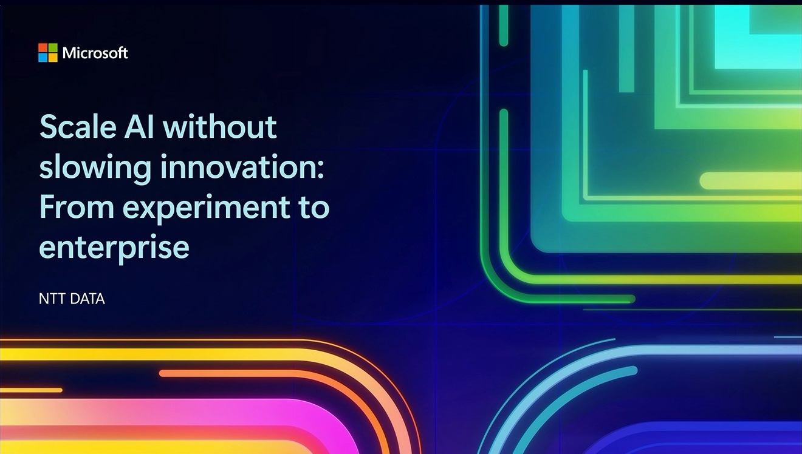
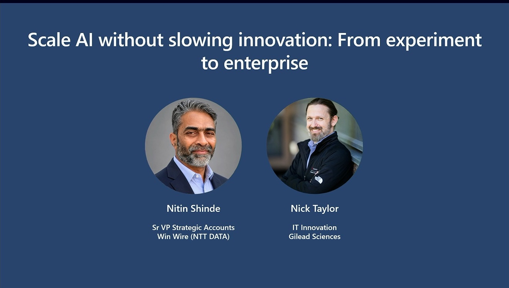
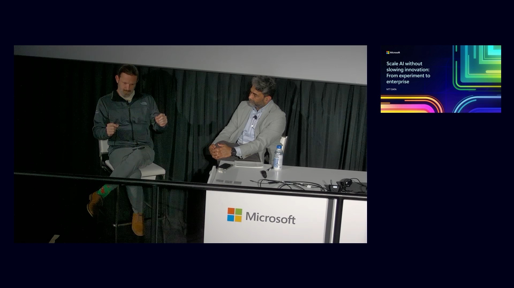

## #genie-foundation 01 / From Viral License to Orchestrator :: 破局一万个智能体：GENIE 联邦编排器的起源与医药监管试炼 || Beyond 10,000 Agents: Origin of the GENIE Orchestrator in Regulated Life Sciences

发放出许可证并开启访问开关，是企业推广人工智能最容易的一步；真正的张力在于，当数千名员工都能顺手搭建定制助手时，业务现场会瞬间涌现成千上万个碎片化用例 [1]。在生物制药巨头吉利德科学内部，员工主要依托提示词加知识库的轻量构建器（Agent Builder），已累计拉起超过 **10,000 个智能体**[1]。Nick Taylor 在复盘这一井喷现象时指出，如果管控标准收得过死，就会直接扼杀催生突破性创意的呼吸空间；但如果放任不管，大量只需一段表格宏或一条确定性自动化流（Power Automate）就能解决的简单诉求会被盲目包装成智能体，引发严重的重复建设与权责真空 [1][2]。 || Turning on seat licenses and scaling raw tool access is straightforward; the real operational tension begins once thousands of employees start building thousands of fragmented use cases [1]. Inside biopharmaceutical leader Gilead Sciences, employees primarily using prompt-and-knowledge Agent Builder workflows have already created **over 10,000 custom agents** [1]. As IT Innovation lead Nick Taylor observed on stage, standardizing too rigidly eliminates the breathing room where unexpected innovation happens, yet leaving creation unchecked turns simple Excel macros and Power Automate routines into sprawling, unaccountable agents [1][2].

吉利德科学破题的起点，是公司内部落地的第一套智能体系统——**GENIE（Gilead Enterprise Navigation and Information Engine，吉利德企业导航与信息引擎）**[1]。最初，Nick 只是偶然发现自己名下有一张 Copilot Studio 病毒式试用许可（Viral License），便单枪匹马利用工作之余连接内部多套异构系统，专门替员工解答“休假政策怎么查”“园区地图在哪里”以及“能否直接帮我提一张报修工单而不必自己填表”等高频日常痛点 [1][2]。早期团队并未向它下放任何高风险业务裁决权，仅将其锁定在跨连接器快速检索与工单代提场景；即便只靠聊天软件挂载与寥寥数条内部社区动态、未做大规模宣发，GENIE 依然凭借实打实的省时体验自然汇聚起**数千名活跃用户**，将数千张内部工单的闭环耗时压缩至原先的零头 [1]。 || Gilead's breakthrough began with its very first agentic system: **GENIE (Gilead Enterprise Navigation and Information Engine)** [1]. Discovering a viral Copilot Studio license attached to his account, Taylor initially built GENIE solo to unify fragmented internal systems—answering everyday employee questions on leave policies and campus maps while opening support tickets automatically [1][2]. Although early builders withheld autonomous decision-making and did minimal internal marketing beyond Teams placement and a few Viva Engage posts, GENIE organically attracted **thousands of active users** and resolved thousands of tickets in a fraction of historical turnaround time [1].

:::figure { src: "./media/brksp620-genie-governance-architecture.figure.json", title: "吉利德科学从沙盒立项到 GENIE 联邦编排器的三层规模化运行架构 || Gilead Sciences Three-Plane Operating Model from Safe Sandbox to GENIE Orchestrator" }
图 1：BRKSP620 揭示的三层企业智能体扩展模型——顶层以隔离租户沙盒、前驻工程师与 WinWire 共建创意门户收敛万级需求；中层通过立项期多方联席预审与防泄漏红队按风险比例放行；底层依托 GENIE 主控编排器实现跨部门子智能体分布式共建与工时观测 [1][3][4]。 || Figure 1: Three-plane enterprise scaling architecture from BRKSP620—combining isolated sandboxes, forward-deployed champions, and the WinWire Idea Portal on top; ideation-stage RAI reviews and SharePoint DLP red-teaming in the middle; and the federated GENIE orchestrator with observability telemetry underneath [1][3][4].
:::

一个好用的智能体上线后，最大的连锁反应并非技术故障，而是全公司蜂拥而至的复制诉求——药政事务（Regulatory）等业务部门纷纷找上门追问：“能不能给我们部门也单独造一个专属 GENIE？”[1] 与此同时，当早期原型试图广泛挂接各类数据源准备正式投产时，负责数据治理与安全的团队及时踩下刹车：必须先整顿文档库权限与数据底座，绝不能带病上线 [1][4]。这一碰撞直接促成了吉利德核心架构的演进转折：由 IT 团队率先打磨好安全受控的 **GENIE 主控编排器（Master Orchestrator）**，再开放标准接口让药政等不同业务团队在编排器内部自主构建并维护各自的**领域子智能体（Sub-Agents）**[1][2]。个人单兵视角由此正式升维至组织级机制设计——如何构建一套让下一个好创意被发现、验证、孵化并规模化复制的土壤 [1]。 || Once a flagship experience succeeds, every department—from Regulatory onward—immediately asks for its own bespoke clone [1]. At the same time, when Taylor's early prototype attempted to hook into sprawling enterprise repositories before launch, security and data owners stepped in to clean up SharePoint hygiene first [1][4]. That friction produced Gilead's defining architectural pivot: starting with IT to harden **GENIE as a central master orchestrator**, then empowering domain groups to build and own specialized **sub-agents** inside that governed shell [1][2].

与 GENIE 同步推进的，还有 2024 年启动的 **300 席受监管全企试点**[1]。在当时必须集齐 300 张起步许可的门槛下，Nick 将名额尽量均衡地撒向全公司 **15 个以上不同业务团队**——其中既有被主管点名试水的员工，也有主动报名的尝鲜者 [1]。这批无人行政任命的志愿者迅速成长为扎根一线的**早期先锋（Champions）**，主动拉拢身边同事并邀约技术团队现场拆解真实业务表格，而非围观脱离实际的通用演示 [1]。作为严谨的制药企业，团队并未采取“先全量铺开、事后补合规”的激进路线，而是在推广途中主动暂停数次，拉拢起初对生成式技术一头雾水的法务与高层管理者逐条厘清权限继承与禁入数据清单，让合规护栏与业务渗透同步成型 [1][4]。 || Alongside GENIE, Taylor led Gilead's **300-license Copilot rollout in 2024**, distributing seats across more than **15 distinct business groups** [1]. Early volunteers—never formally assigned the title—became organic **champions**, inviting Taylor in to work on their teams' actual spreadsheets rather than generic demos [1]. Because pharmaceuticals demand strict patient and regulatory accountability, Gilead refused to bolt governance on after the fact; instead, rollout paused deliberately whenever legal, compliance, and executive stakeholders needed alignment on permission inheritance and restricted data exclusions [1][4].

下方交互导览台按时间轴完整还原了 BRKSP620 全场 45 分钟炉边对谈与四轮现场听众问答的逐分钟纪要，支持一键在页内唤起微软官方点播流或跳转官方议题主页核验一手实录 [1]： || The interactive theater below maps all four chapters across the 45-minute BRKSP620 fireside chat and live audience Q&A, letting you launch the official Microsoft Medius stream inline or jump straight to the Ignite session page [1]:

:::sandbox { id: "brksp620-video-theater", canvas: false, script: "./brksp620-theater.js", style: "./brksp620-theater.css", title: "BRKSP620 官方点播视频与四幕炉边实录时间轴导览台 || BRKSP620 Official On-Demand Stream & Four-Chapter Fireside Theater", desc: "点击顶部时间轴标签切换 GENIE 起源、立项期治理与创意门户、安全厨房分布式责任以及现场沙盒/红队问答四大章节，支持直接加载官方 Medius 播放器。 || Switch across GENIE Origins, Ideation & Idea Portal, Safe Kitchen Ownership, and Live Q&A on Sandboxes & DLP, or launch the official Medius player." }
纯静态议题导览沙盒：内置官方高清封面、炉边舞台关键帧截屏、逐分钟实录摘要与微软官方视频点播直达入口。 || Pure static session theater featuring official HD cover art, stage keyframes, timestamped transcript digests, and direct Medius playback links.
:::

## #ideation-governance 02 / Governance at Ideation & Idea Portal :: 立项期治理与集中归口：前驻工程师、创意门户与实质人工把关 || Governance at Ideation: Forward-Deployed Engineering, Idea Portal, and Meaningful HITL

只懂前沿技术而摸不透业务痛点的试验，最终只会沦为令人厌倦的摆拍演示（Demos）；反过来，守着业务流程却拒绝引入新工具，则只能困在原地踏步的旧常态里 [1]。为打破这组对立，Nick 将自己的日常角色定义为**内部前驻工程师（Internal Forward-Deployed Engineer）**——一方面持续追踪微软各项私有预览与前沿计划（Frontier Program）摸清技术边界，另一方面在立项最早期直接驻场嵌入业务团队，帮他们把个人收件箱省下的零碎时间，转化为跨部门端到端流程的周期压缩 [1][2]。 || Experimentation divorced from domain reality produces disposable demos, while business continuity without new tooling preserves the status quo [1]. Bridging both worlds, Taylor operates as an **internal forward-deployed engineer**—staying on the bleeding edge of Microsoft private previews and Frontier programs while embedding directly inside business teams early enough to turn personal inbox time-savings into cross-functional cycle-time compression [1][2].

他在现场举了一个极具说服力的跨部门协同账本：如果业务人员在向法务或公共事务（Public Affairs）团队正式提审材料前，能直接借用对方团队封装好的智能体技能（Skill）先做一轮合规预检，那么提交上去的初稿收到的修改红线就会**从过去的 50 处骤降至 5 处**，大幅砍掉来回拉锯的审批等待时间 [1][2]。而所谓**立项期治理（Governance at Ideation）**，正是趁需求刚刚萌芽时，由前驻工程师第一时间把 IT 业务伙伴（IT Business Partners）、人工智能委员会、负责任 AI 委员会以及安全、隐私、合规团队拉进同一个房间联席把关 [1][3]。GENIE 当年用无数次试错蹚平了这套跨部门协同链路，使得后续每一个新智能体在立项之初就天然具备合规基因，彻底免除了上线前夕推倒返工的沉没成本 [1]。 || A concrete example illustrates enterprise-grade return: when an employee borrows a pre-built skill or agent from Legal or Public Affairs to vet a first draft before submission, formal review comes back with **5 redlines instead of 50**, dramatically shortening approval cycles [1][2]. **Governance at ideation** means bringing IT business partners, the AI Council, the Responsible AI Council, security, privacy, and compliance into the room while an idea is still forming [1][3]. Having paved that cross-functional path the hard way during GENIE's launch, subsequent agents inherit built-in guardrails without late-stage rework [1].

  <article class="brksp620-media-card">
    

      
    

    

      BRKSP620 现场主视觉课件 · 00:35
      <h4 data-zh="从单点实验迈向企业级规模化的治理命题" data-en="Bridging Grassroots Experimentation and Enterprise Scale">从单点实验迈向企业级规模化的治理命题</h4>
      
WinWire（NTT DATA）与吉利德科学携手 14 年，聚焦生命科学高监管场景下的低代码智能体扩围与资产治理 [1]。

    

  </article>
  <article class="brksp620-media-card">
    

      
    

    

      BRKSP620 讲者阵容实拍 · 07:00
      <h4 data-zh="跨学科业务洞察与企业平台工程双视角碰撞" data-en="Pairing Biotech Entrepreneurship with Enterprise Platform Engineering">跨学科业务洞察与企业平台工程双视角碰撞</h4>
      
融合科学教育、微生物技术与基因编辑创业背景的 Nick Taylor 联袂 Nitin Shinde 拆解一线实战踩坑账本 [1]。

    

  </article>

当全公司每天都有新点子冒头时，“创意该往哪里提”成了消灭影子 IT（Shadow IT）与影子 AI（Shadow AI）的关键抓手 [1]。为此，吉利德联合长期伙伴 **WinWire 共同设计并打磨了集中式创意门户（Idea Portal）**，将其直接嵌入企业的负责任 AI 审批与交付管线之中 [1][3]： || When ideas surface across every department, answering "where do ideas go?" becomes the primary defense against shadow IT and shadow AI [1]. Together with **WinWire**, Gilead built and stress-tested a centralized **Idea Portal** wired directly into its Responsible AI delivery pipeline [1][3]:

:::flow { title: "吉利德创意门户（Idea Portal）与智能体辅助治理的四步防堵漏闭环 || Four-Step Idea Portal Intake and Agent-Assisted Governance Loop" }
1. **宽口径阳光化收集，终结本机裸跑原型 || Broad Open Intake Replacing Localhost Shadow Builds** — 门户同时欢迎成熟的商业计划书与单纯的“某流程耗时烧钱”痛点求助；当员工拿着即兴编码（Vibe-Coded）拼凑出、甚至企图从个人电脑本机端口（`localhost`）对外提供服务的危险原型找上门时，团队立即执行合规体检并将其导入受控正轨，坚守“我们造的是关乎患者生命的药物”这一底线 [1][4]。 || Welcomes everything from ROI-backed business plans to raw workflow pain points; when makers arrive with vibe-coded apps served off `localhost`, the team delivers an immediate reality check to protect patient-critical pharmaceutical standards [1][4].
2. **AI 驱动的相似度去重与责任团队派单 || AI-Powered Similarity Clustering & Routing** — 当前正在升级门户自身的智能化引擎，自动比对全公司提交的相似诉求、合并重复立项，并精准匹配最合适的业务伙伴与工程承建团队，避免集中归口退化为行政审批瓶颈 [1]。 || Modernizes the portal with AI-driven similarity detection to spot duplicate cross-team requests early and route promising concepts to the right IT and governance owners without creating a bureaucratic bottleneck [1].
3. **可观测性锁定真实执行权与前后工时基线 || Observability Over True Agency & Cycle-Time Baselines** — 建设专属可观测性平台以遏制智能体无序泛滥：凡是真正握有业务动作执行权（Actual Agency）的智能体，都必须清晰界定其在工作流中的精确坐标，并在投产前测量现行耗时基线与预期压缩工时，客观筛选高投资回报项目浮出水面 [1][3]。 || Deploys observability tooling so every agent exercising real workflow agency has a mapped process boundary and measured pre/post cycle-time baseline, letting high-ROI candidates rise objectively [1][3].
4. **以智能体加速治理，严拒“橡皮图章”式点选 || Agents Accelerating Governance with Substantive Human Oversight** — 将智能体引入合规初筛与材料预审以缩短治理周期；但在全球法规高频演变的制药行业，人在回路（Human-in-the-Loop）绝不允许沦为机械应付的“点按钮过场（Just for Clicking）”，核心专业判断仍由领域专家实质担责 [1][3]。 || Uses agents to speed up governance review cycles while ensuring human-in-the-loop oversight remains substantive professional judgment rather than rubber-stamp clicking amid shifting AI regulations [1][3].
:::

## #safe-kitchen-triage 03 / Safe Kitchen & Risk-Proportional Triage :: “安全厨房”分布式所有权：隔离沙盒、架构签名快道与协同扩围 || The Safe Kitchen Model: Isolated Sandboxes, Signed Fast-Track Patterns, and Scaling Together

集中式立项解决了“入口可见性”，但上线之后的长期运维如果全压在中央 IT 肩上，创新同样会陷入停滞 [1]。在解释上线后如何维系**分布式所有权（Distributed Ownership）**时，Nick 引用了动画电影中那句著名台词的深层修正——并非字面意义上“人人都能当大厨”，而是**“伟大的厨师可以诞生在组织任何一个意想不到的角落”**[1]。懂业务的科学家、法务与市场人员学习现代低代码与提示词工具的速度，远远快于技术人员从头补习十几年医药行业专长的速度；因此 IT 创新团队的核心使命不是替全公司包办每一道菜，而是**开办烹饪学校、搭建一间连最严苛的卫生检查员（合规审计）进场突击检查也不会勒令关停的“安全厨房（Safe Kitchen）”**[1][4]。 || Centralized intake solves visibility, yet post-launch velocity stalls if central IT tries to own every agent forever [1]. Explaining **distributed ownership**, Taylor adapted a classic culinary lesson: not everyone starts as a master chef, *but a great cook can come from anywhere in the business* [1]. Domain professionals learn modern AI tooling far faster than technologists can master decades of pharmaceutical nuance; IT's job is to run cooking school and **build a "Safe Kitchen" where the health inspector (regulatory audit) will never shut the company down** [1][4].

:::figure { src: "./media/brksp620-risk-proportional-triage.figure.json", title: "受监管药企 AI 用例的风险成比例分流与资产归位象限 || Risk-Proportional AI Triage & Asset Placement Quadrant in Regulated Life Sciences" }
图 2：BRKSP620 风险成比例治理矩阵——拦截右下角本机裸跑的影子原型与左下角脱离业务的孤立演示，将轻量知识问答导入左上角预审模式快车道，并将跨系统高价值场景收敛至右上角 GENIE 联邦编排靶心 [1][2][4]。 || Figure 2: Risk-proportional triage matrix from BRKSP620—eliminating localhost shadow prototypes and disconnected demos while routing lightweight assistants through signed fast-track patterns and anchoring high-agency workflows inside the federated GENIE orchestrator [1][2][4].
:::

在现场问答环节，一位正苦于无法说服内部网络与安全团队松绑探索空间的 IT 主管直接追问破局之道 [1]。Nick 给出了两套经过吉利德实战检验的硬核工程解法 [1][4]： || When an audience IT leader asked how to convince cautious network and security teams to allow exploration, Taylor detailed two concrete mechanisms proven at Gilead [1][4]:

- **创新预算买单的独立租户与合成数据沙盒 || Isolated Tenants with Synthetic Data** — 绝不在生产环境里拿真实患者或商业机密冒险试错，而是由创新部门预算出资设立物理隔离的独立测试租户（Separate Tenants）与合成数据（Synthetic Data）沙盒，向业务团队敞开大门验证工具可靠性并量化潜在工时收益，用实测证据赢得安全团队信任 [1]。 || Rather than gambling on production data, Taylor funds isolated tenants populated with synthetic data from his innovation budget—inviting business partners inside a guided sandbox to prove reliability and quantify ROI before touching live networks [1].
- **企业架构签名模式的按风险比例极速放行 || Risk-Proportional Fast-Track via Signed EA Patterns** — 吉利德正在重构审批流：只要创作者采用企业架构（Enterprise Architecture）团队已预先签署认证的标准设计模式（Signed-Off Pattern）并提交合规证明，审批流就会按低风险等级**一路绿灯快速放行（Sail Through）**；唯有触及全新连接器或高风险外部交互的新物种才拉起深度联席评审，从而把艰难走通的 `0 → 1` 迅速放大为规模化的 `1 → N` [1][3]。 || Gilead is redesigning approvals around risk proportionality: builders who prove adherence to a pre-signed Enterprise Architecture pattern sail through review rapidly, reserving heavy multi-council scrutiny for novel patterns so `0 → 1` breakthroughs scale cleanly from `1 → N` [1][3].

在组织文化与领导力层面，高管绝不能只停留在转发口号或观看包装精美的汇报演示 [1]。幸运的是，吉利德新任首席信息官（CIO）极具前瞻性，直接推动技术布道者与各业务线高管建立一对一辅导机制 [1]。当预设好工作上下文后，哪怕一句极其朴素的提示词也能当场生成高亮标出药物分子官能团（Functional Groups）的交互式演示幻灯片——这种消除技术神秘感与犯错焦虑的真实体验（“你不会把系统搞崩的”），促使领导层在团队面前真诚分享自己日常爱用的提示词与自建小助手 [1]。在此基础上，Nick 为所有寻求规模化破局的企业浓缩出**三大核心行动纲领**[1]： || Culturally, executives must move past staged demos to visible daily usage [1]. Backed by an AI-forward CIO, Taylor coaches executives one-on-one—showing how rich Copilot context lets simple prompts generate interactive slides highlighting molecular functional groups without fear of breaking anything [1]. Distilling Gilead's journey, Taylor left enterprise leaders with **three foundational takeaways** [1]:

:::insight-grid { cols: 3, title: "BRKSP620 企业 AI 规模化三大核心行动纲领 || Three Core Enterprise Scaling Takeaways from BRKSP620" }
::card 01
### 持续陪伴人的心智成长 || Support People Continuously
发放席位许可与普及概念仅仅是起点；员工遇到提示词失效时极易直接否定工具，必须配备可随时求助的业务先锋、实战范例以及诸如微软 **AI Skills Navigator** 等结构化学习阵地，把每周“看看有什么新解法”固化成团队习惯 [1]。 || License access and awareness are only step one; pair everyday practice with trusted champions, recurring team show-and-tells, and structured learning like Microsoft's **AI Skills Navigator** so users don't abandon tools after an early bad prompt [1].

::card 02
### 给创意铺设含护栏的通途 || Give Ideas a Guarded Path
既要保留允许试错的安全试验场，又要清晰划定合规红线，通过集中式创意门户把一线痛点与业务伙伴、IT 架构及负责任 AI 管线无缝咬合，让员工笃信好点子无需绕道地下影子工具也能正规落地 [1][3]。 || Preserve safe spaces for unexpected ideas while baking IT architecture and Responsible AI guardrails directly into the Idea Portal path—removing any incentive to resort to shadow AI [1][3].

::card 03
### 跨部门协同诊断并齐步扩围 || Scale Together Across Cohorts
正视组织内部冷热不均的客观落差——当发现某些部门采用率停留在 **50%** 时，联合业务主管、人力资源（HR）与先锋骨干实地排查究竟是工具能力错位、缺乏知晓度还是存在替代工具，以业务为中心协同补齐短板 [1]。 || Confront uneven adoption candidly—when a division sits at **50% adoption**, partner across business leaders, HR, IT, and champions to diagnose whether the gap stems from tool fit, awareness, or workflow mismatch [1].
:::

## #data-dlp-workiq 04 / Data Red-Teaming & Work IQ Moat :: 数据治理深水区：SharePoint 红队防泄漏、科研连接器试点与选型护城河 || Data Governance Deep Dive: SharePoint Red-Teaming, Scientific Connectors, and the Work IQ Moat

对生命科学企业而言，把内部文档与科研数据接入大模型是最敏感的深水区 [1]。回应现场关于跨系统数据共享挑战的提问时，Nick 坦诚复盘了吉利德在推进全面铺开前经历的严密数据攻坚战：团队在扩围至全部 300 名早期种子用户之前，先圈定了一个极小范围的核心攻坚组，针对内部 **SharePoint 环境展开高强度红队测试（Red Teaming）**——故意构造各种刁钻越界问题，逐一检验系统究竟能吐出哪些内容、哪些敏感角落必须从检索范围中彻底剔除 [1][4]。 || For life-sciences enterprises, exposing internal repositories to generative AI is the most sensitive hurdle [1]. Addressing audience questions on data governance, Taylor revealed that before expanding even to the full 300-seat pilot, a tight Tiger Team ran aggressive **red-teaming against Gilead's SharePoint environment**—firing adversarial prompts to test permission boundaries and identify repositories requiring total exclusion [1][4].

  <article class="brksp620-media-card">
    

      
    

    

      BRKSP620 炉边对谈与听众问答实拍 · 06:00
      <h4 data-zh="直面真实医药生产环境的红队排雷与连接器准入" data-en="Candid Field Lessons on DLP Enforcement and Regulated Connectors">直面真实医药生产环境的红队排雷与连接器准入</h4>
      
Nick Taylor 现场剖析早期数据防泄漏（DLP）规则生效延迟的排障历程，并宣布大会当日正式启动 PubMed 与 ClinicalTrials.gov 科研连接器试点 [1]。

    

  </article>

在红队实测中，团队曾敏锐揪出一项关键阻断：早期阶段部分**数据防泄漏（DLP）规则曾出现短暂未被即时遵循的窗口**；正是因为坚持“先排雷再扩围”，吉利德联合微软彻底跑通了标签拦截机制，将标有**商业机密（Secret）、个人身份信息（PII）与受保护健康信息（PHI）**的文档及衍生回答严格锁死在流出边界之内，同时前瞻性推演了“万一某条合规回答被员工二次转发会带来何种下游影响”[1][4]。在外部连接器准入上，吉利德同样保持审慎定力——直到完成深度安全评估，才在 Ignite 2026 演讲当天正式启动 **PubMed（生物医学文献库）与 ClinicalTrials.gov（全球临床试验注册库）两大外部科研连接器试点**，让一线研发科学家得以在合规护栏内直接检索外部权威文献与临床试验脉络 [1]。 || That red-teaming caught a critical early snag: initial **DLP rules briefly weren't honored as expected**, prompting Gilead to pause until enforcement was rock-solid across **Secret, PII (Personally Identifiable Information), and PHI (Protected Health Information)** sensitivity labels—evaluating even downstream risks if an authorized user reshared a generated answer [1][4]. Gilead applied equal rigor to external connectors, completing deep security analysis before launching a **pilot on Ignite day for PubMed and ClinicalTrials.gov connectors** to empower research scientists [1].

谈及为何在多云异构环境下最终重仓微软底座，Nick 给出了横评全行业后的客观对照表：尽管吉利德内部拥有庞大的亚马逊云（AWS）多云资产并评估过 Amazon Q，也直接与 OpenAI 及 Anthropic 展开过深度技术交流，但决定企业级规模化成败的核心终究回到四个底层拷问 [1][5]： || Explaining why Gilead standardized its enterprise agentic foundation on Microsoft despite running substantial multi-cloud AWS workloads and evaluating Amazon Q, OpenAI, and Anthropic directly, Taylor pointed to four decisive enterprise criteria [1][5]:

| 企业级选型核心维度 || Selection Dimension | 独立大模型或异构云方案痛点 || Standalone LLM / Multi-Cloud Friction | 吉利德锚定微软底座的实战验证 || Verified Microsoft Advantage at Gilead |
|------|------|------|
| 日常业务数据驻留地 || Daily Data Gravity | 核心办公文档、邮件与协作脉络不在其原生边界内，跨云搬运数据拉高合规摩擦 [1] || Daily collaboration files, mail, and Teams context live elsewhere, multiplying integration risk [1] | 绝大多数日常运营数据天然驻留在 M365 与 SharePoint 中，开箱即享零搬运就地连接 [1][4] || Core business data already resides inside M365, enabling zero-copy grounding from day one [1][4] |
| 细粒度权限与契约护城河 || Security & Contractual Moat | 需额外重建复杂的文档级权限映射、防泄漏拦截与企业级法律兜底条款 [1] || Requires rebuilding document-level ACL inheritance, DLP labeling, and contractual indemnities [1] | 原生继承用户级访问权限、Purview 敏感度标签与商业契约保护，构筑难以逾越的安全护城河 [1][4] || Follows user permissions natively with DLP controls and contractual protections ("that's their moat") [1][4] |
| 组织级上下文开箱穿透 || Built-In Work IQ Context | 缺乏原生的组织协作图谱连接器，难以跨会议、邮件与文档即时串联个人工作脉络 [1][5] || Lacks native organizational graph MCP grounding across meetings, chats, and documents [1][5] | 一位来自纯 GPT 技术栈企业的新任高管入职吉利德后，被原生内置的 **Work IQ** 跨源检索能力彻底折服 [1][5] || A newly hired leader arriving from a GPT shop was blown away by built-in **Work IQ** finding cross-org context effortlessly [1][5] |
| 席位制性价比与快速演进 || Seat Economics & Frontier Pace | 按次叠加独立采购推高全员普及门槛，难以覆盖数千名普通业务员工的轻量试错 [1] || Standalone per-tool sprawl inflates cost across thousands of non-technical makers [1] | 席位制许可提供极高全企普及性价比，叠加前沿预览计划持续抹平单项模型能力代差 [1][2] || Seat-based licensing delivers unmatched breadth value while Frontier releases rapidly close feature gaps [1][2] |

诚如两位讲者在收官时所总结：在严苛监管行业里，规模化治理本身绝非一蹴而就的快餐工程，但只要坚持用安全沙盒承接好奇心、用立项期治理替代事后返工、用可复用的联邦编排底座赋能每一支业务团队，**企业完全可以在守护患者与合规底线的同时，让一线 AI 创新保持全速奔跑**[1]。 || As Shinde and Taylor concluded, enterprise-wide governance in a regulated industry is deliberate work—yet by pairing safe sandboxes with ideation-stage guardrails and a reusable federated orchestrator, **organizations can keep grassroots AI innovation moving fast while scaling responsibly** [1].

## 参考资料：官方一手信源与关联技术规范 || References: Official Primary Sources & Engineering Guides

1. **Nitin Shinde & Nick Taylor (Microsoft Ignite 2026 BRKSP620)** — https://ignite.microsoft.com/en-US/sessions/1787854983849001t0Pn-1791588289570001CwkS | 《Scale AI without slowing innovation: From experiment to enterprise》45 分钟官方点播视频流（`https://medius.microsoft.com/Embed/video-nc/0c2ed92a-aa6c-40d4-af67-1217526502bd`）与完整双语演讲字幕实录（2026-11-19） || Official 45-minute breakout on-demand video recording and full WebVTT transcript featuring WinWire and Gilead Sciences (Nov 19, 2026)
2. **Jason Moore (Microsoft Copilot Blog)** — https://www.microsoft.com/en-us/copilot/blog/copilot-studio/build-and-manage-business-processes-with-microsoft-copilot-studio/ | 《Build and manage business processes with Microsoft Copilot Studio》智能体、确定性工作流、多智能体编排与可复用技能体系官方综述（2026-11-18） || Ignite 2026 overview of multi-agent orchestration, deterministic workflows, and reusable organizational skills in Copilot Studio (Nov 18, 2026)
3. **WinWire Technologies Enterprise Practice** — https://www.winwire.com/ | 面向生命科学与医药企业的智能创意门户（Idea Portal）、负责任人工智能交付管线与微软低代码平台现代化工程实践 || Enterprise intake portal, Responsible AI governance pipelines, and life-sciences modernization solutions on Microsoft Cloud
4. **Microsoft Purview & Copilot Studio Security Governance Documentation** — https://learn.microsoft.com/en-us/microsoft-copilot-studio/security-and-governance | Copilot Studio 敏感度标签继承、SharePoint 数据防泄漏策略拦截（商业机密、个人身份与受保护健康信息）及环境隔离沙盒管理规范 || Official security governance documentation covering sensitivity labels, SharePoint data loss prevention enforcement, and isolated sandbox environments
5. **Microsoft Learn — Work IQ & External Knowledge Connectors in Copilot Studio** — https://learn.microsoft.com/en-us/microsoft-copilot-studio/whats-new | Work IQ 默认组织实时上下文挂载、Agent Builder 演进与外部受控连接器架构技术文档 || Official technical documentation on built-in Work IQ grounding, Agent Builder capabilities, and governed external connectors
