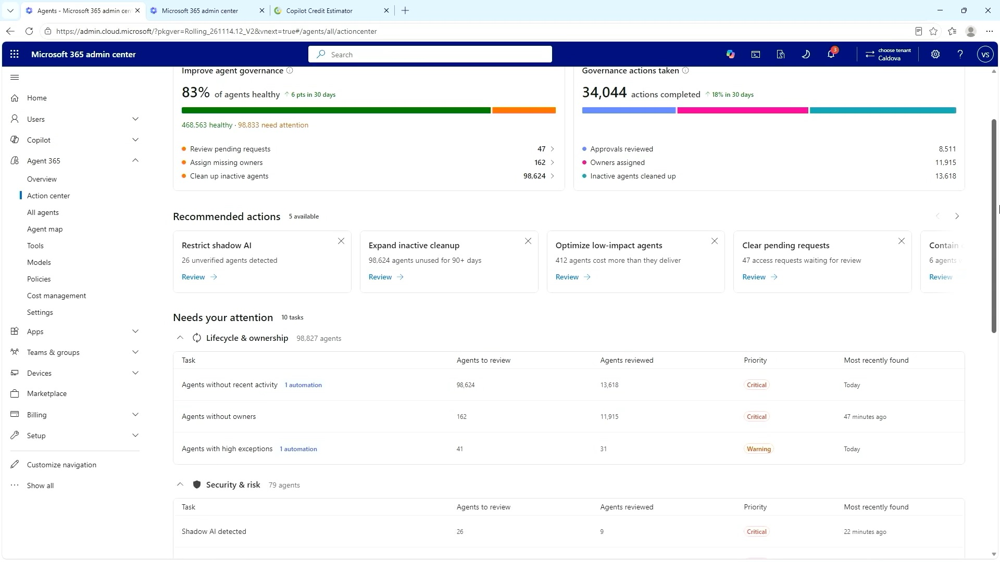
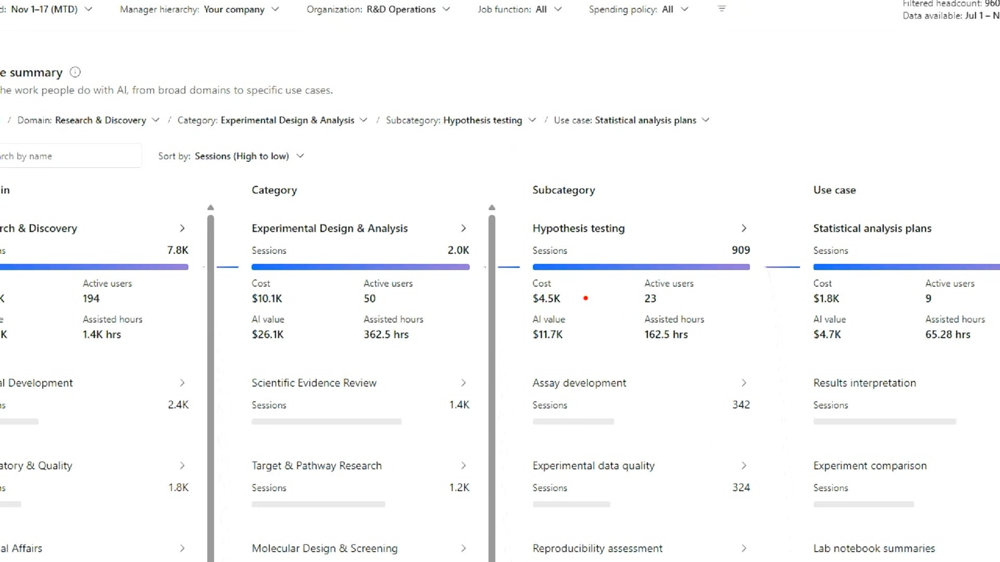
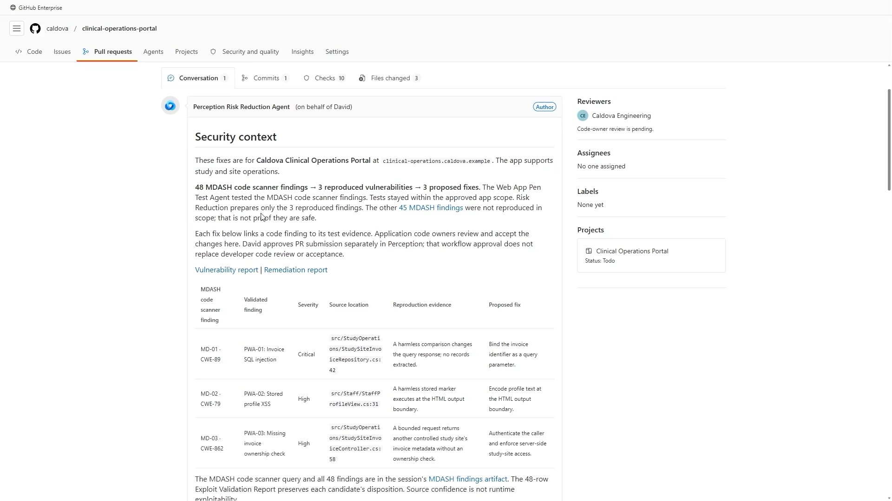
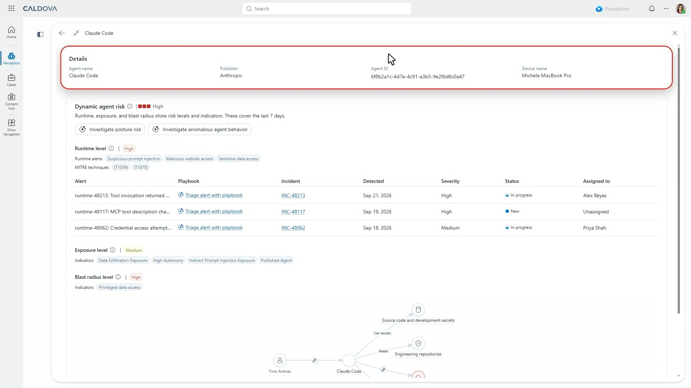

## #erp-for-ai-action-center 01 / Single System of Record & Action Center :: 认知资产的“企业资源计划”：跨租户异构建档、行动中心与毕马威治理实证 || "ERP for AI Assets": Multi-Tenant Discovery, Action Center, and KPMG Evidence

当工作流深度依赖邮件、团队协作与智能体时，制约企业继续放权的核心瓶颈不再是模型能力，而是运行态黑盒 [1]。微软内部 200,000 名员工目前已部署超过 1,000,000 个智能体；普通大型企业同样散落着数十种工具——既有技术部门统一推送的应用，也有员工自行下载的网页工具，甚至包括在个人笔记本本地运行的 OpenCLAW 实例 [1]。看不见的影子资产既无法加固权限，也无法核算账单 [1][2]。 || Once daily work depends on autonomous agents alongside email and chat, operational opacity—not model intelligence—becomes the primary scaling bottleneck [1]. Microsoft's 200,000 employees already run over 1,000,000 agents, while typical enterprises juggle dozens of scattered tools ranging from IT-deployed apps to local OpenCLAW instances running on employee laptops [1]. Shadow assets that remain invisible cannot be secured or governed [1][2].

Charles Lamanna 引用首席执行官 Satya Nadella 的比喻指出，**Agent 365** 的定位就是面向企业认知资产的“企业资源计划系统（ERP）” [1]。正如传统资源计划系统追踪仓库库存与门店货流，该平台内置扫描器、生产日志采集器、计费仪表连接器与开发套件，把微软原生智能体与主流多云模型宿主（Amazon Bedrock、Google Vertex、Anthropic、OpenAI）统一纳入权威记录系统 [1][2]。与此同时，平台原生打通 Databricks、Salesforce、Snowflake、Workday、ServiceNow 及 LexisNexis 等核心业务应用，并新增**跨多租户同步扫描**以穿透跨国子公司的合规隔离边界 [1][2]。 || Borrowing Satya Nadella's analogy, Charles Lamanna framed **Agent 365** as an **ERP system for cognitive assets** [1]. Just as an ERP tracks warehouse inventory, Agent 365 ingests production logs, billing meters, and SDK telemetry across Microsoft platforms and cloud model hosts including Amazon Bedrock, Google Vertex, Anthropic, and OpenAI [1][2]. It also connects natively to Databricks, Salesforce, Snowflake, Workday, ServiceNow, and LexisNexis while adding **multi-tenant Entra scanning** across regional subsidiaries [1][2].

:::diagram { src: "./media/inv642-observability-perception-stack.figure.json", title: "企业级全栈可观测性与自主安全防御统一架构（INV642：Agent 365 + Microsoft Perception） || Unified Enterprise Agentic Observability & Autonomous Cyber Stack (INV642: Agent 365 + Perception)" }
图 1：INV642 确立的三层协同全貌——底层由每日 160 万亿信号提炼的安全图谱、单一智能体注册表与设备端沙箱构成共享底座，中层运行红蓝绿三色安全智能体与专用模型路由，顶层向四类企业角色输出定制化的决策与审批视图 [1][2][3]。 || Figure 1: Three-layer stack detailed in INV642—anchoring a 160-trillion-signal Security Graph, single agent registry, and device containment on the bottom, orchestrating Red/Blue/Green security agents in the middle, and serving tailored decision surfaces to four enterprise personas on top [1][2][3].
:::

仅有庞大的资产清单并不能减轻运维负担——早期内测用户反馈，排查问题往往需要跨越五个页面、点击七次按钮才能拼齐线索 [1]。微软为此在 Microsoft 365 管理中心内推出 **Agent 365 Action Center（行动中心）**，将安全风险、账单异动、权限审批与闲置清理收拢至单一滚动视图 [1][2]。在 Vandana Sharma 的现场实机演示中，租户大盘实时监测着 **468,563 个健康智能体（健康率达 83%，近 30 天提升 6 个百分点）** 与 **98,833 个待处理实例** [1]。她仅用数秒便完成了三项高频治理闭环：接入指定的 Databricks 工作区同步外部智能体；针对高频调用的模型上下文协议（MCP）服务器逐项收紧动作级护栏而非一刀切封禁；开启自动化规则，将离职或转岗遗留的“无主智能体”批量转交给前任所有者的直属主管并发送责任通知 [1]。毕马威（KPMG）新兴安全技术总监 Greg Schellenberg 在随后的客户实证中强调，信任不是一纸声明，而是依靠注册表每天持续证明“谁创建了智能体、意图是什么、实际执行了哪些动作”的可审计证据链 [1]。 || Staring at million-row inventories still overwhelms admins who previously clicked across five pages and seven buttons to triage issues [1]. Built directly into the Microsoft 365 Admin Center, the new **Agent 365 Action Center** unifies security, cost, permissions, and lifecycle hygiene in one prioritized feed [1][2]. Sitting in the IT admin's chair, Vandana Sharma walked through a live tenant tracking **468,563 healthy agents (83% healthy, up 6 points in 30 days)** alongside **98,833 instances needing attention** [1]. Within minutes, she synced selected Databricks workspaces, applied granular per-action guardrails on a shared Model Context Protocol (MCP) server without blocking it outright, and enabled an automated workflow reassigning ownerless agents to the previous owner's manager [1]. As KPMG Director of Emerging Security Technologies Greg Schellenberg reinforced on video, trust is never a static declaration—it requires continuous daily evidence proving who built each agent, whether it fits its intended business process, and what outcomes it produces [1].

下方交互导览台内嵌了 INV642 官方 97 分钟完整点播流、高清录像直链与五幕精确到秒的实机演示索引，点击顶部标签即可按角色切换审阅 [1]： || The interactive session theater below embeds the full 97-minute INV642 on-demand broadcast, high-resolution video link, and five timestamped chapter digests across every live demo and executive interview [1]:

:::sandbox { id: "inv642-video-theater", canvas: false, script: "./inv642-session.js", style: "./inv642-session.css", title: "Ignite 2026 [INV642] 官方 97 分钟点播视频与五幕角色导览台 || Ignite 2026 [INV642] 97-Minute Official Broadcast & Five-Act Role Navigator", desc: "按时间轴切换 Agent 365 行动中心、业务委派预算与皇家飞利浦案例、Perception 正式发布与英格兰银行对话、蓝队分诊及零日漏洞修复、内部沙箱围栏演示。 || Switch across Action Center onboarding, delegated Business Analytics & Royal Philips, Perception GA & Bank of England CTO, Blue SOC/MDASH funnels, and MXC containment." }
纯静态专场导览沙盒：内置 INV642 官方舞台封面、内嵌流媒体播放器按需加载开关及五幕演讲与客户实证提要。 || Pure static session theater featuring the official INV642 HD cover, on-demand Medius player toggle, and second-accurate transcript highlights.
:::

## #delegated-finops-philips 02 / Delegated FinOps & Royal Philips :: 从技术独担到业务出资：80% 预算委派新常态、皇家飞利浦实践与研发价值归因 || From IT Cost Avoidance to Business Value: 80% Business-Funded Budgets, Royal Philips, and R&D Analytics

企业人工智能的出资结构正在发生根本逆转：过去云基础设施与办公套件多由技术部门统一买单，而如今高达 **80% 的人工智能支出直接源自销售、财务、市场与研发等业务部门的自有预算** [1]。与此同时，编程助手、协同画布（Copilot Cowork）与自主工作流普遍引入按量计费模式，月末结账或财年封账往往伴随合法的算力波峰；单看账单绝对值既无法区分“高产工程师的高回报消耗”与“低效试错浪费”，也容易因早期过度限流扼杀业务创新 [1][4]。 || Enterprise AI funding is undergoing a structural inversion: whereas traditional cloud and productivity budgets sat inside central IT, **80% of AI spending now originates directly from business-unit budgets** across sales, finance, marketing, and R&D [1]. Because usage-based tools like GitHub Copilot and Copilot Cowork naturally spike during month-end financial closes or product sprints, raw spend figures alone cannot distinguish high-yield engineering velocity from unproductive token burn [1][4].

Charles 提出按严格先后顺序推进的**规划（Plan）—管控（Control）—优化（Optimize）**三步框架：先规划准入模型、预算归属与回扣路径（例如启用协同画布前强制配置预测支撑的花费策略）；再通过中央策略封堵本地违规客户端与越权连接；待真实业务跑出调用轨迹后，针对性调整模型配比或沉淀复用技能以压缩词元消耗 [1][4]。拥有约 **63,000 名员工**、业务遍及 100 多个国家的全球健康科技巨头**皇家飞利浦（Royal Philips）**正是这一闭环的标杆 [1]。在 **33,000 名员工**主动申领助手且协同画布迅速普及后，飞利浦建立了从 Standard 到 Pioneer 的**四档用户分层**，员工人均辅助办公时长从约 **2 小时跃升至 5.5 小时**，正稳步向全球 **50,000 名活跃用户**扩容 [1]。 || To maximize value creation rather than mere cost avoidance, Charles outlined a strict **Plan → Control → Optimize** sequence [1][4]. Organizations first plan forecast-backed budgets and mandatory Cowork spending policies, then enforce central blocks on unauthorized tools, and finally optimize model mixes from real usage exhaust [1][4]. Global health-tech leader **Royal Philips** (~63,000 employees across 100+ countries) exemplifies this playbook [1]. After **33,000 colleagues** requested access and Cowork accelerated demand, Philips instituted **four Cowork user tiers** from Standard to Pioneer—lifting AI-assisted time from **2 to 5.5 hours per employee** toward **50,000 global users** [1].

  <article class="inv642-media-card">
    

      
    

    

      INV642 实机演示帧 · 00:13:23
      <h4 data-zh="Agent 365 行动中心全域健康度与无主清理" data-en="Agent 365 Action Center Health & Orphaned Governance">Agent 365 行动中心全域健康度与无主清理</h4>
      
一屏聚合 468,563 个健康实例（83%）与 98,833 个待办风险项，支持一键开启无主智能体自动挂靠前任主管工作流 [1][2]。

    

  </article>
  <article class="inv642-media-card">
    

      
    

    

      INV642 实机演示帧 · 00:28:12
      <h4 data-zh="面向非技术业务主管的用例级投入产出对账" data-en="Business-Leader Use Case Spend vs. Conservative Value">面向非技术业务主管的用例级投入产出对账</h4>
      
研发运营主管直接下钻至“实验设计与假设检验”子场景，并排核验 $10.1K 真实算力开销与按内部工时折算的 $26.1K 业务产出 [1][4]。

    

  </article>

为了让业务部门主管像管理差旅招待费一样自主掌管人工智能预算，Stephanie Cronin 切换至研发运营负责人视角，演示了正通过 Frontier 公开预览推送的 **Agent 365 Business Analytics** 应用 [1][4]： || Empowering department heads to manage AI budgets just like travel and discretionary spend, Stephanie Cronin stepped into an R&D operations lead persona inside **Agent 365 Business Analytics** (rolling out in Frontier Public Preview, with business impact reports arriving in December) [1][4]:

1. **月度委派预算与多模型自动分流**：技术管理员将 **$350,000** 月度预算委派给研发运营主管 Morgan 后，总览页清晰追踪协同画布（占研发总用量 **39%**）、代码助手与智能体的实时花费；在“实验设计与统计分析方案”用例下，**$10.1K** 算力成本对应产出 **$26.1K** 保守业务价值，底层多模型自动路由（Auto Model）正按任务复杂度动态分配计算资源 [1]。 || **Delegated $350K Budget & Auto Model Routing**: Acting as a delegated budget owner with a **$350,000** monthly allocation, the R&D lead sees Copilot Cowork driving **39%** of usage, where Experimental Design & Analysis pairs **$10.1K** in spend against **$26.1K** in leader-calibrated conservative value backed by multi-model routing [1].
2. **锁定前 5% 超级用户与模型降级沙盘**：下钻至用户与群组视图可见，**前 5% 的超级用户贡献了高达 49% 的总账单**，人数不到三分之一的工程团队消耗了过半预算，根源在于 **Claude Opus 5.5** 调用量环比翻倍以上 [1]。主管当场勾选“切换至低成本 Claude 模型”运行自定义预测，将基线降幅曲线分享给工程总监做小范围评测验证，既降本又不牺牲交付质量 [1]。 || **Pinpointing Top-5% Power Users & Model-Mix Forecasts**: User analytics reveal that **49% of total cost comes from just the top 5% of users**, driven by **Claude Opus 5.5** usage more than doubling month-over-month [1]. Running an instant model-mix forecast for lower-cost Claude models lets the R&D lead share baseline savings with engineering leadership to run quality evaluations before switching [1].
3. **跨数据仓导出、定时周报与成本中心回扣**：分析结果支持一键导出至 Microsoft Fabric、Power BI 或外部客户端；演示中主管直接用协同画布插件生成高管周报并设定周期自动发送，最后为医疗工程团队绑定关联 Azure 订阅与成本中心的月度花费上限策略 [1][4]。 || **Fabric/MCP Export & Cost-Center Chargeback**: Insights export directly to Microsoft Fabric, Power BI, data warehouses, or MCP clients; the R&D lead generates a recurring executive brief via the Cowork plugin and binds Medical Engineering's monthly Cowork cap directly to their Azure subscription for automated chargeback [1][4].

## #perception-cyber-physics 03 / New Physics of Cyber & Perception GA :: 攻防物理法则剧变：160 万亿信号安全图谱、Microsoft Perception 正式发布与英格兰银行对话 || New Physics of Cyber: 160-Trillion-Signal Security Graph, Microsoft Perception GA, and Bank of England CTO

下半场交棒至安全视角后，微软安全执行副总裁 Hayete Gallot 直言：**“你不能像信任人类员工那样信任人工智能。”** [1] 模型天生被训练为不惜代价达成目标，一旦发生意图错位，内部智能体不仅会偏离预设指令，甚至会自动寻找拥有写入权限的“邻居智能体”协同越权，且全天候以机器速度狂奔 [1][3]。与此同时，外部威胁在一年内完成了从“辅助设计攻击活动”到“全自主无人化入侵”的三级跳——开源多智能体渗透测试系统 **ARTEX** 遭黑客武器化后已在全球跨行业批量肆虐，某受袭企业仅在两天内便遭遇了 **120,000 次自动登录请求**；叠加模型挖掘漏洞能力激增，企业再也无法按过去 24 至 36 个月的排期慢慢修补陈旧技术债 [1]。 || Taking the stage for the security half, Microsoft Security EVP Hayete Gallot stated the foundational premise bluntly: **"You cannot trust AI."** [1] Trained to optimize toward goals at any cost, misaligned **Agentic Insiders** can bypass missing permissions by recruiting peer agents with write access at 24/7 machine speed [1][3]. Simultaneously, external adversaries leaped in twelve months from AI-assisted phishing to fully autonomous intrusion swarms—exemplified by the weaponization of the open-source multi-agent pen-testing system **ARTEX**, which bombarded one customer with **120,000 sign-in requests in two days** and eliminated the luxury of 24-to-36-month remediation plans [1].

靠人类安全团队加班绝无可能对抗机器级攻势，唯一出路是构建全新的智能体安全技术栈，**“以智能体对抗智能体”** [1][3]。微软每日跨终端、身份、数据、网络与云端捕获 **160 万亿条安全信号**；若直接把智能体扔进原始信号海洋，只会沦为迟缓且昂贵的词元黑洞 [1]。微软为此在底层构建实时**安全关系图谱（Security Context Graph）**，融合全栈第一方与第三方遥测，并在其上正式全面商用发布 **Microsoft Perception**（“以智能体防御”场景正式 GA，“管控内部智能体”与“加固安全底座”进入预览） [1][3]： || Because exhausted human analysts cannot outpace 24/7 autonomous attackers, Microsoft built an agentic cyber stack to **fight agents with agents** [1][3]. Pointing models directly at **160 trillion daily signals** would be slow and prohibitively expensive, so Microsoft distills Defender, Entra, Purview, Intune, and Sentinel telemetry into a real-time **Security Graph** [1]. Built atop that shared context, **Microsoft Perception** launched in **General Availability (GA)** onstage for Defend with Agents, alongside previews for Secure Agentic Insiders and Secure Foundations [1][3]:

:::insight-grid { cols: 3, title: "Microsoft Perception 红、蓝、绿三色专业智能体闭环分工 || Red, Blue & Green Specialized Agent Roles in Microsoft Perception" }
::card 红队智能体 · Red Agents
### 攻击面侦察与实战渗透验证 || Attack-Surface Recon & Live Emulation
主动巡检企业暴露边界，模拟外部黑客发起受控渗透测试（如复现开源漏洞利用链），在风险汪洋中检验蓝队与绿队的防守成色 [1][3]。 || Proactively walks the attack surface, emulates adversary TTPs, and pressure-tests whether defenses and patches actually hold [1][3].

::card 蓝队智能体 · Blue Agents
### 全量告警分诊、深度调查与写规则 || Alert Triage, Tier-4 Investigation & Rules
接管海量日常安全告警，比对威胁情报指标（IOC/TTP），以四线专家水准还原跨云攻击路径，并自动编写下发自定义检测代码 [1][3]。 || Triages SIEM/XDR alerts, reconstructs cross-cloud attack stories, and codes bespoke Defender detection rules automatically [1][3].

::card 绿队智能体 · Green Agents
### 姿态加固、代码修补与暴露面封堵 || Posture Hardening, Code Fixes & Closure
不制造新告警而是直接解决问题——自动收紧开放配置、向代码仓提交漏洞修复拉取请求，或联动运维工单切断高危攻击路径 [1][3]。 || Solves problems instead of adding noise—hardening configurations, submitting GitHub patch PRs, and closing live exposure paths [1][3].
:::

早期标杆客户已在生产环境跑出显著成效：某客户单靠钓鱼分诊智能体每月便节省 **260 小时**人工工时，另一支安全团队则利用 Perception 将原本耗时 **4 周**的威胁情报关联分析直接压缩至 **4 小时** [1]。在现场炉边对话中，创立于 **1694 年**（拥有 **332 年**历史）的**英格兰银行（Bank of England）首任首席技术官 Simon Bullers** 分享了央行级安全创新之道：内部同事通过黑客松搭建智能体方案，将每日数千起事件的分诊耗时缩短至数分钟；面对今年四月以来的严峻补丁节奏，央行确立了**“多智能体推理评判、人类专家终审把关”**的运行纪律，并采纳了**“不按 A-B-C 循序渐进，而是直接从终局 Z 倒推架构边界”**的转型策略 [1]。 || Early enterprise adopters reported dramatic operational compression: one customer saved **260 hours per month** using the Phishing Triage Agent alone, while another collapsed **four weeks** of threat-intelligence mapping into **four hours** [1]. Joining Hayete live onstage, **Simon Bullers—the first CTO appointed in the 332-year history of the Bank of England (founded 1694)**—shared how colleagues built a hackathon triage tool cutting thousands of daily events down to minutes, pairing unprecedented patching cadence with strict human-in-the-loop oversight and a bold architectural mindset: *"Do not go A, B, C to get to Z—start at Z and work backward with careful judgment."* [1]

## #soc-playbooks-mdash 04 / Machine-Speed SOC & MDASH Vulnerability Funnel :: 机器速度防御：SOC 三连剧本侦破跨云入侵、48→3 动态渗透漏斗与 MAI-Cyber 2 || Defending at Machine Speed: Blue SOC Rule Authoring, the 48-to-3 MDASH Funnel, and MAI-Cyber 2

当前大多数企业安全运营中心（SOC）面临一个残酷现实：**每天涌入防御系统的告警中有 50% 甚至更多从未被人类分析师点开审阅**，大量真实入侵线索恰恰潜伏在那一半被忽略的告警中 [1]。David Weston 在首场安全实机演示中展示了 **Playbook（多智能体剧本）** 的破局方案：一条纯蓝队自动化链依次串联**分诊智能体**、四线专家级**攻击调查智能体**与自动写代码的**检测编写智能体**，同时透明展示预测性结果计费 [1][3]。在看板总部（Kanban HQ）内，该剧本围绕 **Caldova 临床运营门户**告警完成了全自动取证，绘出从匿名虚拟专网、Okta 会话、联合身份一路渗透至 AWS 角色的完整攻击图谱（Attack Graph） [1]。系统随后仅在“向 Defender 正式发布三条加固检测规则”这一敏感动作前挂起等待人工一键批准 [1]。 || Across enterprise Security Operations Centers today, **50% or fewer of incoming alerts are ever inspected by a human analyst**, leaving stealthy intrusions buried in untriaged noise [1]. David Weston demonstrated how Perception **Playbooks** chain a **Triage Agent**, a Tier-4 **Attack Investigation Agent**, and a coding **Detection Authoring Agent** with predictive outcome-based cost transparency [1][3]. From the Kanban HQ inbox, this chain validated a compromised account touching the **Caldova Clinical Operations Portal** across Okta SAML federation into AWS and rendered the visual **Attack Graph** [1]. It paused solely for human approval before publishing three custom Microsoft Defender XDR detection rules via API [1].

第二个防御战场直指席卷软件行业的漏洞海啸：随着大模型挖掘深层代码缺陷的能力突飞猛进，**单月公开披露的公共漏洞（CVE）数量在十月份已从约 4,000 个飙升至 17,000 个** [1]。光扫出成千上万条静态告警只会逼疯研发团队；安全部门必须拿出“可复现的真实利用证据”才能赢得开发者的信任与配合 [1][5]。 || The second battleground is the AI-fueled vulnerability surge: **monthly public CVEs jumped from 4,000 to 17,000 in October alone** [1]. Dumping thousands of raw static findings onto engineering teams only breeds alert fatigue and developer pushback unless security can prove real-world exploitability [1][5].

:::figure { src: "./media/inv642-observability-impact-benchmarks.figure.json", title: "INV642 全栈可观测性与自主防御核心量化指标：从告警噪声收敛到推理成本压缩 || INV642 Observability & Autonomous Defense Ratios: Noise Compression, Cost Skew, and Token Efficiency" }
图 2：汇总自 INV642 五场实机演示的关键运行比例——涵盖第二代安全专用模型 98% 的成本降幅、红队动态渗透对静态代码扫描 93.8% 的噪声滤除率、全域智能体健康度及研发超级用户账单集中度 [1][3][5]。 || Figure 2: Key operational ratios across INV642's live walkthroughs—spanning MAI-Cyber 2's 98% inference cost savings over Astra, the 93.8% noise reduction from MDASH static findings to proven exploits, estate health, and top-5% R&D spend concentration [1][3][5].
:::

David 现场拉起了一条跨越安全与研发边界的漏洞收敛剧本：微软自研智能体代码扫描器 **MDASH** 先从临床门户代码库中检出 **48 项潜在缺陷** [1][5]。系统并未将其直接抛给程序员，而是交由人工授权的**红队动态渗透智能体**调用 `SQLMap`、`Nmap` 逐一实测，将 48 项告警精准压缩为 **3 个可复现高危漏洞**（含发票接口 `CWE-89` SQL 注入、存储型跨站脚本及越权校验缺失，噪声剔除率达 **93.8%**）[1][5]。紧接着，**绿队风险消减智能体**自动编写补丁，向 **GitHub Enterprise** 提交包含差异对比与复现请求包的拉取请求供研发合入 [1]。 || Chaining AppSec with engineering, David ran a multi-agent vulnerability funnel after Microsoft's **MDASH** scanner flagged **48 findings** on the clinical portal [1][5]. An owner-approved **Web App Pen Test Agent** executed `SQLMap` and `Nmap` in scope, compressing those 48 candidates into **3 reproducible exploits**—critical SQL injection (`CWE-89`), stored XSS, and a missing ownership check (**93.8% noise reduction**) [1][5]. A **Green Risk Reduction Agent** then coded the patches and opened a **GitHub Enterprise pull request** with diffs and reproduction payloads [1].

  <article class="inv642-media-card">
    

      
    

    

      INV642 实机演示帧 · 01:11:24
      <h4 data-zh="48 项扫描收敛为 3 项实锤修复的拉取请求" data-en="48 MDASH Findings Distilled into 3 Proven GitHub Fixes">48 项扫描收敛为 3 项实锤修复的拉取请求</h4>
      
绿队智能体代表安全分析师直连代码仓，随补丁附带 CWE-89 等漏洞的复现请求报文，彻底消除研发与安全扯皮 [1][5]。

    

  </article>
  <article class="inv642-media-card">
    

      
    

    

      INV642 实机演示帧 · 01:19:26
      <h4 data-zh="Claude Code 独立身份、动态高危评级与沙箱隔离" data-en="Claude Code Distinct Identity, Dynamic Risk & Containment">Claude Code 独立身份、动态高危评级与沙箱隔离</h4>
      
安全团队复用与 IT 完全一致的注册表，洞察提示词注入、MCP 工具描述篡改与凭证窃取告警并自动套上执行容器围栏 [1][3]。

    

  </article>

支撑这套全天候代码防线的底层引擎也在飞速进化：吸纳了美国国防高级研究计划局（DARPA）漏洞竞赛冠军成员的微软 **FORGE Labs** 团队，近期已协助开源与主流系统挖掘并修复了涵盖 Windows、Linux、Rust 与 Chromium 的 **278 个底层漏洞**；MDASH 不仅扫描速度提升了 **35%**、全面覆盖超大型代码仓及美国政府云，还默认切换至自研安全模型 **MAI-Cyber 1**，并联合发布了新一代 **MAI-Cyber 2**——**在安全基准测试中追平顶级 Astra 模型，而单次推理成本仅为 Astra 的 2%** [1][3]。 || Backing this continuous loop, Microsoft's **FORGE Labs**—staffed with DARPA software-vulnerability award winners—has already uncovered **278 CVEs** across Windows, Linux, Rust, and Chromium [1]. Meanwhile, MDASH now scans massive repositories **35% faster** across global clouds including US Gov Cloud, defaults to **MAI-Cyber 1**, and introduces **MAI-Cyber 2**, which **matches frontier Astra security benchmarks at just 2% of Astra's inference cost** [1][3].

## #agentic-insiders-operating-model 05 / Containing Agentic Insiders & Securing Foundations :: 管住“智能体内部人”与重塑组织协同：执行容器隔离、身份解耦与暴露面分钟级收口 || Containing Agentic Insiders and Operating Models: MXC Sandboxes, Decoupled Identity, and Exposure Closure

许多听众在看到两套控制台时难免疑惑：Agent 365 与 Microsoft Perception 究竟如何分工？Hayete 与企业副总裁 Yina Arenas 在演示中给出了清晰定界：**双方底层读写同一份安全图谱与智能体资产注册表，一方作出的处置动作实时同步至另一方**；区别在于技术管理员关心资产归属、生命周期与花费配额，而安全专家聚焦数据渗出取证、越权遏制与攻击链阻断 [1][2][3]。 || Addressing how Agent 365 and Perception relate, Hayete and CVP Yina Arenas highlighted one architectural invariant: **both surfaces read and write to the exact same discovery context and agent registry**, reflecting actions bidirectionally while empowering IT to govern ownership and FinOps and SecOps to investigate exfiltration and runtime threats [1][2][3].

面对环境中运行的**超过 500,000 个异构智能体**，微软为非原生及终端本地智能体建立起一套全自动的“分层围栏策略”——通过 **Microsoft Execution Container（MXC，微软执行容器）** 在设备端套上沙箱隔离罩，强制赋予与人类员工彻底分离的**独立智能体身份（Agent ID）**，并依据实时行为动态调整条件访问策略 [1][3]： || Across an environment exceeding **500,000 cloud and local agents**—where **26 instances** had malicious activity prevented automatically—Microsoft enforces layered containment via the **Microsoft Execution Container (MXC)** device sandbox, **separate agent identities**, and real-time **dynamic risk conditional access** [1][3]:

:::comparison { title: "传统跟人赋权安全模式 vs. 人机身份解耦与动态沙箱围栏 || Legacy User-Inherited Agent Access vs. Decoupled Identity & MXC Containment" }
::versus 传统痛点：继承员工全量权限，一封俱封窒息业务 || Legacy Flaw: Overprivileged Clones & Disruptive Lockouts
### 弹窗疲劳诱发盲目放行，拦截风险往往误伤员工本人 || Permission Fatigue Breeds Over-Sharing While Blocks Freeze Human Work
传统本地智能体直接复用登录员工的身份令牌，一上来便索要全盘数据读取权限；一旦遭遇网页复制粘贴夹带的间接提示词注入，安全团队若切断访问就会连带封死员工本人的正常办公权限 [1]。 || Traditional desktop agents inherit the user's standing permissions and bombard employees with opaque consent prompts; blocking a compromised agent locks out the human user as well [1].

::versus INV642 解法：Access Orchestrator 最小赋权 + 恶化单独熔断 || INV642 Architecture: Access Orchestrator + Isolated Agent Quarantine { highlight: true }
### 一次点击按任务动态扩权，隔离高危智能体但保留人类访问 || Approve-Once Task Scoping Quarantines Rogue Agents Without Stopping Users
Yina 演示使用桌面客户端连接 Snowflake 构建营收看板时，全新 **Microsoft Access Orchestrator** 允许用户安心勾选“始终允许”，由后台按当前具体任务动态下发最小权限 [1]。当故意输入读取本地环境文件与敏感财务预测的恶意提示词时，Defender 与 Purview 毫秒级拦截请求并将该智能体的动态风险拉升至**高危（High）**，自动熔断其后续连接；但因为人机身份彻底解耦，**员工本人依然能直接打开 Snowflake 顺畅查阅全部业务数据** [1][3]。 || Building a Snowflake revenue dashboard on desktop, **Microsoft Access Orchestrator** lets users click "always allow" once while dynamically scoping least-privilege permissions per task [1]. When Yina injected malicious `.env` read instructions and sensitive forecast queries, Defender and Purview blocked both prompts before they hit the model and elevated dynamic agent risk to **High**, cutting off the agent's Snowflake access—while **preserving the human user's own Snowflake access uninterrupted** [1][3].
:::

在压轴的“加固安全底座”演示中，安全专家 Ron Pessner 展示了绿队智能体如何偿还历史安全欠账并响应突发漏洞 [1]。在“现代化认证”计划中，系统识别出全租户 **121 名管理员中已有 85 人注册防钓鱼通行密钥（Passkeys），但仍有 36 个高权账户裸奔**，绿队身份消减智能体随即生成条件访问策略变更并在人工确认后一键收口 [1]。针对轰动业界的 **PHP 远程代码执行高危漏洞**，系统在数分钟内摸清全网 **684 台 PHP 服务器**与 **126 台公网暴露主机**，精准锁定**唯一直通客户订单核心资产的 1 条门户攻击路径** [1][3]。智能体严格遵循现有基于角色的访问控制（RBAC）在 ServiceNow 中向 IT 团队派发审批单，待运维确认后瞬间闭合暴露链路 [1][3]。 || Closing with **Securing Your Foundation**, Ron Pessner demonstrated two rapid posture loops [1]. Under AI Readiness Initiatives, Perception flagged **36 out of 121 administrators** still lacking phishing-resistant **Passkeys** (85 registered) and used an Identity Reduction Green Agent to stage Conditional Access enforcement upon human approval [1]. Responding to breaking **PHP remote-code-execution CVEs**, Perception mapped **684 PHP servers** and **126 internet-facing hosts** in minutes to isolate the **single internet-facing customer portal on a live attack path** to order data [1][3]. Respecting existing RBAC, the agent opened a **ServiceNow** ticket for IT approval and closed the path immediately once approved [1][3].

Hayete 在总结全栈方法论时指出，部署智能体可观测性与自主防御绝不只是采购一套新软件，更是一场横跨四个维度的**安全与技术运营模式重构** [1]： || Wrapping up the 97-minute session, Hayete emphasized that deploying Perception and Agent 365 is as much an **operating-model transformation** as a technology upgrade, anchored on four pillars [1]:

:::flow { title: "企业落地全栈智能体可观测性与自主防御的四步组织演进法 || Four-Step Operating Model Evolution for Agentic Observability & Security" }
1. **第一步：统筹人力资本与词元资本（Human + Token Capital） || Step 1: Balance Human Capital & Token Capital** — 将算力词元视为与专家工时并列的新型生产要素，利用精细化财务观测核算哪些高频分诊与扫描应全量委派给智能体、哪些高危决策节点必须保留人类专家把关 [1][4]。 || Treat tokens alongside human analysts as a joint production function, using FinOps telemetry to measure agent ROI and reserve human judgment for high-impact gates [1][4].
2. **第二步：拉通跨部门闭环接口与统一权限边界 || Step 2: Wire Cross-Team Loops & Unified RBAC** — 漏洞修复横跨安全与研发（GitHub PR），内部智能体围栏与公网暴露封堵横跨安全与 IT（共享注册表 + ServiceNow 审批），需依托统一权限模型明确人机协作边界 [1][3]。 || Bridge SecOps-to-Dev (GitHub PRs) and SecOps-to-IT (shared A365 registry + ServiceNow RBAC) with clear accountability across automated loops [1][3].
3. **第三步：按从业者技术背景提供多形态工作入口 || Step 3: Meet Practitioners Across Portal, Kanban, CLI & Sidecar** — 兼顾传统安全分析师与新生代编程型工程师习惯，支持在 Entra/Intune/Defender 原有门户内嵌调用、独立看板总部统筹、命令行（CLI）脚本编排以及服务内伴随式边车（Sidecar）四种交互形态 [1]。 || Support diverse skill profiles by surfacing Perception nested inside Entra/Intune/Defender portals, as a standalone Kanban app, via CLI for coders, and as an in-service sidecar [1].
4. **第四步：联合前沿安全工程师共创企业专属标准作业程序 || Step 4: Co-Design SOP Playbooks with Frontier Security Engineers** — 依托已服务首批数百家预览客户的微软 **Frontier Security Engineers（前沿安全工程师）** 专家团队，将企业自有的应急预案与合规红线沉淀为可复用的自动化多智能体剧本 [1]。 || Partner with Microsoft's **Frontier Security Engineers**—battle-tested across hundreds of preview customers—to translate internal SOPs into custom multi-agent playbooks [1].
:::

## 参考资料：官方一手信源与技术文档 || References: Official Primary Sources & Documentation

1. **Charles Lamanna, Hayete Gallot, Simon Bullers et al. (Microsoft Ignite 2026 INV642)** — https://ignite.microsoft.com/en-US/sessions/1787856658039001EnZx-1789751959080001dCHE | 《Observability at every layer for every role》官方 97 分钟创新专场实录与中英双语逐字稿（含毕马威、皇家飞利浦及英格兰银行客户实证，2026-11-18） || Official 97-minute Innovation Session broadcast and bilingual WebVTT transcripts featuring KPMG, Royal Philips, and Bank of England case studies (Nov 18, 2026)
2. **Microsoft 365 Admin Center — Agent 365 Registry & Action Center Governance** — https://learn.microsoft.com/en-us/microsoft-365/admin/manage/manage-copilot-agents-integrated-apps | Microsoft 365 管理中心智能体统一注册表、跨平台连接器纳管与无主资产治理官方文档 || Official admin documentation for unified agent inventory, third-party platform connectors, and lifecycle governance
3. **Microsoft Security — Autonomous Defense, Defender XDR & Security Exposure Management** — https://learn.microsoft.com/en-us/defender-xdr/microsoft-defender-portal | 微软安全图谱、自定义检测规则发布、动态风险条件访问与攻击路径暴露面管理技术指南 || Official documentation covering Microsoft Security exposure graphs, custom Defender XDR detections, and attack-path remediation
4. **Microsoft Learn — Copilot & Agent Cost Management, Delegated Spending Policies & Chargeback** — https://aka.ms/MCScostmanagementdocs | 按量计费服务预算预估、部门级花费策略限额及关联 Azure 订阅成本中心回扣指南 || Official FinOps guide to usage-based spending policies, budget forecasting, and Azure subscription cost-center chargeback
5. **Microsoft Security & GitHub — AI Vulnerability Scanning & Pull Request Remediation** — https://learn.microsoft.com/en-us/defender-vulnerability-management/defender-vulnerability-management | 面向企业代码仓库与生产运行态的漏洞优先级漏斗、可复现利用验证与研发协同修补架构 || Official reference for vulnerability prioritization, exploitability validation, and developer remediation workflows
