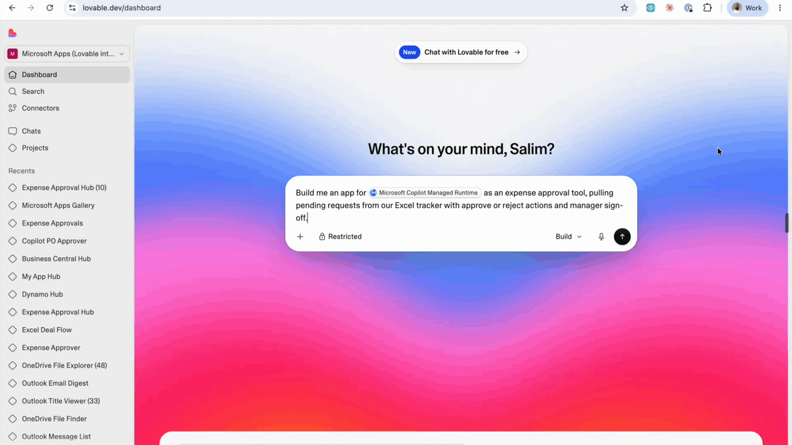
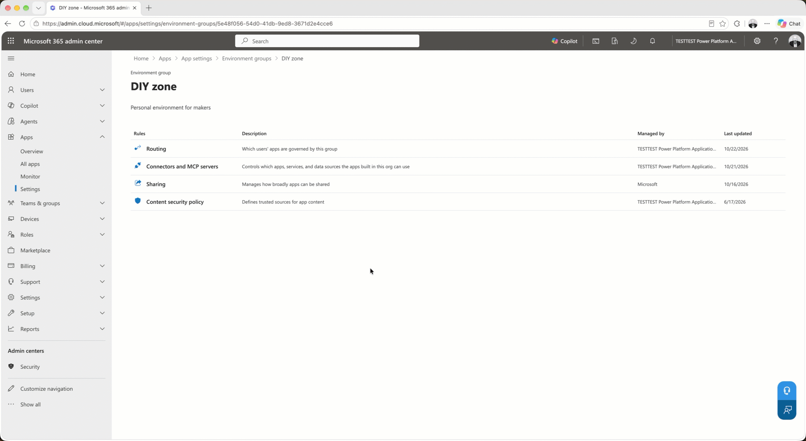
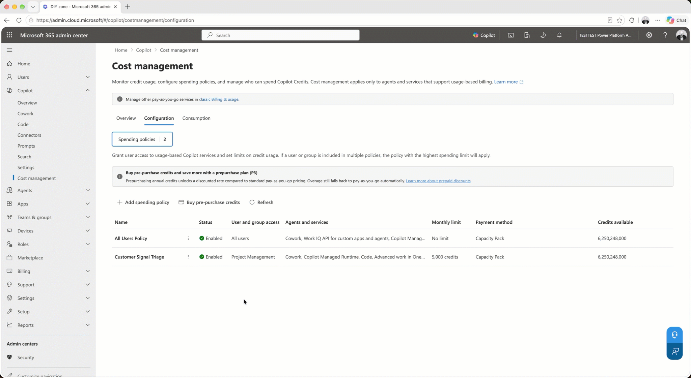

## #build-anywhere 01 / Build Anywhere Vision :: 战略定调：跨越本地端口断崖，汇入同一企业托管归宿 || Strategic Vision: Crossing the Localhost Cliff into One Managed Destination

生成式开发工具已经把编写业务软件的门槛彻底摊平。在 LIVE07 开场对谈中，微软应用业务总经理 Clay Wesener 指出，员工如今在任何顺手的位置都能拉起应用：业务专家在协同画布（Cowork）的工作流里用一句话生成工具，软件工程师从 GitHub 与代码编辑器起步，而一线团队则在 Lovable 等第三方平台内快速拼装交互界面 [1]。真正阻碍企业落地的并非“造不出原型”，而是产物沦为仅限本机访问的本地端口链接，或在交付审查前撞上断崖 [1]。 || Generative coding tools have flattened the barrier to creating working software. Opening Broadcast Stage session LIVE07, Microsoft GM Clay Wesener noted that employees now build wherever work happens: domain experts prompt apps inside Copilot Cowork, engineers start in GitHub and IDEs, and frontline teams assemble interfaces in third-party platforms like Lovable [1]. What stalls enterprise adoption is never a shortage of prototypes—it is apps stranded as inaccessible `localhost` URLs or hitting a compliance cliff right before rollout [1].

Microsoft Copilot 托管运行时（Copilot Managed Runtime）于 2026 年 11 月 17 日正式商用，核心使命就是为分散在各处的构建入口提供同一个企业级落脚点 [1][2]。企业无需手工配置云服务器、弹性扩缩容或网关高可用，所有应用发布后均由微软统一承载运行、打通身份鉴权并纳入集中治理 [2][3]。 || Reaching general availability on November 17, 2026, Microsoft Copilot Managed Runtime gives every authoring surface the exact same enterprise destination [1][2]. Organizations configure zero cloud infrastructure, scaling rules, or availability clusters; Microsoft operates the hosting layer while enforcing identity, governed data access, and lifecycle management out of the box [2][3].

:::figure { src: "./media/cmr-build-host-govern-architecture.figure.json", title: "Microsoft Copilot 托管运行时三层收敛架构：多端自由创作、托管执行与管理中心治理 || Microsoft Copilot Managed Runtime Three-Tier Convergence Architecture" }
图 1：Copilot 托管运行时将对话式工作台、代码仓库工具与第三方生成式平台收敛至同一托管底座，向下衔接 Microsoft 365 管理中心全局策略与企业级持久化存储 [1][2][3]。 || Figure 1: Copilot Managed Runtime converges conversational studios, Git-backed developer tooling, and third-party builders onto one Microsoft-operated execution layer governed through Microsoft 365 admin center [1][2][3].
:::

下方官方点播导览台完整收录了 LIVE07 广播专场的 9 分 07 秒高清视频流与四个核心时间轴章节，点击顶部标签即可分段对照查阅原声论点 [1]： || The interactive theater below pairs the official 9-minute-07-second LIVE07 broadcast stream with four timestamped chapter breakdowns from the WebVTT transcript [1]:

:::sandbox { id: "live07-video-theater", canvas: false, script: "./live07-session.js", style: "./live07-session.css", title: "Ignite 2026 LIVE07 官方广播专场点播与时间轴精读台 || Ignite 2026 LIVE07 Official Broadcast Video & Timestamp Theater", desc: "切换 00:10 跨端愿景、02:05 Entra 权限继承、03:52 管理中心护栏与 06:15 零返工投产四段实录，支持直接唤醒微软官方内嵌播放器。 || Switch across four timestamped LIVE07 chapters and launch the official embedded Microsoft Medius stream directly." }
纯静态议题点播沙盒：内置 LIVE07 官方高清舞台封面、四段双语逐字稿要点以及 Medius 点播与官方 GA 博客直链。 || Static session theater featuring the official LIVE07 stage cover, four bilingual transcript chapters, and direct links to the Medius stream and GA blog.
:::

## #lovable-entra 02 / Ecosystem & Entra Identity :: 第三方生态直连与默认权限继承：从排班表到销售客户简报 || Third-Party Ecosystem & Entra Inheritance: From Shift Schedules to CRM Briefings

为什么第三方生成式开发平台的用户迫切需要把应用“发往微软环境”？Lovable 产品经理 Malavika Balachandran Tadeusz 在 LIVE07 对谈与配套伙伴专场 THRSP1155 中给出了鲜活的一线观察：在 Lovable 上构建应用的群体横跨整个组织光谱，一端是为值班同事编排轮班表的后勤保洁人员，另一端则是在客户关系管理系统之上搭建智能体工作流的原生销售团队 [1][4]。无论角色如何变化，一旦工具要交给同事协同使用，安全与权限就成了不可妥协的底线 [1][4]。 || Why do builders on third-party AI platforms want to ship their apps into a Microsoft environment? Across LIVE07 and companion partner session THRSP1155, Lovable Product Manager Malavika Balachandran Tadeusz shared a striking cross-section from the field: makers on Lovable span from janitors creating shift schedules for on-duty staff all the way to AI-native sales teams building agentic workflows atop their CRM [1][4]. Across every persona, the moment an app moves from personal utility to team adoption, security and access governance become non-negotiable [1][4].

对于非科班出身的业务构建者而言，自行编写登录鉴权、界定应用用户角色以及防止敏感记录越权泄露，往往是最容易踩坑的深水区 [1]。接入托管平台开发套件后，第三方工具构建的应用在托管运行时中天然获得两层开箱即用的安全契约 [1][3]： || For citizen builders and fast-moving teams alike, hand-coding authentication flows, role-based access rules, and row-level data boundaries from scratch is notoriously error-prone [1]. Through the Managed Platform SDK, third-party apps deployed onto Copilot Managed Runtime inherit a two-layer security contract automatically [1][3]:

:::insight-grid { cols: 3, title: "托管运行时在业务构建侧解决的三大核心痛点 || Three Core Builder Bottlenecks Solved by Managed Runtime" }
::card 01
### 免手写 Microsoft Entra 统一鉴权 || Zero-Config Microsoft Entra Sign-In
应用一经部署即处于 Microsoft Entra 身份保护之下，直接复用企业现有的单点登录、安全组与条件访问策略，开发者无需拼装任何令牌校验代码 [1][3]。 || Deployed apps sit behind Microsoft Entra out of the box, enforcing corporate SSO, security groups, and Conditional Access without custom auth code [1][3].

::card 02
### 连接器级用户权限自动继承 || Per-User Connector ACL Inheritance
调用底层业务连接器拉取数据时，运行时自动沿用当前登录员工自身的访问权限，杜绝因共享服务账号导致的敏感商业数据全员裸奔 [1]。 || Data calls routed through governed connectors inherit the signed-in user's own permissions, preventing shared service accounts from overexposing sensitive records [1].

::card 03
### 销售会前简报敏感情境隔离 || Sensitive CRM Pre-Call Briefing Isolation
在销售电话会前自动汇总客户近况、商机金额、关键联系人为代表生成增购简报，依靠 Entra 身份天然锁定仅负责该客户的销售代表本人可见 [1]。 || Pre-call sales workflows compile opportunity size, account contacts, and upsell strategy while Entra identity ensures only authorized reps on that account can view the brief [1].
:::

除了 Lovable 在现场展示的一键定向构建体验外，智能体平台 Manus 联合创始人兼首席产品官张涛也在官方发布中印证了同一趋势：借助托管运行时，由外部智能体生成的企业网页应用能够直接运行在客户自有的微软租户边界内，自动继承既有的安全与合规策略 [2]。 || Alongside Lovable's native deployment integration, Manus Co-founder and Chief Product Officer Tao Zhang highlighted the same enterprise pattern at launch: web apps built by Manus run directly inside an organization's own Microsoft tenant and inherit existing security and compliance policies automatically [2].

  <article class="live07-media-card">
    

      
    

    

      官方实机演示画面 · Lovable × CMR
      <h4 data-zh="在 Lovable 中指定 Microsoft Copilot 托管运行时一键构建费用审批应用" data-en="Targeting Microsoft Copilot Managed Runtime Directly Inside Lovable">在 Lovable 中指定 Microsoft Copilot 托管运行时一键构建费用审批应用</h4>
      
构建者在自然语言提示词中直接选定 Microsoft Copilot Managed Runtime 作为目标底座，连接受控表格追踪待办单据并生成经理签批界面，无需脱离熟悉的工具环境 [1][3]。

    

  </article>

## #admin-control-plane 03 / Admin Observability & Guardrails :: 管理员控制平面：终结影子应用与超 1,500 款连接器护栏 || Admin Control Plane: Ending Shadow IT with 1,500+ Connector Guardrails

在缺乏统一运行底座的年代，一线团队私自搭建的小工具散落在个人云账号或部门角落里，技术管理部门往往要等出事后才察觉异常。主持人 Jiun Hong 在听完治理演示后感叹，过去这一切全都潜伏在阴影之中，回想起来令人后怕 [1]。Clay Wesener 将托管运行时赋予管理员的能力拆解为**全局可观测性**与**前置策略护栏**两大支柱 [1][3]。 || Before a unified runtime existed, frontline micro-apps proliferated across personal cloud accounts and untracked endpoints—leaving IT blind until an incident surfaced. As host Jiun Hong remarked during the conversation, realizing how much previously happened in the shadows feels genuinely alarming in hindsight [1]. Clay Wesener broke the administrator experience down into two foundational pillars: **unified observability** and **proactive policy guardrails** [1][3].

无论应用最初诞生于 Lovable、Cowork、Copilot Code、Copilot Studio 还是本地命令行，只要部署到托管运行时，管理员在 **Microsoft 365 管理中心（Microsoft 365 admin center）** 打开应用清单，看到的始终是同一张全局资产表 [1][2]。每一款应用的创建者、当前活跃使用人群、背后挂载的数据源一目了然；管理员还能直接针对加载速度过慢或运行报错配置主动告警，彻底消灭游离于监管视线之外的“影子应用” [1][3]。 || Whether an app originated in Lovable, Cowork, Copilot Code, Copilot Studio, or a local CLI, deploying it to Copilot Managed Runtime surfaces every artifact inside one single list in **Microsoft 365 admin center** [1][2]. Administrators immediately see who built each app, who uses it, and which data sources it touches, while configuring proactive alerts for slow load times or runtime errors so nothing operates in the shadows [1][3].

| 治理护栏维度 || Governance Dimension | 管理中心管控粒度 || Control Granularity in M365 Admin Center | 对一线构建者与企业的实际价值 || Operational Impact for Makers & IT |
|------|------|------|
| 连接器与组合策略 || Connector & Combination Rules | 覆盖超 1,500 款微软原生、第三方及自定义连接器，精确规定谁可用哪些连接器、哪些连接器允许同台混用 [1][3] || Governs 1,500+ 1P, 3P, and custom connectors, controlling user eligibility and allowed connector pairings [1][3] | 防止高密级业务库与外部非受控渠道桥接外泄，同时保留合法系统直连效率 [1][3] || Blocks toxic data-exfiltration pairings while keeping approved enterprise integrations frictionless [1][3] |
| 环境路由与个人沙盒 || Routing & Personal DIY Zones | 为每位创作者隔离受管的个人沙盒环境（DIY zone），按用户组设定应用归属与治理路由规则 [3] || Isolates each maker inside a managed personal environment (DIY zone) with group-based routing rules [3] | 允许员工在安全沙盒内大胆试错，避免未成熟草稿污染核心生产域 [3] || Gives makers safe room to experiment without polluting production environments [3] |
| 共享范围与外部访客控制 || Sharing & Guest Distribution | 统一界定应用在组织内外的最大可分享范围、安全组准入及访客访问权限 [1][3] || Sets organization-wide sharing limits, security-group gating, and guest access boundaries [1][3] | 让验证通过的应用成为组织“预先核准”的合规资产，一键安全分发给团队 [1] || Turns compliant builds into pre-blessed apps ready for frictionless team rollout [1] |
| 内容安全策略与包白名单 || Content Security & Packages | 限制应用内允许引用的受信任内容源（CSP）、外部端点以及第三方代码软件包类型 [1][3] || Restricts trusted content sources (CSP), external endpoints, and permitted software package types [1][3] | 从源头拦截恶意依赖包注入与未经审计的外部脚本拉取 [1][3] || Prevents unvetted package dependencies and unauthorized external endpoint calls [1][3] |
| 点数花费与计费封顶策略 || Copilot Credits Spend Policies | 在成本管理面板按全员或项目组配置月度点数上限（如单项目 5,000 点数封顶）并绑定容量包或按量兜底 [3] || Configures group or org monthly credit caps (e.g., 5,000-credit project limits) backed by capacity packs or PayGo [3] | 兼顾部门创新探索弹性与财务预算可预测性，消除月末账单失控风险 [3] || Balances team innovation with predictable FinOps ceilings and zero surprise overages [3] |

  <article class="live07-media-card">
    

      
    

    

      M365 管理中心实机界面 · 应用护栏
      <h4 data-zh="个人创作者环境组（DIY zone）四维策略配置" data-en="Four-Rule Policy Guardrails on Maker DIY Zones">个人创作者环境组（DIY zone）四维策略配置</h4>
      
管理员在同一面板内集中定义路由归属（Routing）、连接器与模型上下文服务准入、共享边界（Sharing）以及受信任内容安全策略（Content security policy）[1][3]。

    

  </article>
  <article class="live07-media-card">
    

      
    

    

      M365 管理中心实机界面 · 成本治理
      <h4 data-zh="跨 Cowork、Code 与托管运行时的点数花费封顶策略" data-en="Unified Spending Policies Across Cowork, Code, and Runtime">跨 Cowork、Code 与托管运行时的点数花费封顶策略</h4>
      
支持按用户组为托管运行时及关联服务设置月度点数限额（当同一用户命中多条策略时自动取最高授权额度），实现精细化成本护航 [3]。

    

  </article>

## #zero-rebuild-evolution 04 / Zero-Rebuild Lifecycle & Previews :: 零返工投产闭环与前沿演进：源码同源、Fabric 存储与代码智能体 || Zero-Rebuild Production & Frontier Previews: Git ALM, Fabric Storage, and Code Agents

从“我做出了一个好用的小工具”到“整个部门明天就能正式用起来”，托管运行时给一线构建者带来的最大工程红利就是**零推倒重来（Zero Rebuild）** [1]。过去团队花几周打磨出惊艳的业务原型，提交上线评审时却常因误用了违规数据源或缺失企业级鉴权，被安全管理员一票否决并被迫换栈重写 [1]。如今创作者依然保持敏捷试验节奏，但从第一行提示词或代码起就生长在企业预先核准的连接器与软件包护栏之内，验证跑通即可直接推向生产 [1]。 || Between "I built something useful" and "my team can use it Monday morning," the single biggest engineering dividend Clay Wesener emphasized is **never having to rebuild from scratch** [1]. Previously, teams spent weeks polishing a prototype only to have IT block an unapproved data source during security review, forcing a painful rewrite on another stack [1]. Building on Copilot Managed Runtime preserves agile experimentation while ensuring every data connector and package sits inside pre-approved organizational guardrails from minute one [1].

:::figure { src: "./media/authoring-freedom-governance-quadrant.figure.json", title: "企业 AI 应用构建与运行路径选型象限：打破原型返工断崖 || Enterprise AI App Authoring & Hosting Matrix: Breaking the Prototype Cliff" }
图 2：对比传统重型自建管线、未受控本地原型与汇入 Copilot 托管运行时的三条现代路径——同时守住右上角的高构建自由度与企业级安全治理水位 [1][2][3]。 || Figure 2: Positioning Lovable/3P integrations, Cowork/Studio managed apps, and CLI/Git workflows in the upper-right quadrant—combining rapid builder freedom with enterprise-grade governance [1][2][3].
:::

围绕本场对谈尾声预告的次日深度专场与官方技术博客（`aka.ms/CMRblog`），微软同步揭晓了支撑复杂生产级应用的四大进阶工程能力 [2][3]： || Expanding on the companion breakout previewed at the close of this session and the official November announcement (`aka.ms/CMRblog`), Microsoft rolled out four capabilities for full-lifecycle engineering [2][3]:

- **全链路代码可编辑与 GitHub 协同**：无论从对话画布还是三方工具起步，底层应用代码始终保持开放可编辑并由 Git 仓库托管 [2]。在展厅运营 3D 地图示例场景中，业务团队先在 Cowork 发布线上应用供同事实时调度展位请求，软件工程师可同步将代码克隆至本地用顺手的编辑器迭代优化，接入 GitHub Enterprise 执行标准的分支合并与发布评审，全程不影响线上已发布版本稳定运行 [2]。 || **Editable Git-Backed Source Across Roles**: Regardless of entry point, app code stays open and Git-backed [2]. In Microsoft's show-floor operations scenario, an event team publishes a 3D booth-readiness map from Cowork while a developer clones the repository locally, iterates in their preferred IDE, and promotes changes through GitHub Enterprise branching and review without disrupting live users [2].
- **Microsoft Fabric 持久化业务数据底座（前沿公开预览）**：当发布追踪器或入职看板需要持久化保存负责人、排期与状态变更记录时，除既有的 SharePoint 与 Dataverse 外，全新的 Microsoft Fabric 数据库集成为托管应用提供了开箱即用的持久化存储、数据存储接口与后端支撑 [2][3]。 || **Out-of-the-Box Microsoft Fabric Persistence (Frontier Public Preview)**: When apps like launch trackers or onboarding boards need persistent business records beyond SharePoint and Dataverse, native Microsoft Fabric database integration supplies managed backend storage and data APIs alongside runtime hosting [2][3].
- **本地构建 Copilot Studio 智能体与工作流（公开预览）**：借助托管运行时命令行工具（`aka.ms/msagent-cli`），工程师可直接在本地机器编写与修改自定义 Copilot Studio 智能体及配套工作流，与使用浏览器可视化设计器的业务同事共享同一套 Git 单一事实源 [2][3]。高通（Qualcomm）首席架构师 Paulo Joaquim 指出，命令行与编码智能体的结合让高通工程团队得以用熟悉的代码优先体验快速构建测试智能体，并与企业成熟的软件生命周期实践无缝互补 [2]。 || **Local CLI Authoring for Copilot Studio Agents & Workflows (Public Preview)**: New dev tooling (`aka.ms/msagent-cli`) lets engineers author and modify Copilot Studio agents and workflows locally, sharing one Git source of truth with browser-based makers [2][3]. Qualcomm Principal IT Architect Paulo Joaquim noted that pairing the CLI with coding agents brings fast code-first testing and mature ALM practices directly alongside the Copilot Studio UI [2].
- **纯代码自定义智能体托管（早期访问预览）**：针对希望直接用纯代码编写智能体的研发团队，Code Agents（`aka.ms/cmrcodeagents-signup`）支持在预览允许范围内自由选配模型、编排器或执行内核，直接部署在托管运行时上并零配置默认集成 Agent 365 治理、Microsoft Entra 身份、多端分发渠道与监控告警 [2][3]。 || **Custom Code Agents on Managed Runtime (Early-Access Preview)**: Developers authoring agents directly in code (`aka.ms/cmrcodeagents-signup`) can bring their preferred model, orchestrator, or harness onto Copilot Managed Runtime while inheriting Microsoft Entra identity, channels, monitoring, and zero-setup Agent 365 governance by default [2][3].

## 参考资料：官方一手信源与关联专场 || References: Official Primary Sources & Companion Sessions

1. **Jiun Hong, Clay Wesener & Malavika Balachandran Tadeusz (Microsoft Ignite 2026 LIVE07)** — https://ignite.microsoft.com/en-US/sessions/1793676097907001gh3w-AAAAAAAAAAAAAAAAAAAA | 《Copilot Managed Runtime: Build where you want, run with confidence.》官方广播舞台点播视频（`0c28b348-0e35-4615-9f32-d9bbcc40e458`）与英中双语 WebVTT 完整演讲实录 || Official Broadcast Stage on-demand recording and full bilingual WebVTT session transcript
2. **Microsoft Copilot Managed Runtime Team (Microsoft Tech Community · `aka.ms/CMRblog`)** — https://techcommunity.microsoft.com/blog/copilot-managed-runtime-blog/copilot-managed-runtime-is-now-generally-available-with-new-preview-features/4571846 | 《Copilot Managed Runtime is now generally available, with additional new preview features》正式商用发布公告、Manus 与高通（Qualcomm）客户证言及本地命令行、Fabric 存储与代码智能体说明（2026-11-17） || Official November 17, 2026 announcement featuring Manus and Qualcomm quotes, Fabric database preview, local agent tooling, and Code Agents
3. **Clay Wesener, Emma Cooper & Malavika Balachandran Tadeusz (Microsoft Ignite 2026 Companion Breakout)** — https://ignite.microsoft.com/en-US/sessions/1787856630704001Ep9J-1791588308254001CRyh | 《Host apps from anywhere with the new Copilot Managed Runtime》本场对谈现场预告的次日下午四点十五分姊妹深度专场点播与官方原版演示幻灯片（2026-11-18） || Companion 45-minute breakout session with full architecture slides and live Lovable and Microsoft 365 admin center demos (Nov 18, 2026)
4. **Malavika Balachandran Tadeusz (Microsoft Ignite 2026 THRSP1155)** — https://ignite.microsoft.com/en-US/sessions/1787858601555001SSaX-1791588343927001Cafn | 《Build with Lovable, ship in your Microsoft environment》Lovable 应用投产路径与微软环境集成剧场专场（2026-11-19） || Companion theater session comparing Copilot Managed Runtime and Azure deployment paths for Lovable apps (Nov 19, 2026)
