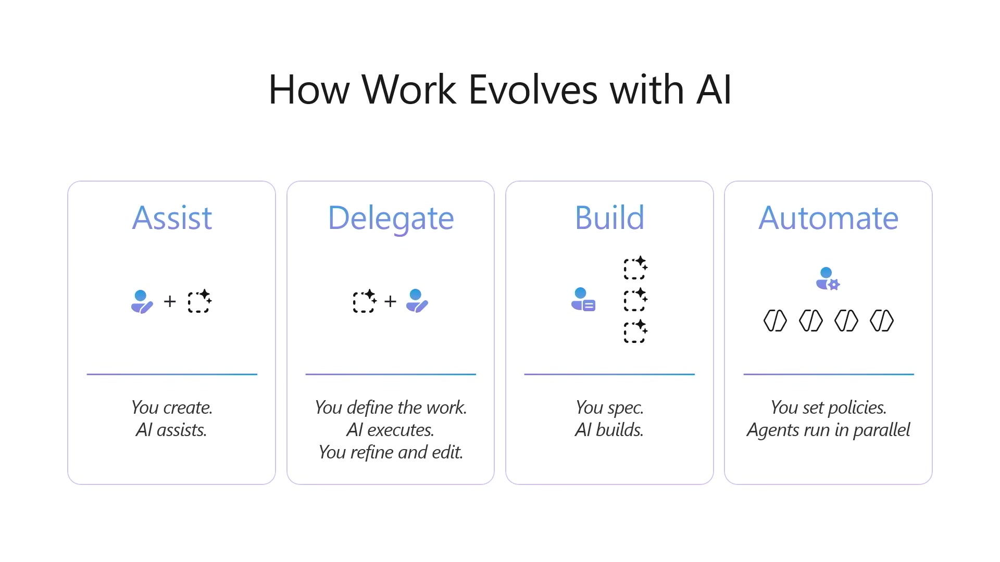
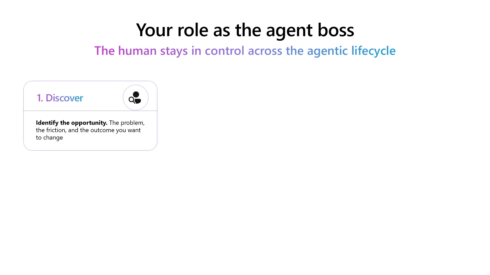
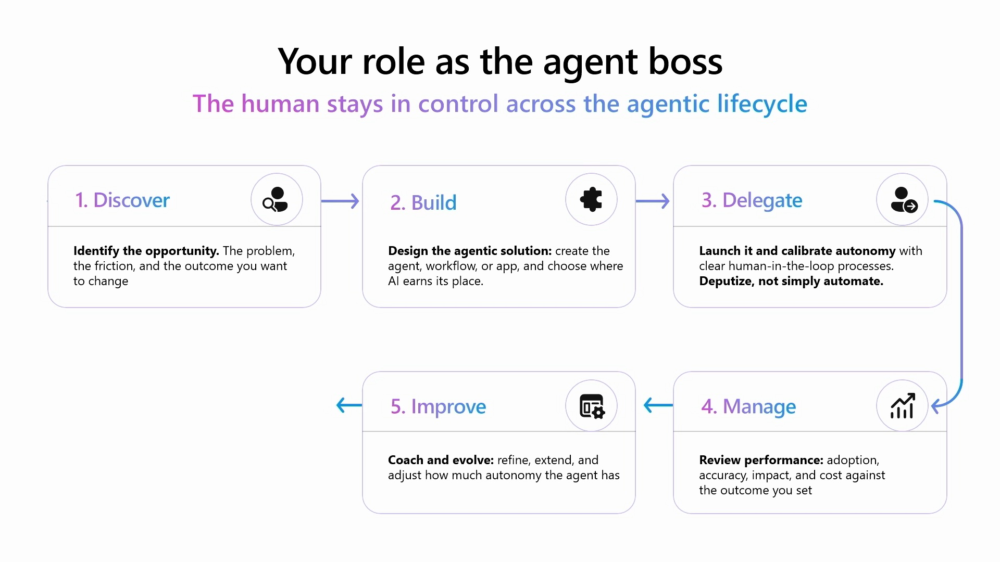

## #three-shifts-four-patterns 01 / Three AI Shifts & Four Patterns :: 从检索、任务到自主循环：复盘 Assist、Delegate、Build、Automate 四大协作模式 || Three Shifts & Four Collaboration Patterns: Assist, Delegate, Build, and Automate

过去数年间，企业与人工智能的交互边界经历了三次底层跃迁 [1]。在 LIVE107 开场对话中，Jack Rowbotham 沿着时间脉络梳理了这三重演进：第一阶段是**检索（Retrieval）**，生成式模型扎根企业业务语境查询海量数据并给出扎实解答；很快演进到第二阶段**任务执行（Tasks）**，模型通过模型上下文协议连接后台工具并直接更新业务线系统；而过去一年加速涌现的第三阶段则是**自主性（Autonomy）**——智能体开始承担推理与规划，在后台驱动智能体循环（Agentic Loop）独立推进整段工作 [1][2]。 || Enterprise interaction with AI has undergone three foundational shifts over the past few years [1]. Opening LIVE107 with Jeremy Chapman, Jack Rowbotham traced that progression: first came **Retrieval**, where generative models queried massive enterprise data stores grounded in business context; second came **Tasks**, connecting through the Model Context Protocol to update line-of-business applications; and third—accelerating over the past year—is **Autonomy**, where agents reason, plan, and execute an agentic loop to complete work independently [1][2].

这三次底层能力演进，直接催生出员工日常使用与驾驭智能体的**四种核心交互模式**，并一一对应四种全新的工作形态（Chat、Co-work、Code、Auto）[1][2]： || Those three technical shifts unlocked **four core human-agent interaction patterns**, mapping directly onto four new modes of work—Chat, Co-work, Code, and Auto [1][2]:

:::insight-grid { cols: 2, title: "LIVE107 界定的四大人机协作模式与新工作形态映射 || Four Human-Agent Collaboration Patterns & New Modes of Work" }
::card 01
### 辅助模式 Assist（对应 Chat 对话审阅） || 1. Assist Mode (Chat Experience)
人类亲手完成主体工作并整理素材，随后唤起对话助手执行审阅、分析与摘要提炼——这是绝大多数职场人接触生成式工具的起点 [1]。 || The human completes the primary work and asks AI via chat to review, analyze, or summarize the material—the entry point where most users began [1].

::card 02
### 委派模式 Delegate（对应 Co-work 协同交付） || 2. Delegate Mode (Co-work Deliverables)
人类向智能体注入更多信任，负责界定清晰的任务目标；智能体自行拟定计划并生成演示文稿或文档初稿，人类最后接手精修润色 [1]。 || Placing greater trust in AI, the human defines the target work while AI builds the plan and drafts PowerPoint decks or Word documents for human refinement [1].

::card 03
### 定制构建 Build（对应 Code 规格驱动） || 3. Build Mode (Spec-Driven Code Route)
面对高度独特的企业专属业务流程，人类将重心放在编写严谨的需求规格说明上，由智能体与开发底座按规格构建并交付定制化成品 [1]。 || When business processes are unique, the human focuses on authoring a crisp specification and AI builds the tailored end-to-end solution [1].

::card 04
### 自动巡航 Automate（对应 Auto 全天候运行） || 4. Automate Mode (Always-On Autopilot)
最受关注的自动驾驶形态：人类专注配置权限边界与治理策略，智能体则在幕后全天候常驻运转，自动响应事件并闭环业务动作 [1][3]。 || True operational autopilot: the human configures permissions and policies upfront, then monitors work executing continuously behind the scenes [1][3].
:::

本场 LIVE107 为 Microsoft Ignite 2026 官方演播室访谈（全长 8 分 52 秒，现场内嵌演示文稿画面）[1][2]。下方交互导览台集成了微软官方 Medius 点播流、高清视频直链、`aka.ms/agentboss` 官方指南入口以及五幕逐秒校对纪要，点击顶部章节按钮即可按时间轴核对核心论断 [1][2]： || Broadcast live at Microsoft Ignite 2026 with inline slide visuals across an 8-minute-52-second conversation, LIVE107 distills actionable management rules for every maker and team lead [1][2]. Use the interactive theater below to browse five timestamped chapter digests or launch the official Medius broadcast stream [1][2]:

:::sandbox { id: "live107-video-theater", canvas: false, script: "./live107-session.js", style: "./live107-session.css", title: "LIVE107 官方演播室点播流与五幕时间轴导览台 || LIVE107 Official Broadcast Stream & Five-Chapter Timestamp Navigator", desc: "切换四大协作模式、1:10 与 1:5 人机配比、受权代办、评测调优与组合退役五幕实录，一键加载官方点播播放器。 || Switch across the 4 Patterns, 1:10/1:5 Ratio, Deputize, Evals Tuning, and Scale/Retire chapters or launch the official Medius player." }
纯静态演播室导览沙盒：内置 LIVE107 官方高清封面、五幕逐秒核验摘要及 Medius 点播、高清 MP4 与官方指南直链。 || Pure static broadcast theater featuring the official LIVE107 HD cover, five timestamped transcript digests, and direct stream and guide links.
:::

## #agent-boss-ratio 02 / Human-to-Agent Ratio :: 什么是“智能体老板”？按自主风险动态配置 1:10 到 1:5 的人机配比 || Being an Agent Boss: Calibrating Your 1:10 to 1:5 Human-to-Agent Ratio by Risk

既然员工同时调遣着对话审阅、协同撰稿、定制方案与后台自动巡航四类体验，Jeremy Chapman 顺势抛出了全场核心命题：**究竟什么才叫作一名合格的“智能体老板（Agent Boss）”？** [1] Jack Rowbotham 指出，成为智能体老板绝不只是当一名工具使用者，尤其是在迈入第三类“构建（Build）”与第四类“自动巡航（Automate）”深水区时，员工必须站在端到端业务全局思考——追问立项背后的真实业务意图、设计受控的委派链路，把智能体的算力真正转化为个人与团队的业务影响力 [1][3]。 || Since employees now orchestrate chat, co-work, custom builds, and always-on automations simultaneously, Jeremy Chapman posed the central question: **what does it actually mean to be an Agent Boss?** [1] Jack Rowbotham emphasized moving beyond casual usage—especially in the Build and Automate modes—to own the end-to-end process from business intent through thoughtful delegation, connecting AI directly to measurable organizational impact [1][3].

衡量一位智能体老板管理半径的关键标尺，是 **人与智能体配比（Human-to-Agent Ratio）** [1]。每个组织、部门乃至具体岗位的最优配比，都取决于智能体的自主深度与业务风险 [1]。如果手头大多是偏简单的对话检索类助手（Chat），单名员工完全可以实现 **1:10** 的高配比并行调度；但如果智能体具备高度自主的推理规划与跨系统写操作能力，管理幅度就应当收敛至 **1:5** 左右——因为越自主的智能体越需要人类老板持续投入精力做方向引导、策略纠偏与评测改进，这与带好一支真人业务团队并无二致 [1]。 || A practical metric for sizing your span of control as an Agent Boss is the **Human-to-Agent Ratio** [1]. Optimal ratios vary across organizations, departments, and individual roles based on autonomy and risk [1]. One employee can comfortably manage **1 to 10 agents (1:10)** when those agents handle simpler chat and retrieval tasks [1]. Once workloads grow more autonomous, however, that span tightens to roughly **1 to 5 agents (1:5)**—because autonomous teammates demand ongoing guidance, policy refinement, and performance coaching just like human direct reports [1].

:::figure { src: "./media/live107-collaboration-ratio-quadrant.figure.json", title: "LIVE107 四大人机协作模式与管理配比风险象限 || LIVE107 Collaboration Modes & Human-to-Agent Span-of-Control Matrix" }
图 1：基于 LIVE107 演播室框架绘制的自主深度与管理投入象限——左下广度赋能区对应约 1:10 的轻量对话与协同草拟模式；右上深度督导区对应约 1:5 的定制构建与自动巡航模式；左上提醒固定步骤优先采用确定性工作流以节约词元预算，右下则警示缺乏问责与高频空转带来的失控风险 [1]。 || Figure 1: Autonomy-versus-oversight matrix reconstructed from LIVE107—mapping ~1:10 lightweight Chat/Co-work patterns at bottom-left, ~1:5 high-autonomy Build/Automate workloads at top-right, deterministic non-AI workflows at top-left, and unmanaged token-burning sprawl at bottom-right [1].
:::

  <article class="live107-media-card" data-present-surface="unframed">
    

      
    

    

      LIVE107 官方实录关键帧 · 01:28
      <h4 data-zh="演播室拆解四大交互模式：从 Assist、Delegate 迈向 Build 与 Automate" data-en="Unpacking the Four Interaction Modes: From Assist & Delegate to Build & Automate">演播室拆解四大交互模式：从 Assist、Delegate 迈向 Build 与 Automate</h4>
      
Jack Rowbotham 结合现场课件阐释 Chat、Co-work、Code、Auto 四种新工作形态如何重塑人类在业务流中的站位 [1][2]。

    

  </article>
  <article class="live107-media-card" data-present-surface="unframed">
    

      
    

    

      LIVE107 官方实录关键帧 · 03:55
      <h4 data-zh="人类始终稳坐主驾席：从价值发现（Discover）开启六阶段治理闭环" data-en="Humans in the Driver's Seat: Launching the Six-Stage Lifecycle with Discover">人类始终稳坐主驾席：从价值发现（Discover）开启六阶段治理闭环</h4>
      
在动手搭建任何智能体之前，先锁定高确定性的商业机会与投资回报率，杜绝“先上线再找理由”的盲目建设 [1]。

    

  </article>

## #discover-build-deputize 03 / Lifecycle Stages 1–3: Intent & Deputize :: 六阶段生命周期前篇：算清立项账、拒绝盲目 AI 化，用“受权代办”锚定问责 || Lifecycle Stages 1–3: Lead with Value, Make AI Earn Its Route, and Deputize Without Surrendering Accountability

当员工真正以老板视角统管智能体生命周期时，人类在每一个环节都必须坐在主驾席（In the driver's seat）[1]。在 LIVE107 中段，Jack 与 Jeremy 深入剖析了 Copilot Studio 智能体全生命周期的前三个关键阶段，直指当前企业落地的三大常见误区 [1][3]： || Stepping into the Agent Boss role means staying in the driver's seat across every phase of engineering and operations [1]. Walking through the first half of the six-stage lifecycle in Copilot Studio, Jack Rowbotham and Jeremy Chapman addressed three widespread enterprise pitfalls [1][3]:

- **阶段 1：价值发现（Discover）——拒绝“先搭出来再硬凑合理性”**：当智能体能够代劳越来越多琐事时，最稀缺的反而成了人类对“哪些事真正值得做”的取舍定力 [1]。最容易被团队跳过的一步，恰恰是追问“我们最初为什么要建这个方案？”——必须先算清真实商业机会与投资回报率，绝不能凭一时兴起先把智能体造出来，事后再回头寻找业务买单的理由 [1]。 || **Stage 1: Discover — Never Build First and Justify Later**: In an era where AI can execute boundless tasks, choosing which work actually deserves to exist becomes paramount [1]. Teams often overlook the foundational question—*why are we doing this in the first place?*—so Agent Bosses anchor on business opportunity and return on investment upfront instead of justifying pet projects after the fact [1].
- **阶段 2：混合构建（Build）——让 AI 凭实力挣得席位，别为闲置输出白付“词元薪水”**：许多创作者一上手就热衷于把所有环节统统改造成智能体，但**并非每一步流程都应该被强行 AI 化（Not everything should be AI-ified）** [1]。AI 必须在架构中证明自己的不可替代性；对于规则固定的环节，采用按既定步骤执行的确定性路径（Deterministic Route）往往更稳妥 [1]。Jeremy 形象地补充道，在后台跑着无人消费的冗余智能体输出，就像白白支付员工薪水、消耗平台点数（Credits）或烧掉词元预算；优秀的构建者会保持技术开放性，按需混编应用、确定性工作流与智能体 [1][3]。 || **Stage 2: Build — Make AI Earn Its Route and Stop Paying Token "Salaries" for Unused Output**: Excitement often tempts makers to turn every step into an agent, yet **not everything should be AI-ified** [1]. AI has to earn its place in the architecture; deterministic routes following set steps remain superior for predictable logic [1]. As Jeremy noted, generating unconsumed AI output is akin to paying a salary in credits or tokens for work nobody uses—so stay open-minded across apps, workflows, and agents [1][3].
- **阶段 3：受权代办（Delegate / Deputize）——智能体干活，人类扛责**：进入委派配置环节，核心不再是能不能自动化，而是界定人在回路（Human in the Loop）的审批流与异常上报标记 [1]。Jack 特别选用 **“受权代办（Deputize）”** 一词来诠释这一阶段的本质：当有人追问“究竟谁对这条业务流程负责？”时，答案永远是具体的人类负责人——智能体受命执行具体任务，但人类老板绝不让出方向盘与最终问责权 [1]。 || **Stage 3: Delegate ("Deputize") — Agents Execute the Work, Humans Own Accountability**: Configuring delegation centers on calibrating autonomy—deciding where humans stay in the loop, how approvals route, and when exceptions flag [1]. Jack deliberately frames delegation as **deputizing** to keep accountability unmistakable: when someone asks who owns the business process, the answer is always the human—the agent performs the task, while the human remains accountable in the driver's seat [1].

:::figure { src: "./media/live107-agent-boss-lifecycle-architecture.figure.json", title: "Copilot Studio 智能体老板六阶段全生命周期治理闭环架构 || Copilot Studio Agent Boss Six-Stage Lifecycle & Governance Architecture" }
图 2：完整还原 LIVE107 阐述的六阶段闭环——顶层输入四大协作模式与人机风险配比；中层通过价值发现、确定性与智能体混合构建以及受权代办守住上线前红线；底层依托持续指标核验、小步评测换模降频以及智能体间协议整合退役，形成自我进化的企业级资产池 [1][2]。 || Figure 2: End-to-end six-stage architecture from LIVE107—connecting the four collaboration modes and risk ratios on top; driving Discover, hybrid Build, and Deputized Delegation in the middle; and enforcing Manage KPIs, small-step Evals tuning, and A2A consolidation or retirement at the base [1][2].
:::

## #manage-improve-retire 04 / Lifecycle Stages 4–6: Evals & Consolidation :: 六阶段生命周期后篇：跑通小步评测、切换高性价比模型，果断退役与合并冗余实例 || Lifecycle Stages 4–6: Run Small-Step Evals, Right-Size Models & Schedules, and Consolidate or Retire

许多团队在智能体上线那一刻欢呼庆祝，却忽略了真正决定长期成败的后半程治理 [1]。在生命周期的第四至第六阶段，智能体老板的工作重心转向精细化运营、成本效能调优与资产组合新陈代谢 [1][2]： || Too many teams celebrate launch day and neglect post-deployment operations [1]. Across Stages 4 through 6, an Agent Boss shifts focus toward telemetry verification, token economics, and disciplined portfolio hygiene [1][2]:

:::flow { title: "LIVE107 上线后三阶治理闭环：从运行核验、小步评测到组合瘦身 || Post-Launch Governance Loop: Manage, Improve, and Scale or Retire" }
1. **阶段 4：持续纳管（Manage）——穿透表面活跃看推理与工具调用 || Stage 4: Manage — Verify Adoption, Tool Calls & Reasoning** — 投产后持续紧盯核心业务指标：真实用户到底有没有在用？是否真正拿到了业务价值？智能体在后台是否准确调用了预期工具、推理链条是否严密无偏？ [1] || Continuously inspect post-launch KPIs: are people actually adopting the solution and extracting value, are the right tools being invoked, and is sound reasoning occurring under the hood? [1]
2. **阶段 5：评测迭代（Improve）——小步跑通 Evals，替换高效率模型并削减空转调度 || Stage 5: Improve — Small-Step Evals, Efficient Models & Lean Schedules** — 建立自动化评测集（Evals）验证每次改动；参考大会主题演讲中优化指令集与微调测试的做法，将昂贵前沿模型按需切换为词元与额度效率更高的模型，且**每次只做一处小改动，证实有效后再推进下一步**；同时审视后台定时任务，把没必要每天跑 3–4 次的作业调低为隔天运行 [1]。 || Run automated evals to validate behavior, swap frontier models for more token- or credit-efficient alternatives where proven, apply **one small verified change at a time**, and trim scheduled tasks from 3–4 daily runs to once every other day when appropriate [1].
3. **阶段 6：扩缩与退役整合（Scale or Retire）——借助 A2A 协议消灭重复建设 || Stage 6: Scale or Retire — Consolidate Sprawl via Agent-to-Agent Protocols** — 当个人或小组智能体验证高价值后，梯次推广至整个部门乃至全公司共享；反之，当某个智能体不再贡献增量价值或出现职责重叠时，必须像传统 IT 应用生命周期管理那样**果断将其退役下线**，或利用智能体间协议（Agent-to-Agent Protocols）将零散小安装实例整合进能力更强的核心智能体中 [1][3]。 || Scale proven team solutions to department or enterprise scope—and apply classic IT application portfolio discipline to **retire** obsolete bots or consolidate fragmented smaller installations into stronger flagship agents connected via agent-to-agent protocols [1][3].
:::

  <article class="live107-media-card" data-present-surface="unframed">
    

      
    

    

      LIVE107 官方实录关键帧 · 05:38 Manage & Improve
      <h4 data-zh="持续评测与精益算力：每次只改一小步，按需切换高性价比模型并压缩冗余定时调度" data-en="Continuous Evals & Lean Compute: Change One Variable at a Time, Right-Size Models, and Trim Schedules">持续评测与精益算力：每次只改一小步，按需切换高性价比模型并压缩冗余定时调度</h4>
      
Jack Rowbotham 与 Jeremy Chapman 强调杜绝一次性大改，通过 Evals 度量真实增益，让词元消耗与人类真实工作节奏严丝合缝 [1]。

    

  </article>

## #boss-skills-action-plan 05 / Skills & Month-One Playbook :: 本月即可启动的行动清单：兼修技术硬护栏与“抱负、判断力、系统思维”软实力 || Skills to Thrive & Month-One Action Plan: Pairing Technical Guardrails with Human Ambition and Judgment

如果观众今天看完专场希望立刻迈出成为智能体老板的第一步，该从何处着手？Jack Rowbotham 在访谈收尾给出了官方学习入口 **`aka.ms/agentboss`**，并特别叮嘱职场人不要只盯着硬核技术指标，而要同步锻造决定管理上限的人类软实力 [1][2]： || For viewers ready to put these lessons into practice immediately, Jack Rowbotham pointed to **`aka.ms/agentboss`** as the primary starting hub and emphasized balancing technical fluency with timeless human leadership capabilities [1][2]:

| 能力与治理维度 || Capability & Governance Dimension | 技术硬实力与工程动作（Hard Technical Skills） || Technical & Operational Execution | 智能体老板核心软实力（Human Boss Soft Skills） || Essential Human Boss Leadership | 本月首条工作流落地核对项 || Month-One First Workflow Checklist |
|------|------|------|------|
| 立项与边界设计 || Intent & Architecture | 区分确定性规则路径与模型推理节点，混编应用与工作流 [1] || Blend deterministic steps, apps, workflows, and agents [1] | **人类抱负与目标感（Ambition & Purpose）**：聚焦真正值得做的事 [1] || **Human Ambition & Purpose**: Prioritize work truly worth doing [1] | 选定 1 条高频业务流，动工前写清商业回报预期而非先建后补 [1] || Pick 1 workflow and document concrete ROI before building [1] |
| 授权与合规风控 || Delegation & Safety | 编写高质量提示词、配置负责任 AI 护栏与人在回路审批 [1] || Author prompts, Responsible AI guardrails, and HITL approvals [1] | **批判性判断力（Judgment & Critical Thinking）**：坚持受权代办问责 [1] || **Judgment & Critical Thinking**: Deputize tasks, retain ownership [1] | 按自主度核定个人 1:10 或 1:5 管理配比，明确异常升级责任人 [1] || Size your 1:10 vs. 1:5 ratio and name the accountable owner [1] |
| 持续评测与组合演进 || Evals & Portfolio Hygiene | 运行自动化评测集、切换高词元效率模型、用智能体间协议整合 [1] || Run evals, swap token-efficient models, consolidate via A2A [1] | **系统思维（Systems Thinking）**：全局审视跨负载协同与退役清理 [1] || **Systems Thinking**: Govern end-to-end impact and retire stale bots [1] | 每次仅做单点小步调优，砍掉每日 3–4 次的冗余空转定时任务 [1] || Prove one small change via evals and trim redundant daily schedules [1] |

正如 Jack 引用大会主题演讲所总结的那样，提示词工程、负责任 AI 与安全护栏固然是构建智能体的必备基本功，但真正区分平庸配置者与卓越“智能体老板”的，始终是人类的**抱负（Ambition）、判断力（Judgment）、批判性思维（Critical Thinking）与系统思维（Systems Thinking）** [1]。归根结底，把一个人塑造成优秀团队管理者的核心素养，如今正原封不动地延伸至你所统领的跨场景智能体舰队之上 [1][3]。 || Echoing the Ignite keynote themes, prompt crafting, Responsible AI, and safety guardrails form the necessary technical baseline—but what separates a casual builder from an effective Agent Boss are **human ambition, judgment, critical thinking, and systems thinking** [1]. Ultimately, the exact qualities that make someone a thoughtful manager of people now define how effectively you lead an enterprise fleet of agentic workloads [1][3].

## 参考资料：官方一手信源与关联指南 || References: Official Primary Sources & Guides

1. **Jeremy Chapman & Jack Rowbotham (Microsoft Ignite 2026 LIVE107 Official Session & Transcript)** — https://ignite.microsoft.com/en-US/sessions/1793673035822001IAoZ-AAAAAAAAAAAAAAAAAAAA | 《How to be an Agent Boss》演播室专场主页与官方英中双语 WebVTT 逐字稿实录（2026-11） || Official Broadcast Stage session page and bilingual WebVTT verbatim transcripts (Nov 2026)
2. **Microsoft Medius On-Demand Stream (LIVE107 Broadcast Recording)** — https://medius.microsoft.com/Embed/video-nc/e2c16839-f8e3-493a-a698-c79121165845 | LIVE107 官方内嵌点播播放器与高清视频源（`https://medius.microsoft.com/video/asset/HIGHMP4/e2c16839-f8e3-493a-a698-c79121165845`） || Official Microsoft Medius video stream and high-definition broadcast recording
3. **Microsoft Official Agent Boss Hub (`aka.ms/agentboss` & Copilot Studio November 2026 Announcements)** — https://aka.ms/agentboss | LIVE107 节目官方推荐的智能体老板实战入门中心及 Copilot Studio 生命周期治理最佳实践 || Official Agent Boss learning resource cited in LIVE107 alongside Copilot Studio lifecycle governance guidance
