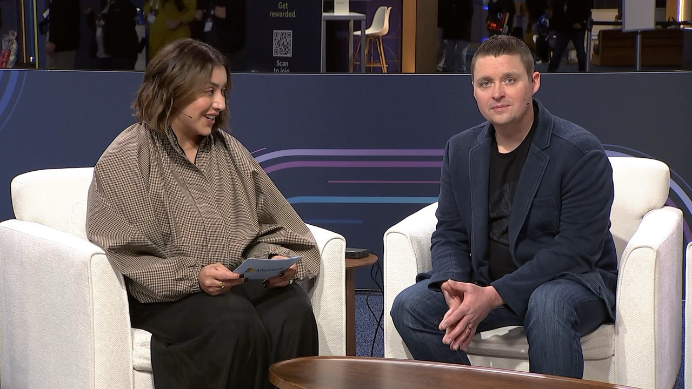
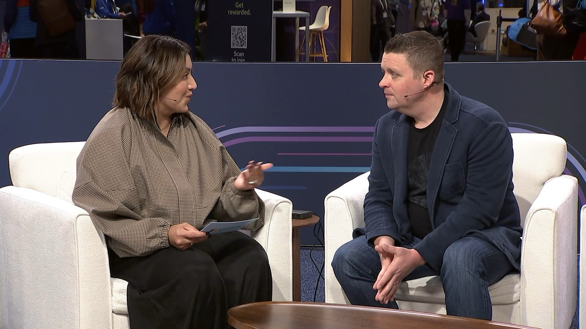
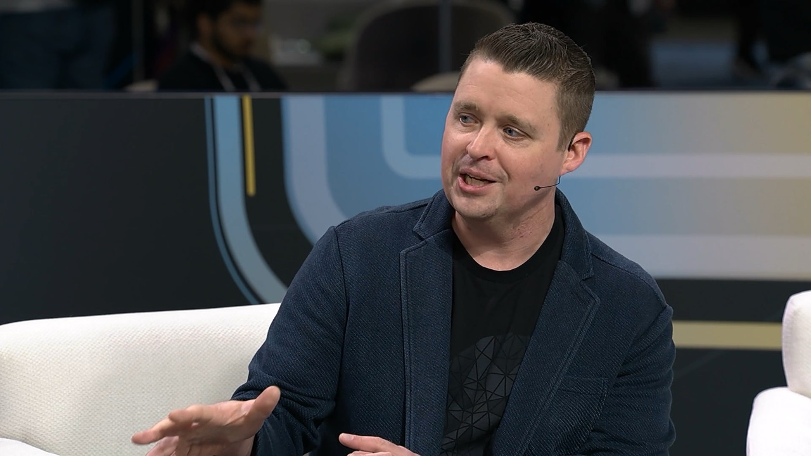

## #self-hosting-factory 01 / Self-Hosting Software Factory :: 自举式软件工厂：数十个专属智能体如何在 Copilot Studio 上构建产品本身 || Self-Hosting Software Factory: How Dozens of Agents Build Copilot Studio on Copilot Studio

今天 Copilot Studio 研发团队交付产品的方式，与一年前同期相比已几乎找不到任何相似之处 [1]。在与 Lauren Soni 的开场对谈中，Ryan Cunningham 直言团队在过去一年完成了从传统人工排期流水线向**软件工厂（Software Factory）**的彻底转型——整套研发体系由数十个智能体、确定性自动化与工作流编织而成，而且其中相当大比例的工程运转流本身就直接托管运行在 Copilot Studio 产品底座之上 [1][2]。 || How the Copilot Studio engineering organization ships software today bears almost no resemblance to how it operated just twelve months earlier [1]. Opening LIVE149 alongside Lauren Soni, Ryan Cunningham explained that the team replaced traditional handoff pipelines with an agentic **software factory**—a coordinated fleet of agents, automations, and workflows that increasingly runs on Copilot Studio itself [1][2].

在这座自举运转的软件工厂里，数十个智能体并非笼统的对话助手，而是像正式团队成员一样拥有明确的岗位分工：有的智能体全天候紧盯生产环境遥测信号，有的专门在社区与社交渠道倾听用户反馈，有的负责编写代码改进补丁，还有的承担回归验证与质量把关 [1][2]。人类研发团队的核心职责由此上移——工程师不再把全部精力耗在逐行手写样板代码上，而是通过塑造、调优和约束整座智能体工厂的系统拓扑，直接决定产品创新的推进配速 [1][3]。 || Inside this self-hosting factory, dozens of agents hold distinct operational jobs rather than acting as generic chat assistants: dedicated agents monitor production telemetry, listen for external user feedback, author code improvements, and validate candidate builds [1][2]. Human engineers shift upstream—shaping, governing, and tuning the factory system itself to set the pace of product innovation [1][3].

:::figure { src: "./media/live149-software-factory-architecture.figure.json", title: "Copilot Studio 自举式软件工厂三层运转与外溢架构 || Copilot Studio Self-Hosting Software Factory Three-Plane Architecture" }
图 1：基于 LIVE149 访谈实录还原的自举软件工厂闭环——顶层汇集生产遥测、社区录屏反馈与超半数设计师直提的代码分支；中层由运行在 Copilot Studio 上的数十个专属智能体接力完成夜间复现、补丁编码与自动化验证；底层经人在回路晨间合入与早期用户环实测加固后，同源外溢为赋能百业的工作操作系统 [1][2]。 || Figure 1: Three-plane architecture reconstructed from LIVE149—combining live telemetry, user video reports, and designer PRs on top; orchestrating overnight triage, coding, and validation agents running on Copilot Studio in the middle; and governing human-in-the-loop merges, early-ring hardening, and customer platform export underneath [1][2].
:::

本场 LIVE149 属于 Microsoft Ignite 2026 官方演播室直击访谈（Broadcast Stage，全长 7 分 40 秒，现场无独立幻灯片附件）[1][2]。下方交互导览台内嵌了微软官方 Medius 点播流、高清视频源直链与完整五幕对话的逐秒时间轴摘要，点击顶部章节标签即可按议题脉络核查原话细节 [1][2]： || Recorded live on the Microsoft Ignite 2026 Broadcast Stage without a separate slide deck, LIVE149 packs dense organizational and architectural disclosures into a 7-minute-40-second executive dialogue [1][2]. The interactive theater below pairs the official Microsoft Medius stream and HD video feed with five timestamped chapter breakdowns [1][2]:

:::sandbox { id: "live149-video-theater", canvas: false, script: "./live149-session.js", style: "./live149-session.css", title: "LIVE149 官方演播室点播流与五幕对话时间轴导览台 || LIVE149 Official Broadcast Stream & Five-Chapter Timestamp Navigator", desc: "切换自举软件工厂、设计师直提 PR、24 小时夜间修复闭环、爬坡转型建议与 Markel 航运险案例五幕实录，一键加载官方点播播放器。 || Switch across the Software Factory, Designer PRs, 24-Hour Fix Loop, Hill-Climbing Advice, and Markel Marine Case chapters or launch the official Medius player." }
纯静态演播室导览沙盒：内置 LIVE149 官方高清封面、五段逐秒校对纪要及 Medius 点播与高清视频直链。 || Pure static broadcast theater featuring the official LIVE149 HD cover, five timestamped transcript digests, and direct stream links.
:::

## #bottleneck-inversion 02 / Bottleneck Inversion & Role Shift :: 当编码不再是最慢瓶颈：告别静态平面稿，超半数设计师直提生产 PR || When Coding Stops Being the Bottleneck: Skipping Flat Mockups as Over Half of Designers Merge PRs

为什么引入智能体之后，连人类团队的创意与规划机制都发生了剧变？Ryan Cunningham 指出了过去几十年软件工程默认遵循的一条隐性假设：**传统研发规划之所以沉重，是因为大家都默认“把代码写出来”是最难、最慢的那一步** [1]。正因为写代码贵且慢，团队在动工前不得不花费数周时间组织焦点小组（Focus Grouping）、反复拉通排期，并绘制大量静态平面设计稿（Flat-File Designing）来提前规避返工风险 [1]。 || Why did adding agents radically alter how human product teams plan and ideate? Ryan Cunningham pinpointed the hidden premise underneath decades of software management: **legacy creative and planning rituals were built around the assumption that writing the code was the hardest, slowest part** [1]. Because implementation was expensive, teams spent weeks scheduling focus groups and polishing static flat-file mockups before anyone wrote a line of production logic [1].

一旦软件工厂接管了繁重的编码实现，这条约束前提便被彻底反转 [1]。团队不再需要围着静态画布空谈数周，而是第一时间把想法直接做成可交互的真实功能，先在内部亲手试穿感受（Try them on ourselves），紧接着推送给早期用户环（Early Rings of Users）收集真实生产反馈，最后筛选出真正站得住脚的能力做工程加固并推向全量主流生产环境 [1][3]。这种即时实现机制直接打破了职能墙——Ryan 在访谈现场披露，**Copilot Studio 团队中已有超过一半（>50%）的设计师亲手提交了代码拉取请求（Pull Request），且其中大批改动已正式合入生产主干** [1]。 || Once the software factory absorbed implementation friction, that constraint inverted [1]. Instead of debating static mockups for weeks, makers implement working features immediately, try them on internally, test them with early rings of users, and then harden proven winners for mainstream production [1][3]. That immediacy dissolved traditional role boundaries: **more than half of the designers on Copilot Studio have submitted pull requests, with many merged directly into production** [1].

  <article class="live149-media-card" data-present-surface="unframed">
    

      
    

    

      LIVE149 官方实录关键帧 · 00:18
      <h4 data-zh="演播室对话：AI 如何同时改写产品与造产品的方式" data-en="Broadcast Dialogue: How AI Reshapes Both the Product and How It Is Built">演播室对话：AI 如何同时改写产品与造产品的方式</h4>
      
Lauren Soni 与 Ryan Cunningham 从工程组织视角切入，剖析数十个智能体如何在 Copilot Studio 自身之上协同运转 [1][2]。

    

  </article>
  <article class="live149-media-card" data-present-surface="unframed">
    

      
    

    

      LIVE149 官方实录关键帧 · 跨职能协同
      <h4 data-zh="跨出研发与设计边界：全角色卷入快速实验内环" data-en="Beyond Engineering & Design: Pulling Every Role Into Live Experimentation">跨出研发与设计边界：全角色卷入快速实验内环</h4>
      
超过半数设计师直接向代码库提交拉取请求，外部真实客户也通过自动化反馈流成为产品迭代的直接参与者 [1]。

    

  </article>

## #overnight-customer-loop 03 / The 24-Hour Customer Loop :: 把外部用户拉进创新内环：从 LinkedIn 抱怨录屏到 24 小时合入上线 || Customers Inside the Innovation Loop: From a Frustrated LinkedIn Video to Merged Fix in 24 Hours

除了内部设计师与工程师的角色融合，最令团队振奋的变化在于**外部客户与终端用户真正成为了日常研发循环的一部分** [1]。Ryan Cunningham 分享了就在 Ignite 大会前一周刚刚发生的真实案例：一位用户在尝试用 Copilot Studio 搭建某项功能时卡壳受挫，一气之下在 LinkedIn 上发了一篇长文，还专门录制了一段复现操作视频吐槽这项体验缺陷 [1]。 || Beyond internal role convergence between designers and engineers, the most energizing shift is how **external customers and end users now participate directly in the engineering loop** [1]. Ryan Cunningham recounted an incident from just one week before Ignite: a user trying to accomplish a task in Copilot Studio hit a wall, grew frustrated, and published a lengthy LinkedIn post complete with a screen-recorded video demonstrating the failure [1].

放在传统大型软件企业的工单流转体系里，这类社交媒体抱怨往往要经历公关收集、产品经理建单、双周排期评审与下月发版等漫长环节；但在 Copilot Studio 的智能体软件工厂中，这则细节详尽的视频反而成了最佳燃料——整个闭环在 **24 小时之内**即告完结 [1]： || In a conventional enterprise backlog, a social-media complaint might wait weeks for triage, sprint planning, and monthly release trains. Inside Copilot Studio's software factory, that detailed video acted as an immediate specification—closing the entire loop in **24 hours** [1]:

:::flow { title: "LIVE149 真实案例还原：24 小时夜间智能体修复与人在回路合入流水线 || Reconstructed LIVE149 Case: 24-Hour Overnight Agent Fix & Human-in-the-Loop Merge" }
1. **高保真痛点捕获（Day 1 晚间） || Detailed User Signal Capture (Evening)** — 用户在 Copilot Studio 操作受阻后于 LinkedIn 发布长篇复盘与完整录屏，软件工厂的外部反馈倾听智能体当晚自动拾取该线索 [1]。 || After getting stuck in Copilot Studio, a user posts a detailed write-up and video on LinkedIn; a feedback-listening agent picks it up that same night [1].
2. **独立复现与真伪核验（Overnight Validate） || Autonomous Issue Validation (Overnight)** — 诊断智能体连夜对视频描述的路径展开自动化验证，独立确认这并非误操作，而是一处真实存在的产品缺陷 [1]。 || Overnight, the agent checks the reported workflow against the live build and validates that the issue is a legitimate product defect [1].
3. **夜间自动编码补丁（Overnight Code Fix） || Automated Patch Authoring (Overnight)** — 代码改进智能体随即针对确认的根因自动编写修复补丁并跑通验证套件，在工程师清晨上班前备好候选分支 [1]。 || Coding and validation agents author the fix and verify the candidate branch before morning stand-up [1].
4. **人在回路晨间合入（Morning HITL Merge） || Human-in-the-Loop Morning Merge (Morning)** — 研发团队保留严格的人在回路（Human in the Loop）把关机制，工程师在第二天早晨完成代码审查并将补丁正式合入主干 [1]。 || Keeping a human in the loop for engineering judgment and safety, the team reviews and merges the fix into production in the morning [1].
5. **24 小时内主动回访（24h Customer Closure） || 24-Hour Customer Notification (<24h)** — 距离原帖发出不到 24 小时，团队已主动回复该用户：“非常感谢你的详细报告，问题已经修好，补丁正在推往你的环境途中” [1]。 || Within 24 hours of the original post, the team replies to the user confirming the bug is fixed and already rolling out to their environment [1].
:::

## #hill-climbing-leadership 04 / Resetting Constraints & Ambitions :: 给技术领导者的转型法则：先下水试游，重设约束指标持续“爬坡” || Leadership Playbook: Get in the Pool, Unlearn Legacy Timelines, and Hill-Climb New Constraints

当被问及团队在切换至智能体工作模式后最大的意外与教训是什么时，Ryan Cunningham 给出的关键词是**“反学习与再学习（Unlearn and Relearn）”** [1]。研发组织脑海中根深蒂固地刻着一套旧时钟——某类特性“理应耗费几个季度”、某项重构“注定有多高的门槛” [1]。技术深水区的硬骨头依然存在，但如果团队不主动打破旧约束、调高目标野心，就会用旧时代的排期惯性限制新时代的工具产能 [1]。 || Asked about the biggest lesson learned from working alongside an agent fleet, Ryan Cunningham emphasized **unlearning and relearning** [1]. Engineering organizations carry deeply ingrained expectations about how many weeks a feature is supposed to take or how hard an integration ought to be [1]. Hard engineering problems remain, yet teams cannot move dramatically faster unless they deliberately reset both their constraints and their ambitions [1].

针对现场与线上希望推动同类转型的产品与工程高管，Ryan 提炼出两步务实行动纲领：第一步是**“立刻下水，别等完美（Just start—get in the pool）”**——仅靠刷社交媒体动态或看发布会转播永远学不会游泳，组织必须迈出信念一步，亲手在真实业务池里试水犯错 [1]；第二步则是**拒绝形式主义伪转型**——成为 AI 转型组织绝不等于“上线一个聊天机器人、调用一下大语言模型，或者单纯烧掉一笔词元额度（Burning a token meter）”，而是要确立清晰的全局靶标，像训练强化学习模型那样围绕核心指标反复实验“爬坡（Climb the hill）” [1]： || For product and technology leaders looking to replicate this operating model, Ryan distilled a two-part playbook. First, **start before it feels ready**: nobody learns to swim without getting wet, and passively scrolling social feeds cannot substitute for hands-on experimentation [1]. Second, **reject superficial AI theater**: transformation is never about shipping a chatbot, calling an LLM, or burning a token meter—it requires setting concrete constraint-breaking goals and iterating against them (“climbing the hill”) [1]:

:::insight-grid { cols: 3, title: "LIVE149 提出的三大组织级“约束重塑（Constraint-Reset）”爬坡靶标 || Three Organizational Hill-Climbing Targets Highlighted in LIVE149" }
::card 01
### 核心主业能力翻倍（2× Core Excellence） || Be Twice as Good at the Core Thing
追问组织赖以生存的核心职能若性能与吞吐提升至原来的 2 倍意味着什么，围绕主航道重构端到端系统而非修补边角料 [1]。 || Ask what it truly takes to become twice as good at your organization's core value engine rather than automating isolated side tasks [1].

::card 02
### 测试预算减半但覆盖率翻倍 || Cut Test Budget, Double Coverage
打破质量与成本零和博弈的旧假设，利用验证智能体与自动化回归流同步实现测试投入压降与 2× 测试覆盖率跃升 [1]。 || Break legacy QA trade-offs by pairing validation agents with deterministic suites to cut testing spend while doubling coverage [1].

::card 03
### 极速压缩客户价值实现时间 || Radically Faster Time to Value
将内部原型验证、缺陷修复与客户业务交付周期压缩一个数量级，通过高频实测快速收敛至可规模化推广的生产方案 [1]。 || Collapse time-to-clarity and time-to-value for customers through rapid early-ring iteration and overnight feedback loops [1].
:::

:::figure { src: "./media/live149-constraint-shifts.figure.json", title: "LIVE149 核心工程与客户成效量化对比：从研发内环到海事核保 || LIVE149 Verified Engineering & Customer Constraint Shifts" }
图 2：汇总 LIVE149 访谈实录中的五组关键量化基准——涵盖内部超过 50% 设计师直提生产 PR、24 小时内闭环社区录屏缺陷、削减测试预算同时实现 200%（2×）测试覆盖率的爬坡法则，以及外部特种保险商 Markel 在不足 18 小时窗口内达成 300%+（3× 以上）的核保决策提速 [1]。 || Figure 2: Quantitative benchmarks disclosed in LIVE149—spanning >50% designer PR participation, ≤24-hour social bug resolution, the hill-climbing target of cutting test budget while hitting 200% (2x) test coverage, and Markel's 300%+ (3x+) marine underwriting velocity under an 18-hour lead time [1].
:::

## #markel-and-work-os 05 / Operating System for Work & Markel Case :: 从个人提效走向系统再造：Markel 海事保险 18 小时窗口内的 3 倍决策跃升 || Operating System for Work: Markel Marine's 3x+ Underwriting Velocity and Rewriting Backend Systems

微软在 Copilot Studio 内部跑通智能体软件工厂的终极目的，并非只为加速自身研发，而是将 Copilot 底下那层抽象工程底座开放出来，打造成为支撑千行百业的**工作操作系统（Operating System for Work）**——让财务部门、政府公共服务机构乃至特种金融企业都能复刻同等级别的流程再造 [1][3]。 || Microsoft's goal in building this internal software factory is not merely shipping its own code faster, but exposing the abstract platform underneath Copilot as an **operating system for work**—empowering finance departments, government agencies, and specialized enterprises to run the exact same innovation loop [1][3].

Ryan Cunningham 在访谈后半段重点剖析了特种保险集团 **Markel** 海事保险部门（Marine Insurance Division）的标杆实践 [1]。不同于常规车险或家财险，当一艘远洋货轮准备驶入地球上最危险的高风险海域时，船东找的正是 Markel 来为整段航次承保 [1]。核保团队必须穿透极为复杂的海事风险评估、船货价值测算与条款定价流程，而且**往往只有不到 18 小时的准备窗口（Lead Time）就必须给出承保结论** [1]。借助 Copilot Studio 重构这套高复杂度核保工作流后，Markel 成功将**达成高质量承保决策的速度提升了 3 倍甚至更多（3×+）**——对急等起航的船东客户而言，这意味着快 3 倍获得明确保障（3× faster time to clarity）；对 Markel 核心业务部门而言，这绝非抠省一点零碎人工成本，而是直接在主营航道上撬动 3 倍的业务承载丰裕度（3× more business）[1]。 || Illustrating what happens when enterprises apply this platform to high-stakes operations, Ryan highlighted specialty insurer **Markel** and its **marine insurance division** [1]. Unlike standard consumer policies, Markel underwrites cargo ships preparing to sail through some of the most dangerous waters on Earth—a complex risk-and-valuation process where underwriters sometimes have **less than 18 hours of lead time** to turn a quote around [1]. Using Copilot Studio, Markel **tripled or more (3x+) the velocity at which it reaches sound underwriting decisions**—unlocking three times faster clarity for shipping clients and three times greater throughput in a core revenue function rather than mere incremental cost savings [1].

  <article class="live149-media-card" data-present-surface="unframed">
    

      
    

    

      LIVE149 官方实录关键帧 · 06:15 Markel 案例
      <h4 data-zh="Markel 海事航运险：在不足 18 小时极限交期内实现 3 倍以上高质量核保决策" data-en="Markel Marine Insurance: 3x+ Faster High-Stakes Voyage Decisions Under an 18-Hour Lead Time">Markel 海事航运险：在不足 18 小时极限交期内实现 3 倍以上高质量核保决策</h4>
      
Ryan Cunningham 阐释丰裕型 AI 价值：不仅压缩耗时，更让客户获取保障确定性的速度加快 3 倍，并释放核心核保团队 3 倍业务吞吐潜力 [1]。

    

  </article>

| 转型维度 || Transformation Dimension | 旧有低效系统态（第一阶段局部提效） || Legacy State (Task-Level Productivity) | 智能体软件工厂与系统再造态（LIVE149 范式） || Agentic Factory & System Redesign (LIVE149) | 实证案例与量化锚点 || Verified Evidence & Metrics |
|------|------|------|------|
| 产品规划与设计交付 || Product Planning & Design | 默认写代码最慢最难，耗费数周做焦点小组与静态平面图 [1] || Assumes coding is slow; weeks of focus groups & flat-file specs [1] | 立即动手编码试穿，推入早期用户环实测后再加固入生产主干 [1] || Implement right away, test in early rings, then harden for production [1] | Copilot Studio 团队 **>50% 设计师**直提 PR 并合入生产 [1] || **>50% of designers** submit PRs merged to production [1] |
| 外部用户反馈响应 || Customer Feedback Loop | 社交媒体吐槽经多层转单排期，按周或月等待补丁发版 [1] || Manual ticket routing and multi-week sprint scheduling [1] | 智能体夜间拾取核验并编码修复，保留人在回路次晨合入 [1] || Overnight agent validation + coding with morning HITL merge [1] | LinkedIn 抱怨视频 **24 小时内**完成合入并回访通知在途 [1] || **Within 24 hours** from LinkedIn video to merged fix rollout [1] |
| 质量保障与工程目标 || QA & Engineering Goals | 围绕既有人工约束微调，测试成本与覆盖率呈线性互斥 [1] || Incremental tweaks bound by linear cost-vs-coverage trade-offs [1] | 重设组织约束持续爬坡，用验证智能体并发守护交付质量 [1] || Reset constraints and hill-climb with automated validation agents [1] | 设定**削减测试预算**同时实现 **2× 测试覆盖率** [1] || **Cut testing budget** while achieving **2x test coverage** [1] |
| 企业核心业务运转 || Enterprise Core Operations | 员工在老旧低效系统表层用个人 AI 写报告、看孤立看板 [1] || Individuals move faster on top of unchanged, inefficient systems [1] | 穿透表层报表与看板，用工作操作系统直接重写后台业务流 [1][3] || Re-architect the backend systems behind reports and dashboards [1][3] | **Markel 海事保险**在 **<18 小时**窗口内核保决策提速 **3×+** [1] || **Markel Marine** reached **3x+ decision velocity** in **<18h** [1] |

在访谈收尾处，Lauren Soni 与 Ryan Cunningham 共同点明了企业 AI 演进的下一道分水岭：过去两年，生成式 AI 确实让许多个人在日常工作中变得更高效，但人们往往只是**骑在原本低效的老旧业务系统之上加快了个人手速** [1]。真正的下一波转型前沿（Next Frontier of Transformation），是追问那些散落的个人周报、审批单与数据看板背后究竟在发生什么，并用智能体、确定性工作流与受控平台去**彻底改写底层的业务系统本身**——这正是微软用智能体工厂重铸 Copilot Studio 所交出的工程答卷 [1][3]。 || Closing the broadcast, Lauren Soni and Ryan Cunningham framed the defining inflection point ahead: up to now, AI has made individuals more productive in their daily routines *on top of* inefficient legacy systems that remained untouched [1]. The next frontier of transformation moves behind individual reports and dashboards to **re-architect the underlying business systems themselves**—the exact mission Copilot Studio was rebuilt to power [1][3].

## 参考资料：官方一手信源与关联议题 || References: Official Primary Sources & Related Sessions

1. **Ryan Cunningham & Lauren Soni (Microsoft Ignite 2026 LIVE149 Official Session & Transcript)** — https://ignite.microsoft.com/en-US/sessions/1793675965297001onQI-AAAAAAAAAAAAAAAAAAAA | 《Behind the Curtain: Building Copilot Studio》演播室专场主页与官方英中双语 WebVTT 逐字稿实录（2026-11） || Official Broadcast Stage session page and bilingual WebVTT verbatim transcripts (Nov 2026)
2. **Microsoft Medius On-Demand Stream (LIVE149 Broadcast Recording)** — https://medius.microsoft.com/Embed/video-nc/2c5e35c0-7c4b-4907-bf96-2e47d2c8580d | LIVE149 官方内嵌点播播放器与高清视频源（`https://medius.microsoft.com/video/asset/HIGHMP4/2c5e35c0-7c4b-4907-bf96-2e47d2c8580d`） || Official Microsoft Medius video stream and high-definition broadcast recording
3. **Microsoft Copilot Blog (Ignite 2026 Copilot Studio Announcements)** — https://www.microsoft.com/en-us/microsoft-copilot/blog/copilot-studio/whats-new-in-copilot-studio-november-2026/ | 微软官方 Copilot Studio 2026 年 11 月更新综述：三位一体业务流程工厂、Microsoft Copilot Harness 与客户生产案例 || Official November 2026 Copilot Studio blog covering unified agents, workflows, managed apps, and enterprise deployments
