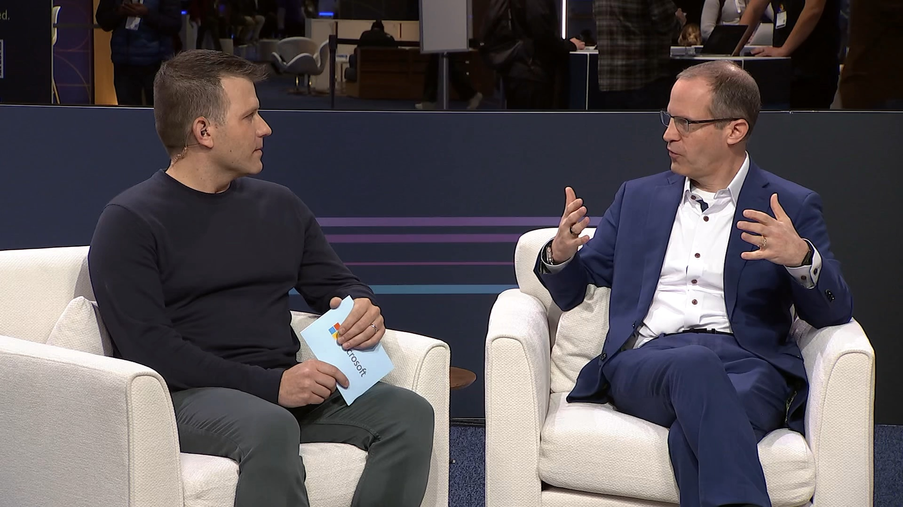
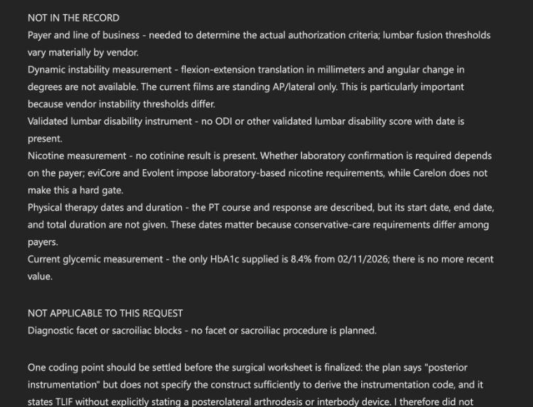
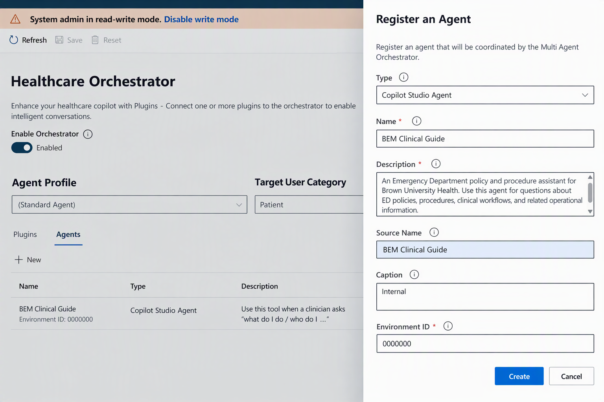
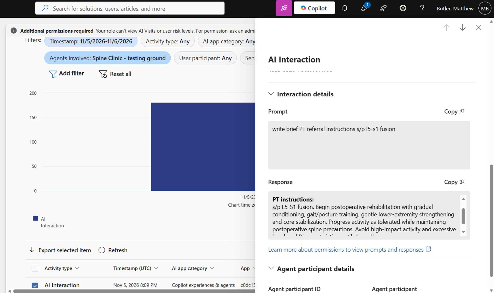

## #builder-enablement 01 / Frontline Clinician Builders :: 双轨赋能范式：从两万员工安全底座到“医生构建者”先锋计划 || Dual-Track Enablement: From a 20,000-Employee Safe Base to Clinician Builders

大型医疗系统的数字化项目长期由管理层自上而下规划，但诊室与病房里最琐碎的日常摩擦往往只有一线医护人员亲身感知 [1]。布朗大学健康系统（Brown University Health）横跨罗德岛州与马萨诸塞州东南部运营八家医院与 200 余处门诊站点，在推进战略级人工智能项目的同时，专门开辟了一条由一线员工自下而上构建解决方案的受控通道 [1][3]。Adam Landman 博士在访谈开篇指出，释放一线创造力的前提并非放任自流，而是先筑牢一套具备隐私边界与治理护栏的统一平台 [1]。 || Hospital technology roadmaps traditionally flow top-down from executive priorities, yet frontline clinicians experience the daily micro-frictions that stall patient care [1]. Operating eight hospitals and over 200 ambulatory sites across Rhode Island and Southeastern Massachusetts, Brown University Health paired strategic initiatives with a controlled bottom-up innovation track [1][3]. Opening LIVE17, Dr. Adam Landman emphasized that empowering frontline staff requires a secure, governed platform before anyone writes a single prompt [1].

该体系的第一层面向全机构约 **20,000 名员工**全面铺开 **Microsoft Copilot Chat** [1]。医院管理层借此确立了明确的数据安全承诺：商业敏感数据与受保护健康信息（Protected Health Information）严格留在受控租户边界内，不会外泄至公共模型训练集 [1]。这一零门槛底座迅速获得约 **8,000 名活跃员工**日常高频使用，渗透率突破活跃用户基数的三分之一 [1]。当部分科研人员、临床创新者与业务骨干不再满足于单轮问答、主动提出自建专属智能体时，院方顺势启动了基于 **Copilot Studio** 的精准构建者项目（Builder Program），并为深度算法研究团队配套开放 **Microsoft Foundry** 科研飞地 [1][3]。 || Layer one rolled out **Microsoft Copilot Chat** to all roughly **20,000 employees**, guaranteeing that business-sensitive records and protected health information remain isolated inside a compliant boundary [1]. Roughly **8,000 employees**—well over a third of active users—adopted the chat workspace [1]. When researchers, innovators, and clinical champions wanted to move beyond chat into building custom agents, Brown launched a targeted **Copilot Studio** builder program alongside **Microsoft Foundry** enclaves for research teams [1][3].

:::figure { src: "./media/live17-clinical-agent-architecture.figure.json", title: "Brown University Health 分层赋能、临床风险门禁与双端床旁交付架构 || Brown University Health Tiered Enablement, Risk Governance & Point-of-Care Delivery Architecture" }
图 1：依据 LIVE17 访谈实录与配套临床架构整理的三层体系——顶层分层承接全员安全问答、临床先锋沙盒原型与院内知识围栏；中层由人工智能卓越中心执行双向孵化、临床风险分级验证与全量审计登记；底层分别经由 Dragon Copilot 嵌入电子病历床旁或投递至办公协同端 [1][3]。 || Figure 1: Three-tier architecture synthesized from LIVE17 and companion clinical artifacts—combining 20K-staff safe chat, Copilot Studio clinician sandboxes, and curated internal grounding on top; bidirectional AI Center of Excellence incubation, risk-tiered validation, and audit registries in the middle; and Dragon Copilot electronic health record embedding alongside Teams delivery underneath [1][3].
:::

下方导览沙盒完整集成了 LIVE17 演播室访谈的官方点播视频流、高清访谈封面与五段核心议题的逐分钟时间轴，点击上方标签即可切换查阅对应进度与对话原意 [1][2]： || The interactive theater below pairs the official LIVE17 Broadcast Stage on-demand stream and studio cover with five timestamped chapter digests across the 10-minute conversation [1][2]:

:::sandbox { id: "live17-video-theater", canvas: false, script: "./live17-theater.js", style: "./live17-theater.css", title: "LIVE17 官方演播室访谈点播流与逐分钟议题导览 || LIVE17 Official Broadcast Stream & Minute-by-Minute Chapter Navigator", desc: "切换医生构建者、神经外科智能体、Dragon Copilot 病历集成、风险分级治理与新聘医师入职五大章节，支持页面内直接加载微软 Medius 点播播放器。 || Switch across Clinician Builders, Neurosurgery Agents, Dragon Copilot Integration, Risk Governance, and Provider Onboarding, or load the embedded Microsoft Medius player." }
纯静态演播室访谈导览沙盒：内置 LIVE17 官方高清封面、五段逐分钟实录摘要及点播与关联专场直链。 || Pure static broadcast session theater featuring the official LIVE17 HD cover, five timestamped chapter summaries, and direct stream links.
:::

## #neurosurgery-agents 02 / Clinician-Built Surgical Agents :: 临床自建实战：神经外科医生如何串联门诊文书、收费编码与医保事前授权 || Clinician-Built in Action: A Neurosurgeon's Agents for Consult Notes, Coding, and Prior Auth

“医生构建者”并非停留在概念验证口号上，而是直接切入了外科手术排期中最耗神的行政瓶颈 [1]。Adam Landman 博士在访谈第 2 分 30 秒详细拆解了一位神经外科医生的真实自建案例：过去每为一名重症患者敲定必需的手术方案，主刀医生都要耗费大量诊后时间拼凑跨科室病史、核对繁杂的手术收费代码，并反复应对商业保险公司的事前授权（Prior Authorization）材料补件 [1]。在接入受控构建环境后，这位神经外科医生（配套临床报告披露为神经外科系 **David B. Kurland, MD, PhD**）亲手设计了一组环环相扣的临床文档智能体 [1][3]。 || The clinician-builder model proved its worth inside one of healthcare's heaviest administrative bottlenecks: surgical scheduling [1]. At 02:30 in the broadcast, Dr. Landman detailed how a frustrated Brown neurosurgeon—identified in the companion clinical session as **David B. Kurland, MD, PhD**—built a coordinated series of agents to eliminate the paperwork standing between a surgical decision and patient care [1][3].

:::flow { title: "神经外科临床自建智能体群的三步术前协同链路 || Three-Stage Pre-Operative Workflow Powered by Surgeon-Built Agents" }
1. **多源接诊汇总与主刀语态成文（Visit & Care Plan Documentation） || Multi-Packet Synthesis in the Surgeon's Voice** — 智能体通读转诊单、基层首诊记录、疼痛管理随访、物理治疗小结以及核磁共振与 X 光影像报告，结合外科医生的查体结论生成结构化会诊病历；所有规则以纯文本写明，严禁捏造任何病历未载明的事实 [1][3]。 || Reads referral notes, pain-management visits, physical therapy summaries, imaging reports, and the surgeon's exam to draft a chart-ready consult note without inventing missing facts [1][3].
2. **账单与手术收费代码精准校验（Billing & Charging Code Alignment） || Surgical Billing & Charging Code Verification** — 仅依据已确认的手术方案推导对应收费与操作代码；若术式描述尚不足以唯一锁定器械编码（如仅写后路固定但未指明融合器细节），智能体会当场标出待澄清项，上线前 5 个月便将每百台手术的事后编码追问从 **43 次压降至 13 次** [1][3]。 || Derives billing codes strictly from the stated surgical plan and flags ambiguous construct details upfront, cutting post-op coding questions from **43 to 13 per 100 surgeries** in the first five months [1][3].
3. **赔付方条款比对与事前授权起草（Personalized Prior Authorization） || Payer-Matched Prior Authorization Drafting** — 自动核查患者具体参保机构与险种的事前授权门槛（如保守治疗起止周期、动态失稳测量值或尼古丁化验要求），赶在申请单发出前揪出病历缺口；主刀医生只需补充确认一次，系统即刻重写病历并生成契合该患者病情的个性化事前授权文书 [1][3]。 || Checks the patient's insurance plan against payer-specific criteria, flags missing chart evidence before submission, and drafts a personalized prior authorization note so patients receive timely surgery [1][3].
:::

  <article class="live17-media-card" data-present-surface="unframed">
    

      
    

    

      LIVE17 演播室实拍关键帧 · 02:35
      <h4 data-zh="Jonathon Dreyer 对话 Adam Landman 博士复盘外科自建案例" data-en="Jonathon Dreyer and Dr. Adam Landman Discussing Clinician Builders">Jonathon Dreyer 对话 Adam Landman 博士复盘外科自建案例</h4>
      
Adam Landman 博士在演播室现场详解一线神经外科医生如何自主设计文档、计费与医保预授权协同智能体 [1]。

    

  </article>
  <article class="live17-media-card" data-present-surface="unframed">
    

      
    

    

      Brown 临床实机输出 · 事前授权缺口拦截
      <h4 data-zh="脊柱外科智能体在提报前精准列出医保核验缺口" data-en="Spine Clinic Agent Flagging Missing Payer Criteria Pre-Submission">脊柱外科智能体在提报前精准列出医保核验缺口</h4>
      
诚实标出病历未载明的赔付方险种、屈伸位失稳毫米数、理疗起止日期与最新糖化血红蛋白（8.4%），杜绝盲目递交遭拒付 [3]。

    

  </article>

## #point-of-care-endpoints 03 / Point-of-Care EHR Delivery :: 把智能体放进工作流现场：Dragon Copilot 如何打通电子健康记录最后一公里 || Meeting Clinicians Where They Work: Dragon Copilot as the Point-of-Care EHR Window

再精巧的临床智能体，一旦要求接诊医生最小化病历系统、另开网页登录问答框，实际使用率就会断崖式下跌 [1]。围绕“智能体究竟呈现在哪个终端入口”这一工程命题，Brown University Health 按岗位工作流重心实施了严格的双轨分发策略 [1]：对于常驻办公桌工作站的行政、财务与运营等知识型员工，直接通过原生 **Microsoft Copilot 应用**、网页端或 **Microsoft Teams** 调用智能体最为顺手；但对于全天泡在**电子健康记录（Electronic Health Record，如 Epic）**里的临床医护而言，电子病历窗口才是唯一自然的工作界面 [1][3]。 || Even the smartest clinical agent will gather dust if a physician has to minimize the patient chart and hunt for a separate browser tab mid-encounter [1]. Brown University Health therefore splits delivery endpoints strictly by daily workflow [1]: workstation-bound knowledge workers access agents seamlessly in the native **Microsoft Copilot app**, web portal, or **Microsoft Teams**, whereas clinicians spend their entire shifts inside the **Electronic Health Record** [1][3].

打通这最后一公里的枢纽正是 **Dragon Copilot** [1]。在诊室接诊场景中，临床医生原本就依赖 Dragon Copilot 完成环境语音监听与病历自动生成（Ambient Documentation），大幅缩短敲字录入耗时 [1]。更重要的是，Dragon Copilot 在电子病历旁侧提供了一个直达床旁（Point of Care）的统一交互窗口——医院在 **Copilot Studio** 中自建的各类专科指南与流程辅助智能体（如罗德岛医院急诊科用于查询出院规范与院内手册的 `BEM Clinical Guide`），只需在医疗编排器中开启多智能体协同并完成注册，就能直接嵌入同一个床旁窗口供医生用自然语言随问随调 [1][3]。 || **Dragon Copilot** bridges that last mile into the chart [1]. Clinicians already rely on Dragon Copilot for ambient encounter capture to speed up note writing [1]. Because Dragon Copilot sits right inside the electronic health record at the point of care, Brown registers its custom **Copilot Studio** agents—such as the Emergency Department's `BEM Clinical Guide` grounded in Rhode Island Hospital handbooks—directly into Dragon Copilot's multi-agent orchestrator, surfacing local protocols without forcing clinicians out of their clinical flow [1][3].

  <article class="live17-media-card" data-present-surface="unframed">
    

      
    

    

      Dragon Copilot 医疗编排器实拍 · 床旁挂载
      <h4 data-zh="将 Copilot Studio 急诊指南智能体一键注册至 Dragon Copilot" data-en="Registering Brown's Copilot Studio ED Guide Inside Healthcare Orchestrator">将 Copilot Studio 急诊指南智能体一键注册至 Dragon Copilot</h4>
      
开启 Healthcare Orchestrator 后填入智能体名称、职责描述与环境标识，急诊医护在床旁病历流中询问院内处置规范时即可自动路由响应 [1][3]。

    

  </article>

## #risk-governance 04 / Risk-Based Governance & Observability :: 治理不是路障而是加速器：受控沙盒、临床风险分级与 Purview 全量审计 || Governance as a Speed Enabler: Sandbox Discovery, Risk Tiers, and Purview + Agent 365

在高度敏感的患者医疗护理领域开放员工自建智能体，如何守住临床安全底线？Adam Landman 博士给出了一个反直觉却经受住实战检验的判断：许多人把治理当作层层设卡说“不”的路障，但在医疗深水区，**设计得当的治理恰恰是让机构跑得更快的加速器** [1]。截至 2026 年 8 月下旬，Brown 内部已有 **189 名员工构建者**累计探索并盘点在册 **1,045 个智能体**（其中约 **55%** 聚焦临床与护理工作流），之所以能放手让一线试错而未失控，核心在于“沙盒先行 + 双向孵化 + 风险分级”三道机制 [1][3]。 || How can a health system let nearly two hundred employees prototype clinical agents without jeopardizing patient safety? Dr. Landman offered a clear operational thesis: while many view governance as a roadblock designed to say no, **governance done right actually lets a healthcare organization move faster** [1]. By late August 2026, **189 employee builders** had already created **1,045 inventoried agents** (~**55%** targeting clinical or care workflows) inside a three-part guardrail model [1][3].

:::insight-grid { cols: 3, title: "Brown University Health 临床智能体三层安全治理机制 || Three-Part Clinical Agent Governance Model at Brown" }
::card 01
### 可视受控沙盒与双向孵化 || Visible Sandbox & CoE Outreach
所有构建者均从 IT 完全可视可控的 Copilot Studio 沙盒环境起步；人工智能卓越中心（AI Center of Excellence）后台巡检发现高潜力原型时会主动联系作者帮扶扩规模，构建者也可随时向卓越中心申请走出个人沙盒 [1][3]。 || Builders start in a Copilot Studio sandbox visible to IT; the AI Center of Excellence proactively reaches out to scale promising prototypes, and innovators can likewise request promotion [1][3].

::card 02
### 基于诊疗影响面的风险分级 || Risk-Tiered Clinical Validation
治理门禁严格按潜在临床风险差异化设防：凡触及患者临床护理与诊疗决策的智能体一律划为**高风险**，必须跨越多轮临床验证、极限测试与多级委员会审批方可推广；纯行政低风险场景则走轻量化审阅敏捷放行 [1][3]。 || Agents touching clinical care or patient decisions classify as **high risk**, requiring rigorous validation, testing, and multi-tier sign-off, whereas lower-risk administrative helpers clear a lighter review [1][3].

::card 03
### Agent 365 台账与 Purview 审计 || Mandatory Registry & Purview Logs
晋升流程强制要求所有智能体完成实名注册，明确记录功能边界与业务责任人（Owner）；运行态联合启用 **Agent 365** 与 **Microsoft Purview**，实时采集会话量、异常报错与完整交互审计日志以备合规抽查 [1][3]。 || Every promoted agent registers its purpose and named owner in **Agent 365** while **Microsoft Purview** captures full prompt/response audit logs and runtime telemetry over time [1][3].
:::

  <article class="live17-media-card" data-present-surface="unframed">
    

      
    

    

      Microsoft Purview 真实审计实拍 · 合规留痕
      <h4 data-zh="Purview 逐条留存临床智能体交互提示词与响应正文" data-en="Microsoft Purview Capturing Agent Prompts and Responses for Compliance Review">Purview 逐条留存临床智能体交互提示词与响应正文</h4>
      
合规审计员可按时间窗与智能体名称（如 Spine Clinic 测试环境，近 30 天累计 160 次会话、0 次异常）调阅术后康复指导等真实交互明细 [1][3]。

    

  </article>

## #future-onboarding-iq 05 / Next Horizon: Provider Onboarding & Work IQ :: 下一站攻坚：直面医疗三大生存挑战、加速新医师入职与院内知识围栏 || What's Next: Tackling Healthcare's Triple Pressures, Provider Onboarding, and Work IQ

访谈尾声谈及未来路线图时，Adam Landman 博士将技术投入明确收拢至当前美国医疗机构普遍承压的三大生存挑战：**严峻的财务收支压力（Financial Pressures）**、**患者临床就诊可及性受限（Limited Access to Care）**以及**临床医护高企的职业倦怠（Clinician Burnout）** [1]。围绕这三座大山，除了医院专门设立总额 **100 万美元**的 2027 财年临床人工智能创新基金（从数十份一线申报中精审 12 项并资助急诊社交孤立筛查、神经外科文档与肿瘤免疫不良反应监测 3 个标杆项目），团队当前正全力推进一项兼具运营与临床价值的旗舰工程——**新聘临床医师入职自动化（Provider Onboarding）** [1][3]。 || Looking ahead in the closing minutes, Dr. Landman anchored every upcoming AI investment in three acute industry headwinds: **financial pressures**, **limited patient access to clinical care**, and **clinician burnout** [1]. Alongside committing **$1 million** in FY27 clinical AI innovation grants—funding three frontline projects across emergency medicine, neurosurgery, and oncology out of 12 reviewed finalists—Brown is actively building agents to overhaul **provider onboarding** [1][3].

每当医院新聘任一名临床专科医生，从入职签约、资质核验到最终获准开诊接见预约排队患者，中间横亘着繁琐的跨部门表格填报与往复问询 [1]。通过引入集成智能体自动化简化入职手续并削减重复函询，不仅行政人员与新医生双双减负，更能直接缩短患者苦等专科门诊的时间窗口 [1]。在底层架构选型上，Landman 博士与 Jonathon Dreyer 共同点明了微软全栈整合与 **Microsoft IQ（Work IQ）** 上下文层的决定性价值：医院能够轻松为智能体划定严密的数据围栏——**彻底阻断其访问公网公开信源**，仅允许定向检索院方已在 **SharePoint** 或 **Microsoft Teams** 上审校沉淀的内部政策手册与临床路径，再一键投送至医护日常工作流前端 [1]。 || Bringing a newly hired physician through credentialing and administrative setup before they can see waiting patients traditionally involves heavy paperwork and back-and-forth queries [1]. Automating onboarding steps eases staff friction and gets clinicians into exam rooms faster to expand patient access [1]. Architecturally, both speakers highlighted why full Microsoft platform integration and the **Microsoft IQ** context layer matter: Brown restricts agents strictly to enterprise data—**blocking public internet lookups** while pointing directly at curated policies and handbooks already living in **SharePoint** or **Teams** [1].

:::figure { src: "./media/live17-brown-adoption-impact.figure.json", title: "Brown University Health 全员渗透率、临床智能体结构与减负量化对比 || Brown University Health Adoption Reach, Clinical Portfolio Share & Efficiency Gains" }
图 2：汇总 LIVE17 演播室访谈与配套临床报告披露的五项关键指标：两万名员工实现 100% 隐私隔离覆盖且活跃渗透率达 40.0%，1,045 个自建智能体中 55.0% 靶向临床流程 [1][3]。此外，神经外科手术编码问询下降 69.8%，2027 财年百万美元创新基金资助率则为 25.0% [3]。 || Figure 2: Five benchmarks from LIVE17 and Brown's clinical report: 100% safe chat coverage across 20,000 staff with 40.0% active adoption, and a 55.0% clinical share across 1,045 inventoried agents [1][3]. Neurosurgery coding queries dropped 69.8% (43 to 13 per 100 surgeries), while the $1M FY27 innovation grant funded 25.0% (3 of 12) of reviewed finalists [3].
:::

| 演进层级与业务场景 || Layer & Workflow Scenario | 核心平台组件 || Core Microsoft Stack | 受众规模与知识围栏 || Scale & Data Guardrails | 可验证临床与运营成效 || Verified Clinical & Operational Impact |
|------|------|------|------|
| 全员隐私安全问答底座 || Enterprise Safe LLM Base | Microsoft Copilot Chat | 覆盖全院约 **20,000 名员工**；商业敏感与受保护健康信息严格留在租户内 [1] || Rolled out to **~20,000 employees**; PHI and business data isolated inside tenant [1] | 约 **8,000 名员工**日常活跃使用（活跃渗透率超三分之一）[1] || **~8,000 active users** (>1/3 active workforce uptake) [1] |
| 一线临床与业务先锋自建 || Frontline Builder Sandbox | Copilot Studio + Microsoft Foundry | **189 名构建者**在受控沙盒内原型创新；科研团队使用安全飞地 [1][3] || **189 unique builders** in governed sandbox; Foundry enclave for researchers [1][3] | 累计盘点 **1,045 个智能体**，约 **55%** 直接服务临床与护理流程 [3] || **1,045 agents inventoried**, with **~55%** targeting clinical/care workflows [3] |
| 神经外科门诊与术前准备 || Neurosurgery Pre-Op Suite | Copilot Studio / M365 Copilot Agents | 锁死转诊/影像/查体事实与赔付方条款，严禁编造缺失指标 [1][3] || Grounded strictly in chart packet & payer rules; never invents missing facts [1][3] | 3 款智能体日均常驻脊柱外科；前 5 个月每百台手术编码追问由 **43 降至 13** [3] || 3 agents in daily spine service use; coding queries cut **43 → 13 per 100 surgeries** [3] |
| 诊室床旁环境录入与指南 || Point-of-Care EHR Assistant | Dragon Copilot + Healthcare Orchestrator | 嵌入电子健康记录界面，仅挂载罗德岛医院审校手册禁公网搜索 [1][3] || Embedded inside EHR window; restricted to curated hospital handbooks [1][3] | 消除医生切出病历查制度摩擦，归还医患面对面交流注意力 [1][3] || Eliminates context-switching out of EHR while speeding ambient documentation [1][3] |
| 风险分级治理与入职攻坚 || CoE Governance & Onboarding | Agent 365 + Microsoft Purview + Work IQ | 强制责任人登记、高风险诊疗多级验证、仅连 SharePoint/Teams 库 [1][3] || Mandatory owner registry, high-risk clinical review, SharePoint/Teams grounding [1][3] | 全量留存审计日志（单测试代理 30 天 160 会话 0 异常）；加速新医师开诊 [1][3] || Full audit trails (160 sessions, 0 exceptions in 30d capture); faster provider onboarding [1][3] |

## 参考资料：官方一手信源与关联专场 || References: Official Primary Sources & Companion Sessions

1. **Jonathon Dreyer & Adam Landman, MD (Microsoft Ignite 2026 LIVE17 Broadcast Video & Transcript)** — https://ignite.microsoft.com/en-US/sessions/1793676448692001gDY9-AAAAAAAAAAAAAAAAAAAA | 《Reimaging Clinical Workflows: Live with Brown University Health》10 分钟官方演播室访谈点播流与中英双语时间轴字幕实录 || Official 10-minute Broadcast Stage conversation and WebVTT transcripts at Microsoft Ignite 2026
2. **Microsoft Medius LIVE17 On-Demand Video Stream** — https://medius.microsoft.com/Embed/video-nc/bc3fe25c-bdfe-4458-ae57-8f637c5cb128 | LIVE17 官方内嵌高清点播播放器与演播室实录画面（Medius ID：`bc3fe25c-bdfe-4458-ae57-8f637c5cb128`） || Official embedded Medius video player for Ignite 2026 session LIVE17
3. **Jonathon Dreyer & Adam Landman, MD (Microsoft Ignite 2026 Companion Breakout BRK460)** — https://ignite.microsoft.com/en-US/sessions/1787856643249001EdAR-1791588097028001C4nX | LIVE17 访谈开篇明确引述的前一日 45 分钟完整临床专场《Reimagining clinical workflows: A Brown University Health story》及官方披露数据（2026-11-17） || Companion 45-minute breakout session referenced at 00:00:24 in LIVE17 detailing Brown University Health's clinical agents, governance metrics, and architecture
