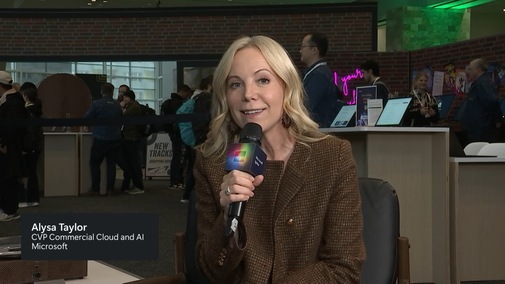
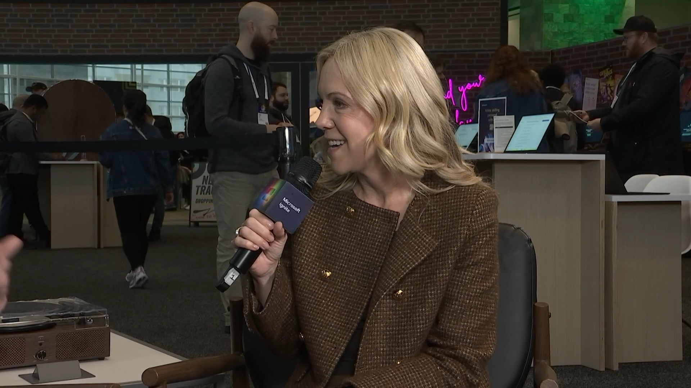
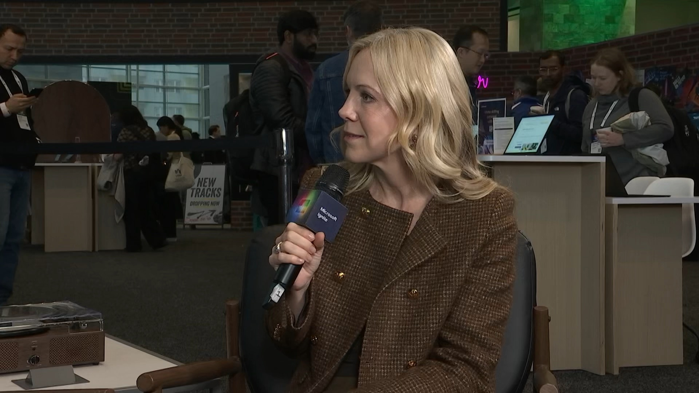

## #proactive-ai-and-finops 01 / Proactive AI & The FinOps Equation :: 从写提示词到全天候巡航：用 Agent 365 商业分析拉平跨云支出与产出天平 || From Manual Prompts to Perpetual Autopilot: Balancing Cross-Cloud Spend and Value in Agent 365

企业应用人工智能的重心正从等待人类输入指令，转向全天候后台自主推进业务 [1]。由于演播中心遭遇天气变化，Alysa Taylor 与 Charles Lamanna 临时转战人声鼎沸的技能中心（Skills Hub）展区完成这场实录对谈；Charles 开篇便点出本届大会最鲜明的风向标——**主动式人工智能（Proactive AI）**不再要求员工字斟句酌地编写提示词或拆解任务，而是直接代劳日常跟进 [1][2]：Copilot 中的 **Today** 视图主动呈送动态简报并推荐下一步最佳行动，**Workspace** 提供人类与智能体并肩推进项目的共享空间，而 **Autopilot** 则在后台持续运转、全天候值守 [1]。 || Enterprise AI is shifting from waiting on human prompts to executing work perpetually in the background [1]. Relocated live to the energetic Skills Hub floor due to weather, Alysa Taylor and Charles Lamanna opened LIVE47 with the keynote's defining theme—**proactive AI** that acts without forcing users to craft prompts [1][2]: **Copilot Today** delivers morning briefs and next best actions, **Workspace** gives people and agents a shared project canvas, and **Autopilot** runs continuously on behalf of its owner [1].

然而当智能体开始在后台持续消耗算力，财务失控的担忧立刻成为企业规模化落地的头号拦路虎 [1][3]。Charles 直言，过去一年客户反映最强烈的采用瓶颈就是“如何看清账单去向、如何设定支出封顶（Spending Caps），以及如何做预算与预测” [1]。为此，微软在 Agent 365 中推出了全新的成本控制策略与 **Agent 365 商业分析体验（Business Analytics）**——它就像一套横跨微软与非微软生态的全局资源规划或商业智能仪表盘，连 Charles 自己都笑言未曾想到主题演讲现场欢呼声最高的高光时刻竟是一块成本控制看板 [1][3]。 || Yet once agents run autonomously, runaway consumption quickly becomes the number-one adoption bottleneck [1][3]. Customers repeatedly asked how to understand spend, enforce spending caps, and forecast budgets [1]. Microsoft answered with new cost policies and the **Agent 365 Business Analytics** experience—an ERP- or BI-style dashboard spanning both Microsoft and non-Microsoft AI investments that unexpectedly drew some of the loudest applause at the keynote [1][3].

更重要的是，这套分析体系并非单纯为削减开支而设，而是同时计量方程的两端：**成本与所创造的业务价值** [1][3]。对于市场营销等日常很少盯着技术账单的知识工作者而言，看板不仅揭示钱花在了哪里，更直接回答投入是否划算——如果一项智能体服务创造了丰厚业务回报，高投入完全合理；反之若毫无产出，哪怕账面花费再低也是纯粹的资源空转 [1]。 || Crucially, Business Analytics measures both sides of the FinOps equation: **cost incurred and business value created** [1][3]. For marketers and knowledge workers who rarely track infrastructure bills day to day, visibility into where spend goes changes the conversation—high spend is welcome when paired with high value, whereas even low spend is wasteful if it generates zero return [1].

  <article class="live47-media-card" data-present-surface="unframed">
    

      
    

    

      LIVE47 官方实录关键帧 · 00:18
      <h4 data-zh="移师技能中心现场：从主动式 Copilot 到全域 Agent 365" data-en="Live from the Skills Hub: Proactive Copilot Meets Estate-Wide Agent 365">移师技能中心现场：从主动式 Copilot 到全域 Agent 365</h4>
      
Alysa Taylor 与 Charles Lamanna 在展区一线拆解 Today、Workspace 与持续巡航 Autopilot 如何重塑日常协作 [1][2]。

    

  </article>
  <article class="live47-media-card" data-present-surface="unframed">
    

      
    

    

      LIVE47 官方实录关键帧 · 01:32
      <h4 data-zh="Agent 365 商业分析：横跨微软与三方生态的支出及价值看板" data-en="Agent 365 Business Analytics: The ERP/BI Dashboard for Cross-Cloud AI Spend">Agent 365 商业分析：横跨微软与三方生态的支出及价值看板</h4>
      
同时打通支出上限、预算预测与业务产出归因，破解企业推进智能体规模化时最棘手的财务黑盒难题 [1][3]。

    

  </article>

本场 LIVE47 为 Microsoft Ignite 2026 官方演播室直击访谈（Broadcast Stage，全长 12 分 28 秒，无独立静态幻灯片附件）[1][2]。下方交互导览台集成了微软官方 Medius 点播播放器、高清视频直链与五幕逐秒核校的章节纪要，点击顶部时间轴标签即可按议题脉络定位原话证据 [1][2]： || Broadcast live on the Microsoft Ignite 2026 stage without a standalone slide deck, LIVE47 packs dense architectural and security guidance into a 12-minute-28-second executive dialogue [1][2]. Use the interactive theater below to launch the official Microsoft Medius stream or step through all five timestamped transcript chapters [1][2]:

:::sandbox { id: "live47-video-theater", canvas: false, script: "./live47-session.js", style: "./live47-session.css", title: "LIVE47 官方演播室点播流与五幕时间轴导览台 || LIVE47 Official Broadcast Stream & Five-Chapter Timestamp Navigator", desc: "按时间轴切换主动式 AI 与花费分析、三大支柱统一背板、Entra 零信任困难模式、开放遥测与智能体 Intune、以及 2027 黑马 Today 与 Apollo 救场实录。 || Switch across Proactive AI & Spend ROI, the 3-Pillar Backplane, Entra Zero Trust Hard Mode, OTEL & Intune for Agents, and the 2027 Copilot Today & Apollo stories." }
纯静态演播室导览沙盒：内置 LIVE47 官方高清封面、五幕逐秒核对纪要及 Medius 点播与高清 MP4 直链。 || Pure static broadcast theater featuring the official LIVE47 HD cover, five timestamped transcript digests, and direct Microsoft Medius video links.
:::

## #three-pillar-backplane 02 / One Consistent Backplane :: 消除产品间断崖与接缝：Copilot、Work IQ 与 Agent 365 的统一背板 || Eliminating Product Cliffs: One Consistent Backplane Across Copilot, Work IQ, and Agent 365

回顾过去一整年自上届大会以来的客户反馈，企业技术负责人提出的最核心诉求只有一条：**让不同入口构建和运行的智能体真正无缝协同，彻底消除跨产品间的断崖（Cliffs）与接缝（Seams）** [1]。在现实企业架构中，研发团队在 Microsoft Foundry 中编排专业模型，业务专家在 Copilot Studio 中搭建流程智能体，而一线员工则在 Copilot 里启动个人 Autopilot 或在代码库中使用 GitHub Copilot [1]。如果每套工具各自维护孤立的插件目录与管理后台，治理成本将随智能体数量呈指数级失控 [1][3]。 || Looking back at customer feedback since the previous Ignite, technology leaders converged on one unmistakable mandate: **eliminate the cliffs and seams between tools so every agent works on a single seamless foundation** [1]. Across a typical enterprise, pro-code teams build in Microsoft Foundry, business makers author in Copilot Studio, and employees run personal Autopilots or code with GitHub Copilot [1]. Separate admin portals and siloed skill catalogs quickly fracture governance at scale [1][3].

微软将这一整年的架构演进收敛为 **Copilot、Work IQ 与 Agent 365 三大支柱**，并在底层拉通了一条完全一致的控制背板（One Consistent Backplane）[1][5]：无论智能体诞生于 Foundry、Copilot Studio 还是 Autopilot，管理员都在 Agent 365 中实施同一套策略管控；所有终端共享同一个**插件与技能注册表（Plugin Registry）**，一处上架即可在 GitHub Copilot、Copilot 与 Autopilot 中一致发现和调用；底层数据连接统一交由语义层 IQ 承载，而安全与身份边界则统一锚定在 Microsoft Entra 之上 [1][4]。 || Microsoft answered by consolidating its architecture around **three pillars—Copilot, Work IQ, and Agent 365**—connected by one consistent backplane [1][5]. Whether an agent is built in Foundry, authored in Copilot Studio, or run as an Autopilot, administrators govern it through the exact same controls in Agent 365; makers publish once to a **shared plugin registry** usable across GitHub Copilot, Copilot, and Autopilot; data grounding flows through IQ; and security anchors directly into Microsoft Entra [1][4].

:::figure { src: "./media/live47-unified-agent365-backplane.figure.json", title: "Copilot、Work IQ 与 Agent 365 无断崖统一控制背板架构 || Unified Backplane Architecture Across Copilot, Work IQ, and Agent 365" }
图 1：基于 LIVE47 访谈实录还原的三层统一背板——顶层汇集主动式协同工作面、第一方开发矩阵与外部多云异构智能体；中层通过 Work IQ 图谱、共享插件注册表与商用 Entra 智能体身份消除产品断崖；底层由 Agent 365 提供跨生态财务核算、开放遥测与“智能体版 Intune”全域管控 [1][3][4]。 || Figure 1: Three-layer backplane reconstructed from LIVE47—uniting proactive surfaces, first-party studios, and multi-cloud agents on top; bridging them via Work IQ, a single plugin registry, and GA Entra Agent IDs in the middle; and governing the entire fleet through Agent 365 FinOps, OpenTelemetry, and Intune-style admin controls underneath [1][3][4].
:::

## #zero-trust-hard-mode 03 / Entra Agent ID & Zero Trust "Hard Mode" :: 规模化前必做的一步安全动作：复用 Entra 身份，以零信任“困难模式”布防 || The Security Step Before You Scale: Extend Entra Basics and Engineer for Zero Trust "Hard Mode"

当智能体走向多人协同（Multiplayer）与全自主运行，并开始读写核心业务系统与敏感数据时，企业究竟该如何设计访问控制与防失控护栏？Charles Lamanna 给出了两条极具实操价值的工程铁律：**第一，访问控制千万不要从零重造轮子；第二，安全防护必须从“完全不信任你自己的智能体”开始** [1][4]。 || As agents become multiplayer and autonomous—touching critical business processes and sensitive records—how should security teams govern access and contain rogue behavior? Charles Lamanna laid down two pragmatic engineering rules: **never reinvent access control from scratch, and start your security posture by not trusting your own agents** [1][4].

在身份与权限层面，每家企业早已积累了成熟的访问控制表、应用服务主体（Service Principals）与守护进程权限体系，终端侧也有 Microsoft Intune 保护各类办公设备 [1]。技术浪潮再怎么剧变，权限与访问控制的底层铁律始终未变 [1]。过去一年间，微软已正式商用发布（GA）**Microsoft Entra Agent ID** 与 **Entra Agent User ID**——它们并非简单套用旧账号，而是在既有企业身份模型之上专门扩展出适配“数字劳动力延伸”的专属凭证语义，让组织直接沿用熟悉的权限基线来迎接即将到来的“智能体海洋（Sea of Agents）” [1][4]。 || On the identity front, enterprises already maintain mature permissions for human users, service principals, and daemon processes alongside Microsoft Intune device policies [1]. Rather than discarding those foundations, Microsoft brought **Microsoft Entra Agent IDs** and **Entra Agent User IDs** to general availability over the past year—extending workforce identity semantics specifically for digital coworkers so IT teams can govern the coming "sea of agents" with familiar tools [1][4].

而在运行时控制层面，Charles 将智能体防御精准定义为传统企业安全的**“困难模式（Hard Mode）”**——没有哪一道单点开关能独自拦住失控或被劫持的智能体，唯有靠“假设已被入侵（Assume Breach）”的零信任纵深防御层层设卡 [1]： || For runtime containment, Charles described securing autonomous agents as enterprise security on **"hard mode"**—no single guardrail stops a compromised or misbehaving agent, requiring Zero Trust defense-in-depth built on an assume-breach mindset [1]:

:::flow { title: "LIVE47 披露的微软自研智能体“困难模式（Hard Mode）”六层纵深防线 || Six-Layer Zero Trust \"Hard Mode\" Defense Stack Disclosed in LIVE47" }
1. **默认不信任假设（Start Untrusted） || Assume Untrusted & Compromised** — 绝不盲信智能体会按预期方式连接系统，即便模型本身通过安全评测，仍按“已被入侵”标准设计外围护栏，不留任何侥幸赌注 [1]。 || Never assume an agent will connect or act as expected; engineer every boundary assuming compromise even when the model appears safe [1].
2. **专用身份与权限收紧（Entra Agent IDs & ACLs） || Identity Isolation & Strict ACLs** — 为每个智能体分配独立的商用 Entra Agent ID 或 Agent User ID，严格执行最小权限访问控制列表与数据源授权 [1][4]。 || Bind every agent to GA Entra Agent IDs or Agent User IDs with least-privilege ACLs across APIs and data shares [1][4].
3. **网络边界与地址段封锁（Network & IP Isolation） || Network & IP Range Isolation** — 实施精细的网络隔离与允许通信的网段范围限制，阻断智能体向未授权外部端点横向渗透或外泄敏感负载 [1]。 || Enforce strict IP ranges and network isolation so agents cannot reach unauthorized endpoints or exfiltrate payloads [1].
4. **凭据与密钥硬隔离（Secret Isolation） || Secret & Credential Isolation** — 将访问下游业务系统的密钥与运行态上下文彻底隔离，防止提示词注入或工具越权读取底层凭据明文 [1]。 || Isolate secrets from agent memory and prompts so compromised tool loops cannot harvest raw credentials [1].
5. **标准化容器沙箱（MXC for Windows） || Standard Container Sandboxing (MXC)** — 将执行环境锁定在标准化安全容器内运行（例如微软新发布的 Windows 端 MXC 容器隔离能力），物理围堵宿主环境风险 [1]。 || Run agent execution inside standardized isolated containers, including newly announced MXC container support for Windows [1].
6. **持续监控与应急缓解（Monitoring & Mitigation） || Real-Time Detection & Mitigation** — 部署全天候异常行为监测与自动熔断缓解预案，一旦侦测到越权漏洞或安全事件苗头立即介入阻断 [1]。 || Pair continuous vulnerability and incident monitoring with pre-wired mitigation playbooks to contain anomalies immediately [1].
:::

## #otel-and-intune-analogy 04 / OpenTelemetry & "Intune for Agents" :: 基于开放遥测标准双向打通，打造统管多云异构生态的“智能体版 Intune” || OpenTelemetry Observability and Agent 365 as the Multi-Vendor "Intune for Agents"

打通了身份准入与多层安全控制之后，整套治理栈的最后一块基石便是**全域可观测性（Observability）**——正如 Charles 在访谈中所言，如果企业手里连一份在役智能体全量清册都没有，根本看不清它们正在干什么，后续一切治理都无从谈起 [1]。听起来略显抽象的“可观测性”，在实际运维中对应着从基础安全清点到深度合规审计的完整证据链：最基础的一层要查清智能体连接了哪些外部系统、调用了哪些工具、所加载的插件与技能究竟来自何处；往上一层则要完整还原促使智能体做出某项决策或执行某个动作的**行动轨迹与推理链（Trajectory & Chain of Thought）**，既满足严格的合规审计要求，也让工程团队能够精准复盘报错与运行故障 [1][3]。 || Once identity access and layered controls are in place, **estate-wide observability** completes the governance stack—because without a complete inventory of active agents and visibility into their actions, governance cannot even begin [1]. Charles demystified observability along a practical spectrum: from foundational security questions—what systems an agent connected to, which tools it invoked, and where its loaded plugins and skills originated—all the way to compliance-grade **decision trajectories, chains of thought**, and error diagnostics [1][3].

为了避免将客户锁死在单一封闭黑盒中，Agent 365 的可观测底座原生构建在 **OpenTelemetry（OTEL）** 开放工业标准之上，支持双向数据流转 [1]：一方面提供标准编程接口，将遥测日志直接导出至企业既有的数据湖或安全信息与事件管理平台（SIEM）；另一方面则面向非微软生态全面敞开，允许企业把运行在 **Anthropic、亚马逊云（AWS）或谷歌云（GCP）** 上的智能体日志同样注入 Agent 365 集中审视 [1]。 || Rather than locking telemetry inside a proprietary silo, Agent 365 builds natively on the **OpenTelemetry (OTEL)** open standard for bidirectional integration [1]. Enterprises can export traces via APIs straight into their existing data lakes or SIEM platforms, while simultaneously injecting logs from non-Microsoft platforms—including **Anthropic, AWS, and GCP**—into Agent 365 [1].

  <article class="live47-media-card" data-present-surface="unframed">
    

      
    

    

      LIVE47 官方实录关键帧 · 08:05 开放生态
      <h4 data-zh="如同 Intune 统管多元终端设备：Agent 365 面向异构多供应商智能体全面开放" data-en="Just Like Intune for Devices: Agent 365 Connects to Every Multi-Vendor Agent Runtime">如同 Intune 统管多元终端设备：Agent 365 面向异构多供应商智能体全面开放</h4>
      
Charles 坦言只支持微软自家平台固然轻松，但真实企业注定是碎片化的多供应商格局，因此 Agent 365 必须连接任意运行时 [1]。

    

  </article>

Charles 用一个令全场运维与安全架构师耳熟能详的比喻精准锚定了 Agent 365 的战略身位：**Microsoft Intune 是现代企业信息化部署中低调却支撑全局的秘密基石（Little Secret Cornerstone），因为它同时管理苹果手机、安卓手机、个人电脑与苹果电脑等任意终端硬件；同理，面对真实企业必然存在的多模型、多云异构智能体格局，Agent 365 就是要成为统管任意智能体平台与运行时的“智能体版 Intune”** [1][3]。 || To crystallize that multi-vendor commitment, Charles shared his favorite architectural analogy: **Microsoft Intune serves as the quiet cornerstone of enterprise IT precisely because it manages iPhones, Android phones, PCs, and Macs alike; Agent 365 plays that exact same role across any agent platform or runtime** [1][3].

:::figure { src: "./media/live47-hard-mode-governance-radar.figure.json", title: "企业智能体规模化准备度对比：散落试点、传统基线与零信任“困难模式” || Enterprise Agent Scaling Readiness: Shadow Pilots vs. Legacy Easy Mode vs. Zero Trust Hard Mode" }
图 2：对照 LIVE47 梳理的六大治理维度——从缺乏资产清册的散落单点试点，到仅覆盖常规用户与应用的传统“简单模式”，再到融合商用 Entra 智能体身份、Windows MXC 与网络密钥隔离、开放遥测审计、跨云商业分析及主动式协同入口的 Agent 365 统一治理态 [1][3][4]。 || Figure 2: Readiness comparison across the six governance dimensions detailed in LIVE47—contrasting ad-hoc shadow pilots and traditional app security ("easy mode") against a fully governed Agent 365 estate running Zero Trust "hard mode" [1][3][4].
:::

## #copilot-today-and-apollo 05 / 2027 Dark Horse: Copilot Today & Apollo :: 展望 2027 最大黑马 Copilot Today：免提示词工作入口与“Apollo”周日机场救场记 || 2027 Dark Horse "Copilot Today": Zero-Prompt Work OS and How Autopilot "Apollo" Saved a Sunday Flight

在访谈压轴环节，Alysa Taylor 请整日提前试用内部前沿构建版本的 Charles Lamanna 预测未来一年最令他兴奋的能力——Charles 毫不犹豫地将 **Copilot Today** 点名为 **2027 年 Copilot 家族最具爆发力的黑马（Sleeper Pick / Dark Horse）** [1]。以往员工打开对话界面时，往往并不清楚系统后台究竟掌握了多少上下文，还得费心构思提示词去提问；而 Copilot Today 直接接入 **Work IQ** 的工作语义图谱与组织人脉图谱（Work Graph & People Graph），完全免去手动提问步骤，一打开就以极易消化的信息流呈现当下最要紧的事项 [1][5]： || Asked in the closing segment what frontier capability excites him most while dogfooding internal Microsoft builds, Charles named **Copilot Today** as the **2027 sleeper pick and dark horse for Copilot** [1]. Historically, users staring at a blank prompt box could not easily tell what context the assistant knew or how it could help; Copilot Today plugs directly into **Work IQ**—combining the semantic work graph and people graph—to present an effortless, zero-prompt feed the moment you open it [1][5]:

:::insight-grid { cols: 3, title: "访谈亲历实证：主动式工作入口的三大真实高光时刻 || Three Firsthand Proactive Moments Shared Live in Session LIVE47" }
::card 01
### 自动置顶关键诉求与每周五件要事 || Urgent Triage & Weekly Top-5 Brief
Charles 每天打开 Copilot Today 即获精准待办流：若首席执行官 Satya Nadella 或首席财务官 Amy Hood 发来询问会自动置顶，更能无需提示词直接列出本周正在推进的 5 件核心工作及背景要点 [1]。 || Charles opens Today to see asks from Satya Nadella or Amy Hood pinned to the top alongside an unprompted brief of his five active priorities for the week [1].

::card 02
### 跨团队人脉唤醒与协同任务主入口 || People-Graph Nudges & Cowork Launchpad
Alysa 分享同款惊喜体验：Today 主动提醒她就手头项目去找同事 Kyle 对齐，切中原本极易遗漏的协作节点；Charles 预判未来一年 Today 将成为人们发起协同任务（Cowork Tasks）的首选主入口 [1]。 || Alysa recounted Today proactively reminding her to connect with colleague Kyle on an active project—validating Today as the future launchpad for cowork tasks [1].

::card 03
### 个人 Autopilot“Apollo”周日救场 || Personal Autopilot "Apollo" Saves a Flight
Charles 给自己的专属 Autopilot 起名“Apollo”。就在大会前一个周日，因航班突发改签调整，Apollo 在未经任何指令询问的情况下自主巡检行程，及时预警专车正开往错误机场，帮他躲过误机危机 [1]。 || Charles's personal Autopilot, named "Apollo," inspected his disrupted Sunday travel schedule completely unprompted and warned him his car was booked for the wrong airport [1].
:::

| 核心演进维度 || Evolution Dimension | 传统被动辅助与割裂治理态 || Legacy Prompt-Driven & Siloed State | LIVE47 主动执行与全域治理态 || LIVE47 Proactive & Estate-Governed State | 访谈实录关键锚点 || Verbatim Session Anchor |
|------|------|------|------|
| 人机交互范式 || Human-AI Interaction | 面对空白输入框反复构思提示词，人工跟进日程与跨人协作盲区 [1] || Blank-box prompting; manual follow-ups across shifting schedules [1] | Work IQ 驱动 **Copilot Today** 免提示词推送每周 5 件要事，**Autopilot** 后台持续巡航 [1][5] || Zero-prompt **Copilot Today** top-5 brief + perpetual **Autopilot** ("Apollo") [1][5] | 置顶紧急高层诉求、提醒对接同事 Kyle、周日自动纠偏错误机场专车 [1] || Auto-pins Satya/Amy asks, nudges Kyle sync, catches wrong-airport car [1] |
| 平台架构连接 || Platform Architecture | Foundry、Copilot Studio 与 GitHub 各自维护独立后台与技能目录，存在产品断崖 [1] || Separate admin portals and skill silos across Microsoft tools [1] | **Copilot + Work IQ + Agent 365** 共用统一背板与单一插件注册表 [1] || Consistent backplane across **Copilot, IQ, and Agent 365** + shared plugin registry [1] | 消除跨产品断崖与接缝，跨 GitHub Copilot、Copilot 与 Autopilot 一致复用技能 [1] || Eliminates cliffs/seams across Foundry, Studio, GitHub Copilot & Autopilot [1] |
| 身份与运行时安全 || Identity & Runtime Security | 为智能体另建孤立鉴权，或轻信模型自觉遵守边界而缺乏底层物理隔离 [1] || Reinvented auth wheels or naive trust in model behavior [1] | 扩展商用 **Entra Agent ID**，按零信任“困难模式”叠加网络、密钥与容器隔离 [1][4] || Extend GA **Entra Agent IDs** + Zero Trust "hard mode" layered isolation [1][4] | 假设已被入侵，启用 ACL、IP 限制、密钥隔离及 Windows 端 **MXC** 容器 [1] || Assume breach; enforce ACLs, IP ranges, secret isolation & **MXC** for Windows [1] |
| 观测与财务治理 || Observability & FinOps | 缺乏在役智能体清册，账单黑盒无法设限，且三方云运行态游离于监管之外 [1] || Missing inventory, uncapped spend, and blind spots on third-party clouds [1] | **Agent 365 商业分析**核算支出与价值，基于 **OTEL** 打造“智能体版 Intune” [1][3] || **Business Analytics** spend-vs-value ERP + **OTEL** cross-cloud ingestion [1][3] | 双向打通数据湖与 SIEM，原生注入 **Anthropic、AWS、GCP** 日志统管全生态 [1] || Exports to data lake/SIEM and ingests **Anthropic, AWS, and GCP** agent logs [1] |

对谈尾声，Alysa Taylor 引用稍早前与微软人工智能首席执行官 Mustafa Suleyman 交流的“人文主义人工智能（Humanistic AI）”理念收束全场：当免提示词主动贴心服务的 Copilot Today、全天候排忧解难的 Autopilot，与更高性能、更具成本效益的模型以及 Agent 365 的零信任治理底座交汇在一起时，企业不仅能放心把关键工作交给智能体去行动，更真正把从繁琐摩擦中解放出来的从容与愉悦还给了每一位职场人 [1]。 || Closing the broadcast, Alysa Taylor connected Charles's engineering blueprint back to Microsoft AI CEO Mustafa Suleyman's vision of humanistic AI: pairing proactive experiences like Copilot Today and Autopilot with cost-effective models and Agent 365's Zero Trust governance lets enterprises put agents safely to work—while bringing genuine relief and joy back to people's daily lives [1].

## 参考资料：官方一手信源与关联专场 || References: Official Primary Sources & Companion Sessions

1. **Charles Lamanna & Alysa Taylor (Microsoft Ignite 2026 LIVE47 Official Session & Transcript)** — https://ignite.microsoft.com/en-US/sessions/1793670952619001g4OH-AAAAAAAAAAAAAAAAAAAA | 《Put Agents to Work: Charles Lamanna and Alysa Taylor on Copilot, Agent 365, and the Future of Work》演播室专场主页与官方英中双语 WebVTT 逐字稿实录（2026-11） || Official Broadcast Stage session page and bilingual WebVTT verbatim transcripts (Nov 2026)
2. **Microsoft Medius On-Demand Stream (LIVE47 Broadcast Recording)** — https://medius.microsoft.com/Embed/video-nc/aa0d0210-ddd6-4397-8802-bcf011c02676 | LIVE47 官方内嵌点播流与高清视频源（`https://medius.microsoft.com/video/asset/HIGHMP4/aa0d0210-ddd6-4397-8802-bcf011c02676`） || Official Microsoft Medius video stream and high-definition broadcast recording
3. **Microsoft Ignite 2026 Companion Breakout [BRK262]: Scale Agents, Not Risk — Governance and FinOps for the Enterprise** — https://ignite.microsoft.com/en-US/sessions/1787856612903001EK5O-1791588157241001CqrV | 深入拆解 Agent 365 全域可观测性、花费封顶策略与跨生态业务价值归因的配套技术专场 || Companion breakout session detailing Agent 365 observability, spending caps, and FinOps ROI attribution
4. **Microsoft Entra Agent Identity & Zero Trust Governance Documentation** — https://learn.microsoft.com/en-us/entra/identity/ | Microsoft Entra 智能体身份（Agent ID / Agent User ID）、最小权限访问控制与零信任安全架构官方文档 || Official Microsoft Entra documentation for agent identities, least-privilege access controls, and Zero Trust architecture
5. **Microsoft Ignite 2026 Companion Breakout: Build Personalized Experiences with Work Graph** — https://ignite.microsoft.com/en-us/sessions/1787856618898001EAOa-1791588268002001CvT5 | 解析驱动 Copilot Today 免提示词简报的工作图谱与人脉语义底座专场（BRK302） || Companion breakout session unpacking the Work IQ work-and-people graph powering Copilot Today
