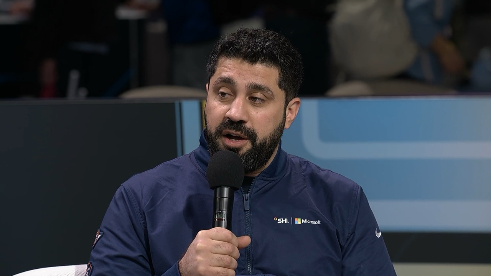
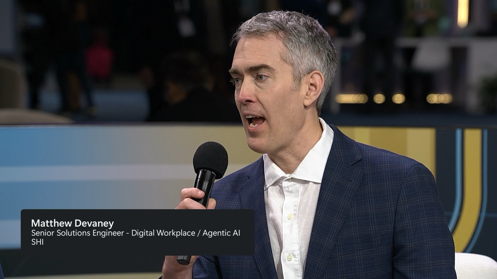
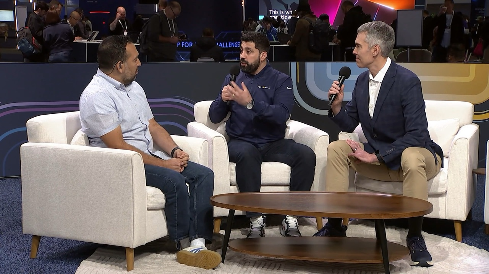

## #shadow-ai-escalation 01 / From Shadow IT to Shadow AI :: 从静态影子应用到动态影子 AI：为什么推理与工具调用改写了企业风险方程 || From Classic Shadow IT to Shadow AI: Why Reasoning and Tool Invocation Rewrite Enterprise Risk

任何人都能在下午茶时间拼出一个演示级智能体，真正棘手的工程考验在于如何将原型转化为跨行业可信赖的生产系统 [1]。在 Microsoft Ignite 2026 大会现场演播室（The Hub）录制的 LIVESP156 专场中，SHI 智能体与数字工作场所经理 Rafsan Huseynov 指出一个客观事实：无论安全团队是否做好准备，大量智能体早已在企业内部环境中悄然运转 [1]。一旦信息科技部门查不清谁拥有这些智能体、它们获准执行哪些动作、能够读取哪些业务数据，且无法施加任何安全控制，这批智能体就会迅速演变为新一代影子资产 [1]。 || Anyone can build a demo agent, yet turning that prototype into a trusted production workload across regulated industries remains the hardest engineering hurdle [1]. Speaking from the Ignite Hub in session LIVESP156, Rafsan Huseynov underscored a blunt reality: AI agents are already operating across enterprise environments today [1]. When IT cannot determine who owns those agents, what actions they can execute, or what data they touch—and cannot enforce security policies—those agents immediately become the next wave of shadow IT [1].

:::figure { src: "./media/shadow-ai-to-governed-fleet-quadrant.figure.json", title: "企业应用与智能体治理成熟度演进象限（LIVESP156） || Enterprise Application & Agent Governance Evolution Matrix (LIVESP156)" }
图 1：基于 LIVESP156 访谈实录绘制的四象限风险演进图——右下角的未纳管“影子 AI”及创建者离职遗留的孤儿智能体兼具高自主调用半径与零可见性，必须通过治理分区、专属目录身份与中央遥测迁移至右上角的可信生产象限 [1][2]。 || Figure 1: Four-quadrant risk matrix distilled from LIVESP156—ungoverned Shadow AI and leaver-orphaned agents combine wide autonomous tool reach with zero IT visibility in the lower right, requiring governance zones, Entra badges, and Agent 365 telemetry to reach the upper-right production zone [1][2].
:::

同台受访的 SHI 资深解决方案工程师、七届微软 MVP 得主 Matthew Devaney 界定了“影子 AI（Shadow AI）”与传统“影子 IT”的本质代差 [1]。过去的影子资产无非是业务部门私自搭建的静态表单应用与孤立数据存储，代码路径固定且边界封闭；如今的智能体则引入了**自主推理（Reasoning）**与**外部工具调用（Tool Calling）**两大变量 [1]。当组织赋予智能体调动业务接口与检索上下文的行动自主权（Agency）时，它的触角比旧式静态应用延伸得远得多，潜藏的数据越权与连锁误操作风险随之成倍放大 [1]。 || Joining Huseynov onstage, Senior Solutions Engineer and seven-time Microsoft MVP Matthew Devaney drew a sharp technical boundary between legacy shadow IT and modern **Shadow AI** [1]. Yesterday's shadow IT consisted of static departmental apps and isolated data stores; today's AI agents combine autonomous reasoning with live tool invocation [1]. Granting software the agency to chain decisions and execute external APIs pushes its operational reach far beyond classic shadow apps, multiplying blast-radius risk [1].

下方交互导览台内嵌了 LIVESP156 官方 6 分 14 秒高清点播流、演播室实录封面与四段精确到秒的核心议题索引，点击顶部胶囊标签即可分段查阅两位专家的现场对谈细节 [1]： || The interactive theater below embeds the official 6-minute-14-second LIVESP156 Medius stream, Hub broadcast cover, and four timestamped chapter digests capturing every architectural argument from the interview [1]:

:::sandbox { id: "livesp156-video-theater", canvas: false, script: "./livesp156-session.js", style: "./livesp156-session.css", title: "Ignite 2026 [LIVESP156] 官方演播室点播视频与四章时间戳导览台 || Ignite 2026 [LIVESP156] Official Hub Video Stream & Four-Chapter Navigator", desc: "切换影子 AI 裂变、Entra 数字门禁卡与生命周期继承、Agent 365 四合一控制面及 SHI 跨双轨客户落盘实战四章提要，一键加载微软官方点播播放器。 || Switch across Shadow AI risk, Entra digital badges & lifecycle workflows, Agent 365 unified defense, and SHI dual-track enterprise onboarding, or launch the embedded Medius player." }
纯静态议题导览沙盒：内含 LIVESP156 官方高清演播室封面、内嵌流媒体播放器加载开关及四章精确到秒的演讲逐字稿提炼。 || Pure static session theater featuring the official LIVESP156 Hub broadcast poster, on-demand Medius player toggle, and second-accurate WebVTT transcript highlights.
:::

  <article class="livesp156-media-card">
    

      
    

    

      LIVESP156 官方视频实录 · 00:51
      <h4 data-zh="Rafsan Huseynov 剖析未纳管智能体的四重盲区" data-en="Rafsan Huseynov on the Four Blind Spots of Ungoverned Agents">Rafsan Huseynov 剖析未纳管智能体的四重盲区</h4>
      
指出若缺失责任归属人、可执行动作清单、可用数据范围与安全控制策略，存量智能体将沦为失控的影子资产 [1]。

    

  </article>
  <article class="livesp156-media-card">
    

      
    

    

      LIVESP156 官方视频实录 · 01:35
      <h4 data-zh="七届 MVP Matthew Devaney 界定“影子 AI”技术特征" data-en="7x MVP Matthew Devaney Defining Shadow AI Complexity">七届 MVP Matthew Devaney 界定“影子 AI”技术特征</h4>
      
对比旧式静态应用与数据表，强调推理规划与工具调用赋予了智能体跨系统深层穿透力与更高风险敞口 [1]。

    

  </article>

## #entra-security-badge 02 / Agent Identity as a Digital Security Badge :: 拒绝拟人化噱头：以 Entra 数字门禁卡实现最小权限与离职自动继承 || Rejecting Anthropomorphism: Entra Security Badges, Least Privilege, and Automated Leaver Inheritance

主持人现场提出了一个令不少架构师困惑的争议点：我们应当坚决反对把人工智能过度拟人化，为什么安全专家却反复强调“必须给智能体赋予身份（Identity）” [1]？Matthew Devaney 给出了全场最精辟的工程类比——给智能体分配身份绝不是给它起个“Sam”之类的人类花名，而是像前台安保给外部进场承包商发放一张**数字安全门禁卡（Security Badge）** [1][2]。 || Addressing a common industry pushback against anthropomorphizing AI, the host asked what "giving agents an identity" actually means at a technical level [1]. Devaney offered a crisp physical-security analogy: assigning an agent identity has nothing to do with giving a bot a human nickname like "Sam"—it works just like issuing a **contractor security badge** at the front desk [1][2].

当外部顾问走进办公大楼时，门禁胸牌清晰记载着持卡人姓名、职责角色以及允许刷卡进入的特定机房与会议室；一旦走到未授权区域，门禁闸机便会直接锁死拦截 [1]。映射到微软技术栈底层，这张门禁卡正是独立的 **Microsoft Entra ID（智能体专属目录身份）**，刷卡进门的房间清单则严格对应着工具调用范围、应用程序接口（API）权限与目录角色 [1][2]。Rafsan 补充道，唯有将安全策略精准锚定在独立的智能体身份上，审计日志才能清晰剥离“究竟是人类员工亲手操作，还是智能体在后台代为执行动作”，从而把野生原型转化为受控生产资产 [1][2]。 || When a contractor enters a building, their badge encodes name, role, and specific room clearances—blocking entry at any unauthorized security gate [1]. Technically, **Microsoft Entra Agent ID** acts as that badge, binding tool access, API scopes, and Entra roles directly to the agent principal [1][2]. As Huseynov noted, scoping controls to distinct agent identities lets security teams distinguish whether an action was executed by an agent or a human user in audit trails [1][2].

:::flow { title: "基于 Microsoft Entra 智能体身份的四步最小权限与生命周期闭环 || Four-Stage Least-Privilege & Lifecycle Loop Built on Entra Agent Identity" }
1. **动作归因与人机身份解耦 || Action Attribution & Principal Separation** — 为生产智能体签发独立于创建者个人账号的专属 Entra 身份，确保每一次读取数据与调用外部工具都在审计流中留下独立可追溯的身份指纹，终结借用创作者高权令牌的隐患 [1][2]。 || Provision a dedicated Entra identity separate from the maker's personal token so every data read and tool call leaves an unmistakable audit trail [1][2].
2. **条件访问策略实时门禁 || Conditional Access Policy Enforcement** — 如同员工登录受控，智能体拥有目录身份后自动纳入条件访问（Conditional Access）评估矩阵，按网络位置、会话风险与目标资源敏感度动态裁决放行或阻断 [1][2]。 || Apply Entra Conditional Access policies directly to agent identities, evaluating network context, session risk, and target sensitivity on every request [1][2].
3. **按月续签的时限访问包 || Time-Bound Access Packages (No Set-and-Forget)** — 摒弃“一次性赋予高危角色后永久遗忘”的粗放授权；通过身份治理访问包（Access Packages）限定智能体仅在指定窗口（例如 **1 个月**）内持有特定角色，期满后若业务仍需使用，由直属经理重新发起延期申请 [1][2]。 || Eliminate permanent standing privileges by wrapping roles in Entra Access Packages—for example, granting a **1-month** lease after which the manager must explicitly request renewal [1][2].
4. **所有者离职自动继承工作流 || Automated Leaver Inheritance via Lifecycle Workflows** — 借助生命周期工作流（Lifecycle Workflows）根治“人走茶凉留孤儿”的顽疾：一旦智能体的原始创建者调岗或离职，系统自动将该智能体的管理所有权无缝移交给其直属经理，确保生产环境零无主智能体悬空 [1][2]。 || Prevent ungoverned "orphan agents" when employees depart: Entra Lifecycle Workflows automatically transfer agent ownership to the departing maker's manager [1][2].
:::

## #cross-stack-architecture 03 / Dual-Track Stack & Governance Zones :: 跨越双轨构建栈：从 Copilot Studio 业务分区到 Foundry 专业代码防线 || Across the Dual-Track Stack: From Copilot Studio Business Zones to Pro-Code Foundry

现代企业的智能体生产力绝不会收敛在单一开发工具里：一端是熟悉业务痛点的一线运营与职能专家，习惯在 **Copilot Studio** 中通过低代码画布与自然语言快速拉起业务智能体；另一端是专业软件与人工智能工程师，依托 **Microsoft Foundry** 编写复杂多步推理逻辑与自定义工具链 [1][4]。如果两套开发栈各自为政，安全团队就会被迫面对割裂的审批孤岛与双倍运维负担 [1]。 || Enterprise agent development naturally bifurcates across two builder populations: business users rapidly assembling low-code workflow agents in **Copilot Studio**, and pro-code engineers architecting custom code-first systems in **Microsoft Foundry** [1][4]. Treating these two surfaces as separate security silos fractures visibility and doubles compliance toil [1].

:::diagram { src: "./media/livesp156-secure-stack-architecture.figure.json", title: "跨微软技术栈双轨生产智能体安全与治理全景架构（LIVESP156） || Full-Stack Secure Production Agent Architecture Across the Microsoft Stack (LIVESP156)" }
图 2：从第一天即内嵌安全与治理的三层架构 [1][4]。顶层通过治理分区承接 Copilot Studio 与 Microsoft Foundry 双轨输入；中层以 Entra 数字门禁卡执行时限授权与离职交接；底层由 Microsoft Agent 365 联合 Purview 与 Defender 闭环资产遥测与威胁防御 [1][2][3]。 || Figure 2: Three-layer day-one security architecture [1][4]. Governed zones channel Copilot Studio and Microsoft Foundry builders on top; Entra badges enforce 30-day access packages and leaver inheritance in the middle; Agent 365 unifies Purview data protection and Defender threat ops underneath [1][2][3].
:::

结合本场议程纲要与现场交锋，把双轨原型推向跨行业可信生产环境的核心在于**治理分区（Governance Zones）**与**第一天内生安全（Day-One Security）** [1][4]。创作者可在受限沙盒分区内自由试错；当原型准备进入生产分区时，系统强制挂接独立智能体身份、最小权限访问包与集中遥测，杜绝携带个人凭据“带病上线” [1][2][4]。下表对比了野生演示原型与跨栈受管生产智能体在六个工程维度上的差异 [1][2][3]： || Turning prototypes into trusted cross-industry production agents hinges on **governance zones** and **day-one security** [1][4]. Makers experiment freely inside scoped sandbox zones. Promotion into production zones enforces dedicated Entra identities, least-privilege access packages, and central telemetry [1][2][4]. The table below contrasts ad-hoc demo prototypes against production-ready stack agents across six engineering dimensions [1][2][3]:

| 治理维度 || Governance Dimension | 演示原型 / 影子 AI 状态 || Demo Prototype / Shadow AI State | 跨栈可信生产智能体状态 || Trusted Production Agent State |
|------|------|------|
| 构建人群与入口 || Builder Track | 散落在未纳管环境或本地脚本，IT 无法感知存量规模 [1] || Scattered across unmanaged environments or rogue scripts unseen by IT [1] | 统一纳管 **Copilot Studio**（业务）与 **Microsoft Foundry**（专业代码）双轨资产 [1] || Unifies **Copilot Studio** (business) and **Microsoft Foundry** (pro-code) tracks [1] |
| 身份与动作归因 || Identity & Attribution | 借用创建者个人凭据运行，人机操作混杂难审计 [1][2] || Borrows maker personal credentials; human vs. agent actions blur [1][2] | 签发独立 **Microsoft Entra ID** 门禁卡，精确剥离智能体动作与用户动作 [1][2] || Dedicated **Entra ID** badge cleanly separates agent actions from human actions [1][2] |
| 权限授予模型 || Privilege Model | 一次性赋予宽泛接口角色，长期遗忘成横向移动跳板 [1] || Broad permanent API roles granted once and forgotten indefinitely [1] | 启用条件访问与 **1 个月时限访问包**，到期须直属经理审批续签 [1][2] || Conditional Access plus **1-month Access Packages** requiring manager renewal [1][2] |
| 人员变动韧性 || Leaver Resilience | 创建者离职后沦为无人看管的“孤儿智能体”继续裸奔 [1] || Becomes an unowned "orphan agent" when its creator leaves the firm [1] | **生命周期工作流**在所有者离职时自动将管理权移交其直属经理 [1][2] || **Lifecycle Workflows** auto-transfer ownership to the departed owner's manager [1][2] |
| 数据合规护栏 || Data Protection | 缺乏分级边界，推理上下文易穿透敏感财务或客户文档 [1] || Unbounded grounding risks exposing sensitive records during reasoning [1] | 沿用员工级 **Microsoft Purview** 敏感度标签与数据防泄漏控制 [1][3] || Applies employee-grade **Microsoft Purview** data protection policies [1][3] |
| 运行态威胁巡检 || Runtime Threat Ops | 无集中日志与调用链路追踪，异常行为事后才暴露 [1] || Zero centralized telemetry on invoked tools or anomalous behavior [1] | **Agent 365** 采集全量遥测，联动 **Microsoft Defender** 实时监测拦截威胁 [1][3] || **Agent 365** centralizes telemetry while **Microsoft Defender** monitors runtime threats [1][3] |

## #agent365-control-plane 04 / Agent 365 Unified Control Plane :: 零新工具学习税：以 Agent 365 统合 Purview 数据防线与 Defender 威胁监控 || Zero New Tooling Tax: Unifying Purview Data Guardrails and Defender Threat Ops in Agent 365

当智能体拥有了与外部承包商或正式员工同源的目录身份后，企业治理架构便迎来了一次关键减负：安全与运维团队**完全不需要再去采购或重新学习一整套陌生的安全工具** [1]。Rafsan Huseynov 在访谈第 4 分 20 秒给出了清晰的四合一控制面映射——企业过去十余年用来治理人类员工的成熟安全底座，如今在 **Microsoft Agent 365** 的统合下可直接平滑复用于全体智能体 [1][3]： || Once every agent carries a first-class Entra identity, enterprise security teams unlock an architectural dividend: **they do not need to buy or learn a whole new set of security tools** [1]. At `04:20` in the broadcast, Huseynov mapped out how decades of human workforce governance investments carry straight over to digital teammates under **Microsoft Agent 365** [1][3]:

:::insight-grid { cols: 2, title: "复用员工级安全资产的四位一体智能体防线 || Four-Pillar Agent Defense Reusing Workforce Security Investments" }
::card 01
### Microsoft Agent 365：中央控制与清册中枢 || Microsoft Agent 365: Central Control Plane
充当全组织智能体的统一指挥台（Central Control Plane），消除业务低代码与专业代码研发之间的管理断层，一站式汇总存量与新增智能体清册及运行态遥测信号 [1][3]。 || Acts as the central control plane bridging business and pro-code estates with one unified inventory and runtime telemetry hub [1][3].

::card 02
### Microsoft Entra：目录身份与准入生命周期 || Microsoft Entra: Identity & Access Lifecycle
承担数字门禁卡签发、条件访问实时拦截、按月滚动的访问包授权以及员工离职主管继承流，让每个智能体从诞生到退役始终责任到人 [1][2]。 || Governs agent security badges, Conditional Access checks, monthly Access Packages, and automated manager inheritance [1][2].

::card 03
### Microsoft Purview：同源敏感数据保护 || Microsoft Purview: Data Protection Parity
将保护人类员工办公文档的同一套数据安全规则直接延伸至智能体交互链路，守住智能体在推理与检索过程中能够触达的企业敏感数据边界 [1][3]。 || Extends the exact same information protection and data governance controls used for human employees to agent data access [1][3].

::card 04
### Microsoft Defender：运行态威胁防护与监控 || Microsoft Defender: Runtime Threat Monitoring
持续盯防智能体上线后的每一次真实活动（Activity Monitoring），针对异常工具调用、越权刺探或提示注入威胁实施主动防护与告警响应 [1][3]。 || Applies continuous threat protection and live activity monitoring across agent executions to detect and contain anomalies [1][3].
:::

主持人当场感慨，一旦想通“给智能体发门禁卡就能直接套用现成安全策略”这层逻辑，安全治理就不再是创新的对立面 [1]。正如 Rafsan 所强调的，部署这套控制面的初衷绝不是给业务团队踩刹车、拖慢研发进度，而是让一线人员继续全速构建智能体，同时赋予 IT 部门管理风险所必需的全局视野与精准开关 [1]。 || As the host observed onstage, realizing that an Entra identity unlocks every existing enterprise policy engine transforms how IT approaches AI [1]. Rather than slowing down innovation, this control-plane design lets business makers and engineers keep building at full velocity while giving IT the visibility and precision controls needed to manage risk [1].

  <article class="livesp156-media-card">
    

      
    

    

      LIVESP156 演播室全景实录 · 05:40
      <h4 data-zh="SHI 一线客户辅导复盘：打通全量盘点与动作、数据、工具三级遥测" data-en="SHI Field Onboarding Insights: Unified Inventory & Three-Tier Runtime Telemetry">SHI 一线客户辅导复盘：打通全量盘点与动作、数据、工具三级遥测</h4>
      
两位讲者总结协助大型客户落地 Agent 365 的高频诉求：收拢存量旧智能体清册，并看清每个智能体正在做什么、读什么数据、调什么工具 [1]。

    

  </article>

## #shi-production-playbook 05 / SHI Enterprise Onboarding Playbook :: 从看清存量到可信投产：SHI 客户落地实战与五步生产治理清单 || From Estate Discovery to Trusted Production: SHI Field Insights and Five-Step Action Playbook

在节目尾声，Rafsan Huseynov 与 Matthew Devaney 复盘了 SHI 团队近期密集辅导企业客户上线 **Microsoft Agent 365** 的一线实战经验 [1]。几乎所有正在规模化构建智能体的企业技术负责人都会提出同一个核心拷问：*“当我们的业务人员和专业代码开发者同时在造智能体时，我们到底该如何统一纳管？”* [1] Matthew 用一句直白的安全格言点破了破局起点：**“你无法监控、也无法治理你看不见的东西（You cannot monitor and you cannot govern what you cannot see）。”** [1] || Closing the session, Huseynov and Devaney shared field lessons from SHI's engagements onboarding enterprise customers onto **Microsoft Agent 365** [1]. Across industries, IT leaders ask the exact same question: *"How do we govern these agents when both business users and pro-code developers are building simultaneously?"* [1] Devaney distilled the starting premise into one operational rule: **"You cannot monitor and you cannot govern what you cannot see."** [1]

:::comparison { title: "一刀切封堵式管控 vs. Agent 365 可见性驱动的赋能式治理 || Heavy-Handed Innovation Freeze vs. Visibility-Driven Enablement" }
::versus 传统误区：靠行政审批封堵或另起炉灶堆叠新工具 || Legacy Anti-Pattern: Gatekeeping Bottlenecks or Tool Sprawl
### 既催生地下影子 AI，又拖垮安全运维团队 || Breeds Underground Shadow AI While Overwhelming Security Ops
若安全部门因担心越权风险而一刀切封禁业务自建入口，员工往往转向完全脱离企业租户监管的外部工具，进一步加剧影子 AI 失控；反之若为每套构建平台单独采购异构审计插件，则会制造严重的策略漂移与学习负担 [1]。 || Blocking business makers outright drives employees toward unsanctioned external bots, while bolting bespoke security add-ons onto each builder tool creates policy drift and steep learning curves [1].

::versus SHI × 微软推荐范式：先盘清全栈家底，再按身份分级套用员工防线 || SHI × Microsoft Blueprint: Centralize Inventory, Then Bind Employee-Grade Controls { highlight: true }
### 集中盘点存量资产 + 三维运行遥测 + 分区最小权限晋升 || Unified Estate Inventory + 3D Telemetry + Zone-Based Promotion
首先利用 Agent 365 拉通集中式资产清单（Centralized Inventory），摸清存量旧智能体与新增双轨智能体全貌；同步采集**执行动作、读取数据、调用工具**三维遥测信号，再按治理分区绑定 Entra 门禁卡与时限访问包平稳放行生产 [1][2][3]。 || Start by aggregating all legacy, Copilot Studio, and Foundry agents into a centralized Agent 365 inventory; capture live telemetry across **actions, data, and tools**, then enforce Entra badges and time-bound packages across governance zones [1][2][3].
:::

基于 LIVESP156 完整访谈实录与微软跨栈治理规范，企业架构师可按以下五步清单将散落的原型收敛为可审计的生产智能体舰队 [1][2][3][4]： || Synthesizing the LIVESP156 transcript and Microsoft's cross-stack governance guidance, enterprise architects can execute a five-step playbook to turn scattered prototypes into an auditable production fleet [1][2][3][4]:

1. **拉通跨双轨集中式资产清册**：接入 Microsoft Agent 365 盘点全租户存量智能体，将业务部门在 Copilot Studio 构建的低代码智能体与研发团队在 Microsoft Foundry 部署的专业代码智能体纳入同一张动态台账，彻底清零“影子 AI”盲区 [1][3]。 || **Establish a Unified Dual-Track Inventory**: Onboard onto Microsoft Agent 365 to catalog existing and net-new agents across both Copilot Studio and Microsoft Foundry in one central registry, eliminating Shadow AI blind spots [1][3].
2. **采集动作、数据与工具三维运行遥测**：开启细粒度运行态遥测管线，持续观测每个智能体正在执行什么具体动作、访问哪些知识库或业务表、调用哪些外部连接器与 API，为风险评级提供客观实证 [1][3]。 || **Instrument Three-Dimensional Runtime Telemetry**: Collect continuous telemetry tracking what actions each agent executes, what data sources it touches, and which tools or APIs it invokes in production [1][3].
3. **划分治理分区并签发独立 Entra 门禁卡**：按原型沙盒、部门协作与全企业关键生产划分治理分区（Governance Zones）；凡晋升生产分区的智能体一律剥离创建者个人凭据，绑定专属 Microsoft Entra ID 与条件访问策略 [1][2][4]。 || **Enforce Governance Zones & Dedicated Entra Badges**: Segment environments into sandbox and production governance zones; require every production candidate to drop maker credentials in favor of a dedicated Entra ID and Conditional Access policies [1][2][4].
4. **以时限访问包与离职继承流锁死生命周期**：用 **1 个月**等固定租期的 Entra 访问包取代永久静态角色授权，到期由直属经理按需续签；同步配置生命周期工作流，确保创建者离职当日智能体所有权自动平滑移交其主管 [1][2]。 || **Lock Down Lifecycles with Time-Bound Packages & Inheritance**: Replace permanent role assignments with **1-month** Entra Access Packages subject to manager renewal, and wire Lifecycle Workflows so managers automatically inherit agents when owners leave [1][2].
5. **联动 Purview 与 Defender 闭环日常安全运营**：直接复用现有的 Microsoft Purview 敏感度标签拦截越权数据读取，并将智能体活动流接入 Microsoft Defender 威胁监控大盘，在零新增工具学习负担的前提下实现员工与数字同事同标同管 [1][3]。 || **Close the Loop with Purview & Defender**: Reuse existing Microsoft Purview data protection policies to guard sensitive records and route agent activity into Microsoft Defender for real-time threat detection without learning new tools [1][3].

## 参考资料：官方一手信源与工程规范 || References: Official Primary Sources & Engineering Guides

1. **Rafsan Huseynov & Matthew Devaney (Microsoft Ignite 2026 LIVESP156)** — https://ignite.microsoft.com/en-US/sessions/1787855009112001tM9c-AAAAAAAAAAAAAAAAAAAA | 《Build secure agents across the Microsoft stack》Ignite Hub 官方录播视频（Medius ID: `5e6a1af0-3acb-48e2-b4cf-86cf12dd3a6f`）与英中双语 WebVTT 演讲逐字稿（2026-11） || Official Ignite 2026 Hub session recording and verbatim WebVTT transcripts featuring SHI's Rafsan Huseynov and 7x MVP Matthew Devaney (Nov 2026)
2. **Microsoft Entra Official Documentation** — https://learn.microsoft.com/en-us/entra/identity/ | Microsoft Entra 智能体身份（Agent ID）、条件访问策略、身份治理访问包（Access Packages）与生命周期工作流（Lifecycle Workflows）技术文档 || Technical documentation for Microsoft Entra Agent Identity, Conditional Access, Identity Governance Access Packages, and Lifecycle Workflows
3. **Microsoft 365 & Security Governance Documentation** — https://learn.microsoft.com/en-us/purview/ai-microsoft-purview | Microsoft Agent 365 中央控制面、Microsoft Purview 人工智能数据安全护栏与 Microsoft Defender 运行态威胁防护规范 || Enterprise governance documentation covering Microsoft Agent 365, Microsoft Purview data security for AI, and Microsoft Defender runtime threat protection
4. **Microsoft Copilot Studio & Foundry Security Overview** — https://learn.microsoft.com/en-us/microsoft-copilot-studio/security-and-governance | 跨越 Copilot Studio 治理分区与 Microsoft Foundry 专业代码开发的生产级安全与生命周期管理指南 || Production security, governance zones, and application lifecycle management guidance across Copilot Studio and Microsoft Foundry
