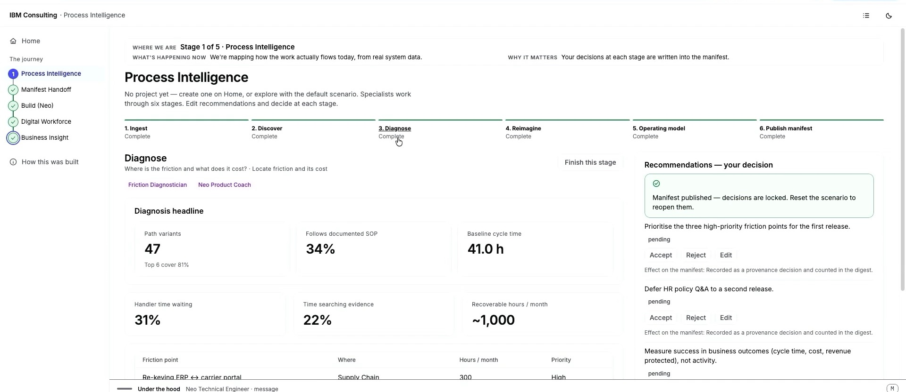
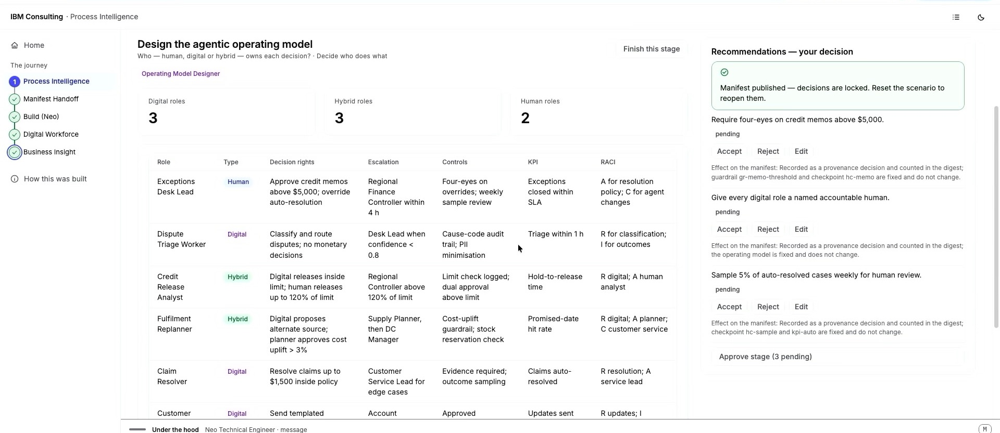
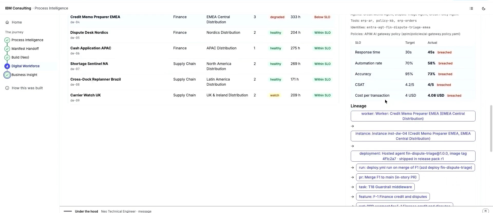
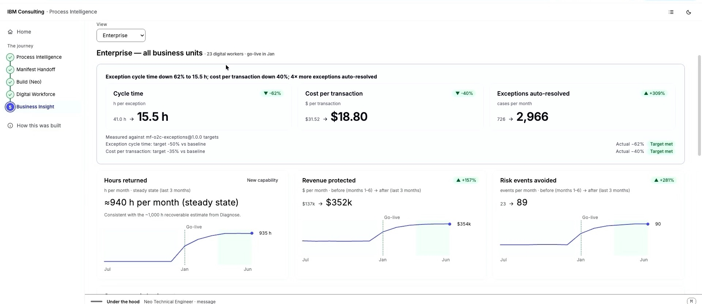

## #pilot-to-production-platform 01 / Co-Developing Imagine Enterprise :: 跨越试点泥潭：IBM 6,000+ 智能体资产与微软全栈连接层的联合工程 || Crossing the Pilot Chasm: Co-Engineering IBM's 6,000+ Agent Assets with the Microsoft Stack

企业技术团队在推进智能体转型时普遍困在同一个断层：概念验证阶段热闹非凡，一旦迈向规模化量产，却既算不清真实的投资回报率（ROI），也不知该从哪条业务链路切入 [1]。在 Microsoft Ignite 2026 现场演播室专场 LIVESP165 中，IBM Consulting 演示负责人 Josh Scriven 披露了刚于大会前一周正式官宣的联合成果——**Imagine Enterprise** [1]。过去数月间，IBM 团队与微软 **Frontier Co** 及其前线部署工程师（Forward-Deployed Engineers）同处一室闭门攻坚，目标直指同一个工程命题：如何免去客户手工缝合零散工具的繁琐负担，端到端重塑业务流程，在同一座平台上设计、构建、运行并治理“人类员工 + 数字员工”协同作业的新型劳动力 [1][2]。 || Enterprise engineering leaders repeatedly stall at the same inflection point: moving from isolated proofs of concept to production scale while proving concrete return on investment [1]. Speaking at the Ignite Hub in session LIVESP165, IBM Consulting's Josh Scriven unveiled **Imagine Enterprise**, jointly announced with Microsoft just one week prior [1]. Built over several months of co-located engineering alongside **Microsoft Frontier Co** and its forward-deployed engineers, the platform targets a foundational shift: letting enterprises design, build, run, and govern a combined human-plus-digital workforce without manually stitching underlying infrastructure together [1][2].

要让多智能体系统真正落地业务一线，光靠单一模型或孤立画布远远不够 [1]。微软技术栈提供了覆盖 **Microsoft Foundry**、**Microsoft Agent 365**、**Copilot Studio**、**Microsoft Fabric** 与 **Azure** 云安全护栏的完整积木，但对于急需解决订单积压或财务对账痛点的企业而言，把这些丰富的底层组件逐一打通仍存在不小的工程拼装门槛 [1][2]。Imagine Enterprise 预先封装了跨栈“连接组织（Connective Tissue）”，将 **IBM Consulting 积累的超过 6,000 个行业智能体与业务资产**直接嫁接在微软云数据与安全治理底座之上，使业务专家与研发团队能够把精力集中在定义数字劳动力的职责边界与商业产出上 [1]。 || Deploying multi-agent systems in production demands far more than a standalone prompt canvas [1]. While the Microsoft ecosystem supplies critical building blocks across **Microsoft Foundry**, **Microsoft Agent 365**, **Copilot Studio**, **Microsoft Fabric**, and **Azure** security controls, enterprise teams often burn months wiring those components together before solving a single domain bottleneck [1][2]. Imagine Enterprise pre-integrates that connective tissue, pairing **more than 6,000 IBM Consulting AI agents and domain assets** with Microsoft's cloud, data, and governance stack so teams can focus directly on business outcomes [1].

:::diagram { src: "./media/livesp165-imagine-enterprise-architecture.figure.json", title: "IBM × 微软 Imagine Enterprise 端到端数字劳动力平台架构（LIVESP165） || IBM × Microsoft Imagine Enterprise End-to-End Digital Workforce Architecture (LIVESP165)" }
图 1：基于 LIVESP165 现场演示提炼的三层联合架构 [1]。顶层借助流程智能与混合运营设计器将 28 步流程压缩至 11 步并划定人机权责；中层通过版本化 Manifest 清单包驱动 Microsoft Foundry、Copilot Studio 与 Fabric 组装；底层依托 Entra、Agent 365 与 API 网关策略执行五维 SLO 巡检与商业回报核算 [1][2][3]。 || Figure 1: Three-layer architecture distilled from the LIVESP165 live demo [1]. Process Intelligence and the Operating Model Designer compress 28 steps to 11 and lock RACI rights on top; a versioned Manifest bundle accelerates Foundry, Copilot Studio, and Fabric assembly in the middle; Entra, Agent 365, and AI Gateway policies enforce runtime SLOs and ROI tracking underneath [1][2][3].
:::

下方交互导览台内嵌了 LIVESP165 官方 6 分 32 秒点播视频、演播室高清封面与四段精确到秒的议题索引，点击顶部胶囊标签即可分段查阅从意图诊断、清单交接到运行态治理的全部演示细节 [1]： || The interactive theater below embeds the official 6-minute-32-second LIVESP165 Medius stream, Hub broadcast poster, and four timestamped chapter digests covering the entire live walkthrough from intent to outcome [1]:

:::sandbox { id: "livesp165-video-theater", canvas: false, script: "./livesp165-session.js", style: "./livesp165-session.css", title: "Ignite 2026 [LIVESP165] 官方演播室点播视频与四章时间戳导览台 || Ignite 2026 [LIVESP165] Official Hub Video Stream & Four-Chapter Navigator", desc: "切换联合研发与 6,000+ 资产底座、O2C 流程重构与 Manifest 交接、24 名数字员工 SLO 与血缘问责、以及商业 ROI 大盘四章提要，一键加载微软官方点播播放器。 || Switch across IBM × Microsoft co-development, O2C 28-to-11 step redesign & Manifest handoff, 24-worker SLO & Git lineage governance, and Enterprise ROI verification, or launch the Medius stream." }
纯静态议题导览沙盒：内含 LIVESP165 官方高清演播室封面、内嵌流媒体播放器加载开关及四章精确到秒的演讲逐字稿提炼。 || Pure static session theater featuring the official LIVESP165 Hub broadcast poster, on-demand Medius player toggle, and second-accurate WebVTT transcript highlights.
:::

## #process-intelligence-manifest 02 / From Intent to Manifest Handoff :: 从 28 步压缩至 11 步：流程智能诊断、人机 RACI 席位与版本化清单交接 || From 28 Steps to 11: Process Intelligence, Human-Digital RACI Seats, and Manifest Handoff

如何把一句模糊的高管转型意图转化为可投产的多智能体工程规范？Josh Scriven 在现场实机打开了 Imagine Enterprise 的第一站——**流程智能（Process Intelligence）**工作台，以企业高频痛点**订单到收款（Order-to-Cash，简称 O2C）异常处理**为例完整走通了“采集 → 发现 → 诊断 → 重构 → 运营模型 → 发布清单”六步闭环 [1]。团队无需从零撰写冗长需求文档，直接把现行流程图、标准操作程序（SOP），乃至业务人员随手搭建的**氛围编码原型（Vibe-Coded Prototypes）**一并喂入平台，由内置的摩擦诊断智能体与 Neo 产品教练结合真实系统日志还原作业全貌 [1]。 || How does an organization translate a high-level business intent into an executable multi-agent specification? Opening the live demo in **Process Intelligence**, Scriven walked through an **Order-to-Cash (O2C) exception handling** transformation across a structured sequence: Ingest, Discover, Diagnose, Reimagine, Operating Model, and Publish Manifest [1]. Instead of drafting static specification docs from scratch, teams feed existing process flows, standard operating procedures (SOPs), and even **vibe-coded prototypes** directly into the workspace, where specialist discovery agents map how work actually flows against real system data [1].

实机诊断面板瞬间暴露了传统人工流转的结构性损耗：当前订单异常处理平均耗时高达 **41.0 小时**（每月可回收潜力约 **1,000 小时**），全流程分化出 **47 条路径变体**（前 6 条覆盖 **81%** 流量），真正严格遵循既定操作规程的比例仅为 **34%**；经办人员有 **31%** 的时间耗在被动等待审批，另有 **22%** 的工时耗费在翻找凭证依据，最突出的摩擦黑洞集中在企业资源计划系统（ERP）向承运商门户的人工重复录入 [1]。在保留“人在回路（Human-in-the-Loop）”批判性把关的前提下，架构师通过右侧对话窗实时审阅、编辑或采纳重构建议，将原本繁琐的 **28 个步骤直接压缩至 11 步** [1]。 || The live Diagnose canvas immediately quantified why legacy O2C operations stall: baseline exception resolution averaged **41.0 hours** (~**1,000 recoverable hours/month**) across **47 path variants** (with the top 6 covering **81%** of volume), while only **34%** of cases followed documented SOPs [1]. Handlers spent **31%** of their time waiting and **22%** searching for supporting evidence, bogged down by manual re-keying from ERP into carrier portals [1]. Keeping humans firmly in the loop via an interactive process chat sidebar, architects review, edit, or accept AI recommendations—compressing a bloated **28-step workflow down to 11 steps** [1].

  <article class="livesp165-media-card">
    

      
    

    

      LIVESP165 实机演示 · 03:35
      <h4 data-zh="流程智能诊断台：透视 47 条路径变体与跨系统手工录入摩擦" data-en="Process Intelligence Diagnose: Surfacing 47 Path Variants & Manual Re-Keying Friction">流程智能诊断台：透视 47 条路径变体与跨系统手工录入摩擦</h4>
      
导入 SOP 与氛围编码原型后精准定位 41.0 小时基准周期、31% 等待耗时及仅 34% 的合规遵循率，每一项人工采纳决策均作为溯源记录写入清单 [1]。

    

  </article>
  <article class="livesp165-media-card">
    

      
    

    

      LIVESP165 实机演示 · 04:12
      <h4 data-zh="运营模型设计器：划定人类、数字与混合席位及双人复核红线" data-en="Operating Model Designer: Assigning Human, Digital & Hybrid Seats with Four-Eyes Controls">运营模型设计器：划定人类、数字与混合席位及双人复核红线</h4>
      
逐一锁定每个岗位的决策权、升级路径与 RACI 矩阵，例如强制要求超 $5,000 贷项通知单双人复核、每周抽检 5% 自动结案工单并为数字角色绑定人类责任人 [1]。

    

  </article>

流程瘦身只是起点，更核心的治理设计发生在紧随其后的**智能体运营模型设计器（Operating Model Designer）**中 [1]。平台拒绝把所有环节盲目交给黑盒自动化，而是显式划分 **2 类纯人类席位、3 类纯数字席位与 3 类人机混合席位**，逐行敲定决策权限、升级条件、内控护栏与负责/批准/咨询/知情（RACI）矩阵 [1]。例如在演示画面中：*争议分诊员（Dispute Triage Worker）*属于纯数字席位，仅负责分类路由、严禁触碰资金裁决，置信度低于 `0.8` 时自动上交异常处理主管；*信用放行分析师（Credit Release Analyst）*采用人机混合席位，额度内由数字员工自动放行，超出额度 `100%~120%` 区间转交人类分析师裁决；而一旦涉及超过 **$5,000** 的贷项通知单（Credit Memo）审批或推翻自动决议，系统通过固定护栏 `gr-memo-threshold` 强制触发人类主管双人复核（Four-Eyes Check），并要求每周抽取 **5%** 的自动结案样本由人工复盘 [1]。 || Process compression is paired immediately with the **Operating Model Designer**, which answers a governance question most pilots ignore: *who—human, digital, or hybrid—owns each decision?* [1] Rather than automating blindly, the designer partitions the future-state O2C org chart across **2 human roles, 3 digital roles, and 3 hybrid roles**, binding explicit decision rights, escalation triggers, controls, and RACI accountability to every seat [1]. In the live matrix, the *Dispute Triage Worker* (Digital) classifies and routes disputes without monetary authority, escalating whenever confidence drops below `0.8`; the *Credit Release Analyst* (Hybrid) lets digital workers release orders within credit limits while routing `100%–120%` overrides to a human analyst; and any credit memo exceeding **$5,000** triggers a locked four-eyes human approval guardrail (`gr-memo-threshold`) alongside a mandatory **5%** weekly human audit sample [1].

:::flow { title: "从业务意图到研发加速：版本化 Manifest 清单包的四步交接机制 || Four-Stage Intent-to-Engineering Pipeline via Versioned Manifest Handoff" }
1. **多源实证采集与摩擦量化 || Multi-Source Ingest & Friction Quantification** — 导入现有流程图、标准操作规程与氛围编码原型，对标系统真实流转日志识别路径分叉与手工跨系统搬运瓶颈，锁定约 **1,000 小时/月**的可释放工时池 [1]。 || Ingest process flows, SOPs, and vibe-coded prototypes alongside system logs to expose path sprawl and quantify ~**1,000 recoverable hours/month** [1].
2. **人在回路的流程步数腰斩 || Human-in-the-Loop Workflow Compression** — 领域专家通过交互式流程对话窗逐条审阅、修订智能体重构方案，在关键风险点保留人工裁决，将 **28 步**旧流程收敛为高内聚的 **11 步**新链路 [1]。 || Domain leads collaborate via interactive process chat to edit recommendations, compressing **28 legacy steps into 11** while preserving critical human checkpoints [1].
3. **人机混合席位与固定护栏编码 || Hybrid Seat Allocation & Guardrail Locking** — 在运营模型设计器内为每个数字角色指派具名的人类问责主管（Named Accountable Human），将金额阈值（如 `>$5,000` 双签、`≤$1,500` 理赔自动结案）固化为不可绕过的系统检查点 [1]。 || Assign every digital role a named accountable human and codify monetary thresholds (`>$5,000` four-eyes approval, `≤$1,500` auto-claims) as immutable checkpoints [1].
4. **一键打包发布产品团队 Manifest || One-Click Manifest Bundle Handoff** — 点击发布清单（Publish Manifest），平台自动将全部 **Markdown 规范文档、智能体角色定义、业务本体（Ontologies）与溯源决策摘要**封装为版本化契约包（如 `mf-o2c-exceptions@1.0.0`），直接推送至下游产品工程团队在 Foundry 与 Copilot Studio 中提速构建 [1][2]。 || Publishing the manifest bundles all **Markdown specs, agent definitions, domain ontologies, and provenance decisions** into a versioned package (`mf-o2c-exceptions@1.0.0`) handed directly to product engineering [1][2].
:::

## #workforce-slo-lineage 03 / Governing Digital Workforces via SLOs & Lineage :: 管理 24 名数字员工与 46 个智能体：超越 Token 消耗的 SLO 监控、代码血缘与违规下线 || Governing 24 Digital Workers & 46 Agents: Business SLOs, Git Lineage, and Worker PIPs

当产品工程团队基于 Manifest 清单在 Azure、Foundry 与 Copilot Studio 上完成构建并投产后，运维与业务主管该如何日常管理这支庞大的多智能体舰队？Josh Scriven 将画面切入已上线的**数字劳动力（Digital Workforce）**运营中心：此时全应用共运行着 **24 名数字员工（Digital Workers），底层由 46 个协同工作的智能体组装而成**，横跨欧洲、中东与非洲（EMEA）、北欧、亚太、北美、拉美及英爱六大区域的财务与供应链分拨中心 [1]。 || Once engineering builds and deploys the manifest across Azure, Foundry, and Copilot Studio, how do operations leaders govern a live multi-agent fleet day to day? Switching to the live **Digital Workforce** console, Scriven showcased a production Order-to-Cash estate running **24 digital workers composed of 46 underlying agents** across Finance and Supply Chain distribution hubs in EMEA, Nordics, APAC, North America, Brazil, and the UK [1].

Scriven 在第 4 分 53 秒提出了一个极具启发性的治理转向：**企业管理者不该天天盯着“烧了多少 Token”或“底层护栏配没配”来评判数字员工——因为借助 Microsoft Entra 与 Microsoft Agent 365 的原生集成，身份鉴权、安全护栏与基础令牌账单早已作为平台免费底座自动就位** [1][3]。既然数字员工是人类员工的并肩同事（Co-workers），就必须像考核人类团队一样，通过**服务级别目标（SLO）与业务健康度**来衡量它们的履职质量，并打通从业务席位直达底层容器与代码仓库的全链路血缘（Lineage）[1][3]。 || At `04:53`, Scriven articulated a crucial governance shift: **enterprise leaders should not judge digital workers merely by raw token burn or basic guardrails—because native integration with Microsoft Entra and Microsoft Agent 365 already provides identity, guardrails, and baseline telemetry out of the box** [1][3]. Treating digital workers as true co-workers means managing them through **Service Level Objectives (SLOs)** and end-to-end engineering **lineage** [1][3].

下表完整还原了演示现场对劣化告警员工 **EMEA 贷项通知单编制员（`Credit Memo Preparer EMEA`，实例 `inst-dw-04`）** 的五维 SLO 巡检与跨栈身份血缘诊断记录 [1]： || The table below captures the exact runtime telemetry, Entra/APIM bindings, Git deployment lineage, and five-metric SLO breach diagnosis inspected live on the degraded **`Credit Memo Preparer EMEA` (`inst-dw-04`)** digital worker [1]:

| 治理与巡检维度 || Governance & Inspection Layer | 实机绑定配置 / 目标阈值 || Bound Configuration / SLO Target | 运行态实测表现与处置判定 || Live Actuals & Operational Action |
|------|------|------|
| 专属目录身份与网关策略 || Entra Identity & AI Gateway | 身份：`entra-agt-fin-dispute-triage-emea`；网关：`apim/policies/ai-gateway.policy.yaml` [1][3] || Identity: `entra-agt-fin-dispute-triage-emea`; Policy: `apim/policies/ai-gateway.policy.yaml` [1][3] | 严格限定仅可调用 `erp-ar`、`policy-kb`、`erp-orders` 三项授权工具 [1] || Strictly scoped to three authorized tools: `erp-ar`, `policy-kb`, and `erp-orders` [1] |
| 全链路部署与代码血缘 || End-to-End Deployment Lineage | 托管智能体 `fin-dispute-triage@1.0.0`（镜像标签 `4f1c2a7`，发版包 `r1`）[1] || Hosted agent `fin-dispute-triage@1.0.0` (image `4f1c2a7`, release pack `r1`) [1] | 精确溯源至 `azd deploy` 流水线、合并请求 `Merge F1 to main` 及任务 `T18 Guardrail middleware` [1] || Traces directly to `deploy.yml` (`azd deploy`), PR `Merge F1 to main`, and task `T18` [1] |
| 响应时长与自动化率 SLO || Latency & Automation SLOs | 目标响应时长 `≤ 30s`；目标自动处理率 `≥ 70%` [1] || Target response time `≤ 30s`; target automation rate `≥ 70%` [1] | 实测响应退化至 **`45s`（违约）**；自动处理率跌至 **`58%`（违约）** [1] || Degraded to **`45s` (breached)** response and **`58%` (breached)** automation rate [1] |
| 准确率、满意度与单笔成本 SLO || Accuracy, CSAT & Cost SLOs | 目标准确率 `≥ 95%`；满意度 `≥ 4.2/5`；单笔成本 `≤ $4.00` [1] || Target accuracy `≥ 95%`; CSAT `≥ 4.2/5`; cost/tx `≤ $4.00` [1] | 准确率跌至 **`73%`**、满意度 **`4/5`**、单笔成本升至 **`$4.08`**，五项指标全线红灯告警 [1] || Accuracy dropped to **`73%`**, CSAT **`4/5`**, cost **`$4.08`**—all five SLOs breached [1] |
| 数字员工人力级干预动作 || Workforce Remediation Action | 对比健康同事（如北欧争议台 `204 h`、亚太现金应用 `275 h` 均达标运行）[1] || Contrasted against healthy peers (`Dispute Desk Nordics`, `Cash Application APAC`) [1] | 因继续在线将损害业务，主管当场执行**下线隔离（Fire / Take Offline）**或转入**绩效改进计划（PIP）**回炉调优 [1] || Immediately **taken offline ("fired")** to prevent business harm or placed on a **PIP** for engineering remediation [1] |

这种把“人力资源式绩效管理”与“软件工程级 Git 血缘”合二为一的设计，彻底消除了生产排障的盲猜成本：当某位数字员工出现精度滑坡时，运营主管既能在秒级时间内切断其线上执行权防止资损扩大，研发工程师又能顺着血缘树一键定位到引入回归缺陷的具体合并请求与中间件任务 [1][2]。 || Merging HR-style workforce accountability with software-grade Git lineage eliminates production guesswork: operations leads can quarantine a degrading worker in seconds before financial errors compound, while engineers trace the regression straight back to the exact pull request, container tag, and middleware task [1][2].

  <article class="livesp165-media-card">
    

      
    

    

      LIVESP165 实机演示 · 05:32
      <h4 data-zh="数字劳动力治理台：五维 SLO 违约告警与 Entra / Git 全栈血缘穿透" data-en="Digital Workforce Console: Five-Metric SLO Breach Alert & Full Entra/Git Lineage">数字劳动力治理台：五维 SLO 违约告警与 Entra / Git 全栈血缘穿透</h4>
      
直观呈现 EMEA 贷项编制员工五项指标违约劣化，同时关联 Entra 专属身份、APIM 网关策略与 azd 部署流水线，支撑秒级下线摘除 [1]。

    

  </article>
  <article class="livesp165-media-card">
    

      
    

    

      LIVESP165 实机演示 · 05:56
      <h4 data-zh="企业级商业洞察大盘：对标版本化清单目标核验真实投资回报" data-en="Enterprise Business Insight: Verifying Real-World ROI Against Manifest Targets">企业级商业洞察大盘：对标版本化清单目标核验真实投资回报</h4>
      
跨全业务单元稳态运行实测：异常周期缩短 62%（超额达成 -50% 目标）、单笔成本下降 40%（超额达成 -35% 目标），月护航营收升至 $352k [1]。

    

  </article>

## #verified-business-impact 04 / Verified Enterprise ROI & Maturity Model :: 从技术投入到账面回报：全企业稳态实测成效与成熟度演进闭环 || From Tech Spend to Audited Value: Enterprise Steady-State Outcomes and Maturity Model

在整场演示的收官环节，Josh Scriven 切换到面向首席财务官与业务高管的**企业级商业洞察（Business Insight）**视图，回答了开篇最棘手的投资回报率追问 [1]。不同于市面上常见的“调用次数统计看板”，Imagine Enterprise 直接将全企业上线后的近三个月稳态实测数据，与最初锁定的 `mf-o2c-exceptions@1.0.0` 清单承诺目标逐项对账 [1]： || In the final segment of the walkthrough, Scriven opened the executive **Business Insight** view to answer the opening ROI question with hard financial telemetry [1]. Rather than reporting vanity activity counts like total messages or prompt volume, Imagine Enterprise benchmarks steady-state post-launch performance (last 3 months across all business units) directly against the locked targets defined in `mf-o2c-exceptions@1.0.0` [1]:

:::figure { src: "./media/livesp165-o2c-outcome-benchmark.figure.json", title: "订单到收款（O2C）数字劳动力投产前后核心指标实测对比（LIVESP165） || Order-to-Cash (O2C) Digital Workforce Before vs. After Production Benchmark (LIVESP165)" }
图 2：汇总 LIVESP165 现场演示面板的五项核心前后对比数据 [1]。上线稳态运行后，端到端流程由 28 步精简至 11 步，异常处理周期由 41.0 小时缩短至 15.5 小时（降幅 62%，优于 -50% 目标）[1]。同时单笔交易成本由 $31.52 降至 $18.89（降幅 40%，优于 -35% 目标），月均风险事件从 23 起压降至 8 起，月度护航受保护营收由 $137k 跃升至 $352k（+157%）[1]。 || Figure 2: Five before-and-after production metrics captured from LIVESP165 [1]. Post-go-live steady state compresses O2C steps from 28 to 11 and cuts exception cycle time from 41.0 h to 15.5 h (-62%, beating the -50% target) [1]. Transaction cost drops from $31.52 to $18.89 (-40%, beating the -35% target), monthly risk events fall from 23 to 8, and monthly protected revenue rises from $137k to $352k (+157%) [1].
:::

除上述五项硬核效率与风控突破外，全企业稳态运行每月还稳定释放约 **940 小时**高价值人工工时（与诊断阶段预估的 `~1,000 小时` 可回收潜力高度吻合），每月自动结案的异常工单量更从 **726 单激增至 2,966 单**（增幅高达 **+309%**，实现逾 **4 倍**自动解决能力跃升）[1]。演播室主持人现场评价道，这套体系不仅交付了底层的可观测性（Observability）与可管理性（Manageability），更实质上为企业提供了一套循序渐进的**智能体运营成熟度模型（Maturity Model）**，确保每一笔技术投资都能精准转化为账面可核验的业务价值 [1]。 || Alongside those cycle-time and unit-cost gains, steady-state operations return approximately **940 hours per month** to human teams—closely matching the ~1,000-hour recoverable estimate forecast during initial Process Intelligence diagnosis—while auto-resolved exceptions jump more than **4x from 726 to 2,966 (+309%)** [1]. As the Hub host noted, pairing runtime observability and manageability with manifest-locked targets gives enterprises a repeatable **operational maturity model** for proving AI investment value [1].

:::insight-grid { cols: 2, title: "企业落地可规模化数字劳动力平台的四条工程启示 || Four Architectural Takeaways for Scaling Governed Digital Workforces" }
::card 01
### 先做流程减法，再上智能体自动化 || Reimagine Friction Before Automating
切忌直接用智能体去原样照搬冗长旧流程：先借流程挖掘看清 47 条分叉变体与跨系统手工搬运黑洞，把 28 步压缩至 11 步后再分配数字席位，方能避免“把低效流程加速运行” [1]。 || Never wrap agents blindly around broken legacy steps. Use process mining to expose path variants and manual re-keying first, compressing 28 steps to 11 before assigning digital workers [1].

::card 02
### 用版本化 Manifest 消除业务与研发断层 || Bridge Business & Build via Versioned Manifests
将业务专家拍板的金额红线、RACI 权责、Markdown 规范与领域本体统一锁入不可篡改的 Manifest 清单包，让下游 Foundry 与 Copilot Studio 工程团队直接站在结构化契约上高起点构建 [1][2]。 || Lock human-approved guardrails, RACI rights, Markdown specs, and domain ontologies into a versioned Manifest bundle so Foundry and Copilot Studio engineers build from an unambiguous contract [1][2].

::card 03
### 身份安全底座归平台，日常考核看齐业务 SLO || Platformize Guardrails, Govern by Workforce SLOs
依托 Microsoft Entra、Agent 365 与 Azure API Management 网关把身份鉴权、工具白名单与令牌统计变成默认基础设施；运营主管则聚焦响应时间、准确率与满意度 SLO，对劣化员工果断下线或启动 PIP 整改 [1][3][4]。 || Offload identity, tool scoping, and token guardrails to Entra, Agent 365, and APIM AI Gateway policies so operations leads can manage digital workers by business SLOs and rapid offline/PIP controls [1][3][4].

::card 04
### 拒绝虚荣活跃度指标，锚定清单基准核验 ROI || Measure Outcomes Against Locked Baselines, Not Activity
在立项诊断期即锁定“以周期缩短、单笔降本与护航营收衡量成败，而非对话轮次活跃度”的原则，投产后持续对账实测曲线与版本清单目标，彻底打通商业价值闭环 [1]。 || Commit during diagnosis to measuring cycle time, transaction cost, and protected revenue rather than chat volume—continuously auditing live steady-state telemetry against manifest targets [1].
:::

## 参考资料：官方一手信源与工程规范 || References: Official Primary Sources & Engineering Guides

1. **Josh Scriven (Microsoft Ignite 2026 LIVESP165)** — https://ignite.microsoft.com/en-US/sessions/1787855010982001tzJO-AAAAAAAAAAAAAAAAAAAA | 《Build an agentic platform to scale and govern digital workforces》Ignite Hub 官方录播视频（Medius ID: `67cf14de-0e47-4c29-a542-c498eb8587b6`）、Imagine Enterprise 实机演示与英中双语 WebVTT 演讲逐字稿（2026-11） || Official Ignite 2026 Hub session recording, Imagine Enterprise live product walkthrough, and verbatim WebVTT transcripts featuring Josh Scriven (Nov 2026)
2. **Microsoft Copilot Studio, Microsoft Foundry & Fabric Enterprise Architecture** — https://learn.microsoft.com/en-us/microsoft-copilot-studio/guidance/architecture | 跨越 Copilot Studio、Microsoft Foundry 与 Microsoft Fabric 构建企业级多智能体编排与业务流程自动化的官方架构指南 || Official enterprise architecture guidance for orchestrating multi-agent business processes across Copilot Studio, Microsoft Foundry, and Microsoft Fabric
3. **Microsoft Entra Agent Identity & Microsoft Agent 365 Governance** — https://learn.microsoft.com/en-us/entra/identity/ | Microsoft Entra 智能体专属目录身份、最小权限工具授权与 Microsoft Agent 365 全域数字劳动力可观测性技术文档 || Technical documentation for Microsoft Entra agent identities, least-privilege tool scoping, and Microsoft Agent 365 digital workforce observability
4. **Azure API Management AI Gateway Policies** — https://learn.microsoft.com/en-us/azure/api-management/genai-gateway-capabilities | 使用 Azure API Management（APIM）AI 网关策略统一管控智能体后端接口路由、令牌配额与运行态安全护栏 || Reference guide on enforcing AI gateway policies, backend tool routing, token quotas, and runtime safety controls in Azure API Management
