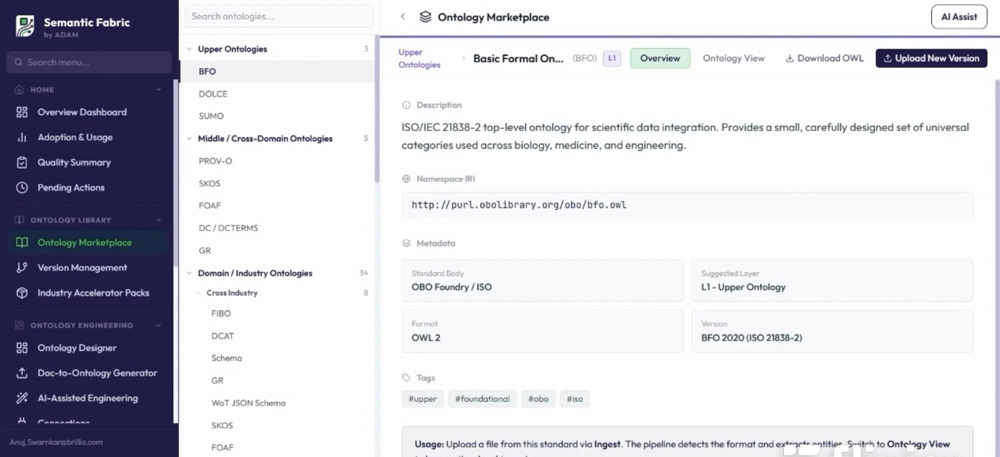
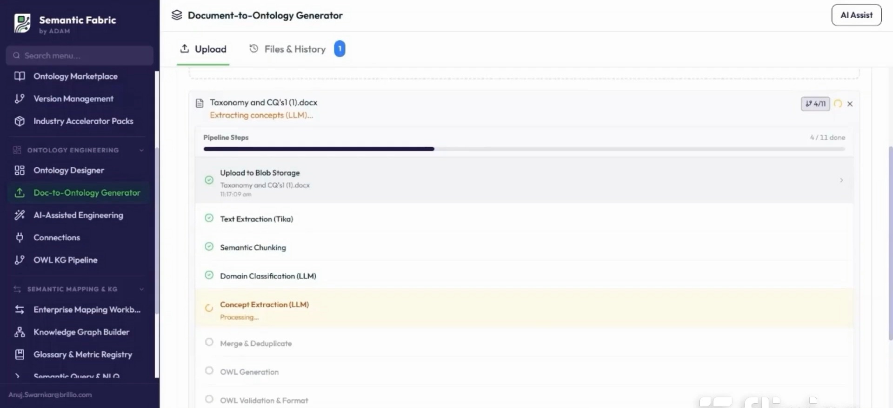
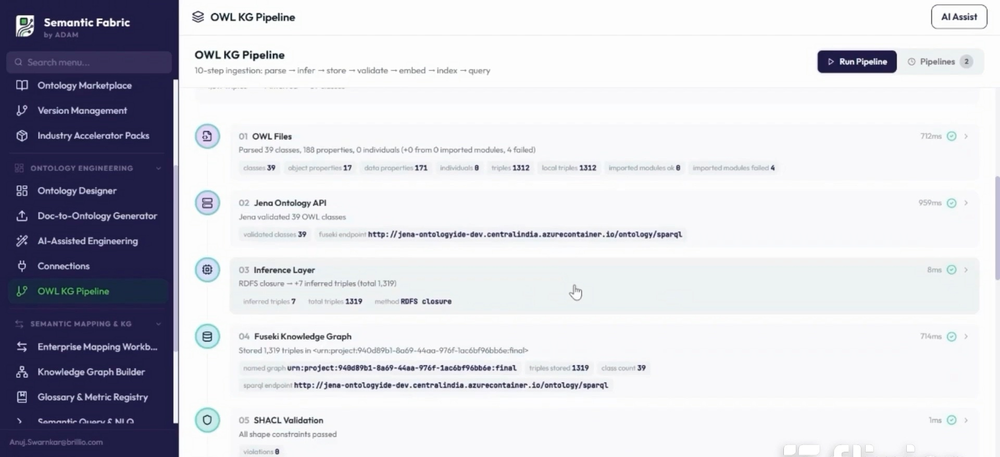
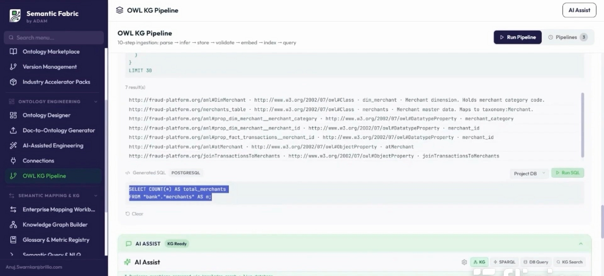

## #semantic-gap-and-architecture 01 / The Enterprise Semantic Gap :: 跨越语义断层：让所有智能体共享同一本受控业务词典 || Bridging the Semantic Gap: Giving Every Enterprise Agent One Governed Business Vocabulary

大型企业推进生成式应用时，最隐蔽的故障往往发生在答案看似通顺的时刻。财务报表里的“活跃商户”、风控引擎里的“可疑交易”与客服工单里的“账户状态”，在不同数据库与部门政策文档中有着截然不同的边界条件；一旦大模型越过业务定义直接猜测底层物理表结构，产出的结论便会在不同团队的智能体之间相互打架 [1][2]。ODSP2231 开篇便点明了这一工程前提：企业级智能体的真正门槛不是生成文本，而是让所有智能体建立在对业务概念、关系与合规政策的一致理解之上 [1][2]。 || Fluent prose often masks the most dangerous failure mode in enterprise AI. Terms like "active merchant," "suspicious transaction," or "account status" carry distinct boundary conditions across finance warehouses, anti-fraud engines, and policy manuals; letting a language model guess raw table joins directly guarantees conflicting answers across departmental copilots [1][2]. Session ODSP2231 opens with a clear architectural premise: the hardest challenge in enterprise AI is not generating answers, but anchoring every answer in a consistent understanding of the business [1][2].

围绕这一目标，Brillio 推出的 **ADAM Semantic Fabric** 在 **OneLake** 统一数据底座上构建了一层结构化企业知识层 [1][3]。该架构向上对齐 **Fabric IQ** 与 **Power BI** 语义模型，横向依托 **Microsoft Purview** 落实元数据归属治理 [1][3]。分散在制度文档、业务数据库与应用系统里的碎片化规则由此汇聚为受控本体与知识图谱，统一供给 **Fabric 数据智能体**、**Copilot Studio** 及 **Microsoft Foundry** 消费 [1][3]。 || To solve this, Brillio's **ADAM Semantic Fabric** establishes a structured enterprise knowledge layer on **OneLake** [1][3]. Aligned with **Fabric IQ** and **Power BI** while governed through **Microsoft Purview**, the platform unifies policy documents, operational databases, and application schemas into a governed ontology and knowledge graph [1][3]. Fabric data agents, **Copilot Studio**, and **Microsoft Foundry** then consume this shared enterprise context directly [1][3].

:::figure { src: "./media/odsp2231-semantic-fabric-architecture.figure.json", title: "ADAM Semantic Fabric 面向企业智能体的三层本体建模、十步图谱管线与跨生态消费架构 || Three-Tier Ontology Engineering, 10-Step Knowledge Graph Pipeline & Multi-Agent Consumption Architecture" }
图 1：ODSP2231 全栈语义架构——顶层依托 44 套可复用本体库、七步文档抽取管线与领域专家三视图门禁沉淀标准本体；中层通过十步管线完成 Jena 校验、RDFS 闭包推理与 SHACL 零违例约束，并与 OneLake、Fabric IQ 及 Purview 对齐；底层借助自然语言到图谱查询再到关系型查询的双跳锚定机制，为 Copilot Studio 与 Foundry 提供可解释上下文 [1][2][3]。 || Figure 1: Three-tier ODSP2231 architecture—combining the 44-model Ontology Marketplace, 7-step document extractor, and SME review gate at the modeling tier; running the 10-step Jena/RDFS/SHACL pipeline aligned with OneLake, Fabric IQ, and Purview in the middle; and grounding Copilot Studio and Foundry via dual-hop NLQ-to-SPARQL-to-SQL resolution [1][2][3].
:::

进入平台首页的 **Overview Dashboard**（治理总览看板），架构师与数据治理官可以在单一视图内掌握全组织的知识工程进展 [1]。看板实时汇总活跃项目总数、本体节点规模、待审阅资产队列与数据摄取作业状态，并提供直达可视化本体设计器、质量校验队列、图谱查询控制台及文档生成器的快捷入口 [1]。下方交互导览台集成了 ODSP2231 官方 6 分钟点播视频流、官方讲稿直链以及按实机演示划分的五个章节索引 [1][2]： || Starting from the consolidated **Overview Dashboard**, data stewards and architects gain immediate visibility into knowledge engineering across the organization [1]. The console tracks total active projects, ontology nodes, pending review queues, and ingestion jobs while providing one-click access to the visual Ontology Designer, quality validation queue, and query console [1]. Explore the official 6-minute recording and five timestamped walkthrough chapters in the interactive theater below [1][2]:

:::sandbox { id: "odsp2231-video-theater", canvas: false, script: "./odsp2231-session.js", style: "./odsp2231-session.css", title: "ODSP2231 官方点播视频与五章实机演示时间轴导览 || ODSP2231 Official On-Demand Stream & Five-Chapter Timestamp Navigator", desc: "按时间轴切换治理总览、44 套本体市场、七步文档抽取与专家门禁、十步知识图谱管线及双跳自然语言转 SQL 演示，支持页内直接加载官方点播播放器。 || Switch across the governance dashboard, 44-asset Ontology Marketplace, 7-step Doc-to-Ontology gate, 10-step KG pipeline, and live NLQ-to-SQL grounding, or load the embedded Medius player." }
纯静态点播与议题导览沙盒：内置 ODSP2231 官方高清封面、五段分章实录摘要及官方点播流与讲稿直链。 || Pure static session theater featuring the official ODSP2231 HD cover, five timestamped chapter digests, and direct video and transcript links.
:::

## #ontology-marketplace-and-designer 02 / Ontology Marketplace & Designer :: 四级可复用本体市场：站在 44 套标准资产肩上启动企业建模 || Four-Tier Ontology Marketplace: Bootstrapping Enterprise Models from 44 Proven Standards

任何企业语义层的根基都是本体——它用机器与人类共同遵循的形式化结构定义“有哪些业务实体、实体具备什么属性、彼此如何关联” [1]。如果每家企业都从空白画布手工定义上千个基础概念，知识工程往往在起步阶段就会因周期过长而搁浅。为此，Semantic Fabric 内置了开箱即用的 **Ontology Marketplace**（本体资产市场），将经过学界与行业长期验证的 **44 套**标准本体按抽象层级划分为 **4 大分组** [1]： || Every semantic layer rests on an ontology—a formal representation of concepts, properties, and relationships understood identically by humans and AI systems [1]. Building thousands of foundational definitions from a blank canvas stalls enterprise initiatives before agents ever ship. To accelerate modeling, Semantic Fabric provides an **Ontology Marketplace** organizing **44 reusable ontologies across 4 hierarchical groups** [1]:

- **顶层基础本体（Upper Ontologies）**：包含基本形式化本体（`BFO`）、语言与认知工程描述本体（`DOLCE`）及合并上层本体（`SUMO`），负责确立时间、空间、过程与实体的通用逻辑骨架 [1]。 || **Upper Ontologies**: Includes Basic Formal Ontology (`BFO`), `DOLCE`, and `SUMO` to anchor universal categories such as continuants, processes, and temporal regions [1].
- **中层跨域本体（Middle / Cross-Domain Ontologies）**：涵盖溯源本体（`PROV-O`）、简单知识组织系统（`SKOS`）、人员关系词汇表（`FOAF`）、都柏林核心元数据（`DCTERMS`）及商业关系模型，统一跨部门通用的血缘、分类与组织结构表达 [1]。 || **Middle / Cross-Domain Ontologies**: Covers W3C provenance (`PROV-O`), knowledge organization (`SKOS`), friend-of-a-friend (`FOAF`), Dublin Core (`DCTERMS`), and GoodRelations for lineage and taxonomy metadata [1].
- **垂直行业本体（Domain / Industry Ontologies）**：提供金融行业商业本体（`FIBO`）、数据目录词汇表（`DCAT`）、通用结构化标记与物联网模式定义，直接对齐银行风控与数据资产目录的监管术语 [1]。 || **Domain / Industry Ontologies**: Supplies Financial Industry Business Ontology (`FIBO`), data catalog vocabulary (`DCAT`), Schema.org, and Web-of-Things schemas to match regulated banking vocabularies out of the box [1].
- **企业专属扩展（Organization-Specific Extensions）**：允许团队在 **Ontology Designer**（可视化本体设计器）中一键克隆上述公共基线，结合自身政策增补专属类与关系，纳入统一版本管理 [1]。 || **Organization-Specific Extensions**: Lets teams clone library baselines inside the **Ontology Designer** and enrich them with proprietary classes, rules, and Gitea-backed version control [1].

  <article class="odsp2231-media-card" data-present-surface="unframed">
    

      
    

    

      ODSP2231 实机录屏截帧 · 01:15 本体市场
      <h4 data-zh="Ontology Marketplace 四级可复用本体资产库与元数据透视" data-en="Ontology Marketplace Four-Tier Asset Library & Metadata Visibility">Ontology Marketplace 四级可复用本体资产库与元数据透视</h4>
      
实拍展示平台预置的顶层基础本体、中层跨域标准与金融行业本体（如 FIBO）；点开任一资产即可检视归属权、命名空间、36 个类与 40 项对象属性等完整拓扑连接 [1]。

    

  </article>

在实机演示中，演讲者点开基本形式化本体（BFO）详情页，系统立即透明化呈现其归属信息、命名空间定义与内部图谱构成：包含 **36 个类**、**40 项对象属性**（如连接“可实现实体”与“过程”的 `has realization` 及 `participates in`）以及 **11 项注解属性** [1]。架构团队无需黑盒盲用，既能直接在画布上追踪概念间的网状连接，也能随时下载标准文件或上传演进版本 [1]。 || Opening Basic Formal Ontology (BFO) during the walkthrough immediately exposes its governance metadata, namespaces, and structural graph: **36 classes**, **40 object properties** (such as `has realization` linking *realizable entity* to *process*), and **11 annotation properties** [1]. Architects inspect exact domain-and-range links visually, download raw OWL/Turtle artifacts, or branch new versions directly inside the designer [1].

## #doc-to-ontology-and-governance 03 / Doc-to-Ontology & Human Gate :: 七步文档生本体与专家门禁：用大模型提速，由领域专家拍板 || Seven-Step Doc-to-Ontology & Human Gate: Accelerating Extraction While Keeping Experts in Charge

即便有了行业基线本体，企业核心的专有规则依然大量沉睡在非结构化的制度手册、分类标准与合规文档之中。为了消除逐条手写概念的繁重劳动，Semantic Fabric 提供了 **Doc-to-Ontology Generator**（文档生本体生成器），将非结构化业务文档自动转化为候选形式化本体 [1]。在实机演示中，工程师上传了一份金融风控领域的分类与能力问题文档（`Taxonomy and CQ's1 (1).docx`），后台随即按序启动透明可观测的七步抽取管线 [1]： || Even with industry baselines in place, proprietary business rules still live inside unstructured policy manuals, taxonomies, and compliance documents. Rather than authoring every class by hand, **Doc-to-Ontology Generator** converts raw business documents into formal candidate ontologies [1]. In the live demo, uploading an anti-fraud taxonomy document (`Taxonomy and CQ's1 (1).docx`) triggers an observable seven-step extraction pipeline [1]:

:::flow { title: "Doc-to-Ontology 七步自动化文档抽取与人在回路审批链路 || Seven-Step Doc-to-Ontology Extraction & Human-in-the-Loop Governance Flow" }
1. **安全上传受控存储（01 Upload to Blob Storage） || Managed Ingestion (01 Upload to Blob Storage)** — 将业务制度、分类学或能力问题文档（DOCX / PDF）上传至受控云端对象存储，记录文件批次与操作时间戳 [1]。 || Uploads enterprise policy or taxonomy documents into managed blob storage with full version and timestamp tracking [1].
2. **文档正文解析（02 Text Extraction via Tika） || Structural Parsing (02 Text Extraction via Tika)** — 调用 Apache Tika 引擎剥离复杂排版格式，精准还原段落层级、表格条目与术语上下文 [1]。 || Extracts clean text, headings, and tabular definitions from complex office formats using Apache Tika [1].
3. **语义边界分块（03 Semantic Chunking） || Context-Preserving Split (03 Semantic Chunking)** — 按主题内聚度而非生硬字数切分语料块，防止跨段落的业务规则与约束条件被截断 [1]。 || Splits text along semantic topic boundaries so multi-sentence policy rules stay intact [1].
4. **业务领域归类（04 Domain Classification） || Automated Domain Tagging (04 Domain Classification)** — 由大语言模型判别各语义块所属的业务子域（如账户体系、支付清算、设备指纹或反洗钱风险评分）[1]。 || Classifies each semantic chunk into target business subdomains such as accounts, transactions, or risk scoring [1].
5. **概念与关系抽取（05 Concept Extraction） || Candidate Modeling (05 Concept Extraction)** — 从文本中提炼候选业务类、父子继承层级、对象属性及数据属性定义 [1]。 || Extracts candidate OWL classes, `subClassOf` hierarchies, object properties, and datatype attributes [1].
6. **实体对齐与去重合并（06 Merge & Deduplicate） || Entity Consolidation (06 Merge & Deduplicate)** — 跨文档切片合并同义概念、消解命名冲突，汇总生成包含 251 个风控业务类的候选本体结构 [1]。 || Deduplicates synonymous terms across chunks, consolidating 251 candidate financial-crime classes [1].
7. **标准格式校验与专家审批（07 OWL Validation & SME Gate） || Syntax Check & Expert Gate (07 OWL Validation & SME Gate)** — 完成标准网络本体语言语法校验与格式化后送入审阅台，必须经领域专家在层级、树状或辐射视图中点击批准（Approve）方可进入正式企业知识层 [1]。 || Formats valid OWL syntax and pauses at the review workbench until domain experts inspect Hierarchy, Tree, and Radial views to Approve or Reject [1].
:::

演讲者特别强调了一条不可妥协的工程红线：**大模型负责加速初稿生成，但入库裁决权必须留在人类领域专家手中** [1]。所有由文档自动抽出的概念与关联在未获批准前均处于隔离待审状态；业务专家可在审阅工作台中逐一检视该文档生成的 **251 个候选类**（涵盖存款账户 `DepositAccount`、借贷账户 `LendingAccount`、可疑交易 `SuspiciousTransaction`、设备指纹 `Device` 以及客户与交易风险评分 `RiskScore` 等），切换 **层级（Hierarchy）**、**树状（Tree）** 与 **辐射（Radial）** 三种可视化布局核查上下位关系，并通过内置代码仓（Gitea）留存修订历史，确认无误后点击 **Approve & Build KG** 放行 [1]。 || The presenter underscored a non-negotiable governance rule: **AI accelerates drafting, but human domain experts own publication** [1]. Every extracted class and relationship stays quarantined until reviewed; inside the OWL Viewer, subject-matter experts inspect all **251 generated classes**—spanning `DepositAccount`, `LendingAccount`, `SuspiciousTransaction`, `Device`, and `CustomerRiskScore`—toggle across **Hierarchy**, **Tree**, and **Radial** graph layouts, verify raw OWL diffs backed by Gitea, and explicitly click **Approve & Build KG** or **Reject** [1].

  <article class="odsp2231-media-card" data-present-surface="unframed">
    

      
    

    

      ODSP2231 实机录屏截帧 · 02:58 文档生本体
      <h4 data-zh="Doc-to-Ontology 七步自动化语义结构抽取流水线" data-en="Doc-to-Ontology Seven-Step Automated Semantic Extraction Pipeline">Doc-to-Ontology 七步自动化语义结构抽取流水线</h4>
      
上传业务分类文档后，系统实时展示从对象存储上传、Tika 文本提取、语义分块、大模型领域分类与概念抽取到去重合并及标准语法校验的每一步执行进展 [1]。

    

  </article>
  <article class="odsp2231-media-card" data-present-surface="unframed">
    

      
    

    

      ODSP2231 实机录屏截帧 · 04:38 十步图谱管线
      <h4 data-zh="OWL KG 十步可执行管线：Jena 校验与 RDFS 闭包推理" data-en="10-Step Executable OWL KG Pipeline: Jena Validation & RDFS Inference">OWL KG 十步可执行管线：Jena 校验与 RDFS 闭包推理</h4>
      
管线实拍记录：第 01 步解析 39 个类、188 项属性与 1,312 条三元组；第 02 步经 Jena API 完成全量类校验；第 03 步通过 RDFS 闭包推演新增 7 条隐含三元组（总计 1,319 条），并经零违例 SHACL 校验写入 Fuseki [1]。

    

  </article>

## #owl-kg-pipeline-and-onelake 04 / 10-Step OWL KG Pipeline :: 十步可执行知识图谱管线：用确定性推理与形状约束打通生产数据 || Ten-Step Executable KG Pipeline: Operationalizing Governed Semantics Across Live Enterprise Data

静态本体文件本身并不能直接回答实时业务问题；只有把受控本体与企业真实的数据库、业务应用及 **OneLake** 数据资产连接起来，转化为可查询的知识图谱，语义层才能真正具备生产战斗力 [1][3]。Semantic Fabric 为此构建了全自动编排的 **OWL KG Pipeline**（十步摄取与图谱化管线），依次串联“解析（parse）→ 推理（infer）→ 存储（store）→ 校验（validate）→ 向量嵌入（embed）→ 索引（index）→ 查询（query）”全生命周期 [1]。 || Static ontology files alone cannot answer live operational prompts; organizations must connect governed semantic models to live enterprise databases, applications, and **OneLake** data estates [1][3]. Semantic Fabric operationalizes these assets through an automated **10-Step OWL KG Pipeline** spanning *parse → infer → store → validate → embed → index → query* [1].

如上方右侧实机截帧及完整运行日志所示，当演示者挂载业务数据库并上传通过审批的反洗钱领域本体后，管线在秒级时间内完成了严密的符号逻辑核验 [1]： || As captured in the live execution metrics above, once the approved anti-money-laundering ontology and operational database are connected, the pipeline enforces deterministic symbolic verification in milliseconds [1]:

1. **解析与语义校验（Steps 01–02）**：系统解析导入的本体模块，精准提取 **39 个核心类**、**188 项属性**（含 **17 项对象属性**）与 **1,312 条本地三元组**，随后调用 **Apache Jena Ontology API** 完成全部 **39 个类**的一致性核验（耗时 `712 ms`）[1]。 || **OWL Parsing & Jena Validation (Steps 01–02)**: Parses **39 classes**, **188 properties** (**17 object properties**), and **1,312 base triples**, validating all **39 OWL classes** through the **Apache Jena Ontology API** in `712 ms` [1].
2. **符号闭包推理（Step 03）**：推理层执行 **RDFS 闭包计算（RDFS Closure）**，依据子属性与定义域规则自动推演出 **+7 条隐含三元组**，将受控图谱规模扩充至 **1,319 条三元组** [1]。 || **Symbolic Inference Layer (Step 03)**: Runs **RDFS closure** to deduce **+7 implicit triples** from domain, range, and subclass axioms, bringing the graph to **1,319 total triples** [1].
3. **命名图谱存储与形状约束（Steps 04–05）**：全部 **1,319 条三元组**被持久化写入 **Apache Fuseki** 命名图谱并暴露标准 SPARQL 服务端点；紧接着执行 **SHACL 形状约束校验**，确认违规项为 **0（`violations: 0`）**，从源头杜绝脏结构流入下游向量索引与智能体工作台 [1]。 || **Fuseki Persistence & SHACL Gate (Steps 04–05)**: Stores all **1,319 triples** inside a named graph on **Apache Fuseki** and runs **SHACL shape validation**, passing with **0 violations** before embedding and indexing [1].

:::figure { src: "./media/odsp2231-semantic-grounding-quadrant.figure.json", title: "企业 AI 知识工程模式的语义一致性与跨智能体复用度对比象限 || Semantic Consistency vs. Cross-Agent Reusability Across Enterprise Knowledge Engineering Patterns" }
图 2：不同企业知识供给模式对比——裸表直连生成查询易因字段歧义产生幻觉，纯文本切片向量检索丢失实体关系与确定性约束，孤立报表语义模型则困于单一工具；Semantic Fabric 借助受控本体、SHACL 校验与 OneLake 统一底座，同时守住业务口径一致性与跨智能体高复用度 [1][2][3]。 || Figure 2: Positioning enterprise grounding patterns—raw table Text-to-SQL guesses cryptic joins, chunk-only vector RAG loses structural constraints, and single-report BI datasets stay siloed; Semantic Fabric pairs governed OWL/SHACL graphs with OneLake alignment to achieve both high consistency and cross-agent reuse [1][2][3].
:::

## #nlq-sparql-sql-consumption 05 / Dual-Hop Grounded Query :: 双跳自然语言转译与跨平台复用：一次沉淀，赋能全栈智能体 || Dual-Hop Grounded Query & Multi-Agent Reuse: Build Once, Share Across Copilot Studio, Fabric, and Foundry

图谱就绪后，业务人员无需学习复杂的图查询语法、关系数据库语句或底层物理库表字典，即可在知识图谱工作台与各类智能体入口中用日常自然语言直接发问 [1]。与传统“把数据库成百上千张裸表直接塞进提示词让大模型硬猜”的脆弱做法不同，Semantic Fabric 采用了一条高可解释性的“自然语言 → 图谱查询 → 关系查询”双跳确定性锚定路径（`NLQ → SPARQL → SQL`）[1]： || Once the knowledge graph is live in the workspace, business users ask everyday questions without writing graph queries, relational syntax, or memorizing technical table schemas [1]. Instead of dumping hundreds of raw database tables into a prompt and hoping the model guesses the right foreign keys, Semantic Fabric executes an explainable dual-hop grounding workflow (`NLQ → SPARQL → SQL`) [1]:

  <article class="odsp2231-media-card" data-present-surface="unframed">
    

      
    

    

      ODSP2231 实机录屏截帧 · 05:38 双跳语义转译
      <h4 data-zh="先查知识图谱消歧 7 项商户映射，再精确生成生产库 PostgreSQL 查询" data-en="Resolving 7 Ontology Schema Mappings Before Generating Exact PostgreSQL Queries">先查知识图谱消歧 7 项商户映射，再精确生成生产库 PostgreSQL 查询</h4>
      
面对商户规模统计提问，AI Assist 先从反洗钱知识图谱检索出 DimMerchant、merchants_table、atMerchant 与 joinTransactionsToMerchants 等 7 条受控映射，随后针对业务库精确生成可执行 SQL [1]。

    

  </article>

在收官实机演示中，用户用自然语言询问商户主数据情况。**第一跳（自然语言到图谱消歧）**首先向 Fuseki 图谱发起语义检索，精准召回反洗钱命名空间（`fraud-platform.org/aml`）下的 **7 条核心本体与物理映射定义**——明确区分分析维度类 `DimMerchant`（持有商户类别码）与主数据表类 `merchants_table`（映射至标准业务分类 `taxonomy:Merchant`），并锁定 `merchant_id` 数据属性以及 `atMerchant`、`joinTransactionsToMerchants` 等标准关联路径 [1]。紧接着，**第二跳（语义锚定生成关系查询）**严格依据图谱给定的物理映射，针对底层 **PostgreSQL** 生产数据库生成干净无歧义的查询语句 `SELECT COUNT(*) AS total_merchants FROM "bank"."merchants" AS m;` 并一键返回实时统计结果 [1]。下表提炼了把这套语义底座接入微软智能体生态时的四项核心工程收益 [1][2][3]： || In the closing live walkthrough, a plain-language question about merchants triggers **Hop 1 (Semantic Graph Resolution)**: the engine queries the anti-money-laundering namespace (`fraud-platform.org/aml`) and retrieves **7 exact ontology-to-physical mappings**—distinguishing analytical `DimMerchant` from master `merchants_table` (`Maps to taxonomy:Merchant`) while surfacing `merchant_id`, `atMerchant`, and `joinTransactionsToMerchants` [1]. Guided by those verified bindings, **Hop 2 (Grounded SQL Synthesis)** emits clean **PostgreSQL** syntax—`SELECT COUNT(*) AS total_merchants FROM "bank"."merchants" AS m;`—for immediate execution against the live project database [1]. The table below summarizes the four architectural payoffs across the Microsoft AI stack [1][2][3]:

| 核心工程环节 || Engineering Layer | 无本体底座的常见痛点 || Unmanaged AI Pitfall | ODSP2231 受控语义方案 || Semantic Fabric Pattern | 跨生态实测与落地价值 || Verified Enterprise Value |
|------|------|------|------|
| 业务概念与口径建模 || Domain Modeling | 各团队在提示词里重复硬编码业务规则，彼此矛盾 [1] || Teams hardcode conflicting rules inside isolated prompts [1] | 复用 **44 套**四级标准本体 + 七步文档自动抽取初稿 [1] || Clone from **44** 4-tier ontologies + 7-step DOCX extraction [1] | 从制度文档抽取出 **251 个**候选风控类，大幅缩短冷启动周期 [1] || Extracts **251** candidate AML classes directly from policy docs [1] |
| 质量保障与合规治理 || Governance & Quality | 大模型抽取概念未经审核直接上线，污染企业指标 [1] || Ungoverned LLM extractions pollute production definitions [1] | 领域专家三视图人工审批门禁 + **Purview** 治理与 **SHACL** 约束 [1][3] || 3-view SME approval gate + **Purview** lineage & **SHACL** checks [1][3] | **39 个**生产类与 **1,319 条**推理三元组实现 **0 违例**入库 [1] || **39** validated classes & **1,319** triples stored with **0 violations** [1] |
| 自然语言查库可解释性 || Query Explainability | 裸表直连盲猜同名字段与连接键，难以排查算错根因 [1] || Raw Text-to-SQL guesses cryptic tables with opaque errors [1] | **NLQ → SPARQL → SQL** 双跳解析，显式展示本体至物理表映射 [1] || **NLQ → SPARQL → SQL** dual-hop resolution with explicit mappings [1] | 精准区分维度表与主数据表（召回 **7 项**映射），输出确定性查询 [1] || Disambiguates master vs. dim tables (**7 mappings**) before SQL run [1] |
| 多智能体上下文复用 || Multi-Agent Reuse | 每建一个新聊天助手都要重新对接数据源与业务词表 [1][3] || Every new copilot rebuilds connectors and glossaries from scratch [1][3] | 构建于 **OneLake** 之上，对齐 **Fabric IQ** 与 **Power BI** 语义模型 [2][3] || Built on **OneLake**, aligned with **Fabric IQ** & **Power BI** [2][3] | 同一知识底座跨 **Copilot Studio**、**Fabric** 与 **Foundry** 规模复用 [1][3] || Shared across **Copilot Studio**, **Fabric** agents & **Foundry** [1][3] |

当企业把分散在文档与异构库表里的隐性规则沉淀为受控本体与知识图谱后，业务语义便不再是附属在单个智能体提示词里的易耗品，而是沉淀在 OneLake 之上的长效企业资产——无论前端接入的是 Copilot Studio 对话智能体、Fabric 数据分析助手还是 Microsoft Foundry 定制多智能体工作流，都能在同一套可解释、可审计的业务真相上协同运转 [1][2][3]。 || Turning fragmented institutional knowledge into a governed ontology and knowledge graph transforms semantics from fragile prompt boilerplate into a durable OneLake enterprise asset—ensuring every Copilot Studio agent, Fabric data agent, and Microsoft Foundry workflow reasons over the exact same explainable business truth [1][2][3].

## 参考资料：官方一手信源与技术归档 || References: Official Primary Sources & Technical Archives

1. **Microsoft Ignite 2026 ODSP2231 Official Video & Bilingual Transcripts** — https://medius.microsoft.com/Embed/video-nc/6b1bf64d-6336-4584-b794-271dc5f60c8c | 《Semantic foundation for enterprise AI》官方 6 分钟实机录屏点播流与官方逐字稿归档（`https://medius.microsoft.com/video/asset/Transcript/6b1bf64d-6336-4584-b794-271dc5f60c8c`） || Official ODSP2231 Medius on-demand video stream and downloadable verbatim transcript archive
2. **Microsoft Ignite Session Catalog Page** — https://ignite.microsoft.com/en-US/sessions/1787855007168001twda-AAAAAAAAAAAAAAAAAAAA | 《Semantic foundation for enterprise AI》官方专场目录页，明确定义 OneLake 数据湖、Fabric 智能体、微软商业智能报表、Purview 合规治理与 Copilot Studio 协同架构（2026-11） || Official Ignite 2026 session catalog entry detailing OneLake, Fabric, Microsoft Purview, Copilot Studio, and Foundry integration
3. **Brillio ADAM (Agentic Data & AI Management) Enterprise Accelerator** — https://www.brillio.com/ | Brillio 企业级数据与智能体加速器平台技术架构及行业知识工程实践说明 || Brillio enterprise AI accelerator platform overview and semantic knowledge engineering capabilities
