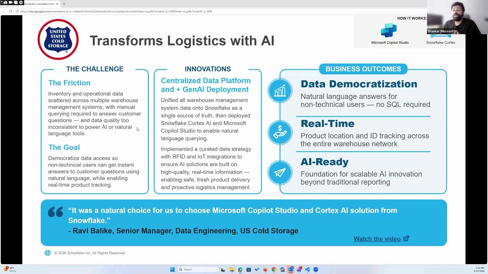
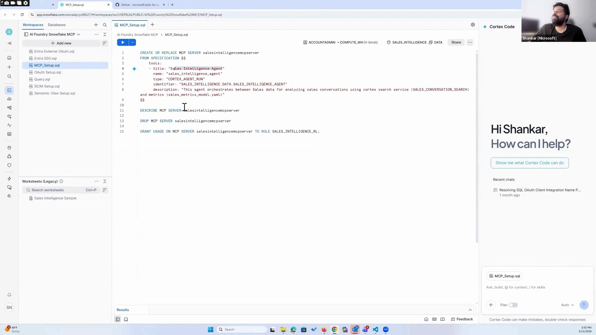
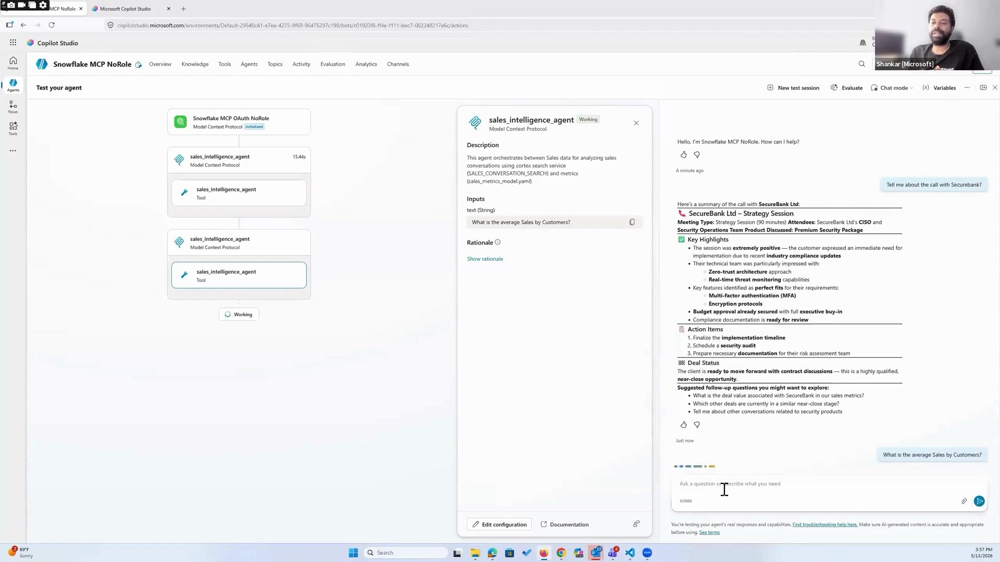
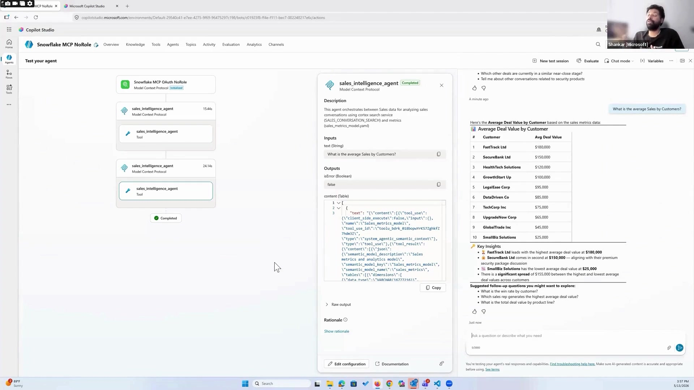

## #ecosystem-pillars 01 / Bridging Workplace and Data Cloud :: 跨越协同入口与数仓鸿沟：微软与 Snowflake 的三路联合架构 || Bridging Everyday Collaboration and the Data Cloud: Three Joint Ecosystem Pillars

企业落地面临一道普遍的物理割裂：销售、运营与客服团队全天在 Microsoft Teams 与网页工作台中处理业务，而高价值库存流水、交易台账与客户录音却集中在 Snowflake 数据云内 [1][2]。过去若要回答一线人员的临时追问，数据团队要么手工编写查询脚本，要么维护成百上千张静态报表；员工往往需要漫长等待整张大表加载完毕，才能看清一个具体的业务数字 [1]。 || Enterprise workflows suffer from a persistent divide: business users collaborate inside Microsoft Teams and web apps, whereas inventory ledgers, sales metrics, and call transcripts reside inside the Snowflake AI Data Cloud [1][2]. Answering ad-hoc operational questions traditionally forced non-technical staff to wait on custom SQL scripts or heavy BI report loads just to verify a single customer fact [1].

Shankar Narayanan 在开场明确了双方消除这一断层的三条技术主线 [1]。第一条主线是 **Copilot Studio 原生协议直连**：平台现已支持通过托管式模型上下文协议（Model Context Protocol）服务器直接挂载 Snowflake Cortex 智能体，将多智能体编排成果一键发布至 Teams 与各类业务前端 [1][3]。第二条主线是 **Microsoft 365 Teams 沉浸式交互**，让一线员工像给同事发消息一样用日常语言向数仓提问，同步覆盖结构化指标表与非结构化文本 [1][2]。 || Opening ODSP2233, Shankar Narayanan mapped out three engineering pillars built by Microsoft and Snowflake to close that gap [1]. First, **Copilot Studio native protocol integration** connects directly to Cortex Agents through managed Snowflake servers so multi-agent workflows publish straight to Teams and web channels [1][3]. Second, **direct Microsoft 365 Teams integration** lets knowledge workers chat with enterprise structured and unstructured data in plain text [1][2].

:::figure { src: "./media/snowflake-cortex-mcp-architecture.figure.json", title: "Copilot Studio 结合托管式 Snowflake 协议服务与 Cortex 双模引擎的三层受控架构 || Three-Tier Governed Architecture Pairing Copilot Studio, Managed Snowflake Server & Cortex Engines" }
图 1：ODSP2233 全栈架构——顶层由 Teams、Copilot Studio 与 Microsoft Foundry 承接多渠道交互与前沿模型；中层通过外部身份鉴权与托管式协议服务器桥接智能体路由；底层由 Cortex Analyst 语义视图与 Cortex Search 非结构化索引在数仓原生安全边界内协同返回可信答案 [1][2][3]。 || Figure 1: Full-stack ODSP2233 architecture—combining Teams, Copilot Studio, and Microsoft Foundry on top; enforcing OAuth passthrough and managed server routing in the middle; and executing governed Text-to-SQL and transcript search inside Snowflake's native security perimeter [1][2][3].
:::

第三条主线则是**双向前沿模型底座** [1]。研发团队既可以在 Microsoft Foundry 中调用前沿大模型构建由 Cortex 数据驱动的复杂智能体，也可以反过来在 Snowflake Cortex 内部直接调用 Azure OpenAI 服务就近完成推理，按场景灵活择优 [1]。下方交互导览台汇总了 ODSP2233 官方 7 分钟实录点播流、官方讲稿直链与五个核心演示章节的逐秒索引 [1]： || The third pillar establishes **bidirectional frontier model power**: pro-code teams can build agents in Microsoft Foundry backed by Cortex knowledge, or invoke Azure OpenAI models directly inside Snowflake Cortex [1]. Explore the official 7-minute video stream and five timestamped chapters in the interactive theater below [1]:

:::sandbox { id: "odsp2233-video-theater", canvas: false, script: "./odsp2233-session.js", style: "./odsp2233-session.css", title: "官方点播视频与五章实录时间轴导览 || Official On-Demand Stream & Five-Chapter Timestamp Navigator", desc: "按时间轴切换三大跨生态支柱、冷链物流客户案例、声明式协议配置、双模态实机联调与开源配置技能包，支持页内加载官方播放器。 || Switch across the three ecosystem pillars, the cold-storage case study, SQL server setup, live dual-modal queries, and open-source YAML skills, or launch the Medius player." }
纯静态点播与议题导览沙盒：内置 ODSP2233 官方高清封面、五段精确到秒的实录提要及微软官方点播流直链。 || Pure static session theater featuring the official ODSP2233 HD cover, five second-accurate chapter digests, and direct Medius video and transcript links.
:::

## #us-cold-storage-case 02 / Customer Proof: US Cold Storage :: 冷链物流投产实证：US Cold Storage 如何打通多仓系统与物联网实现零 SQL 查数 || Production Logistics Proof: How United States Cold Storage Unified Multi-Warehouse & IoT Data for Teams

在切入代码配置前，Shankar 分享了北美温控仓储与冷链物流代表企业 **United States Cold Storage** 的生产落地路径 [1][4]。对于冷链物流而言，货品新鲜度与准时交付高度依赖实时库内状态；然而该企业此前的库存与运营数据分散在多套异构仓库管理系统中，不仅跨仓查询高度依赖人工提取，底层数据口径也参差不齐，难以直接支撑自然语言问答 [1][4]。 || Before diving into live configuration, Narayanan highlighted **United States Cold Storage**, a major temperature-controlled logistics provider that deployed this integration to eliminate operational data friction [1][4]. Previously, inventory and operational records sat fragmented across multiple warehouse management systems, requiring manual SQL queries to answer customer inquiries while inconsistent data quality blocked natural-language tooling [1][4].

<div class="odsp2233-media-grid is-single">
  <article class="odsp2233-media-card" data-present-surface="unframed">
    <div class="odsp2233-media-frame">
      
    </div>
    <div class="odsp2233-media-body">
      <span class="odsp2233-media-badge" data-zh="ODSP2233 官方课件实拍 · 02:40 客户案例" data-en="ODSP2233 Official Slide · 02:40 Case Study">ODSP2233 官方课件实拍 · 02:40 客户案例</span>
      <h4 data-zh="United States Cold Storage：融合多仓台账与冷链传感数据的零 SQL 转型" data-en="United States Cold Storage: Unifying Multi-Warehouse & Sensor Streams for Zero-SQL Teams Access">United States Cold Storage：融合多仓台账与冷链传感数据的零 SQL 转型</h4>
      <p data-zh="汇聚分散仓库系统并接入射频识别与物联网实时数据流，通过 Copilot Studio 编排 Cortex 智能体直推 Teams。数据工程高级经理 Ravi Balike 评价两者是“顺理成章的天然搭档” [1][4]。" data-en="Consolidates warehouse systems alongside curated RFID and IoT telemetry into Snowflake, exposing Cortex Agents inside Teams via Copilot Studio—praised by Senior Data Engineering Manager Ravi Balike [1][4].">汇聚分散仓库系统并接入射频识别与物联网实时数据流，通过 Copilot Studio 编排 Cortex 智能体直推 Teams。数据工程高级经理 Ravi Balike 评价两者是“顺理成章的天然搭档” [1][4]。</p>
    </div>
  </article>
</div>

如上方官方课件实拍所示，团队分两步重构了数据链路 [1][4]。底层先将全网仓库管理系统汇聚至 Snowflake 建立单一事实源，同步引入经过治理的射频识别标签与物联网温控传感实时流，确保上层推理建立在鲜活且一致的高质量数据之上 [1][4]。上层则在数仓内构建领域专属的 Cortex 智能体，交由 Copilot Studio 统一编排工作流并直接部署进 Microsoft Teams [1][4]。 || As captured in the official slide above, the engineering team executed a two-layer modernization [1][4]. First, they consolidated every warehouse management system onto Snowflake as a single source of truth, pairing it with a curated data strategy fed by live radio-frequency identification and internet-of-things sensor streams [1][4]. Second, they built domain Cortex Agents on top, orchestrated the platform in Copilot Studio, and rolled the experience straight into Microsoft Teams [1][4].

改造上线后，分布各地的非技术客服与调度员不再需要打开厚重的商业智能报表、等待全量数据渲染，也无需请求工程师代写查询语句 [1]。员工只需在 Teams 聊天窗内像询问同事一样输入自然语言，即可即时获知全网仓库内的货品精确位置与编号追踪状态，把原本滞后的报表查阅升级为主动的冷链履约管理 [1][4]。 || Non-technical staff now open Teams and chat with the agent just like messaging a coworker—tracking real-time product locations and IDs across the entire warehouse network without writing SQL or waiting for full dashboard loads [1][4].

## #mcp-workflow-and-setup 03 / Six-Step Workflow & Declarative MCP Setup :: 六步受控工作流与声明式配置：一行 SQL 暴露双模智能体并锁紧角色权限 || Six-Step Governed Workflow & Declarative Setup: Exposing Cortex Agents via SQL and OAuth

把数仓智能体安全接入日常办公流，到底需要多少胶水代码？答案是零自建中间件 [1][3]。官方架构图与实机工作区清晰界定了从底层数据准备到跨源协同的六步标准工作流 [1]： || How much custom middleware does it take to bridge Snowflake data governance with Microsoft 365? Zero bespoke proxy servers [1][3]. ODSP2233 defines a repeatable six-step workflow from raw tables to Teams orchestration [1]:

:::flow { title: "Copilot Studio 与 Snowflake Cortex 智能体六步标准集成链路 || Six-Step Reference Workflow Connecting Copilot Studio and Cortex Agents" }
1. **构建结构化语义分析服务 || Create Cortex Analyst Service** — 针对销售指标或库存台账等结构化表，编写语义模型文件（如 `sales_metrics_model.yaml`），为自然语言转查询语句锚定准确的指标口径与表关联逻辑 [1][3]。 || Bind structured warehouse tables to a YAML semantic view (`sales_metrics_model.yaml`) so Cortex Analyst generates accurate, business-grounded SQL [1][3].
2. **构建非结构化对话检索服务 || Create Cortex Search Service** — 针对客服通话录音转写文本、合同与文档等非结构化语料建立检索服务（如 `SALES_CONVERSATION_SEARCH`），支持高召回语义检索 [1][3]。 || Index unstructured text such as customer call transcripts (`SALES_CONVERSATION_SEARCH`) inside Cortex Search for low-latency semantic retrieval [1][3].
3. **封装 Cortex 智能路由代理 || Assemble the Broker Cortex Agent** — 借助数仓内置编程助手组装顶层智能体（如 `SALES_INTELLIGENCE_AGENT`），由其根据提问意图自主裁决何时调用结构化分析、何时调用文本检索 [1][3]。 || Create a parent Cortex Agent (`SALES_INTELLIGENCE_AGENT`) using Cortex Code to dynamically broker requests between Analyst, Search, and custom functions [1][3].
4. **声明式注册托管协议服务器 || Expose via Managed MCP Server** — 在数仓工作区运行声明式语句创建协议服务器，将该智能体注册为标准运行工具，并向指定业务角色授予最小使用权限 [1][3]。 || Register a Snowflake-managed MCP server via SQL specification, exposing the Cortex Agent as a tool governed by role-based access grants [1][3].
5. **配置外部身份令牌接入编排台 || Connect Copilot Studio over OAuth** — 在 Copilot Studio 工具面板填入协议服务器地址与外部身份认证参数，无需搬运底层数据即可完成安全握手 [1][3]。 || Add the Model Context Protocol endpoint inside Copilot Studio with Entra External OAuth credentials—zero data duplication required [1][3].
6. **融合微软生态数据多渠道发布 || Combine M365 Context & Publish** — 将数仓返回的可信洞察与 Microsoft 365 邮件、日历及其他业务连接器串联编排，统一发布至 Teams 或企业门户 [1][2]。 || Blend Snowflake answers with broader Microsoft 365 data and operational connectors, publishing one cohesive agent to Teams [1][2].
:::

进入 Snowflake 实机环境后，Shankar 展示了在 `SALES_INTELLIGENCE.DATA` 模式下用内置编程助手辅助搭建的 `SALES_INTELLIGENCE_AGENT`：其下同时挂载了指向 `SALES_INTELLIGENCE_WH` 计算仓库的语义模型 `SALES_METRICS_MODEL`，以及承载销售代表与客户历史通话纪要的检索服务 `SALES_CONVERSATION_SEARCH` [1]。紧接着，他在工作区打开配置脚本，演示如何用原生声明语句将该智能体直接转化为外部可调用的协议端点 [1][3]： || Stepping into the live Snowflake console under `SALES_INTELLIGENCE.DATA`, Narayanan inspected `SALES_INTELLIGENCE_AGENT`—built with Cortex Code and wired to both `SALES_METRICS_MODEL` (running on `SALES_INTELLIGENCE_WH`) and `SALES_CONVERSATION_SEARCH` [1]. Opening `MCP_Setup.sql` alongside companion Entra External OAuth, SSO, and SCIM scripts, he exposed the agent as a managed server [1][3]:

```sql
CREATE OR REPLACE MCP SERVER salesintelligencemcpserver
  FROM SPECIFICATION $$
    tools:
      - title: "Sales Intelligence Agent"
        name: "sales_intelligence_agent"
        type: "CORTEX_AGENT_RUN"
        identifier: "SALES_INTELLIGENCE.DATA.SALES_INTELLIGENCE_AGENT"
        description: "This agent orchestrates between Sales data for analyzing sales conversations using cortex search service (SALES_CONVERSATION_SEARCH) and metrics (sales_metrics_model.yaml)"
  $$;

GRANT USAGE ON MCP SERVER salesintelligencemcpserver TO ROLE SALES_INTELLIGENCE_RL;
```

<div class="odsp2233-media-grid is-single">
  <article class="odsp2233-media-card" data-present-surface="unframed">
    <div class="odsp2233-media-frame">
      
    </div>
    <div class="odsp2233-media-body">
      <span class="odsp2233-media-badge" data-zh="ODSP2233 实机演示截帧 · 04:00 Snowflake 工作区" data-en="ODSP2233 Live Demo · 04:00 Snowflake Workspace">ODSP2233 实机演示截帧 · 04:00 Snowflake 工作区</span>
      <h4 data-zh="声明式注册托管协议服务并与 Entra 单点登录及角色权限对齐" data-en="Declarative MCP Server Registration Paired with Entra OAuth & Role Grants">声明式注册托管协议服务并与 Entra 单点登录及角色权限对齐</h4>
      <p data-zh="工作区左侧目录完整配套 Entra External OAuth、Entra SSO、SCIM 与语义视图脚本；右侧将 CORTEX_AGENT_RUN 封装为标准工具并严格授权给 SALES_INTELLIGENCE_RL 角色 [1][3]。" data-en="Alongside Entra External OAuth, SSO, and SCIM setup scripts, the SQL specification binds CORTEX_AGENT_RUN and scopes usage strictly to SALES_INTELLIGENCE_RL [1][3].">工作区左侧目录完整配套 Entra External OAuth、Entra SSO、SCIM 与语义视图脚本；右侧将 CORTEX_AGENT_RUN 封装为标准工具并严格授权给 SALES_INTELLIGENCE_RL 角色 [1][3]。</p>
    </div>
  </article>
</div>

这段配置体现了“安全不下放、数据不出域”的架构精髓 [1][3]。左侧目录树中并列着外部身份认证、单点登录与跨域身份管理脚本；底部的赋权语句则确保即便智能体被发布到全公司聊天群，每一次协议调用依然受限于数仓原生角色体系与行列级安全控制，绝不会因引入低代码前端而敞开越权后门 [1][2][3]。 || Notice the governance posture visible in the workspace tree (`Entra External OAuth.sql`, `Entra SSO.sql`, `SCIM Setup.sql`): every call arriving from Copilot Studio authenticates via OAuth and executes strictly under Snowflake's role-based access control (`SALES_INTELLIGENCE_RL`), preserving warehouse governance end to end [1][2][3].

## #dual-modal-live-demo 04 / Live Demo: Unstructured & Structured Turns :: 双模态实机联调：从 90 分钟安全高管纪要检索到十家客户客单价自动建模 || Dual-Modal Live Walkthrough: From a 90-Minute CISO Call Summary to Ten-Customer Deal Analytics

切回 Copilot Studio 环境后，添加好的模型上下文协议工具已自动识别出远端的 `sales_intelligence_agent` [1]。Shankar 清空测试窗，在同一个对话上下文中连续发起两轮形态截然不同的业务追问，现场检验跨模态路由与数据返回质量 [1]。 || Switching into Copilot Studio, the configured Model Context Protocol connection automatically surfaces `sales_intelligence_agent` [1]. Clearing the test pane, Narayanan ran two consecutive prompts within a single chat session to test unstructured retrieval followed immediately by structured analytics [1].

第一轮聚焦**非结构化客户语音纪要**，输入提问：*‘Tell me about the call with Securebank?’（告诉我与 SecureBank 那通电话聊了什么？）* [1]。Copilot Studio 自动唤醒协议工具并将文本透传至 Snowflake；远端智能体识别出这是对话内容查询，随即调动 `SALES_CONVERSATION_SEARCH` 检索原始记录，全程耗时 **15.44 秒**（`isError: false`）即返回结构清晰的商机简报 [1]。 || Starting with **unstructured conversational data**, he asked: *'Tell me about the call with Securebank?'* [1]. Copilot Studio invoked `sales_intelligence_agent` over the protocol bridge; Cortex routed the prompt to `SALES_CONVERSATION_SEARCH` and completed execution in **15.44 seconds** (`isError: false`), returning a structured executive brief [1].

<div class="odsp2233-media-grid">
  <article class="odsp2233-media-card" data-present-surface="unframed">
    <div class="odsp2233-media-frame">
      
    </div>
    <div class="odsp2233-media-body">
      <span class="odsp2233-media-badge" data-zh="ODSP2233 实机演示截帧 · 05:45 非结构化检索" data-en="ODSP2233 Live Demo · 05:45 Cortex Search">ODSP2233 实机演示截帧 · 05:45 非结构化检索</span>
      <h4 data-zh="15.44 秒穿透 90 分钟高管会议纪要并提炼三项成交待办" data-en="15.44s CISO Strategy Call Extraction with Action Items & Follow-Ups">15.44 秒穿透 90 分钟高管会议纪要并提炼三项成交待办</h4>
      <p data-zh="精准还原与 SecureBank 首席信息安全官团队围绕高级安全套件展开的 90 分钟深潜会议：标注零信任、多因素认证与加密协议契合点，确认预算已获批并列出 3 项跟进任务 [1]。" data-en="Summarizes the 90-minute Premium Security deep dive with SecureBank's CISO team—highlighting zero-trust, MFA, approved budget, and 3 concrete pre-contract action items [1].">精准还原与 SecureBank 首席信息安全官团队围绕高级安全套件展开的 90 分钟深潜会议：标注零信任、多因素认证与加密协议契合点，确认预算已获批并列出 3 项跟进任务 [1]。</p>
    </div>
  </article>
  <article class="odsp2233-media-card" data-present-surface="unframed">
    <div class="odsp2233-media-frame">
      
    </div>
    <div class="odsp2233-media-body">
      <span class="odsp2233-media-badge" data-zh="ODSP2233 实机演示截帧 · 06:35 结构化分析" data-en="ODSP2233 Live Demo · 06:35 Cortex Analyst">ODSP2233 实机演示截帧 · 06:35 结构化分析</span>
      <h4 data-zh="24.14 秒基于语义视图生成 SQL 并跨模态印证商机体量" data-en="24.14s Semantic Text-to-SQL Ranking 10 Accounts & Cross-Checking Context">24.14 秒基于语义视图生成 SQL 并跨模态印证商机体量</h4>
      <p data-zh="自动调用 Sales_metrics_model 生成数仓查询，输出 10 家客户平均客单价榜单（榜首 FastTrack &#36;180K，SecureBank &#36;150K 位居第二），并主动关联上一轮安全套件洽谈背景 [1]。" data-en="Translates the prompt via Sales_metrics_model into Snowflake SQL, ranking 10 customers (&#36;180K down to &#36;25K) and linking #2 SecureBank (&#36;150K) back to the prior call [1].">自动调用 Sales_metrics_model 生成数仓查询，输出 10 家客户平均客单价榜单（榜首 FastTrack &#36;180K，SecureBank &#36;150K 位居第二），并主动关联上一轮安全套件洽谈背景 [1]。</p>
    </div>
  </article>
</div>

简报点明这是一场与 SecureBank 首席信息安全官及安全运营团队召开的 **90 分钟**策略深潜会议，核心聚焦近期行业合规更新驱动的 `Premium Security Package` 采购需求 [1]。客户技术团队高度认可零信任架构、实时威胁监测、多因素认证与加密协议，且项目预算已获高管层批准 [1]。与此同时，智能体自动梳理出推进合同签署前的 **3 项明确待办**（敲定实施时间表、排期安全审计、准备风险评估合规文档），并在底部推荐了查询关联交易额等追问建议 [1]。 || The brief captured key buying signals from the **90-minute** session with SecureBank's CISO, covering zero-trust architecture, real-time threat monitoring, multi-factor authentication, encryption protocols, and approved executive budget [1]. It then itemized **three concrete action items** (finalize timeline, schedule security audit, prepare risk documentation) and suggested targeted follow-up questions [1].

紧接着，Shankar 在同一窗口切换到**结构化指标分析**，追问：*‘What is the average Sales by Customers?’（各客户的平均销售额是多少？）* [1]。这一次，远端智能体自动转向语义模型 `Sales_metrics_model`（对应 `sales_metrics_model.yaml`），将自然语言翻译为标准查询语句在数仓内执行，耗时 **24.14 秒**返回完整的十家客户平均客单价排行榜 [1]： || Switching immediately to **structured analytics** in the same thread, Narayanan asked: *'What is the average Sales by Customers?'* [1]. Cortex routed the turn to `Sales_metrics_model` (`sales_metrics_model.yaml`), translating the prompt into governed Snowflake SQL in **24.14 seconds** and returning all ten customer averages [1]:

:::figure { src: "./media/odsp2233-sales-intelligence-metrics.figure.json", title: "ODSP2233 实机输出复现：基于语义视图实时计算的十家企业平均客单价梯队 || ODSP2233 Live Demo Output: Ten-Account Average Deal Value Distribution via Semantic View" }
图 2：Cortex Analyst 实时返回的结构化交易均值——榜首 FastTrack Ltd 达 `$180,000`，刚刚完成 90 分钟安全深潜会议的 SecureBank Ltd 以 `$150,000` 紧随其后，长尾 SmallBiz Solutions 为 `$25,000`，首尾客单价跨度达 7.2 倍（绝对价差 `$155,000`）[1]。 || Figure 2: Structured deal averages returned live by Cortex Analyst—FastTrack Ltd leads at `$180,000`, SecureBank Ltd ranks second at `$150,000`, and SmallBiz Solutions anchors the tail at `$25,000`, spanning a 7.2x (`$155,000`) spread [1].
:::

更值得留意的工程细节在于**跨轮次上下文互证**：智能体在总结结构化数据时，不仅精准算出最高与最低客单价之间存在 **`$155,000`** 价差（约 **7.2 倍**跨度），还主动指出位列第二的 SecureBank Ltd（**`$150,000`**）恰好印证了上一轮非结构化通话纪要中探讨的高价值高级安全套件商机，随后进一步给出按客户查赢单率、按销售代表查均单产值等深化分析入口 [1]。 || Crucially, the orchestrated response **connected both modalities across turns**: alongside computing the **`$155,000`** top-to-bottom spread (**7.2x**), Copilot Studio explicitly noted that second-ranked SecureBank Ltd (**`$150,000`**) aligned directly with the high-value Premium Security package discussed in the preceding transcript turn [1].

## #pro-code-skills-and-playbook 05 / AI-Assisted YAML Skills & Rollout Playbook :: 研发提效与落地指南：用开源 YAML 技能包与双 AI 结对加速交付 || Engineering Velocity & Rollout Playbook: Authoring Copilot Studio Workflows as YAML with Coding Agents

除了面向业务构建者的可视化拖拽画布，Shankar 在收尾阶段专门展示了面向专业工程团队的代码化提效利器——微软官方开源仓库 **`microsoft/skills-for-copilot-studio`**（演示版本 `v1.0.11`，采用 MIT 许可协议开源）[1][5]。 || Beyond drag-and-drop authoring, Narayanan closed the session by spotlighting a pro-developer accelerator: Microsoft's open-source **`microsoft/skills-for-copilot-studio`** repository (shown at release `v1.0.11` under the MIT license) [1][5].

该技能包允许研发人员将 Copilot Studio 智能体直接表示为结构化的 **YAML** 定义文件，配套提供模式校验器（Schema Validation）、标准模板库、评测集（`evals`）以及推送与克隆脚本 [1][5]。在实际工程交付中，开发者可以左手调用 **Snowflake Cortex Code（CoCo）** 快速编写数仓侧语义模型、角色授权与协议注册脚本，右手结合 **GitHub Copilot** 或 Claude Code 调用该开源技能直接生成并校验 Copilot Studio 工作流配置，把跨栈智能体的研发周期从数周压缩至小时级 [1][5]。下表汇总了企业落地该集成架构的四项核心设计准则 [1][2][3]： || This skill pack lets AI coding tools build, validate, and edit Copilot Studio agents directly as **YAML**—complete with schema validation, pattern libraries, `evals`, and push/pull management scripts [1][5]. Engineering teams can pair **Snowflake Cortex Code (CoCo)** on the warehouse side with **GitHub Copilot** on the orchestration side to ship end-to-end workflows rapidly [1][5]. The table below summarizes four architectural best practices from ODSP2233 [1][2][3]:

| 架构设计维度 || Architectural Dimension | 传统跨系统查数痛点 || Legacy Data Access Bottleneck | ODSP2233 原生协同方案 || ODSP2233 Governed Integration Pattern | 实测业务与工程收益 || Verified Operational Impact |
|------|------|------|------|
| 业务人员触达界面 || Frontline User Surface | 切换独立商业智能门户，等待厚重报表加载或排期写 SQL [1][4] || Context-switching to slow BI portals or queuing manual SQL tickets [1][4] | 通过 Copilot Studio 将数仓智能体原生推入 **Microsoft Teams** 聊天流 [1][2] || Publish Cortex-backed agents straight into **Microsoft Teams** via Copilot Studio [1][2] | US Cold Storage 非技术员工实现全网冷链库存零 SQL 即时问答 [1][4] || Instant plain-language inventory & ID tracking at US Cold Storage [1][4] |
| 异构数据联合推理 || Dual-Modal Grounding | 结构化交易表与非结构化通话录音割裂在不同检索孤岛 [1] || Structured KPIs and unstructured call notes trapped in separate silos [1] | 单一 Cortex 智能体同时编排 **Cortex Analyst**（YAML 语义视图）与 **Cortex Search** [1][3] || One Cortex Agent brokers **Cortex Analyst** (`yaml` view) and **Cortex Search** [1][3] | 同会话跑通 15.44s 纪要提炼与 24.14s 十客户客单价互证 [1] || 15.44s call triage + 24.14s SQL analytics correlated in one thread [1] |
| 跨栈协议与权限边界 || Protocol & Security Boundary | 自建中转接口易暴露静态高权账号，绕开数仓行级隔离 [1][2] || Custom API middleware leaks service accounts and bypasses row security [1][2] | 声明式 `CREATE MCP SERVER` + **Entra External OAuth** + 角色级 `GRANT USAGE` [1][3] || Managed `CREATE MCP SERVER` + **Entra OAuth** + scoped `GRANT USAGE` [1][3] | 零数据搬运，100% 沿用 Snowflake 原生角色与 Horizon 治理边界 [1][2][3] || Zero data copy while strictly enforcing native Snowflake RBAC [1][2][3] |
| 智能体工程化演进 || Workflow Authoring Lifecycle | 纯手工点选配置难以纳入版本控制与自动化回归评测 [1][5] || Manual UI clicks resist Git version control and automated regression evals [1][5] | 联合 **Cortex Code**、**GitHub Copilot** 与 `skills-for-copilot-studio` 编写校验 YAML [1][5] || Pair **Cortex Code** & **GitHub Copilot** with `skills-for-copilot-studio` YAML [1][5] | 支持代码模型与可视化界面双向同步及 Schema 自动校验 [1][5] || Unlocks schema-validated YAML authoring alongside visual low-code UI [1][5] |

当托管式协议服务器消除了胶水代码、语义视图兜住了结构化查询口径、外部身份认证守住了数仓角色防线，把可信数据送到业务团队手边便不再是一场高风险的搬迁工程——数据继续稳固留在受监管的数仓之内，而洞察已经自然融入每一次日常协作对话之中 [1][2]。 || With managed protocol servers eliminating custom middleware, semantic views grounding SQL generation, and OAuth preserving warehouse roles, organizations no longer have to move sensitive data to make it accessible—vital records stay governed inside Snowflake while trusted answers meet every team right inside Microsoft 365 [1][2].

## 参考资料：官方一手信源与技术文档 || References: Official Primary Sources & Documentation

1. **Shankar Narayanan (Microsoft Ignite 2026 Video & Transcript)** — https://ignite.microsoft.com/en-US/sessions/1787855007373001tHrU-AAAAAAAAAAAAAAAAAAAA | 《Deliver trusted, accessible AI where your teams work》官方专场主页、7 分钟完整演示实录与双语时间轴字幕（点播流：`https://medius.microsoft.com/Embed/video-nc/f7e4add0-d026-4e44-84f0-72e7f878feb1`） || Official Ignite 2026 session page, 7-minute video walkthrough, and bilingual WebVTT transcripts
2. **Snowflake & Microsoft Partnership (Cortex Agents for Microsoft 365 Copilot & Teams)** — https://www.snowflake.com/en/blog/snowflake-microsoft-integrate-cortex-agents-copilot/ | Snowflake 与微软联合发布的智能体集成架构、身份令牌透传与跨结构化及非结构化数据协同官方技术解析 || Official engineering overview of Snowflake Cortex Agents integration with Microsoft Copilot Studio and Teams
3. **Snowflake Documentation (Snowflake-Managed MCP Server & CORTEX_AGENT_RUN)** — https://docs.snowflake.com/en/user-guide/snowflake-cortex/cortex-agents-mcp | Snowflake 官方文档：托管协议服务器声明规范、外部身份安全集成、角色使用权限控制及客户端接入指南 || Official Snowflake documentation covering managed MCP server creation, OAuth setup, and role-based access control
4. **Snowflake Customer Case Study (United States Cold Storage Logistics Transformation)** — https://www.snowflake.com/en/customers/all-customers/case-study/united-states-cold-storage/ | United States Cold Storage 整合多套仓库管理系统与冷链传感实时流，依托 Snowflake Cortex 与 Microsoft Copilot Studio 实现自然语言查数的官方案例 || Official customer story detailing United States Cold Storage's unified data cloud and conversational AI deployment
5. **Microsoft Open Source (`microsoft/skills-for-copilot-studio`)** — https://github.com/microsoft/skills-for-copilot-studio | 演示结尾展示的微软官方开源技能库，支持通过 GitHub Copilot 与 Claude Code 以结构化配置文档构建并校验 Copilot Studio 智能体 || Official Microsoft repository enabling AI coding assistants to author and validate Copilot Studio agents as YAML
