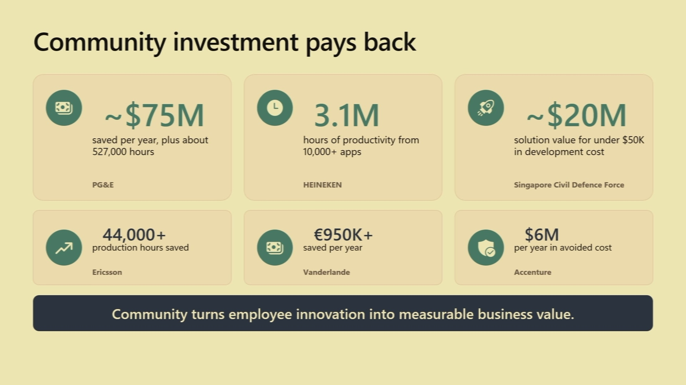
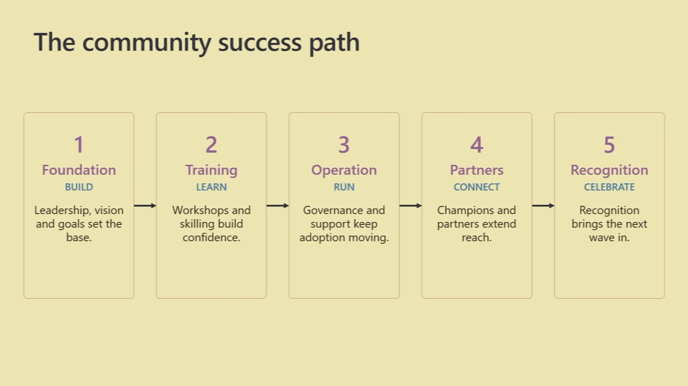
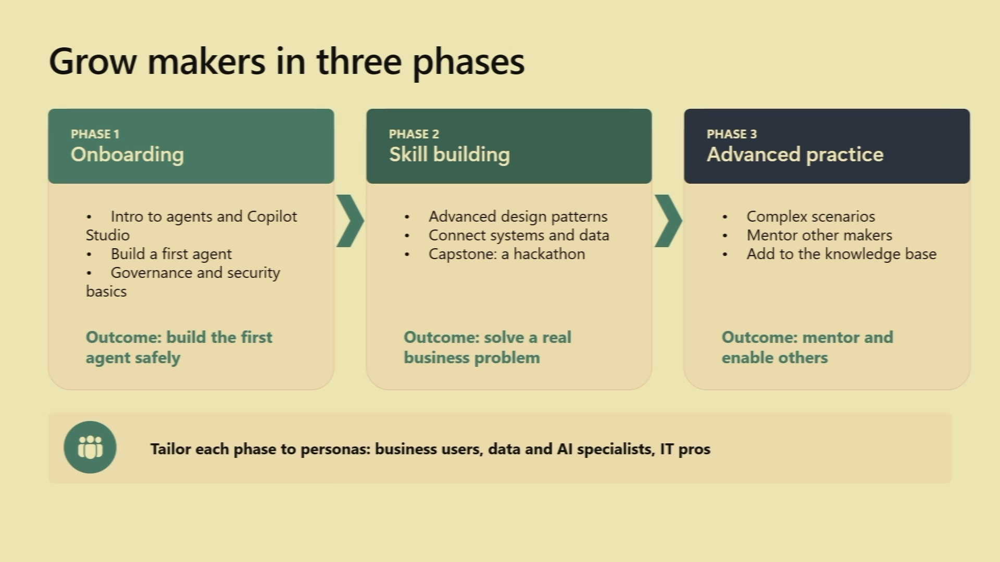
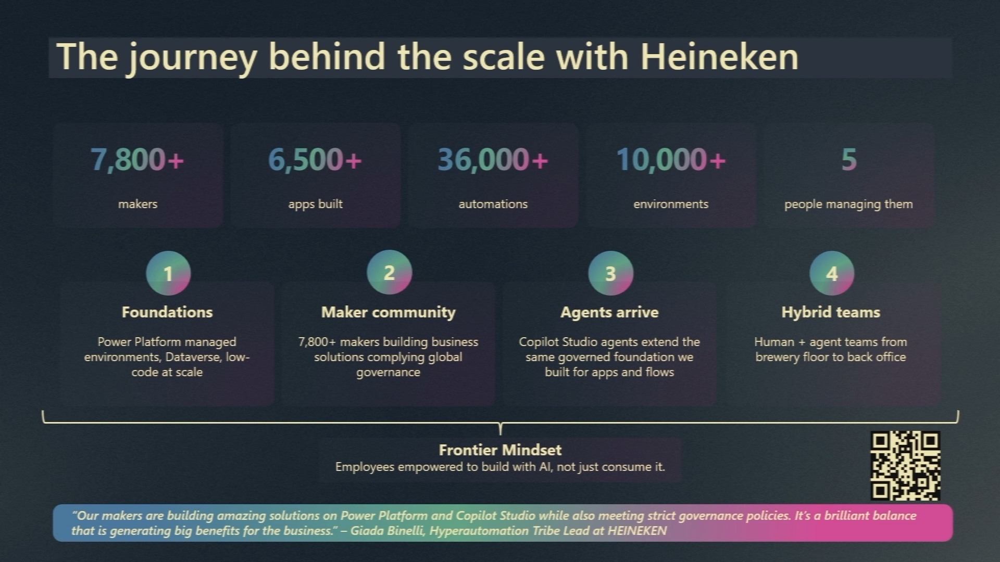

## #week-two-cliff-and-spark 01 / Beyond the Week-Two Cliff :: 跨越“第二周采纳悬崖”：单打独斗造不出规模，单次活动也不等于社区 || Surviving the Week-Two Adoption Cliff: Why Solo Agents and Launch Events Fall Short

企业在引入 Microsoft Copilot Studio 时几乎都会撞上同一个衰减周期：新工具刚发布的首周到第二周全员兴致高涨，紧接着在第三周迎来断崖式降温 [1]。统管微软全球 Copilot Studio、Power Platform 与 Dynamics 365 社区生态的 David Abu 在 THR1021 开场便指出了病根——抱着“我造了一个很酷的智能体，全公司都该来用”的技术本位心态，永远无法跑通规模化采纳；同样，声称公司内部某个群组里有 5,000 名成员，也绝不代表这群人真正产出了可度量的商业回报 [1][2]。 || Enterprise rollouts of Microsoft Copilot Studio routinely hit the same wall: excitement peaks during the first two weeks and drops sharply in week three [1]. Opening THR1021, Microsoft Global Community Lead David Abu explained why top-down broadcasts ("I built something cool, everyone should use it") and 5,000-member vanity chat groups fail to deliver durable business outcomes [1][2].

要打破“两周退潮”，首先必须把**火花（The Spark）**与**引擎（The Engine）**彻底区分开来 [1][2]。许多转型负责人谈起社区建设，第一反应就是筹备一场宣讲会（Meetup）、动手工作坊或黑客松，随后把两千名听众塞进新建的聊天频道；结果员工当天在多个社交平台与内部邮件里同时收到三四条入群链接，热闹散去后便彻底失联 [1]。David Abu 结合十年间在非洲运营超万人技术社区的一线经验反复强调：**活动只能点燃早期热情，活动本身绝不会自动长成社区** [1][2]。唯有在火花之后接上由先锋答疑（Office Hours）、活跃问答论坛与同侪带教组成的长效引擎，零散创意才能转化为经得起审计的财务收益 [1][2]。在微软披露的客户账本中，新加坡民防部队以不到 5 万美元的开发成本撬动约 2,000 万美元方案价值；爱立信累计节省超 44,000 个生产工时，范德兰德（Vanderlande）年省逾 95 万欧元，埃森哲每年规避 600 万美元成本 [2]。农机巨头爱科集团（AGCO）则从约 900 名主动举手的志愿骨干起步，裂变出约 2,000 名创作者并将数百个企业级智能体推入生产环境，证明公民开发“不是影子 IT，而是一线赋能支持” [1][2]。 || Breaking that cycle starts by separating **the spark** from **the engine** [1][2]. Leaders often equate community with hosting a launch meetup or hackathon and inviting 2,000 attendees into a fresh chat channel—only to watch participation vanish amid competing social links [1]. Drawing on a decade growing a 10,000-member African tech community, Abu stressed a hard rule: **events create energy, never community** [1][2]. Sustaining momentum requires an engine of Champion office hours, active forums, and peer mentoring that converts experimentation into audited financial returns [1][2]. Across Microsoft's customer ledger, the Singapore Civil Defence Force unlocked ~$20M in solution value for under $50K in build cost, while Ericsson saved 44,000+ production hours, Vanderlande saved €950K+ annually, and Accenture avoided $6M per year [2]. Similarly, AGCO grew ~900 volunteer leaders into ~2,000 makers running several hundred production enterprise agents—proving "it's not shadow IT—it's support" [1][2].

  <article class="thr1021-media-card" data-present-surface="unframed">
    

      
    

    

      THR1021 官方演讲实录画面 · 03:10
      <h4 data-zh="社区投入的商业回报账本：六家跨国机构实证" data-en="Community Investment Pays Back: Six Audited Customer Proof Points">社区投入的商业回报账本：六家跨国机构实证</h4>
      
汇总 PG&E、喜力、新加坡民防部队、爱立信、范德兰德与埃森哲的真实财务节省与生产力工时数据 [1][2]。

    

  </article>
  <article class="thr1021-media-card" data-present-surface="unframed">
    

      
    

    

      THR1021 官方演讲实录画面 · 06:40
      <h4 data-zh="微软社区成功路径五阶段：筑基、育人、运营、结盟与表彰" data-en="The Five-Stage Community Success Path: Build, Learn, Run, Connect, Celebrate">微软社区成功路径五阶段：筑基、育人、运营、结盟与表彰</h4>
      
串联目标愿景设定、分层实战培训、治理答疑运营、跨部门伙伴扩展与荣誉晋升闭环 [1][2][3]。

    

  </article>

下方交互导览台集成了 THR1021 官方点播视频流、Microsoft Learn 社区构建指南直链，以及严格对齐演讲实录的五段核心时间轴；点击顶部章节标签即可逐段核验客户案例细节与落地节拍 [1][2]： || The interactive theater below pairs the official Medius video stream and Microsoft Learn playbook with five timestamped chapters mapped directly to David Abu's talk [1][2]:

:::sandbox { id: "thr1021-video-theater", canvas: false, script: "./thr1021-session.js", style: "./thr1021-session.css", title: "THR1021 官方点播视频与五段核心议题时间轴导览 || THR1021 Official On-Demand Stream & Five-Chapter Timestamp Navigator", desc: "按时间轴切换查阅火花与引擎辨析、目标筑基与三阶育人、先锋答疑与原生平台、伙伴护栏与 90 天冷启动计划，支持页内加载官方播放器。 || Switch across the five timestamped chapters, load the embedded Microsoft Medius player on demand, or jump to the official Microsoft Learn playbook." }
纯静态点播与议题导览沙盒：内置 THR1021 官方高清封面图、五段精确到秒的实录提要及官方视频与 Microsoft Learn 手册直链。 || Pure static session theater featuring the official THR1021 HD cover, five timestamped chapter digests, and direct stream/Learn links.
:::

## #foundation-and-cohort-skilling 02 / Foundation & Three-Phase Skilling :: 先立业务指标再点火花：从 1 人起步的三阶育人与“学徒变讲师”裂变 || Goals Before Events: Starting Small and Designing Cohorts That Graduate Teachers

既然内部社区常被员工视作“本职工作之外的额外负担”，怎样才能拿到管理层的持续预算与绿灯？THR1021 五阶段路径的第一环**筑基（Foundation · Build）**给出了硬前置条件：在策划任何一场活动之前，先把社区使命压缩成一句话，并将员工掌握可迁移 AI 技能的个人诉求锚定到企业降本增收的战略目标上（例如明确写下“6 个月培育 100 名新创作者、年底累计节省 500 工时”）[1][2]。许多团队害怕“2 个人的冷清小组永远长不到上万人”而迟迟不敢动身，但正方经验恰恰相反——**如果不从第 1 个人开始并交付早期量化战果，你永远走不到 500 人** [1]。壳牌（Shell）最初只立下培训 500 名自主开发者的朴素基线，最终裂变出超过 4,000 名活跃创作者 [2]。太平洋煤电（PG&E）更是仅凭 **3 人组成的卓越中心（CoE）** 培训出 1,300 名“数字创作者”，配合年度大会与黑客松支撑起全公司 4,300+ 名创作者生态，每年节省约 52.7 万工时与约 7,500 万美元成本 [1][2]。 || Because employees often view community work as unpaid effort outside their day jobs, winning leadership sponsorship requires **Foundation (Build)** before scheduling any meetup [1][2]. Teams must distill their mission into one sentence and tie personal AI skill growth to organizational targets—such as onboarding 100 new makers in six months and saving 500 hours by year-end [1][2]. Leaders intimidated by scaling from two colleagues to thousands should remember Abu's blunt axiom: **you never reach 500 without starting from one** [1]. Shell set out to train 500 DIY developers and grew past 4,000 active makers [2]. Similarly, **PG&E** relied on a **three-person Center of Excellence** to train 1,300 Digital Creators—supporting 4,300+ makers company-wide while saving ~527,000 hours and ~$75M every year [1][2].

:::figure { src: "./media/thr1021-community-adoption-flywheel.figure.json", title: "THR1021 企业级社区驱动 Copilot Studio 规模化采纳飞轮架构 || THR1021 Community-Led Copilot Studio Adoption Flywheel Architecture" }
图 1：对照 THR1021 官方五阶段模型绘制的端到端运营飞轮——顶层以业务指标牵引三阶分层培训与四类目标匹配活动；中层依托先锋答疑、员工原生协作工具与产品级四维度量承接日常留存；底层联合四维跨部门伙伴并通过四阶荣誉晋升将新成员转化为下一代带教先锋 [1][2][3]。 || Figure 1: End-to-end THR1021 community flywheel linking goal-aligned three-phase skilling and targeted events at the top, Champion office hours + native M365 platforms + product telemetry in daily operations, and four-role partner coalitions + member-to-leader recognition underneath [1][2][3].
:::

进入第二环**培训（Training · Learn）**后，创作者能力必须面向业务用户、数据与 AI 专家以及 IT 专业人员做差异化裁剪，按三个递进阶段稳步爬坡，并将四类线下/线上活动精准卡位到不同转化目标上（德国铁路 Deutsche Bahn 的内部需求印证了这一渴望——其放出的 2,000 余场培训席位在短短 7 小时内即被抢订一空）[1][2]： || In Stage 2, **Training (Learn)** tailors curricula across business users, data/AI specialists, and IT pros through three progressive phases while matching event formats strictly to outcomes (demand is rarely the bottleneck: Deutsche Bahn's 2,000+ training sessions booked out in just seven hours) [1][2]:

- **第一阶段 · 安全启蒙（Onboarding）**：讲透智能体与 Copilot Studio 核心概念、连接治理与安全底线，指导学员亲手构建第一个受控个人助手，配合 1–2 小时的**分享会（Meetup）**用真实演示唤起认知 [2][3]。 || **Phase 1 · Safe Onboarding**: Introduce Copilot Studio fundamentals and security/governance basics so makers safely build their first agent, paired with 1–2 hour **Meetups** featuring peer demos and stories to spark awareness [2][3].
- **第二阶段 · 技能实战（Skill Building）**：深入高阶设计模式与跨业务系统数据接入，通过半天以上的**动手实验营（Workshop）**练兵，并以 1–2 天的**黑客松（Hackathon）**作为结业大考，真正解决一个部门级业务痛点 [2][3]。 || **Phase 2 · Applied Skill Building**: Advance into design patterns and live data connections through half-day hands-on **Workshops**, culminating in a 1–2 day capstone **Hackathon** solving real business bottlenecks [2][3].
- **第三阶段 · 导师反哺（Advanced Practice）**：攻克复杂多系统场景、沉淀内部知识库并带教新晋创作者，辅以年度**成果展（Showcase）**表彰标杆 [2]。北美保险巨头 **State Farm** 把“让每一期培训班自动产出下一批新讲师”做成了标准范式：围绕负责任 AI 工作坊、日常答疑与实战建造赛（单场最高吸引 150 人参会），引导学员拾级而上晋升为带教先锋，经严格风险评审后已有 41 个构建方案正式投产，甚至将内部翻译周转周期从 **12 个月直接压缩至 24 小时** [1][2]。 || **Phase 3 · Advanced Practice & Teaching**: Tackle complex scenarios, enrich shared knowledge hubs, and mentor peers ahead of annual **Showcases** [2]. Insurer **State Farm** engineered its Responsible AI workshops (up to 150 attendees), office hours, and build-a-thons so every cohort produces new teachers—placing 41 risk-reviewed builds into production and slashing translation turnaround from **12 months to 24 hours** [1][2].

  <article class="thr1021-media-card" data-present-surface="unframed">
    

      
    

    

      THR1021 官方演讲实录画面 · 08:55
      <h4 data-zh="三阶创作者培育阶梯：从安全首建到反哺带教" data-en="Grow Makers in Three Phases: Safe First Build to Peer Mentoring">三阶创作者培育阶梯：从安全首建到反哺带教</h4>
      
按业务人员、数据/AI 专家与 IT 角色分层定制课程，确保每阶输出明确业务成果与新讲师梯队 [1][2]。

    

  </article>
  <article class="thr1021-media-card" data-present-surface="unframed">
    

      
    

    

      THR1021 官方演讲实录画面 · 14:35
      <h4 data-zh="喜力规模化演进全景：5 名管理员支撑 7,800+ 创作者" data-en="Heineken Scale Journey: 5 Admins Governing 7,800+ Makers & 10,000+ Environments">喜力规模化演进全景：5 名管理员支撑 7,800+ 创作者</h4>
      
在既有 Power Platform 托管环境与 Dataverse 治理底座上平滑延展 Copilot Studio 人机混合团队 [1][2]。

    

  </article>

## #operations-and-native-platforms 03 / Sustained Operations & Native Platforms :: 靠同侪答疑留住日常温度：转化“有话语权的质疑者”并严守原生协作阵地 || Sustaining Momentum Between Events: Vocal Skeptics as Champions and Zero-Friction Platforms

两次大型活动之间的漫长空窗期，才是检验社区生死的真正考场 [1][2]。在第三环**运营（Operation · Run）**中，微软提倡依靠四项日常机制维持热度：由先锋轮值主持的开放答疑时间（Office Hours）、高频响应的社区问答论坛、结对同侪辅导以及短平快的成员微展示 [2][3]。在招募早期先锋时，David Abu 分享了一条极具反常识洞察的实战秘诀——**重点去争取那些起初明确拒绝参加社区、抱怨“我根本没空搞这些”，但在业务团队内部极具话语权与威望的骨干** [1]。一旦用解决实际痛点的能力打动这批“清醒的质疑者”，他们往往会变成最坚定、最具号召力的长期答疑护旗手 [1]。德国汽车零部件巨头**采埃孚（ZF Group）**正是凭借这套同侪互助杠杆，用区区 **20 人的中央团队**撬动了全集团 **37,000 名活跃用户**与 **25,000+ 个自建应用**：通过搭建统一社区门户、培育互助型公民专家（Citizen Pros）并开展“5 天交付可用原型”的融合工作坊（Fusion Workshops），门户上的求助帖通常在数小时内就会被其他一线开发者解答完毕 [1][2]。 || Momentum lives or dies in the quiet weeks between flagship events [1][2]. Stage 3, **Operation (Run)**, anchors engagement around four steady habits: Champion-hosted office hours, active Q&A forums, peer mentoring, and brief member showcases [2][3]. When recruiting initial Champions, Abu shared a counterintuitive field tactic: **actively court influential colleagues who initially push back and claim they have no time for community** [1]. Winning over respected skeptics turns the loudest doubters into your most credible evangelists [1]. Automotive supplier **ZF Group** proved how peer support multiplies a lean core team: just **20 central staff** support **37,000 active users** and **25,000+ built apps** via a central hub, five-day prototype Fusion Workshops, and "Citizen Pros" who answer peer questions within hours [1][2].

与此同时，社区运营必须像打磨正式软件产品一样建立四维量化看板——同步追踪**触达广度（Reach）**、**留存活跃度（Engagement）**、**技能层级分布（Skills）**与**生产环境节省工时（Business Impact）**，用“第二季度三场活动培育 75 名新创作者、活跃用户从 50 人增至 85 人”这类增量战报取代空洞口号 [2][3]。在选择日常交流阵地时，铁律只有一条：**永远到员工已经在用的工具里去见他们（Always meet them where they are）** [1][2]。如果团队全天泡在 Microsoft Teams 里办公，绝不要因为组织者偏爱外部聊天软件就强迫全员跨平台搬家——强行迁移只会瞬间流失绝大部分受众 [1]。官方推荐直接组合现成的 Microsoft 365 套件各司其职：**Viva Engage** 承载开放论坛与活动报名，**SharePoint** 沉淀知识库与成功案例，**Microsoft Teams** 开展直播实训与项目协作，**Microsoft Forms** 收集活动反馈与脉搏问卷 [2]。电信企业 **Lumen** 的全公司创作者社区如今汇聚逾 7,800 名创作者，最初正是由单一一个 Teams 频道生根发芽而来 [1][2]。 || Equally critical, community leads must **measure the program like a product** across **Reach**, **Engagement**, **Skills**, and **Business Impact**—reporting concrete deltas such as *"Three Q2 events trained 75 new makers; active users grew from 50 to 85"* [2][3]. Tooling discipline is just as unforgiving: **always meet employees where they already work** [1][2]. Forcing Microsoft Teams-native staff onto external chat apps guarantees instant drop-off [1]. Instead, map native Microsoft 365 surfaces cleanly: **Viva Engage** hosts open forums and RSVPs, **SharePoint** anchors knowledge hubs, **Microsoft Teams** runs live labs, and **Microsoft Forms** captures pulse surveys [2]. Telecom provider **Lumen** proved this model at scale, growing a company-wide network of 7,800+ makers from a single Teams channel [1][2].

:::figure { src: "./media/thr1021-lean-team-enterprise-scale.figure.json", title: "极简核心团队撬动全企规模化采纳：THR1021 标杆企业实证象限 || Lean Central Teams Scaling Enterprise Adoption: THR1021 Customer Evidence Matrix" }
图 2：THR1021 核心客户案例的组织杠杆对比——左上象限以 State Farm 与 AGCO 代表种子裂变与一线志愿转正，右上象限汇聚 PG&E（3 人撬动 4,300+ 人）、喜力（5 人纳管 7,800+ 人）、采埃孚（20 人服务 3.7 万人）与 Hiscox（采纳率飙至 74%）的精益复利飞轮，直观反衬右下角“先办大会强拉死群”的次周退潮陷阱 [1][2]。 || Figure 2: Customer leverage quadrant contrasting State Farm and AGCO seed incubators (top-left) and PG&E, Heineken, ZF Group, and Hiscox enterprise flywheels (top-right) against isolated solo builds and event-first chat sprawl [1][2].
:::

## #partners-recognition-and-90day-plan 04 / Partner Coalitions, Guardrails & 90-Day Plan :: 四维伙伴结盟与护栏放权：从喜力、Hiscox 到 90 天冷启动四步法 || Partner Coalitions, Guardrailed Trust, and Your 90-Day Starter Plan

要让部门级试点真正升级为席卷全企业的数字化运动，单靠社区牵头人孤军奋战远远不够，必须走通第四环**伙伴结盟（Partners · Connect）**与第五环**荣誉认可（Recognition · Celebrate）** [1][2]。微软将跨部门同盟拆解为四类互补角色：由 **IT 安全团队**与**数据分析部门**共同担任“治理伙伴（Governance Partners）”，筑牢环境与数据防线；由**各业务单元**担任“业务伙伴”，锁定高价值痛点；由 **Microsoft 365 先锋群体**担任“促活伙伴”；再邀请**高管赞助人（Executive Sponsors）**公开站台定调，并联动外部用户组与微软 MVP 拓宽视野 [1][2]。在此基础上，通过聚光灯专访、技能徽章与影响力故事构建四阶晋升通道，把**新成员（Step 1）**逐步托举为**活跃创作者（Step 2）**、**带教先锋（Step 3）**乃至统筹跨区域分会的**社区领袖（Step 4）** [1][2]。 || Scaling a grassroots initiative into an enterprise movement requires Stage 4, **Partners (Connect)**, and Stage 5, **Recognition (Celebrate)** [1][2]. Microsoft maps four complementary partner roles: **IT & Security** alongside **Data & Analytics** as governance partners, **Business Units** scoping priority workflows, **Microsoft 365 Champions** driving engagement, and visible **Executive Sponsors** plus external **User Groups / MVPs** lending authority and reach [1][2]. Structured recognition—spotlights, badges, and impact stories—then elevates contributors up a four-step ladder from **New Member** to **Active Maker**, **Champion**, and chapter-coordinating **Community Leader** [1][2].

| 标杆企业与核心团队规模 || Enterprise Case & Central Team | 社区与治理协同机制 || Community & Governance Mechanism | 活跃创作者与方案沉淀规模 || Maker & Solution Footprint | 经审计的业务与效率产出 || Audited Business & Productivity ROI |
|------|------|------|------|
| **PG&E（太平洋煤电）** · 3 人 CoE || **PG&E** · 3-Person CoE | 培训认证“数字创作者”，举办内部年度大会与 AI 黑客松 [1][2] || Certified "Digital Creators" backed by annual conference & AI hackathon [1][2] | 1,300 名受训骨干支撑全公司 **4,300+ 名创作者** [2] || 1,300 trained creators supporting **4,300+ makers** [2] | 每年节省约 **527,000 工时**，年化直接成本节约约 **7,500 万美元** [1][2] || Saves **~527,000 hours** and **~$75M** per year [1][2] |
| **Heineken（喜力）** · 5 名管理员 || **Heineken** · 5 Admins | 基于 Power Platform 托管环境与 Dataverse 治理底座延展人机混合团队 [2] || Power Platform Managed Environments + Dataverse foundation for hybrid teams [2] | **7,800+ 名创作者**跨 **10,000+ 环境**构建 6,500+ 应用与 36,000+ 自动化 [2] || **7,800+ makers** across **10,000+ environments** (6,500+ apps, 36,000+ flows) [2] | 从酿造车间到后台全面赋能员工自建 AI，累计释放 **310 万生产力工时** [2] || Unlocks **3.1M hours** of productivity from 10,000+ solutions [2] |
| **ZF Group（采埃孚）** · 20 人中央团队 || **ZF Group** · 20 Central Staff | 搭建社区门户与 Citizen Pros 同侪答疑机制，5 天融合工作坊快速出原型 [1][2] || Community hub + Citizen Pros peer answers within hours + 5-day Fusion Workshops [1][2] | 同侪互助网络覆盖 **37,000 名活跃用户**，累计构建 **25,000+ 个应用** [1][2] || Peer-supported network of **37,000 active users** and **25,000+ apps built** [1][2] | 一线问题在数小时内由同侪闭环解答，以极小编制服务数万员工 [1][2] || Resolves maker blockers in hours without central IT bottlenecks [1][2] |
| **Hiscox（希思科保险）** · Citizen AI 项目 || **Hiscox** · Citizen AI Hub | 启动 Citizen AI 计划培训 3,000+ 人，并用 **Agent 365** 统一纳管自建智能体 [1][2] || Launched Citizen AI hub, trained 3,000+ staff, and governed builds via **Agent 365** [1][2] | 约 3,500 名员工自主构建 **6,000+ 个受控智能体**（沙盒实验态未盲目外放）[2] || ~3,500 employees built **6,000+ governed agents** (safely bounded) [2] | Copilot 采纳率从 **4% 飙升至 74%**，平均每人每周节省 **2–5 小时** [1][2] || Copilot adoption surged **4% → 74%**, saving **2–5 hours/person/week** [1][2] |
| **State Farm & AGCO** · 先锋梯队 || **State Farm & AGCO** · Cohorts | State Farm 负责任 AI 工作坊 + 风险评审；AGCO 激活一线举手志愿者 [1][2] || State Farm Responsible AI risk review; AGCO volunteer leader network [1][2] | State Farm 41 项过审投产；AGCO 从 ~900 志愿者壮大至 **~2,000 创作者**与数百生产智能体 [1][2] || State Farm: 41 prod builds; AGCO: **~2,000 makers** & hundreds of prod agents [1][2] | State Farm 翻译周转从 **12 个月缩至 24 小时**；AGCO 消除影子 IT 对立 [2] || Cut translation turnaround **12 mo → 24h**; turned shadow IT into governed support [2] |

上表中**喜力（Heineken）**与**希思科（Hiscox）**的对比尤为值得企业架构师深思：喜力之所以只用 **5 个人**就能稳稳管住 10,000 多个环境与 7,800 多名创作者，是因为他们把早年为低代码应用与自动化流打磨成熟的 Power Platform 托管环境及 Dataverse 全局治理框架，原封不动地复用到从酿酒车间延伸至后台职能的 Copilot Studio 人机混合团队上 [2]；而 Hiscox 之所以敢放心让约 3,500 名员工动手试验出 6,000 多个智能体、把全公司采纳率从 **4% 一举拉升到 74%**，核心同样在于配套了 **Agent 365** 控制机制与清晰护栏——信任员工亲手构建能力，同时用透明治理兜底风险 [1][2][4]。在专场收官之际，David Abu 将整套方法论浓缩为任何组织下周即可启动的 **90 天社区冷启动四步路线图**，并特意提醒听众注意“办活动”被刻意推迟到了第三顺位 [1][2][3]： || **Heineken** and **Hiscox** illustrate how governance and grassroots trust reinforce each other: Heineken manages 10,000+ environments and 7,800+ makers with just **five administrators** by extending its battle-tested Power Platform Managed Environments and Dataverse governance directly to Copilot Studio human-agent teams [2], while Hiscox vaulted adoption from **4% to 74%** by pairing its Citizen AI training hub with **Agent 365** guardrails so ~3,500 employees could safely build 6,000+ agents [1][2][4]. Closing the session, Abu distilled everything into a **four-step 90-day starter plan**, explicitly pointing out that hosting events sits third—never first [1][2][3]:

:::flow { title: "THR1021 企业级 Copilot Studio 社区 90 天冷启动四步路线图 || THR1021 Four-Step 90-Day Copilot Studio Community Starter Plan" }
1. **第 1 步 · 组建极简核心组（A Small Core Team） || Step 1 · A Small Core Team** — 正式任命 **2–3 名社区牵头人**并锁定 **1 位高管赞助人**，在首日即写清一句话使命与对齐业务优先级的量化基线指标 [1][2][3]。 || Name **2–3 community leads** alongside **one executive sponsor**, establishing a one-sentence mission and measurable business KPIs from day one [1][2][3].
2. **第 2 步 · 孵化带教型先锋（Champions Who Teach） || Step 2 · Champions Who Teach** — 招募早期志愿骨干与有影响力的业务能手，精心设计培训机制，确保**每一期学员班都能自动裂变出下一批能授课、能坐镇答疑的讲师**，彻底告别牵头人单兵授课瓶颈 [1][2][3]。 || Recruit respected voices and structure cohorts so **every learning wave produces new teachers and Office Hours hosts**, removing reliance on solo organizers [1][2][3].
3. **第 3 步 · 建立稳态活动节拍（A Steady Event Rhythm） || Step 3 · A Steady Event Rhythm** — 拒绝运动式透支，保持**每季度至少一场目标明确的活动**（按需匹配 Meetup、实操工作坊或黑客松），每次活动后向管理层刚性汇报新增创作者、生产方案数与节省工时 [1][2][3]。 || Run **one purposeful event per quarter** matched to your current goal—never leading with unanchored hype—and report hard adoption and hours-saved metrics afterward [1][2][3].
4. **第 4 步 · 扎根员工原生协作工具（Tools Employees Already Use） || Step 4 · Tools Employees Already Use** — 直接在员工每天打开的 **Teams、Viva Engage、SharePoint 与 Forms** 中开启答疑、沉淀案例并颁发荣誉徽章，零迁移阻力推动采纳飞轮持续滚大 [1][2][3]。 || Anchor daily forums, Office Hours, and recognition spotlights inside **Teams, Viva Engage, SharePoint, and Forms** where employees already collaborate every day [1][2][3].
:::

正如 David Abu 在发布配套 Microsoft Learn 开源手册《Build thriving Copilot Studio communities》时所总结的那样：规模化采纳从来不是单靠技术更迭自然发生的奇迹——从小处着眼，从第 1 个举手的人起步，激活第一批愿意带教同侪的先锋，并从第一天起用真实的工时与财务结果说话，任何企业都能把两周即逝的新鲜感锻造成长效运转的智能体创新引擎 [1][2][3]。 || As Abu concluded while unveiling his companion Microsoft Learn guide, *Build thriving Copilot Studio communities*, enterprise adoption never happens by shipping software alone: start small, activate your first teaching Champions, and measure business outcomes from day one to turn fleeting launch excitement into a compounding innovation engine [1][2][3].

## 参考资料：官方一手信源与实战指南 || References: Official Primary Sources & Adoption Playbooks

1. **David Abu (Microsoft Ignite 2026 Video & Bilingual Captions)** — https://ignite.microsoft.com/en-US/sessions/1787856601105001EEot-1791588257574001Cxwy | 《Scaling Copilot Studio Adoption Through Community-Led Agent Building》剧场专场官方点播页与中英双语实录字幕（2026-11-20） || Official Ignite 2026 theater session page and word-for-word bilingual captions (Nov 20, 2026)
2. **David Abu (Ignite 2026 Medius On-Demand Stream & Customer Evidence Slides)** — https://medius.microsoft.com/Embed/video-nc/94421f2b-19dc-4225-8b67-aed713685a76 | 专场官方高清点播视频流及全套微软社区架构与客户案例胶片（涵盖太平洋煤电、喜力、State Farm、采埃孚、爱科集团、Lumen 与希思科实证数据） || Official Medius stream capturing the five-stage community framework and audited enterprise customer slides
3. **Build Thriving Copilot Studio Communities (Microsoft Learn Official Playbook)** — https://aka.ms/BuildMakerCommunity | David Abu 在 THR1021 专场发布的微软官方创作者社区建设全指南（使命目标、三阶培训、先锋运营与 90 天冷启动模板） || Official Microsoft Learn framework referenced in THR1021 for building, operating, and measuring maker communities
4. **Microsoft Copilot Studio Adoption, Security & Agent Governance Guidance** — https://learn.microsoft.com/en-us/microsoft-copilot-studio/guidance/ | 微软官方 Copilot Studio 企业级采纳路径、托管环境治理与卓越中心（CoE）协同架构文档 || Official Microsoft Copilot Studio adoption, Managed Environments, and CoE implementation guidance
