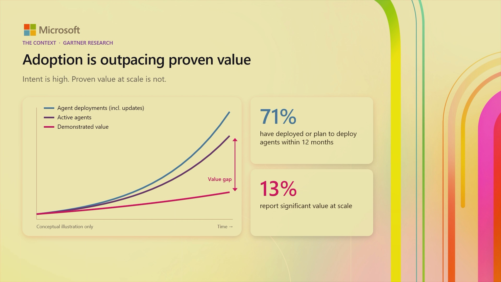
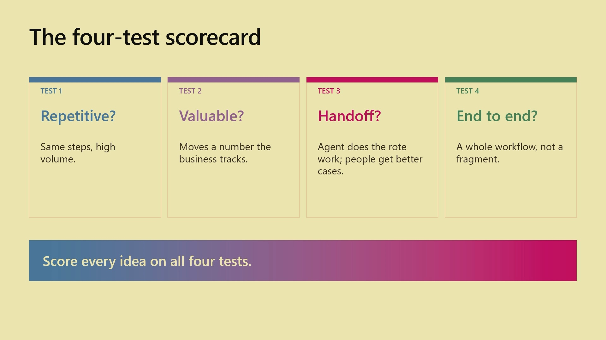
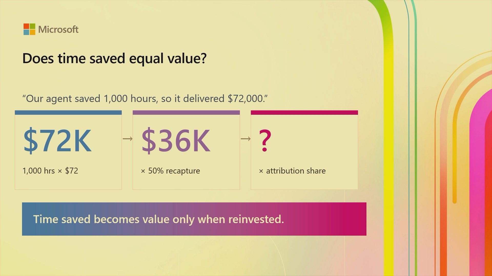
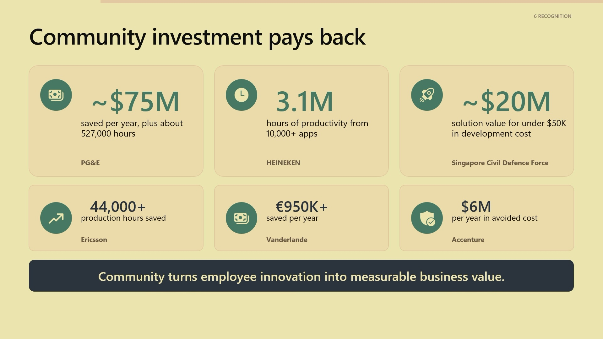
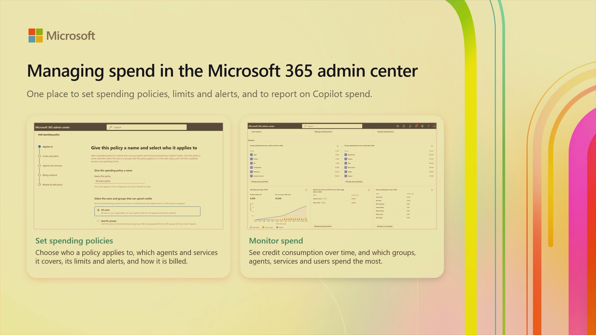

## #value-gap-and-choose 01 / Closing the 71%–13% Gap :: 拒收脱离业务的“智能体点子”：断裂工作流准入与四测计分卡 || Stop Asking for Agent Ideas: Broken-Workflow Intake & the Four-Test Scorecard

许多高管推动产品采纳的第一反应是“办一场内部黑客松或创新日”，但热闹的活动现场往往陷入“员工一拥而入、赛后一哄而散”的怪圈 [1]。把社区激发的原型真正搬进生产系统，面对的是两道截然不同的现实拷问：一线创作者手握 50 份参赛提案，不知挑哪几个才能跑出真实回报；预算赞助人则直接追问每一笔许可与研发投入究竟换回了什么商业结果 [1]。Gartner 调研数据印证了这种结构性错位——尽管 **71%** 的受访组织已在或计划于 12 个月内部署智能体，真正跑出规模化显著商业价值的却只有 **13%** [1][2]。问题早已不是“团队会不会搭建智能体”，而是为什么精心挑出的前 5 名或前 10 名试点，推向生产后依然大面积折戟 [1][2]。 || Executive sponsors frequently equate internal hackathons with product adoption, yet one-off events suffer from a "rush-in, rush-out" cycle that leaves daily operations unchanged [1]. Moving community prototypes into production forces two hard questions: builders must pick winners out of 50 submissions, while sponsors demand concrete return on investment [1]. Gartner research captures this chasm—**71%** of organizations have deployed or plan to deploy agents within 12 months, whereas only **13%** report significant value at scale [1][2]. Building agents is no longer the bottleneck; selection fails when teams optimize for flashy demos instead of production workflows [1][2].

  <article class="thr1022-media-card" data-present-surface="unframed">
    

      
    

    

      THR1022 官方演讲实录画面 · 03:24
      <h4 data-zh="采纳速度远超价值兑现：71% 部署意向与 13% 规模化回报鸿沟" data-en="Adoption Outpaces Proven Value: 71% Intent vs. 13% Value at Scale">采纳速度远超价值兑现：71% 部署意向与 13% 规模化回报鸿沟</h4>
      
部署数量与活跃曲线攀升并不自动转化为商业回报，弥合中间的“价值缺口”需重构准入立项标准 [1][2]。

    

  </article>
  <article class="thr1022-media-card" data-present-surface="unframed">
    

      
    

    

      THR1022 官方演讲实录画面 · 10:28
      <h4 data-zh="四项测试计分卡：每份立项提案必须全项通关的四道筛子" data-en="The Four-Test Scorecard: Repetitive, Valuable, Handoff & End-to-End">四项测试计分卡：每份立项提案必须全项通关的四道筛子</h4>
      
剔除每季度才用一次的低频伪需求与遗留手工尾巴的半截工程，确保智能体接管机械活并跑通全链路 [1][2]。

    

  </article>

David Abu 用两个极具现场感的反面案例点破了立项失败的病根 [1]。第一个误区是**征集空泛的“智能体点子”**：数据分析师打开对话框输入“请给我列 10 个适合分析师的智能体创意”，随后把生成的清单原封不动甩给研发同事代工；哪怕研发把这 10 个智能体全做出来，它们也根本嵌不进提交人眼下真实的日常工序 [1]。第二个误区是**盲目跟风与半截自动化**：有人看完单人智能体编排演示后张口索要“4 个 Autopilot”，却忽略了只需 1 个主控编排器即可统管下游子智能体；更致命的是，某条原本横跨多套工具的繁琐流程，自动化后如果还留着最后两步要员工手动补填，一线人员用不了几次就会彻底弃用 [1][2]。 || Abu illustrated why demo-driven selection collapses using two field anti-patterns [1]. First, employees prompt Copilot for "10 agent ideas for a data analyst" and hand that generic list to an engineer—even if all ten get built, none fix the requester's actual daily bottleneck [1]. Second, teams chase novelty or stop short of full completion: one colleague demanded "four Autopilots" when a single orchestrator manages downstream agents, and cross-tool automations that leave the final two steps manual get abandoned almost immediately [1][2].

要让原型真正走通生产环境，企业必须把立项提问从“你想做什么智能体”彻底改写为“**你眼下哪条现有工作流是断裂的**”，并按投资组合（Portfolio）而非孤立演示来分配资源 [1][2]： || Shipping to production requires replacing "what agent should we build?" with **"what is your current broken workflow?"**, managing candidates as a balanced portfolio rather than a string of demos [1][2]:

:::figure { src: "./media/thr1022-portfolio-priority-quadrant.figure.json", title: "THR1022 社区提案到生产投产的四象限组合配比矩阵 || THR1022 Community-to-Production Portfolio Prioritization Matrix" }
图 1：对照 THR1022 官方投资组合模型绘制的四象限筛选矩阵——优先资助 3–5 项低投入高影响的“速赢（Quick Win）”建立早期实证，搭配 1–2 项设好阶段门禁的“战略投资（Strategic Investment）”；将脱离痛点的尝鲜需求压回“探索（Explore）”消解不确定性，对遗留手工断尾的高耗低效提案果断合并或叫停 [1][2]。 || Figure 1: Four-quadrant portfolio matrix adapted from THR1022—funding three to five low-effort, high-impact Quick Wins alongside one or two stage-gated Strategic Investments, while holding ambiguous requests in Explore and halting fragmented builds in Reconsider [1][2].
:::

下方点播导览台集成了 THR1022 官方剧场演讲视频流、官方逐字稿下载直链以及按演讲推进锚定的五段核心时间轴，点击顶部章节胶囊即可逐段核对原话细节与胶片论据 [1][2]： || The interactive session theater below pairs the official Medius video stream and downloadable transcript with five timestamped chapters mapped directly to David Abu's talk [1][2]:

:::sandbox { id: "thr1022-video-theater", canvas: false, script: "./thr1022-session.js", style: "./thr1022-session.css", title: "THR1022 官方点播视频与五段核心方法论时间轴导览 || THR1022 Official On-Demand Stream & Five-Chapter Timestamp Navigator", desc: "按时间轴切换核验 71% vs 13% 价值鸿沟、四测计分卡、工时再投资折算、采纳飞轮与下周一三步行动清单，支持页内加载官方 Medius 播放器。 || Switch across five timestamped chapters covering the Gartner gap, scorecard triage, ROI recapture math, habit flywheel, and Monday action plan." }
纯静态点播与议题导览沙盒：内置 THR1022 官方高清封面图、五段精确到秒的实录提要及官方视频与逐字稿直链。 || Pure static session theater featuring the official THR1022 HD cover, five timestamped chapter digests, and direct stream/transcript links.
:::

无论是划入“速赢”还是“战略投资”，每一份候选方案在立项评审会上都必须同时通过**四项测试计分卡（The Four-Test Scorecard）**的交叉核验 [1][2]： || Whether a candidate targets a Quick Win or a Strategic Investment, every proposal must pass all four checks on **The Four-Test Scorecard** with a business decision maker in the room [1][2]:

| 计分卡维度 || Scorecard Test | 核心判准与官方拷问 || Core Criterion & Session Diagnostic | 典型反例（一票否决） || Disqualifying Anti-Pattern | 生产准入达标画像 || Production-Ready Target |
|------|------|------|------|
| **测试 1：高频重复（Repetitive?）** || **Test 1: Repetitive?** | 相同步骤是否高频出现？每周至少遭遇 1–2 次才能积累可感知的速赢体感 [1][2] || Same steps, high volume—encountered once or twice every week [1][2] | 仅每季度或每三个月才触发一次（9 月交付、12 月才首次打开）[1] || Triggered once a month or once a quarter (built in September, unused until December) [1] | 团队每周反复执行、耗时数天至数周的标准业务流转 [1][2] || High-frequency weekly routine draining recurring team hours [1][2] |
| **测试 2：指标挂钩（Valuable?）** || **Test 2: Valuable?** | 能否拨动业务账本真实追踪的硬指标？没有绑定明确指标的方案一律免谈开发 [1][2] || Moves a number the business already tracks; no metric means no build [1][2] | 仅以“技术很酷”或模糊感受立项，无法关联周期、差错率或营收数字 [1][2] || Vague enthusiasm with zero connection to cycle time, error rate, or revenue [1][2] | 同时兼顾高管痛点（如首席财务官关注的结账瓶颈）与一线员工减负 [1] || Solves both executive bottlenecks (e.g., CFO reporting pain) and staff toil [1] |
| **测试 3：人机交接（Handoff?）** || **Test 3: Handoff?** | 智能体是否揽下枯燥繁琐的铺垫活，把上下文完整的高价值个案交还人类决策？[1][2] || Agent handles the rote work so people receive better, higher-value cases [1][2] | 机械甩锅或在高风险动作中剔除人工把关，导致返工与投诉升级 [2] || Blind automation on high-risk actions that triggers escalations and rework [2] | 清晰界定自主执行边界，智能体完成初筛汇总、人工聚焦复杂研判 [1][2] || Clear autonomy limits where rote prep feeds cleaner human judgment [1][2] |
| **测试 4：端到端闭环（End to end?）** || **Test 4: End to end?** | 是否贯通整条工作流，而不是只切出中间一小段碎片？[1][2] || Covers a whole workflow rather than an isolated middle fragment [1][2] | 跨多套系统自动化了前段，却仍留最后两步靠人工手填收尾 [1] || Automates middle steps across tools while leaving the final two steps manual [1] | 在智能体平台内重构完整闭环，彻底消除跨工具手工断尾 [1][2] || Reconstructs the complete workflow end to end without manual tail work [1][2] |

## #prove-value-and-roi 02 / Proving Net Business Value :: 戳破“省工时即赚钱”的账面泡沫：开工前五问、50% 回收率折算与全球客户实证 || Beyond Raw Hours Saved: Five Pre-Build Questions, 50% Recapture Math & Global Paybacks

选准工作流只是第一步；为什么许多团队明明算出了“节省工时”，向管理层汇报时依然拿不到扩编预算？THR1022 给出的诊断十分犀利：**省下的时间只有在被重新投入高价值产出时才构成商业价值**，直接拿“节省小时数 × 平均时薪”充当净收益，往往经不起财务审视 [1][2]。 || Selecting the right workflow is only half the battle; teams still lose executive backing when they equate raw hours saved with realized cash [1][2]. THR1022 draws a sharp financial line: **time saved becomes value only when reinvested**, and presenting gross labor-hour multiplication as net return rarely survives Chief Financial Officer scrutiny [1][2].

在写下第一行提示词或配置连接器之前，项目组必须先逐条回答**开工前定义价值的五道必答题（Define Value Before You Build）**：① 工作究竟在哪个环节变慢或出错？② 当前由谁执行，方案上线后角色分工发生什么变化？③ 准备改善哪项指标、提升幅度多少、何时兑现？④ 当前的量化**基线（Baseline）**是多少？⑤ 由谁负责阶段复盘，依据什么硬标准决定规模化扩推还是果断叫停 [1][2]？官方胶片在底部醒目警示：**“没有基线、没有责任人，试点就永远只是一场演示（No baseline, no owner: a pilot stays a demo）”** [2]。 || Before building anything, teams must lock down **five pre-build value questions**: (1) Where does work slow down or fail? (2) Who performs it today, and what changes? (3) Which metric moves, by how much, and by when? (4) What is the current baseline? (5) Who reviews progress, and what criteria decide scale or stop [1][2]? As Microsoft's framework slide warns: **"No baseline, no owner: a pilot stays a demo"** [2].

  <article class="thr1022-media-card" data-present-surface="unframed">
    

      
    

    

      THR1022 官方演讲实录画面 · 13:16
      <h4 data-zh="工时节省真的等于商业价值吗？从 7.2 万美元账面数字到再投资净值" data-en="Does Time Saved Equal Value? Discounting USD 72K via Recapture &amp; Attribution">工时节省真的等于商业价值吗？从 7.2 万美元账面数字到再投资净值</h4>
      
1,000 小时乘以 72 美元时薪得出的 7.2 万美元并非净回报，需依次乘以 50% 有效再投资回收率（折为 3.6 万美元）与归因份额 [1][2]。

    

  </article>
  <article class="thr1022-media-card" data-present-surface="unframed">
    

      
    

    

      THR1022 官方演讲实录画面 · 14:50
      <h4 data-zh="社区投入兑现真金白银：全球六大标杆组织生产级价值账本" data-en="Community Investment Pays Back: Six Enterprise Production Proof Points">社区投入兑现真金白银：全球六大标杆组织生产级价值账本</h4>
      
PG&amp;E 年省约 7,500 万美元、喜力超 10,000 个应用释放 310 万小时产能、新加坡民防部队以不到 5 万美元成本撬动约 2,000 万美元价值 [1][2]。

    

  </article>

顺着官方 ROI 折算模型拆解：假设某智能体一年帮团队节省 **1,000 小时**，按综合人力成本每小时 **`$72`** 计算，粗看似乎直接创造了 **`$72,000`** 收益 [1][2]。但在真实职场中，零散省下的几分钟不会百分百转化为新增业务产出——引入 **50% 生产力再投资回收率（Recapture Rate）** 后，有效价值立刻折半为 **`$36,000`**；若该流程优化还同步依赖了流程改制或配套软件升级，还需进一步乘以智能体本身的**归因权重（Attribution Share）** [2]。要想向管理层讲透立体的商业故事，团队不能只盯着“省了多少工时”这一根独木桥，而应同步对齐**四大商业价值驱动力（Four Drivers of Business Value）**：① **效率（Efficiency）**——返还工时，压降流转周期与单件成本；② **质量（Quality）**——减少人为差错，压低返工率与合规违约；③ **营收（Revenue）**——开拓增量商机，拉升客户留存与交叉销售；④ **战略（Strategic）**——提速管理层关键研判与市场响应速度 [1][2]。 || Walking through Microsoft's valuation formula: if an agent saves **1,000 hours** at **`$72`** per hour, the headline claim of **`$72,000`** overstates actual impact [1][2]. Applying a realistic **50% recapture rate** trims recoverable value to **`$36,000`**, which must then be multiplied by an **attribution share** reflecting how much improvement came from the agent versus concurrent process changes [2]. To build a resilient executive case, Abu pairs **Efficiency** (hours returned, cycle time, cost) with three additional value drivers: **Quality** (fewer errors, lower rework, compliance), **Revenue** (retention, cross-sell, new business), and **Strategic** impact (faster decision speed) [1][2].

与此同时，回答失准、反复返工与人工升级会直接侵蚀上述收益——正如官方援引 Microsoft Learn 的定调：**“治理绝不是叠加在投资回报率之上的额外税负，而是投资回报率得以成立的底座”** [2][4]。然而行业现状显示，目前仅有 **21%** 的组织制定了智能体治理框架，而在这些已建框架的企业里，也只有 **43%** 纳入了明确的生命周期或下线退役标准 [2]。为此，投产前必须同步布设三道质量与止损防线：利用 Copilot Studio 内置分析看板持续监测首次解决率与转人工率、在高风险动作中强制保留人类审批节点，并在立项之初就约定好“一旦使用率跌破阈值或单次运行成本超标即主动退役”的退出红线 [1][2]。当这套严选与核验体系真正跑通，基层社区创新便能转化为惊人的财务回报 [1][2]： || Errors, rework, and escalations quickly erode ROI—as Microsoft Learn summarizes on the session slide, *"Governance isn't a tax on top of your ROI—it's the layer your ROI depends on"* [2][4]. Yet only **21%** of organizations have established an AI agent governance framework, and just **43%** of those frameworks define lifecycle or retirement criteria [2]. Protecting ROI requires testing answers pre-launch and tracking resolution versus escalation rates in Copilot Studio analytics, keeping humans in the loop for high-risk actions, and agreeing upfront when falling usage or rising costs trigger retirement [1][2]. Organizations that connect community programs with these production guardrails report substantial, verified returns [1][2]:

| 标杆企业与机构 || Organization | THR1022 官方披露量化业务成果 || Verified Community-to-Production Outcome | 核心价值驱动维度 || Primary Value Driver |
|------|------|------|
| **太平洋煤气电力（PG&E）** || **PG&E** | 每年节省约 **`$75M`（7,500 万美元）**，并同步释放约 **527,000 小时**工作时间 [1][2] || **`~$75M`** saved per year plus roughly **527,000 hours** returned [1][2] | 成本压降 + 规模化工时返还 || Cost Reduction & Hours Returned |
| **喜力集团（HEINEKEN）** || **HEINEKEN** | 依托社区孵化超 **10,000 个**应用，累计创造 **310 万小时（3.1M hrs）**生产力增益 [1][2] || **3.1M hours** of productivity generated across **10,000+ apps** [1][2] | 全员习惯养成与流程提效 || Enterprise-Wide Efficiency Scale |
| **新加坡民防部队（SCDF）** || **Singapore Civil Defence Force** | 以不到 **`$50,000`** 的研发投入，交付高达约 **`$20M`（2,000 万美元）**的解决方案价值 [1][2] || **`~$20M`** solution value delivered for under **`$50K`** in development cost [1][2] | 极高投入产出比与应急响应提速 || Asymmetric ROI & Mission Speed |
| **爱立信（Ericsson）** || **Ericsson** | 累计节省超 **44,000 小时**生产作业工时 [1][2] || **44,000+ production hours** saved across engineering and operations [1][2] | 生产流水线周期压缩 || Production Cycle Efficiency |
| **范德兰德（Vanderlande）** || **Vanderlande** | 每年实现超 **`€950K+`（95 万欧元）**的直接财务成本节约 [2] || **`€950K+`** saved per year through community-led solutions [2] | 运营质量改善与年度降本 || Operational Cost Savings |
| **埃森哲（Accenture）** || **Accenture** | 每年规避高达 **`$6M`（600 万美元）**的潜在运营与重工成本 [1][2] || **`$6M` per year** in avoided operational cost [1][2] | 风险防控与规模化成本规避 || Cost Avoidance & Governance |

## #sustain-flywheel-and-admin 03 / Sustaining Habit & Spend Guardrails :: 把尝鲜变成刚需习惯：社区采纳双向飞轮与 M365 管理中心消费封顶 || Sustaining Scale: The Community-Habit Flywheel & M365 Admin Spend Governance

把试点成功推上生产环境并非终点——不少智能体上线首月热闹非凡，三个月后却沦为无人问津的僵尸资产 [1]。David Abu 在现场向听众抛出一个直击本质的问题：回想你自己亲手做过或用过的应用，究竟是什么决定了它被随手丢弃，还是变成每天上班“离了它简直没法干活”的刚需工具？台下观众高声给出的答案正是**持续演进（Continuous Improvement）** [1]。 || Launching into production is not the finish line; plenty of agents celebrate a successful go-live only to gather dust a quarter later [1]. When Abu asked the theater audience what separates an abandoned agent from one employees rely on daily, the immediate answer from the floor was **continuous improvement** [1].

:::figure { src: "./media/thr1022-community-production-flywheel.figure.json", title: "从社区痛点征集、价值折算到习惯飞轮与 M365 消费治理的端到端架构 || End-to-End Choose, Prove & Sustain Architecture for Scaling Agentic Business Apps" }
图 2：THR1022 端到端规模化运营闭环——顶层用断裂工作流准入与四项测试计分卡严控入口，中层以建前五问基线与再投资回收率核算真实净值，底层双轨驱动“社区—采纳习惯飞轮”与 Microsoft 365 管理中心消费限额及退役治理 [1][2][5]。 || Figure 2: End-to-end THR1022 operating architecture linking broken-workflow intake and four-test scoring at the top, pre-build baselines and recapture ROI math in the middle, and the community-habit flywheel paired with M365 admin spend policies underneath [1][2][5].
:::

单靠自上而下的行政命令造不出日活习惯，单靠松散兴趣小组也守不住生产账本；THR1022 将持续运营（Sustain）拆解为文化飞轮与管理后台的一体两面 [1][2]： || Mandates alone rarely build daily habits, while grassroots enthusiasm alone cannot police cloud consumption; THR1022 anchors long-term sustainability on twin cultural and administrative pillars [1][2]:

  <article class="thr1022-media-card" data-present-surface="unframed">
    

      
    

    

      THR1022 官方演讲实录画面 · 17:18
      <h4 data-zh="在 Microsoft 365 管理中心一处统管智能体消费策略、额度上限与账单归属" data-en="Managing Spend in the Microsoft 365 Admin Center: Policies, Limits & Credit Telemetry">在 Microsoft 365 管理中心一处统管智能体消费策略、额度上限与账单归属</h4>
      
按员工、业务组、特定智能体及关联服务配置消费上限与告警阈值，实时洞察点数消耗曲线与高支出主体 [1][2][5]。

    

  </article>

- **社区与采纳习惯双向飞轮（The Adoption Flywheel）**：内部社区汇聚起一线创作者（Makers）、业务先锋（Champions）、领域专家与管理层领袖，在协同解决真实痛点的过程中持续沉淀**信任与商业价值（Builds trust and value）** [1][2][3]。这份信任推动普通员工跨越“知道有这个工具（Awareness）”的浅层尝鲜，养成高频依赖的**工作习惯（Habit）**；而真正尝到甜头的重度用户又会主动化身内部倡导者（Advocates bring others），把周边同事带回社区提报下一批高价值痛点，形成“社区驱动采纳、采纳反哺社区”的自增长闭环 [1][2]。 || **The Community-Adoption Flywheel**: Internal communities unite makers, champions, experts, and leaders to build trust and tangible value [1][2][3]. That trust moves employees from initial **awareness to daily habit**, turning satisfied users into vocal **advocates** who bring peers back into the community—so community drives adoption, and adoption grows community [1][2].
- **Microsoft 365 管理中心消费封顶与精细化账单（Managing Spend in M365 Admin Center）**：规模化放开智能体使用后，财务与 IT 最担心算力账单失控 [1]。管理员无需额外交接第三方外挂，直接在 **Microsoft 365 管理中心**即可一站式完成两项核心管控 [1][2]。其一是**设定消费策略（Set spending policies）**，精准圈定策略覆盖人群、受控智能体与底层服务，并设置美元或点数上限与超支告警；其二是**持续监控消耗（Monitor spend）**，按时间序列检视点数走势，迅速锁定高消耗团队、智能体与个人账户 [1][2][5]。 || **Centralized Spend Controls in the Microsoft 365 Admin Center**: Scaling habits must never mean uncapped cloud bills [1]. Directly inside the **Microsoft 365 admin center**, administrators **set spending policies** to define target groups, covered agents, credit limits, alerts, and billing rules [2][5]. Teams simultaneously **monitor spend** over time to pinpoint which groups, agents, services, and users consume the most credits [1][2][5].

## #monday-execution-playbook 04 / Three Immediate Next Steps :: 从下周一开始改写立项规则：三步落地清单与官方实操资源库 || What to Do Monday Morning: Three-Step Execution Playbook & Official Toolkits

整场剧场分享没有停留在抽象方法论，David Abu 在收官胶片中将其压缩为一份按时间节点推进的**三步即刻行动指南（Three Things to Do Next）**，帮助企业社区负责人与业务主管立刻扭转“重演示、轻投产”的惯性 [1][2]： || Rather than leaving attendees with abstract theory, Abu closed THR1022 with a concrete, time-boxed **Three Things to Do Next** playbook that community leads and IT partners can execute immediately [1][2]:

:::flow { title: "THR1022 从黑客松立项改革到实名投产问责的三阶行动路线图 || Three-Horizon Execution Roadmap from Monday Intake Shift to Accountable Pilots" }
1. **下周一 · 改写需求准入（Monday · Change Intake） || Step 1 · Monday: Change Intake** — 在下一场黑客松、创客营或立项征集单上彻底删掉“你想构建什么智能体创意”，改问**“团队眼下哪条现有工作流最让你头疼、经常卡壳且耗时一周甚至两个月才能走完？”** 从源头截断脱离日常工序的伪命题 [1][2]。 || Ban generic "what agent should we build?" prompts in hackathons and spark sessions; ask teams to submit **one broken workflow** they currently dislike that takes a week or two months to finish [1][2].
2. **本月内 · 拉决策者共审四测（This Month · Score Every Idea） || Step 2 · This Month: Score Every Idea** — 启用**四项测试计分卡**（周频重复、指标挂钩、人机交接、端到端闭环）对存量提案逐一打分，且必须邀请**业务决策者（Decision Maker）**坐进评审现场共同拍板，让管理层从立项第一天起就对投产目标共担责任 [1][2]。 || Score every candidate across all four tests—Repetitive, Valuable, Handoff, and End-to-End—with an accountable business **decision maker in the room** [1][2].
3. **每个试点 · 无责任人不立项（Every Pilot · No Owner, No Pilot） || Step 3 · Every Pilot: No Owner, No Pilot** — 为每一个获批进入试点的项目正式任命**实名试点负责人（Named Owner）**并锁定量化业务结果与基线；由该负责人全程追踪生产表现、把成功经验反哺回先锋社区，并在成本超标或采纳衰退时执行退役止损 [1][2]。 || Enforce **"No owner, no pilot"**—name the accountable owner and target business outcome upfront to champion results back into the community and govern long-term sustainability [1][2].
:::

围绕“严选场景（Choose well）— 实证价值（Prove value）— 持续采纳（Sustain adoption）”这条主线，官方同步公开了三套可直接复用的微软实战工具包：面向内部先锋网络建设的 **Champion Resources**（`aka.ms/Copilot/champion-resources`）[3]、面向财务建模与高管汇报的 **ROI 与商业价值测算指南**（`aka.ms/ROIandBusinessValue`）[4]，以及面向规模化落地的 **Microsoft Copilot Studio 采纳中心**（`aka.ms/mcsadoption`）[5]。先把黑客松的第一句提问换成“哪条工作流坏了”，再把省下的时间扎扎实实折算成可再投资的业务产出，社区点燃的星星之火才能真正沉淀为企业核心账本上的长期复利 [1][2]。 || Anchoring the mantra *"Choose well. Prove value. Sustain adoption,"* Abu shared three official Microsoft toolkits for immediate reuse: **Copilot Champion Resources** (`aka.ms/Copilot/champion-resources`) [3], **ROI and Business Value guidance** (`aka.ms/ROIandBusinessValue`) [4], and the **Microsoft Copilot Studio Adoption Hub** (`aka.ms/mcsadoption`) [5]. Swapping brainstormed agent wishlists for scored broken workflows—and backing every build with named owners, recapture-adjusted baselines, and M365 spend guardrails—turns fleeting hackathon energy into durable production value [1][2].

## 参考资料：官方一手信源与采纳治理指南 || References: Official Primary Sources & Adoption Guides

1. **David Abu (Microsoft Ignite 2026 Video & Transcript)** — https://ignite.microsoft.com/en-US/sessions/1787856601255001EaAa-1791588248645001CLer | 《From Community to Production: Scaling Agentic Business Apps》剧场专场官方点播主页与双语演讲实录（2026-11-20） || Official theater session page, bilingual captions, and word-for-word transcript (Nov 20, 2026)
2. **David Abu (Official Medius On-Demand Stream & Methodology Slides)** — https://medius.microsoft.com/Embed/video-nc/8dfb35b2-a9de-4c2d-9f22-b5e4870c9c77 | 官方内嵌高清点播流与十页核心方法论胶片（03:24 Gartner 价值缺口、07:40 四象限组合、10:28 四项测试计分卡、11:55 建前五问、13:16 工时回收折算、14:50 六大客户实证、16:38 采纳飞轮、17:18 管理中心消费管控、19:48 三步行动） || Official Medius video stream capturing core portfolio, value recapture, customer proof, and Microsoft 365 admin spend slides
3. **Microsoft 365 & Copilot Champion Program Resources** — https://aka.ms/Copilot/champion-resources | THR1022 官方推荐的内部先锋网络建设、创作者赋能与社区运营工具包 || Official Microsoft Champion community enablement toolkit shared in THR1022
4. **Microsoft Copilot ROI & Business Value Framework** — https://aka.ms/ROIandBusinessValue | 微软官方智能体商业价值评估、生产力再投资折算与治理护栏指南 || Official Microsoft guidance on measuring AI business value, ROI baselines, and governance protection
5. **Microsoft Copilot Studio Adoption & M365 Spend Governance** — https://aka.ms/mcsadoption | Microsoft Copilot Studio 规模化采纳路径与 Microsoft 365 管理中心按量计费及消费限额配置指南 || Official Microsoft Copilot Studio adoption hub and M365 admin center spending policy documentation
