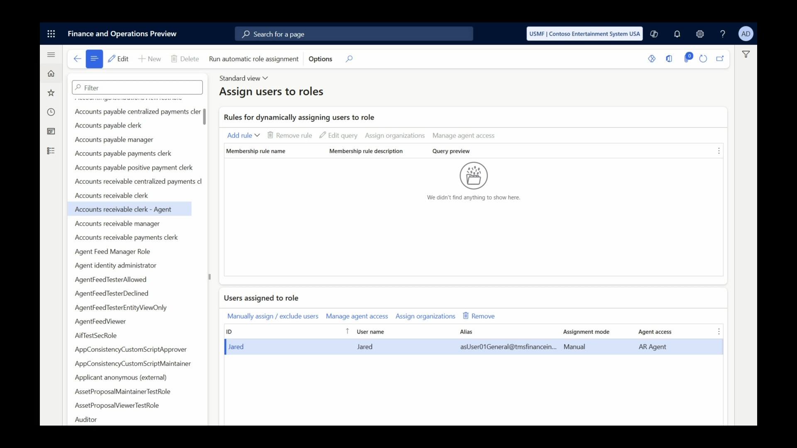
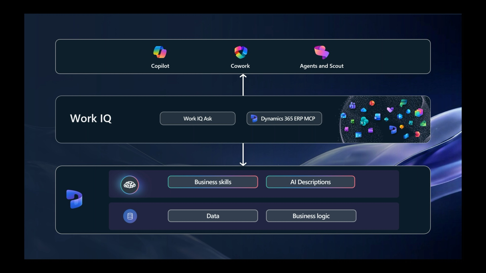
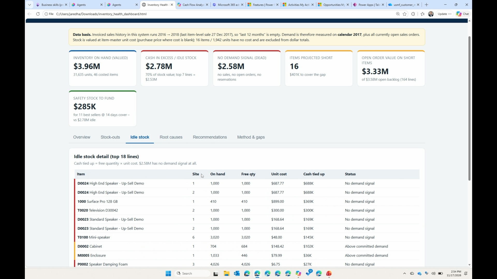
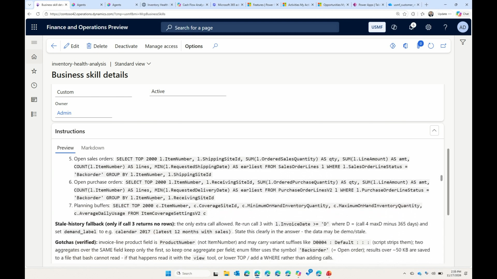

## #form-mcp-and-dual-id-security 01 / Form-Driven MCP & 10.0.51 Security :: 超越增删改查与双身份降权：基于视图模型的协议底座及 10.0.51 内核重构 || Beyond CRUD & Dual-Identity Security: View-Model Form Execution and the 10.0.51 Kernel Overhaul

企业把智能体接入财务与供应链核心系统时，最先撞上的往往不是推理能力不足，而是业务上下文缺失与权限颗粒度失控 [1]。Jared Hall 在开场亮明了贯穿整场分享的核心论断：**上下文的质量与相关性直接决定了智能体的作业水准**[1][2]。早在一年前的技术大会上，微软首次公开预览了面向企业资源计划的模型上下文协议服务；与仅针对底层数据库表做创建、读取、更新和删除的常规数据连接器不同，这套服务直接运行在**表单交互工具（Form Interaction Tools）**之上 [1][4]。智能体能够读取应用的视图模型（View Model）、字段列标签与悬停提示（Tooltips），像真实业务员一样定位目标表单、点击功能按钮并触发底层完整的业务校验逻辑 [1][4]。 || When enterprises connect AI agents to finance and supply chain systems, the primary bottleneck is rarely model reasoning—it is missing operational context and coarse permission boundaries [1]. Opening THR885, Jared Hall stated the session's central thesis: **better, more organization-relevant context directly determines how well an agent operates** [1][2]. Introduced in public preview a year earlier, the Dynamics 365 ERP MCP server diverges sharply from plain database CRUD tools by operating through **form interaction tools** [1][4]. Guided by the application's view model, column labels, and tooltips, an agent locates the right form, clicks buttons, and runs the exact underlying business logic that governs human users [1][4].

在过去一年的迭代中，工程团队围绕执行效率与上下文闭环补齐了四项关键能力 [1][2]：其一，正在全量推送底层性能提速更新，大幅削减单次任务所需的工具调用轮次；其二，响应报文原生附带指向目标单据的**记录深链（Deep Links）**，方便业务人员一键跳回系统核验数据或接力后续审批；其三，支持直接读写单据**附件（Attachments）**并将系统内的**可下载资源（Downloadable Resources）**拉入智能体上下文；其四，即将上线支持多实例并存的**自定义协议配置（MCP Configurations）**——制作者不必再受困于服务端写死的默认上限，而是针对不同业务场景分别创建专属阈值配置供对应智能体按需调用 [1][2]。 || Over the past year, the engineering team shipped four major protocol upgrades [1][2]: significant runtime performance improvements that cut tool-call roundtrips; **deep links** inside MCP responses so users jump straight back to source records for verification; direct **attachment** handling plus **downloadable resources** pulled into agent context; and upcoming **MCP configurations** that replace hardcoded server limits with multiple scenario-tuned profiles per agent [1][2].

:::figure { src: "./media/thr885-erp-mcp-workiq-architecture.figure.json", title: "Dynamics 365 ERP MCP、Work IQ 双通道与 10.0.51 安全内核架构 || Dynamics 365 ERP MCP, Work IQ Dual-Channel & 10.0.51 Security Architecture" }
图 1：THR885 揭示的三层智能体底座——顶层覆盖自定义智能体、协同端与远程代码客户端；中层通过只读检索覆盖 42 个高频实体，并在行动通道后挂载 65 万项协议操作；底层依托 10.0.51 双身份安全内核、内置与自建业务技能以及语义描述锁死合规边界 [1][2]。 || Figure 1: Full three-tier THR885 architecture—connecting studio, cowork, and remote clients at the top; routing read-only Q&A (42 entities) alongside 650,000 MCP operations in the middle; and enforcing 10.0.51 User+Agent security profiles, Business Skills, and AI Descriptions underneath [1][2].
:::

权限管控则是过去一年客户呼声排名第一的架构诉求 [1]。现行协议服务虽已严格继承财务与运营安全框架中的角色、职责与特权（确保员工经由智能体绝不可能越权执行其在前台无权操作的动作），但大批企业安全管理员提出了更严苛的反向约束：**即便某位员工在前台界面拥有完整操作权限，当他通过智能体或协同助手发起请求时，系统也必须允许管理员进一步收窄其可执行范围**[1][2]。为此，即将随 **10.0.51 版本**推送的安全内核重构深入底层代码实现了**双身份联合鉴权** [1][2]。管理员只需复制标准“应收账款文员（`Accounts receivable clerk`）”角色，剔除不希望智能体触碰的高危操作后另存为 `Accounts receivable clerk - agent`，再通过页面底部新增的 `Manage agent access` 将该裁剪角色同时关联至用户与目标智能体 [1][2]。请求抵达时，内核同时提取用户标识与智能体（或应用）标识，按实际接入表面精准施加最小特权 [1][2]。下方交互导览台集成了 THR885 官方 25 分钟点播流、高清封面与五幕逐分钟实录索引 [1][2]： || Security governance topped customer requests over the past twelve months [1]. While ERP MCP already enforces standard Finance and Operations roles, duties, and privileges so a user never exceeds their UI permissions, administrators repeatedly asked for the inverse control: **restricting a user to do less through an agent than they can inside the web application** [1][2]. Rolling out in version **10.0.51**, a deep security-kernel overhaul introduces **dual-identity evaluation** [1][2]. An administrator simply clones the standard `Accounts receivable clerk` role into `Accounts receivable clerk - agent`, strips out sensitive actions, and binds it via `Manage agent access` so runtime requests carrying both User ID and Agent (or Application) ID enforce surface-specific least privilege [1][2]. The interactive theater below pairs the official 25-minute Medius stream with timestamped walkthroughs across all five session chapters [1][2]:

:::sandbox { id: "thr885-video-theater", canvas: false, script: "./thr885-theater.js", style: "./thr885-theater.css", title: "THR885 官方点播视频与五幕时间戳导览台 || THR885 Official On-Demand Stream & Five-Chapter Timestamp Theater", desc: "切换表单交互底座、10.0.51 双身份安全降权、Work IQ 65 万项操作、AOT 角色级业务技能与 USD 2.78M 库存诊断实录五大章节，支持在页内直接唤起微软官方 Medius 点播流。 || Switch across Form-Driven MCP, 10.0.51 Dual-ID Security, Work IQ 650K Operations, Role-Scoped Business Skills, and the USD 2.78M Inventory Demo, or launch the embedded Medius player." }
纯静态点播与议题导览沙盒：内置 THR885 官方高清封面、五段逐分钟实录摘要及官方点播与文档直链。 || Pure static session theater featuring the official THR885 HD cover, five timestamped transcript digests, and direct Medius and documentation links.
:::

## #work-iq-and-business-skills 02 / Work IQ & Role-Scoped Skills :: 汇入组织上下文与角色级业务技能：42 个索引实体、65 万项操作与 AOT 节点 || ERP in Work IQ & Business Skills: 42 Indexed Entities, 650K Actions, and Native AOT Nodes

为了让财务与供应链数据不再孤立于办公协同流之外，微软正式将企业资源计划纳入统一的组织上下文枢纽 **Work IQ**，使其与文档、演示文稿、邮件及低代码数据底座并肩运行在同一智能端点之下 [1][3]。在数据与行动衔接层，系统采用快慢互补的双通道设计 [1][2]：第一条通道是处于公开预览阶段的只读查询工具 **Ask**，它借助 Dataverse 搜索与云端全文索引率先打通了 **42 个最常用的核心业务实体**，让员工在对话窗口用自然语言提问即可秒级获知高频经营数据 [1][3]；第二条通道则是挂载在 **Do Action** 背后的完整企业资源计划协议服务——一旦诉求超出上述 42 个实体的只读范畴，请求便无缝路由至协议底座，直接解锁跨数据与业务逻辑的 **650,000 项系统操作**[1][2]。 || To eliminate context switching between productivity tools and core back-office operations, Microsoft brought Dynamics 365 ERP into **Work IQ** alongside Word, PowerPoint, Outlook, and Dataverse [1][3]. Underneath Work IQ, two complementary tool paths bridge natural language and enterprise execution [1][2]: **Ask** (in Public Preview) uses Dataverse search and ACS indexing across the **42 most commonly used F&O entities** to return fast, read-only full-text answers [1][3]; **Do Action** links directly to the Dynamics 365 ERP MCP server behind the scenes, unlocking **650,000 operations** across the full breadth of application data and business logic whenever scenarios go beyond read-only Q&A [1][2].

  <article class="thr885-media-card" data-present-surface="unframed">
    

      
    

    

      THR885 实机演示截帧 · 07:25
      <h4 data-zh="10.0.51 安全内核重构：Manage agent access 双标识角色分配" data-en="10.0.51 Security Kernel: Manage Agent Access Role Binding">10.0.51 安全内核重构：Manage agent access 双标识角色分配</h4>
      
复制标准应收账款文员角色并删减敏感动作，通过用户标识与智能体标识联合鉴权实现接入端精准降权 [1][2]。

    

  </article>
  <article class="thr885-media-card" data-present-surface="unframed">
    

      
    

    

      THR885 官方课件实拍 · 11:55
      <h4 data-zh="Work IQ 双通道路由与底层双语义增强层" data-en="Work IQ Ask + ERP MCP Over Business Skills & AI Descriptions">Work IQ 双通道路由与底层双语义增强层</h4>
      
上层统一承接多端请求，中层分流只读检索与 65 万项协议操作，底层由业务技能与元数据描述注入企业专属规程 [1][2]。

    

  </article>

光有接口通路还不够，复杂财务系统里常有命名晦涩的历史表结构，不仅新员工看不明白，智能体直接读取原始列名也容易犯迷糊 [1]。为此，微软在数周前率先开放了 **AI Descriptions（智能元数据描述）**公开预览，允许团队为特定表单、数据实体或字段补充面向智能体的用途说明，引导其在业务流中准确选定目标对象 [1][5]。而在大会当天随 **10.0.51 版本**正式开启公开预览的 **Business Skills（业务技能）**，则进一步把“这家公司究竟按什么规矩办事”沉淀成了全组织共享的数字资产 [1][3]。 || Even with 650,000 actions reachable, legacy ERP schemas contain cryptic table and column names that confuse humans and models alike [1]. Launched into Public Preview just weeks prior, **AI Descriptions** let teams augment specific forms, entities, and columns with usage guidance so agents select the right objects reliably [1][5]. Complementing object-level metadata, **Business Skills**—announced in Public Preview on stage and available immediately in build **10.0.51**—encode organization-specific policies, processes, and step-by-step procedures [1][3].

既然各大智能体客户端早已支持遵循通用规范的本地技能，为什么还要在企业资源计划内部专门构建一套技能框架 [1]？Jared 指出了两项核心工程优势 [1][2]。第一是**原生受控于企业安全模型且跨宿主一致生效**：系统内的业务技能可直接授权给特定安全角色（如隔离敏感人事政策），员工无论从自定义智能体、代码编辑器还是协同助手接入都遵循同一份受控规程 [1][2]。第二是**作为全新节点写入应用对象树（Application Object Tree, AOT）**：微软与独立软件开发商在交付 X++ 表单、表、实体和类库时可同步打包内置业务技能，客户与伙伴也能在运行环境中按需自建技能 [1][2]。 || Why build an ERP-native skill framework when client harnesses like Claude, Cowork, and Copilot Studio already support the standard Agent Skills specification [1]? Jared highlighted two decisive architectural advantages [1][2]. First, **role-scoped governance across every harness**: skills saved inside Finance and Operations are secured by standard F&O security roles (such as locking sensitive HR policies) and surfaced consistently through MCP and Work IQ across every client [1][2]. Second, **native Application Object Tree (AOT) packaging**: Microsoft added Business Skills as a first-class AOT node alongside X++ forms, tables, entities, and classes so vendors ship built-in intelligence with code while customers layer custom skills on top [1][2].

:::figure { src: "./media/thr885-access-governance-quadrant.figure.json", title: "Dynamics 365 ERP 智能体接入通道与上下文治理选型象限 || Dynamics 365 ERP Agent Access & Context Governance Quadrant" }
图 2：基于 THR885 架构实践绘制的治理选型象限——规避无语义裸表直连与全量前台权限透传，按只读核验或深层交易诉求匹配双通道路由、对象树内置技能与 10.0.51 双身份降权方案 [1][2]。 || Figure 2: Governance selection quadrant derived from THR885—avoiding raw table CRUD and unscoped UI privilege inheritance in favor of indexed Ask Q&A, AOT-packaged skills, and dual-ID scoped MCP actions [1][2].
:::

## #live-demos-inventory-to-cowork 03 / Live Demos: Zero-Skill Triage to Cowork :: 端到端实机演练：两句话揪出 USD 2.78M 呆滞库存、自动写回技能与协同催收 || End-to-End Walkthrough: Uncovering USD 2.78M Idle Stock, Auto-Authoring Skills, and Acting in Cowork

在实机演示环节，Jared 展示了如何从零预置技能的探索性对话出发，一路闭环沉淀企业标准技能并在跨应用协同端复现执行 [1][2]： || Moving into pre-recorded live environment walkthroughs, Jared traced the complete lifecycle from zero-skill exploratory analysis to automated skill authoring and cross-app execution in Cowork [1][2]:

:::flow { title: "实机闭环：从两句话冷启动库存诊断到跨宿主逾期账款催收的四步演进 || Four-Step Live Lifecycle: From Two-Sentence Stock Triage to Cross-Harness Collections" }
1. **零技能两句话冷启动诊断 || Zero-Skill Two-Sentence Exploratory Prompt** — 在仅挂载企业资源计划协议服务、未配置任何业务技能的智能体中，仅输入两句大白话诉求：“我们在卖不动的呆滞库存上压了太多现金，同时客户真正下单的商品却频繁断货，请帮我做一份分析” [1][2]。协议服务仅凭应用原生元数据便自主定位表入口并批量拉取在库、销售历史与未清订单数据 [1][2]。 || Attaches only the ERP MCP server with zero business skills and sends a two-sentence prompt (*"We have too much cash tied up in stock that doesn't move, and at the same time we keep running out of items customers actually order..."*), letting the agent discover entry points purely from application metadata [1][2].
2. **输出 USD 3.96M 库存健康可视化看板 || Generating the USD 3.96M Inventory Health Dashboard** — 智能体自动完成交叉测算并渲染交互式仪表盘：在 USMF 账套已计价的 **USD 3.96M** 在库资产（涵盖 **46** 个计价物料、共 **31,635** 件；另有 **16** 个无成本物料共 **1,942** 件予以剔除并明确标注口径）中，高达 **USD 2.78M（占比 70%）** 属于超额呆滞库存（前 7 大积压行即占 **USD 2.53M**，毫无需求信号的死库达 **USD 2.58M**，例如在库积压 **1,000 台**却从未售出一台的高端音箱）；与此同时识别出 **16** 项预计缺货商品（补齐缺口需 **USD 401K**，关联未清销售订单金额达 **USD 3.33M**）[1][2]。 || Produces an HTML dashboard over USMF data revealing **USD 3.96M** in valued on-hand stock (**31,635** units across **46** costed items; **16** uncosted items / **1,942** units excluded). It flags **USD 2.78M (70%)** in excess stock (**USD 2.58M** dead stock including **1,000** unsold high-end speakers) alongside **16** projected short items (**USD 401K** gap impacting **USD 3.33M** in open orders) [1][2].
3. **一句话反向生成并管控 F&O 业务技能 || One-Prompt Skill Authoring & Role Security in F&O** — 确认分析框架满意后，无需手工编写繁琐配置，直接吩咐智能体：“效果很好，帮我在环境里创建一项业务技能” [1][2]。智能体随即通过协议服务在系统后台自动写入名为 `inventory-health-analysis`（版本 `1.0.0`）的自定义技能，不仅自动生成供后续检索匹配的触发描述与排除应收应付误用的负向边界，还将包含 `TOP 2000` 聚合查询、历史数据断档回退逻辑与字段避坑提示的完整规程落盘，管理员点开 `Manage access` 即可从“全员可见”收窄至指定安全角色 [1][2]。 || Sends *"This looks great. Go ahead and create a business skill for me"*—prompting the agent to write `inventory-health-analysis` (`v1.0.0`) directly into F&O (`mi=McpBusinessSkills`) with discovery keywords and negative scope rules. The saved definition bundles `TOP 2000` SQL queries, stale-data fallbacks, schema gotchas, and role-based `Manage access` controls [1][2].
4. **切入 Cowork 跨应用调用与一键逾期催收 || Invoking Inventory & Cash-Flow Skills Inside Cowork** — 切换至日常办公界面 **Copilot Cowork**，输入“我有哪些关于库存健康的业务技能？”，系统即刻经由组织上下文通道检出刚创建的技能并复现全套分析，在界面上直接列出可点击写回系统的整改动作按钮；同理调用另一项 `cash-flow-analysis`（现金流分析）技能时，智能体自动拉通应收账款、应付账款、销售管线与历史回款记录，并给出**一键为逾期客户起草催收邮件**等跨应用联动建议 [1][2]。 || Switches to **Copilot Cowork** (routed through Work IQ Business Apps) to discover and execute both the inventory health skill and a repeatable **Cash Flow Analysis** skill—combining receivables, payables, pipeline, and collections history with clickable actions such as drafting overdue collection emails [1][2].
:::

值得工程团队细看的是智能体自动写入系统的 `inventory-health-analysis` 技能正文截帧 [2]。它首先固化了“1 次并行数据拉取、1 次文件生成、1 次运行”的极简工具调用约束以压缩耗时 [2]。同时，它把首轮探索踩过的底层表结构暗坑悉数写进了已验证注意事项——例如发票行物料字段名为 `ProductNumber` 而非 `ItemNumber` 且带变体后缀、未清订单枚举值需填 `'Backorder'`，以及结果超 `50 KB` 时的安全读取降级策略 [2]。这意味着高水平业务专家只需与智能体共创打磨一次，全公司受权岗位便能在任意客户端直接复用零踩坑的成熟规程 [1][2]。 || Inspecting the auto-generated `inventory-health-analysis` skill inside Finance and Operations reveals why agent-authored skills accelerate enterprise adoption [2]. Beyond writing clear discovery keywords, the agent captured a minimal tool-call workflow (*1 parallel data block, 1 file create, 1 run*) [2]. It also documented verified F&O schema gotchas: invoice lines use `ProductNumber` with variant suffixes instead of `ItemNumber`, open orders filter on enum `'Backorder'`, and payloads over `50 KB` switch to safe file views [2]. Once refined by one domain expert, every authorized colleague inherits those exact optimizations across any harness [1][2].

  <article class="thr885-media-card" data-present-surface="unframed">
    

      
    

    

      THR885 实机演示截帧 · 19:35
      <h4 data-zh="两句话零技能冷启动：USD 3.96M 库存健康与呆滞诊断看板" data-en="Two-Sentence Cold Start: USD 3.96M Inventory Health Dashboard">两句话零技能冷启动：USD 3.96M 库存健康与呆滞诊断看板</h4>
      
自动量化 70%（USD 2.78M）呆滞资金占压、USD 2.58M 无需求死库（含 1,000 台未售音箱）及影响 USD 3.33M 未清订单的 16 项缺货风险 [1][2]。

    

  </article>
  <article class="thr885-media-card" data-present-surface="unframed">
    

      
    

    

      THR885 实机演示截帧 · 20:52
      <h4 data-zh="F&O 后台实景：智能体自动写入的业务技能与角色权限面板" data-en="F&O McpBusinessSkills Form: Auto-Authored Skill & Role Access">F&O 后台实景：智能体自动写入的业务技能与角色权限面板</h4>
      
将探索对话一键固化为版本化 Markdown 规程（含 SQL 模板与字段避坑指南），支持通过 Manage access 精确绑定安全角色 [1][2]。

    

  </article>

## #client-matrix-and-adoption 04 / Client Matrix & Enterprise Rollout :: 多宿主能力矩阵与落地指南：五大客户端支持边界及架构师上手清单 || Client Matrix & Rollout Playbook: Five-Surface Support Boundaries and Architect Checklist

在推进企业规模化落地前，架构师需要准确掌握不同智能体宿主对“索引只读问答”与“完整协议操作”的支持边界 [1][2]。Jared 在现场给出了清晰的五端能力对照表——目前除常规办公聊天窗口仅开放只读问答外，其余四大开发与协同表面均已全面打通读写双向能力 [1][3]： || Before rolling out agentic ERP workflows across business units, architects should map each client surface's exact support across indexed Q&A and full MCP action execution [1][2]. Jared shared the five-surface availability matrix on stage—confirming that four of the five surfaces already support both read-only Ask and full ERP MCP execution today [1][3]:

| 智能体客户端表面 || Client Surface | Work IQ Ask（42 实体只读问答） || ERP Data in Ask (42 Entities) | Work IQ 内 ERP MCP（65 万项操作） || ERP MCP in Work IQ (650K Ops) | 官方推荐集成与启用方式 || Configuration & Onboarding Pattern |
|------|------|------|------|
| **Copilot Studio** || **Copilot Studio** | 已支持 || Supported | 已支持 || Supported | 在构建自定义业务智能体时，直接将 Work IQ MCP 服务器添加为智能体工具（亦可直连 ERP MCP）[1][2] || Add the Work IQ MCP server as a tool inside your custom agent (or attach ERP MCP directly) [1][2] |
| **VS Code 内 GitHub Copilot** || **GitHub Copilot in VS Code** | 已支持 || Supported | 已支持 || Supported | 配置指向 Work IQ MCP 服务器的远程连接，赋能研发与运维工作流 [1][2] || Configure a remote connection to the Work IQ MCP server [1][2] |
| **第三方客户端（如 Claude）** || **Third-Party Clients (e.g., Claude)** | 已支持 || Supported | 已支持 || Supported | 配置指向 Work IQ MCP 服务器的标准远程连接，跨生态复用受控业务技能 [1][2] || Configure a remote connection to the Work IQ MCP server to reuse role-secured skills [1][2] |
| **Microsoft 365 Copilot Chat** || **Microsoft 365 Copilot Chat** | 已支持 || Supported | 暂未支持（规划中） || Not Supported Yet (Planned) | 在聊天端启用 Work IQ 即可执行跨 42 个实体的自然语言问答；完整操作能力将于后续跟进 [1][2] || Enable Work IQ in Copilot Chat for natural-language Q&A; MCP action support coming later [1][2] |
| **Copilot Cowork** || **Copilot Cowork** | 已支持 || Supported | 已支持 || Supported | 在协同端启用 Work IQ，一站式打通库存诊断、现金流分析与邮件起草等跨应用闭环动作 [1][2] || Enable Work IQ in Cowork for full cross-app Q&A, Business Skills discovery, and live ERP actions [1][2] |

结合 THR885 披露的全部版本节点与工程细节，企业技术团队可按以下三步稳妥启动智能体改造 [1][3]：首先，在升级至 **10.0.51 版本**后优先盘点财务、采购与仓储高频角色，参照 `Accounts receivable clerk - agent` 模式克隆出剥离高危写权限的智能体专属安全角色，并通过双身份绑定锁死安全底线 [1][2]；其次，针对二开扩展表或命名含糊的历史字段补充 **AI Descriptions**，同时让资深业务骨干用自然语言与挂载协议服务的智能体跑通库存健康、现金流催收等高价值分析，再由智能体自动写回版本化的 **Business Skills** 并按岗位角色授权分发 [1][2]；最后，面向独立软件开发商（ISV）与内部 X++ 研发团队，将成熟业务技能直接纳入 **AOT 应用对象树**随代码包统一发布，并访问微软官方公开文档站 `https://aka.ms/ERPWorkIQ` 查阅最新配置手册启动试点 [1][3]。 || Synthesizing THR885's release milestones, enterprise engineering teams can adopt agentic ERP in three concrete phases [1][3]. First, upon upgrading to build **10.0.51**, clone high-frequency finance and supply chain roles into stripped-down `- agent` security profiles and bind them via `Manage agent access` so agent-mediated actions stay strictly narrower than direct UI privileges [1][2]. Second, annotate custom or cryptic fields with **AI Descriptions**, pair domain leads with an MCP-connected agent to iterate on high-value analyses like inventory working capital or cash-flow collections, and let the agent save validated **Business Skills** back into F&O scoped to the right security roles [1][2]. Third, for X++ engineering teams and ISVs, package foundational skills directly inside the **AOT** alongside forms and classes, using the official documentation hub at `https://aka.ms/ERPWorkIQ` to configure Work IQ across Copilot Studio and Cowork [1][3].

## 参考资料：官方一手信源与技术文档 || References: Official Primary Sources & Documentation

1. **Jared Hall (Microsoft Ignite 2026 THR885 Video & Transcript)** — https://ignite.microsoft.com/en-US/sessions/1787856580022001El3j-1791588087248001CNOO | 《Agentic ERP in action: Build agents & skills with Dynamics 365 ERP MCP》25 分钟官方剧场实录与中英双语 WebVTT 逐字稿（2026-11-17） || Official 25-minute theater session page and bilingual WebVTT transcripts (Nov 17, 2026)
2. **Jared Hall (THR885 Official Medius On-Demand Stream)** — https://medius.microsoft.com/Embed/video-nc/c43045ee-f382-49e7-8f57-2448115ae000 | THR885 微软官方 Medius 点播视频流（涵盖 10.0.51 双身份角色降权、Work IQ 双通道架构图、USD 2.78M 呆滞库存看板与 Cowork 业务技能调用实录） || Official Microsoft Medius embedded video stream capturing all stage slides and Finance & Operations live walkthroughs
3. **Dynamics 365 ERP in Work IQ Official Documentation** — https://aka.ms/ERPWorkIQ | Jared Hall 在演讲收尾发布的微软官方技术文档中心：涵盖 Work IQ Ask（42 个索引实体）、Do Action（65 万项操作）及 10.0.51 业务技能启用指南 || Official public documentation hub shared on stage covering ERP in Work IQ setup, client surfaces, and Business Skills
4. **Dynamics 365 Finance and Operations MCP Server Documentation** — https://learn.microsoft.com/en-us/dynamics365/fin-ops-core/dev-itpro/copilot/copilot-mcp | Dynamics 365 ERP 模型上下文协议（MCP）服务官方文档：基于视图模型的表单交互工具、记录深链、多套配置与内核安全治理 || Official documentation for Dynamics 365 ERP MCP form interaction tools, deep links, custom configurations, and security profiles
5. **Microsoft Copilot Studio Documentation (MCP Tools & Enterprise Agents)** — https://learn.microsoft.com/en-us/microsoft-copilot-studio/ | Microsoft Copilot Studio 官方技术文档：挂载远程 MCP 服务端点、集成 Work IQ 商业应用上下文与跨渠道智能体编排指南 || Official documentation on attaching MCP servers, configuring Work IQ tools, and orchestrating enterprise agents
