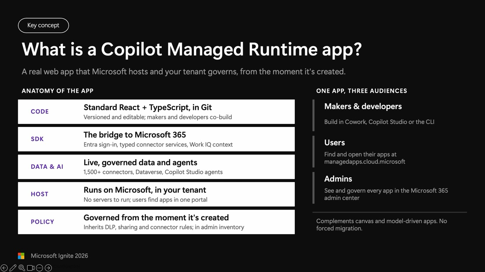
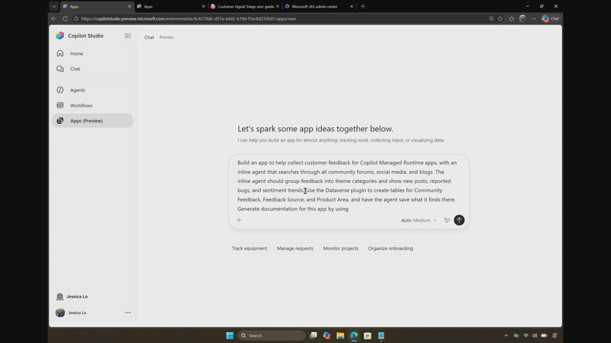
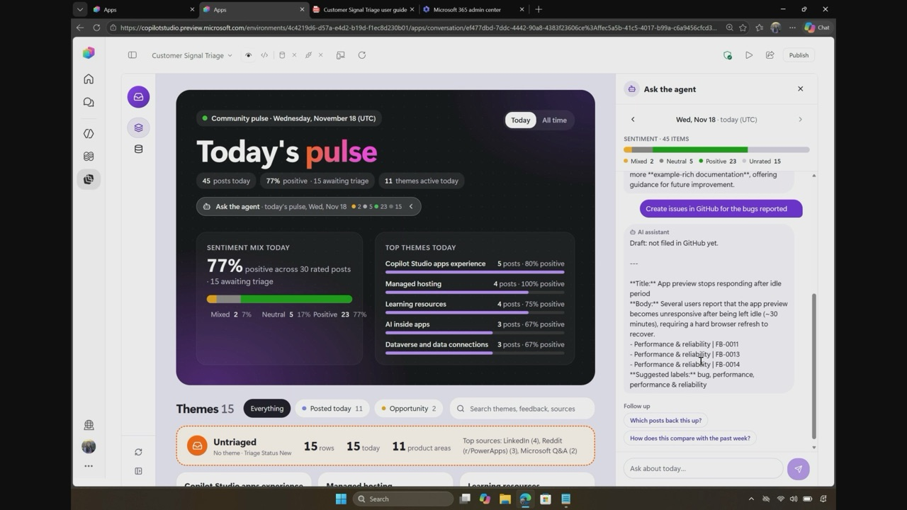
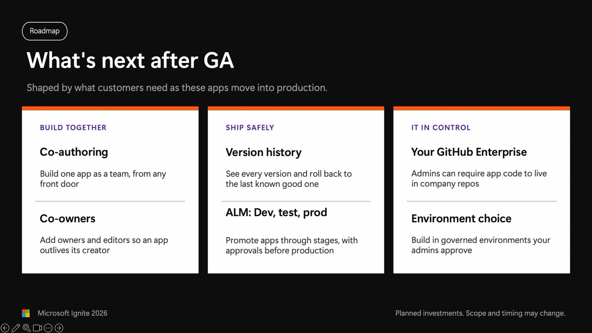

## #from-prototype-to-ga-runtime 01 / From Toy Prototype to Production GA :: 跨越原型鸿沟：Copilot 托管运行时正式商用与三扇前门架构 || Beyond Demo Toys: Copilot Managed Runtime GA and the Three Front Doors

大模型已经彻底改写了软件早期的探索成本：过去产品团队必须耗费数小时撰写冗长的需求文档再排期移交研发编码，如今任何人只需输入一段描述并反复对话微调，几分钟就能拿到可点击的界面 [1]。然而写代码本身早已不是最难的一关 [1]。当团队试图把随手生成的快闪原型真正投入企业日常运转时，往往因为缺失统一身份登录、受管数据连接与安全合规策略而被迫推倒重写 [1][2]。 || Coding agents have made early software exploration inexpensive: instead of spending hours writing a product requirements document and waiting on engineering queues, makers describe an idea and refine a working screen in minutes [1]. Writing initial code is no longer the bottleneck [1]. Moving from a vibe-coded prototype to dependable software that an organization can run safely usually forces teams into a full rewrite to bolt on authentication, governed data access, and tenant security [1][2].

在 THR887 开场，微软托管运行时应用创作产品经理 Jessica Lo 给出了破局方案，并宣布团队历时六个月打磨的 **Copilot 托管运行时（Copilot Managed Runtime）应用现已正式全面商用** [1][2]。凡是在该运行时上生成并托管的应用，均直接运行在微软托管的租户级基础设施上，无需团队自行采购或维护任何服务器；从应用诞生的第一分钟起，系统便默认接通 Microsoft Entra 身份登录，自动绑定 SharePoint 或 Dataverse 等受管真实数据源，并严格继承企业管理员配置的防数据泄漏（DLP）与共享策略 [1][3]。把原型推向生产环境，不再意味着推倒重来，而是在既有应用之上顺滑叠加业务严谨度 [1]。 || Opening THR887, Microsoft Product Manager Jessica Lo announced that after six months of intensive engineering, **Copilot Managed Runtime apps are now generally available** [1][2]. Every app generated and hosted on the runtime executes on Microsoft-managed infrastructure inside the customer's tenant with zero servers to maintain [1][3]. From minute one, it authenticates through Microsoft Entra and enforces admin-defined data loss prevention (DLP) and sharing policies across SharePoint or Dataverse [1][3]. Going to production means adding rigor to the existing app rather than rewriting a throwaway prototype [1].

:::figure { src: "./media/thr887-cmr-architecture.figure.json", title: "Copilot 托管运行时三扇前门与单提示词四联交付全栈架构 || Copilot Managed Runtime Three Front Doors & Single-Prompt Four-Deliverable Stack" }
图 1：THR887 核心工程架构——顶层面向三类构建者敞开三扇前门并共享同一 Git 源码仓；中层在 Copilot Studio 内由单条提示词同步产出四项企业级资产；底层依托微软零运维托管、1,500 余款受管连接器与管理中心策略实现开箱受控 [1][2]。 || Figure 1: Full THR887 architecture [1][2]. Three builder doors share one Git repository at the top, while a single Copilot Studio prompt synthesizes four artifacts over zero-server hosting and 1,500+ connectors underneath [1][2].
:::

为了贴合不同角色的日常工作流，微软将同一套底层应用技能封装为“同一栋房子的正门、车库门与后院门”——即三扇通往同一受管底座的前门 [1][2]：**Copilot Cowork** 面向信息工作者，适合在日常办公流中直接融合邮件、文件与会议上下文（例如 Jessica 上周推进旧产品下线时，生成应用每 2 小时巡检收件箱以追踪 350 多名客户经理的回执）[1]；**Copilot Studio** 面向业务制作者与企业技术团队，在智能体与工作流旁构建基于真实业务数据的流程应用 [1][4]；**命令行与开发套件（CLI + SDK）**则面向专业开发者，支持在 VS Code 等编码环境中掌控代码仓并继续享受微软免运维托管 [1][3]。无论从哪扇门起步，底层均由 Git 版本库统一承载，团队随时可以换一扇门接力演进 [1]。下方交互导览台集成了 THR887 官方 25 分钟点播视频流与五幕逐分钟实录索引 [1][2]： || Rather than splintering into separate products, Microsoft exposes **one underlying app skill through three front doors**—like entering the same house via the front door, garage, or backyard [1][2]. **Copilot Cowork** meets information workers in the flow of work to infuse email, file, and meeting context; Jessica shared how she built a Cowork app to check her inbox every two hours and track deprecation acknowledgments across 350+ Microsoft account managers [1][5]. **Copilot Studio** serves makers and IT teams building process apps alongside Dataverse, agents, and workflows [1][4]. **CLI + SDK** gives pro developers full repository control in VS Code or GitHub Copilot while Microsoft still hosts the runtime [1][3]. Because every door writes to Git, builders can start in one entry point and continue in another [1]. Explore the official 25-minute stream and five timestamped chapters below [1][2]:

:::sandbox { id: "thr887-video-theater", canvas: false, script: "./thr887-theater.js", style: "./thr887-theater.css", title: "THR887 官方点播视频与五幕时间戳导览台 || THR887 Official On-Demand Stream & Five-Chapter Timestamp Theater", desc: "切换正式商用与三扇前门、五层解剖结构、实机单提示词建表、内联智能体起草 GitHub 缺陷单与管理中心路线图五大章节，支持页内直接加载微软官方 Medius 点播流。 || Switch across GA & Three Front Doors, Five-Layer Anatomy, Live Prompt & Dataverse Tables, Inline Agent GitHub Triage, and Admin Governance & Roadmap, or launch the embedded Medius player." }
纯静态点播与议题导览沙盒：内置 THR887 官方高清封面、五段逐分钟实录摘要及官方点播流与托管运行时文档直链。 || Pure static session theater featuring the official THR887 HD cover, five timestamped transcript digests, and direct Medius and Copilot Managed Runtime documentation links.
:::

## #under-the-hood-and-four-outputs 02 / Under the Hood & Four Deliverables :: 掀开引擎盖：标准 React + TypeScript 底座与“一词四件”生成机制 || Under the Hood: Standard React + TypeScript Anatomy and One-Prompt Synthesis

受管运行时生成的应用究竟包含什么？Jessica 在现场课件中明确拆解了它的五层工程解剖结构——它绝不是静态高保真草图，也不是锁死在私有格式里的黑盒文件，而是**存放在 Git 仓库中的标准 React + TypeScript 真实 Web 应用**，专业开发者随时可以检出源码阅读或深度扩展 [1][2]。在这份标准前端工程之下，专用开发套件充当连接 Microsoft 365 的桥梁，将企业身份登录、类型化连接器服务与 Work IQ 组织上下文开箱接通；数据与智能层则直接挂载超过 **1,500 款受管连接器**、Dataverse 结构化表与 Copilot Studio 智能体 [1][2]。 || What actually lives inside a Copilot Managed Runtime app? Opening the hood on stage, Jessica emphasized that makers do not receive a static mockup or proprietary file format—they get **a standard React + TypeScript web application stored in a Git repository** that developers can inspect and extend freely [1][2]. Beneath that codebase, the runtime SDK bridges into Microsoft 365 with Entra sign-in, typed connector services, and Work IQ organizational context, while the data layer taps into **1,500+ governed connectors**, Dataverse, and Copilot Studio agents [1][2].

  <article class="thr887-media-card" data-present-surface="unframed">
    

      
    

    

      THR887 官方课件实拍 · 07:08
      <h4 data-zh="受管应用五维解剖：React + TypeScript 源码与三方协同" data-en="Anatomy of a Managed App: React + TypeScript & Three Audiences">受管应用五维解剖：React + TypeScript 源码与三方协同</h4>
      
涵盖标准 Git 源码、M365 桥接套件、1,500+ 连接器、managedapps.cloud.microsoft 零运维门户与首分钟管理策略，并与画布及模型驱动应用互补共存 [1][2]。

    

  </article>
  <article class="thr887-media-card" data-present-surface="unframed">
    

      
    

    

      THR887 实机演示截帧 · 11:52
      <h4 data-zh="在 Copilot Studio 提交单条复合提示词触发四联构建" data-en="Submitting One Compound Prompt in Copilot Studio Apps">在 Copilot Studio 提交单条复合提示词触发四联构建</h4>
      
一段自然语言同时指定社区反馈看板、搜索论坛与社媒的内联智能体、自动创建 3 张业务表以及调用 Cowork 文档技能 [1][2]。

    

  </article>

这套架构让同一款应用自然服务企业内的三类受众：制作者与开发者通过三扇前门协同构建，终端员工统一在 `managedapps.cloud.microsoft` 门户查找并打开应用，而 IT 管理员则在 Microsoft 365 管理中心全局监管每一款应用；同时它与现有的画布应用和模型驱动应用互补共存，绝不强制存量系统迁移 [1][2]。围绕即将展开的 Copilot Studio 实机演示，Jessica 重点点明了**单条提示词一次性交付的四项核心产物**（其中第 2 项智能体节点连接器与第 3 项建表插件目前已在微软内部租户投入实战，正经历严格测试并向公众陆续推送，尚未包含在首日正式商用基线内）[1]： || One generated app cleanly serves three organizational roles: makers and developers co-building across the three front doors, end users discovering apps at `managedapps.cloud.microsoft`, and admins governing inventory in the Microsoft 365 Admin Center—all complementing existing canvas and model-driven apps with no forced migration [1][2]. Setting up her live Copilot Studio build, Jessica highlighted **four artifacts synthesized from a single prompt**—noting transparently that items #2 (the agent node connector) and #3 (the Dataverse table-creation plugin) were running in Microsoft's internal tenant and rolling out gradually beyond the initial GA baseline [1]:

1. **可交互的企业级业务 Web 应用**：直接由自然语言生成的完整前端看板与筛选工作流 [1][2]。 || **A Working Enterprise Web App**: Full interactive UI and triage views generated from natural language [1][2].
2. **通过新“智能体节点连接器”织入应用内部的内联智能体**：不同于挂在页面边缘凑数的独立聊天框，该连接器将智能体推理能力原生嵌入业务应用内部并实时联动当前数据 [1][2]。 || **An Inline Agent via the New Agent Node Connector**: Rather than tacking on a detached side chatbot, the new connector wires contextual AI intelligence directly inside the app experience [1][2].
3. **由全新 Dataverse 插件自动创建的结构化数据表**：无需制作者预先手工建表配置字段，智能体按提示词自动生成多张业务表持久化数据（若团队偏好使用 SharePoint 列表同样原生支持）[1][2]。 || **Net-New Tables via the Dataverse Plugin**: Automatically provisions structured Dataverse tables on behalf of the maker—eliminating manual schema setup while still supporting SharePoint lists when preferred [1][2].
4. **跨端直接复用的 Cowork 技能**：此前在 Copilot Cowork 中沉淀的个人或团队技能（如一键生成应用说明手册），可在 Copilot Studio 内通过斜杠命令直接唤醒执行，印证底层平台的彻底贯通 [1][2]。 || **Reusable Cross-Surface Skills**: Invokes existing skills authored in Copilot Cowork directly inside Copilot Studio via slash commands, proving both experiences share the exact same platform [1][2].

:::figure { src: "./media/thr887-front-doors-quadrant.figure.json", title: "Copilot 托管运行时三扇前门与传统应用原型开发选型象限 || Copilot Managed Runtime Three Front Doors vs. Legacy App Prototyping Quadrant" }
图 2：基于 THR887 选型准则绘制的工程决策象限——告别无护栏孤岛快闪原型与漫长的传统需求移交管线，按办公流上下文、业务数据智能体编排与全栈代码控制深度精准选用三扇受管前门 [1][2]。 || Figure 2: Engineering selection quadrant mapped from THR887—moving past ungoverned demo toys and slow PRD hand-offs by matching builder needs across Cowork, Copilot Studio, and CLI + SDK [1][2].
:::

## #live-community-pulse-build 03 / Live Build: Community Pulse :: 实机演练：用自己构建的“客户信号分诊”应用备战正式商用 || Live Walkthrough: Building Customer Signal Triage to Ship GA

演示切入真实的自身痛点：在受管运行时开启公开预览的三至四周里，来自 LinkedIn、YouTube 视频评论区、技术博客、Reddit 与社交平台的制作者反馈呈井喷态势 [1]。Jessica 每天清晨逐站翻找评论、归纳情绪并手工向研发团队同步缺陷，耗时且极易遗漏关键问题；于是她在三周前决定“用托管运行时应用来收集托管运行时的社区反馈”，现场还原了驱动这一真实生产工具落地的完整四步闭环 [1][2]： || Grounding the demo in her own daily workflow, Jessica explained that during the three to four weeks of public preview, maker feedback surged across LinkedIn, YouTube comments, blogs, Reddit, and social channels [1]. Manually hunting down posts every morning and filing engineering bugs became overwhelming—so three weeks before Ignite, she built a Copilot Managed Runtime app to triage feedback for Copilot Managed Runtime itself [1][2]:

:::flow { title: "实机闭环：从提交单条复合提示词到生成 10 页 PDF 用户手册的四步实战 || Four-Step Live Flow: From One Prompt to GitHub Bug Filing & 10-Page PDF Guide" }
1. **在 Copilot Studio 提交单条复合提示词 || Submitting the Single Compound Prompt** — 点击主页第三个“应用”磁贴（正式商用推送期间界面预览角标正逐步移除），输入一段完整指令 [1][2]。该指令要求构建收集托管运行时客户反馈的应用，内置扫描论坛、社媒与博客的内联智能体以展示主题分类、上报缺陷与情绪趋势；同时调用 Dataverse 插件自动创建“社区反馈”“反馈来源”“产品领域” 3 张表，并复用 Cowork 应用文档技能生成说明手册 [1][2]。 || Opens the third `Apps` tile on the Copilot Studio home page and submits one compound prompt [1][2]. That prompt requests a community feedback app, an inline agent scanning forums and blogs for themes and bugs, three new Dataverse tables (`Community Feedback`, `Feedback Source`, `Product Area`), and user documentation via a Cowork skill [1][2].
2. **检视对话记忆、React 源码与三表四连接器 || Inspecting Chat Memory, Code View & Connections** — 打开生成的 `Customer Signal Triage`（社区脉搏）工作区：左侧保留初始提示词与多轮对话便于 30、60 或 90 天后回溯决策（智能体还会主动提醒 1280 像素分屏下标签挤压并询问是否修复）；右侧提供交互预览、底层 **Code 代码视图**以及平板/手机尺寸切换器 [1][2]。展开顶部数据与连接面板，可见自动生成的 `craf4_communityfeedback`、`craf4_feedbacksource`、`craf4_productarea` 三张表，以及 **Office 365 用户**、**GitHub**、**内联智能体**与 **Microsoft Dataverse** 四项连接器（系统要求四者处于同一数据策略组方可发布）[1][2]。 || Opens `Customer Signal Triage`: the left pane retains full chat history for 30/60/90-day continuity and even flags a `1280px` split-pane label squeeze [1][2]. The right pane provides an interactive preview, the underlying React `Code` view, mobile/tablet device pickers, the three `craf4_*` Dataverse tables, and four wired connectors (`Office 365 Users`, `GitHub`, `Agent`, and `Dataverse`) verified under one data-policy group [1][2].
3. **晨会秒级情绪汇总与内联起草 GitHub 缺陷单 || Standup Pulse Summary & Inline GitHub Bug Drafts** — 收起构建栏后，看板呈现当日脉搏：**今日新增 45 条帖子**，30 条已评级帖子中 **77% 为正向情绪**（正向 23、中性 5、混合 2），另有 **15 条待分诊**，并自动聚类出应用体验（5 帖，80% 正向）、托管宿主（4 帖，100% 正向）、学习资料（4 帖）、应用内 AI（3 帖）与数据连接（3 帖）五大主题 [1][2]。点击页内 **Ask the agent** 即可一键生成晨会摘要同步至 Teams 频道；继续输入 `Create issues in GitHub for the bugs reported`，内联智能体便会梳理当日性能与可靠性缺陷，起草 GitHub 议题草稿并在确认后直接建单 [1][2]。 || Collapsing the builder pane reveals **45 posts today**, **77% positive sentiment** across 30 rated items, and **15 awaiting triage** [1][2]. Top clustered themes span `Copilot Studio apps experience`, `Managed hosting`, `Learning resources`, `AI inside apps`, and `Dataverse and data connections` [1][2]. Clicking `Ask the agent` summarizes daily opportunities for morning standup, then drafts GitHub bug issues inline (`Create issues in GitHub for the bugs reported`) for one-click filing into the team repository [1][2].
4. **一键团队共享与零人工产出 10 页 PDF 手册 || Team Sharing & Zero-Touch 10-Page PDF User Guide** — 验证无误后点击发布并将应用分享给同事 Emma（对方收到邮件链接即可开箱使用）[1]。与此同时，跨端复用的 Cowork 文档技能已自动渲染出一份 **10 页完整版《Customer Signal Triage 用户指南》PDF**（涵盖应用定位、快速上手、今日脉搏与全量视图导览、手机小窗适配及每日晨会操作指引），后续每当应用功能演进，只需一句话即可让智能体同步刷新这份手册 [1][2]。 || Publishes and shares the app with teammate Emma via email link [1]. Meanwhile, the reusable Cowork skill renders a **10-page PDF user guide** covering quick start, feature tour, and daily review steps—all regenerable as the app evolves [1][2].
:::

  <article class="thr887-media-card" data-present-surface="unframed">
    

      
    

    

      THR887 实机演示截帧 · 19:45
      <h4 data-zh="社区脉搏看板（45 条动态 / 77% 正向）与内联起草 GitHub 议题" data-en="Community Pulse Dashboard (45 Posts / 77% Positive) & GitHub Drafts">社区脉搏看板（45 条动态 / 77% 正向）与内联起草 GitHub 议题</h4>
      
左侧实时聚类五大产品反馈主题与情绪占比，右侧内联智能体直接响应指令为当日上报缺陷生成 GitHub 议题草稿 [1][2]。

    

  </article>
  <article class="thr887-media-card" data-present-surface="unframed">
    

      
    

    

      THR887 官方课件实拍 · 23:12
      <h4 data-zh="正式商用后的六大演进路线图：协同、发布管线与环境主权" data-en="What's Next After GA: Six Customer-Driven Roadmap Pillars">正式商用后的六大演进路线图：协同、发布管线与环境主权</h4>
      
围绕团队共建（协同创作、共同所有者）、安全交付（版本历史回滚、开发测试生产晋级）与 IT 管控（企业自有代码仓、环境选择）全面升级 [1][2]。

    

  </article>

## #admin-governance-and-roadmap 04 / Admin Governance & Post-GA Roadmap :: 管理员全局透视与演进路线图：159 款受管应用盘点与六大企业级增强 || Admin Governance & Post-GA Roadmap: Tenant-Wide Visibility and Six Next Steps

业务人员用单条提示词几分钟拉起一款全栈应用，会不会在企业内制造新的影子 IT 盲区？演示尾声，Jessica 直接切入 **Microsoft 365 管理中心**（`admin.cloud.microsoft`）的“应用 -> 全部应用”视图给出了定心丸 [1][2]。在演示租户的受管应用资产大盘中，全部 **159 款受管应用**悉数在列；输入名称检索刚构建的 `CMR Community Pulse`，管理员无需等待业务团队事后报备，就能实时查看该应用挂载了哪些连接器、调用频次如何、由谁创建以及当前所有者归属，并可随时配置性能告警或一键阻断高风险应用 [1][2]。 || When makers spin up full-stack apps in minutes, does IT lose visibility into shadow software? Switching live into the **Microsoft 365 Admin Center** (`admin.cloud.microsoft` under *Apps -> All apps*), Jessica demonstrated how every single app appears in tenant inventory from the moment it is created [1][2]. Searching across the tenant's **159 managed apps** surfaced `CMR Community Pulse` immediately—exposing active connectors, usage frequency, creator identity, and ownership alongside controls to set custom alerts or block vulnerable apps [1][2].

| 选型与治理维度 || Engineering & Governance Dimension | Copilot Cowork（日常协作前门） || Copilot Cowork (Flow-of-Work Door) | Copilot Studio（业务流程前门 · 本场演示） || Copilot Studio (Process & Agent Door) | CLI + SDK（专业代码前门） || CLI + SDK (Pro-Developer Door) |
|------|------|------|------|
| 核心适用构建者 || Target Builder Persona | 熟悉办公套件的信息工作者与项目负责人 [1][5] || Information workers & project leads [1][5] | 业务制作者、企业 IT 与智能体编排团队 [1][4] || Makers, IT teams & workflow builders [1][4] | 追求底层仓库控制权的全栈与专业开发者 [1][3] || Pro developers in VS Code or GitHub Copilot [1][3] |
| 最佳切入业务场景 || Primary Workload Fit | 融合邮件、会议、聊天上下文的个人或小组快建工具（如每 2 小时巡检 350+ 人回执）[1] || Quick team trackers grounded in email, files & meetings [1] | 跑在真实结构化数据上、需深度协同内联智能体与工作流的业务系统 [1][4] || Process apps backed by Dataverse, inline agents & workflows [1][4] | 需要直接审查修改组件代码、执行机械级版本回滚的复杂定制工程 [1][3] || Custom extensions & direct Git version rollback [1][3] |
| 底层源码与跨门连续性 || Underlying Code & Continuity | 统一生成标准 React + TypeScript 存入 Git，随时可在 Studio 或命令行接力打开 [1][2] || Shared React + TypeScript Git repo; seamlessly pick up in Studio or CLI [1][2] | 内置对话记忆、交互预览与源码查看器，跨端复用 Cowork 技能 [1][2] || Built-in chat memory, live preview, code view & reusable Cowork skills [1][2] | 本地检出完整 React + TypeScript 仓库自由编码，仍由微软免服务器托管 [1][2] || Full local repo editing while Microsoft hosts and runs infrastructure [1][2] |
| 身份鉴权与管理员管控 || Identity, Policy & Admin View | 首分钟启用 Entra 登录与管理员防泄漏策略，统一汇聚至 M365 管理中心盘点 [1][3] || Entra sign-in, admin DLP & M365 Admin Center visibility from minute one [1][3] | 发布前强制校验多连接器数据策略组一致性，终端用户在受管门户统一访问 [1][2] || Enforces connector DLP policy groups pre-publish; hosted at `managedapps.cloud.microsoft` [1][2] | 与可视化前门继承完全一致的租户级连接器规则、共享边界与安全审计 [1][3] || Identical tenant DLP, sharing guardrails, and admin inventory telemetry [1][3] |

面向已经迈过正式商用门槛的企业客户，Jessica 在收官环节坦诚分享了团队正紧锣密鼓推进的**六大后续路线图投资**（按客户投产诉求归纳为三大支柱）[1][2]： || Looking beyond general availability, Jessica closed by detailing **six post-GA roadmap investments** shaped directly by public-preview customers moving apps into production [1][2]:

- **团队协同共建（Build Together）**：一是支持多人在同一会话内实时并肩编辑同一款应用的**协同创作（Co-authoring）**；二是支持指派**共同所有者（Co-owners）**——解决当前应用仅绑定单一创建者、一旦员工离职或突发变动导致应用失管的连续性痛点 [1][2]。 || **Build Together (`Co-authoring` & `Co-owners`)**: Enables multiple teammates to co-edit inside the same session simultaneously and lets creators assign co-owners so critical business apps never vanish when an individual leaves the team [1][2].
- **安全可控交付（Ship Safely）**：一是把目前已在命令行工具中支持的机械级**版本历史与一键回滚（Version history）**全面引入 Copilot Studio 与 Cowork 图形界面；二是呼声极高的**应用生命周期管理（ALM）**，支持带审批门禁地将应用从开发、测试平滑晋级至生产环境 [1][2]。 || **Ship Safely (`Version history` & `ALM`)**: Surfaces mechanical version rollback—already working today in the CLI—directly inside the Copilot Studio and Cowork UX, alongside staged dev-test-prod promotion pipelines with pre-production approvals [1][2].
- **企业自主掌控（IT in Control）**：一是支持**接入企业自有 GitHub Enterprise**，允许管理员强制要求受管应用源码存放在公司自管代码仓内；二是开放**环境自由选择（Environment choice）**，打破当前默认落在个人开发环境（PDE）的限制，允许在管理员批准的任意指定受控环境中构建和运行应用 [1][2]。 || **IT in Control (`Your GitHub Enterprise` & `Environment choice`)**: Lets administrators require generated app code to reside inside company-owned GitHub Enterprise repositories and unlocks building inside designated custom environments beyond the default personal developer environment (PDE) [1][2].

## 参考资料：官方一手信源与技术文档 || References: Official Primary Sources & Documentation

1. **Jessica Lo (Microsoft Ignite 2026 THR887 Video & Transcript)** — https://ignite.microsoft.com/en-US/sessions/1787856580323001EG0e-1791588176515001C35D | 《Build an enterprise app from a single prompt with Copilot Studio》25 分钟官方剧场实录与中英双语 WebVTT 逐字稿（2026-11-18） || Official 25-minute theater session page and bilingual WebVTT transcripts (Nov 18, 2026)
2. **Jessica Lo (THR887 Official Medius On-Demand Stream)** — https://medius.microsoft.com/Embed/video-nc/b08b8f4a-b185-4c45-a65d-9829439b24d2?sessiontimeID=1791588176515001C35D | THR887 微软官方 Medius 点播视频流（涵盖受管运行时五维解剖课件、单提示词四联产物演示、社区脉搏应用与六大路线图实录） || Official Microsoft Medius embedded video stream capturing all stage slides and the live Customer Signal Triage walkthrough
3. **Microsoft Copilot Managed Runtime Documentation** — https://learn.microsoft.com/en-us/microsoft-365/copilot-managed-runtime/ | 专场尾声直达的官方总览文档：涵盖三扇前门架构、React + TypeScript 底座、命令行开发套件与 Microsoft 365 管理中心治理指南 || Official hub documentation linked on the closing session slide covering runtime architecture, developer tooling, and admin governance
4. **Apps in Microsoft Copilot Studio Overview** — https://learn.microsoft.com/en-us/microsoft-copilot-studio/apps-experience/apps-overview | Copilot Studio 应用构建官方文档：自然语言生成应用、连接器与数据表绑定、代码视图预览及团队发布共享说明 || Official guide to building, previewing, connecting data, and publishing Copilot Managed Runtime apps inside Copilot Studio
5. **Build Apps with the App Skill in Copilot Cowork** — https://learn.microsoft.com/en-us/microsoft-365/copilot/cowork/#build-apps-with-the-app-skill-frontier | Copilot Cowork 应用技能官方文档：在日常邮件、会议与文件协作流中描述并生成受管业务应用 || Official documentation for creating governed apps directly from organizational context inside Copilot Cowork
