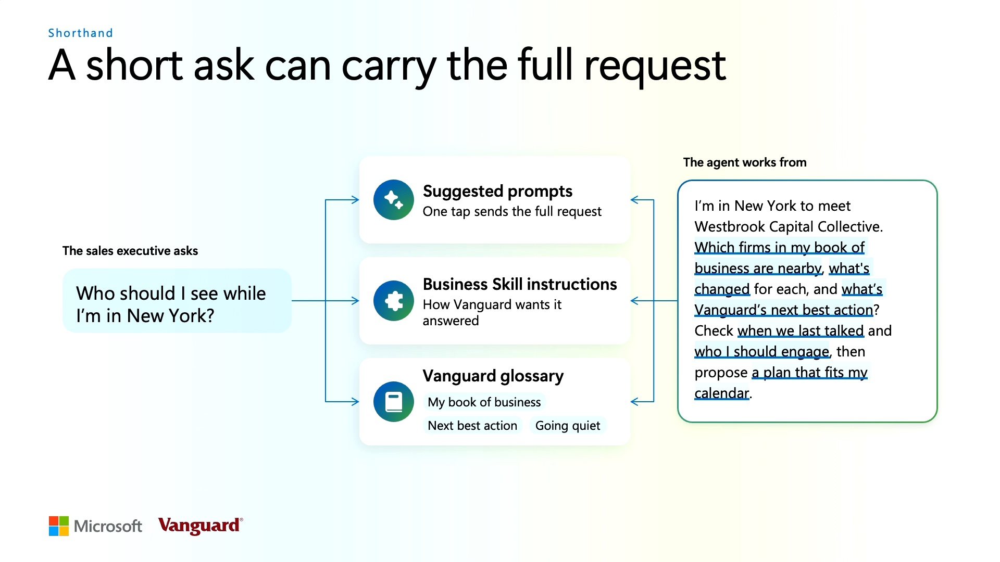
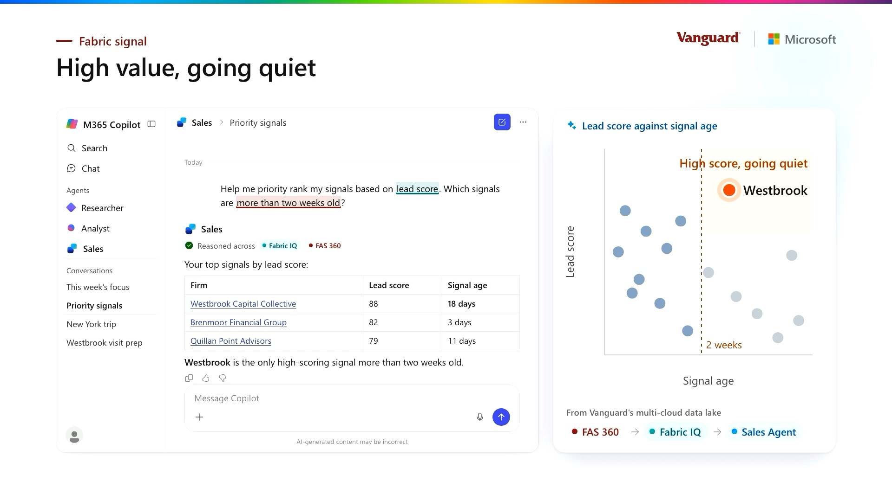
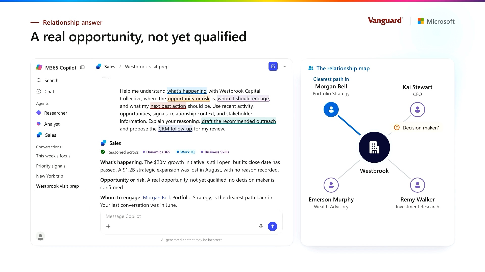
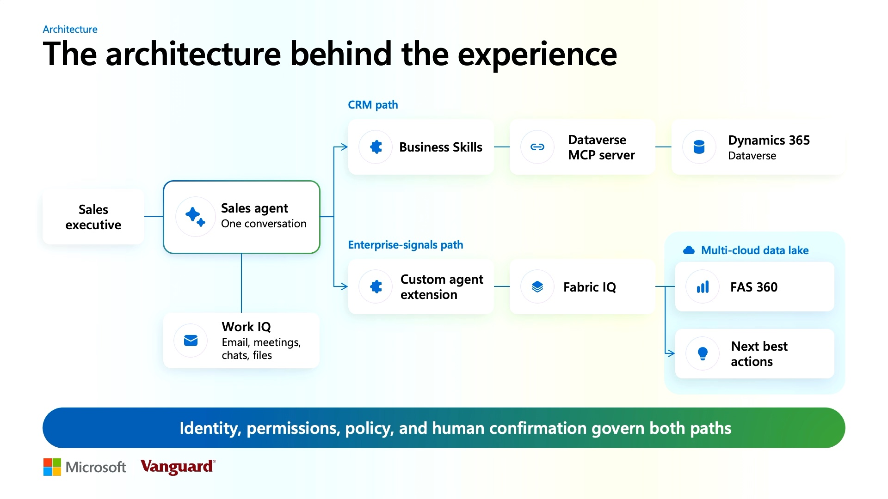

## #human-integration-bottleneck 01 / Fragmented Stack & 40+ Skills :: 破除“人类集成层”：从跨系统手工拼图到超过 40 项业务技能库 || Ending the Human Integration Layer: From App-Hopping to 40+ Business Skills

Vanguard 旗下的财务顾问服务部（Financial Advisor Services）是一项典型的机构分销业务：全美数百名一线销售人员常年奔波在曼哈顿金融高楼与中部单人理财工作室之间，面对面服务约 **300,000 名**外部理财顾问，推动各类基金产品进入终端投资者的资产组合 [1][2]。一名出差在外的销售代表每周要密集会见数十位客户，但支撑高质量对话的上下文却散落在割裂的软件栈里 [1]。 || Vanguard's Financial Advisor Services operates as a high-touch distribution business: several hundred sales executives travel nationwide—from Manhattan towers to one-person shops in the middle of the country—supporting **300,000** financial advisors who allocate funds into end-client portfolios [1][2]. Meeting dozens of people every week on the road, each representative relies on context scattered across disconnected software [1].

过去，销售人员本人被迫充当这套软件栈的“人工集成层” [1][2]。哪怕只是回答一句看似简单的日常提问——“我下周去纽约出差，顺路还该见谁？”——他们也必须手工登录客户关系管理库核对机构档案，翻阅邮件与聊天记录回顾上次沟通纪要，再切入名为 **FAS 360** 的外部多云数据湖以及多张商业智能报表，逐一比对近期资金净流向、顾问平台准入产品清单与系统推荐的下一步最佳行动 [1][2]。同栋写字楼里往往还驻扎着同一机构的多位顾问，谁值得顺道拜访、哪段时间能塞进行程表，全靠人脑在多块屏幕之间硬拼 [1]。 || Historically, **the human was the integration layer** [1][2]. Answering a deceptively simple question like *"I'm going to New York next week—who else should I see?"* forced the rep to check firm records in customer relationship software, comb through email and chat history, query a multi-cloud data lake called **FAS 360** for cash-flow shifts and platform product availability, and cross-check analytical dashboards [1][2]. Figuring out which other advisors sat in the same building and fit open calendar slots required tedious mental synthesis [1].

:::figure { src: "./media/thr916-vanguard-dual-path-architecture.figure.json", title: "Vanguard FAS 销售顾问辅助体验的双路数据集成与受监管人审架构 || Vanguard FAS Dual-Path Integration & Human-Governed Architecture" }
图 1：THR916 生产级架构全貌——顶层以一方销售智能体作为对话统一前门并自动接入个人工作上下文；中层分设客户管理技能路与多云数据湖信号路；底层通过委托身份鉴权、重名暂停追问与写入前人工审批锁死合规边界 [1][2]。 || Figure 1: Full THR916 production architecture—unifying conversational access and zero-plumbing work context at the top, splitting CRM skills and multi-cloud enterprise signals across two governed paths in the middle, and enforcing user-scoped auth and write-back confirmation underneath [1][2].
:::

为了把一线团队从繁琐的跨系统检索中解放出来，Vanguard 与微软联合团队没有停留在浅层的问答检索，而是将高频复合提问逆向拆解为底层子提示词，沉淀出一套包含**超过 40 项原子能力**的业务技能库（Business Skills）[1][2]。这套技能库不仅注入了“负责账簿（Book of business）”“静默转冷（Going quiet）”等内部业务黑话与评判标准，更打通了双向读写闭环——让智能体既能跨源拉取证据，也能按规范起草核心业务系统的待审回写记录 [1][2]。下方点播导览台汇总了本场 22 分钟剧场演讲的官方视频流与五幕逐分钟关键节点 [1][2]： || Rather than building a shallow search bot, Vanguard and Microsoft decomposed compound field queries into underlying subprompts and built a library of **over 40 Business Skills** [1][2]. Infused with Vanguard's internal glossary (*book of business*, *going quiet*, *next best action*), these skills empower the sales agent not only to read across systems but also to stage structured write-backs to systems of record [1][2]. The interactive theater below pairs the 22-minute official Medius stream with timestamped breakdowns of all five chapters [1][2]:

:::sandbox { id: "thr916-video-theater", canvas: false, script: "./thr916-theater.js", style: "./thr916-theater.css", title: "THR916 官方点播视频与五幕时间戳导览台 || THR916 Official On-Demand Stream & Five-Chapter Timestamp Theater", desc: "切换业务痛点与 40+ 技能库、纽约顺路排程实机闭环、三大受监管信任原则、双路 MCP/Fabric 架构及 40 分钟提效实测五大章节，支持在页内直接加载微软官方点播流。 || Switch across Fragmented Stack & 40+ Skills, NYC Trip Walkthrough, Regulated Trust Principles, Dual-Path MCP/Fabric Architecture, and 40-Minute Pilot ROI, or launch the embedded Medius player." }
纯静态点播与议题导览沙盒：内置 THR916 官方高清封面、五段逐分钟实录摘要及官方视频与文档直链。 || Pure static session theater featuring the official THR916 HD cover, five timestamped transcript digests, and direct Medius and Microsoft Fabric links.
:::

## #monday-to-nyc-walkthrough 02 / Compound Field Walkthrough :: 实机推演：从静默 18 天高分信号捕获到纽约顺路拜访与 2000 万美元商机重定级 || Inside the Walkthrough: Catching an 18-Day Stale Signal, Sequencing NYC, and Requalifying a USD 20M Deal

由于复合提示词在后台跨系统推理最长可能耗时近 1 分钟，且受金融机构生产数据隐私保护限制，Sangeeta Iyer 在现场展示了基于真实环境脱敏数据录制的端到端工作流 [1][2]。整场演示串联起周一晨间盘点、高分沉寂预警、同城顺路筛选与会前深度备战四个紧密咬合的业务切面 [1][2]： || Because reasoning across compound multi-system prompts can take up to a minute—and strict financial privacy rules govern live client records—Sangeeta Iyer walked through a recorded simulation captured inside Vanguard's environment with illustrative data [1][2]. The journey connects four consecutive moments in a rep's week [1][2]:

:::flow { title: "周一晨间到登门拜访：单会话驱动的四步销售决策闭环 || Monday Morning to Client Doorstep: Four-Step Conversational Workflow" }
1. **晨间账簿盘点与静默信号捕获 || Morning Triage & Stale Signal Detection** — 周一清晨，销售代表仅问一句“本周哪些客户关系最需要我关注？”，智能体随即横跨客户档案、近期活动与企业信号给整本账簿排序，将 **Westbrook Capital Collective** 推至榜首 [1][2]。紧接着销售用内部术语追问：“按线索分给信号排序，标出哪些已超过两周”，Microsoft Fabric IQ 从外部多云库调出前三名：**Westbrook（88 分 · 已达 18 天）**、Brenmoor Financial Group（82 分 · 3 天）与 Quillan Point Advisors（79 分 · 11 天）——一眼揪出极易被人工遗漏的“高价值但正在转冷”风险 [1][2]。 || Asking *"What needs my attention this week?"* ranks the book and surfaces **Westbrook Capital Collective** first [1][2]. Following up to rank signals by lead score and flag those older than two weeks pulls FAS 360 data via Fabric IQ: **Westbrook (score 88, 18 days old)** stands out above Brenmoor (82, 3 days) and Quillan Point (79, 11 days) as high-value going quiet [1][2].
2. **纽约同城名单透明筛选 || Transparent In/Out Rules for the NYC Shortlist** — 既然已计划赴纽约拜访锚点客户 Westbrook，销售顺势发出一句简问：“我在那边还该见谁？” [1][2]。智能体自动带入潜在业务规则并返回清晰列明“入选或剔除理由”的五家同城机构：**Corvane Wealth Partners**（入选：多云库监测到资金流出信号）、**Pellward Advisory Group**（入选：新任首席信息官履新）、**Tilwick Wealth Advisors**（入选：跟进事项逾期）；而 **Larkspan Family Office** 因上周刚见过面、**Marrowfield Capital Advisors** 因当前无待办推荐行动，双双被明确排除在名单之外 [1][2]。 || Prompting *"Who else should I see while I'm there?"* applies visible rules across nearby accounts: **Corvane** (FAS 360 outflow signal), **Pellward** (new CIO), and **Tilwick** (overdue follow-up) stay **In**, while **Larkspan** (met last week) and **Marrowfield** (no open recommendation) stay **Out** [1][2].
3. **告别横穿城区的顺路排程 || Geographical Sweep Around Calendar Constraints** — 若机械按照线索优先级高低依次登门，销售代表将在曼哈顿与布鲁克林之间来回折返横穿市区 [1][2]。智能体结合地理位置与现有日历空档，将保留下来的三家顺访机构与锚点会面重排为单趟顺路动线，把消耗在出租车上的通勤时间重新还给客户对话 [1][2]。 || Visiting in raw priority order would crisscross Manhattan and Brooklyn [1][2]. Instead, the sales agent sequences the kept firms around existing calendar blocks into a single geographical sweep [1][2].
4. **严守证据边界的 2000 万美元简报与草稿生成 || Evidence-Bound USD 20M Brief & Staged Last-Mile Drafts** — 登门前夕，销售要求全面梳理 Westbrook 现状、风险、切入人选并起草外联邮件与系统跟进单 [1][2]。智能体严格依据记录事实作答：一笔 **2000 万美元（USD 20M）**增长计划虽仍开放但预计成交日已过，今年 8 月曾丢掉一笔 **12 亿美元（USD 1.2B）**战略扩张项目且未登记原因，当前关键决策人尚未确认；6 月曾有过沟通的投资组合策略负责人 **Morgan Bell** 是最清晰的破局切入口 [1][2]。随后系统直接调取多云数据湖预置的确定性下一步最佳行动（绝非模型临场自由编造）——“召开工作坊重新定级商机、锁定决策人并敲定一项带日期的里程碑”，同步备妥致 Morgan Bell 的邮件草稿与客户系统待审记录 [1][2]。 || Asking for full visit prep surfaces strictly what records prove: an open **USD 20M** growth initiative past its close date, a **USD 1.2B** strategic expansion lost in August with no recorded reason, an unconfirmed buyer, and Portfolio Strategy lead **Morgan Bell** (last contacted in June) as the clearest path back in [1][2]. Pulling Vanguard's curated Next Best Action (*hold a working session, requalify, identify decision makers, set one dated milestone*), the agent stages outreach and CRM follow-up drafts for human review [1][2].
:::

  <article class="thr916-media-card" data-present-surface="unframed">
    

      
    

    

      THR916 官方课件实拍 · 04:20
      <h4 data-zh="简短提问承载完整意图：业务技能指令与专属词汇表自动扩写" data-en="Shorthand Carries the Full Request via Business Skills & Glossary">简短提问承载完整意图：业务技能指令与专属词汇表自动扩写</h4>
      
销售只需输入一句“去纽约该见谁”，业务技能即自动注入账簿范围、近期变动、下一步最佳行动与日历排程规则 [1][2]。

    

  </article>
  <article class="thr916-media-card" data-present-surface="unframed">
    

      
    

    

      THR916 实机演练截帧 · 06:28
      <h4 data-zh="Fabric IQ 穿透多云数据湖：精准锁定高分转冷的 Westbrook" data-en="Fabric IQ Surfaces High-Scoring Stale Signals from FAS 360">Fabric IQ 穿透多云数据湖：精准锁定高分转冷的 Westbrook</h4>
      
交叉比对线索分与信号年龄，标出唯一超过两周静默期的高价值机构 Westbrook（88 分 · 18 天）[1][2]。

    

  </article>

将实机演示中的线索分、沉寂天数与两周排重规则投射到二维平面，可以清晰看清智能体是如何替人类完成高频筛选计算的 [1][2]： || Mapping lead score, signal age, and two-week visit deduplication onto a single plane illustrates how the agent automates territory triage [1][2]:

:::figure { src: "./media/thr916-signal-triage-quadrant.figure.json", title: "Vanguard FAS 顾问机构信号优先级与纽约行程入选决策矩阵 || Vanguard FAS Advisor Signal Triage & NYC Trip Selection Quadrant" }
图 2：复刻 THR916 纽约行程筛选逻辑——右上靶心锁定高分静默锚点与具备明确异动信号的三家顺访机构，左侧与下方则依据“两周内已见面”和“无在途推荐”透明剔除低效拜访 [1][2]。 || Figure 2: Reconstructing the THR916 NYC shortlist logic—isolating high-score stale anchors and actionable nearby firms in the upper-right while transparently filtering recently visited or recommendation-free accounts [1][2].
:::

## #trust-and-dual-path-architecture 03 / Regulated Trust & Dual-Path Architecture :: 受监管金融护栏与双路架构：共享单实例校验、Dataverse MCP 与 Fabric IQ 桥接 || Regulated Guardrails & Dual-Path Architecture: Shared Dataverse Rules, MCP Skills, and Fabric IQ

在资产管理与证券分销这类强监管行业落地生成式工具，绝不是“把聊天助手简单连上客户数据库”就能交差 [1]。Sangeeta Iyer 指出，整套工程建立在三条不可妥协的设计原则之上：第一，智能必须通过日常办公入口主动送达销售手边；第二，**Vanguard 始终是所有数据与推荐动作的唯一事实源**，模型负责检索拼装证据而非临场臆造投资或销售策略；第三，人类在每一刻都握有最终控制权——未经销售代表本人点选确认，系统绝不会擅自对外发出一封邮件，也绝不会往后台数据库写入任何一条记录 [1][2]。 || Shipping agentic workflows inside a regulated financial institution goes far beyond wiring a chatbot to a database [1]. Sangeeta Iyer anchored the build on three core design principles: bring intelligence directly into the rep's flow of work, preserve **Vanguard as the single source of truth** for data and curated recommendations, and keep the human in control at all times—zero emails leave the outbox and zero updates hit customer tables until the executive explicitly approves [1][2].

更棘手的挑战来自 Vanguard 内部复杂的企业级现状 [1][2]。在后台，Vanguard 采用**单一共享的 Dynamics 365 与 Dataverse 实例**同时支撑多条业务线与多套上层应用，大量关键业务规则与合法性校验不仅存在于后端存储层，还分散在前端展示层逻辑中 [1][2]。与此同时，安全合规要求把信任机制内嵌进每一步动作：智能体严格运行在当前登录用户的委托身份与权限边界之内（人类看不见的数据、做不了的操作，智能体同样无权触碰）；一旦检索时撞上重名联系人或重复商机，智能体会主动暂停并向用户追问澄清；所有回写动作一律弹出交互确认框交由人工终审 [1][2]。 || Underneath the clean conversational surface sits Vanguard's complex enterprise reality [1][2]. A **single shared Dynamics 365 and Dataverse instance** supports multiple lines of business and applications, with validations living across both the backend data layer and the presentation layer [1][2]. Trust is therefore engineered into every action: the agent inherits the exact identity and authorization boundary of the human user, pauses to double-check whenever duplicate names or opportunities appear, and gates every Dataverse write behind confirmation dialogs [1][2].

  <article class="thr916-media-card" data-present-surface="unframed">
    

      
    

    

      THR916 实机演练截帧 · 08:52
      <h4 data-zh="严守记录证据链：2000 万美元逾期商机、12 亿美元丢单与关系图谱" data-en="Evidence-Backed Brief: USD 20M Overdue Deal &amp; Morgan Bell Path">严守记录证据链：2000 万美元逾期商机、12 亿美元丢单与关系图谱</h4>
      
如实呈现决策人空缺现状而不夸大推断，精准标出上次于 6 月沟通的 Morgan Bell 作为最佳切入路径 [1][2]。

    

  </article>
  <article class="thr916-media-card" data-present-surface="unframed">
    

      
    

    

      THR916 官方架构课件 · 16:35
      <h4 data-zh="支撑单一对话体验的双路生产架构全图" data-en="The Dual-Path Production Architecture Behind One Conversation">支撑单一对话体验的双路生产架构全图</h4>
      
上路经 Dataverse MCP 运行业务技能读写客户系统，下路经自定义扩展与 Fabric IQ 接入非微软生态多云数据湖 [1][2]。

    

  </article>

围绕上述约束，微软前线部署工程（Forward Deployed Engineering）团队连续数周直接进驻 Vanguard 办公楼，与客户工程团队结成单一联合敏捷小组（Co-Scrum Team）[1][2]。当真实环境中的共享库表规则或跨云链路令标准特性受阻时，前线工程师直接联动微软内部的智能体、商业应用与数据平台产品组双向打磨并反哺产品路线图，最终收敛出清晰的三源双路架构 [1][2]： || Making this work required Microsoft's Forward Deployed Engineering team to embed inside Vanguard's building for weeks as one co-scrum team, looping real-world friction directly back to Microsoft product groups across Copilot, Dynamics, and Fabric [1][2]. Together, they converged on three context pillars across two governed integration paths [1][2]:

- **一方对话前门与零管道个人上下文**：销售代表直接从一方 **Microsoft 365 Sales Agent** 发起对话；个人邮箱往来、聊天记录、日历行程与会议文档通过 **Work IQ** 开箱自动挂载，无需团队编写任何额外的数据搬运管道 [1][3]。 || **First-Party Front Door & Zero-Plumbing Work Context**: Sales executives interact through the first-party **M365 Sales Agent**, which automatically grounds emails, chats, calendar items, and meeting context via **Work IQ** with zero custom data plumbing [1][3].
- **上路——基于 Dataverse MCP 的客户管理技能路径**：针对关系档案与商机读写，团队利用名为 **Business Skills** 的能力封装机构专属术语与双层校验逻辑，并通过 **Dataverse MCP Server**（模型上下文协议服务端）与共享 Dynamics 365 实例安全交互 [1][4]。 || **Top Path—CRM via Business Skills & Dataverse MCP**: Relationship records, stakeholder maps, and staged follow-ups flow through **Business Skills** exposed over the **Dataverse MCP server** into Vanguard's shared Dynamics 365 environment [1][4].
- **下路——基于 Fabric IQ 的跨云信号路径**：针对存放在微软生态之外多云数据湖中的 **FAS 360** 企业级信号与预置推荐动作，团队通过 **Microsoft Fabric IQ** 完成跨云语义桥接，再借由定制开发的销售扩展（Custom Sales Extension）无缝汇入同一对话流 [1][5]。 || **Bottom Path—External Multi-Cloud Signals via Fabric IQ**: Enterprise signals and deterministic Next Best Actions residing outside the Microsoft ecosystem in Vanguard's **FAS 360** multi-cloud lake connect through **Fabric IQ** and plug into the sales agent via a custom extension [1][5].

## #pilot-impact-and-roadmap 04 / Production Pilot & Roadmap :: 生产试点量化成效与演进路线：日省 40 分钟、通话转写反哺与智能体自治循环 || Production Pilot ROI & Roadmap: 40 Minutes Saved Daily, Call Summarization, and Autopilots

从手工拼图切换至双路智能体协同后，Vanguard 一线销售作业流在四个核心工程维度上实现了代际跨越 [1][2]： || Moving from manual app-switching to the governed dual-path sales agent reshaped four operational dimensions across FAS [1][2]:

| 作业与架构维度 || Operational Dimension | 改造前：人类充当系统集成层 || Before: Human as Integration Layer | 改造后：M365 Sales Agent 双路协同架构 || After: Governed Dual-Path Sales Agent |
|------|------|------|
| 信息检索与会前准备 || Context Gathering & Prep | 人工横跨客户系统、邮箱聊天、多云数据湖与多张报表逐屏核对拼凑 [1][2] || Manual hopping across CRM, email, Teams, FAS 360 lake & BI dashboards [1][2] | 一句自然语言简问触发 **Work IQ + Dataverse MCP + Fabric IQ** 自动聚合证据链 [1][2] || Single shorthand ask unifies **Work IQ, Dataverse MCP & Fabric IQ** with citations [1][2] |
| 出差名单与路线规划 || Trip Triage & City Routing | 手工比对同楼或周边机构，按原始优先级拜访易在城区往返折返耗费通勤 [1][2] || Ad-hoc nearby lookup; raw priority order causes city-wide crisscrossing [1][2] | 透明呈现入选与排重理由（如剔除两周内刚见客户），结合日历排成单趟顺路动线 [1][2] || Visible in/out rules (2-week dedup, open NBA) sequenced into one practical sweep [1][2] |
| 策略生成与数据主权 || Recommendations & Truth | 各系统信号割裂，高分但超过 14 天未触达的静默商机极易被人工漏看 [1][2] || High-scoring accounts going quiet (>14 days) easily missed by hand [1][2] | 严格调取 **FAS 360** 预置确定性下一步最佳行动，如实标注决策人空白，绝不臆造 [1][2] || Surfaces curated **FAS 360** Next Best Actions and flags evidence gaps honestly [1][2] |
| 合规权限与系统回写 || Governance & Write-Back | 依赖人工切换多业务线共享表单逐项补录跟进纪要，耗时且易遗漏 [1][2] || Manual post-meeting entry across complex shared multi-LOB forms [1][2] | 继承用户最小权限、重名暂停核实，自动起草外联邮件与跟进单并经人工确认回写 [1][2] || User-scoped auth, duplicate disambiguation & human-approved CRM write-back [1][2] |

在演讲披露的最新进展中，这套顾问辅助方案已在 Vanguard 生产环境中面向约 **7 名一线销售人员**开展实机试点，并计划在未来数月全面推广至部门全部数百名销售代表 [1][2]。Chris Zahner 分享了一组极具说服力的一线反馈：试点团队中有一名销售代表仅凭自己在日常工作中打磨出的一条高频提示词，**每天就能稳定节省 40 分钟**机械检索时间——省下的宝贵时段被直接投入高价值的客户关系深耕，推动更多基金产品配置进终端客户组合 [1][2]。现场问答环节还补充了一项关键的语音合规细节：受监管约束，Vanguard **不会对销售通话直接录音** [1]。团队改为在电话、线上会议与当面拜访后运行转写与自动摘要流水线，将结构化纪要写入客户系统并下沉至多云数据湖，反过来持续提升下一步最佳行动的推荐精度 [1]。 || Today the experience runs live in production pilot with roughly **7 sales executives**, ahead of rollout to all several hundred FAS salespeople over the coming months [1][2]. Chris Zahner shared concrete field feedback: one pilot rep reported that a single prompt he uses **saves him 40 minutes every single day**—time reinvested directly into client conversations that place Vanguard funds into end portfolios [1][2]. During Q&A, Chris added an important regulated-industry detail: Vanguard **does not record calls** [1]. Instead, transcripts from phone calls, virtual meetings, and in-person visits flow through a summarization pipeline into CRM and down into the data lake to enrich future Next Best Actions [1].

面向下一阶段演进，Vanguard 已锚定三大技术扩展方向 [1][2]：其一，目前接入多云数据湖的场景仍只是“冰山一角”，团队将持续扩展技能库深度，挖掘更多底层交易与持仓异动信号；其二，打通更多第三方与内部专业内容库——特别是将存有各只基金背景及**经合规部门审批通过的标准话术库（Compliance-approved content & talking points）**直接内嵌至外联邮件起草环节；其三，积极引入本届大会新发布的**智能体自治循环（Autopilots / Agent Loops）**能力，让部分成熟技能在团队协同空间内按规则后台值守运行，使企业数据在关键时机溜走前主动推演并唤醒销售代表 [1][2]。 || Looking ahead, Chris outlined three expansion horizons for the platform [1][2]. First, current data-lake integrations represent only the tip of the iceberg, with new skills planned to tap deeper FAS 360 signals. Second, Vanguard plans to connect third-party repositories—specifically surfacing **compliance-approved fund content and talking points** inline whenever the agent drafts advisor outreach. Third, the team aims to adopt newly announced **autopilot agent loops**, allowing selected skills to monitor changes continuously in the background so insights reach the advisor before critical client moments pass [1][2].

## 参考资料：官方一手信源与关联技术文档 || References: Official Primary Sources & Technical Documentation

1. **Sangeeta Iyer & Chris Zahner (Microsoft Ignite 2026 Official Session & Transcript)** — https://ignite.microsoft.com/en-US/sessions/1787856584719001EqrK-1791588293549001CGwG | 《How Vanguard is transforming advisor productivity with data and AI》官方剧场专场主页与中英双语逐字稿（2026-11-18） || Official theater session page and bilingual transcripts featuring Microsoft Forward Deployed Engineering and Vanguard Financial Advisor Services (Nov 18, 2026)
2. **Sangeeta Iyer & Chris Zahner (THR916 Official Medius On-Demand Stream)** — https://medius.microsoft.com/Embed/video-nc/f9b6bdc6-9792-4683-bf6e-170588fbf6b1 | THR916 微软官方 Medius 点播视频流（含业务技能扩写课件、Westbrook 88 分信号与纽约顺路排程实录、双路生产架构图及现场问答） || Official Microsoft Medius embedded video stream capturing stage slides, the simulated Vanguard FAS walkthrough, architecture diagrams, and Q&A
3. **Microsoft 365 Copilot for Sales & Sales Agent Documentation** — https://learn.microsoft.com/en-us/microsoft-sales-copilot/ | Microsoft 365 销售智能体与 Dynamics 365 客户关系上下文集成、邮件外联辅助及管理治理官方文档 || Official documentation covering Microsoft 365 sales agent experiences, CRM integration, and administrative governance
4. **Microsoft Dataverse Model Context Protocol (MCP) & Copilot Studio Extensibility** — https://learn.microsoft.com/en-us/power-apps/maker/data-platform/ | Microsoft Dataverse 数据平台、业务规则双层校验与模型上下文协议服务端扩展技术指南 || Official technical documentation for Microsoft Dataverse business rules, security roles, and MCP server integration
5. **Microsoft Fabric Documentation (Enterprise Data & Cross-Cloud Analytics)** — https://learn.microsoft.com/en-us/fabric/ | Microsoft Fabric 官方文档：跨云数据湖接入、企业语义建模与智能体信号赋能体系 || Official documentation for Microsoft Fabric cross-cloud data integration, enterprise semantics, and AI grounding
